<!-- layout: cover -->
<!-- tag: PROJECT REPORT 1.0 -->

# 雙核心平台 1.0 簡報

### 開放世界文字 RPG × 會員制智能客服機器人

> 專案狀態報告｜2026-11-16｜Flask ・ Vue 3 ・ SQL Server ・ LLM

<!-- src: 本簡報以 docs/ 設計文件與程式碼為準；Mermaid 圖可在 GitHub 與 VS Code 預覽，PDF 由 docs/diagrams/build_deck.py 產生 -->

---

<!-- tag: 01 SUMMARY -->
<!-- src: README.md、docs/路線圖-roadmap.md；數字取自 2026-11-16 的程式碼與 git 紀錄 -->

## 專案摘要：一個平台、兩個核心

- **目標**：以 LLM 驅動的「開放世界文字 RPG」與「會員制智能客服」共用同一套帳號、年齡閘門、模型呼叫層與用量控制。
- **現況**：客服核心與營運後台已完成；RPG 的劇本創作、創角、回合引擎、記事簿、遊戲幣與遊戲畫面已封存；重新生成與編輯（rpg-turn-revision）實作中。
- **原則**：嚴格分層、離線前端（不用 CDN）、SQLite 與 SQL Server 雙軌、全面繁體中文與 UTF-8、個資最小化。
- **文件**：每個設計決策都有 OpenSpec 規格、設計文件與守門測試，圖與程式保持一致。

<!-- col -->

| 指標 | 數值 |
|---|---|
| 後端 | 175 個模組、約 2.6 萬行 Python |
| 前端 | 40 個 JS 模組、約 0.9 萬行；19 個模板 |
| 資料庫 | 21 張資料表、249 個欄位、18 個 migration |
| 介面 | 73 個 API 端點、19 個頁面路由、16 個維運指令 |
| 測試 | pytest 收集 10,510 案例；Node 1,091 案例全數通過 |
| 規格 | 81 份主規格；23 個 change 已封存、2 個進行中 |
| 歷程 | 139 次提交（2026-10-27 至 2026-11-16） |

---

<!-- layout: stack -->
<!-- tag: 02 POSITIONING -->
<!-- src: AGENTS.md 第 1、5、6、7 節 -->

## 雙核心平台定位

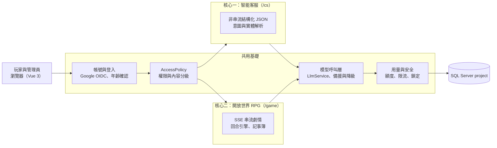

<!-- col -->

| | 客服 | RPG |
|---|---|---|
| 模型 | Gemini | OpenAI 相容端點 |
| 輸出 | 非串流 JSON | SSE 串流與打字機 |
| 記憶 | 摘要＋最近 10 輪＋狀態 | 記事簿＋最近 10 輪＋世界狀態 |
| 額度 | 每日輪數、每分鐘訊息數 | 遊戲幣（一輪 30 幣） |

---

<!-- layout: stack -->
<!-- dmax: 410 -->
<!-- tag: 03 ARCHITECTURE -->
<!-- src: docs/系統架構-architecture.md 第 1 節 -->

## 系統全景

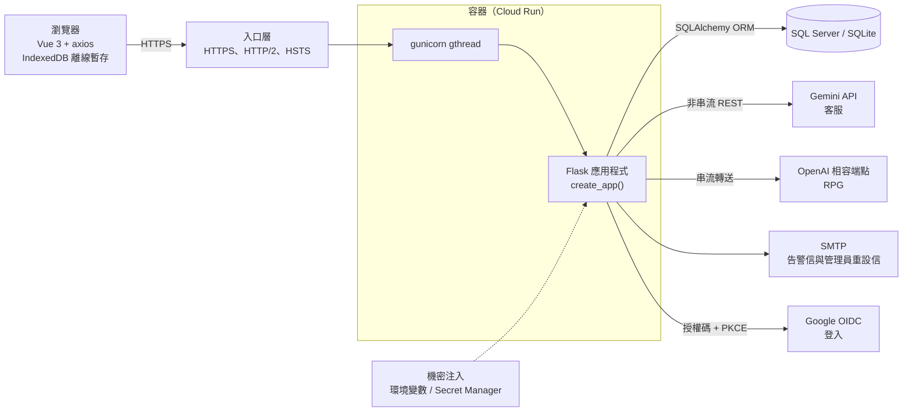

<!-- col -->

- 瀏覽器只載入**本機資產**（static/vendor、static/fonts），不使用任何 CDN。
- **所有狀態都在資料庫**：多個 worker 之間沒有行程內共用狀態（限流、處理標記、斷路都存資料庫）。
- 模型供應商**可替換**：業務程式只認得 app/llm/types.py 的中立型別。
- 機密只由環境變數或平台機密注入，不進版本庫、日誌與前端。

---

<!-- tag: 04 LAYERS -->
<!-- src: docs/系統架構-architecture.md 第 2 節；tests/architecture/test_layering.py -->

## 後端分層與依賴方向

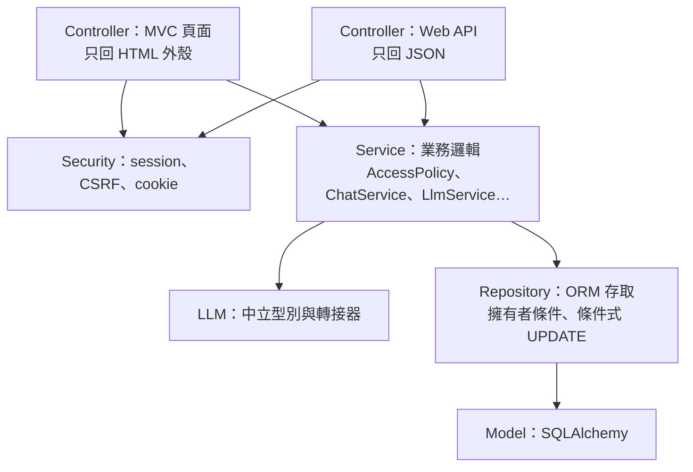

<!-- col -->

**以 AST 測試守住的規則**

| 層 | 禁止匯入 |
|---|---|
| Controller | Repository、db、models、sqlalchemy |
| Service | controllers、flask |
| Repository | services、controllers、flask |
| Model | services、repositories、controllers |
| LLM | 所有上層與 models |

另有：禁用 Raw SQL、業務程式不得出現供應商字樣、`AdminService` 每個方法先 `require_admin`。

---

<!-- size: 16 -->
<!-- tag: 05 STACK -->
<!-- src: AGENTS.md 第 2 至 5、9 節 -->

## 技術棧與規範

| 面向 | 技術與規範 |
|---|---|
| 前端 | Vue 3 全域變數模式（無 .vue、無打包）、Bootstrap 5.3（只用排版）、axios、原生 fetch＋ReadableStream；全部離線 |
| 後端 | Flask；MVC Page Controller、Web API Controller、Service、Repository 四層 |
| 資料庫 | SQLAlchemy ORM（禁止 Raw SQL）；SQLite 與 SQL Server 雙軌；Alembic（expand/contract，部署的獨立步驟） |
| 模型 | 客服 Gemini；RPG 用 OpenAI 相容端點；模型名稱皆為環境變數；429、5xx、逾時切備援，失敗回降級文案 |
| 安全 | Google OIDC＋PKCE；簽章 session cookie；CSRF；AccessPolicy 集中授權；非擁有者一律 404 |
| 部署 | Docker、gunicorn gthread、Cloud Run＋Cloud SQL＋Secret Manager；結構化 JSON 日誌 |
| 語系 | 全面繁體中文（zh-TW）與 UTF-8；字型 Noto Sans TC 自行託管 |

---

<!-- tag: 06 FRONTEND -->
<!-- src: docs/前端結構-frontend.md；AGENTS.md 第 2 節 -->

## 前端架構與視覺規範

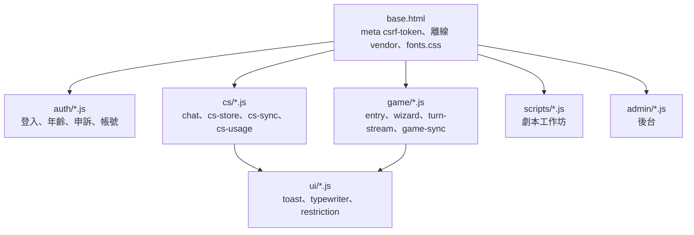

<!-- col -->

**Cinematic Dark Minimalist**

| 用途 | 色碼 |
|---|---|
| 主背景 |  `#0F1012` |
| 主要文字 |  `#E2E4E9` |
| 次要文字 |  `#8A8F99` |
| 焦點 |  `#FF6B35` |
| 分隔線 |  `#2A2D34` |

Modal、Toast、Sidebar 的顯示狀態由 Vue 完全接管；不使用 Bootstrap 的 JavaScript 外掛。

---

<!-- layout: stack -->
<!-- dmax: 330 -->
<!-- tag: 07 DATABASE -->
<!-- src: docs/project資料結構文件.md 第 1、2 節 -->

## 資料庫概覽：SQL Server project

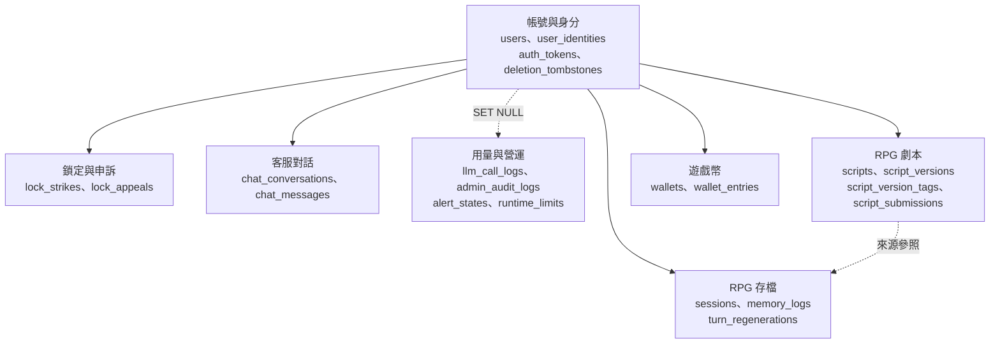

<!-- col -->

| 項目 | 內容 |
|---|---|
| 程式碼 | 21 表、249 欄、18 外鍵（0018） |
| 實際資料庫 | 0017：20 表、234 欄；0018 待備份後套用 |
| 型別與識別碼 | NVARCHAR、DATETIME2(6) 存 UTC、JSON 欄位；對外只用 public_id（UUID） |

完整的 Schema、ERD 與逐欄資料字典：`docs/project資料結構文件.md`

---

<!-- ratio: 1.3:0.7 -->
<!-- tag: 08 ERD -->
<!-- src: docs/project資料結構文件.md 第 3、4 節（此處只畫主要關聯；完整的 erDiagram 見該文件第 3 節）-->

## 核心實體關聯圖（簡化）

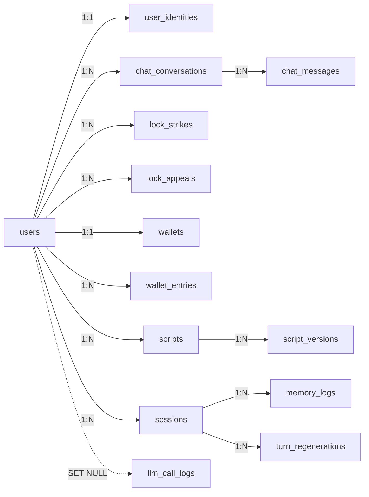

<!-- col -->

- 完整的 `erDiagram`（含每個欄位）在 `docs/project資料結構文件.md` 第 3 節。
- 刪除帳號：**CASCADE** 讓內容真的消失，只有用量帳本與稽核變空值保留。
- 唯一的抹除出口：`AccountErasureService`，並寫入 `deletion_tombstones`。
- 可為空的唯一欄位以「非 NULL 列的部分唯一索引」處理，兩種資料庫行為一致。

---

<!-- tag: 09 LOGIN FLOW -->
<!-- src: docs/帳號與安全-auth-security.md 第 4 節；app/services/google_sign_in_service.py -->

## 登入與註冊（1）：Google 登入即註冊

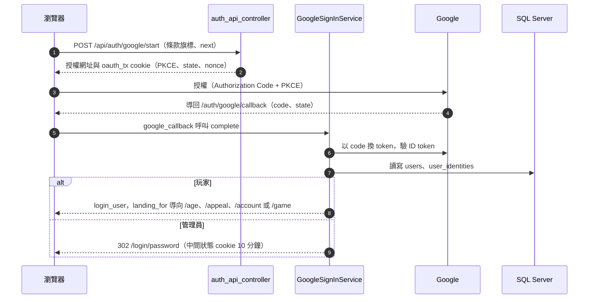

---

<!-- layout: diagram -->
<!-- tag: 10 LOGIN DIAGRAM -->
<!-- src: docs/登入與註冊架構圖解.png；圖示為 Azure Architecture Icons，僅作元件符號 -->

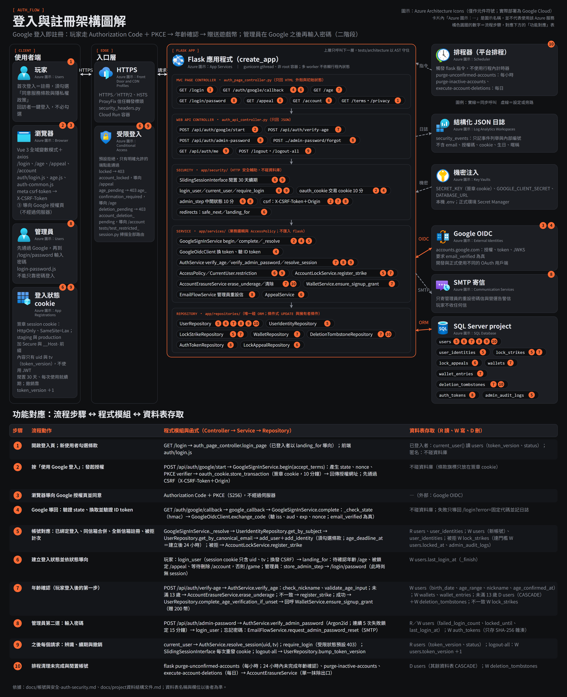

<!-- col -->

## 登入與註冊（2）：架構圖解

- 圖的欄位依序是使用者端、入口層、Flask 四層、資料與外部服務。
- 橘色數字是流程步驟 ①～⑩，標在用到它的模組與資料表上。
- 虛線是設定或旁路（機密、日誌、SMTP、排程）。
- 完整圖含「功能對應」表，見 `docs/登入與註冊架構圖解.png`。

---

<!-- tag: 11 LOGIN MAPPING -->
<!-- src: docs/登入與註冊架構圖解.png 的功能對應表；R 讀、W 寫、D 刪 -->

## 登入與註冊（3）：流程步驟 ↔ 程式 ↔ 資料表

| 步驟 | 動作 | 主要程式 | 資料表 |
|---|---|---|---|
| 1 | 開登入頁、勾選條款 | `login_page`、`login.js` | 匿名不碰資料庫 |
| 2 | 發起 Google 授權 | `/api/auth/google/start` → `GoogleSignInService.begin` | — |
| 3 | 導向 Google 並同意 | Authorization Code ＋ PKCE | — |
| 4 | 驗 state、換並驗證 ID token | `google_callback` → `complete` → `exchange_code` | — |
| 5 | 帳號對應：登入、合併、註冊、被拒計次 | `_resolve`、`UserRepository`、`UserIdentityRepository`、`register_strike` | R/W `users`、`user_identities`、`lock_strikes` |
| 6 | 建立登入狀態並導向 | `login_user`、`landing_for`、`store_admin_step` | W `users.last_login_at` |
| 7 | 年齡確認與贈幣 | `AuthService.verify_age`、`erase_underage`、`ensure_signup_grant` | W `users`、`wallets`、`wallet_entries`、`deletion_tombstones` |
| 8 | 管理員輸入密碼 | `verify_admin_password`（Argon2id） | R/W `users`、W `auth_tokens` |
| 9 | 每個請求辨識與續期 | `current_user`、`resolve_session`、`bump_token_version` | R `users` |
| 10 | 排程清理 | `purge-unconfirmed-accounts`（每小時）、`AccountErasureService` | D `users`、W `deletion_tombstones` |

---

<!-- tag: 12 ACCOUNT STATES -->
<!-- src: docs/帳號與安全-auth-security.md 第 1、7b 節 -->

## 帳號狀態與受限登入

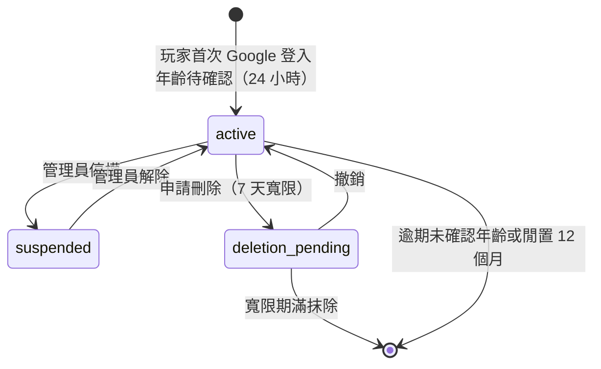

<!-- col -->

**受限登入狀態：預設拒絕**

| 狀態 | 拒絕代碼 | 導向 |
|---|---|---|
| locked | account_locked | /appeal |
| age_pending | age_confirmation_required | /age |
| deletion_pending | account_deletion_pending | /account |

只有明確允許的端點能通過；`test_restricted_session.py` 掃描全部路由證明這點。

---

<!-- size: 17 -->
<!-- tag: 13 SECURITY -->
<!-- src: AGENTS.md 第 10 節；docs/帳號與安全-auth-security.md -->

## 身分驗證與安全機制

| 面向 | 機制 |
|---|---|
| 登入 | Authorization Code＋PKCE、state、nonce；驗 iss、aud、exp；email_verified 為真 |
| Session | 簽章 cookie，內容只有 uid 與 tv；閒置 30 天滑動續期；撤銷靠 token_version 加 1 |
| CSRF | 非 GET 請求驗證 X-CSRF-Token 與 Origin |
| 管理員 | Google 之後再輸入密碼；連續 5 次失敗鎖 15 分鐘；高風險操作重新輸入密碼並寫稽核 |
| 鎖定 | 登入被拒 5 次或洗版 10 次（15 分鐘）→ 鎖定，只有管理員能解除，可申訴 |
| 年齡 | 由生日計算；未滿 13 歲立即抹除；13 至 17 歲固定安全模式 |
| 授權 | AccessPolicy 集中判斷；非擁有者一律 404；管理員讀他人資料走專用 Repository 並寫稽核 |
| 日誌 | 結構化 JSON；不記 email、cookie、授權碼、生日與使用者文字 |

---

<!-- tag: 14 CS CYCLE -->
<!-- src: docs/客服對話-chat-service.md 第 2 節；app/services/chat_service.py -->

## 客服對話的完整週期

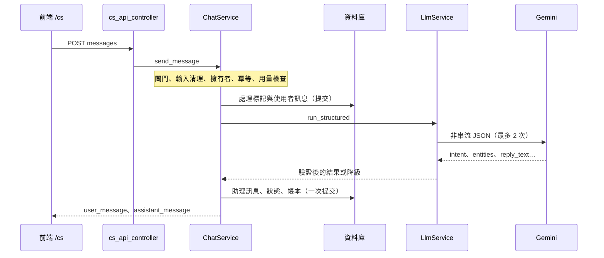

---

<!-- layout: diagram -->
<!-- tag: 15 MCP DIAGRAM -->
<!-- src: docs/MCP架構圖解.png；docs/RPG.md R-16；AGENTS.md 第 10 節 -->

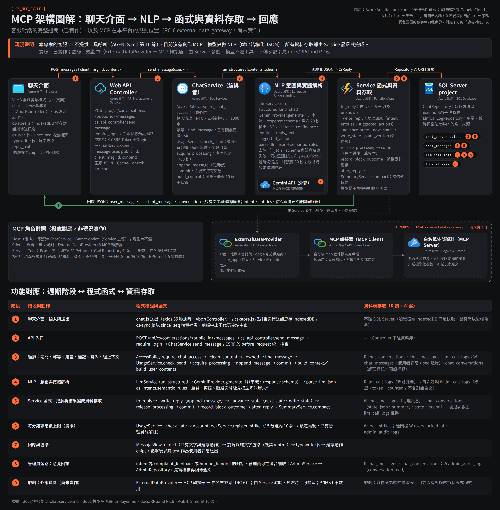

---

<!-- tag: 16 MCP MAPPING -->
<!-- src: docs/MCP架構圖解.png 的功能對應表；R 讀、W 寫 -->

## 週期階段 ↔ 程式函式 ↔ 資料存取

| 階段 | 動作 | 主要函式 | 資料表 |
|---|---|---|---|
| ① | 聊天介面輸入與送出 | `chat.js`、`cs-store.js`、`cs-sync.js`（since_seq 補齊） | 只有瀏覽器 IndexedDB 快取 |
| ② | API 入口 | `cs_api_controller.send_message`、`require_login`、CSRF | — |
| ③ | 編排 | `require_chat_access`、`find_message`、`check_send`、`acquire_processing`、`build_context` | R/W `chat_messages`、`chat_conversations`；R `llm_call_logs` |
| ④ | NLP 意圖與實體解析 | `LlmService.run_structured`、`GeminiProvider.generate`、`parse_llm_json` | R/W `llm_call_logs` |
| ⑤ | Service 函式與資料存取 | `to_reply`、`_write_reply`、`_advance_state`、`SummaryService.compact` | W `chat_messages`、`chat_conversations` |
| ⑥ | 洗版鎖定 | `_check_rate`、`register_strike` | W `lock_strikes`、`users` |
| ⑦ | 回應與渲染 | `MessageView.to_dict`、`typewriter.js`、建議動作 chips | — |

---

<!-- tag: 17 NLP -->
<!-- src: docs/模型呼叫層-llm-layer.md；app/services/llm_service.py -->

## NLP 結構化輸出、重試與降級

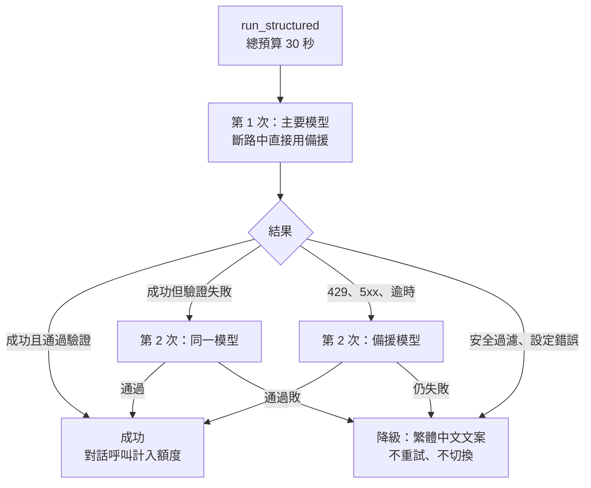

<!-- col -->

- 強制 JSON：intent、confidence、entities、reply_text、suggested_actions；Service 層重新驗證，不信任模型輸出。
- 信心低於 0.6 改為 unknown；回覆須含中文且不得含洩漏標記。
- 每次呼叫一筆帳本，**不含對話全文**；失敗原文截斷 2000 字，保存 14 天。
- 呼叫期間不持有資料庫交易。

---

<!-- layout: stack -->
<!-- dmax: 330 -->
<!-- tag: 18 USAGE -->
<!-- src: docs/客服對話-chat-service.md 第 3 節；app/services/quota_policy.py -->

## 用量與安全限制

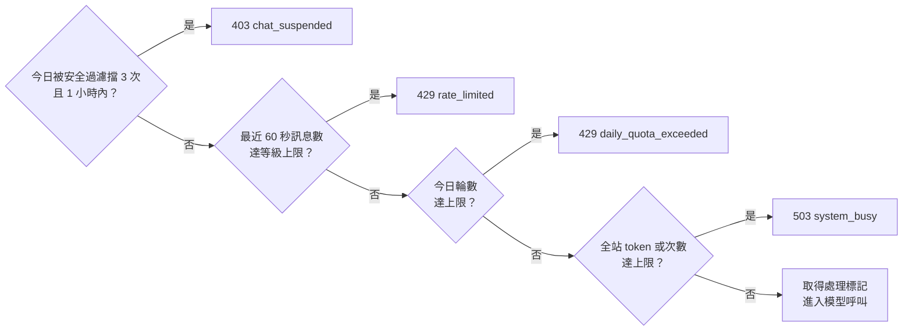

已有回覆的重送：直接回傳既有回覆，**不檢查、不計數**。檢查順序＝暫停 → 每分鐘 → 每日輪數 → 全站用量。

<!-- col -->

| 等級 | free | plus | vip |
|---|---|---|---|
| 每日輪數 | 30 | 100 | 300 |
| 每分鐘訊息 | 6 | 10 | 20 |
| 對話數 | 20 | 100 | 500 |
| 記事簿字數 | 2000 | 5000 | 10000 |

等級只影響額度，不影響權限。

---

<!-- tag: 19 RPG ENGINE -->
<!-- src: docs/系統架構-architecture.md「RPG 回合引擎」；docs/RPG.md -->

## RPG 回合引擎：串流、審查與結算

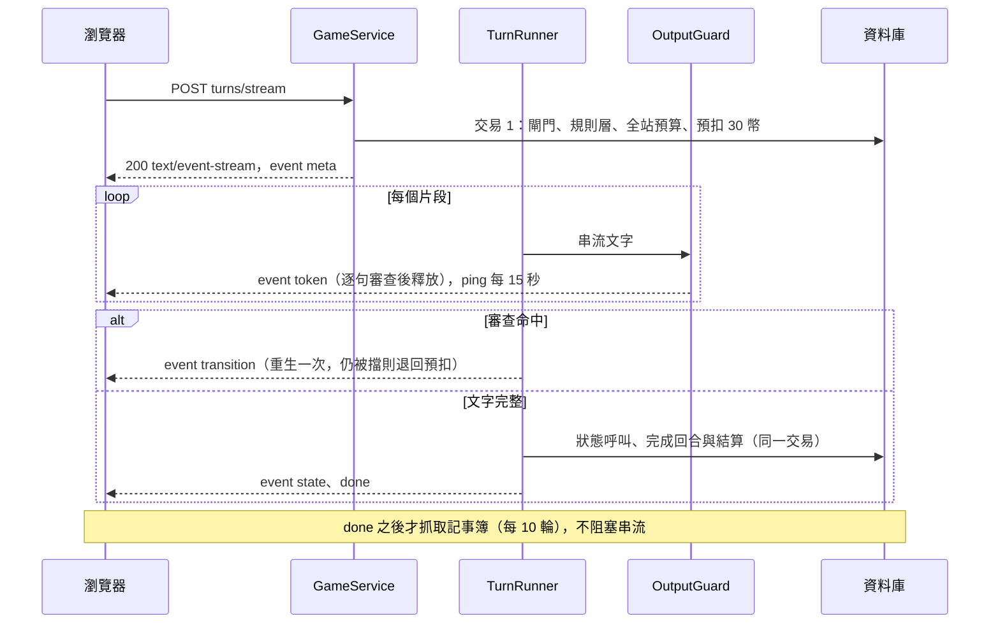

---

<!-- layout: stack -->
<!-- tag: 20 CONTENT TIERS -->
<!-- src: AGENTS.md 第 7、10 節；docs/帳號與安全-auth-security.md 第 5 節 -->

## 內容分級與輸出審查

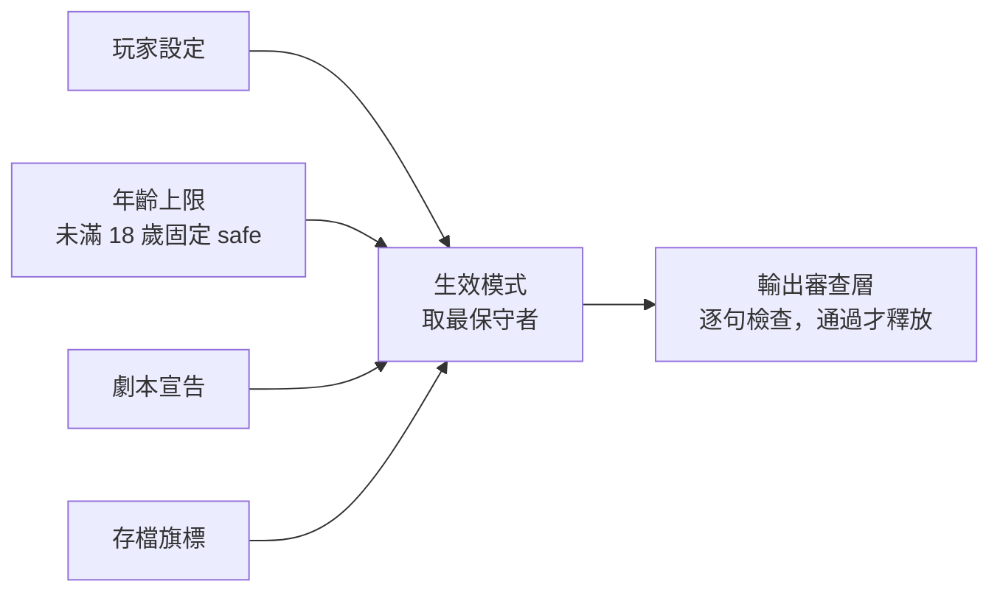

| 模式 | 範圍 |
|---|---|
| safe | 無性行為與性暗示；牽手、擁抱、簡短親吻允許 |
| standard | 浪漫、曖昧與感官；性行為與器官只能淡出或暗示 |
| adult | 成年角色合意的露骨內容；須供應商許可、部署層開啟、玩家成年確認 |

無論模式，涉及未成年、性暴力、非自願與真人名義的性內容一律禁止，由伺服器端審查層執行。

---

<!-- layout: stack -->
<!-- dmax: 300 -->
<!-- tag: 21 SCRIPTS -->
<!-- src: docs/系統架構-architecture.md「劇本創作與審查」；docs/路線圖-roadmap.md -->

## 玩家創作劇本與兩層審查

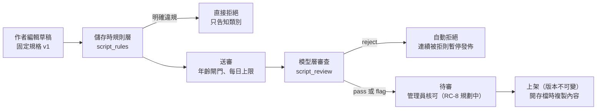

<!-- col -->

- 模型不可用、預算用盡、降級或被擋，**一律不放行**。
- 劇本屬於作者；暱稱與筆名在第一次發佈時鎖定。
- 劇本數與送審次數依等級，存資料庫設定表，以 flask 指令調整並寫稽核。

---

<!-- size: 16 -->
<!-- tag: 22 NOTEBOOK COINS -->
<!-- src: AGENTS.md 第 6、7 節；docs/RPG.md 第 7 章 -->

## 記事簿、遊戲幣與重新生成

| 功能 | 規則 | 狀態 |
|---|---|---|
| 記事簿 | 每存檔一本；容量 2000／5000／10000 字，另有 25% 預備空間（只供 AI 寫入）；每完成 10 輪由 RPG 模型抓重點追加；玩家可編輯但不得超量 | 已封存 |
| 遊戲幣 | 一輪 30 幣；首登送 200、每日簽到 200（台灣時間 0 點刷新）；免費幣上限 1000；先扣免費再扣付費；預扣、結算、退回皆冪等 | 已封存 |
| 第 0 幕 | 創角後的開場；不是一輪、不扣幣 | 已封存 |
| 重新生成與編輯 | 只能動最後一輪；每回合前 2 次免費（兩者合計），第 3 次起每次 30 幣；重新生成須選分類並填理由；通過審查才原子替換 | 實作中（23／33） |

---

<!-- tag: 23 PRIVACY -->
<!-- src: docs/project資料結構文件.md 第 9 節；AGENTS.md 第 11 節 -->

## 個資、保存與刪除

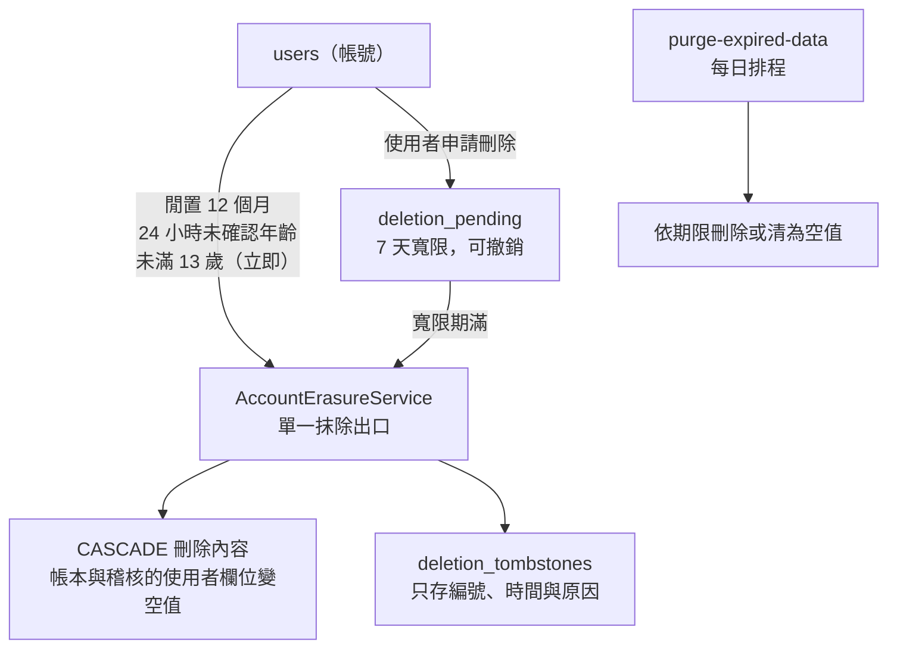

<!-- col -->

| 資料 | 保存期限 |
|---|---|
| 對話與訊息 | 最後訊息後 12 個月 |
| 模型呼叫帳本 | 12 個月；失敗原文 14 天 |
| 管理稽核紀錄 | 24 個月 |
| 應用程式日誌 | 30 天 |
| 備份 | 30 天，還原後依 tombstones 重新抹除 |

---

<!-- layout: stack -->
<!-- dmax: 360 -->
<!-- tag: 24 DEPLOYMENT -->
<!-- src: docs/營運與部署-operations.md；AGENTS.md 第 9 節 -->

## 部署與營運

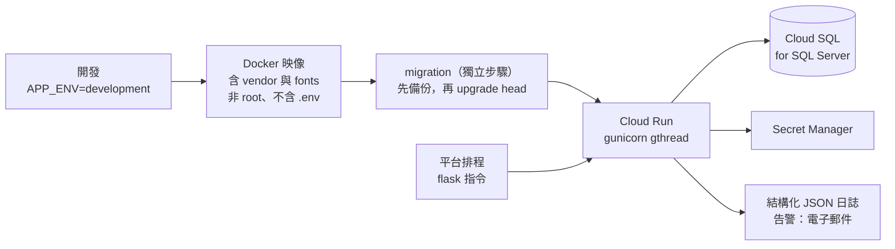

<!-- col -->

- 以 `APP_ENV` 選設定；未設定拒絕啟動；staging 與 production 缺機密即啟動失敗。
- migration **不在應用程式啟動時執行**。
- **雲端環境尚未建立**：沒有可計費的 Google Cloud 專案，目前只完成本機預演（C-5b）。

---

<!-- size: 17 -->
<!-- tag: 25 QUALITY -->
<!-- src: docs/營運與部署-operations.md 第 6 節；tests/ -->

## 品質保證與守門測試

| 層次 | 內容 |
|---|---|
| 單元與整合 | pytest 收集 10,510 案例；SQLite 與 SQL Server 雙軌（SQL Server 以 sqlserver 標記） |
| 前端 | Node 內建測試 1,091 案例（node --test）全數通過 |
| 架構 | tests/architecture：以 AST 檢查分層、後台邊界、無 Raw SQL、前端規則 |
| 文件守門 | test_design_docs、test_project_db_schema_doc：資料表、欄位、路由、migration 與文件逐項一致 |
| 驗收 | 假模型伺服器與 HTTP 驗收腳本、容器驗收、瀏覽器人工驗收 |
| 規格 | OpenSpec 81 份主規格；change 以 validate --strict 驗證後才封存 |

---

<!-- layout: stack -->
<!-- dmax: 170 -->
<!-- tag: 26 ROADMAP -->
<!-- src: docs/路線圖-roadmap.md；openspec/changes/ -->

## 路線圖與進度

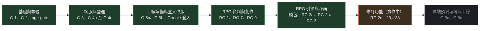

<!-- col -->

| 狀態 | change |
|---|---|
| 已封存（23） | platform-foundation、member-auth、age-gate、age-verification-birthdate、cs-chat-core、usage-limits、admin-console、openai-compatible-provider、privacy-lifecycle、ops-alerting、launch-readiness、staging-deployment、google-first-login、remove-player-password-auth、rpg-data-and-script、rpg-script-authoring、rpg-character-creation、game-wallet、rpg-notebook、rpg-turn-engine、rpg-entry-ui、story-preference、rpg-game-ui |
| 實作中 | rpg-turn-revision（23／33）：剩下共用免費次數的後端、前端、政策頁與驗收腳本，以及瀏覽器重驗、破壞驗證、全套測試與文件同步 |
| 規劃中 | cloud-staging-run（等可計費專案）、production-launch、rpg-script-publishing、external-data-gateway、rpg-ops-loadtest、rpg-persona-library、player-hub、order-integration |

---

<!-- size: 16 -->
<!-- tag: 27 LIMITS -->
<!-- src: docs/路線圖-roadmap.md 第 2 節；AGENTS.md 第 7、11 節 -->

## 已知限制與待決事項

| 項目 | 現況 |
|---|---|
| MCP | **未實作**；客服 v1 不提供工具呼叫；外部資料閘道（RC-6）規劃中，由 Service 發動 |
| 雲端環境 | 沒有可計費的 Google Cloud 專案；僅完成本機預演；cloud-staging-run 等前提 |
| 資料庫 0018 | 程式與測試已就緒；實際 `project` 仍在 0017，須備份後套用 |
| 模型供應商 | 客服 Gemini 為過渡；正式對外前須重新評估資料使用條款與付費方案；免費模型不得輸入真實個資 |
| 成人模式 | 程式鎖定；須供應商書面許可、法務意見與部署層開啟 |
| 金流與訂閱 | 尚待探索；遊戲幣目前只能由簽到與贈幣取得 |
| 劇本上架 | 先審後發的管理員審核、目錄與檢舉（RC-8）規劃中 |
| 入口層限流 | IP 限流尚未做，列為上線前關卡 |
| 法務 | 條款、隱私權政策、內容規範與檢舉處理列入法務覆核 |

---

<!-- size: 17 -->
<!-- tag: 28 DOCS -->
<!-- src: docs/README.md -->

## 文件索引與結語

| 文件 | 內容 |
|---|---|
| 系統架構-architecture.md | 全景、分層、請求生命週期、依賴注入 |
| project資料結構文件.md | **Database Schema、ERD、Data Dictionary**（逐欄字典，隨資料庫同步） |
| 帳號與安全-auth-security.md | 登入、session、CSRF、年齡閘門、權限 |
| 客服對話-chat-service.md | 客服端點、送出流程、冪等、用量、摘要 |
| 模型呼叫層-llm-layer.md | 重試、備援、斷路、帳本、提示詞 |
| 前端結構-frontend.md | 資產、模組、暫存與同步 |
| 營運與部署-operations.md | 環境、容器、日誌、維運指令、測試分層 |
| 登入與註冊架構圖解.png、MCP架構圖解.png | 以 Azure 圖示設計的關聯圖與功能對應 |

**結語**：兩個核心共用同一套可驗證的基礎；客服已可獨立運作，RPG 已具備完整的創作、遊玩與營運骨架，下一步是補完修訂功能、建立雲端預備環境並完成法務覆核。
