<!-- layout: cover -->
<!-- tag: PROJECT REPORT 2.0 -->

# 雙核心平台 2.0 簡報

### 開放世界文字 RPG × 會員制智能客服機器人

> 專案狀態報告｜2026-11-24｜Flask ・ Vue 3 ・ SQL Server ・ LLM ・ AWS 展示環境

<!-- src: 本簡報以 docs/ 設計文件與程式碼為準；Mermaid 圖可在 GitHub 與 VS Code 預覽，PDF 由 docs/diagrams/build_deck.py 產生、PowerPoint（2.1簡報.pptx）由 docs/diagrams/build_pptx.py 產生，給主管與評審的 15 張精簡版（大字）在 docs/4.0簡報.pptx（2026-11-22 的快照）與 docs/5.0簡報.pptx（2026-11-24 的重點版），分別由 docs/diagrams/build_pptx_40.py 與 build_pptx_50.py 產生，6 張 Azure 圖示架構圖解由 docs/diagrams/ 產生（4K PNG） -->

---

<!-- tag: 01 SUMMARY -->
<!-- src: README.md、docs/路線圖-roadmap.md；數字取自 2026-11-24 的程式碼與 git 紀錄（計法與 1.0 相同） -->

## 專案摘要：一個平台、兩個核心

- **目標**：以 LLM 驅動的「開放世界文字 RPG」與「會員制智能客服」共用同一套帳號、年齡閘門、模型呼叫層與用量控制。
- **現況**：客服核心、營運後台與 RPG 的創作、創角、回合引擎、記事簿、遊戲幣、遊戲畫面、重新生成與編輯皆已封存；2026-11-17 起又封存 **AWS 展示環境**、全站**只限滿 18 歲**、**安全模式開／關**、**錢包頁**、管理員帳號不消耗遊戲幣，以及玩家創作劇本的**審核、公開目錄、檢舉與匿名保留**；2026-11-23 至 11-24 再封存**視覺小說式遊戲畫面**（劇情卡、行動建議、直接推進劇情）、**登入後的三步設定精靈**與**管理員後台刪除帳號**；展示環境最新部署是 2026-11-24 的映像 `bb665dd`，資料庫在遷移 0023。
- **原則**：嚴格分層、離線前端（不用 CDN）、SQLite 與 SQL Server 雙軌、全面繁體中文與 UTF-8、個資最小化。
- **文件**：每個設計決策都有 OpenSpec 規格、設計文件與守門測試，圖與程式保持一致。

<!-- col -->

| 指標 | 數值 |
|---|---|
| 後端 | 186 個模組、約 2.9 萬行 Python |
| 前端 | 56 個 JS 模組、約 1.3 萬行；22 個模板 |
| 資料庫 | 22 張資料表、269 個欄位、23 個 migration |
| 介面 | 90 個 API 端點、21 個頁面路由、16 個維運指令 |
| 測試 | pytest 15,163 案例（通過 15,158、略過 5）；Node 1,872 案例全數通過 |
| 規格 | 103 份主規格；35 個 change 已封存（另有 1 個擱置：cloud-staging-run） |
| 歷程 | 278 次提交（2026-10-27 至 2026-11-24，不含簡報自己的提交） |

---

<!-- layout: stack -->
<!-- dmax: 150 -->
<!-- tag: 02 WHAT'S NEW -->
<!-- src: docs/路線圖-roadmap.md；openspec/changes/archive/（2026-11-17 至 2026-11-24 封存的 11 個 change） -->

## 從 1.0 到 2.0：八天內的五件事

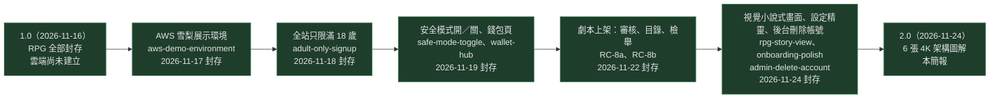

| 項目 | 1.0 | 2.0 |
|---|---|---|
| 主規格／已封存的 change | 83／24 | **103／35** |
| migration／資料表欄位 | 18／249 | **23／269**（新增年滿 18 歲聲明、安全模式提示、劇本審核、劇本檢舉與匿名保留偏好、行動建議） |
| pytest／Node | 10,544／1,099 | **15,163／1,872** |
| 提交 | 145 | **278** |
| 雲端 | 沒有可計費專案，只有本機預演 | **AWS 雪梨展示環境**（單機、兩個池分流、RDS；2026-11-24 部署映像 `bb665dd`），不是 production |
| 年齡與內容模式 | 13 歲以上可用（13 至 17 歲固定安全模式）；safe／standard／adult 三種，沒有介面可切換 | **只限滿 18 歲**；**安全模式開（預設）／關**兩種，個人頁可切換、劇本可綁定、部署層有緊急煞車 |

<!-- col -->

- **展示環境**：EC2 加 Caddy 入口，客服池與 RPG 串流池第一次真正分流，已對真實主機驗證；之後又經遷移 0019 至 0023 逐次部署，每次前先做 RDS 快照。
- **只限滿 18 歲與安全模式**：登入須勾選「我確認已滿 18 歲」（0019）；個人頁可關閉安全模式、劇本可綁定、部署層有緊急煞車（0020）。
- **劇本上架（RC-8）**：管理員審核與下架、公開目錄與詳情頁（0021）、檢舉與匿名保留（0022）都已部署。
- **視覺小說式遊戲畫面、設定精靈與刪除帳號（11-23 至 11-24）**：劇情依句分段、點擊翻段，行動建議點圖示才產生（0023）；`/age` 改為三步精靈；管理員可在後台立即刪除一個玩家帳號（需重新輸入密碼，寫稽核）。
- **6 張 4K 架構圖解**已隨現況更新，**全部輸出為 4K（寬 3840 像素）**。

---

<!-- layout: stack -->
<!-- tag: 03 POSITIONING -->
<!-- src: AGENTS.md 第 1、5、6、7 節 -->

## 雙核心平台定位

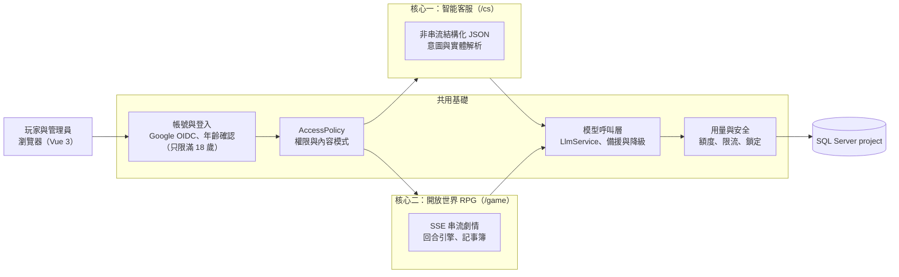

<!-- col -->

| | 客服 | RPG |
|---|---|---|
| 模型 | Gemini | OpenAI 相容端點 |
| 輸出 | 非串流 JSON | SSE 串流與打字機 |
| 記憶 | 摘要＋最近 10 輪＋狀態 | 記事簿＋最近 10 輪＋世界狀態 |
| 額度 | 每日輪數、每分鐘訊息數 | 遊戲幣（一輪 30 幣；管理員帳號不扣） |

---

<!-- layout: stack -->
<!-- dmax: 430 -->
<!-- tag: 04 ARCHITECTURE -->
<!-- src: docs/系統架構-architecture.md 第 1 節；docs/營運與部署-operations.md 第 8 節 -->

## 系統全景

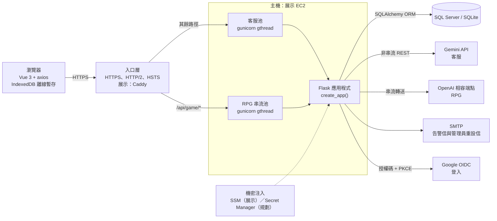

<!-- col -->

- 瀏覽器只載入**本機資產**（static/vendor、static/fonts），不使用任何 CDN。
- **所有狀態都在資料庫**：多個 worker 之間沒有行程內共用狀態（限流、處理標記、斷路都存資料庫）。
- **兩個池各司其職**：`/api/game/*` 到 RPG 串流池（不緩衝、不壓縮），其餘到客服池；展示環境已實際分流並驗證。
- 模型供應商**可替換**：業務程式只認得 app/llm/types.py 的中立型別。
- 機密只由環境變數或平台機密注入，不進版本庫、日誌與前端。

---

<!-- tag: 05 LAYERS -->
<!-- src: docs/系統架構-architecture.md 第 2 節；tests/architecture/test_layering.py -->

## 後端分層與依賴方向

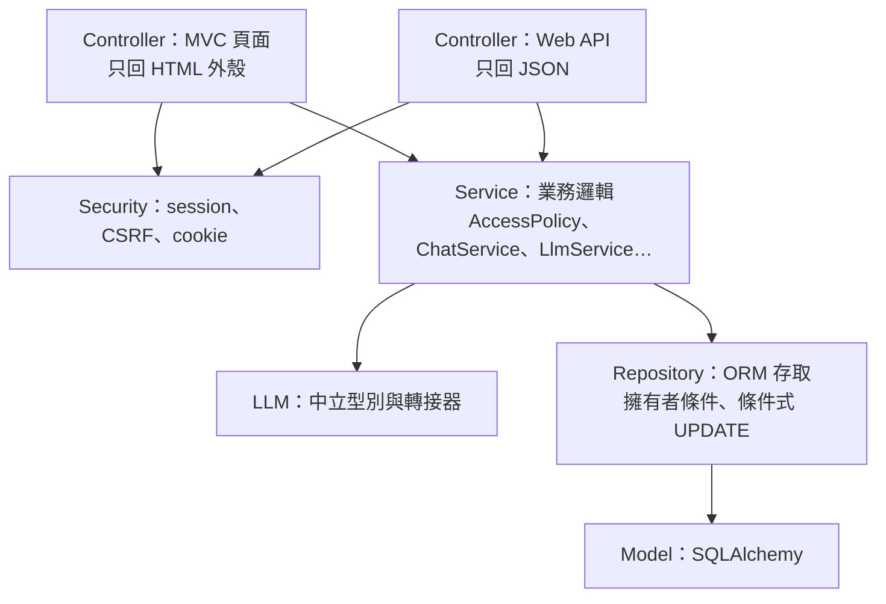

<!-- col -->

**以 AST 測試守住的規則**

| 層 | 禁止匯入 |
|---|---|
| Controller | Repository、db、models、sqlalchemy |
| Service | controllers、flask |
| Repository | services、controllers、flask |
| Model | services、repositories、controllers |
| LLM | 所有上層與 models |

另有：禁用 Raw SQL、業務程式不得出現供應商字樣、`AdminService` 每個方法先 `require_admin`。

---

<!-- size: 16 -->
<!-- tag: 06 STACK -->
<!-- src: AGENTS.md 第 2 至 5、9 節 -->

## 技術棧與規範

| 面向 | 技術與規範 |
|---|---|
| 前端 | Vue 3 全域變數模式（無 .vue、無打包）、Bootstrap 5.3（只用排版）、axios、原生 fetch＋ReadableStream；全部離線 |
| 後端 | Flask；MVC Page Controller、Web API Controller、Service、Repository 四層 |
| 資料庫 | SQLAlchemy ORM（禁止 Raw SQL）；SQLite 與 SQL Server 雙軌；Alembic（expand/contract，部署的獨立步驟） |
| 模型 | 客服 Gemini；RPG 用 OpenAI 相容端點；模型名稱皆為環境變數；429、5xx、逾時切備援，失敗回降級文案 |
| 安全 | Google OIDC＋PKCE；簽章 session cookie；CSRF；AccessPolicy 集中授權；非擁有者一律 404；全站只限滿 18 歲 |
| 部署 | Docker、gunicorn gthread；展示環境已在 AWS 雪梨運行（EC2＋RDS）；production 規劃為 Google Cloud |
| 語系 | 全面繁體中文（zh-TW）與 UTF-8；字型 Noto Sans TC 自行託管；RPG 的模型輸出另經簡轉繁處理（規格 `rpg-output-traditional-chinese`） |

---

<!-- tag: 07 FRONTEND -->
<!-- src: docs/前端結構-frontend.md；AGENTS.md 第 2 節 -->

## 前端架構與視覺規範

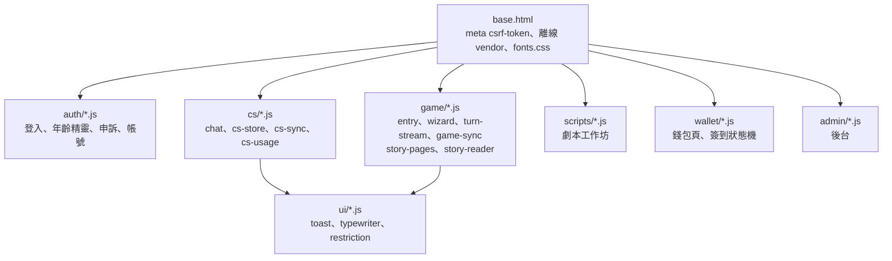

<!-- col -->

**Cinematic Dark Minimalist**

| 用途 | 色碼 |
|---|---|
| 主背景 |  `#0F1012` |
| 主要文字 |  `#E2E4E9` |
| 次要文字 |  `#8A8F99` |
| 焦點 |  `#FF6B35` |
| 分隔線 |  `#2A2D34` |

Modal、Toast、Sidebar 的顯示狀態由 Vue 完全接管；不使用 Bootstrap 的 JavaScript 外掛。

---

<!-- layout: stack -->
<!-- dmax: 330 -->
<!-- tag: 08 DATABASE -->
<!-- src: docs/project資料結構文件.md 第 1、2 節 -->

## 資料庫概覽：SQL Server project

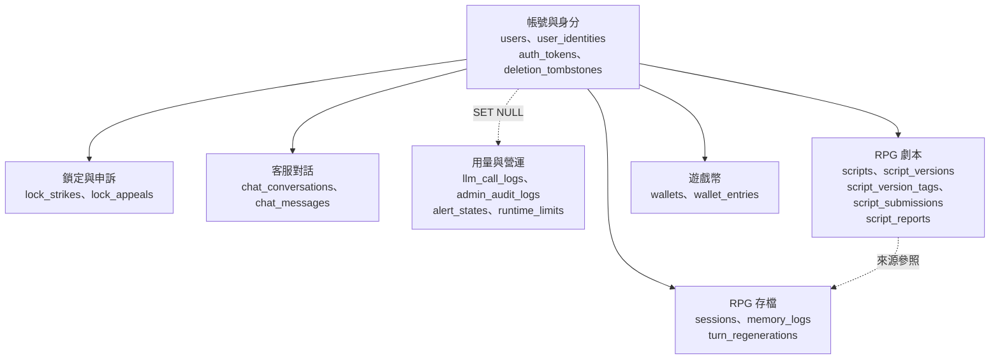

<!-- col -->

| 項目 | 內容 |
|---|---|
| 程式碼 | 22 表、269 欄、20 外鍵（0023：`sessions` 新增 `suggestions_json`，保存最近一次行動建議；0022：新增 `script_reports`、`users.keep_published_scripts`） |
| 實際資料庫 | 本機 `project` 在 0022（2026-11-22 備份後升級，0023 尚未套用）；展示環境的 RDS 在 0023（2026-11-23 升級；部署前快照 `rac-demo-staging-db-pre-787ee62`，回復點是快照、不降級資料庫） |
| 型別與識別碼 | NVARCHAR、DATETIME2(6) 存 UTC、JSON 欄位；對外只用 public_id（UUID） |

完整的 Schema、ERD 與逐欄資料字典：`docs/project資料結構文件.md`

---

<!-- ratio: 1.3:0.7 -->
<!-- tag: 09 ERD -->
<!-- src: docs/project資料結構文件.md 第 3、4 節（此處只畫主要關聯；完整的 erDiagram 見該文件第 3 節）-->

## 核心實體關聯圖（簡化）

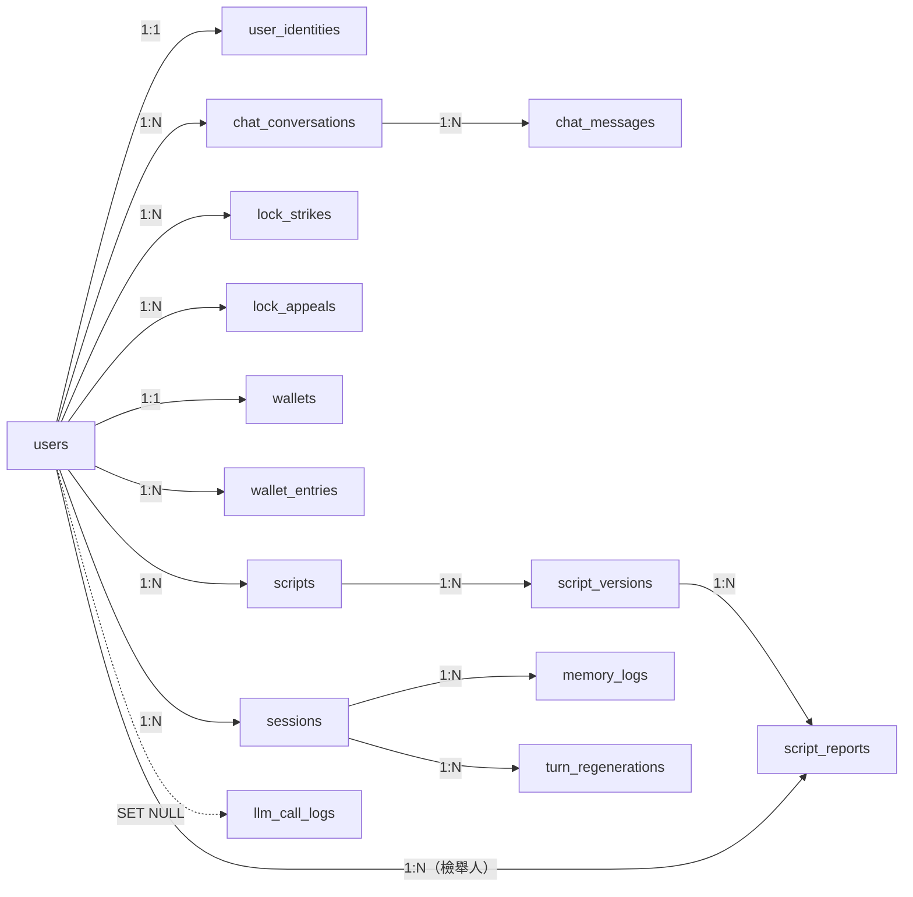

<!-- col -->

- 完整的 `erDiagram`（含每個欄位）在 `docs/project資料結構文件.md` 第 3 節。
- 刪除帳號：**CASCADE** 讓內容真的消失，只有用量帳本與稽核變空值保留；偏好「匿名保留」開啟者的上架劇本版本例外（作者關聯清空，筆名改為「已註銷的作者」）。
- 唯一的抹除出口：`AccountErasureService`，並寫入 `deletion_tombstones`；管理員在後台刪除帳號（立即、劇本全刪）也走同一個出口。
- 可為空的唯一欄位以「非 NULL 列的部分唯一索引」處理，兩種資料庫行為一致。

---

<!-- layout: diagram -->
<!-- tag: 10 SITE ENTRY -->
<!-- src: docs/網站入口架構圖解.png；docs/營運與部署-operations.md 第 2、8 節；app/__init__.py -->

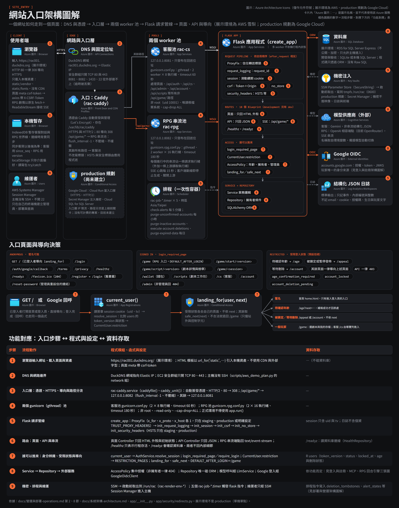

<!-- col -->

## 網站入口（1）：從網址到 Flask

- 圖的欄位依序是使用者端、網路與入口層、兩個 worker 池、Flask 請求管線、資料與外部服務。
- **入口層**：DuckDNS 網域指向 Elastic IP；安全群組只開 80 與 443；Caddy 自動簽發憑證、HTTP/2、80 一律 308 導向 HTTPS。
- **分流**：`/api/game/*` 到 RPG 串流池（不緩衝、不壓縮），其餘到客服池；兩個池只聽回送位址。
- **請求管線**：ProxyFix → 請求日誌 → session → CSRF → no-store → 安全標頭，之後才進路由。
- 完整圖含「功能對應」表，見 `docs/網站入口架構圖解.png`（4K）。

---

<!-- layout: diagram -->
<!-- tag: 11 SITE ENTRY ROUTES -->
<!-- src: docs/網站入口架構圖解.png 的下半部；app/security/redirects.py；app/controllers/*_page_controller.py -->

<!-- col -->

## 網站入口（2）：誰能進哪個頁面

- **匿名可進**：首頁、登入頁、Google 回呼、條款、隱私權政策、`/healthz`、`/readyz`。
- **登入後**：`/game`（RPG 入口，登入後的預設頁面）、`/game/script/<版本>`（劇本詳情與檢舉）、`/wallet`（錢包）、`/scripts`、`/cs`、`/account`；`/admin` 非管理員回 404。
- **受限狀態預設拒絕**：待確認年齡去 `/age`、被鎖定去 `/appeal`、等待刪除去 `/account`；API 一律 403 並附固定代碼。
- 導向只有一個函式 `landing_for`，預設頁面只改一個常數；`next` 只接受站內路徑。

---

<!-- size: 14 -->
<!-- tag: 12 SITE ENTRY MAPPING -->
<!-- src: docs/網站入口架構圖解.png 的功能對應表；R 讀、W 寫 -->

## 網站入口（3）：入口步驟 ↔ 程式與設定 ↔ 資料存取

| 步驟 | 動作 | 主要程式與設定 | 資料存取 |
|---|---|---|---|
| 1 | 輸入網址、載入頁面與本機資產 | 模板以 `url_for('static', …)`；meta `csrf-token` | 不碰資料庫 |
| 2 | DNS 與網路邊界 | DuckDNS → Elastic IP；安全群組只開 TCP 80、443；沒有 SSH | — |
| 3 | 入口層：憑證、HTTPS、分流 | `rac-caddy.service`（`caddyfile()`）：Let's Encrypt、HTTP/2、80→308；`/api/game/*` → 8082，其餘 → 8081 | — |
| 4 | 兩個 gunicorn（gthread）池 | `gunicorn.conf.py`（2×8、timeout 60）；`gunicorn.rpg.conf.py`（2×16、timeout 180）；非 root、唯讀 | — |
| 5 | Flask 請求管線 | `create_app`：ProxyFix → `init_request_logging` → `init_session` → `init_csrf` → `init_no_store` → `init_security_headers` | session 只含 uid、tv |
| 6 | 路由：頁面、API、串流 | 頁面只回 HTML；API 只回 JSON；RPG 串流回 `text/event-stream`；`/healthz` 存活、`/readyz` 查資料庫 | `/readyz`：讀資料庫連線 |
| 7 | 身分辨識、受限狀態與導向 | `current_user`、`login_required_page`、`landing_for`、`safe_next`、`DEFAULT_AFTER_LOGIN`＝`/game` | R `users` |
| 8 | Service → Repository → 外部服務 | `AccessPolicy` 集中授權；Repository 唯一碰 ORM；模型經 `LlmService` | 依功能而定 |
| 9 | 機密、排程與維運 | SSM → 啟動前取出到 `/run/rac`；五個 `rac-job-*.timer`；維運者只經 Session Manager | `deletion_tombstones`、`alert_states` 等 |

---

<!-- tag: 13 LOGIN FLOW -->
<!-- src: docs/帳號與安全-auth-security.md 第 4 節；app/services/google_sign_in_service.py -->

## 登入與註冊（1）：Google 登入即註冊

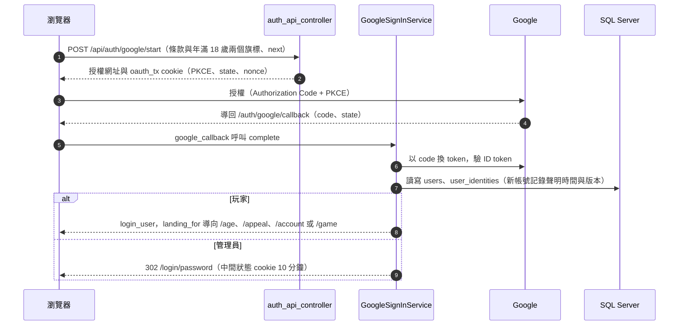

---

<!-- layout: diagram -->
<!-- tag: 14 LOGIN DIAGRAM -->
<!-- src: docs/登入與註冊架構圖解.png；圖示為 Azure Architecture Icons，僅作元件符號 -->

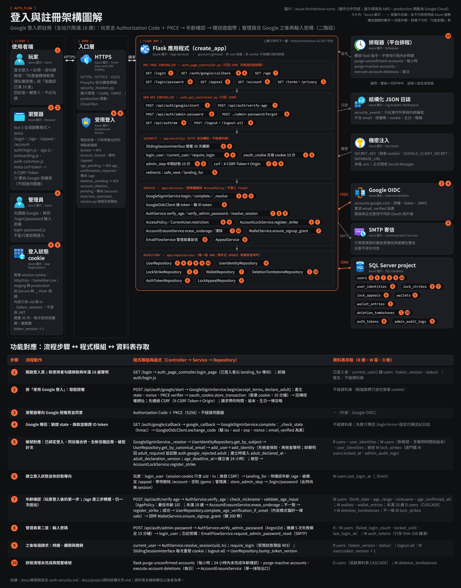

<!-- col -->

## 登入與註冊（2）：架構圖解

- 圖的欄位依序是使用者端、入口層、Flask 四層、資料與外部服務。
- 橘色數字是流程步驟 ①～⑩，標在用到它的模組與資料表上。
- **2.0 更新**：新使用者須勾選兩項（條款、我確認已滿 18 歲，登入頁另有「全部同意」總開關）；缺聲明不建立帳號並記錄 `auth.google_rejected.adult`。
- **登入後的設定精靈**：`/age` 改為三步（歡迎與使用守則、年齡確認、故事偏好），送出仍是一次；故事偏好在年齡確認成功之後才存。
- 完整圖含「功能對應」表，見 `docs/登入與註冊架構圖解.png`（4K）。

---

<!-- size: 14 -->
<!-- tag: 15 LOGIN MAPPING -->
<!-- src: docs/登入與註冊架構圖解.png 的功能對應表；R 讀、W 寫、D 刪 -->

## 登入與註冊（3）：流程步驟 ↔ 程式 ↔ 資料表

| 步驟 | 動作 | 主要程式 | 資料表 |
|---|---|---|---|
| 1 | 開登入頁、勾選條款與年滿 18 歲聲明 | `login_page`、`login.js` | 匿名不碰資料庫 |
| 2 | 發起 Google 授權 | `/api/auth/google/start` → `GoogleSignInService.begin(accept_terms, declare_adult)` | — |
| 3 | 導向 Google 並同意 | Authorization Code ＋ PKCE | — |
| 4 | 驗 state、換並驗證 ID token | `google_callback` → `complete` → `exchange_code` | — |
| 5 | 帳號對應：登入、合併、註冊（先驗條款、再驗聲明）、被拒計次 | `_resolve`、`UserRepository`、`UserIdentityRepository`、`register_strike` | R/W `users`（含 `adult_declared_at`）、`user_identities`、`lock_strikes` |
| 6 | 建立登入狀態並導向 | `login_user`、`landing_for`、`store_admin_step` | W `users.last_login_at` |
| 7 | 年齡確認與贈幣（未滿 18 歲立即抹除） | `AuthService.verify_age`、`erase_underage`、`ensure_signup_grant` | W `users`、`wallets`、`wallet_entries`、`deletion_tombstones` |
| 8 | 管理員輸入密碼 | `verify_admin_password`（Argon2id） | R/W `users`、W `auth_tokens` |
| 9 | 每個請求辨識與續期 | `current_user`、`resolve_session`、`bump_token_version` | R `users` |
| 10 | 排程清理 | `purge-unconfirmed-accounts`（每小時）、`AccountErasureService` | D `users`、W `deletion_tombstones` |

---

<!-- tag: 16 ACCOUNT STATES -->
<!-- src: docs/帳號與安全-auth-security.md 第 1、7b 節 -->

## 帳號狀態與受限登入

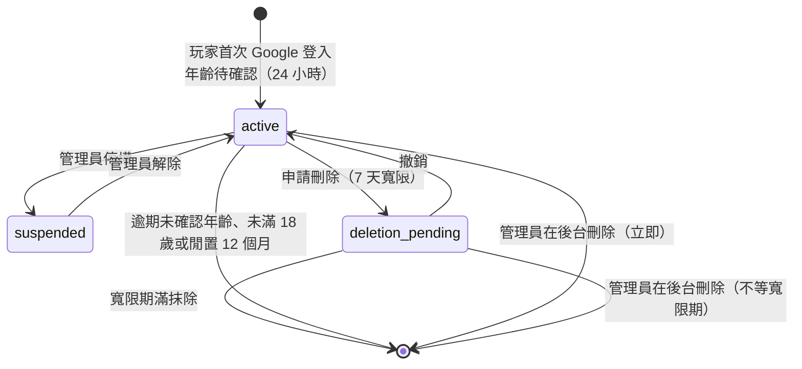

<!-- col -->

**受限登入狀態：預設拒絕**

| 狀態 | 拒絕代碼 | 導向 |
|---|---|---|
| locked | account_locked | /appeal |
| age_pending | age_confirmation_required | /age |
| deletion_pending | account_deletion_pending | /account |

只有明確允許的端點能通過；`test_restricted_session.py` 掃描全部路由證明這點。

---

<!-- size: 17 -->
<!-- tag: 17 SECURITY -->
<!-- src: AGENTS.md 第 10 節；docs/帳號與安全-auth-security.md -->

## 身分驗證與安全機制

| 面向 | 機制 |
|---|---|
| 登入 | Authorization Code＋PKCE、state、nonce；驗 iss、aud、exp；email_verified 為真；新使用者須勾選條款與「我確認已滿 18 歲」 |
| Session | 簽章 cookie，內容只有 uid 與 tv；閒置 30 天滑動續期；撤銷靠 token_version 加 1 |
| CSRF | 非 GET 請求驗證 X-CSRF-Token 與 Origin |
| 管理員 | Google 之後再輸入密碼；連續 5 次失敗鎖 15 分鐘；高風險操作（停權、刪除帳號、調整等級與遊戲幣、下架劇本等）重新輸入密碼並寫稽核 |
| 鎖定 | 登入被拒 5 次或洗版 10 次（15 分鐘）→ 鎖定，只有管理員能解除，可申訴 |
| 年齡 | 全站只限滿 18 歲；由生日計算；未滿 18 歲立即抹除；新帳號預設安全模式 |
| 授權 | AccessPolicy 集中判斷；非擁有者一律 404；管理員讀他人資料走專用 Repository 並寫稽核 |
| 日誌 | 結構化 JSON；不記 email、cookie、授權碼、生日與使用者文字 |

---

<!-- tag: 18 CS CYCLE -->
<!-- src: docs/客服對話-chat-service.md 第 2 節；app/services/chat_service.py -->

## 客服對話的完整週期

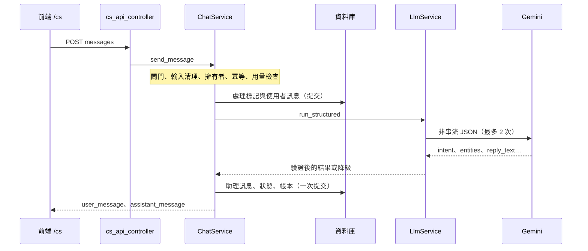

---

<!-- layout: diagram -->
<!-- tag: 19 MCP DIAGRAM -->
<!-- src: docs/MCP架構圖解.png；docs/RPG.md R-16；AGENTS.md 第 10 節 -->

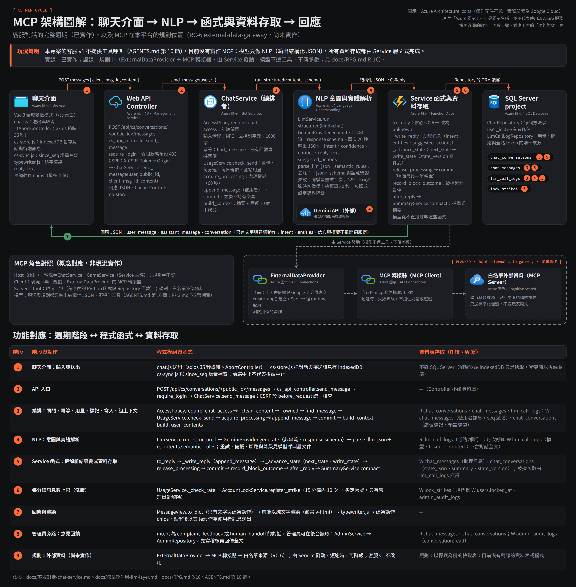

<!-- col -->

## MCP 架構圖解：週期與規劃位置

- 圖的主體是客服對話的**完整週期**（已實作）：聊天介面 → API → ChatService → NLP → Service 函式 → 資料庫 → 回應。
- **現況聲明**：專案**沒有實作 MCP**；客服 v1 不提供工具呼叫，模型只輸出結構化 JSON。
- 虛線是規劃中的外部資料閘道（RC-6）：由 Service 發動，模型不選工具、不傳參數。
- 完整圖含「功能對應」表，見 `docs/MCP架構圖解.png`（4K）。

---

<!-- size: 14 -->
<!-- tag: 20 MCP MAPPING -->
<!-- src: docs/MCP架構圖解.png 的功能對應表；R 讀、W 寫 -->

## 週期階段 ↔ 程式函式 ↔ 資料存取

| 階段 | 動作 | 主要函式 | 資料表 |
|---|---|---|---|
| ① | 聊天介面輸入與送出 | `chat.js`、`cs-store.js`、`cs-sync.js`（since_seq 補齊） | 只有瀏覽器 IndexedDB 快取 |
| ② | API 入口 | `cs_api_controller.send_message`、`require_login`、CSRF | — |
| ③ | 編排 | `require_chat_access`、`find_message`、`check_send`、`acquire_processing`、`build_context` | R/W `chat_messages`、`chat_conversations`；R `llm_call_logs` |
| ④ | NLP 意圖與實體解析 | `LlmService.run_structured`、`GeminiProvider.generate`、`parse_llm_json` | R/W `llm_call_logs` |
| ⑤ | Service 函式與資料存取 | `to_reply`、`_write_reply`、`_advance_state`、`SummaryService.compact` | W `chat_messages`、`chat_conversations` |
| ⑥ | 洗版鎖定 | `_check_rate`、`register_strike` | W `lock_strikes`、`users` |
| ⑦ | 回應與渲染 | `MessageView.to_dict`、`typewriter.js`、建議動作 chips | — |

---

<!-- tag: 21 NLP -->
<!-- src: docs/模型呼叫層-llm-layer.md；app/services/llm_service.py -->

## NLP 結構化輸出、重試與降級

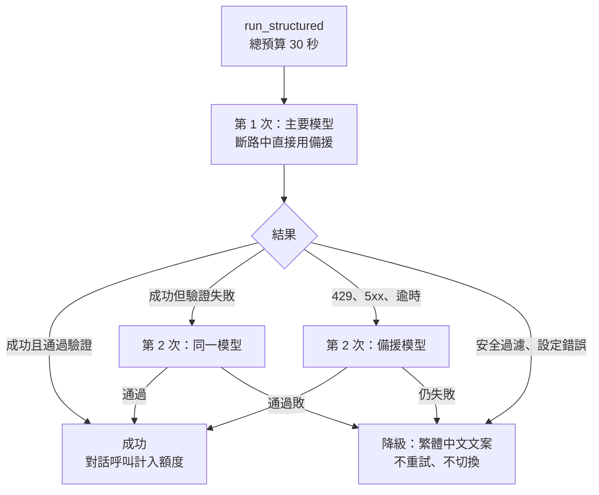

<!-- col -->

- 強制 JSON：intent、confidence、entities、reply_text、suggested_actions；Service 層重新驗證，不信任模型輸出。
- 信心低於 0.6 改為 unknown；回覆須含中文且不得含洩漏標記。
- 每次呼叫一筆帳本，**不含對話全文**；失敗原文截斷 2000 字，保存 14 天。
- 呼叫期間不持有資料庫交易。

---

<!-- layout: stack -->
<!-- dmax: 250 -->
<!-- tag: 22 USAGE -->
<!-- src: docs/客服對話-chat-service.md 第 3 節；app/services/quota_policy.py -->

## 用量與安全限制

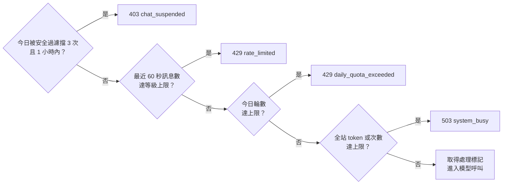

已有回覆的重送：直接回傳既有回覆，**不檢查、不計數**。檢查順序＝暫停 → 每分鐘 → 每日輪數 → 全站用量。

<!-- col -->

| 等級 | free | plus | vip |
|---|---|---|---|
| 每日輪數 | 30 | 100 | 300 |
| 每分鐘訊息 | 6 | 10 | 20 |
| 對話數 | 20 | 100 | 500 |

等級只影響額度，不影響權限。這張表只含客服的額度；RPG 改以遊戲幣控制（記事簿容量依等級，見「記事簿、遊戲幣與重新生成」）。

---

<!-- tag: 23 RPG ENGINE -->
<!-- src: docs/系統架構-architecture.md「RPG 回合引擎」；docs/RPG.md -->

## RPG 回合引擎：串流、審查與結算

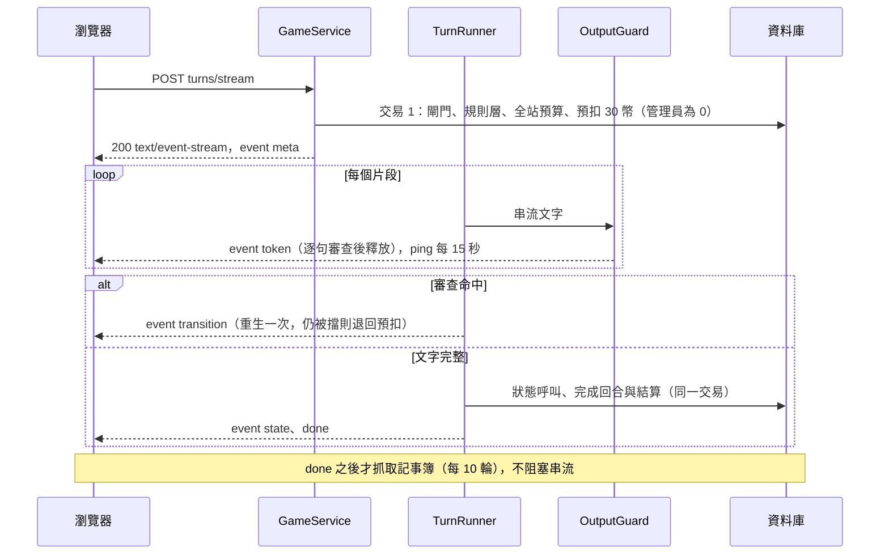

---

<!-- layout: diagram -->
<!-- tag: 24 RPG DIAGRAM -->
<!-- src: docs/RPG回合引擎架構圖解.png；docs/系統架構-architecture.md；圖示為 Azure Architecture Icons，僅作元件符號 -->

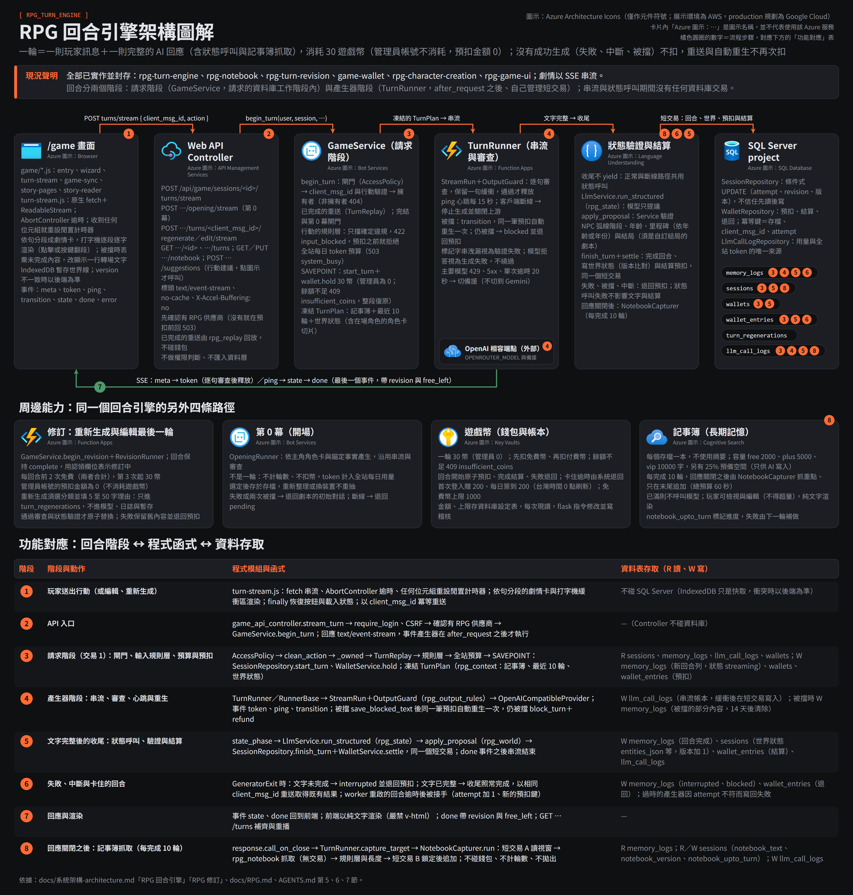

<!-- col -->

## RPG 回合引擎架構圖解

- 六個欄位是一輪的完整路徑：畫面 → API → **請求階段**（GameService）→ **產生器階段**（TurnRunner）→ 狀態驗證與結算 → 資料庫。
- 下方四條周邊路徑：重新生成與編輯、第 0 幕、遊戲幣、記事簿。
- 串流與狀態呼叫期間**沒有任何資料庫交易**；完成回合、寫世界狀態與結算預扣在同一個短交易。
- 完整圖含「功能對應」表，見 `docs/RPG回合引擎架構圖解.png`（4K）。

---

<!-- size: 14 -->
<!-- tag: 25 RPG MAPPING -->
<!-- src: docs/RPG回合引擎架構圖解.png 的功能對應表；R 讀、W 寫 -->

## RPG 回合：階段 ↔ 程式函式 ↔ 資料存取

| 階段 | 動作 | 主要函式 | 資料表 |
|---|---|---|---|
| 1 | 玩家送出行動 | `turn-stream.js`：fetch 串流、AbortController 逾時、`client_msg_id` 冪等重送 | 只有 IndexedDB 快取 |
| 2 | API 入口 | `game_api_controller.stream_turn` → `GameService.begin_turn` | — |
| 3 | 請求階段：閘門、規則層、預算、預扣 | `AccessPolicy`、`TurnReplay`、規則層、全站預算、`start_turn`＋`wallet.hold` | W `memory_logs`、`wallets`、`wallet_entries` |
| 4 | 串流、審查、心跳、重生 | `TurnRunner`、`StreamRun`＋`OutputGuard`、`OpenAICompatibleProvider` | W `llm_call_logs` |
| 5 | 收尾：狀態呼叫、驗證、結算 | `state_phase`、`apply_proposal`、`finish_turn`＋`settle` | W `memory_logs`、`sessions`、`wallet_entries` |
| 6 | 失敗、中斷與卡住的回合 | `interrupted`／`blocked` 並退回預扣；逾時由下一次重送接手（`attempt` 加 1） | W `memory_logs`、`wallet_entries` |
| 7 | 回應與渲染 | 事件 `state`、`done`；純文字渲染（嚴禁 v-html） | — |
| 8 | 記事簿抓取（每完成 10 輪） | `call_on_close` → `NotebookCapturer.run`（不碰錢包、不計輪數） | R/W `sessions.notebook_*` |

---

<!-- layout: stack -->
<!-- dmax: 150 -->
<!-- tag: 26 CONTENT SAFETY -->
<!-- src: AGENTS.md 第 7、10 節；docs/帳號與安全-auth-security.md 第 5 節 -->

## 內容安全：六道防線，不依賴模型拒絕

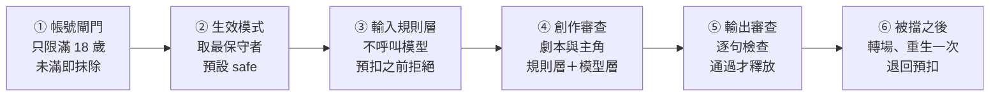

| 項目 | 規範（AGENTS.md） | 程式現況 |
|---|---|---|
| 使用者年齡 | 全站只限滿 18 歲 | 已實作並已部署到展示環境（`AgePolicy` 18；adult-only-signup，已封存） |
| 內容模式 | 安全模式開（預設）／關 | 已實作並已部署到展示環境（safe-mode-toggle，2026-11-19 封存）：safe／adult 兩種，舊值 standard 讀作 adult；生效模式取玩家偏好、劇本綁定與緊急煞車三者中最保守者 |
| 不變的底線 | 無論模式，禁止涉及未成年的性內容，以及性暴力、非自願與真人名義的性內容 | 規則層、模型層與逐句輸出審查已實作 |

<!-- col -->

- **伺服器端自有的審查層**：使用不具拒絕行為的模型時，它是必要條件；模型拒答視為生成失敗，不得以改寫繞過。
- 判定依年齡紀錄與文字的明確線索；沒有明確年齡的角色不因此被擋。
- 玩家文字（劇本、主角、記事簿）只放資料區塊，不進 `system_instruction`。
- 安全模式開時，玩家輸入性內容只**提醒**可調整、不自動調高，仍生成安全尺度的內容；每個存檔最多提示一次。

---

<!-- layout: diagram -->
<!-- tag: 27 SAFETY DIAGRAM -->
<!-- src: docs/內容安全與審查架構圖解.png；AGENTS.md 第 7、10 節；圖示為 Azure Architecture Icons，僅作元件符號 -->

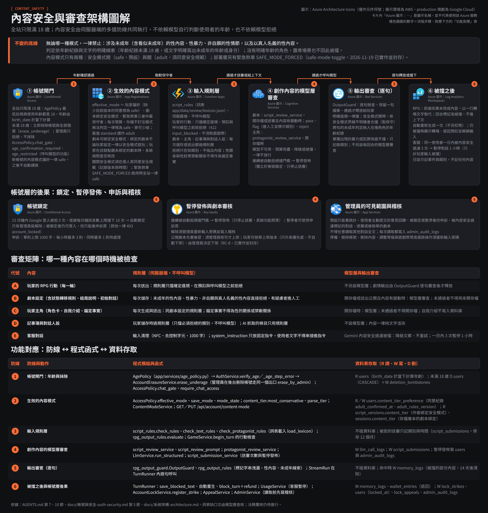

<!-- col -->

## 內容安全與審查架構圖解

- 上方是**不變的底線**與兩種內容模式的說明；六欄是防線，下方三張卡片是帳號層的後果（鎖定、暫停發佈與劇本審核、管理員的可見範圍與稽核）。
- 輸出審查「保留一句緩衝，通過才釋放」，所以玩家看不到未通過的文字。
- 被擋的回合不進上下文、不扣幣；客服一日內被內容安全過濾 3 次暫停 1 小時。
- 完整圖含「審查矩陣」與「功能對應」表，見 `docs/內容安全與審查架構圖解.png`（4K）。

---

<!-- size: 14 -->
<!-- tag: 28 SAFETY MATRIX -->
<!-- src: docs/內容安全與審查架構圖解.png 的審查矩陣；AGENTS.md 第 7、10 節 -->

## 審查矩陣：哪一種內容在哪個時機被檢查

| 內容 | 規則層（伺服器端，不呼叫模型） | 模型層與輸出審查 |
|---|---|---|
| 玩家的 RPG 行動 | 每次送出：只擋確定違規，在預扣與呼叫模型之前拒絕 | 不另設模型層；劇情輸出由 `OutputGuard` 逐句審查後才釋放 |
| 劇本設定 | 每次儲存：明確違規直接拒絕，有疑慮者進人工 | 開存檔或送審且內容有變動時：模型層審查；未通過者不得開存檔 |
| 玩家主角 | 每次生成與送出；錨定事實不得為性的關係或禁斷關係 | 開存檔時：模型層；自我介紹不寫入資料庫 |
| 記事簿與對話人設 | 玩家儲存時過規則層；AI 抓取的條目只用規則層 | 不設模型層；內容一律純文字渲染 |
| 客服對話 | 輸入清理（NFC、去控制字元、1000 字）；使用者文字不得串接進指令 | Gemini 內容安全過濾被擋：降級文案、不重試；一日 3 次暫停 1 小時 |

拒絕一律只告知類別，不指出內容。

---

<!-- layout: stack -->
<!-- dmax: 300 -->
<!-- tag: 29 SCRIPTS -->
<!-- src: docs/系統架構-architecture.md「劇本創作與審查」；docs/路線圖-roadmap.md -->

## 玩家創作劇本與兩層審查

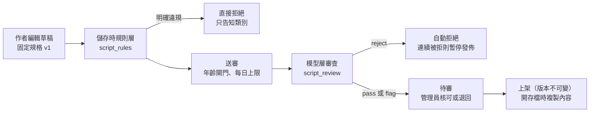

<!-- col -->

- 模型不可用、預算用盡、降級或被擋，**一律不放行**。
- 劇本屬於作者；暱稱與筆名在第一次發佈時鎖定。
- 劇本數與送審次數依等級，存資料庫設定表，以 flask 指令調整並寫稽核。

---

<!-- size: 16 -->
<!-- tag: 30 PUBLISHING -->
<!-- src: AGENTS.md 第 7、10、11 節；docs/RPG.md 的 8a、8b；openspec/changes/archive/2026-11-22-rpg-script-reports -->

## 劇本上架、檢舉與匿名保留

| 功能 | 規則 | 狀態 |
|---|---|---|
| 管理員審核 | 審核佇列核可或退回（退回只告知類別；審核備註只有管理員看得到）；核可與退回不須密碼，但都寫稽核 | 已封存、已部署（rpg-script-publishing） |
| 上下架 | 作者可自行下架與恢復；管理員下架與恢復須重新輸入密碼；下架的版本不能再開新存檔、已開局的存檔不受影響；內建劇本不能下架 | 已封存、已部署 |
| 公開目錄 | 關鍵字、標籤、讀者頻道篩選、游標分頁與詳情頁；所有玩家看得到所有劇本 | 已封存、已部署 |
| 檢舉 | 掛在上架的版本；每人每版本一次、每人每日 5 次；理由為七項預設加 200 字以內的自寫文字；**只升高審核佇列的優先度，不自動下架**；版本下架或被取代時由系統自動結案；檢舉人不會收到通知 | 已封存、已部署（rpg-script-reports，0022） |
| 匿名保留 | 帳號偏好（預設關閉）：因申請刪除或閒置 12 個月被抹除時，目前上架的版本改為「已註銷的作者」保留，其餘全刪；未滿 18 歲、逾時未確認與管理員刪除一律全刪 | 已封存、已部署 |

---

<!-- size: 16 -->
<!-- tag: 31 NOTEBOOK COINS -->
<!-- src: AGENTS.md 第 6、7 節；docs/RPG.md 第 7 章 -->

## 記事簿、遊戲幣與重新生成

| 功能 | 規則 | 狀態 |
|---|---|---|
| 記事簿 | 每存檔一本；容量 2000／5000／10000 字，另有 25% 預備空間（只供 AI 寫入）；每完成 10 輪由 RPG 模型抓重點追加；玩家可編輯但不得超量 | 已封存 |
| 遊戲幣 | 一輪 30 幣；首登送 200、每日簽到 200（台灣時間 0 點刷新）；免費幣上限 1000；先扣免費再扣付費；預扣、結算、退回皆冪等；**管理員帳號不消耗（預扣金額 0）** | 已封存（管理員豁免：admin-unlimited-coins） |
| 錢包頁 | `/wallet`：免費簽到、儲值示意（標示「示意，非正式價格」、按鈕停用）、紀錄；各頁頂列顯示餘額 | 已封存（wallet-hub） |
| 第 0 幕 | 創角後的開場；不是一輪、不扣幣 | 已封存 |
| 重新生成與編輯 | 只能動最後一輪；每回合前 2 次免費（兩者合計），第 3 次起每次 30 幣（管理員 0）；重新生成須選分類並填理由；通過審查才原子替換；編輯不使免費次數歸零 | 已封存（33／33） |

---

<!-- size: 16 -->
<!-- tag: 32 GAME SCREEN -->
<!-- src: AGENTS.md 第 5、7、10 節；docs/前端結構-frontend.md；openspec/changes/archive/2026-11-24-rpg-story-view -->

## 遊戲畫面：劇情卡、行動建議與推進劇情

| 功能 | 規則 | 狀態 |
|---|---|---|
| 劇情卡 | AI 回應依句分段；一次顯示一段，逐段打字機渲染，點擊或按鍵翻段；「‹」只能在當前輪內回上一段；說話者標示為「旁白」與「你」 | 已封存、已部署（rpg-story-view） |
| 歷史與氛圍 | 只讀的「歷史」視圖（純文字、可載入更早內容）；純 CSS 氛圍背景與流星動態；偏好減少動態時一律直接顯示完整文字 | 已封存、已部署 |
| 行動建議 | 點燈泡圖示才產生：一次獨立的非串流結構化呼叫，至多 3 個建議；每個畫面最多一次、結果存於存檔（遷移 0023）；不扣遊戲幣但計入全站 token 上限；點選只是貼進輸入框 | 已封存、已部署 |
| 直接推進劇情 | 送出固定文字「推進劇情」，視為一般行動：一輪 30 幣、可重新生成與編輯 | 已封存、已部署 |
| 不變的部分 | 分段只是前端呈現：不改串流事件協定、回合內容、審查與扣幣 | — |

---

<!-- tag: 33 PRIVACY -->
<!-- src: docs/project資料結構文件.md 第 9 節；AGENTS.md 第 11 節 -->

## 個資、保存與刪除

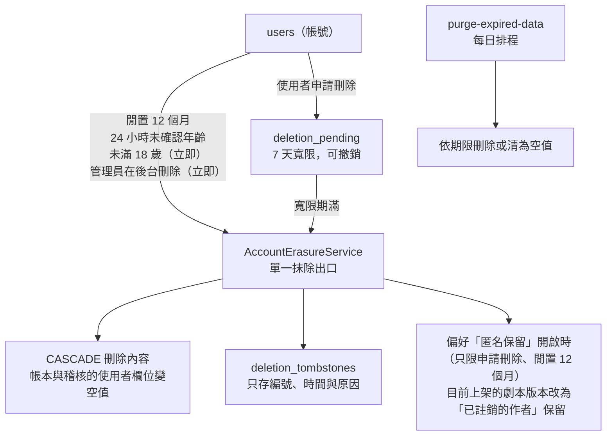

<!-- col -->

| 資料 | 保存期限 |
|---|---|
| 對話與訊息 | 最後訊息後 12 個月 |
| 模型呼叫帳本 | 12 個月；失敗原文 14 天 |
| 管理稽核紀錄 | 24 個月 |
| 劇本送審紀錄 | 12 個月 |
| 劇本檢舉 | 結案後 12 個月（未結案者與所屬版本同壽命）；檢舉人刪除帳號時其檢舉一併刪除 |
| 應用程式日誌 | 30 天 |
| 備份 | 30 天，還原後依 tombstones 重新抹除 |

---

<!-- layout: stack -->
<!-- dmax: 330 -->
<!-- tag: 34 DEPLOYMENT -->
<!-- src: docs/營運與部署-operations.md 第 2、8 節；AGENTS.md 第 9 節 -->

## 部署：AWS 雪梨展示環境（單機，不是 production）

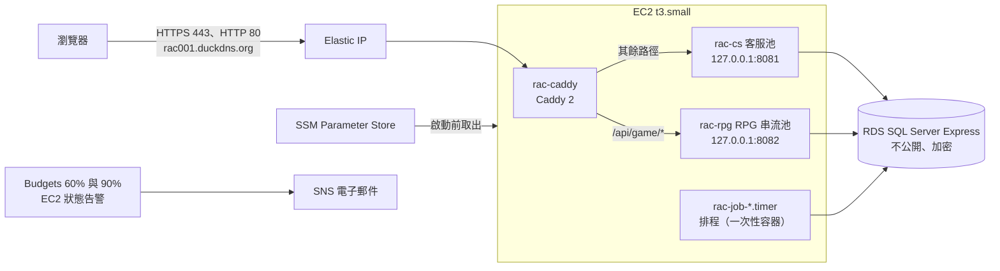

<!-- col -->

- **為什麼是 AWS**：沒有可計費的 Google Cloud 專案；展示改用 AWS 雪梨（Free plan 抵用金，展示期到 2026-12-31），目的是讓兩個 worker 池第一次真正分流。
- **限制**：資源名稱不含 production；只用 `.invalid` 的測試帳號；單機單點，數字不是容量依據。
- `APP_ENV` 選設定；未設定拒絕啟動；staging 與 production 缺機密即啟動失敗；migration **不在應用程式啟動時執行**。
- **目前版本**：2026-11-24 部署映像 `bb665dd`、RDS 在遷移 0023（回復點：前一版映像 `1762fa5`，不降級資料庫）；檢舉與匿名保留（0022）、行動建議（0023）都已部署。

---

<!-- layout: diagram -->
<!-- tag: 35 DEPLOY DIAGRAM -->
<!-- src: docs/部署與營運架構圖解.png；docs/營運與部署-operations.md；圖示為 Azure Architecture Icons，僅作元件符號 -->

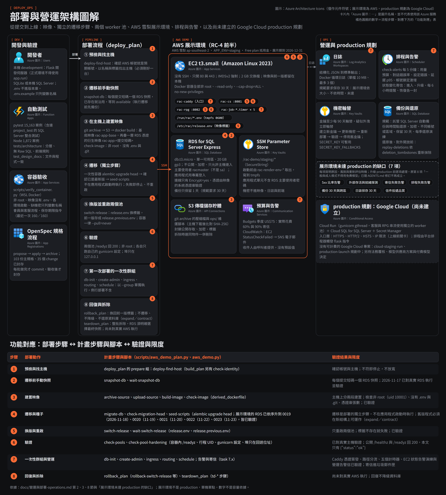

<!-- col -->

## 部署與營運架構圖解

- 四個欄位：開發與驗證 → **部署流程**（八個步驟）→ AWS 展示環境 → 營運與 production 規劃。
- 部署順序固定：快照 → 建置映像 → **遷移（獨立步驟）** → 換版重啟 → 驗證；回復只換回前一版標籤，**不降級資料庫**。
- 右欄列出展示環境未達 production 的 7 項缺口與 Google Cloud 規劃（尚未建立）。
- 完整圖含「功能對應」表，見 `docs/部署與營運架構圖解.png`（4K）。

---

<!-- size: 14 -->
<!-- tag: 36 DEPLOY MAPPING -->
<!-- src: docs/部署與營運架構圖解.png 的功能對應表；scripts/aws_demo_plan.py -->

## 部署步驟 ↔ 計畫步驟 ↔ 驗證與限度

| 步驟 | 動作 | 計畫步驟與腳本 | 驗證與限度 |
|---|---|---|---|
| 1 | 預檢與找主機 | `deploy-find-host`（`build_plan` 另有 `check-identity`） | 確認帳號與主機；不符即停止 |
| 2 | 遷移前手動快照 | `snapshot-db`、`wait-snapshot-db` | 每個提交短碼一個 RDS 快照；已對真實 RDS 驗證 |
| 3 | 建置映像 | `archive-source`、`upload-source`、`build-image`、`check-image` | 非 root、沒有 `.env` 與 `.git`；已驗證 |
| 4 | 遷移與種子 | `migrate-db`、`check-migration-head`、`seed-scripts` | 獨立步驟；RDS 已依序升到 0019（2026-11-18）、0020（11-19）、0021（11-20）、0022（11-22）、0023（11-23），每次前先做 RDS 快照，皆已驗證 |
| 5 | 換版與重啟 | `switch-release`（`release.env`、`release.previous.env`） | 只重啟兩個池；已驗證 |
| 6 | 驗證 | `check-pools`、`check-pool-hardening` | `/readyz` 200、非 root、各自的 gunicorn 設定；已驗證 |
| 7 | 一次性群組與營運 | `db-init`、`create-admin`、`ingress`、`routing`、`schedule` | 憑證、分流、五個計時器、告警演練已驗證；告警信進垃圾郵件匣 |
| 8 | 回復與拆除 | `rollback_plan`、`teardown_plan` | **尚未對真實 AWS 執行** |

---

<!-- size: 17 -->
<!-- tag: 37 QUALITY -->
<!-- src: docs/營運與部署-operations.md 第 6 節；tests/ -->

## 品質保證與守門測試

| 層次 | 內容 |
|---|---|
| 單元與整合 | pytest 收集 15,163 案例（通過 15,158、略過 5）；SQLite 與 SQL Server 雙軌（SQL Server 以 sqlserver 標記） |
| 前端 | Node 內建測試 1,872 案例（node --test）全數通過 |
| 架構 | tests/architecture：以 AST 檢查分層、後台邊界、無 Raw SQL、前端規則 |
| 文件守門 | test_design_docs、test_project_db_schema_doc：資料表、欄位、路由、migration 與文件逐項一致 |
| 驗收 | 假模型伺服器與 HTTP 驗收腳本、容器驗收（最近一次 160／160，SQLite）、瀏覽器人工驗收、展示環境冒煙驗收；change 封存前另做破壞驗證（刻意改壞程式，確認測試會抓到） |
| 規格 | OpenSpec 103 份主規格；change 以 validate --strict 驗證後才封存 |

---

<!-- layout: stack -->
<!-- size: 15 -->
<!-- dmax: 300 -->
<!-- tag: 38 ROADMAP -->
<!-- src: docs/路線圖-roadmap.md；openspec/changes/ -->

## 路線圖與進度

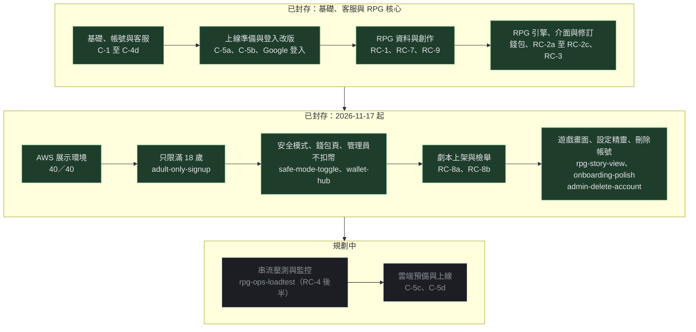

<!-- col -->

| 狀態 | change |
|---|---|
| 已封存（35） | platform-foundation、member-auth、age-gate、age-verification-birthdate、cs-chat-core、usage-limits、admin-console、openai-compatible-provider、privacy-lifecycle、ops-alerting、launch-readiness、staging-deployment、google-first-login、remove-player-password-auth、rpg-data-and-script、rpg-script-authoring、rpg-character-creation、game-wallet、rpg-notebook、rpg-turn-engine、rpg-entry-ui、story-preference、rpg-game-ui、rpg-turn-revision、aws-demo-environment、adult-only-signup、**admin-unlimited-coins、add-traditional-chinese-output-spec、safe-mode-toggle、wallet-hub、rpg-script-publishing、rpg-script-reports、rpg-story-view、onboarding-polish、admin-delete-account** |
| 擱置中 | cloud-staging-run（0／20，等可計費的 Google Cloud 專案） |
| 規劃中 | rpg-ops-loadtest、production-launch、external-data-gateway、rpg-persona-library、player-hub、order-integration |

---

<!-- size: 16 -->
<!-- tag: 39 LIMITS -->
<!-- src: docs/路線圖-roadmap.md 第 2 節；AGENTS.md 第 7、9、11 節 -->

## 已知限制與待決事項

| 項目 | 現況 |
|---|---|
| MCP | **未實作**；客服 v1 不提供工具呼叫；外部資料閘道（RC-6）規劃中，由 Service 發動 |
| 雲端環境 | AWS 雪梨展示環境已運行（單機、不是 production，7 項缺口）；Google Cloud 沒有可計費專案，cloud-staging-run 等前提 |
| 資料庫版本 | 展示環境 RDS 在 0023（2026-11-23 升級，部署前快照 `rac-demo-staging-db-pre-787ee62`）；本機 `project` 在 0022，0023 尚未套用（套用前先備份） |
| 展示前須知 | 展示環境不預建玩家帳號，要自己以 Google 登入新註冊（先前驗收留下的非管理員帳號尚未清理，管理員可在後台逐一刪除）；新玩家預設**安全模式**，可在 `/account` 關閉；`/wallet` 的儲值分頁只是示意（標「示意，非正式價格」、按鈕停用），別讓人誤會儲值已開放 |
| 模型供應商 | 客服 Gemini 為過渡；RPG 目前用免費模型並已設定備援模型；正式對外前須重新評估供應商與方案；免費模型不得輸入真實個資 |
| 金流與訂閱 | 尚待探索；遊戲幣目前只能由簽到與贈幣取得，儲值畫面只是示意 |
| 劇本上架 | 審核、上下架、目錄、詳情、檢舉與匿名保留皆已封存並部署；公開分享的法務覆核待進行 |
| 入口層限流 | IP 限流尚未做，列為上線前關卡 |
| 展示環境的驗證缺口 | 心跳經入口的到達時間、HTTP/2 下的串流與一般回合的串流尚未量測；rollback 與 teardown 尚未對真實 AWS 執行 |
| 法務 | 條款（版本 `2026-11-24-draft-11`，仍標示草稿；第 4 節新增「管理員得刪除違規者的帳號與其全部資料」）、隱私權政策、內容規範與檢舉處理列入法務覆核 |

---

<!-- size: 17 -->
<!-- tag: 40 DOCS -->
<!-- src: docs/README.md -->

## 文件索引與結語

| 文件 | 內容 |
|---|---|
| 系統架構-architecture.md | 全景、分層、請求生命週期、依賴注入 |
| project資料結構文件.md | **Database Schema、ERD、Data Dictionary**（逐欄字典，隨資料庫同步） |
| 帳號與安全-auth-security.md | 登入、session、CSRF、年齡閘門、權限 |
| 客服對話-chat-service.md | 客服端點、送出流程、冪等、用量、摘要 |
| 模型呼叫層-llm-layer.md | 重試、備援、斷路、帳本、提示詞 |
| 前端結構-frontend.md | 資產、模組、暫存與同步 |
| 營運與部署-operations.md | 環境、容器、日誌、維運指令、測試分層、AWS 展示環境 |
| 6 張 4K 架構圖解（PNG） | 登入與註冊、MCP、網站入口、RPG 回合引擎、內容安全與審查、部署與營運（以 Azure 圖示設計，含功能對應表） |
| 2.1簡報.pptx、4.0簡報.pptx、5.0簡報.pptx | 2.1：本簡報的 PowerPoint 版；4.0：給主管與評審的 15 張精簡版（2026-11-22 的快照）；5.0：2026-11-24 的重點版（大字、深色，納入遊戲畫面、設定精靈與後台刪除帳號），分別由 `docs/diagrams/build_pptx_40.py`、`build_pptx_50.py` 產生 |

**結語**：兩個核心共用同一套可驗證的基礎；客服已可獨立運作，RPG 已具備完整的創作、遊玩、上架與營運骨架（審核、目錄、檢舉與匿名保留皆已封存），展示環境已在 AWS 運行；只限滿 18 歲、安全模式開／關、錢包頁、管理員不扣幣、視覺小說式遊戲畫面、設定精靈與後台刪除帳號都已封存並部署，下一步是做串流壓測與監控（rpg-ops-loadtest）、補齊展示環境的缺口，並完成法務覆核後建立 production。
