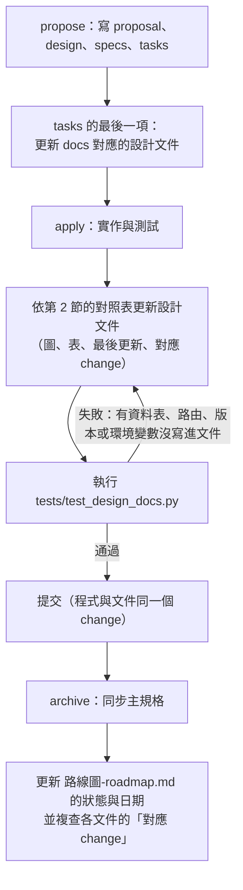

# 設計文件索引與維護規則

> 狀態：持續更新 ｜ 最後更新：2026-10-30 ｜ 對應 change：全部 ｜ 維護提醒：`.claude/skills/design-docs-sync/SKILL.md`

這裡的設計文件用 Mermaid 圖說明專案的主要設計，讓人（與 AI）能快速對齊架構。**它們描述「現在的設計」**，不是歷史紀錄：每次 propose、apply、archive 之後，受影響的文件要一起更新，使內容、圖與程式保持一致。決策的來龍去脈與備選方案留在 `openspec/`（每個 change 的 `design.md` 與封存紀錄）與 [report.md](report.md)、[RPG.md](RPG.md)。

## 1. 文件索引

| 文件 | 內容 | 主要對應的程式與規格 |
|---|---|---|
| [系統架構-architecture.md](系統架構-architecture.md) | 系統全景、後端分層與依賴方向、請求生命週期、依賴注入、關鍵技術決策 | `app/__init__.py`、`app/config.py`、`app/runtime.py`、`app/services/registry.py`、`tests/architecture/` |
| [資料模型-data-model.md](資料模型-data-model.md) | 實體關聯圖、約束與設計理由、migration 歷程、保存與刪除 | `app/models/`、`migrations/versions/`、`app/repositories/` |
| [帳號與安全-auth-security.md](帳號與安全-auth-security.md) | 帳號狀態、註冊與登入、session 與 CSRF、Google 登入、年齡閘門、權限規則、`/api/auth/*`、管理員後台的存取規則與 `/api/admin/*` | `app/services/auth_service.py`、`access_policy.py`、`age_policy.py`、`admin_service.py`、`app/security/` |
| [客服對話-chat-service.md](客服對話-chat-service.md) | 客服端點、送出訊息流程、冪等與處理標記、上下文與狀態、摘要、降級文案、管理員可讀的對話範圍 | `app/services/chat_service.py`、`cs_*.py`、`summary_service.py`、`app/controllers/cs_*.py` |
| [模型呼叫層-llm-layer.md](模型呼叫層-llm-layer.md) | 模型呼叫的分層、重試與備援決策、斷路、預算、解析驗證、提示詞結構、帳本、更換供應商 | `app/llm/`、`app/services/llm_service.py`、`llm_output.py`、`app/observability/llm_events.py` |
| [前端結構-frontend.md](前端結構-frontend.md) | 資產與載入順序、共用元件、客服頁面與管理員後台的模組關係、暫存與同步引擎 | `app/static/`、`app/templates/`、`tests/js/` |
| [營運與部署-operations.md](營運與部署-operations.md) | 環境與設定載入、容器與部署、migration 步驟、日誌與事件、維運指令與保存期限、測試分層 | `app/config.py`、`Dockerfile`、`gunicorn.conf.py`、`app/observability/`、`app/cli.py`、`scripts/` |
| [路線圖-roadmap.md](路線圖-roadmap.md) | 各 change 的順序、相依與狀態；待決定事項 | `openspec/changes/`、[report.md](report.md) 第 5.2 節、[RPG.md](RPG.md) |

與其他文件的分工：

| 文件 | 角色 |
|---|---|
| `AGENTS.md` | 規範的唯一權威（衝突時以它為準）；設計文件只描述實作如何符合它，不修改它 |
| `README.md`（根目錄） | 安裝、環境變數、端點表、驗收紀錄與已知限制；設計文件引用它而不重複 |
| `openspec/specs/` | 已封存能力的規格（需求與情境）；設計文件說明「怎麼做」 |
| [report.md](report.md)、[RPG.md](RPG.md) | 探索與決策紀錄（含備選方案與理由），不隨每次 change 更新 |

## 2. 改了什麼，更新哪一份

| 如果這次的 change 改了… | 更新 |
|---|---|
| 分層、禁止匯入規則、後台專用 Repository 的規則、`create_app` 的注入參數、請求生命週期、主要外部依賴 | 系統架構-architecture.md |
| 資料表、欄位、約束、索引、外鍵動作、migration、保存期限與刪除流程 | 資料模型-data-model.md（保存期限的實作狀態同步 營運與部署-operations.md） |
| 註冊、登入、驗證信、Google 登入、session、CSRF、年齡規則、權限政策、`/api/auth/*`、`/api/admin/*`、後台的可讀範圍與重新輸入密碼 | 帳號與安全-auth-security.md |
| `/api/cs/*`、送出流程、冪等、處理標記、上下文與狀態、摘要、降級文案、客服回覆原則、管理員可讀的對話範圍 | 客服對話-chat-service.md |
| `LlmService`、轉接器、錯誤分類、斷路、預算、帳本、提示詞結構、`GEMINI_*` 與 `LLM_*` 設定 | 模型呼叫層-llm-layer.md（用到的端點與流程同步 客服對話-chat-service.md） |
| 前端模組、載入順序、共用元件、Sidebar、暫存與同步、前端規範 | 前端結構-frontend.md |
| 環境與必要機密、容器、gunicorn、日誌白名單與事件、維運指令、測試與驗收分層 | 營運與部署-operations.md |
| 任何 change 的 propose、apply 完成、archive；待決定事項有結論 | 路線圖-roadmap.md |

## 3. 維護流程

重點：
- **OpenSpec 會提醒**：openspec/config.yaml 的 
ules.tasks 要求會影響設計的 change 在 	asks.md 最後加一項「更新設計文件」，operations.apply 與 operations.archive 的 guidance 在 apply 與 archive 時重複提醒；技能 design-docs-sync 提供逐步的檢查表。
- **文件與程式在同一個 change 內一起更新**，不留到「之後再補」；`tests/test_design_docs.py` 把最容易漂移的事實變成測試（見第 5 節）。
- 圖與表描述的是最新設計；被取代的設計不留在圖上（理由放進該 change 的 `design.md`）。
- 每份文件的標頭有「最後更新」日期與「對應 change」；內容有實質修改時一併更新。

## 4. Mermaid 撰寫慣例

- 使用 GitHub 與 VS Code 預覽都能渲染的圖類型：`flowchart`、`sequenceDiagram`、`erDiagram`、`stateDiagram-v2`。
- 節點文字一律放在雙引號內（`A["文字"]`），換行用 ` `；避免在標籤內使用未加引號的括號、`;`（序列圖中的分號會結束訊息）與 `#`。
- 一張圖只講一件事、節點盡量不超過 15 個；細節放在圖下方的表格。
- 圖中的名稱要與程式一致（資料表、端點、環境變數、類別與檔名），這樣測試與搜尋才對得上。
- 規劃中但尚未實作的部分在圖或表中標明「（C-4）」「（C-5）」「規劃中」，不要畫得像已經存在。

## 5. 自動檢查（`tests/test_design_docs.py`）

| 檢查 | 目的 |
|---|---|
| 每份文件有「最後更新」日期、至少一個 Mermaid 圖，圖的類型合法，內部連結都存在，並列在本索引 | 結構一致 |
| 每張資料表（`Base.metadata`）與最新的 migration 版本都出現在 資料模型-data-model.md | 新增資料表不更新文件就失敗 |
| 每個 `/api/auth/` 與 `/api/admin/` 路由出現在 帳號與安全-auth-security.md，每個 `/api/cs/` 路由出現在 客服對話-chat-service.md；每個頁面（含 `/admin`）出現在設計文件 | 新增端點不更新文件就失敗 |
| 每個分層名稱與 `create_app` 的注入參數出現在 系統架構-architecture.md | 分層與注入的變動要反映 |
| 每個帳本狀態與每個 `GEMINI_*`、`LLM_*` 環境變數出現在 模型呼叫層-llm-layer.md | 模型呼叫層的設定要反映 |
| 四種環境與三個 flask 指令出現在 營運與部署-operations.md；`static/js/cs/`、`static/js/ui/`、`static/js/admin/` 的每個檔案出現在 前端結構-frontend.md；已封存與進行中的 change 名稱出現在 路線圖-roadmap.md | 營運、前端與路線圖的事實要反映 |

測試只能確認「有沒有提到」，不能確認「描述得對不對」；內容的正確性仍靠更新時對照程式檢視。Mermaid 語法本身不在測試內驗證，提交前請在 VS Code 或 GitHub 預覽確認圖能渲染。
