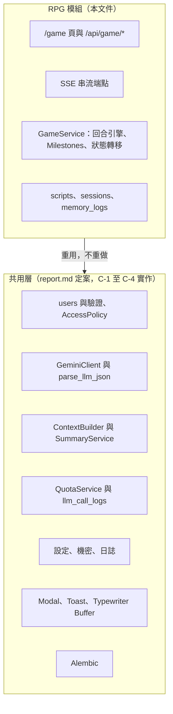
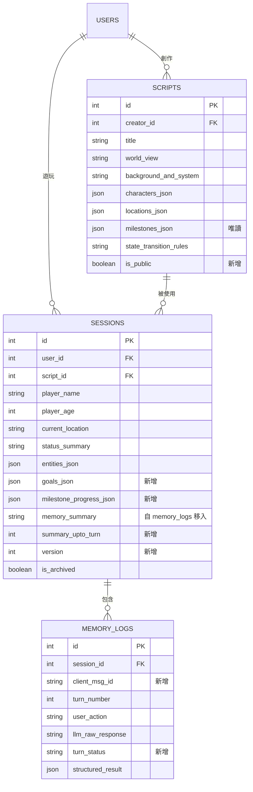
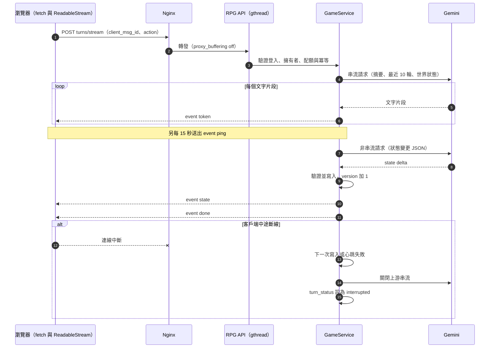
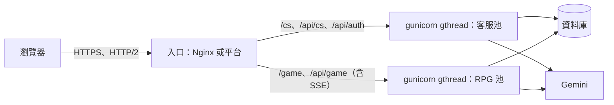
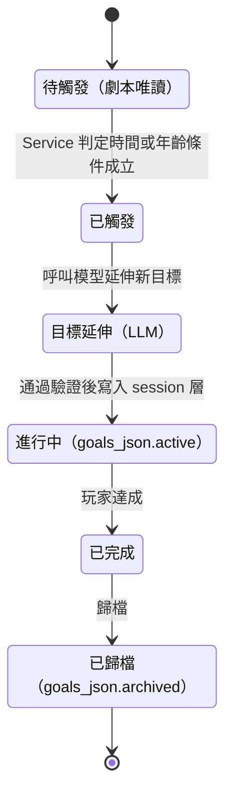
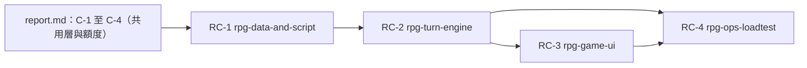

# 開放世界文字 RPG 模組：延後事項與設計方向

- **文件版本**：v1.0（Explore 階段產出，與 [report.md](report.md) 配套）
- **日期**：2026-10-27
- **依據**：`AGENTS.md`（唯一權威來源）、`docs/spec_report_v2.1.1.md`、report.md 的 D-00（範圍方案 A）
- **性質**：本次 explore 的範圍是客服；RPG 依 D-00 **延後實作**。本文件收納所有 RPG 專屬的決策、SSE 串流細節與待決定事項，使 RPG 之後接入時不必重做共用層。**不含實作程式碼，也未修改任何規範檔或資料表。**
- **編號**：本文件的決策編號為 **R-NN**，與 report.md 的 D-NN 分開；狀態標籤與 report.md 相同（[建議]、[待決定]）。

---

## 第 1 章　範圍與接入共用層

RPG 與客服共用 report.md 定案的共用層。RPG 之後接入時，只需要**新增 migration 加表、新增 `/game` 與 SSE 端點、新增 RPG 專屬 Service**，不動 `users`、驗證與部署基礎。

| RPG 需要的能力 | 重用的共用元件 | RPG 專屬的新增部分 |
|---|---|---|
| 使用者與登入 | `users`、驗證、CSRF | 無 |
| 資料擁有者檢查 | `AccessPolicy`、Repository 帶 `user_id` | `sessions`、`scripts` 的擁有者檢查 |
| 呼叫模型 | `GeminiClient`、`parse_llm_json` | 串流呼叫包裝 |
| 滑動視窗與摘要 | `ContextBuilder`、`SummaryService` | 「世界狀態」的組成內容 |
| 用量與限額 | `QuotaService`、`llm_call_logs`（`kind` 新增 `rpg_stream`、`rpg_delta`） | 同時串流數上限 |
| 前端元件 | Modal、Toast、Typewriter Buffer、IndexedDB 封裝 | `/game` 頁面、串流接收器 |
| 部署 | 設定、secret、Alembic | 獨立的 RPG worker 池 |

---

## 第 2 章　資料模型

### 2.1 以 AGENTS.md 檢視 spec_report 的資料表

spec_report 主題三的 `scripts`、`sessions`、`memory_logs` 對照 AGENTS.md 第 6 節與第 7 節，有以下缺口（R-07）：

| 編號 | 缺口 | 依據 | 建議 |
|---|---|---|---|
| G-1 | `sessions` 沒有 `version` | 第 6 節：可變的世界狀態須帶版本號 | 新增 `sessions.version`，預設 1 |
| G-2 | `memory_logs` 沒有前端產生的唯一 ID | 第 6 節：每則訊息有唯一 ID，後端以此去重 | 新增 `memory_logs.client_msg_id`，`(session_id, client_msg_id)` 唯一 |
| G-3 | 回合序號沒有唯一約束 | 一輪的定義 | `(session_id, turn_number)` 唯一 |
| G-4 | `memory_summary` 放在每筆 `memory_logs` | 摘要是整個 session 的累積值，每列各存一份是冗餘 | 移到 `sessions.memory_summary`，並新增 `summary_upto_turn`，與客服的作法一致 |
| G-5 | 沒有地方存「LLM 動態延伸的目標」 | 第 7 節：不得寫回原始劇本，應另存於 session 層 | 新增 `sessions.goals_json`（見 R-06） |
| G-6 | 沒有記錄各 Milestone 的觸發進度 | 原始劇本唯讀，進度只能記在 session | 新增 `sessions.milestone_progress_json` |
| G-7 | 串流中斷時 `llm_raw_response` 無法為 NOT NULL | spec_report 主題六第 6 點 | 見 R-03，新增 `memory_logs.turn_status` |
| G-8 | `scripts` 沒有可見性 | 若允許使用者創作劇本，需區分私人與公開 | 新增 `scripts.is_public`（預設 false）；是否開放使用者創作為待決定（R-13） |

### 2.2 建議的資料模型

`sessions.script_id` 在 RPG 模組內維持原定義，**不受客服影響**（客服不使用 `sessions`，見 report.md D-05）。

---

## 第 3 章　SSE 串流與伺服器

本章集中 report.md 中因 D-00 而延後的 SSE 相關內容（D-11、D-13、D-20、D-24 的 SSE 部分）。

### 3.1 R-01　SSE 事件協定　**[建議]**

AGENTS.md 指定前端以 `fetch` 搭配 `ReadableStream` 接收，因此端點可用 **POST**（原生 `EventSource` 只支援 GET，不採用）。建議端點：`POST /api/game/sessions/{public_id}/turns/stream`。

| 事件 | 內容 | 用途 |
|---|---|---|
| `meta` | `turn_id`、回送的 `client_msg_id` | 開始，確認冪等 |
| `token` | `{ "text": "片段文字" }` | 劇情片段，交給打字機緩衝區 |
| `ping` | 空物件 | 心跳 |
| `state` | `{ "state_version": n, "delta": {...} }` | 世界狀態變更（見 R-04） |
| `done` | `{ "turn_number": n }` | **明確的結束標記**；前端收到才視為完整 |
| `error` | `{ "code": "...", "message": "繁體中文訊息" }` | 失敗，訊息為繁體中文 |

格式為 `event: 名稱` 加 `data: 單行 JSON`，以空行分隔。文字片段放在 JSON 內，避免換行字元破壞協定。回應標頭：`Content-Type: text/event-stream; charset=utf-8`、`Cache-Control: no-cache, no-transform`、`X-Accel-Buffering: no`。

### 3.2 R-02　心跳與斷線偵測　**[建議]**（對應 report.md A-05）

| 項目 | 建議值 | 說明 |
|---|---|---|
| 心跳間隔 | 15 秒 | 後端定期送出 `ping`，維持中介層連線，也使斷線能被偵測 |
| 前端閒置逾時 | 45 秒 | 每收到任何位元組（含 `ping`）就重設計時器；逾時以 `AbortController` 中止 |
| 前端總逾時 | 90 秒 | 超過即中止 |
| 後端單次生成上限 | 60 秒 | 超過即中止並送出 `error` |
| 斷線偵測 | 寫入失敗或產生器被關閉 | 後端偵測到客戶端斷線時**停止生成並關閉上游 Gemini 串流**，把該回合標記為 `interrupted` |

說明：在 `gthread` 模型下，斷線只會在**下一次寫入**時被發現。心跳確保即使 Gemini 暫時沒有輸出，最晚 15 秒內也會發現斷線並釋放執行緒與停止計費。

### 3.3 R-08　伺服器架構與並發　**[建議]**

**獨立 worker 池**：同一個 gunicorn 無法為不同端點設定不同 worker 型態，且長串流會佔用執行緒。因此 RPG 使用**獨立的 gunicorn 行程**，由入口依路徑（`/api/game/*/stream`）分流；客服池維持 report.md D-13 的設定。

**容量估算**（假設值，須由壓測校正）：並發串流數 ＝ 同時生成的回合數；所需執行緒槽位 ＝ 回合到達率 × 平均占用秒數。

- 假設：RPG 池 2 個 worker、每個 16 條執行緒，共 32 個槽位；一個回合占用串流約 12 秒，加上狀態變更呼叫與寫入約 2.5 秒，合計約 14.5 秒。
- 吞吐上限 ≈ 32 ÷ 14.5 ≈ 2.2 回合每秒。
- 若玩家閱讀與思考約 60 秒才送出下一個行動，可支撐約 2.2 × 60 ≈ **130 位同時在線玩家**。
- 全站同時串流上限設為「槽位數減 4」（保留 4 個槽位給非串流的 API 請求），即 28；超過時回 503 與繁體中文文案「目前冒險者眾多，請稍候片刻再出發。」
- 每位使用者同時只能有 1 個進行中的串流。

**Nginx 的 SSE 專用設定**：

| 設定 | 建議 |
|---|---|
| `proxy_buffering` | off |
| `proxy_cache` | off |
| `proxy_http_version` | 1.1，並清除 `Connection` 標頭 |
| `proxy_read_timeout` | 120 秒（大於後端生成上限 60 秒，也大於心跳間隔） |
| gzip | 對 `text/event-stream` 關閉 |
| 回應標頭 | 由應用程式送出 `X-Accel-Buffering: no` |
| HTTP/2 | 啟用，避免 HTTP/1.1 同網域連線數上限造成多分頁互相阻塞 |

gunicorn 的 `timeout` 應大於生成上限（例如 120 秒）；`gthread` 的 worker 存活回報獨立於請求長度，不會因長串流被誤殺。

**限額補充**（接 report.md D-20）：一個 RPG 回合包含串流呼叫、狀態變更呼叫，超過 10 輪後再加摘要折疊呼叫，三者都寫入 `llm_call_logs` 並計入每日 token 與全站預算；每日回合數的上限比照客服的等級額度，數值待 U-7 預算確認後設定。

### 3.4 R-09　前端串流接收與打字機　**[建議]**

- 使用 `fetch` 搭配 `ReadableStream`，以 `TextDecoder('utf-8')` 解碼，**必須使用串流模式解碼**（`stream: true`）。中文字元為多位元組，網路分段可能把一個字元切在兩個片段之間，未使用串流模式會出現亂碼。
- 以行為單位累積緩衝，遇到空行才切出一個完整事件再解析 JSON。
- `token` 事件的文字推入打字機緩衝區，以固定節奏逐字渲染；緩衝區積壓過多時加速追趕，避免串流結束後還要等很久。
- 計時器：每收到任何位元組重設閒置計時器；`AbortController` 在逾時、使用者取消、離開頁面時中止。**無論成功、失敗或中斷，皆在 `finally` 恢復 UI**（解除按鈕禁用、清除載入動畫）。
- 只有收到 `done` 才視為完整；沒有 `done` 的結尾視為中斷，提示使用者可重新生成。

### 3.5 R-03　串流中斷時的紀錄處理（spec_report 主題六第 6 點）　**[建議]**

| 方案 | 內容 | 評估 |
|---|---|---|
| (a) `llm_raw_response` 改為 NULLABLE | 中斷時為空值 | 簡單，但丟失已生成的部分內容，且 NULL 語意不清 |
| **(b) 保持 NOT NULL，預設空字串，新增 `turn_status`（採用）** | 回合開始時寫入 `streaming`；完成為 `complete`；中斷為 `interrupted`，保留已收到的片段 | 可偵錯、語意明確；需要處理狀態 |
| (c) 中斷時不寫入 | 回合直接消失 | 無法偵錯，也無法做冪等 |

**建議 (b)**，並訂下規則：

- `interrupted` 的回合**不計入輪數、不進入滑動視窗的上下文**，不算「一輪」（一輪須有完整的 AI 回應）。
- 使用者以相同 `client_msg_id` 重送：若原回合為 `complete`，直接回傳既有結果（冪等）；若為 `interrupted`，允許重新生成並覆蓋該筆。
- `interrupted` 的部分內容保存 14 天後清除。

---

## 第 4 章　RPG 設計決策與待決定事項

### 4.1 R-04　狀態變更的取得方式（spec_report 主題六第 1 點）　**[建議]**

NPC 好感度與狀態效果屬結構化資料，但劇情是自由文字串流，無法直接攜帶。

| 方案 | 內容 | 優點 | 缺點 |
|---|---|---|---|
| **(a) 串流後再做一次非串流 JSON 呼叫（採用）** | 文字完成後，帶著本回合內容要求輸出狀態變更 JSON | 與 AGENTS.md 一致（結構化輸出為非串流）；文字與資料互不干擾；可用 schema 強制格式 | 多一次呼叫，增加延遲與成本 |
| (b) 在串流尾端嵌入標記區塊 | 劇情後附一段特殊標記的 JSON | 單次呼叫 | 標記可能被模型漏掉或洩漏到畫面；JSON 原文會混入串流，違反「嚴禁將 JSON 原文以串流送達前端」的精神 |
| (c) 工具呼叫 | 模型在敘事中呼叫工具回報變更 | 結構清楚 | 與串流混用複雜，v1 過度設計 |

**建議 (a)**。狀態變更 JSON 建議欄位：`favorability_changes`（NPC 與增減值）、`status_effects`、`current_location`、`milestone_events`、`entities_patch`、`goals_patch`。寫入前須通過 `parse_llm_json` 與 Service 層驗證，並比對 `sessions.version`；成功後以 `state` 事件通知前端，再送出 `done`。狀態呼叫失敗時重試 1 次，仍失敗則該回合文字保留、世界狀態不變，並記錄於 `llm_call_logs`。

### 4.2 R-05　`state_transition_rules` 的格式（spec_report 主題六第 2 點）　**[建議]**

| 方案 | 說明 | 評估 |
|---|---|---|
| **(a) 維持 TEXT（自由文字），並加上 Service 層的不變量檢查（採用）** | 規則直接放入 Prompt 供模型解讀 | 劇本創作簡單；以程式碼不變量防止模型違規 |
| (b) 結構化 JSON | 條件與結果由程式解讀 | 彈性低，劇本創作門檻高，v1 過度設計 |
| (c) 混合 | 文字規則加少量 JSON 掛鉤 | 後續可由 (a) 演進而來 |

**不變量**（Service 層強制，與 AGENTS.md 第 7 節「廢除死亡死局」一致）：年齡只增不減；不存在「死亡」或「結局」終止狀態；地點必須是已登錄地點或經新增登錄；Milestone 的觸發須符合條件。

### 4.3 R-06　Milestones 與動態目標　**[建議]**

AGENTS.md 第 7 節：`scripts.milestones_json` 為**唯讀**；LLM 延伸的目標不得寫回原始劇本，應另存於 session 層，完成後歸檔。

- 動態目標存於 `sessions.goals_json`（JSON，結構為 `active` 與 `archived` 兩個清單），**與 AGENTS.md 第 4 節「高動態資料用 JSON 欄位」一致**；變更時帶 `sessions.version`。不另建資料表。
- 各 Milestone 是否已觸發，記錄於 `sessions.milestone_progress_json`，不修改劇本。
- Milestone 的觸發判斷由 Service 層依遊戲內時間（乾歷年月）與年齡計算，**不交給模型自行宣告**；模型只負責在觸發後延伸新目標。

### 4.4 R-10　前端暫存與同步　**[建議]**

沿用 AGENTS.md 第 6 節：前端 IndexedDB 暫存完整對話與世界線，背景同步；每個回合由前端產生 `client_msg_id` 供去重；世界狀態帶 `sessions.version`，寫入不一致時**以後端為準並通知前端**（以 Toast 提示）。RPG 的回合由後端產生 AI 回應，因此同樣採「後端先寫庫、前端拉取補齊」，並與客服共用冪等與 `seq` 類的同步工具；與客服不同之處是 RPG 的離線期間仍可閱讀歷史與世界線，但**產生新劇情需要連線**。

### 4.5 R-11　RPG 的上下文組成

沿用 AGENTS.md 第 6 節：「摘要 + 最近 10 輪原文 + 當前世界狀態」。RPG 的「當前世界狀態」建議包含：`player_name`、`player_age`、`current_location`、`status_summary`、`entities_json`（NPC 好感度等）、`goals_json.active`、已觸發的 Milestone，以及該劇本的 `state_transition_rules` 與世界觀設定（劇本設定每回合都放入 System Prompt，不佔用對話輪數）。

### 4.6 R-13　RPG 專屬的待決定事項

| 編號 | 事項 | 選項 | 我的建議 |
|---|---|---|---|
| RU-1 | 是否開放使用者創作劇本（影響 `scripts.is_public`、內容審核與 IDOR） | (a) v1 只提供內建預設劇本；(b) 開放私人劇本；(c) 開放公開分享 | (a) |
| RU-2 | 狀態變更呼叫是否等待完成才解鎖輸入 | (a) 收到 `state` 與 `done` 後才解鎖（資料一致，延遲略增）；(b) 文字完成即解鎖，狀態延後到達（體驗快，需處理版本競爭） | (a) |
| RU-3 | `state_transition_rules` 格式 | R-05 的 (a)、(b)、(c) | (a) |
| RU-4 | 每日回合上限與每回合 token 預算 | 依 U-7 的預算決定 | 待預算 |
| RU-5 | RPG 啟動時間點 | 緊接 C-4 之後，或待客服上線穩定後 | 待你決定 |

---

## 第 5 章　測試與壓測（SSE 部分）

| 類別 | 項目 |
|---|---|
| **必須自動化** | 以假的 Gemini 串流驗證：心跳依間隔送出；`done` 為最後一個事件；客戶端中斷後**上游串流被關閉**（以假用戶端計算被消耗的片段數）；中斷回合標記為 `interrupted` 且不進入上下文 |
| | 冪等：相同 `client_msg_id` 重送，`complete` 回合直接回傳、`interrupted` 回合重新生成 |
| | 版本衝突：`sessions.version` 不一致時以後端為準 |
| | 不變量：年齡不減、無死亡終局狀態；Milestone 觸發判斷；`milestones_json` 在任何流程中都不被修改 |
| | 前端：多位元組中文字元在片段邊界被切開時，解碼結果正確（以測試資料驗證 `TextDecoder` 串流模式） |
| **壓測** | 以假串流回應器（可設定片段速率）測試 N 位同時串流：量測執行緒占用、首位元組延遲、是否被代理緩衝（第一個片段是否即時到達）、慢速客戶端的行為、同時開多個分頁（HTTP/2） |
| **人工驗證** | 打字機節奏與質感；弱網路下的中斷與重新生成體驗；劇情的繁體中文品質與世界觀一致性 |

壓測結果回頭調整第 3.3 節的 worker 數、執行緒數與同時串流上限。

---

## 第 6 章　對規範的修改與 change 拆分

### 6.1 針對 RPG 的 AGENTS.md 與 skill 修改

| 編號 | 位置 | 建議內容 |
|---|---|---|
| RA-1 | AGENTS.md 第 5 節 | SSE 端點、串流逾時條文標註「RPG 適用」（對應 report.md A-03、A-04）；新增心跳與斷線偵測條文（A-05），間隔與數值引用本文件 R-02 |
| RA-2 | AGENTS.md 第 6 節 | 補充 RPG：回合需有完整 AI 回應才計為一輪；`interrupted` 回合不進入上下文 |
| RA-3 | AGENTS.md 第 7 節 | 補充動態目標存放於 `sessions.goals_json`、Milestone 進度存放於 `sessions.milestone_progress_json` |
| RA-4 | `references/llm-streaming.md` | 把 SSE、心跳、逾時、串流解碼與中斷處理整理成「RPG 適用」專區 |
| RA-5 | `references/business-encoding.md` | RPG 段補充上述 `goals_json` 與唯讀規則 |
| RA-6 | `docs/spec_report_v2.1.1.md` | 主題三依第 2.1 節缺口調整；主題六第 1、2、6 點結案並指向本文件 |

### 6.2 建議的 RPG change 拆分（依相依順序）

RPG 的 change 在 report.md 的 C-1 至 C-4 完成後才開始（需要共用層與額度保護）。

| change | 名稱 | 範圍 |
|---|---|---|
| RC-1 | `rpg-data-and-script` | `scripts`、`sessions`、`memory_logs` 的 migration（含第 2.1 節缺口調整）、預設劇本種子（古風仙俠，讀取以 `utf-8-sig`）、Repository |
| RC-2 | `rpg-turn-engine` | `GameService`、SSE 端點、狀態變更呼叫、Milestone 判斷與動態目標、重用 `ContextBuilder` 與 `SummaryService`、額度整合、RPG worker 池設定 |
| RC-3 | `rpg-game-ui` | `/game` 頁面、串流接收與打字機、IndexedDB 同步、版本衝突提示 |
| RC-4 | `rpg-ops-loadtest` | 同時串流上限、Nginx SSE 設定驗證、串流壓測、監控項目補充 |

