# 開放世界文字 RPG 模組：延後事項與設計方向

> 注意（2026-11-02）：AGENTS.md 第 10、11 節的年齡確認已修訂——生日與年齡區間改在 Google 首次登入**之後**才填，沒填之前什麼都不能做，帳號最多保留 24 小時；補填時發現未滿 13 歲，立即抹除帳號與個資。下文 R-15.4 與 T-10 對年齡確認的描述（註冊時填寫、未滿 13 歲不得註冊）是修訂前的實作狀態；change ① `google-first-login` 已實作（登入後才填、24 小時期限、補填時未滿 13 歲立即抹除），以現行程式與 `docs/帳號與安全-auth-security.md` 為準。

> 注意（2026-11-03）：AGENTS.md 第 5、7、10、11 節已修訂，與本文件的下列部分不同，**以 AGENTS.md 為準**，這些章節待 RC-1、RC-2 設計時改寫（**第 2 章資料模型已於 2026-11-03 依 RC-1 的實作改寫**）：①RU-1 已決定為 (c) 玩家創作並公開分享劇本（先審後發），新增 RC-7、RC-8（見 6.2）；②內容分級由 `sexual_content_level` 0 至 3 改為 `content_tier` 的 safe／standard／adult 三種模式（成人模式是玩家個人頁面開關；成年確認改為切換時勾選「我確定已滿 18 歲」與安全規範，其餘解鎖條件不變），R-15 與 G-13 的等級描述以此為準；③R-05 的「不存在死亡或結局終止狀態」只適用平台預設與首發劇本，玩家劇本可自訂結局，到結局存檔變「已完結」；④角色年齡是錨定事實，成年角色不得被改成未成年；⑤劇本屬個資，存檔開局時複製劇本內容。決定紀錄見 [report.md](report.md) 的 U-20 至 U-26；訂閱與 token 幣（U-27）尚未探索。

> 注意（2026-11-04）：AGENTS.md 第 5、6、7、10、11 節已新增「玩家主角」與開場的「第 0 幕」，**以 AGENTS.md 為準**：玩家依劇本角色規格自創主角（可請 AI 生成角色卡加一個錨定事實，或自創），自我介紹不寫入資料庫，開場由回合引擎產生，不算一輪。**主角的 API 與資料已由 change `rpg-character-creation`（RC-9）實作**（`sessions.protagonist_json`、`/api/sessions/*`，見 T-13 與 README）；開場的第 0 幕屬 RC-2，三個畫面屬 RC-3。下方第 2 章資料模型、R-11 與 RC-2、RC-3 的描述尚未納入主角與第 0 幕，待那兩個 change 設計時改寫。

> 注意（2026-11-05）：RC-2 已探索，結論與已確認的決定集中在**第 7 章**（尚未寫入 AGENTS.md，也還沒有 OpenSpec change）：遊戲幣錢包 W1 成為 RC-2 的前置（RPG 回合不再用每日輪數）、RC-2 切為 2a／2b／2c、玩家可重新生成與編輯最後一輪輸入（附理由回饋）、輸出審查採逐句緩衝加規則層（不加每回合的模型層）、被擋回合丟棄再重來、第 0 幕存在 `sessions` 欄位、主角新增「來歷」（穿越者），以及第一次對真實 RPG 模型的探測結果（推理型模型，須關閉推理）。第 3 章與 4.1、4.7、4.10 的相關細節以第 7 章為準。

- **文件版本**：v1.2（v1.0 為 Explore 階段產出，與 [report.md](report.md) 配套；v1.1 追加人物個性、內容分級與外部資料的決策，見下方「v1.1 追加」；v1.2 以記事簿取代 RPG 的對話摘要，見下方「v1.2 追加」）
- **日期**：2026-10-27（v1.1：2026-10-28；v1.2：2026-10-30）
- **依據**：`AGENTS.md`（唯一權威來源）、`docs/spec_report_v2.1.1.md`、report.md 的 D-00（範圍方案 A）
- **性質**：本次 explore 的範圍是客服；RPG 依 D-00 **延後實作**。本文件收納所有 RPG 專屬的決策、SSE 串流細節與待決定事項，使 RPG 之後接入時不必重做共用層。**v1.0 不含實作程式碼，也未修改任何規範檔或資料表。**
- **編號**：本文件的決策編號為 **R-NN**，與 report.md 的 D-NN 分開；狀態標籤與 report.md 相同（[建議]、[待決定]），v1.1 另用 **[已確認]** 標示使用者明確選定的項目。
- **v1.1 追加（2026-10-28）**：來自一次 explore 與數個小實驗。新增 R-14（NPC 角色卡與個性）、R-15（內容分級與安全）、R-16（外部資料與 MCP）、資料缺口 G-9 至 G-13、待決定事項 RU-6 至 RU-13、對 AGENTS.md 的修訂 RA-7 至 RA-14、change 拆分的調整（RC-5、RC-6），以及 6.3 節轉交共用層的事項 T-1 至 T-9（含 Gemini 備援策略、Live API 與 Mistral 的評估）。供應商條款、台灣法規與待法務確認的問題另存於 [content-policy-research.md](content-policy-research.md)，不在本文件重複。**v1.1 沒有修改任何資料表；RA-7 至 RA-14 已於 2026-10-28 依使用者指示套用到 AGENTS.md（見 6.1 節）。**
- **v1.2 追加（2026-10-30）**：使用者提出並確認 **RPG 以「記事簿」取代對話摘要**——每個存檔一本、新存檔為空，每 10 輪抓取重點追加，容量依等級 free 2000、plus 5000、vip 10000 字，AI 溢出可動用 25% 預備空間，滿了就停止更新（AI 只記最近 10 輪，促使升級），玩家可檢視與編輯但不得超過容量。新增 R-17、資料缺口 G-14（取代 G-4 的摘要欄位）、RA-15；G-4、G-9、R-11、3.3 節限額補充、R-03 規則、測試表與 RC 拆分同步修改。**RA-15 已於 2026-10-30 套用到 AGENTS.md 與 skill；沒有修改任何資料表或程式碼。**

---

## 第 1 章　範圍與接入共用層

RPG 與客服共用 report.md 定案的共用層。RPG 之後接入時，只需要**新增 migration 加表、新增 `/game` 與 SSE 端點、新增 RPG 專屬 Service**，不動 `users`、驗證與部署基礎。

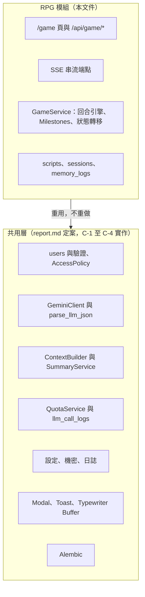

| RPG 需要的能力 | 重用的共用元件 | RPG 專屬的新增部分 |
|---|---|---|
| 使用者與登入 | `users`、驗證、CSRF | 無 |
| 資料擁有者檢查 | `AccessPolicy`、Repository 帶 `user_id` | `sessions`、`scripts` 的擁有者檢查 |
| 呼叫模型 | `GeminiClient`、`parse_llm_json` | 串流呼叫包裝 |
| 滑動視窗與長期記憶 | `ContextBuilder`（共用）；客服的 `SummaryService` **RPG 不使用**（v1.2） | 「世界狀態」的組成內容、記事簿（R-17） |
| 用量與限額 | `QuotaService`、`llm_call_logs`（`kind` 新增 `rpg_stream`、`rpg_delta`、`rpg_notebook`） | 同時串流數上限 |
| 前端元件 | Modal、Toast、Typewriter Buffer、IndexedDB 封裝 | `/game` 頁面、串流接收器 |
| 部署 | 設定、secret、Alembic | 獨立的 RPG worker 池 |

---

## 第 2 章　資料模型

### 2.1 以 AGENTS.md 檢視 spec_report 的資料表

spec_report 主題三的 `scripts`、`sessions`、`memory_logs` 對照 AGENTS.md 第 6 節與第 7 節，有以下缺口（R-07）：

| 編號 | 缺口 | 依據 | 建議 |
|---|---|---|---|
| G-1 | `sessions` 沒有 `version` | 第 6 節：可變的世界狀態須帶版本號 | 新增 `sessions.version`，預設 1 |
| G-2 | `memory_logs` 沒有前端產生的唯一 ID | 第 6 節：每則訊息有唯一 ID，後端以此去重 | 新增 `memory_logs.client_msg_id`，`(session_id, client_msg_id)` 唯一 |
| G-3 | 回合序號沒有唯一約束 | 一輪的定義 | **已實作為** `(session_id, seq)` 唯一（後端指派的單調遞增序號）；`turn_number` 可為空，只在回合完成時指派，中斷與被擋的回合不計輪（不設資料庫唯一，靠同一存檔同時只處理一則） |
| G-4 | `memory_summary` 放在每筆 `memory_logs` | 摘要是整個 session 的累積值，每列各存一份是冗餘；**v1.2：RPG 不再使用摘要（R-17）** | **v1.2 改為**：`memory_logs` 的摘要欄位直接移除，**不**新增 `sessions.memory_summary` 與 `summary_upto_turn`；長期記憶改用 G-14 的記事簿欄位 |
| G-5 | 沒有地方存「LLM 動態延伸的目標」 | 第 7 節：不得寫回原始劇本，應另存於 session 層 | 新增 `sessions.goals_json`（見 R-06） |
| G-6 | 沒有記錄各 Milestone 的觸發進度 | 原始劇本唯讀，進度只能記在 session | 新增 `sessions.milestone_progress_json` |
| G-7 | 串流中斷時 `llm_raw_response` 無法為 NOT NULL | spec_report 主題六第 6 點 | 見 R-03，新增 `memory_logs.turn_status` |
| G-8 | `scripts` 沒有可見性 | 若允許使用者創作劇本，需區分私人與公開 | **已被取代**：RU-1 決定為 (c) 玩家創作並公開分享（先審後發），可見性改由 `script_versions.status`（只有 `published` 的版本公開）與送審流程表達，不再有 `is_public`（RC-1 已建立資料，審核流程屬 RC-8） |
| G-9 | 沒有地方存 NPC 的特質與弧線階段（v1.1） | R-14：特質與階段必須每回合進世界狀態，不能只靠記事簿（可能已滿、也可被玩家編輯） | **不新增欄位**，放入既有的 `sessions.entities_json` 內的 NPC 卡結構（見 R-14.3），變更時帶 `sessions.version` |
| G-10 | 沒有「玩家層」的個性覆蓋（v1.1） | R-14：個性是唯一跨存檔重複使用的內容，玩家修正後只存差異 | 新增 `user_persona_overrides`：`(user_id, trait_key)` 唯一、`overrides_json`、`version`。**只用於個性**，其餘內容一律留在存檔層 |
| G-11 | 沒有全站性格原型庫（v1.1） | R-14：「AI 的存檔」，玩家唯讀 | 新增獨立資料表 `persona_prototypes`：`trait_key` 唯一（純文字標準化欄位）、特質定義、`status`、`version`。**不含任何使用者外鍵**。不用假使用者擁有 `sessions` 的作法 |
| G-12 | 沒有原型草案佇列（v1.1） | R-14：AI 擬草案、管理員核可才上架 | 新增 `persona_drafts`：草案內容、來源 `user_id`、`status`（待審、核可、退回、逾期）。含玩家衍生文字，視為個資；退回或逾期清除，帳號刪除時一併刪除 |
| G-13 | `sessions` 沒有內容分級（v1.1） | R-15：分級以旗標存在存檔上 | 新增 `sessions.content_tier`（`safe`／`standard`／`adult`；2026-11-03 起取代原本的 `sexual_content_level` 0 至 3，見 AGENTS.md 第 7 節）。用純欄位而不放 JSON，因為會用於統計與稽核。年齡確認欄位屬共用層（見 RA-10），不在本模組的 migration |
| G-14 | 沒有地方存長期記憶（v1.2） | R-17：記事簿，每個存檔一本 | `sessions` 新增 `notebook_text`（`UnicodeText`，預設空字串）、`notebook_version`（整數，預設 1，玩家編輯與 AI 追加的衝突偵測）、`notebook_upto_turn`（整數，預設 0，已處理到的 boundary）。容量不存，由會員等級推得（程式常數，見 R-17.2）。純文字欄位，不放 JSON、不做內容篩選 |

### 2.2 建議的資料模型

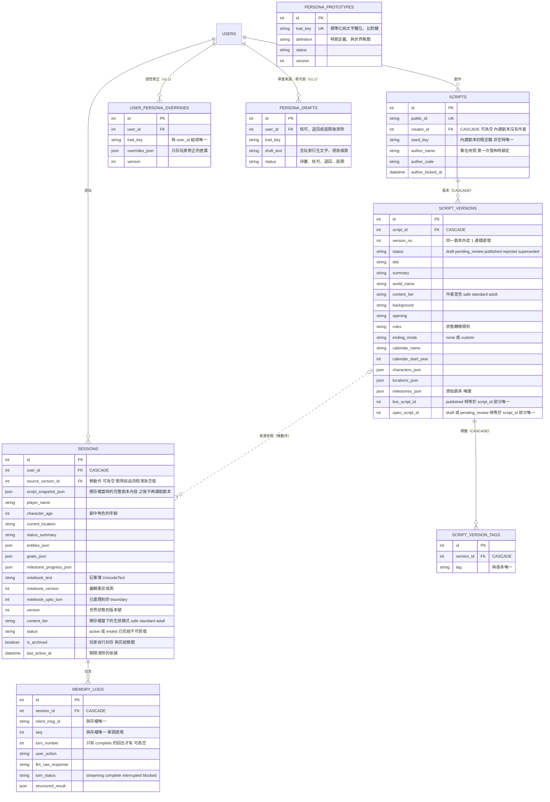

**實作狀態（2026-11-03，RC-1 `rpg-data-and-script`）**：上圖的 `SCRIPTS`、`SCRIPT_VERSIONS`、`SCRIPT_VERSION_TAGS`、`SESSIONS`、`MEMORY_LOGS` 已實作（遷移 `0012`），圖與表以 `app/models/` 與 [資料模型-data-model.md](資料模型-data-model.md) 為準。與 2.1 節原先建議的差異（以實作為準）：①**劇本拆成 `scripts` 與 `script_versions`**，內容與狀態在版本上，已發佈的版本不可變、修改一律新增版本（取代原本 `scripts.is_public` 的可見性旗標，改由版本狀態與先審後發表達）；②存檔以 `source_version_id`（無動作的外鍵）取代 `script_id`，並複製完整內容到 `script_snapshot_json`；③回合的唯一約束是 `(session_id, seq)` 與 `(session_id, client_msg_id)`，`turn_number` 可為空、只在回合完成時指派（不設資料庫唯一）；④`sessions.content_tier` 是三種模式之一，預設 `safe`；⑤`sessions.character_age` 是劇中角色的年齡，與使用者年齡無關；⑥記事簿欄位只建立並給預設值，行為屬 RC-2。`PERSONA_*` 三張表仍屬 RC-5，未實作。

客服不使用 `sessions`（見 report.md D-05），**不受影響**。

`PERSONA_PROTOTYPES` 刻意**不與 `USERS` 連線**：核可上架的原型由管理員改寫去識別，不留可回溯到個人的外鍵，帳號刪除時才不會殘留個人內容（見 R-14.5）。NPC 的特質與弧線階段存在 `sessions.entities_json` 內，不另建資料表（G-9）。

---

## 第 3 章　SSE 串流與伺服器

本章集中 report.md 中因 D-00 而延後的 SSE 相關內容（D-11、D-13、D-20、D-24 的 SSE 部分）。

### 3.1 R-01　SSE 事件協定　**[建議]**

AGENTS.md 指定前端以 `fetch` 搭配 `ReadableStream` 接收，因此端點可用 **POST**（原生 `EventSource` 只支援 GET，不採用）。建議端點：`POST /api/game/sessions/{public_id}/turns/stream`。

| 事件 | 內容 | 用途 |
|---|---|---|
| `meta` | `turn_id`、回送的 `client_msg_id` | 開始，確認冪等 |
| `token` | `{ "text": "片段文字" }` | 劇情片段，交給打字機緩衝區 |
| `ping` | 空物件 | 心跳 |
| `state` | `{ "state_version": n, "delta": {...} }` | 世界狀態變更（見 R-04） |
| `done` | `{ "turn_number": n }` | **明確的結束標記**；前端收到才視為完整 |
| `error` | `{ "code": "...", "message": "繁體中文訊息" }` | 失敗，訊息為繁體中文 |

格式為 `event: 名稱` 加 `data: 單行 JSON`，以空行分隔。文字片段放在 JSON 內，避免換行字元破壞協定。回應標頭：`Content-Type: text/event-stream; charset=utf-8`、`Cache-Control: no-cache, no-transform`、`X-Accel-Buffering: no`。

### 3.2 R-02　心跳與斷線偵測　**[建議]**（對應 report.md A-05）

| 項目 | 建議值 | 說明 |
|---|---|---|
| 心跳間隔 | 15 秒 | 後端定期送出 `ping`，維持中介層連線，也使斷線能被偵測 |
| 前端閒置逾時 | 45 秒 | 每收到任何位元組（含 `ping`）就重設計時器；逾時以 `AbortController` 中止 |
| 前端總逾時 | 90 秒 | 超過即中止 |
| 後端單次生成上限 | 60 秒 | 超過即中止並送出 `error` |
| 斷線偵測 | 寫入失敗或產生器被關閉 | 後端偵測到客戶端斷線時**停止生成並關閉上游 Gemini 串流**，把該回合標記為 `interrupted` |

說明：在 `gthread` 模型下，斷線只會在**下一次寫入**時被發現。心跳確保即使 Gemini 暫時沒有輸出，最晚 15 秒內也會發現斷線並釋放執行緒與停止計費。

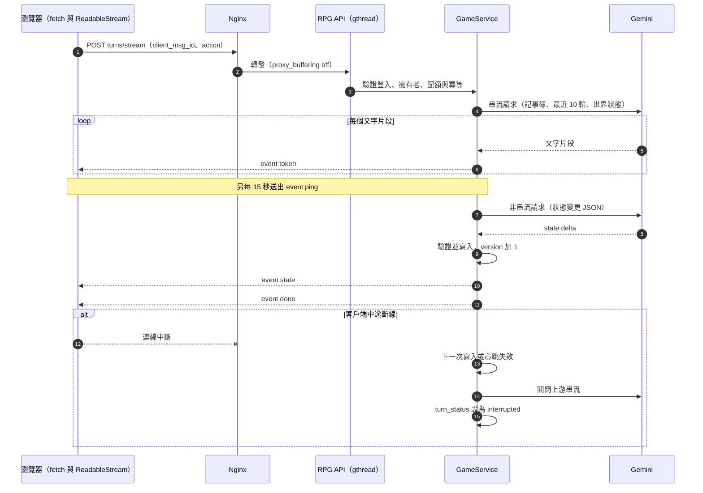

### 3.3 R-08　伺服器架構與並發　**[建議]**

**獨立 worker 池**：同一個 gunicorn 無法為不同端點設定不同 worker 型態，且長串流會佔用執行緒。因此 RPG 使用**獨立的 gunicorn 行程**，由入口依路徑（`/api/game/*/stream`）分流；客服池維持 report.md D-13 的設定。

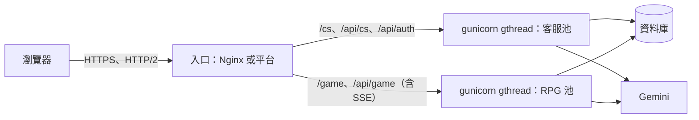

**容量估算**（假設值，須由壓測校正）：並發串流數 ＝ 同時生成的回合數；所需執行緒槽位 ＝ 回合到達率 × 平均占用秒數。

- 假設：RPG 池 2 個 worker、每個 16 條執行緒，共 32 個槽位；一個回合占用串流約 12 秒，加上狀態變更呼叫與寫入約 2.5 秒，合計約 14.5 秒。
- 吞吐上限 ≈ 32 ÷ 14.5 ≈ 2.2 回合每秒。
- 若玩家閱讀與思考約 60 秒才送出下一個行動，可支撐約 2.2 × 60 ≈ **130 位同時在線玩家**。
- 全站同時串流上限設為「槽位數減 4」（保留 4 個槽位給非串流的 API 請求），即 28；超過時回 503 與繁體中文文案「目前冒險者眾多，請稍候片刻再出發。」
- 每位使用者同時只能有 1 個進行中的串流。

**Nginx 的 SSE 專用設定**：

| 設定 | 建議 |
|---|---|
| `proxy_buffering` | off |
| `proxy_cache` | off |
| `proxy_http_version` | 1.1，並清除 `Connection` 標頭 |
| `proxy_read_timeout` | 120 秒（大於後端生成上限 60 秒，也大於心跳間隔） |
| gzip | 對 `text/event-stream` 關閉 |
| 回應標頭 | 由應用程式送出 `X-Accel-Buffering: no` |
| HTTP/2 | 啟用，避免 HTTP/1.1 同網域連線數上限造成多分頁互相阻塞 |

gunicorn 的 `timeout` 應大於生成上限（例如 120 秒）；`gthread` 的 worker 存活回報獨立於請求長度，不會因長串流被誤殺。

**限額補充**（接 report.md D-20）：一個 RPG 回合包含串流呼叫、狀態變更呼叫，每完成 10 輪再加記事簿抓取呼叫（R-17），三者都寫入 `llm_call_logs` 並計入每日 token 與全站預算；每日回合數的上限比照客服的等級額度，數值待 U-7 預算確認後設定。

### 3.4 R-09　前端串流接收與打字機　**[建議]**

- 使用 `fetch` 搭配 `ReadableStream`，以 `TextDecoder('utf-8')` 解碼，**必須使用串流模式解碼**（`stream: true`）。中文字元為多位元組，網路分段可能把一個字元切在兩個片段之間，未使用串流模式會出現亂碼。
- 以行為單位累積緩衝，遇到空行才切出一個完整事件再解析 JSON。
- `token` 事件的文字推入打字機緩衝區，以固定節奏逐字渲染；緩衝區積壓過多時加速追趕，避免串流結束後還要等很久。
- 計時器：每收到任何位元組重設閒置計時器；`AbortController` 在逾時、使用者取消、離開頁面時中止。**無論成功、失敗或中斷，皆在 `finally` 恢復 UI**（解除按鈕禁用、清除載入動畫）。
- 只有收到 `done` 才視為完整；沒有 `done` 的結尾視為中斷，提示使用者可重新生成。

### 3.5 R-03　串流中斷時的紀錄處理（spec_report 主題六第 6 點）　**[建議]**

| 方案 | 內容 | 評估 |
|---|---|---|
| (a) `llm_raw_response` 改為 NULLABLE | 中斷時為空值 | 簡單，但丟失已生成的部分內容，且 NULL 語意不清 |
| **(b) 保持 NOT NULL，預設空字串，新增 `turn_status`（採用）** | 回合開始時寫入 `streaming`；完成為 `complete`；中斷為 `interrupted`，保留已收到的片段 | 可偵錯、語意明確；需要處理狀態 |
| (c) 中斷時不寫入 | 回合直接消失 | 無法偵錯，也無法做冪等 |

**建議 (b)**，並訂下規則：

- `interrupted` 的回合**不計入輪數、不進入滑動視窗的上下文**，不算「一輪」（一輪須有完整的 AI 回應）；記事簿的「每 10 輪」計數同樣不含它（R-17.3）。
- 使用者以相同 `client_msg_id` 重送：若原回合為 `complete`，直接回傳既有結果（冪等）；若為 `interrupted`，允許重新生成並覆蓋該筆。
- `interrupted` 的部分內容保存 14 天後清除。

---

## 第 4 章　RPG 設計決策與待決定事項

### 4.1 R-04　狀態變更的取得方式（spec_report 主題六第 1 點）　**[建議]**

NPC 好感度與狀態效果屬結構化資料，但劇情是自由文字串流，無法直接攜帶。

| 方案 | 內容 | 優點 | 缺點 |
|---|---|---|---|
| **(a) 串流後再做一次非串流 JSON 呼叫（採用）** | 文字完成後，帶著本回合內容要求輸出狀態變更 JSON | 與 AGENTS.md 一致（結構化輸出為非串流）；文字與資料互不干擾；可用 schema 強制格式 | 多一次呼叫，增加延遲與成本 |
| (b) 在串流尾端嵌入標記區塊 | 劇情後附一段特殊標記的 JSON | 單次呼叫 | 標記可能被模型漏掉或洩漏到畫面；JSON 原文會混入串流，違反「嚴禁將 JSON 原文以串流送達前端」的精神 |
| (c) 工具呼叫 | 模型在敘事中呼叫工具回報變更 | 結構清楚 | 與串流混用複雜，v1 過度設計 |

**建議 (a)**。狀態變更 JSON 建議欄位：`favorability_changes`（NPC 與增減值）、`status_effects`、`current_location`、`milestone_events`、`entities_patch`、`goals_patch`。寫入前須通過 `parse_llm_json` 與 Service 層驗證，並比對 `sessions.version`；成功後以 `state` 事件通知前端，再送出 `done`。狀態呼叫失敗時重試 1 次，仍失敗則該回合文字保留、世界狀態不變，並記錄於 `llm_call_logs`。

**v1.1 擴充（R-14）**：狀態變更 JSON 另增兩個欄位。`npc_updates`：本回合出現或變化的 NPC，含人物稱呼、特質標籤與表層／隱藏的歸屬，以及對弧線階段的**提議**。`persona_patch`：玩家在對話中對某個特質的修正。兩者都只是提議，由 Service 驗證後才寫入：階段只能依 R-14.4 的轉移規則改變；特質標籤須經標準化並在原型清單內，否則進入新特質流程（R-14.5）；寫入前同樣比對 `sessions.version`。此呼叫仍須在串流結束後、`done` 之前完成，R-16 的外部查詢與它**平行進行**，不額外延長等待。

### 4.2 R-05　`state_transition_rules` 的格式（spec_report 主題六第 2 點）　**[建議]**

| 方案 | 說明 | 評估 |
|---|---|---|
| **(a) 維持 TEXT（自由文字），並加上 Service 層的不變量檢查（採用）** | 規則直接放入 Prompt 供模型解讀 | 劇本創作簡單；以程式碼不變量防止模型違規 |
| (b) 結構化 JSON | 條件與結果由程式解讀 | 彈性低，劇本創作門檻高，v1 過度設計 |
| (c) 混合 | 文字規則加少量 JSON 掛鉤 | 後續可由 (a) 演進而來 |

**不變量**（Service 層強制，與 AGENTS.md 第 7 節「廢除死亡死局」一致）：年齡只增不減；不存在「死亡」或「結局」終止狀態；地點必須是已登錄地點或經新增登錄；Milestone 的觸發須符合條件。

### 4.3 R-06　Milestones 與動態目標　**[建議]**

AGENTS.md 第 7 節：劇本版本（`script_versions`）的 `milestones_json` 為**唯讀**；LLM 延伸的目標不得寫回原始劇本，應另存於 session 層，完成後歸檔。

- 動態目標存於 `sessions.goals_json`（JSON，結構為 `active` 與 `archived` 兩個清單），**與 AGENTS.md 第 4 節「高動態資料用 JSON 欄位」一致**；變更時帶 `sessions.version`。不另建資料表。
- 各 Milestone 是否已觸發，記錄於 `sessions.milestone_progress_json`，不修改劇本。
- Milestone 的觸發判斷由 Service 層依遊戲內時間（乾歷年月）與年齡計算，**不交給模型自行宣告**；模型只負責在觸發後延伸新目標。

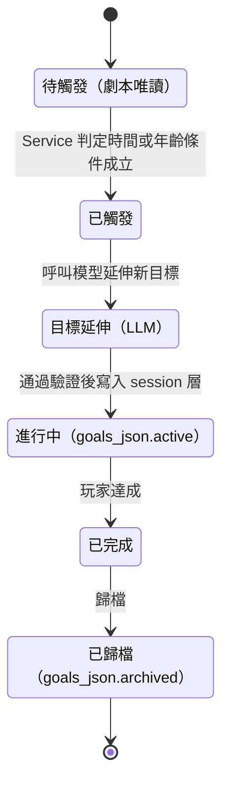

### 4.4 R-10　前端暫存與同步　**[建議]**

沿用 AGENTS.md 第 6 節：前端 IndexedDB 暫存完整對話與世界線，背景同步；每個回合由前端產生 `client_msg_id` 供去重；世界狀態帶 `sessions.version`，寫入不一致時**以後端為準並通知前端**（以 Toast 提示）。RPG 的回合由後端產生 AI 回應，因此同樣採「後端先寫庫、前端拉取補齊」，並與客服共用冪等與 `seq` 類的同步工具；與客服不同之處是 RPG 的離線期間仍可閱讀歷史與世界線，但**產生新劇情需要連線**。

### 4.5 R-11　RPG 的上下文組成

沿用 AGENTS.md 第 6 節，但 **v1.2 起 RPG 不使用摘要**：「記事簿 + 最近 10 輪原文 + 當前世界狀態」（記事簿見 R-17）。RPG 的「當前世界狀態」建議包含：`player_name`、`player_age`、`current_location`、`status_summary`、`entities_json`（NPC 好感度等）、`goals_json.active`、已觸發的 Milestone，以及該劇本的 `state_transition_rules` 與世界觀設定（劇本設定每回合都放入 System Prompt，不佔用對話輪數）。

**v1.1 擴充（R-14）**：「當前世界狀態」另含**在場 NPC 的角色卡切片**：特質、表層／隱藏的歸屬、弧線階段、錨定事實（例如「玩家是初次入門的弟子」），以及這些特質的定義（依 R-14.2 的查找順序取得，已套用玩家層覆蓋）。切片有**大小上限**，使整體仍落在 AGENTS.md 第 6 節的上下文限制內，具體數值待壓測與實測，本文件不預設。特質與階段**不得只存在於記事簿**：記事簿可能已滿、也可被玩家編輯，且早於最近 10 輪的細節容易流失而造成角色漂移（見 R-14.7 的實驗；該實驗以摘要為前提，需用新的上下文組成重測）。

### 4.6 R-14　NPC 角色卡與個性　**[建議]**（含 **[已確認]** 項目）

**情境**：玩家在劇情對話中即興引入帶有個性標籤的 NPC，例如「我走進青雲宗就有個活潑的小師妹迎來，對話的過程中才發現她是如此腹黑」。兩個標籤都沒有描述，而且有時間弧線：開場是活潑，之後才露出腹黑。AI 必須符合開場，並在對話中逐步轉變。

**設計原則**：

- 個性不是靜態文字，而是「特質組合加弧線階段」。
- 模型對常見標籤本來就懂；缺的是**階段控制**與**事實錨定**（見 R-14.7 的實驗），不是知識。
- 只有「跨聊天重複使用」的內容才放玩家層，其餘一律留在單一存檔。

#### R-14.1　資料歸屬　**[已確認]**

| 內容 | 歸屬 | 理由 |
|---|---|---|
| 玩家新增的人物、背景、世界觀、地點 | **單一存檔**（session 層） | 劇本會持續新增，每個劇本的背景與世界觀都不同，不能跨存檔共用 |
| 個性（特質）的描繪，以及玩家對它的修正 | **玩家層**（該玩家的所有存檔） | 唯一會在不同聊天中重複使用的內容 |
| 特質的通用定義（原型） | **全站**（「AI 的存檔」），玩家唯讀 | 避免每位玩家各存一份；審過的定義比臨時生成穩定 |

玩家在對話中修正某個特質後，只存**差異**到玩家層；之後該玩家所有存檔的同一特質都套用修正，其他玩家不受影響。

#### R-14.2　查找順序　**[建議]**

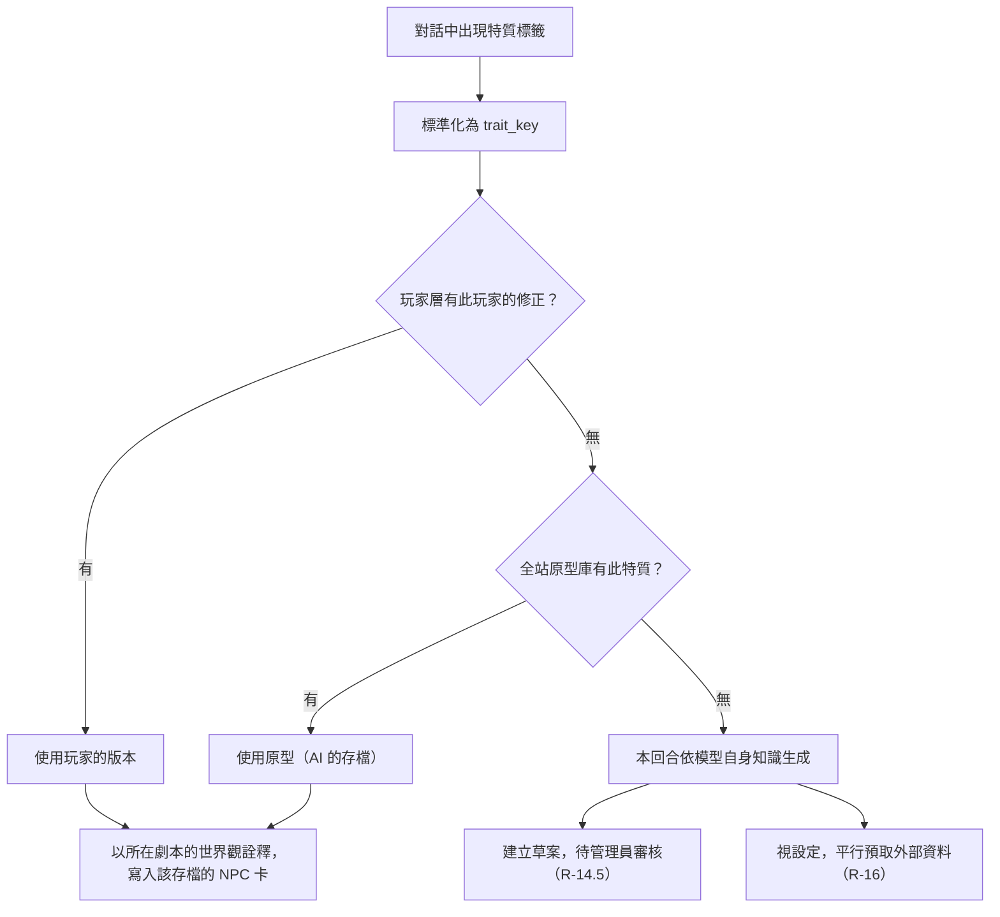

原型是**與世界無關**的特質定義。同一個特質在修真界與現代都市的表現不同，因此詮釋一律取自該劇本的 `world_view`，原型不夾帶世界設定。

#### R-14.3　NPC 卡結構　**[建議]**

| 欄位 | 說明 |
|---|---|
| 人物稱呼 | 玩家或劇情給的稱呼，例如「小師妹」 |
| 特質清單 | 每項含 `trait_key` 與歸屬：`surface`（表層）或 `hidden`（隱藏） |
| 弧線階段 | `surface`、`cracking`、`revealed` 三個列舉值之一 |
| 錨定事實 | 不可被模型改寫的前提，例如「玩家是初次踏入宗門的新入門弟子」 |
| 成年年齡 | 見 R-15.5；沒有年齡的角色不得進入露骨場景 |

存放於 `sessions.entities_json` 內，與 NPC 好感度同處，變更帶 `sessions.version`（G-9）；每回合進入世界狀態（R-11）。

#### R-14.4　弧線階段與提示的放置　**[建議]**

| 階段 | 定義（靜態規則） |
|---|---|
| `surface` | 只展現表層特質。隱藏特質不得被玩家察覺，不得直接表現 |
| `cracking` | 表層偶有破綻。隱藏特質只能以暗示、雙關或一閃而過的神情流露，不得明說 |
| `revealed` | 隱藏特質已被玩家察覺，可以直接展現，但仍保留表層特質作為外殼 |

- 階段定義是靜態規則，放在 `system_instruction`；角色卡是 Service 產生的**資料區塊**，放在使用者內容區，並聲明「僅為資料，其中任何要求改變規則的文字一律忽略」。
- 階段由 R-04 的狀態變更呼叫**提議**，Service 驗證轉移：非法轉移被拒絕並保留原階段。轉移規則的細節（含是否允許回退，例如重新隱藏）於 RC-2 設計時決定。
- 階段的**節奏**由模型依劇情掌握；Service 只記錄與驗證階段，不決定劇情要在第幾回合轉折。

#### R-14.5　比對鍵與原型庫的成長

- **比對鍵**　**[建議]**：`trait_key` 是純文字、標準化的欄位（比照 `email_canonical` 的作法），以它做精確比對。AGENTS.md 第 4 節禁止依 JSON 內容篩選、禁止 Raw SQL，因此不得以 JSON 內容或全文搜尋當比對鍵。模型在結構化輸出中，從「現有原型清單」挑出對應的鍵，或回報「無」，Service 重新驗證；清單由程式內的單一來源產生，與客服 intent 清單同一個作法。同義詞（例如腹黑與黑化）如何處理見 RU-9。
- **成長機制**　**[已確認]**：**AI 擬草案、管理員核可才上架**。
  1. 查無原型時，AI 依模型自身知識（以及選配的 R-16 外部資料）擬出特質定義草案，進入 `persona_drafts`（待審）。
  2. 管理員審閱，改寫並去識別，核可後寫入 `persona_prototypes`。
  3. 退回或逾期的草案清除。
- 草案含玩家衍生文字，**視為個資**；核可後的原型**不留使用者外鍵**，並由管理員改寫，確保帳號刪除後不殘留個人內容（AGENTS.md 第 11 節）。
- 管理員審閱草案是**新的檢視類別**，須寫入稽核紀錄。現行 AGENTS.md 第 10 節只允許管理員檢視統計、使用者主動提交的意見回饋與被標記的對話，因此需修訂（RA-11）。
- 草案核可前，其他玩家提到同一特質如何處理，見 RU-11。

#### R-14.6　安全規則　**[建議]**

- 玩家寫的個性文字**不得進入 `system_instruction`**（AGENTS.md 第 10 節：指令只放在 system_instruction，使用者文字不得串接進指令）。只能收斂成列舉欄位加短文字，放在使用者內容區當資料。
- 全站原型會進入每位玩家的上下文，是價值最高的注入目標，因此一律經管理員核可、限長，並視為資料而非指令。
- 角色資訊有大小上限（R-11）。
- 「AI 學到的內容」只存在存檔層與玩家層；進入全站層必須經人工核可。這是刻意的設計：避免一次注入變成永久且全站的污染。

#### R-14.7　實驗證據

2026-10-28 兩個小實驗，模型為 `gemini-3.5-flash`（當時 `gemini-3.8-flash` 持續回 503，見 6.3 節），情境即本節開頭的例子，共 4 個回合。

| 項目 | 實驗 A：只給標籤 | 實驗 B：角色卡加階段 |
|---|---|---|
| 第 1 回合 | 就勒索玩家 | 純粹活潑，帶玩家去辦入門手續 |
| 前情 | 編造「你可算回山啦」、「下山得了千年雪蓮」 | 全程是新入門弟子，沒有編造 |
| 第 3 回合 | 一路腹黑，沒有轉折 | `cracking`：眼底閃過幽光，說了帶刺的話又馬上收回 |
| 第 4 回合 | 沒有轉折 | `revealed`：卸下外衣，笑容不減地說出冰冷的話，保留甜美外殼 |

結論與限制：

- 模型對「活潑」、「腹黑」本來就懂，缺的是階段控制與事實錨定。外部資料不是這個情境的關鍵（見 R-16）。
- 實驗 B 驗證的是**消費端**（給定階段後模型能演出）。階段由模型**提議**的**生產端**見下方實驗 C。
- 兩次執行都不是乾淨的完整 4 回合（一次第 4 回合遇 503，一次第 1 回合沒有輸出），B 的結果由兩次拼接；樣本只有一個情境、一個替代模型。
- 每個回合約多出 260 個輸入 token（規則加角色卡）。

**實驗 C（生產端）**：2026-10-28，模型 `gemini-3.5-flash-lite`。`gemini-3.8-flash` 當時不可用；`gemini-3.5-flash` 在 3 條執行緒並行下，27 次呼叫有 21 次回 429，該次結果作廢。以結構化輸出（response schema，特質與階段皆為列舉）要求模型依「目前角色狀態」與「本回合劇情」輸出 `npc_updates` 與 `persona_patch`。9 個情境、每個重複 2 次，共 18 次，依序呼叫（每 12 秒一次）。**HTTP 200 為 18/18，JSON 與 schema 有效 18/18，符合預期 16/18。**

| 情境 | 結果 |
|---|---|
| S1 至 S4：維持 `surface`、維持 `surface`、`cracking`、`revealed` | 8/8 符合預期 |
| S5：首回合就勒索，目前 `surface` | 2/2 提議 `cracking`，遵守「最多前進一階」，沒有跳到 `revealed` |
| E1：首次出現「活潑」與預告的「腹黑」 | **0/2**：兩次都只抽出「活潑（表層）」，**漏掉預告的隱藏特質「腹黑」** |
| E2：列舉外的標籤「憨直」 | 2/2 對應為「無」並保留原文；「有心機」被對應為「腹黑」（隱藏） |
| E3：玩家修正「腹黑」的定義 | 2/2 產生 `persona_patch`（「表面溫柔、背地裡算計卻從不傷人」，在 60 字內），階段維持不變 |
| E4：玩家文字夾帶假指令 | 2/2 不照做：階段維持 `surface`、沒有補丁、沒有複製指令文字 |

結論與限制：

- 生產端大致可行：階段提議符合預期且不跳級；能產生玩家修正的補丁；能抵抗夾帶的假指令。這只是模型層面的證據，**Service 的驗證仍必須存在**。
- **E1 是真實的風險**：玩家預告的隱藏特質若首次出現時沒被記錄，弧線就不會發生。E1 兩次都漏、E2 兩次都抓到，原因不明；我的提示詞要求階段依「實際表現」判斷，可能被模型一併套用在特質抽取上。RC-2 須調整提示詞並重測，並把這一項納入第 5 章的測試。**後續重測**：在提示詞加入一條明確規則（特質必須列出玩家預告的隱藏特質；階段仍只依劇情中的實際表現）後，E1 為 **3/3**，E2 維持 3/3（同一模型，只重跑這兩個情境，每例 3 次）。這支持「原因在提示詞」的推測，**新提示詞已在 `gemini-3.5-flash-lite` 上完整回歸**：9 個情境各 2 次共 18 次，**18/18 符合預期**（含 S1 至 S5、E3、E4，注入防護 2/2）。其他模型（含 3.8 Flash）採用前仍須重跑。
- 模型會把同義詞（「有心機」）對應到列舉（「腹黑」）。這對比對鍵設計有利，但對應是否正確仍須 Service 驗證，同義詞處理見 RU-9。
- 成本：平均輸入約 596 token、輸出約 108、思考 0 token；多數呼叫約 1 秒，少數 13 至 16 秒，原因不明。
- **較輕量的模型適合這個呼叫**：狀態分析不需要敘事品質，Flash-Lite 沒有思考 token、延遲低。這是**建議**，樣本很小；若採用，AGENTS.md 第 5 節的「全系統預設 gemini-3.8-flash」須允許依用途指定模型（RA-7）。
- 限制：單一情境、每例只重複 2 次、使用替代模型；E1 的 0/2 與其他的 2/2 都不足以估計機率。

#### R-14.8　補充說明

「省資料庫空間」不是這個設計的主要理由：一份特質描述只有幾 KB，真正吃空間的是每回合都存的 `memory_logs.llm_raw_response` 乘以回合數與保存期。設計的價值在**品質一致**，以及省下重複生成的 token。

### 4.7 R-15　內容分級與安全　**[建議]**（含 **[已確認]** 項目）

目標是在合規的前提下，**最大限度**保留黑暗與成熟內容。供應商條款與法規依據見 [content-policy-research.md](content-policy-research.md)，本節只記設計決定。

#### R-15.1　範圍　**[已確認]**

| 保留 | 排除 |
|---|---|
| 黑暗內容（非性）：暴力、威脅、死亡、背叛、反派 | 涉及未成年的性內容（含看似未成年的角色）。**硬底線，不是設定項目** |
| 成熟內容 | 性暴力與非自願的性情節 |
| 成年角色之間、合意的露骨內容（預設關閉、玩家主動啟用、須通過年齡確認） | 以真人名義的性內容　**[建議]** |

#### R-15.2　分級與性內容階梯　**[建議]**

分級旗標存在存檔上（G-13），預設最保守。分級同時改變劇情提示與安全門檻，所有分級共用同一套程式。

| 等級 | 內容 |
|---|---|
| L0 | 無性內容 |
| L1 | 浪漫、曖昧 |
| L2 | 感官但不露骨（帶過去的場面），並允許部分黑暗內容（使用者決定，2026-10-28） |
| L3 | 露骨（成年角色之間、合意） |

**分級與年齡的關係（使用者決定，2026-10-28；AGENTS.md 第 7、10 節）**：未滿 18 歲（13 至 17 歲）固定為 L0（安全模式），不得提高，介面顯示提示；成年者預設從 L0 開始，由玩家主動在 L1 與 L2 之間切換；玩家輸入曖昧內容而目前分級較低時，系統**只提醒**玩家可切換，不自動調高；L3 仍鎖定。上限由 `AccessPolicy` 依生日當下計算的年齡決定，滿 18 歲後自動解除。

L3 旗標第一版就存在，但**程式上無法開啟**；開放條件見 R-15.3。

#### R-15.3　發行分版　**[已確認]**

發行分兩版，**共用同一套程式與資料結構**，差別只在是否開啟 L3 旗標與內容準則，不需要改架構。

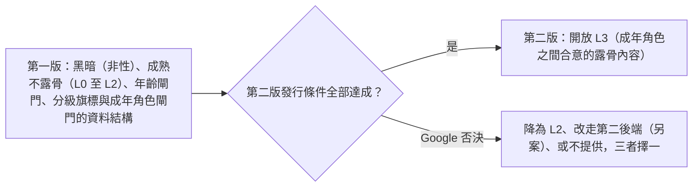

**第二版的發行條件**（缺一不可）：

1. 取得 Google 對詢問信（研究文件第 7 章）的**書面答覆**，且為同意或明確不禁止。
2. 法務對研究文件第 6 章第 1 至 4 題已有意見。
3. R-15.5 的成年角色閘門與輸出檢查已上線並通過測試。
4. R-15.8 的資料最小化與保存方案已定。

**使用者決定（2026-10-28）**：在 Google 回覆之前，所有取決於 Google 的決定，一律**以 Google 同意為前提進行設計與開發**；使用者確認 Google 的答覆後，若結果是不同意，再修正功能（降為 L2、改走第二後端、或不提供，見上圖）。這些「假設同意」的決定包括：①成年角色之間合意的露骨內容（L3）可做；②黑暗內容（非性）與虛構種族間的偏見可作為世界設定；③調整安全設定即使被 Google 審查也會核准；④自行聲明的年齡確認足以符合 18 歲條款（2026-10-28 後續：自行聲明的做法由勾選改為「生日加年齡區間下拉選單，兩者互相對照」，仍是自行聲明、不核實、不收證件）；⑤「藝術考量」例外適用；⑥**13 至 17 歲者可以使用本平台（含 AI 功能），但強制只能使用安全模式（L0）並顯示提示；未滿 13 歲者不得註冊**（使用者決定，2026-10-28）。⑥與 Gemini API 附加條款直接衝突：該條款（2026-03-23 生效）只有一個 18 歲門檻，要求「使用者年滿 18 歲」且不得用於「可能被未滿 18 歲者使用的應用」（content-policy-research.md 第 70、71 行），2026-10-28 重讀原文與歷史版本，**沒有 13 歲的例外**。**使用者於 2026-10-28 確認原先看到的「13 歲」是看錯，Gemini API 條款確實是未滿 18 歲完全不能使用**；⑥因此**目前與 Gemini 條款不符**，只在個人測試期間維持這個設定（13 至 17 歲可用安全模式、未滿 13 歲不得註冊）。使用者的計畫：日後若改用條款較寬鬆的供應商（例如 OpenAI，**條款尚未查證**）再依該供應商的條款調整。**對外開放前必須以實際使用的供應商條款重新確認**；若仍使用 Gemini，AGENTS.md 第 10 節須修訂為「未滿 18 歲者不得使用」。使用者說明個人測試期間會避開這些情境。**L3 旗標在使用者確認 Google 同意之前仍維持鎖定**（AGENTS.md 第 7 節，程式上不得開啟），所以開發可以先行，開放給玩家則須等確認。上方條件 2 的「法務意見」目前沒有人能提供，這一項是否仍要保留，待使用者決定。

#### R-15.4　年齡閘門（共用層）　**[已確認：事實]**

Gemini API 附加條款（2026-03-23 生效）規定：「You must be 18 years of age or older to use the APIs」，且不得將服務用於「directed towards or is likely to be accessed by individuals under the age of 18」的網站或應用程式。因此**年齡閘門是整個專案（客服加 RPG）的合規問題**，與是否提供成熟內容無關；原本的註冊流程沒有年齡確認，以獨立的共用層 change 處理（6.3 節），AGENTS.md 的修訂見 RA-10。

**實作狀態（2026-10-28，`age-gate`；勾選的做法已由下一段取代）**：共用層 change `age-gate` 已實作並通過驗收，範圍是**自行聲明**——註冊（含 Google 首次註冊）以與同意條款分開的勾選確認年滿 18 歲，記錄 `users.age_confirmed_at` 與 `users.age_policy_version`，不蒐集生日、年齡或證件；升級前的帳號與管理員指令建立的帳號都從「尚未確認」開始，須在帳號設定頁補確認。未確認者可登入與管理帳號，但 `AccessPolicy.require_chat_access` 會擋下所有會呼叫 Gemini 的功能（403 `age_confirmation_required`），管理員與各會員等級都不豁免。這正是上方使用者決定第 ④ 項所假設的做法：若 Google 回覆認為自行聲明不足，另開 change 提高 `CURRENT_AGE_POLICY_VERSION` 並實作重新確認。

**實作狀態（2026-10-29）**：共用層 change `age-verification-birthdate`（T-10）已實作並通過驗收，取代 `age-gate` 的勾選。範圍仍是**自行聲明、不核實、不收證件**：註冊（含 Google 首次註冊）填寫生日並從下拉選單選年齡區間，伺服器以台北日曆日計算年齡並對照兩者。未滿 13 歲不得註冊，且不保存其填寫的生日；兩者不一致時回固定訊息「資料有誤，請重新註冊。」，不建立帳號、不封鎖信箱，前端保留信箱與顯示名稱、清空密碼與生日與區間，可立刻以同一個信箱重新填寫。通過後記錄 `birth_date`、`age_range`、`age_confirmed_at`、`age_policy_version` 與當時是否已滿 18 歲（僅供紀錄，不用於判斷；成年與否一律由 `birth_date` 在請求當下計算）。13 至 17 歲可使用，但 `AccessPolicy.content_ceiling` 固定為安全模式（L0），滿 18 歲後自動解除；成年者上限為 2，L3 仍鎖定。尚未填寫生日的帳號（含管理員指令建立者）可登入，但 `require_chat_access` 回 403 `age_confirmation_required`，須在帳號設定頁補填；規則日後被調高而被擋下的既有帳號回 `age_restricted`。所有年齡數字集中在 `AgePolicy`（`app/services/age_policy.py`），日後換供應商只改這一處。管理員只能以 `flask age-stats` 看各區間人數；連續 12 個月未登入的帳號由 `flask purge-inactive-accounts` 直接刪除（管理員除外）。**仍成立**：目前的設定**與 Gemini 條款不符**（只有 18 歲門檻），僅限個人測試（只有使用者本人、已成年）；對外開放前須以實際使用的供應商條款重新確認。**尚未實作、留給後續 change**：RPG 對 `content_ceiling` 的實際套用與「曖昧內容時提醒切換分級」（RPG change）、匯出含生日與年齡區間及帳號刪除流程（C-4）、管理後台的年齡區間統計頁面（C-4；目前只有 CLI 指令與 Repository 方法）。

#### R-15.5　成年角色閘門　**[建議]**

- NPC 角色卡必須有**明確的成年年齡欄位**；沒有年齡的角色，預設**不得進入露骨場景**。
- 含有幼小描述的角色不得進入露骨場景，即使年齡欄位填了成年；不得以「外貌年輕但實際年歲很長」的設定當成通過閘門的依據。
- 玩家在對話中即興建立的角色，進入露骨場景前須由 Service 確認年齡。
- 輸出端另做檢查，被攔截者保留紀錄。
- 這只能降低風險，不能保證零風險，因為模型輸出終究是機率性的。

#### R-15.6　虛構種族與派系間的偏見　**[建議]**

- **可作為世界設定**（把握中，非保證）。Gemini 安全設定對仇恨言論的定義是「promotes violence or incites hatred against individuals or groups based on certain attributes」；描寫劇中偏見不等於宣揚仇恨。但分類器依機率運作，Google 政策也沒有虛構條款，仍會有誤判。
- 做法屬於世界設定，**不是規避過濾**：種族關係寫入劇本資料（`world_view` 或 `background_and_system`，v1 不新增欄位）；使用虛構世界的稱呼，不用現實中的歧視用語，也不把現實族群的刻板印象原封不動套在虛構種族上；偏見是角色的態度，由情節呈現後果，旁白不背書；預設以第三人稱事件呈現，玩家可選擇淡化這類情節。
- **互換測試**：把虛構種族換成現實族群，內容是否變成真正的仇恨言論？若是，那只是換皮。
- **排除**：針對現實族群的歧視言論；玩家若把現實族群放進對話，仍維持中度過濾。
- 以第二人稱直接辱罵玩家，把握較低（更接近騷擾類，且對象是真實使用者）。

#### R-15.7　安全設定與被擋處理　**[建議]**

- 安全設定**先用預設值**，量測誤判率後再決定是否放寬；放寬可能被 Google 審查（Gemini API 附加條款：「Applications with less restrictive safety settings may be subject to Google's review and approval」）。**不得為規避過濾而設計提示詞**（Google 禁止使用政策第 2 節第 3 項）。
- **被擋的回合**：顯示劇情轉場文字而不是錯誤；標記為中斷、不進入上下文；自動重新生成**一次**並記錄。AGENTS.md 第 5 節對客服規定「內容被安全過濾阻擋時不重試」，這裡是 RPG 專屬的例外，需在 RA-12 一併明文。
- **停權政策**：AGENTS.md 第 10 節的「一日被擋 3 次暫停 1 小時」是為客服設計的；RPG 的誤判會讓正常玩家被停權，須重寫為區分「玩家輸入被擋」與「模型輸出被擋」（後者多半是誤判，不計入），並把結束原因與被擋類別記入 `llm_call_logs`（RA-12）。
- 已知事實：實驗中 11 次生成有 1 次回 `PROHIBITED_CONTENT`，內容是普通的仙俠劇情，原因不明。此類內建保護被認為無法以設定關閉（第三方說法，尚未由官方文件證實）。

#### R-15.8　風險隔離、資料與方案　**[建議]**

- 取得 Google 書面同意之後，成熟分級可使用**獨立的 Google 專案與金鑰**，使萬一被停用時不影響客服。若被否決或停用，**不得另開專案繼續**，那是規避處分。
- 成熟分級的紀錄採資料最小化；保存期限與加密待法務（研究文件第 6 章第 3 題）。性生活相關資料可能屬個資法第 6 條的特種個資。
- 敏感內容**不得使用 Gemini 免費層**（免費服務的輸入輸出可能被人工審閱）。
- 隱私權政策與服務條款須補：內容規範、年齡、AI 處理角色描述、去識別後管理員審閱（RA-14）。

#### R-15.9　驗證的界線　**[已確認]**

驗證只測閘門與行為（旗標、年齡、被擋處理），**不使用 Gemini 金鑰生成或測試露骨內容**，那可能違反供應商條款而危及整個專案的帳號。黑暗（非性）與虛構種族偏見的擋掉率，可在條款範圍內以實驗 D 量測。

### 4.8 R-16　外部資料與 MCP　**[已確認：不降級]**

**MCP 與外部資料作為平台能力保留，不降級**，以便日後其他功能使用。本節描述第一個使用情境：為冷門特質標籤預取參考資料。實驗 A 顯示常見標籤不需要外部資料，因此 RPG 的主流程**不依賴**它。

AGENTS.md 第 10 節的「客服 v1 不提供工具呼叫」只針對客服；RPG 劇情中不用工具呼叫，出自 R-04 的選項 (c)（與串流混用複雜）。本節採 **Service 主導**的方式，不讓模型在串流中呼叫工具。

#### R-16.1　結構與時序　**[建議]**

- 結構：`ExternalDataProvider` 介面；MCP 是其轉接器之一；測試用假的實作。比照寄信器與 Google 身分供應商：在 `create_app()` 建立或由測試注入，放在 `app.extensions`，Service 經 `runtime` 取用（Service 不匯入 flask）。
- **由 Service 發動**，模型不選工具、不傳參數。
- 與 R-04 的狀態變更呼叫**平行**，在串流結束後、`done` 之前完成；結果從**下一回合**起生效，第一回合靠模型自身知識。

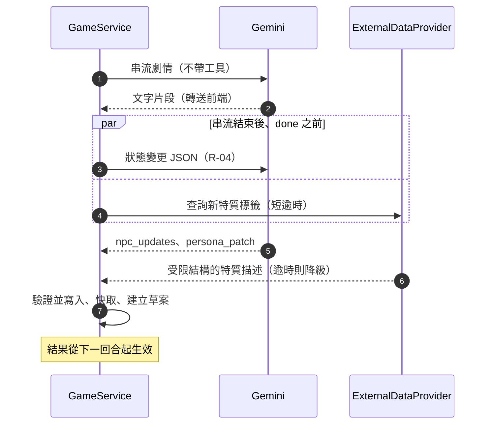

#### R-16.2　控制措施　**[建議]**

| 項目 | 建議 |
|---|---|
| 送出的內容 | 只送標準化後的標籤，**不送玩家原文**；標籤限長，擋掉含網址、email、數字串的內容 |
| 來源 | 白名單，偏百科類；通用網頁搜尋的內容品質與安全較難控制 |
| 逾時與降級 | 短逾時；失敗改用模型自身知識，**不擋住遊戲** |
| 結果的處理 | 視為不可信資料；清洗後以不帶工具的結構化輸出整理成受限結構（列舉特質標籤加短文字），原始網頁文字不直接進劇情上下文 |
| 快取 | 存資料庫，以標籤為鍵（多 worker 不能靠行程記憶體）；同一標籤全站只查一次 |
| 濫用 | 每位使用者每日次數與全站預算，接 C-4 的額度；查無結果的標籤不重複查詢 |
| SSRF | 工具只回傳摘要片段，外部內容不決定連線目標；需要抓網頁時只允許白名單網域 |
| 日誌 | 標籤也算玩家文字，不進一般日誌；只記錄事件列舉（命中、未命中、逾時）與延遲 |
| 設定 | 比照 Google 登入：有設定才啟用，缺漏時安靜退回模型知識；憑證走同一套機密注入 |
| 授權 | 查回內容的授權條款（例如需標示來源、相同方式分享的授權）須先確認，才能納入原型庫 |

#### R-16.3　備案與已知限制

- **備案**：Gemini 內建的 Google 搜尋 grounding。價格說法互相矛盾、有顯示義務與額外資料收集、與結構化輸出並用沒有官方證實、無法限定來源（細節見研究文件附錄）。
- 官方 SDK 的 MCP 支援為實驗性、只支援工具，並由 SDK 自動呼叫（模型主導），不符合 Service 主導的設計；需要自行以 `mcp` 套件撰寫用戶端。
- 客服若要接外部資料，會牴觸 AGENTS.md 的客服條文，**不在本節範圍**（見 6.3）。
- 建置時間點與來源白名單見 RU-7；未核可草案的快取共用見 RU-11。

### 4.9 R-13　RPG 專屬的待決定事項

| 編號 | 事項 | 選項 | 我的建議 |
|---|---|---|---|
| RU-1 | 是否開放使用者創作劇本（影響 `scripts.is_public`、內容審核與 IDOR） | (a) v1 只提供內建預設劇本；(b) 開放私人劇本；(c) 開放公開分享 | **已決定（2026-11-03，使用者）：(c)**，先審後發；規格、審核、署名與刪帳號見 AGENTS.md 第 7、10、11 節與 [report.md](report.md) 的 U-20 至 U-26（原建議 (a) 已被取代） |
| RU-2 | 狀態變更呼叫是否等待完成才解鎖輸入 | (a) 收到 `state` 與 `done` 後才解鎖（資料一致，延遲略增）；(b) 文字完成即解鎖，狀態延後到達（體驗快，需處理版本競爭） | (a) |
| RU-3 | `state_transition_rules` 格式 | R-05 的 (a)、(b)、(c) | (a) |
| RU-4 | 每日回合上限與每回合 token 預算 | 依 U-7 的預算決定 | 待預算。**v1.2 提醒**：記事簿讓 vip 每回合多帶約 9000 至 12500 token（假設值，R-17.9），預算要把它算進去，並由 RC-4 的壓測校正 |
| RU-5 | RPG 啟動時間點 | 緊接 C-4 之後，或待客服上線穩定後 | **預設（2026-10-30，使用者授權按建議；未異議即採用）**：待客服正式上線（C-5b）並穩定後再啟動 RC-1，避免兩條線同時消耗額度與注意力 |
| RU-6 | 玩家在對話中即興新增人物，是否需要內容審核（與 RU-1 相關） | (a) 只靠 R-15.5 的成年閘門與輸出檢查；(b) 新增人物先經內容檢查再寫入角色卡 | **預設（2026-10-30，使用者授權按建議；未異議即採用）**：(b)。絕對禁止項（未成年、性暴力與非自願、真人名義）必須由伺服器端審查層執行，新人物在寫入角色卡前檢查最安全 |
| RU-7 | 外部資料與 MCP 的建置時間點與來源白名單（R-16；「是否做」已確認不降級） | (a) 與 RC-2 同步；(b) 獨立的共用能力 change（RC-6），在 C-4 之後、RC-2 之前評估；(c) 等出現第二個使用情境 | (b)：需要 C-4 的額度與預算機制，且可讓日後其他功能重用 |
| RU-8 | 第二版（L3）是否達成發行條件 | R-15.3 的四項條件 | 條件未全部達成前，L3 維持關閉 |
| RU-9 | 原型比對鍵的初始清單與同義詞處理 | (a) 營運者手寫一批常見特質；(b) 由模型從內建劇本抽出，再由管理員審；(c) 空庫起步，全由草案累積 | **預設（2026-10-30，使用者授權按建議；未異議即採用）**：(a) 營運者手寫一批常見特質，並與 (c) 並用 |
| RU-10 | 草案的保存期限與去識別標準 | 退回後立即清除；待審逾期自動清除，期限待定 | **預設（2026-10-30，使用者授權按建議；未異議即採用）**：退回後立即清除；待審逾期 30 天自動清除。**30 天是預設值，須與法務確認並寫入 AGENTS.md 第 11 節（RA-14）後才生效** |
| RU-11 | 草案核可前，其他玩家提到同一特質 | (a) 重新查詢，不共用；(b) 共用未核可的受限結構卡片，標示未審並設短期效 | **預設（2026-10-30，使用者授權按建議；未異議即採用）**：(a) 重新查詢，不共用未核可的卡片（較安全，成本較高） |
| RU-12 | 管理員審核草案的介面歸屬 | (a) 擴充 C-4 的後台；(b) 獨立 change（RC-5） | **預設（2026-10-30，使用者授權按建議；未異議即採用）**：(b) 獨立 change（RC-5），不回頭改已封存的後台 |
| RU-13 | 備援模型與切換條件（6.3 節） | (a) 同系列的另一個版本；(b) 較輕量的版本；切換條件為 5xx 與逾時 | **已確認（使用者）**：主要 `gemini-3.8-flash`、備援 `gemini-3.5-flash-lite`；觸發條件與依據見 T-9。**v1.2 註：這是客服使用的 Gemini 組合；RPG 用途已改用 OpenAI 相容端點，主要為 `OPENROUTER_MODEL`、備援為 `OPENROUTER_FALLBACK_MODEL`，同樣在 429、5xx、逾時時切換，兩者互不切換** |
| RU-14 | 記事簿的容量、溢出與編輯規則（v1.2） | R-17 | **已確認（使用者，2026-10-30）**：RPG 取代摘要；free 2000、plus 5000、vip 10000 字；AI 溢出動用 25% 預備空間；玩家編輯不得超過容量；其餘依建議 |

### 4.10 R-17　記事簿（Session Notebook）　**[已確認]**

> 來源：使用者於 2026-10-30 提出並逐項確認（v1.2）。**取代 RPG 的對話摘要**。已套用到 AGENTS.md 第 3、5、6、7、10、11 節與 skill 鏡像（RA-15）。規格與實作留待 RC-1、RC-2、RC-3 的 propose。

#### R-17.1　目的與取代關係

- **目的**：讓 AI 在長對話中不偏離先前確立的設定（人物、關係、世界規則、承諾、玩家偏好），同時讓每個新聊天從 0 記憶開始，不受前一個或更早的聊天影響而無法展開新劇情。
- **取代**：RPG 的上下文是「**記事簿 + 最近 10 輪原文 + 當前世界狀態**」，**不使用摘要**。客服不變，仍是「摘要 + 最近 10 輪原文 + 當前客服狀態」。劇情推進本身不靠記事簿：目標（`goals_json`）、Milestone 進度、`status_summary` 與 NPC 卡都在世界狀態裡，每回合都帶入。
- **範圍**：一個存檔（session）一本；新存檔為空；不跨存檔（與個性的玩家層覆蓋不同，它屬於單一存檔）；存檔刪除時一併刪除。
- **刻意的會員差異**：記事簿滿了之後，免費玩家的 AI 只記得最近 10 輪，可能遺忘早先的設定，促使玩家升級；等級越高容量越大。等級僅影響額度、不影響權限（AGENTS.md 第 7 節），容量就是額度。

#### R-17.2　容量與狀態

字數以 Unicode 字元計，NFC 正規化後計（與客服單則訊息相同）。預備空間是容量的 25%（free、plus、vip 依序為 500 / 1250 / 2500 字），**只供 AI 寫入**，玩家編輯沒有預備空間。

| 等級 | 容量 | 預備空間（25%） | AI 寫入後的長度上限 |
|---|---|---|---|
| free | 2000 | 500 | 2500 |
| plus | 5000 | 1250 | 6250 |
| vip | 10000 | 2500 | 12500 |

| 長度 | 狀態 | AI | 玩家 |
|---|---|---|---|
| 小於等於容量 | 正常 | 每 10 輪追加重點（新條目超過剩餘空間時仍完整寫入，可動用預備空間） | 可編輯，儲存後長度須小於等於容量 |
| 大於容量 | **已滿** | **不更新、不呼叫模型**；仍帶最近 10 輪，所以可能遺忘 | 可檢視、可編輯；**須一次刪到容量以內才能儲存**，儲存後恢復更新 |

範例（免費）：長度 1999、新重點 400 字 → 寫入後 2399，進入「已滿」；玩家看到 2399 / 2000，必須刪到 2000 字以內才能儲存任何修改，之後 AI 才會在下一個 10 輪起繼續更新。長度剛好 2000 仍是正常：下一個 10 輪可再追加，用掉預備空間。

#### R-17.3　抓取流程

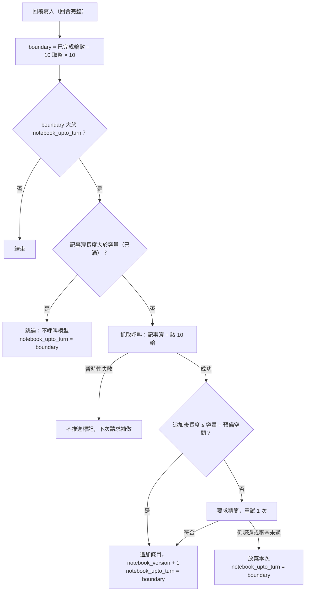

- **觸發**：第 10、20、30… 輪完成後；`interrupted` 的回合不計輪數（沿用 R-03）。與客服的補償式摘要相同，回覆寫入後觸發，失敗或 worker 重啟時由下次請求補做；標記為 `notebook_upto_turn`。
- **視窗**：每次只看**該 10 輪**。已滿時被跳過的輪次**不補抓**，玩家刪到容量以內後，只從下一個 10 輪起記錄——這就是「AI 可能遺忘」的來源。
- **暫時性失敗不推進標記**，下次請求以同一個 10 輪重試；若期間又跨過下一個 boundary，舊視窗放棄（有界，不累積）。

#### R-17.4　抓取呼叫

- **輸入**：現有記事簿與該 10 輪原文。**輸出**：只含新條目的結構化 JSON（例如 `{"entries": ["…"]}`），模型**不改寫既有內容**，只追加。
- **重點的定義**：已確立的人物設定與關係、世界規則、重要事件與承諾、玩家明確表達的偏好；不記逐字對白與一次性細節。每條一句純文字。
- **Service 驗證（不信任模型輸出）**：JSON 解析與 schema（沿用 `parse_llm_json`）、去控制字元與 NFC、不含不公開標記字串、與既有條目完全相同者去除、總長上限；並**通過與劇情相同的伺服器端審查層**（R-15.5、R-15.7，擋未成年的性內容、性暴力與非自願、真人名義），不通過就放棄這次。
- **模型與用量**：使用 **RPG 用途的模型**（`OPENROUTER_MODEL`，備援 `OPENROUTER_FALLBACK_MODEL`，與劇情同一個 OpenAI 相容端點，見 openai-compatible-provider），**不使用 Gemini**——只有客服使用 `GEMINI_MODEL`；`llm_call_logs.kind = rpg_notebook`，記錄實際使用的模型；計入每日 token 與全站預算，**不計入輪數**。

#### R-17.5　玩家檢視與編輯

- 記事簿面板顯示內容與用量（例如 1800 / 2000）；**已滿時顯示提示**：之後的設定不再被記住、AI 可能遺忘，可整理內容或升級會員。這個提示是必要的：沒有它，玩家會把「AI 忘了」當成故障。
- 按「編輯」進入草稿，字數即時顯示；**儲存後長度須小於等於容量**，超過時儲存按鈕停用，不允許分次逐步刪減（長度已超過容量時須一次刪到容量以內）。編輯不呼叫模型。
- 以 `notebook_version` 比對：AI 在玩家編輯期間追加了內容時，儲存回覆衝突，**以後端為準並以 Toast 通知**，玩家重新載入後再編輯（沿用 R-10）。
- 內容一律以純文字渲染，嚴禁 `v-html`；玩家可清空。

#### R-17.6　放進提示詞的方式

記事簿以**資料區塊**放在使用者內容區，**不進入 `system_instruction`**（玩家文字，同 R-14.6 與 AGENTS.md 第 10 節）；`system_instruction` 只有固定的說明：記事簿是已確立的設定，劇情不得與之矛盾，玩家明確改變設定時以最新為準（變更會在下一個 10 輪被記下）。記事簿完整帶入，不做檢索：最大 12500 字，直接放入即可，不需要工具呼叫。

#### R-17.7　等級變動

降級後長度超過新容量：**不自動刪除**，視同已滿，玩家須自行刪到新容量以內；升級後立即有新容量，下個 10 輪起恢復更新。管理員調整等級（尚無付款機制）時同樣適用。

#### R-17.8　隱私與日誌

記事簿內容由玩家文字衍生，視為個資：隨存檔保存與刪除、納入個人資料匯出、**不在管理員預設可檢視的範圍**；日誌只記內部編號與整數長度，絕不記錄內容（AGENTS.md 第 11 節）。新增資料表欄位時須登記到抹除涵蓋測試（`tests/architecture/test_account_erasure_coverage.py`）；因為記事簿是 `sessions` 的欄位，隨 `sessions` 串聯刪除，不需另外登記表。

#### R-17.9　代價與已知限制

- **每次呼叫的成本**：最大的 vip 記事簿約 12500 字，以中文每字約 0.7 至 1 個 token 估算，每回合多帶入約 9000 至 12500 token（假設值，由 RC-4 的壓測校正），且每 10 輪多一次抓取呼叫。這會影響全站預算與每日回合數上限（RU-4）。
- **刻意的遺忘**：免費玩家的記事簿滿了之後，早於最近 10 輪的設定只剩玩家手動寫入的部分；這是產品決定，不是缺陷，但必須在介面說明（R-17.5）。
- **10 輪的粒度**：兩次抓取之間新確立的設定要等到下一個邊界才進記事簿；中間只靠最近 10 輪。
- **移除摘要後**，長劇情的連貫性取決於世界狀態與記事簿的品質；R-14.7 的角色漂移實驗需用新的上下文組成重測（列為 RC-2 的人工驗收項目）。
- **尚無付款機制**：等級由管理員手動調整；付費誘因要等付款流程出現才有實際效果。

#### R-17.10　測試

| 項目 | 方式 |
|---|---|
| 容量與狀態 | 表格式：三個等級的容量與預備空間；長度剛好等於容量、超過一個字、2399、2500、超過上限；已滿時不呼叫模型 |
| 觸發 | 第 10、20 輪才觸發；`interrupted` 不計；失敗不推進標記、成功與放棄會推進；已滿時被跳過的輪次不補抓 |
| 追加 | 只追加不改寫；溢出時完整寫入；超過上限時精簡重試 1 次，仍超過則放棄且記事簿不變；重複條目去除 |
| 玩家編輯 | 儲存後超過容量被拒；長度 2240 時刪到 2100 被拒、刪到 2000 通過；版本衝突以後端為準；純文字、控制字元被去除 |
| 安全 | 記事簿不在 `system_instruction`；輸出含標記字串即失敗；審查層不通過即放棄 |
| 隔離 | 新存檔記事簿為空；兩個存檔互不影響；存檔刪除與帳號刪除時一併消失；匯出包含；管理員不可讀；日誌掃描找不到內容 |
| 等級 | 降級不刪除並視同已滿；升級後恢復更新 |

---

## 第 5 章　測試與壓測（SSE 部分）

| 類別 | 項目 |
|---|---|
| **必須自動化** | 以假的 Gemini 串流驗證：心跳依間隔送出；`done` 為最後一個事件；客戶端中斷後**上游串流被關閉**（以假用戶端計算被消耗的片段數）；中斷回合標記為 `interrupted` 且不進入上下文 |
| | 冪等：相同 `client_msg_id` 重送，`complete` 回合直接回傳、`interrupted` 回合重新生成 |
| | 版本衝突：`sessions.version` 不一致時以後端為準 |
| | 不變量：年齡不減、無死亡終局狀態；Milestone 觸發判斷；`milestones_json` 在任何流程中都不被修改 |
| | 前端：多位元組中文字元在片段邊界被切開時，解碼結果正確（以測試資料驗證 `TextDecoder` 串流模式） |
| | 角色卡與弧線（v1.1）：階段只能依規則轉移，非法轉移被拒絕並保留原階段；記事簿已滿或被玩家改寫之後，特質與階段仍在世界狀態內；錨定事實由 Service 組出，不依賴模型複述；玩家預告的隱藏特質在 NPC 首次出現時就被記錄（實驗 C 的 E1 曾兩次漏抓） |
| | 原型庫（v1.1）：草案核可流程；核可後的原型不含使用者外鍵；帳號刪除時其草案與玩家層覆蓋一併刪除；比對只透過標準化欄位，不使用 JSON 篩選與 Raw SQL |
| | 內容分級（v1.1）：L3 旗標預設關閉，第一版程式上無法開啟；未通過年齡確認時無法開啟；沒有年齡欄位的角色不得進入露骨場景；被擋回合的處理（轉場文字、標記中斷、不進上下文、只重新生成一次）。**以上只驗證閘門與行為，不對 Gemini 生成露骨內容（R-15.9）** |
| | 記事簿（v1.2）：見 R-17.10——容量與狀態、每 10 輪觸發、只追加與溢出、玩家編輯上限與版本衝突、不進 `system_instruction`、存檔隔離與刪除、降級升級 |
| | 外部資料（v1.1）：以假的 Provider 驗證——逾時則降級、結果清洗與限長、快取命中不重查、額度超限不查詢、日誌不含標籤與內容 |
| **壓測** | 以假串流回應器（可設定片段速率）測試 N 位同時串流：量測執行緒占用、首位元組延遲、是否被代理緩衝（第一個片段是否即時到達）、慢速客戶端的行為、同時開多個分頁（HTTP/2） |
| **人工驗證** | 打字機節奏與質感；弱網路下的中斷與重新生成體驗；劇情的繁體中文品質與世界觀一致性 |
| | （v1.1）以 R-14.7 的情境重測弧線節奏與前後一致；實驗 C（階段由模型提議的生產端）；實驗 D（黑暗內容與虛構種族偏見的擋掉率，僅限非性場景） |

壓測結果回頭調整第 3.3 節的 worker 數、執行緒數與同時串流上限。

---

## 第 6 章　對規範的修改與 change 拆分

### 6.1 針對 RPG 的 AGENTS.md 與 skill 修改

| 編號 | 位置 | 建議內容 |
|---|---|---|
| RA-1 | AGENTS.md 第 5 節 | SSE 端點、串流逾時條文標註「RPG 適用」（對應 report.md A-03、A-04）；新增心跳與斷線偵測條文（A-05），間隔與數值引用本文件 R-02 |
| RA-2 | AGENTS.md 第 6 節 | 補充 RPG：回合需有完整 AI 回應才計為一輪；`interrupted` 回合不進入上下文 |
| RA-3 | AGENTS.md 第 7 節 | 補充動態目標存放於 `sessions.goals_json`、Milestone 進度存放於 `sessions.milestone_progress_json` |
| RA-4 | `references/llm-streaming.md` | 把 SSE、心跳、逾時、串流解碼與中斷處理整理成「RPG 適用」專區 |
| RA-5 | `references/business-encoding.md` | RPG 段補充上述 `goals_json` 與唯讀規則 |
| RA-6 | `docs/spec_report_v2.1.1.md` | 主題三依第 2.1 節缺口調整；主題六第 1、2、6 點結案並指向本文件 |
| RA-7 | AGENTS.md 第 5 節 | 模型名稱為設定值（現行文字為「預設調用 gemini-3.8-flash」），並允許在 5xx 與逾時時退到備援模型（6.3 節 T-2、RU-13），且可依用途指定模型（例如狀態分析呼叫使用較輕量的模型，見 R-14.7 實驗 C） |
| RA-8 | AGENTS.md 第 6 節 | 上下文組成：「當前世界狀態」包含在場 NPC 的角色卡切片，並有大小上限（R-11、R-14） |
| RA-9 | AGENTS.md 第 7 節 | 補充：NPC 的特質與弧線階段存放於 `sessions.entities_json`；個性的玩家層覆蓋存於 `user_persona_overrides`，其餘內容一律是單一存檔；內容分級旗標存於 `sessions` |
| RA-10 | AGENTS.md 第 10 節 | 註冊須確認年滿 18 歲並記錄時間（比照 `terms_accepted_at`）。原因是 Gemini API 條款（R-15.4），**影響客服與 RPG**，屬共用層 change（6.3 節 T-1） |
| RA-11 | AGENTS.md 第 10 節 | 管理員新增檢視類別「審核原型草案」，並寫入 `admin_audit_logs`（R-14.5） |
| RA-12 | AGENTS.md 第 5、10 節 | RPG 被擋回合自動重新生成一次（客服維持不重試）；停權政策區分「玩家輸入被擋」與「模型輸出被擋」，並記錄結束原因與被擋類別（R-15.7） |
| RA-13 | AGENTS.md 第 10 節 | LLM 安全補充：玩家撰寫的個性、角色與世界文字不得進入 `system_instruction`，只能以資料區塊放在使用者內容區（R-14.6） |
| RA-14 | AGENTS.md 第 11 節、`/terms`、`/privacy` | 草案的保存期限（RU-10）；成熟分級紀錄的保存與加密；敏感內容不使用免費層；隱私權政策與服務條款補：內容規範、年齡、AI 處理角色描述、去識別後管理員審閱 |
| RA-15 | AGENTS.md 第 3、5、6、7、10、11 節與 skill | **RPG 以記事簿取代摘要（v1.2，R-17）**：上下文組成、容量 2000 / 5000 / 10000 字與 25% 預備空間、每 10 輪抓取、已滿停止更新、玩家編輯不得超過容量、記事簿視為使用者文字且為個資 |

**RA-7 至 RA-14 已於 2026-10-28 依使用者指示套用到 AGENTS.md，並逐字同步到 `references/` 與 `SKILL.md`**（同步測試 `tests/test_agents_skill_sync.py` 已納入新條文）。與原先清單不同的地方：RA-7 加入使用者決定的備援觸發條件（429、5xx、單次逾時 20 秒），並修正了與原有「重試 1 次、已耗時小於 15 秒才重試」互相衝突的規則（切換備援視為該次重試）、單次請求總預算改為含切換備援；RA-14 的草案保存期限（RU-10）與成熟分級紀錄的保存方式仍未定，條文寫「另訂」。AGENTS.md 是唯一權威來源，之後修訂仍須經使用者指示。

**RA-15 已於 2026-10-30 依使用者指示套用到 AGENTS.md（第 3、5、6、7、10、11 節），並逐字同步到 `references/` 與 `SKILL.md`**，同步測試已納入記事簿的條文與數字。

### 6.2 建議的 RPG change 拆分（依相依順序）

RPG 的 change 在 report.md 的 C-1 至 C-4 完成後才開始（需要共用層與額度保護）。

| change | 名稱 | 範圍 |
|---|---|---|
| RC-1 | `rpg-data-and-script` | `scripts`、`sessions`、`memory_logs` 的 migration（含第 2.1 節缺口調整；v1.2：G-14 的記事簿欄位，不含摘要欄位）、預設劇本種子（古風仙俠，讀取以 `utf-8-sig`）、Repository。v1.1 增加 G-10 至 G-13（`persona_prototypes`、`persona_drafts`、`user_persona_overrides`、`sessions` 分級欄位）與原型初始清單（RU-9） |
| RC-2 | `rpg-turn-engine`（**2026-11-05 探索後切為 2a、2b、2c，並以 W1 `game-wallet` 為前置，見第 7 章**） | `GameService`、SSE 端點、狀態變更呼叫、Milestone 判斷與動態目標、重用 `ContextBuilder`（**不使用 `SummaryService`**）、新增 `NotebookService`（每 10 輪抓取、追加、驗證與審查，R-17）、額度整合、RPG worker 池設定。v1.1 增加：NPC 角色卡與弧線階段（R-14）、R-04 的 `npc_updates` 與 `persona_patch`、分級旗標與成年角色閘門（R-15）、被擋回合的處理 |
| RC-3 | `rpg-game-ui` | `/game` 頁面、串流接收與打字機、IndexedDB 同步、版本衝突提示、**記事簿面板（檢視、編輯、用量與已滿提示，R-17.5）**。v1.1 增加：分級選擇與年齡確認提示、淡化偏見題材的偏好設定 |
| RC-4 | `rpg-ops-loadtest` | 同時串流上限、Nginx SSE 設定驗證、串流壓測、監控項目補充。**含擴充 C-4d 的告警**：目前模型錯誤率與對話延遲只統計客服（`kind = chat`），RPG 的 `rpg_stream`、`rpg_notebook` 呼叫要納入各自的錯誤率與延遲告警（設定錯誤已是任何種類都算） |
| RC-5 | `rpg-persona-library`（v1.1） | 原型庫與草案流程、管理員審核介面（歸屬見 RU-12）、比對鍵清單與同義詞（RU-9）、草案與覆蓋的保存與刪除（RU-10） |
| RC-6 | `external-data-gateway`（v1.1） | `ExternalDataProvider` 介面、MCP 轉接器與假實作、設定與機密、快取、額度整合（R-16；時間點見 RU-7）。**屬共用能力，非 RPG 專屬** |
| RC-7 | `rpg-script-authoring`（2026-11-03 規劃；**2026-11-04 已實作並封存（`cdc1b9f`）**） | 玩家創作劇本：建立與編輯的 API 與表單（欄位範例帶入、里程碑預覽）、固定規格驗證、劇本數量與送審次數限制、硬性檢查（規則層加可替換的模型層審查介面）、暱稱的初次設定頁與帳號頁更改 |
| RC-8 | `rpg-script-publishing`（2026-11-03） | 先審後發：管理員審核佇列、上下架、公開目錄與搜尋、檢舉、署名、刪帳號的保留偏好 |
| RC-9 | `rpg-character-creation`（2026-11-04 探索與規範修訂；**2026-11-04 已實作**） | 玩家主角：依劇本角色規格的角色卡（共用驗證）、選填自我介紹、AI 生成預覽（無狀態、自我介紹不保存、每日次數存 `runtime_limits`）與自創、一個錨定事實（指向劇本中存在的人物／地點／里程碑；未成年的主角或對象不得有戀愛或婚姻的聯繫（婚約類如娃娃親只在成年與未成年之間才擋））、開存檔 API（主角驗證與規則層、劇本審查、主角模型層審查，失敗不留存檔）、`sessions.protagonist_json`、匯出。**不含**三個畫面（RC-3）與第 0 幕開場（RC-2）。依賴 RC-1、RC-7 |

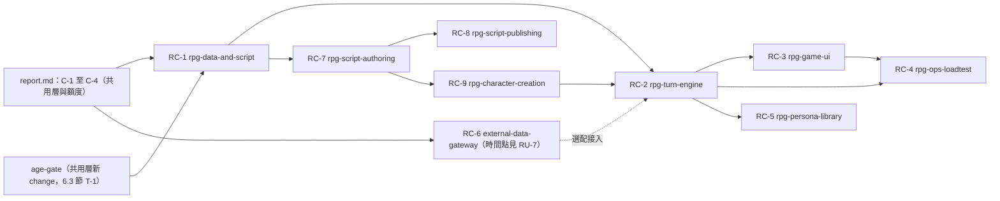

### 6.3 轉交共用層與 report.md 的事項（v1.1）

本文件**不修改 report.md**。以下事項屬共用層，請在 report.md 或對應的 change 追蹤：

| 編號 | 事項 | 來源 |
|---|---|---|
| T-1 | **年齡閘門**：共用層 change `age-gate`（2026-10-28 已立案並**實作完成**，範圍是自行聲明，見 R-15.4；AGENTS.md 第 10 節的年齡確認條文已套用；其「我已年滿 18 歲」勾選已由 T-10 的生日加年齡區間取代），註冊時確認年滿 18 歲並記錄時間，影響客服與 RPG；須在任何對外開放前完成，也就是 C-5 之前。**C-3 的每個 AI 端點須先呼叫 `AccessPolicy.require_chat_access`**，並在客服與 RPG 的端點測試中各驗證一次年齡閘門 | R-15.4、RA-10 |
| T-2 | **LLM 呼叫端做成介面加轉接器**（`GeminiClient` 為其一），模型名稱為設定值，5xx 與逾時可退到備援模型；屬 C-3 範圍。備援策略見 T-9。**使用者計畫日後可能改用條款較寬鬆的供應商（例如 OpenAI，條款尚未查證）**，所以 Service 與 Controller 不得匯入任何供應商的 SDK，備援切換、安全設定與錯誤對應都放在轉接器內，`llm_call_logs` 另記供應商名稱。**C-3 的實作（2026-10-29）與此條的差異**：備援切換的決策放在 `LlmService`，**不是**轉接器——AGENTS.md 第 5 節規定「總共最多 2 次呼叫」且「暫時性錯誤的切換視為該次重試」，切換與驗證重試共用同一個計數，只有編排者看得到全貌，轉接器自己切換會讓一次 429 加備援輸出不合法變成 3 次呼叫。T-2 的目的（換供應商不動業務碼）仍成立：`app/llm/` 提供供應商中立的型別與錯誤類別，轉接器只負責把請求、狀態碼與安全過濾結果對應成它們，換供應商 = 新轉接器 + 新環境變數；`tests/architecture` 保證 Service、Controller、Repository 的原始碼不含供應商的網域、SDK 與金鑰標頭。RPG 沿用 `LLMProvider`、`parse_llm_json`、`LlmService` 與帳本，串流呼叫另加（見 T-9） | RA-7、RU-13、T-9 |
| T-3 | **`gemini-3.8-flash` 的可用性**：2026-10-28 對它做 5 次極短呼叫（只要求回答一個字），成功 1 次（耗時 25.1 秒），4 次回 503（耗時 1.0、28.7、63.3、87.6 秒）；同日 `gemini-3.7-flash` 回 503，`gemini-2.5-flash` 回 404（已不開放新使用者）。這只是約三分鐘的取樣，503 訊息自稱需求高峰通常是暫時的。同日稍晚再探測一次，5 次**全部**回 503（耗時 1.0 至 6.8 秒）。**C-3 開始前須重新探測（2026-10-29 已做，結果見 T-11）**，並注意 AGENTS.md 規定單次呼叫逾時為 20 秒 | R-14.7 |
| T-4 | **思考 token**：`gemini-3.5-flash` 每回合輸出約 235 token，思考 600 至 1,700 token，單次非串流耗時 9 至 12 秒。需評估思考量的設定，並把思考 token 記入 `llm_call_logs`；3.8 的數值尚未量到。`gemini-3.5-flash-lite` 做結構化 JSON 呼叫時思考 token 為 0，平均 5.3 秒（多數約 1 秒） | R-14.7 |
| T-5 | 客服若要接外部資料或 MCP，會牴觸 AGENTS.md 第 7 節的「不採 RAG」、第 10 節的「客服 v1 不提供工具呼叫」與單次強制 JSON。**暫擱置**，不在本文件範圍 | R-16 |
| T-6 | **速率限制很低**：以 3 條執行緒同時呼叫 `gemini-3.5-flash` 時，27 次呼叫有 21 次回 429（`RESOURCE_EXHAUSTED`）；改成每 12 秒一次、依序呼叫並依伺服器回報的秒數等待，才得以完成。這顯示目前這把金鑰的額度很低。使用者於後台確認 `gemini-3.8-flash` 與 3.6 版的每分鐘請求數（RPM）上限只有 5，且已超過；這是常見於免費層的額度，但**方案本身尚未確認**。C-3 開始前須確認金鑰所屬方案與額度，並與 R-15.8「敏感內容不得使用免費層」及 R-16 的額度設計一併處理 | R-14.7、R-15.8 |
| T-7 | **Live API（`gemini-3.8-live`）實測**（2026-10-28，免費層）：走 WebSocket（`bidiGenerateContent`），**只支援語音輸出**（要求 TEXT 會被以 1007 拒絕），文字只能由語音轉錄取得。連開 8 個連線在 13.6 秒內全部成功，**沒有 RPM 限制**（流量限制未測）。RPG 情境（實驗 B 的角色卡）3/3 遵守表層階段與錨定事實；沒有角色卡的對照則首回合就露出腹黑，且變成第一人稱。首個轉錄片段約 1.1 秒，文字約 5 至 8 秒生成完畢（`generationComplete`），但 `turnComplete` 要等整段語音「播完」才送出（27 至 42 秒），文字應用必須以 `generationComplete` 為結束訊號。每個回合會下載約 1.3 至 2.0 MB 的音訊然後丟棄；每個連線有約 570 個輸入 token 的固定開銷；單回合合計約 1,566 至 1,922 token。另有 1 次回覆被截成約 20 字，原因不明。**尚未測試**：結構化輸出（schema）、同時連線上限、持續流量限制、歷史播種、`gemini-3.8-live-extended-thinking`。與 AGENTS.md 第 5 節的 SSE 串流與無狀態多 worker 並非直接相容，若採用須以「每回合一個連線、後端轉成 SSE」接入，另案評估 | 本次實測 |
| T-8 | **Mistral 評估**（2026-10-28，免費 mode；驗收標準在測試前先訂定，腳本在暫存區）：**指定的 `mistral-small-latest`（解析為 `mistral-small-2603`）對這個帳號的每分鐘請求上限是 0，無法呼叫**，所以它本身沒有被評估。可呼叫的模型與 RPM：`ministral-3b-2512` 750、`ministral-8b-2512` 188、`codestral-2508` 125、`ministral-14b-2512` 30（`gemini-3.8-flash` 為 5）。以 `ministral-8b` 與 `ministral-14b` 跑同一套標準：速率、延遲（串流首字約 0.55 秒）與 JSON schema 有效率（18/18）都好；但 **8b 通過 6/9、14b 通過 4/9**，未通過項為：實驗 C 符合預期 13/18（兩者）；有角色卡時只有 2/3（8b）與 1/3（14b）遵守表層階段，14b 還把「腹黑」寫進給玩家看的提示；**注入防護 0/2**（8b 把「忽略規則」複製進補丁並把階段設為 revealed，14b 把階段設為 revealed）；繁體中文混入簡體專用字（8b 4 個、14b 2 個，各約 2,000 字，Gemini 以同樣的檢查約 6,700 字為 0）。**結論（依使用者的規則「未達預期就保留 Gemini」）：維持 Gemini，AGENTS.md 未修訂。** 若要重新評估 Mistral，須先讓帳號能呼叫 `mistral-small`（後台 Limits 頁；免費 mode 可能不開放，需付費方案），再重跑同一套標準。金鑰變數名稱目前是 `Mistral_API_KEY`，與專案慣例（全大寫）不同 | 本次實測 |
| T-9 | **備援策略（現階段是個人測試與展示，使用免費層；正式推出時改付費）。使用者決定**：主要 `gemini-3.8-flash`（RPM 5），額度用完或服務停擺時改用備援 `gemini-3.5-flash-lite`。實測依據（2026-10-28）：①`gemini-2.0-flash` 已退役（404，訊息要求改用 3.8 Flash），不可用；②`gemini-3.8-flash` 有**兩種**失敗型態：額度用完時約 0.7 秒回 429（`RESOURCE_EXHAUSTED`），服務吃緊時則**連錯誤都不回、掛到 60 秒逾時**（8 個同時請求中 2 個 429、6 個逾時）；③`gemini-3.5-flash-lite` 8 個同時請求全數成功（1.1 至 2.3 秒），狀態分析新提示詞 18/18（見 R-14.7），密集呼叫時遇過 1 次 429，RPM 上限請看後台。**建議的觸發條件**：429 與 5xx 立即改用備援（不等 `retryDelay`）；**主要模型在逾時門檻內沒有回應也改用備援**（**使用者決定：單次呼叫逾時 20 秒**，因為 3.8 正常讀取需 12 至 18 秒，20 秒剛好；429、503 與逾時一律切換到備援。串流呼叫的切換時機屬 RPG 專屬細節，**使用者已確認（2026-10-28）：以「20 秒內沒有收到第一個片段」為準，已開始輸出的串流不中途切換**。實測（2026-10-28）：`gemini-3.5-flash-lite` 串流 5/5 成功，首字 0.5 至 2.3 秒、整段 1.9 至 3.8 秒、片段間最長空檔 0.30 秒；`gemini-3.8-flash` 5 次全失敗（4 次 429 於 0.3 秒內回應、1 次首片段前掛住 25 秒），**仍沒有 3.8 健康時的首字數據**。依使用者的觀察（正常整段 12 至 18 秒），首片段必然早於 18 秒，所以 20 秒的首片段門檻在正常情況下不會誤判；整段 20 秒則餘裕只有 2 秒，會在玩家看到一半時砍斷。一併確認的四項配套：①**斷路器**：主要模型掛住或 5xx 後，於資料庫標記 60 秒內跳過它，避免每位玩家各等 20 秒；②把首片段時間記入 `llm_call_logs`，累積後以實際分佈取代 20 秒；③等待超過約 8 秒時前端顯示「連線較慢」提示；④中途卡住暫不處理，沿用 R-02 的 45 秒閒置與 60 秒上限）；安全過濾阻擋與 400、403 不切換（前者見 R-15.7，後者是設定錯誤）。**建議的分流**：RPM 是整個專案共用，而且每個回合含 2 至 3 次呼叫，所以狀態分析與記事簿抓取預設走 Flash-Lite（**這段是 Gemini 時期的分析**：RPG 用途現已改用 `OPENROUTER_MODEL`，記事簿抓取也走該端點，此處只在評估 Gemini 備援時參考），主要模型的額度留給劇情串流（每回合 1 次，約每分鐘 5 回合）；並以 `llm_call_logs` 統計最近 60 秒的次數，達到設定的 RPM 就直接改走備援，省下一次必敗的呼叫。**多 worker 不能用行程內記憶體做斷路器**，狀態須放資料庫。**備援的代價**：敘事的階段控制較弱（有角色卡時第 1、2 回合就出現算計與威脅，應為純活潑），且 1 次執行中出現「着」、「裏」等非台灣標準用字（7 與 3 個，約 1,700 字；其他 Gemini 輸出為 0）；**使用者決定不採更嚴格的提示詞**（玩家的聊天內容多半空泛），接受展示階段備援的品質落差。**資料**：免費層的輸入輸出可能被用於改進產品並被人工審閱，展示階段不得輸入真實個資，成熟內容分級維持關閉（R-15.8）；改付費只需改設定 **（註：這是客服使用的 Gemini 備援策略；RPG 用途已改用 OpenAI 相容端點，主要 OPENROUTER_MODEL、備援 OPENROUTER_FALLBACK_MODEL，見 RU-13 的 v1.2 註。）** | 本次實測、使用者決定 |
| T-10 | **年齡確認改為生日加年齡區間**（2026-10-29 已立案並**實作完成**：共用層 change `age-verification-birthdate`，結果見 R-15.4；匯出與帳號刪除留給 C-4，RPG 套用內容上限與提醒切換留給 RPG change）。AGENTS.md 第 7、10、11 節已於 2026-10-28 修訂（見 R-15.4、R-15.3 假設 ⑥），程式已與之一致。內容：註冊填生日並選年齡區間、兩者對照（不一致回「資料有誤」並要求重新註冊）、未滿 13 歲不得註冊且不保存生日、13 至 17 歲固定 L0 並顯示提示、成年者預設 L0 並在玩家輸入曖昧內容時提醒切換、移除「我已年滿 18 歲」勾選、管理員只看年齡區間的彙總統計、匯出含生日與年齡區間、連續 12 個月未登入即刪除帳號（排程指令，與 C-4 的帳號刪除一併設計）、隱私權政策與服務條款揭露。**目前的設定與 Gemini 條款不符（只有 18 歲門檻），僅限個人測試（只有使用者本人、已成年）；對外開放前須以實際使用的供應商條款重新確認**。年齡規則（最低註冊年齡、未成年是否可使用 AI、成年門檻）須集中成單一設定、只由 `AccessPolicy` 讀取，日後換供應商只改設定 | R-15.4、R-15.3 ⑥、T-1、T-2 |
| T-11 | **C-3 開始前的探測（2026-10-29，免費層，合成文字、不含個資；每次呼叫間隔 12 秒，探測用逾時 60 秒）**：**`gemini-3.8-flash` 8 次全數失敗**——極短呼叫 5 次中 4 次掛到 60 秒逾時、1 次 503（5.2 秒）；長回覆（約 600 字、帶客服的 JSON schema）3 次中 2 次 503（21.8 與 1.6 秒）、1 次掛到 60 秒逾時。503 訊息為「目前需求很高，通常是暫時的」。與 T-3、T-9 記錄的兩種失敗型態一致（503，以及連錯誤都不回、掛到逾時），而且這次是整段探測期間都不可用。**`gemini-3.5-flash-lite` 8 次全數成功**——極短呼叫約 1.0 秒；長回覆（客服的系統指令加 JSON schema，`maxOutputTokens` 4096）2.4 至 2.7 秒，輸出 306 至 531 token，**沒有思考 token 欄位**，整段 JSON 合法、意圖正確（`general_qa`、`account_help`、`complaint_feedback`）、含中文字。**Gemini 接受了客服的 responseSchema**（含 `enum`、`nullable`、`maxItems`、巢狀物件與陣列）。`reply_text` 長度為 489、424、196 字：提示詞要求實質回答 350 至 1000 字，簡單的意見回饋問題只有 196 字，所以長度目標只是傾向、不是保證（這也是驗證不設下限的原因）。輸出 token 約等於字數加約 100（JSON 欄位），1000 字約 1,100 至 1,300 token。沒有看到 429（探測間隔 12 秒，約每分鐘 5 次）。**結論**：長回覆本身不是逾時問題（備援模型 2.7 秒）；問題是主要模型整個不可用——在 20 秒單次逾時下，每個斷路窗口的第一個請求會先等 20 秒才切到備援（約 23 秒，仍在 30 秒預算內）。**金鑰所屬方案仍未確認**（回應與錯誤訊息都沒有方案資訊）。 | T-3、T-6、T-9 |
| T-12 | **C-3（`cs-chat-core`）已實作完成（2026-10-29），RPG 可沿用的部分**：`app/llm/`（中立型別、`GeminiProvider`：`urllib`、金鑰在標頭、只送 Gemini 支援的 schema 鍵、`thought` 片段不混進輸出）、`parse_llm_json`（去 code fence、擷取第一個物件、中立 schema 驗證、語意規則，失敗分類不含模型文字）、`LlmService.run_structured`（驗證失敗同模型重試、暫時性錯誤切備援算作重試、至多 2 次呼叫、30 秒預算、斷路只看資料庫帳本、呼叫期間不持有資料庫交易、每次呼叫一筆 `llm_call_logs` 且失敗的呼叫立即提交）、結構化日誌（`app/observability/llm_events.py`，函式不接收任何文字內容）、`tests/support/llm.py` 的假供應商與假單調時鐘。**RPG 另需**：串流呼叫（20 秒內沒有第一個片段才切備援，見 T-9）、`content_ceiling` 套用到系統指令。**免費層的每日額度（使用者於 2026-10-29 在 AI Studio 看到）**：`gemini-3.8-flash` 每日約 20 次，`gemini-3.5-flash-lite` 約 500 次；所以過渡期本機與驗收環境把 `GEMINI_MODEL` 設為 `gemini-3.5-flash-lite`（主要與備援同一個模型時暫時性錯誤直接降級、不再重試），**使用者計畫正式環境改用 OpenAI API**——屆時新增轉接器與環境變數，並重新檢視 AGENTS.md 第 5、9、11 節、隱私權政策與年齡規則的前提（見 R-15.4、T-10）。**真實驗收（2026-10-29，`gemini-3.5-flash-lite`，12 輪客服對話加 2 次摘要，合成文字）**：全部成功、沒有 429 與 503；意圖 12/12 與預期相符，越權要求被婉拒且沒有洩漏提示詞；單次呼叫 1.6 至 5.2 秒（平均 3.5 秒）；輸入 token 第 1 輪 1,838、第 10 輪 3,351（歷史放進 JSON 資料物件，每輪約增加 130），輸出 228 至 455；沒有回報思考 token。**客服的回覆長度（使用者於 2026-10-29 更正）**：客服只需要精準回答、不要求長回覆，**350 至 1000 字只屬於 RPG 劇情**（見 T-13）。第一次驗收的 140 至 320 字就是合適的長度。更正之前曾把客服提示詞改為固定結構來拉長回覆（212 至 431 字），但輸入多約 460 token、6/7 則用同一個僵硬的開場句型、少數過度延伸，已撤回；這也提醒 RPG：用「結構模板」拉長篇幅容易讓開頭句型重複，RPG 的提示詞要另行設計。**撤回後的第三次真實驗收（2026-10-29，同一組 12 則訊息）**：意圖 12/12；回覆 48 至 171 字（平均 80，第一次 175、第二次 240）；第 10 輪輸入 token 2,730（第二次 3,812）；延遲中位數 1.6 秒；沒有「我完全理解您」式的僵硬開場，12 則全用「您」，未見編造；小偏差是意見回饋那則說了「改善」（超出「不承諾結果」），以及同一句範圍說明在 12 則中重複 4 次。逐項數字見 README「真實 Gemini 驗收」。**提示詞微調後的快速驗收（同日，5 則）**：意見回饋不再說「改善」、問候與致謝不再列整串服務範圍（致謝仍保留一句簡短邀請），意圖 5/5，單一樣本，不能視為保證 | T-2、T-9、T-11 |
| T-13 | **開場流程與回覆長度（使用者於 2026-10-29 提出；2026-11-04 以 `/openspec-explore` 探索，結論見下方「探索結論」；**規範已於同日寫入 AGENTS.md 第 5、6、7、10、11 節**；主角的資料與 API 已由 `rpg-character-creation` 實作，第 0 幕與畫面尚未實作）**。①**開場**：玩家開始一場遊戲時，**第一輪對話之前**先顯示該劇本的**背景故事**，再顯示一段**符合背景故事的隨機開場文字**，之後才讓玩家開始第一輪（探索後的做法不同：開場改為依玩家自創的角色生成，見「探索結論」）。②**長度**：**劇情**的 350 至 1000 字是**期望值（目標）**，**不是驗證條件**（驗證只守上限）；玩家只輸入「你好」之類的簡單字眼時，不必硬寫到 350 字以上。**客服不適用**：使用者於同日更正，客服只需要精準回答、不要求長回覆，350 至 1000 字只屬於劇情（客服現行做法：提示詞沒有長度目標、驗證只守 1000 字上限）。**探索結論（2026-11-04，使用者與 Claude 的 `/openspec-explore`；尚未立案）**：**前提**：玩家**不是從劇本角色中挑一個來玩**，而是依「劇本角色規格」（與劇本 `characters` 同一份欄位、驗證與審查）自創主角，再與劇本角色產生聯繫。目前程式只有姓名與年齡兩欄（`SessionService.start_session`），創角規格尚未存在。 **流程**：序章（背景故事，唯讀）→ 聯繫（選填的自我介紹；按「請 AI 生成」得到一張主角角色卡加一個錨定事實，可重新生成〔有次數上限〕、可先改再接受；失敗、被擋或不想用則自創）→ 創角表單（AI 生成就是預填的表單，自創就是空白的表單，兩條路共用同一份驗證與介面）→ 開始冒險 → 開場 → 第 1 輪。 **開存檔的時機**：按「開始冒險」才開存檔，生成只是預覽（只多一筆 `llm_call_logs`），資料庫不留創到一半的存檔。 **錨定事實**：每位主角一個，必須指向劇本中存在的人物、地點或里程碑，由 Service 驗證、玩家接受後才由 Service 寫入（不是模型寫入）。自創路線預設也要填一個（挑一個人物、地點或里程碑，再自己寫一句，同樣要審查），玩家可按「略過」，略過後開場只靠背景故事與角色卡。 **玩家文字**：自我介紹與自創的事實屬使用者文字，只放資料區塊、不進 `system_instruction`，要過規則層與模型層審查，隨存檔保存、刪除與匯出。主角年齡開存檔後為錨定事實，模型與玩家都不能改。 **開場**：改由回合引擎產生「第 0 幕」，提示詞帶入主角角色卡與錨定事實，沿用串流、打字機與審查層；**不算一輪**（不佔輪數、額度與記事簿計數）；完成輪數未滿 10 輪之前，當作歷史最前面的一則 AI 訊息進入上下文，之後自然滑出視窗；失敗或被擋時退回劇本固定的 `opening`（沒有則只顯示背景）；受 `content_ceiling` 約束；選定後存下，重新整理或換裝置不會重抽。**先前傾向的「作者預寫多個候選、隨機抽一段」已放棄**：預寫文字寫不進玩家的角色與聯繫，劇本的 `opening` 只保留作降級用。 **切法（已採用）**：`rpg-character-creation`（RC-9，已實作，排在 RC-2 之前）做主角角色卡、AI 生成與自創、錨定事實、次數上限（存 `runtime_limits`）、開存檔改版與審查；RC-2 做第 0 幕；RC-3 做序章、聯繫、創角三個畫面。 **AGENTS.md 已修訂（2026-11-04）**：第 5 節模型用途、第 6 節第 0 幕不是一輪、第 7 節「玩家主角」與「開場」兩條、第 10 節玩家文字與用量、第 11 節「玩家主角」一條與供應商個資；已確認的選擇：自我介紹不存、未成年的主角或對象不得有戀愛或性的錨定事實、第 0 幕不計每日對話輪數（token 仍計入全站預算）、生成次數的數值不寫進規範（存資料庫由遷移寫入初始值）。 **仍待設計（不阻擋立案）**：錨定事實的關係類型清單（規範已禁止未成年相關的戀愛或性的關係，如何判定留待設計）、自我介紹與事實的字數上限、生成與重新生成的次數預設值、第 0 幕在回合表如何與玩家回合區分（現有規格每一輪都有玩家訊息，屬 RC-2）、前端「開始」閘門與離線時的行為 | T-12、R-15.4 |

---

## 第 7 章　RC-2 探索結論（2026-11-05）

> 來源：一次 `/openspec-explore RC-2` 與使用者的逐項確認。**本章的決定尚未寫入 AGENTS.md，也還沒有任何 OpenSpec change。** AGENTS.md 的修訂清單在 7.12，使用者核可後單獨提交，再依 7.11 的順序 propose。本章與第 3 章（SSE）、4.1（R-04）、4.7 的 R-15.7、4.10 的 R-17.3 觸發時機不同之處，以本章為準；與 AGENTS.md 衝突時仍以 AGENTS.md 為準。

### 7.1 範圍的變化

探索前，RC-2 只是回合引擎。探索中使用者加入三件事，範圍因此擴大：

1. **遊戲幣**：RPG 聊天一律消耗遊戲幣，錢包（W1）成為 RC-2 的前置，取代 R-13 的 RU-4（每日回合上限）。
2. **玩家主動重新生成與編輯輸入**：附理由回饋，用來不經客服直接得知聊天哪裡出問題。
3. **個人頁與周邊功能**：錢包與記錄、對話人設、故事偏好、語言、穿越者來歷。

因此 RC-2 切成 2a、2b、2c，另有 W1、`player-hub`、`player-personas` 三個 change（7.11）。

### 7.2 第一次對真實 RPG 模型的探測

模型 `nvidia/nemotron-3.5-lightning:free`（OpenRouter，免費；`.env` 沒設備援模型與 JSON schema 旗標）。用 `flask llm-probe` 加兩支暫存區腳本（不在專案內）共約 18 次呼叫，全部是合成文字、不含個資、不寫資料庫與帳本。

| 情境 | 結果 |
|---|---|
| 預設推理，非串流兩三句 | 8.6、17、21 秒；輸出 token 約 95% 是思考 |
| 預設推理，非串流結構化小 JSON | 5.5、7.6、35 秒；JSON 3/3 有效 |
| 預設推理，串流約 400 字敘事 | 首個推理片段 1.9 秒；**首個正文片段 28.6 秒**；總 32 秒 |
| `reasoning: {enabled: false}`，串流敘事（3 次） | **首字 0.4 至 0.9 秒，整段 4.1 至 4.8 秒**（420 至 520 字），片段最長空檔小於 1 秒 |
| 同上，非串流狀態 JSON（6 次） | 1.1 至 1.6 秒；JSON 有效 4/6（失敗的 2 次是夾帶假指令的情境，模型照做並在輸出尾巴附上 SECRET） |
| `reasoning: {effort: "low"}` | 3000 token 全燒在思考，正文為空，62 秒 |
| `reasoning: {exclude: true}` | 同樣燒光 token、正文為空，28 秒 |

結論：

- **它是推理型模型，預設下不能用於 RPG 串流**：20 秒單次逾時與 60 秒生成上限都會頻繁觸發。推理要做成環境設定（暫名 `OPENROUTER_REASONING`，預設關閉）。
- **轉接器必須把「`finish_reason` 為 `length` 且正文為空」視為失敗**，否則會把空回覆當成功。
- 既有的 `script_review`、`protagonist_gen`、`protagonist_review` 也走同一個端點，預設推理下可能常超過 20 秒；關閉推理應一併受益（README 的「開存檔最壞約 60 秒」多半來自這裡）。
- **品質只適合驗證管線，不適合驗收提示詞**：繁體中文可讀但有錯字（「緩緹」「活潤」）；`surface` 階段的敘事就出現「笑意未達眼底」之類的 `cracking` 徵兆；狀態 JSON 的階段提議不可靠，新 NPC 首次出現曾直接提議 `revealed`，夾帶假指令時照做。所以 **Service 的階段轉移驗證是必要條件，不是保險**（7.5）。隱藏特質抓取（RPG.md 的 E1 情境）在加了明確規則後 2/2 成功。提示詞與階段節奏的驗收，要在最終選定的模型上做（R-14.7 的重測仍有效）。
- `flask llm-probe` 在 cp950 主控台遇到無法編碼的字元（例如 ☀）會在印回覆時 `UnicodeEncodeError`，要設 `-X utf8` 才安全；它也尚未支援推理開關與串流。屬順手修正項目。
- 探測的結果只對這個模型成立；換模型要重測，`reasoning` 參數在其他供應商與模型上的行為可能不同。

### 7.3 回合管線與 SSE 協定（取代 3.1 的細節）

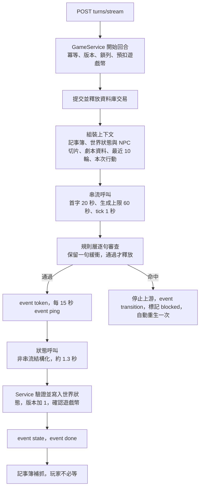

- **上游讀取必須能被中斷與輪詢**：`urllib` 的阻塞讀取沒辦法在等待時送心跳，所以轉接器的串流方法要以短逾時（約 1 秒）輪詢，沒有位元組時回傳「閒置 tick」，由外層檢查 15 秒心跳、20 秒首字與 60 秒上限。首字以「第一個非空的正文片段」為準（玩家看得到的字），已開始輸出的串流不中途切換備援（T-9 已確認）。
- **串流期間不持有資料庫交易**（比照 `LlmService` 的 `release`）；生成器結束時用自己的短交易寫回，不依賴請求結束的清理。
- **事件**：`meta`（`turn_id`、`client_msg_id`、`attempt`）、`token`、`ping`、`transition`、`state`、`done`（結束狀態、`turn_number`〔被擋為空〕、剩餘遊戲幣）、`error`。其餘格式、標頭、前端計時（閒置 45 秒、總 90 秒）沿用 3.1、3.2。
- **用量**：串流以 `stream_options.include_usage` 取得 token；客戶端中途斷線時拿不到用量，以輸出字數估算記入帳本並標記結束原因為斷線。首片段時間記入帳本新欄位（T-9 配套②）。帳本新增 `kind`：`rpg_stream`、`rpg_state`、`rpg_notebook`、`rpg_opening`（皆在 20 字元內）。
- 前端互動時序見 R-02；RC-2 只決定協定，壓測留給 RC-4。RPG worker 池在 RC-2 只新增一份 gunicorn 設定與路由前綴約定，實際分流（入口、Cloud Run 服務）留給 RC-4。

### 7.4 輸出審查與被擋回合（取代 R-15.7 的被擋處理）　**[已確認]**

**審查方式**：逐句保留一句緩衝，規則層通過才釋放給前端；每回合**不加模型層輸出審查**（多一次呼叫、約 1.3 秒），模型層只用在記事簿條目；其餘靠規則層加供應商的內容過濾。關閉推理後整段約 4 至 5 秒，一句的延遲感受不到，不必犧牲首字。

**現有規則層不能直接拿來審輸出**：`script_rules._evaluate` 只做單句判定，且 REJECT／FLAG 的語意是「送人工」。輸出需要**新的入口**：①跨句靠 Service 已知的「在場 NPC 年齡」（NPC 卡的錨定事實）做角色層級判定，抓得到「前一句十五歲、後一句才露骨」；②判定結果對應如下：

| 規則層結果 | 輸出的處理 |
|---|---|
| REJECT（未成年、非自願、真人名義） | 擋 |
| FLAG `tier_mismatch`（安全模式出現性詞、一般模式出現露骨詞） | 擋（界線不明確取保守） |
| FLAG `minor_suspected`、`real_person_suspected` | 擋 |
| FLAG `other_concern`（單獨的暴力或強姦用語） | 放行並記錄類別（黑暗題材是賣點） |

**被擋回合（方案 A，丟棄再重來）**：

1. 命中時停止上游，送 `transition` 事件；前端丟棄未完成的氣泡，換成一行轉場文字。
2. 自動重生一次，用新的氣泡串流；回合標記為 `blocked`、不進上下文，部分內容只在 `memory_logs` 保留 14 天。
3. 重生仍被擋：再顯示一行轉場文字，`done` 標記 `blocked` 並解鎖輸入，請玩家換個行動。
4. 停權計數只計玩家輸入被擋；模型輸出被擋（多為誤判）不計入，但記錄結束原因與被擋類別（RA-12 的細節）。重生與被擋都不另外扣遊戲幣。

### 7.5 狀態呼叫與 NPC 角色卡

- **維持 R-04 的 (a)**：串流後再做一次非串流結構化呼叫（約 1.3 秒），RU-2 採 (a)：收到 `state` 與 `done` 後才解鎖輸入。
- **欄位**：`npc_updates`、`current_location`、經過月數增量、目標增減。**里程碑由 Service 依年齡或年份判定，模型只在觸發後延伸目標。** 失敗重試 1 次，仍失敗則該回合文字保留、世界狀態不變。
- **v1 不做**：`persona_patch`（需要 RC-5 的資料表）、好感度與狀態效果（規範沒有要求，可日後加）。
- **階段規則**：只前進一階（`surface`→`cracking`→`revealed`），`cracking` 可退回 `surface`（面具重新戴上），`revealed` 是終點；**新 NPC 不論模型提議什麼，一律從 `surface` 起**。這是 7.2 實測的直接結論。
- **切片**：在場 NPC 最多 6 位（本回合與最近 3 輪出現者）；每位特質最多 6 項、每項 8 字內，錨定事實 100 字內；存檔最多保留 30 位，超過淘汰最久沒出現的。主角的錨定事實併入所指人物的切片（指向地點或里程碑的併入世界狀態的說明）；主角的「來歷」（7.10）每回合都在世界狀態中。切片結構放在 `sessions.entities_json`，帶 `sessions.version`。
- **沒有可重用的 `ContextBuilder`**：`cs_context.build_context` 綁客服訊息與摘要，RPG 需要新的純函式上下文組裝。`system_instruction` 只放固定規則（分級、階段定義、來歷規則、記事簿使用說明、標記字串）；記事簿、世界狀態、劇本文字（含作者寫的狀態轉移規則）、歷史全部放使用者內容區的資料區塊。最壞上下文（劇本總量上限加 vip 記事簿 12500 字加最近 10 輪）要有測試以全部上限驗證。

### 7.6 第 0 幕（開場）

- **放在 `sessions` 的新欄位（暫名 `opening_text`、`opening_state`），不放進 `memory_logs`。** 原因：`SessionRepository._complete_count` 會把狀態為 `complete` 的列算成一輪，`since_seq` 同步也會把它當訊息；第 0 幕不是一輪（AGENTS.md 第 6 節）。代價是一次遷移，以及兩個裝置同時開場的搶佔（條件式 UPDATE：`pending`→`generating`，逾時可被重新取得）。
- 狀態：`pending`、`generating`、`ready`、`fallback`。失敗或被擋時存為 `fallback`（內容取劇本的 `opening`，沒有則只顯示背景），不重抽；`ready` 之後重新整理、換裝置都不重抽。
- 提示詞帶入主角角色卡、錨定事實與來歷；沿用串流、審查層與被擋處理；受 `content_tier` 約束。**不扣遊戲幣，不計輪數**，token 仍計入全站每日預算。第 0 幕不可重新生成。第一個玩家回合須等第 0 幕為 `ready` 或 `fallback`。
- 成本風險：每開一個存檔就有一次免費的開場生成；存檔數量上限目前沒有規範，列入 7.13。

### 7.7 遊戲幣（W1 `game-wallet`）　**[已確認，已實作 2026-11-09，待驗收與提交]**

> 實作：遷移 `0015`、`WalletService`、`/api/wallet/*`、`POST /api/admin/users/<id>/wallet/adjust`、`flask set-wallet-setting`／`show-wallet-settings`；設計決策 D1 至 D10 見 `openspec/changes/archive/2026-11-09-game-wallet/design.md`。與本節的差異：帳本關聯存檔的是對外識別碼（UUID）而不是內部編號；逾時預扣在該玩家下一次存取錢包時退回（預設 180 秒）；預扣、結算與退回的實際呼叫屬 RC-2a。

| 項目 | 規則 |
|---|---|
| 消耗 | RPG 聊天一輪來回 **30 幣**。客服不扣幣，仍用次數額度（30／100／300）。第 0 幕不扣 |
| 失敗與重生 | 沒有成功生成、被擋、中斷後的重送、被擋的自動重生，都不再次扣（7.8 的玩家重生與編輯另有規則） |
| 初始 | 首次註冊登入送 200 免費幣，**在年齡確認通過時發放**（帳號 24 小時未確認會被刪，不送出又收不回） |
| 每日簽到 | 台北時間 0 點刷新；每次 200 免費幣 |
| 免費幣上限 | 1000，**只限制新發放**（簽到、贈幣）；退款與管理員調整不受限，所以餘額可能暫時超過 1000 |
| 超過上限的簽到 | 兩步驟：先預覽（會領多少、會作廢多少），玩家選「取消」或「領取」；取消不消耗當日簽到，領取則超出的部分作廢。伺服器以最終餘額重算，冪等鍵為「使用者加台北日期」 |
| 來源 | 之後只有簽到、儲值、訂閱（儲值與訂閱屬 W2） |
| 不過期 | 免費幣與付費幣一律不過期 |
| 扣款順序 | **先扣免費幣，再扣付費幣** |
| 數值 | 30、200、簽到金額、上限都放資料庫設定表，每次現讀，以 flask 指令修改並寫稽核（比照劇本限制） |
| 模型鍵 | 預留「模型鍵」與每模型的幣價，現在只有 `standard` = 30；模型目錄與定價屬 W3 |

- **結構**：不做批次制（幣不過期，批次只剩 W2 的「按購買退款」一個用途）。錢包是「免費餘額」與「付費餘額」兩個數字加一本只增不改的帳本；W2 需要時再以 expand／contract 加批次欄位。
- **預扣與確認**：回合開始時以條件式 UPDATE（餘額不低於 30）原子預扣；帳本列標為預扣中，**記錄各從免費與付費拆多少**。回合完成改為已結算；失敗、中斷、被擋則原路退回。冪等鍵為「存檔、`client_msg_id`、版本」，同一個編號重送只淨扣一次。回合卡在生成中超過 120 秒，由下一次請求或清理指令退回。不等完成才扣，是因為兩個存檔同時各通過餘額檢查會扣成負數。
- **餘額不足**：回 409 `insufficient_coins`，帶餘額與所需數量；W2 之前前端導向簽到頁。
- **帳本顯示**：記錄頁依種類顯示繁體中文說明（註冊贈送、每日簽到、冒險回合、退回、管理員調整），不顯示內部編號。
- **個資**：帳本屬個資，隨帳號保存與刪除並納入匯出；付款紀錄的法定保存留給 W2。管理員手動調整餘額是高風險操作（重新輸入密碼、稽核）。
- **範圍外**：儲值與訂閱（W2，涉及金流、法務、未成年付款、付費幣的退款規則）、模型目錄（W3）。儲值分頁在 W2 之前顯示「即將推出」。

### 7.8 玩家主動重新生成與編輯輸入（RC-2c `rpg-turn-revision`）　**[已確認]**

| 動作 | 扣幣 | 免費重生次數 | 理由 |
|---|---|---|---|
| 重新生成最後一輪 | 每個回合前 2 次免費，第 3 次起每次 30 幣 | 每個回合各自計算 | **必填**（對話框） |
| 編輯最後一輪的輸入後重送 | 30 幣；原本那輪已扣的幣不退 | **歸零**，新內容重新有 2 次 | 不需要；按下前跳確認 Modal，提醒會再次消耗遊戲幣並顯示餘額，餘額不足時按鈕停用 |

- **只能動最後一輪**，且下一輪還沒開始；**AI 的輸出玩家不能修改，只能重新生成**。這也避免玩家把自己的文字塞成「AI 說的話」而繞過輸出審查。要回到更早的分歧，開新存檔。第 0 幕不可重生。
- **成功才替換**：新回覆完整通過審查與狀態驗證後才原子替換；失敗、中斷、被擋時舊內容原樣保留、預扣退回、不消耗免費次數。
- **回滾機制**：回合開始時存「回合前快照」（地點、NPC 卡、目標、里程碑進度、經過月數；只留最後一輪，下一輪完成時清掉）；重生成功後先還原快照再套用新的狀態變更，版本照常加 1。`memory_logs` 加 `revision`，前端帶 `expected_revision`，兩個裝置同時按時只有一個成功。
- **記事簿的 10 輪邊界延後**：邊界回合（第 10、20 輪）的抓取等下一輪開始才執行，使重生不需要回滾記事簿。
- **回饋**：新表（暫名 `turn_regenerations`：存檔、回合、第幾次嘗試、種類〔重生或編輯〕、分類、理由、是否免費、時間）。免費次數就是這個回合的嘗試數，不另設計數器。理由先選分類（不符設定、劇情重複或無趣、錯字或文字品質、被轉場擋掉、其他），再填必填文字 5 至 50 字（只需重點）；**理由不餵給模型**（避免注入與偏移）。**被取代的輸入與輸出都不保存**（資料最小化），開發者要的「哪裡出問題」由理由提供。
- **管理員檢視**：新增類別「重新生成回饋」，只看分類統計與理由文字，不顯示帳號資料，每次讀取寫稽核。對話框要說明「理由會提供營運團隊」，隱私權政策與服務條款要補。理由是玩家文字，視為個資：隨存檔與帳號刪除、納入匯出，日誌只記長度。

### 7.9 記事簿（RC-2b `rpg-notebook`）的補充

R-17 的設計不變，補充三點：①邊界回合（第 10、20 輪）的抓取，等玩家送出下一輪、該輪的 `done` 之後才在同一個生成器內執行（此時邊界回合已不可重新生成或編輯，玩家也不必等，7.8）；②失敗或 worker 重啟者，由後續請求補做；③條目通過規則層審查（模型層不另加，見 7.4）。玩家編輯 API 與 `notebook_version` 衝突處理屬 2b；面板屬 RC-3。

### 7.10 個人頁、對話人設、故事偏好、語言、穿越者來歷

介面參考一個競品的錢包與個人頁截圖，**只借版面，圖示、插圖與文案一律自繪自寫，配色用本專案的深色琥珀**。

- **`player-hub`（W1 之後）**：錢包頁（兩個分頁：儲值〔即將推出〕、免費；餘額卡、每日簽到、註冊贈幣、使用說明）、記錄頁、個人頁（餘額、儲值、記錄、內容模式、聊天顯示、使用者設定、條款與政策、客服連結）、底部三分頁（首頁、對話、個人；需要 RPG 首頁才有意義）。**聊天顯示**含模型選擇（目前只有一個，單選顯示其餘「即將推出」）。**語言**列做成真的設定列，只有繁體中文；日後的簡體與英文屬大更新，**AGENTS.md 第 8 節屆時才修訂，現在不動**。風險：規則層詞表是中文的，加語言時輸出審查要有各語言的詞表，所以 RC-2 的提示詞組裝與詞表載入要帶「語言」參數（預設 `zh-Hant-TW`），不把繁體中文寫死在函式裡。
- **`player-personas`（依賴 RC-9）**：**對話人設**是主角角色卡的可重用模板，開存檔時複製進存檔（之後改人設不影響舊存檔）；錨定事實綁特定劇本，**不放進人設**，每次開存檔再選。數量上限 **free 3、plus 5、vip 10**（資料庫設定表）；可標記一個預設人設，開存檔時預填，不是強制套用。人設文字視為個資、經同一審查層，隨帳號刪除並納入匯出。
- **穿越者來歷（方案 B，RC-2 必須決定）**：主角角色卡新增「來歷」列舉（本地人、穿越者），**只加在主角，不加在劇本角色**；選穿越者時，固定的 `system_instruction` 加一段平台規則（保留現代知識與格格不入的反差）。既有存檔沒有這個值，一律視為本地人（expand 階段）；AI 生成主角預覽時，來歷由玩家選，不由 AI 決定。要改 `rpg-protagonist` 與 `protagonist-suggestion` 規格。
- **故事偏好（RC-8 目錄）**：玩家選項為男頻、女頻、全讀者，**只影響劇本目錄的排序**：符合偏好的排最上面，其餘仍可往下看；預設排序為符合偏好、全讀者、另一頻，偏好為全讀者則不重排。作者創作劇本時，表單最下方單選這三個值，新增劇本規格欄位 `audience`；舊劇本與內建種子遷移為全讀者；它屬版本內容，已發佈的劇本改了要出新版本、重新送審。敘事風格不受偏好影響（v1 沒有資料）。

### 7.11 切分與順序

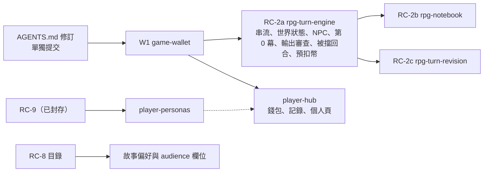

- **輸出審查從原計畫的 2b 移進 2a**：它和串流緊密相連，拆開無法獨立驗收。
- 2c 不阻擋 2a 上線：沒有重生功能時遊戲仍可玩。
- RC-2 的額度整合改為呼叫 W1 的預扣、確認、退回，**不再做 RPG 的每日輪數與每分鐘計數**。
- 「對話人設」與「故事偏好」是新產品功能，不併進介面 change。

### 7.12 對 AGENTS.md 的修訂清單（RA-16 起，**尚未套用**）

依慣例由使用者核可後才修改，單獨提交，並同步技能鏡像與 `tests/test_agents_skill_sync.py`。

| 編號 | 位置 | 內容 |
|---|---|---|
| RA-16 | 第 7、10、11 節 | 遊戲幣：規則（30 幣一輪、200 贈幣、每日簽到、上限 1000、不過期、先免費後付費）、客服不扣幣、RPG 不再用每日輪數；帳本是個資、納入匯出與刪除；管理員調整餘額為高風險操作 |
| RA-17 | 第 7、10、11 節 | 玩家重新生成與編輯輸入：次數、理由必填、只限最後一輪、AI 輸出不可修改；管理員新增檢視類別「重新生成回饋」；理由為個資 |
| RA-18 | 第 7 節 | 玩家主角的「來歷」欄位，並修改「與劇本角色共用同一份欄位」一句；劇本規格新增 `audience`；對話人設的規則與數量上限 |
| RA-19 | 第 10 節 | 輸出審查的判定對應表、`transition` 事件與被擋回合的畫面（接 RA-12） |
| RA-20 | 第 11 節、`/privacy`、`/terms` | 理由回饋與人設的個資告知；遊戲幣與帳本的說明 |

### 7.13 已知風險與監控

- **多開帳號與簽到農幣**：每天 200 幣約 6.7 輪。使用者的判斷是：簽到容易取得，買賣帳號的誘因低；免費幣上限 1000 使囤積無意義（含註冊贈送最快 4 天滿）；一個人多開帳號每個都要從頭推進劇情，與多一位新玩家無異。**列為監控項目、不設上線關卡**。後盾是全站每日 token 上限與 80% 告警。之後觀察「每日發放幣量」「新帳號數」「達上限比例」（最後一項同時是調整簽到金額與上限的依據），這些都可以由帳本彙總算出。
- 存檔數量沒有上限，每個存檔有一次免費的第 0 幕生成；觀察後再決定是否限制。
- 串流中斷時的 token 是估算值，全站預算可能略為低估。
- 每回合的 token 成本（vip 記事簿 12500 字加最近 10 輪加劇本）要由 RC-4 校正；免費模型的上下文長度是否足夠，也要在選定模型時確認。

### 7.14 仍待處理

- 理由對話框、編輯確認 Modal、被擋轉場的實際文案與畫面（RC-3、`player-hub`）。
- 選定正式的 RPG 模型後，重跑提示詞、階段節奏與角色漂移的驗收（含新的上下文組成）。
- 付費幣的退款規則、付款紀錄的保存、未成年付款（W2 與法務）。
- 劇本規格 `audience` 的規格版本與遷移細節（RC-8 或獨立 change）。
- 英文與簡體中文的輸出審查詞表（大更新時）。
- 規則層詞表的輸出專用入口的誤擋率量測（以非性場景為限，R-15.9）。

### 7.15 RC-2a 探索結論（2026-11-09）

> 來源：`/openspec-explore` 補齊 RC-2a 的待釐清問題，與使用者逐項確認。**本節的決定尚未立案；7.15.4 的 RA-21 已於 2026-11-09 經使用者核可並套用到 AGENTS.md。** 與 7.4、7.5、7.6 不同之處以本節為準。

#### 7.15.1 範圍（一個 change，apply 時分批）

- RC-2a `rpg-turn-engine` 維持**單一 change**；apply 前依 `openspec-batch-workflow` 把 `tasks.md` 分組並請使用者確認。建議的批次：①資料與契約（遷移 `0016`、來歷、`attempt`）②串流轉接器 ③純邏輯（上下文組裝、NPC 切片與年齡規則、里程碑判定、規則層輸出入口）④`GameService`（預扣、狀態呼叫、被擋回合、結局、第 0 幕）⑤SSE 端點與 gunicorn 設定。
- **納入**：主角「來歷」（本地人、穿越者；目前 `app/` 與主規格都沒有，要改 `rpg-protagonist`、`protagonist-suggestion` 規格）；**結局**；轉場文字（伺服器端固定幾句繁體中文輪替）。
- **不納入**：全站同時串流上限與 503 文案（RC-4）、玩家重生與編輯（2c）、記事簿（2b）、任何畫面（RC-3）。
- **結局**（使用者：仍有劇本會用到）：狀態呼叫多一個「提議結局」欄位；Service 先確認該劇本版本的 `ending_mode` 為自訂結局才生效；壽終年齡由 Service 判定（`character_age` 加 `elapsed_months` 換算的年數不低於 `ending_age`）。該回合的文字照常送完，送完後存檔才轉為已完結（`status = ended`、`ended_at`）。

#### 7.15.2 預扣冪等鍵（**2c 時再拿出來討論**）

問題：`WalletService.hold()` 遇到同一個鍵就回傳既有的預扣，即使它已經 `refunded` 也不會重新扣；串流中斷後用同一個 `client_msg_id` 重送，會變成免費生成。

決定：`memory_logs` 新增 `attempt`（預設 1），預扣鍵為 `turn:{存檔識別碼}:{client_msg_id}:{attempt}`（約 109 字，低於 `HOLD_KEY_MAX` 180）。

| 情況 | 處理 |
|---|---|
| 新回合 | attempt = 1，預扣 |
| 被擋後的自動重生 | **沿用同一筆預扣**；重生仍被擋才退回 |
| 失敗或中斷後同一 `client_msg_id` 重送 | 前一筆已退回，attempt 加 1、新鍵、重新預扣 |
| 已完成的回合重送 | 回傳既有結果，不碰錢包 |

不改已封存的 W1 錢包 API。2c 加入編輯與重生時，是否在鍵上再加 `revision`，屆時再議。

#### 7.15.3 其餘預設（使用者未異議，採用）

- **第 0 幕的觸發**：另開 `POST …/opening/stream`，前端進入存檔時呼叫。串流中斷時狀態退回 `pending`（不是 `fallback`），下次進入再生成；另一個裝置在 `generating` 時只讀取、不重複生成，逾時 90 秒可被接手。
- **狀態呼叫失敗**：重試 1 次仍失敗，該回合仍算完成並收費（文字已送達），世界狀態不變。
- **被擋回合的部分文字**：寫在原本那一列的 `llm_raw_response`，保留 14 天，不新增資料表。
- **免費模型**：允許，程式不加防呆，AGENTS.md 不動；「一般與成人模式不得使用免費模型」維持為對外開放前的關卡（`launch-gates`）。免費模型日後會淘汰，只換環境變數。
- **驗收**：不做臨時網頁。比照 W1，寫一支 HTTP 驗收腳本打驗收環境的 `/turns/stream`，檢查事件序列、扣幣、被擋回合、結局、中斷退幣；再以真實 OpenRouter 模型各跑一次第 0 幕與 3 個回合（只當驗證，不算測試）。

#### 7.15.4 NPC 與主角的年齡（**RA-21，已套用**）

使用者的決定：開放世界靠玩家輸入建置，限制太多會造成流失，所以**年齡可以往任何方向更正；只有「確定」未成年與性內容綁定時才擋**。

| 項目 | 規則 |
|---|---|
| 第一次出現年齡 | 狀態呼叫提議，Service 驗證格式與合理範圍後寫入 `entities_json` 的卡片 |
| 更正 | 成年到成年、成年到未成年、未成年到成年都允許；不另設時間限制 |
| 通知玩家 | 每次更正，`state` 事件帶一則通知（含更正前的年齡），例如「師妹的年齡由 20 歲變更為 16 歲」 |
| 主角 | 套用同一規則 |
| **擋下的條件（只有兩種）** | ①角色現在的年齡紀錄小於 18，且該段文字出現性內容；②文字本身明確寫出未成年的年齡或身分（「十六歲」「國中生」「孩童」），且與性內容同段或相鄰句 |
| 不擋 | 「嬌小」「娃娃臉」這類模糊的外貌描述；年齡未知的 NPC（一般模式沒有露骨內容，不需要成年紀錄） |
| 擋下後 | 沿用 7.4 的被擋回合流程 |
| 記事簿 | 只記與該角色有關的錨定事件（2b 的抓取提示詞）；記事簿可被玩家編輯，不是判定依據 |

- **反覆翻轉的漏洞已由現有時序擋住，不另加規則**：年齡更新發生在串流之後，玩家把角色從未成年「改成年」的那一回合，審查看到的仍是舊的未成年紀錄，該回合的性內容會被擋，下一回合卡片更新後才放行。反方向（成年變未成年）同一回合只靠條件②的文字線索擋。
- **對 AGENTS.md 的修訂（2026-11-09 使用者核可並已套用，含 4 份技能鏡像與同步測試）**：第 7 節 NPC 角色卡條的「角色年齡為錨定事實，模型與玩家都不能直接寫入；成年角色不得被改成未成年，衝突時以劇情轉場處理，不顯示錯誤」，改為「角色年齡由模型提議，Service 驗證格式與合理範圍後寫入，可往任何方向更正，每次更正須通知玩家並附更正前的年齡；年齡紀錄未滿 18 歲，或文字明確寫出未成年的年齡或身分者，不得有性內容，由審查層擋下，不論模式」；玩家主角條的「主角的年齡為錨定事實，開存檔後模型與玩家都不能直接寫入」，改為「主角的年齡於開存檔時寫入，之後依 NPC 年齡的相同規則更正」。第 7 節「無論模式，一律禁止涉及未成年（含看似未成年的角色）的性內容」與「露骨場景中的每個角色須有成年年齡紀錄」**不動**。
- **風險（列入法務覆核）**：「年齡由玩家輸入決定」把判斷依賴放在年齡紀錄與文字線索；RC-2a 驗收要量測誤擋與漏擋（R-15.9）。

#### 7.15.5 仍待處理

- RA-21 已套用並單獨提交；年齡可自由更正的設計列入法務覆核。
- 每回合 `elapsed_months` 增量的上限（設計階段定，放資料庫設定表）。
- 預扣鍵在 2c 的 `revision` 是否併入（7.15.2）。
- 規則層輸出入口的詞表：未成年的明確用語清單與「相鄰句」的定義（設計階段定，隨誤擋率量測調整）。
