# project 資料庫結構（Database Schema 與 Data Dictionary）

> 狀態：已實作 ｜ 最後更新：2026-11-12 ｜ 對應 change：rpg-turn-revision（`memory_logs` 新增 `revision`、`regen_count`、`revising_started_at`、`state_before_json`，新增 `turn_regenerations`，設定鍵 `rpg.free_regenerations`）、story-preference（新增 `users.story_preference`、`script_versions.audience`）、rpg-notebook（沒有結構變更，只補固定值與欄位行為）、rpg-turn-engine、game-wallet、rpg-character-creation、rpg-script-authoring（以及先前所有建立或修改資料表的 change，見第 12 節） ｜ 資料庫版本：`0018_rpg_turn_revision`（實際的 `project` 目前為 `0017_story_preference`，0018 尚未套用，見第 14 節） ｜ 規範依據：AGENTS.md 第 4、10、11 節

本文件是 SQL Server `project` 資料庫的**結構參考**：共 **21 張資料表、249 個欄位**（另有 Alembic 自己的 `alembic_version`）。第 3 節用 ERD 說明關聯，第 5 節是逐表逐欄的資料字典，第 6、7 節補充固定值與 JSON 欄位的內容。

與其他文件的分工：本文件回答「資料庫裡**有什麼**」（結構、型別、鍵、固定值、保存期限的對照）；為什麼這樣設計、跨資料庫（SQLite 與 SQL Server）的取捨與決策理由，在 [資料模型-data-model.md](資料模型-data-model.md)；各資料的保存與刪除指令在 [營運與部署-operations.md](營運與部署-operations.md)；程式分層與依賴方向在 [系統架構-architecture.md](系統架構-architecture.md)。

## 1. 資料庫概述

| 項目 | 內容 |
|---|---|
| 資料庫管理系統 | Microsoft SQL Server（本機開發的 `project` 實測：主版本 17，相容性層級 170） |
| 資料庫名稱 | `project`＝本機開發；`project_test`＝整合測試專用（名稱必須以 `_test` 結尾，測試會自行建立與刪除資料表，**絕不可指向 `project`**）；正式環境規劃使用 Cloud SQL for SQL Server（尚未建立） |
| 排序規則 | `Chinese_Taiwan_Stroke_CI_AS`（**不分大小寫**；本機開發的 `project` 實測）。程式不依賴排序規則：具唯一約束的字串（如 email）一律先在 Service 層正規化（轉小寫）再寫入與查詢，讓 SQLite 與 SQL Server 行為一致 |
| 連線 | SQLAlchemy 2.x 加 pyodbc 與 ODBC Driver 18；連線字串只存在環境變數 `DATABASE_URL`（`.env` 或平台機密）。本機可設定 `TrustServerCertificate=yes`；正式環境須驗證伺服器憑證，且不得使用 `sa` 帳號 |
| 結構管理 | Alembic（`render_as_batch`）；**結構只能透過 migration 變更**，應用程式啟動時不建立資料表、不自動執行 migration。程式的最新版本 `0018_rpg_turn_revision`；實際的 `project` 目前為 `0017_story_preference`（`alembic_version` 只有一列；0017 已於 2026-11-11 套用，0018 尚未套用，見第 14 節） |
| 資料表與欄位 | 21 張業務資料表、249 個欄位、51 個索引與唯一約束、18 個外鍵 |
| 字元 | 文字欄位一律 Unicode（`NVARCHAR`），繁體中文不亂碼 |
| 時間 | 一律存 UTC（`DATETIME2(6)`）；日界與年齡以 Asia/Taipei 計 |
| 主鍵 | 全部是 `INTEGER IDENTITY(1,1)`；對外（網址與 API）只使用 `public_id`（UUID 字串），內部整數編號不外露 |

**`0018_rpg_turn_revision`（`memory_logs` 的四個修訂欄位、新表 `turn_regenerations`、設定鍵 `rpg.free_regenerations`）尚未套用到實際的 `project`**：本文第 5 節以 ORM 以 SQL Server 方言編譯的結構為準，已由 `tests/test_project_db_schema_doc.py` 逐項比對，並在整合測試資料庫 `project_test` 上完成 upgrade → downgrade → upgrade；套用到 `project` 時依第 14 節的做法先備份、再升級並追加「套用」列。

**`0016_rpg_turn_engine`（`memory_logs.attempt`、`sessions` 的第 0 幕三欄、`llm_call_logs.first_chunk_ms`、設定鍵 `rpg.max_months_per_turn`）已於 2026-11-09 套用到實際的 `project`**：`alembic current` 為 `0016_rpg_turn_engine (head)`，`alembic check` 回報 `No new upgrade operations detected.`，`flask show-rpg-settings` 列出 `rpg.max_months_per_turn = 24`（來自資料庫，不是保底預設），唯讀查詢確認 20 張資料表、232 個欄位、17 個外鍵、`runtime_limits` 16 列，與本文一致。

**`0015_game_wallet`（`wallets`、`wallet_entries`、五個遊戲幣設定鍵）已於 2026-11-09 套用到實際的 `project`**：`alembic current` 為 `0015_game_wallet (head)`，`alembic check` 回報 `No new upgrade operations detected.`，`flask show-wallet-settings` 列出五個鍵（30、200、200、1000、180），唯讀查詢確認 20 張資料表、227 個欄位、17 個外鍵、`runtime_limits` 15 列，與本文一致。以下的逐項比對紀錄是 `0014` 為止的狀態。

**驗證紀錄**：本文的型別、可空、索引與唯一約束的名稱、篩選條件與主鍵名稱，已於 2026-11-04 以**唯讀**方式與實際的 `project` 資料庫（`alembic_version` ＝ `0013_rpg_script_authoring`）逐項比對，18 張資料表沒有任何差異；`alembic check` 回報 `No new upgrade operations detected.`。**`0014_rpg_character_creation`（`sessions.protagonist_json`、三個限制鍵）已於 2026-11-05 套用到實際的 `project`**：`alembic current` 為 `0014_rpg_character_creation (head)`，`alembic check` 回報 `No new upgrade operations detected.`（ORM 與實際資料庫沒有差異），`flask show-script-limits` 列出十個鍵、三個新的值是 5、15、40。

## 2. 資料表總覽

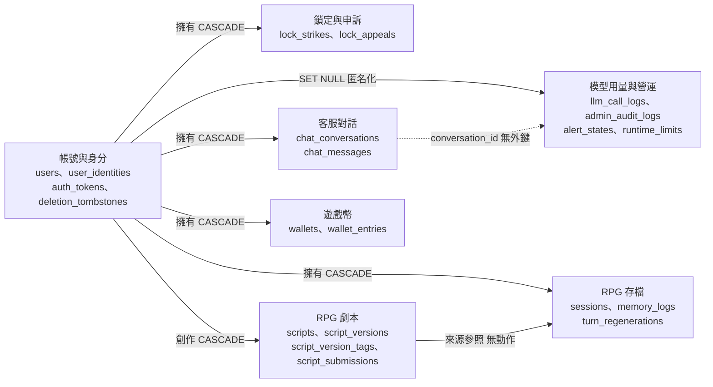

`users` 是整個資料庫的中心：幾乎每個領域的資料都指向它，刪除帳號時靠外鍵的 `CASCADE` 讓內容真的消失（第 4 節）。

| 資料表 | 中文名稱 | 領域 | 用途 | 主要寫入者 | 保存與刪除 | 欄位 |
|---|---|---|---|---|---|---|
| `users` | 會員 | 帳號與身分 | 玩家與管理員的帳號主表：身分、年齡確認、內容模式、帳號鎖定與暫停發佈、暱稱、故事偏好。 | UserRepository（條件式更新）；後台操作走 AdminRepository | 連續 12 個月未登入刪除（管理員不納入）；申請刪除後 7 天寬限；建立後 24 小時未完成年齡確認即刪除；一律經 AccountErasureService 單一出口 | 36 |
| `user_identities` | 第三方登入身分 | 帳號與身分 | Google 登入的穩定識別（sub）。一個帳號最多一個 Google 身分，一個 Google 身分只屬於一個帳號。 | UserIdentityRepository | 隨帳號刪除（CASCADE） | 5 |
| `auth_tokens` | 管理員重設密碼權杖 | 帳號與身分 | 管理員「忘記密碼」寄出的一次性權杖；只存 SHA-256 雜湊，原值只出現在信件中。 | AuthTokenRepository | 到期後 7 天由 purge-expired-data 刪除；隨帳號刪除（CASCADE） | 7 |
| `deletion_tombstones` | 帳號刪除紀錄 | 帳號與身分 | 記錄「哪個內部編號在何時、因何原因被抹除」，備份還原後據此重新執行刪除；不含任何個資。 | DeletionTombstoneRepository（隨抹除流程同一交易寫入） | 不設期限、不納入期限清除（還原後要靠它重播刪除） | 4 |
| `lock_strikes` | 帳號鎖定計次 | 鎖定與申訴 | 玩家帳號自動鎖定的計次：已辨識身分卻被拒的 Google 登入，與被每分鐘訊息數上限擋下的洗版。 | LockStrikeRepository | 建立後 7 天由 purge-expired-data 刪除（計次視窗只有 15 分鐘）；隨帳號刪除（CASCADE） | 4 |
| `lock_appeals` | 申訴 | 鎖定與申訴 | 被鎖定或被暫停發佈的玩家向管理員提出的申訴；內容由玩家撰寫，視為個資。 | LockAppealRepository；管理員檢視走 AdminRepository | 保存期限與所屬帳號相同，隨帳號刪除（CASCADE）；不由期限清除 | 6 |
| `chat_conversations` | 客服對話 | 客服對話 | 客服對話的標頭：標題、累積摘要、當前狀態與處理標記。 | ChatRepository | 最後活動後 365 天由 purge-expired-data 刪除；使用者可主動刪除；隨帳號刪除（CASCADE） | 12 |
| `chat_messages` | 客服訊息 | 客服對話 | 對話中的每一則訊息（使用者與助理），以單調遞增的 seq 排序。 | ChatRepository | 隨對話刪除（CASCADE） | 12 |
| `llm_call_logs` | 模型呼叫用量帳本 | 模型用量與營運 | 每次模型呼叫一筆（含重試與備援）：用量、額度、斷路與全站每日 token 的唯一來源；不含對話全文。 | LlmCallLogRepository（與回覆同一交易） | 建立後 365 天刪除；失敗原文（error_detail）14 天清為空值；帳號刪除時 user_id 變空值（匿名化） | 17 |
| `admin_audit_logs` | 管理稽核紀錄 | 模型用量與營運 | 管理員操作與系統自動動作（鎖定、暫停發佈、修改營運限制）的稽核；只新增、不可修改。 | AdminAuditRepository（只有新增與讀取） | 建立後 730 天由 purge-expired-data 刪除（唯一的清除途徑在 RetentionRepository） | 8 |
| `alert_states` | 營運告警狀態 | 模型用量與營運 | 五項營運告警各一列（至多 5 列）：目前是否告警中、嚴重度與最近一次通知。 | AlertStateRepository（條件式更新搶佔通知） | 不設期限；不指向使用者，不含個資 | 8 |
| `runtime_limits` | 營運限制 | 模型用量與營運 | 存放在資料庫的營運限制（劇本數量、每日送審次數、每日主角生成次數、連續被拒門檻、遊戲幣的五個設定，以及 RPG 回合引擎的每回合月數上限、每個回合前幾次重新生成免費）；程式每次使用時現讀。 | RuntimeLimitRepository；只能以 flask set-script-limit 修改 | 不設期限；不指向使用者，不含個資；初始十列由遷移 0013（七列）與 0014（三列）寫入 | 4 |
| `scripts` | 劇本 | RPG 劇本 | 劇本的身分：作者、內建劇本的種子鍵、筆名與短代號的快照；內容與狀態在 script_versions。 | ScriptRepository | 隨作者的帳號抹除（CASCADE）；內建劇本沒有作者，不隨帳號刪除 | 9 |
| `script_versions` | 劇本版本 | RPG 劇本 | 劇本的每個版本：固定規格的全部欄位、狀態、內容雜湊與審查結果。已發佈的版本不可變，修改一律新增版本。 | ScriptRepository（狀態只在此寫入，有架構測試擋住別處） | 隨劇本刪除（CASCADE）；刪除草稿時直接刪除 | 33 |
| `script_version_tags` | 劇本版本標籤 | RPG 劇本 | 版本的標籤（以顯示形式儲存，查詢以小寫比對），讓目錄日後可以篩選。 | ScriptRepository | 隨版本刪除（CASCADE） | 3 |
| `script_submissions` | 劇本送審紀錄 | RPG 劇本 | 每次成功送審、被自動拒絕與管理員解除暫停各一筆，用來算每日送審次數與連續被拒；不含任何劇本文字。 | ScriptSubmissionRepository | 建立後 365 天由 purge-expired-data 刪除；隨帳號刪除（CASCADE） | 5 |
| `sessions` | RPG 存檔 | RPG 存檔 | 玩家的一個遊戲存檔：開局時複製的劇本內容、主角、世界狀態、記事簿與內容模式。 | SessionRepository | 最後活動後 365 天由 purge-expired-data 刪除（回合、記事簿與主角一併消失）；隨帳號刪除（CASCADE） | 29 |
| `memory_logs` | RPG 回合紀錄 | RPG 存檔 | 存檔中的每一個回合：玩家行動、劇情原文與結構化輸出；最後一輪可被重新生成或編輯（修訂版本、免費次數、認領時間與回合前快照）。 | SessionRepository | 隨存檔刪除（CASCADE）；中斷或被擋回合的劇情內容超過 14 天清為空字串；回合前快照在下一輪完成時清為空值 | 16 |
| `turn_regenerations` | 重新生成與編輯的回饋 | RPG 存檔 | 玩家重新生成時選的分類與填的理由（供營運檢視），與每次修訂的結果；不存被取代的行動與劇情。 | 儲存庫層（rpg-turn-revision 的後續批次加入寫入方法） | 隨存檔刪除（CASCADE），隨存檔與帳號一併抹除；視為個資，納入個人資料匯出 | 11 |
| `wallets` | 遊戲幣錢包 | 遊戲幣 | 每位玩家至多一個：免費與付費兩個餘額（不得為負）與每次異動加 1 的版本號（樂觀鎖）。 | WalletRepository（餘額只由它寫入，架構測試守住） | 隨帳號抹除（CASCADE），不匿名化保留；視為個資，納入個人資料匯出 | 7 |
| `wallet_entries` | 遊戲幣帳本 | 遊戲幣 | 只增不改的帳本：每次餘額異動一筆（註冊贈送、每日簽到、冒險回合預扣與退回、管理員調整）；只放固定列舉與整數，不放玩家文字。 | WalletRepository | 隨帳號抹除（CASCADE），不匿名化保留；視為個資，納入個人資料匯出 | 13 |

## 3. 實體關聯圖（ERD）

圖例：實線＝外鍵（標籤為「外鍵欄位 刪除動作」）；虛線＝沒有外鍵、只存編號的參照；`||` 為必有的父列，`|o` 為可為空的父列（`o{` 為「零到多」）。實體內的 `PK`、`FK`、`UK` 為主鍵、外鍵、唯一鍵。

### 3.1 全庫關聯總覽（只列主鍵與外鍵）

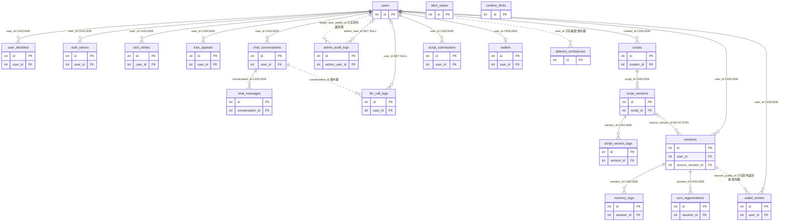

### 3.2 帳號、鎖定與申訴

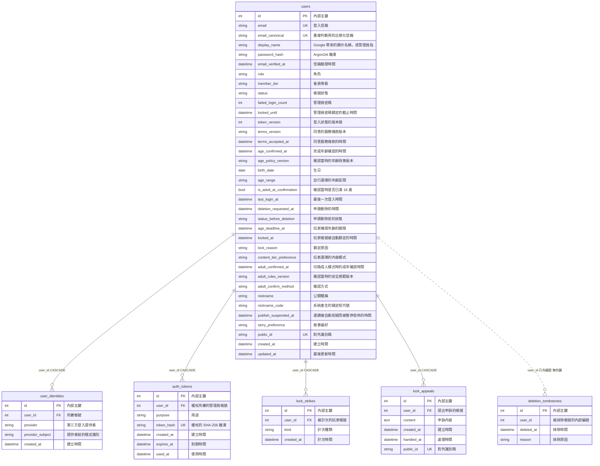

### 3.3 客服對話與模型用量

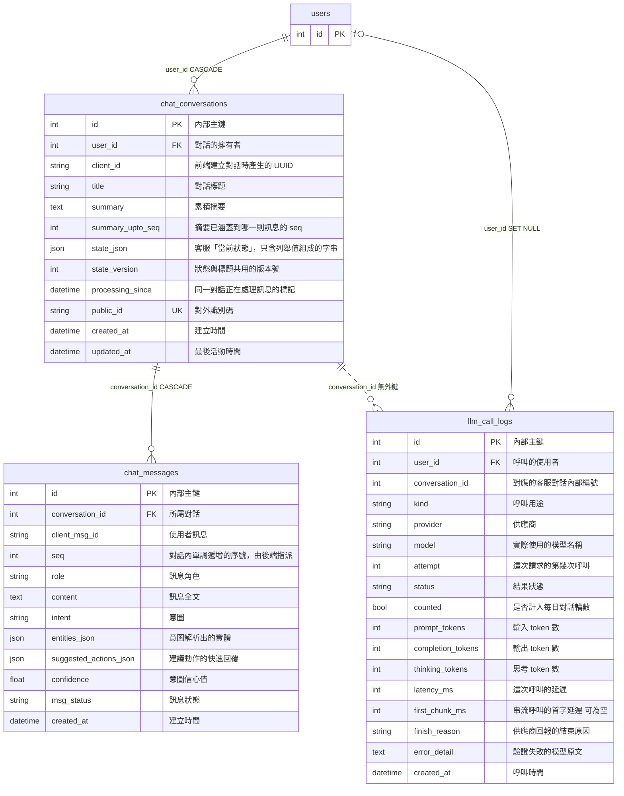

### 3.4 RPG 劇本與存檔

```mermaid
erDiagram
    users |o--o{ scripts : "creator_id CASCADE"
    scripts ||--o{ script_versions : "script_id CASCADE"
    script_versions ||--o{ script_version_tags : "version_id CASCADE"
    users ||--o{ script_submissions : "user_id CASCADE"
    users ||--o{ sessions : "user_id CASCADE"
    script_versions |o--o{ sessions : "source_version_id NO ACTION"
    sessions ||--o{ memory_logs : "session_id CASCADE"
    sessions ||--o{ turn_regenerations : "session_id CASCADE"

    scripts {
        int id PK "內部主鍵"
        int creator_id FK "作者"
        string seed_key "內建劇本的穩定鍵"
        string author_name "筆名快照"
        string author_code "短代號快照，與筆名一起顯示"
        datetime author_locked_at "筆名鎖定時間"
        string public_id UK "對外識別碼"
        datetime created_at "建立時間"
        datetime updated_at "最後更新時間"
    }
    script_versions {
        int id PK "內部主鍵"
        int script_id FK "所屬劇本"
        int version_no "版本編號"
        string status "版本狀態"
        int spec_version "劇本固定規格的版本"
        string content_hash "標準化內容的 SHA-256"
        int total_chars "全部文字欄位的總字數"
        string title "標題"
        string summary "簡介"
        string world_name "世界觀名稱"
        string content_tier "作者宣告的內容模式"
        string audience "讀者頻道"
        text background "背景與體系"
        text opening "初始對話"
        text rules "世界規則"
        string ending_mode "結局模式"
        text ending_text "結局說明"
        int ending_age "壽終年齡"
        string calendar_name "曆法名稱"
        int calendar_start_year "曆法的起始年"
        json characters_json "角色清單"
        json locations_json "地點清單"
        json milestones_json "里程碑清單"
        int live_script_id "輔助欄位"
        int open_script_id "輔助欄位"
        datetime published_at "上架時間"
        string review_hash "審查當時的 content_hash"
        string review_verdict "審查結果"
        json review_categories_json "審查的類別"
        datetime reviewed_at "審查時間"
        string public_id UK "對外識別碼"
        datetime created_at "建立時間"
        datetime updated_at "最後更新時間"
    }
    script_version_tags {
        int id PK "內部主鍵"
        int version_id FK "所屬版本"
        string tag "標籤"
    }
    script_submissions {
        int id PK "內部主鍵"
        int user_id FK "送審的作者"
        string outcome "結果"
        json categories_json "拒絕或有疑慮的類別"
        datetime created_at "紀錄時間"
    }
    sessions {
        int id PK "內部主鍵"
        int user_id FK "存檔的擁有者"
        int source_version_id FK "開局所用的劇本版本"
        json script_snapshot_json "開存檔當時的標準化劇本內容"
        int snapshot_spec_version "快照的固定規格版本"
        string player_name "主角姓名"
        int character_age "主角在劇中的年齡"
        json protagonist_json "主角角色卡與錨定事實 可為空"
        string current_location "目前所在地點"
        text status_summary "狀態摘要"
        json entities_json "NPC 角色卡與關係狀態"
        json goals_json "目標"
        json milestone_progress_json "里程碑的進度"
        int elapsed_months "故事開始後經過的遊戲內月數"
        int version "世界狀態的版本號"
        text notebook_text "記事簿"
        int notebook_version "記事簿的版本號"
        int notebook_upto_turn "記事簿已處理到第幾輪"
        text opening_text "第 0 幕的文字 可為空"
        string opening_state "第 0 幕的狀態 可為空"
        datetime opening_started_at "第 0 幕開始生成的時間 可為空"
        string content_tier "開存檔當下的生效內容模式"
        string status "存檔狀態"
        datetime ended_at "完結時間"
        bool is_archived "玩家自行封存"
        datetime last_active_at "最後活動時間"
        string public_id UK "對外識別碼"
        datetime created_at "建立時間"
        datetime updated_at "最後更新時間"
    }
    memory_logs {
        int id PK "內部主鍵"
        int session_id FK "所屬存檔"
        string client_msg_id "前端產生的唯一編號"
        int seq "存檔內單調遞增的序號，由後端指派"
        int turn_number "輪數"
        string turn_status "回合狀態"
        int attempt "嘗試序號 預扣冪等鍵的一部分"
        text user_action "玩家的行動"
        text llm_raw_response "劇情原文"
        json structured_result "模型的結構化輸出"
        int revision "修訂版本 每次成功修訂加 1"
        int regen_count "這份輸入已成功重新生成幾次"
        datetime revising_started_at "修訂的認領時間 可為空"
        json state_before_json "回合前的世界快照 可為空"
        datetime created_at "建立時間"
        datetime updated_at "最後更新時間"
    }
    turn_regenerations {
        int id PK "內部主鍵"
        int session_id FK "所屬存檔"
        int turn_seq "被修訂的回合序號"
        int attempt "認領後的嘗試序號"
        string kind "種類 regenerate 或 edit"
        string category "玩家選的分類 編輯為空"
        text reason "玩家填的理由 編輯為空"
        bool is_free "是否免費重新生成"
        string result "結果"
        datetime created_at "建立時間"
        datetime updated_at "最後更新時間"
    }
    users {
        int id PK
    }
```

### 3.5 營運與稽核

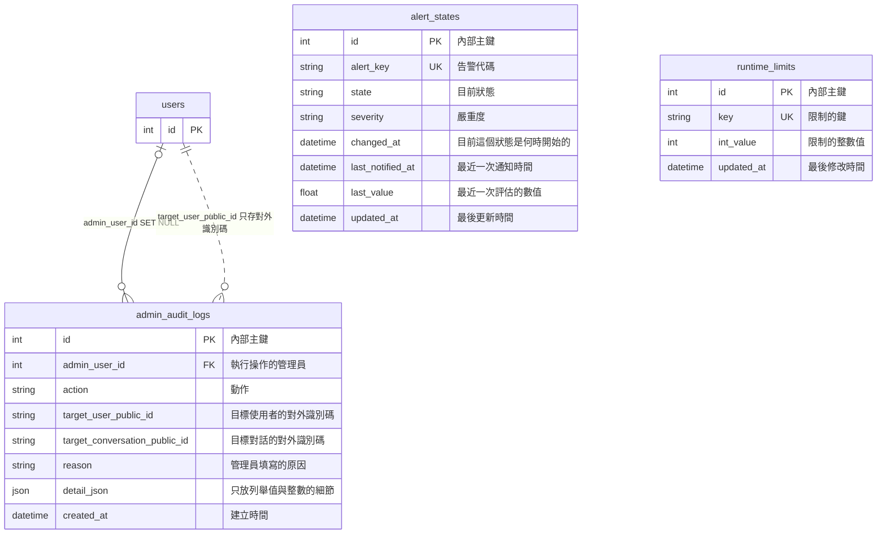

`alert_states` 與 `runtime_limits` 不指向任何使用者，也不含個資；`script_versions.live_script_id`、`open_script_id` 是輔助欄位而不是外鍵（見第 4.3 節）。

### 3.6 遊戲幣

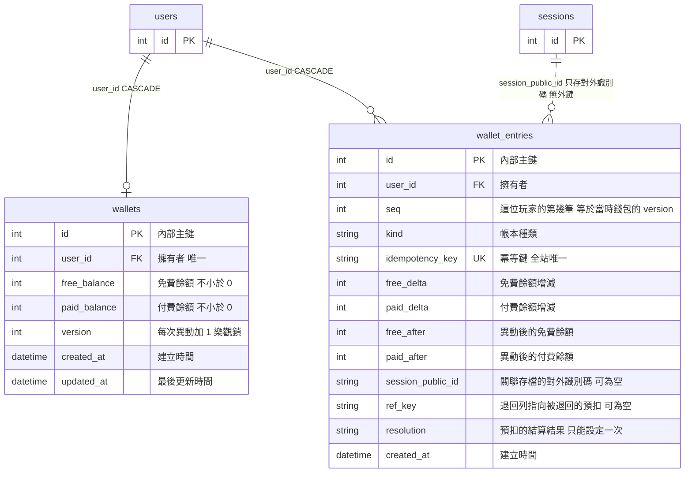

帳本關聯存檔的是**對外識別碼（UUID）**而不是內部編號，且沒有外鍵：帳本比存檔活得久，SQLite 會重用整數編號而錯指別人的存檔，SQL Server 也不允許 `users` 到帳本有兩條串聯路徑（見第 4.3 節）。

## 4. 外鍵與刪除動作

### 4.1 外鍵一覽

| 子表.欄位 | 父表.欄位 | 刪除動作 | 可為空 | 說明 |
|---|---|---|---|---|
| `user_identities.user_id` | `users.id` | CASCADE | 否 |  |
| `auth_tokens.user_id` | `users.id` | CASCADE | 否 |  |
| `lock_strikes.user_id` | `users.id` | CASCADE | 否 |  |
| `lock_appeals.user_id` | `users.id` | CASCADE | 否 |  |
| `chat_conversations.user_id` | `users.id` | CASCADE | 否 |  |
| `chat_messages.conversation_id` | `chat_conversations.id` | CASCADE | 否 |  |
| `llm_call_logs.user_id` | `users.id` | SET NULL | 是 | 帳號刪除時帳本匿名化後保留（用量彙總與成本稽核仍需要）。 |
| `admin_audit_logs.admin_user_id` | `users.id` | SET NULL | 是 | 管理員或目標被刪除後，「誰對誰做了什麼」仍然成立，這正是稽核該有的性質；系統自動動作的管理員欄位本來就是空值。 |
| `scripts.creator_id` | `users.id` | CASCADE | 是 | 內建劇本沒有作者（空值）；玩家劇本隨作者的帳號抹除。 |
| `script_versions.script_id` | `scripts.id` | CASCADE | 否 |  |
| `script_version_tags.version_id` | `script_versions.id` | CASCADE | 否 |  |
| `script_submissions.user_id` | `users.id` | CASCADE | 否 | 刻意不連到版本，避免 users→script_versions→script_submissions 的第二條串聯路徑。 |
| `sessions.user_id` | `users.id` | CASCADE | 否 |  |
| `sessions.source_version_id` | `script_versions.id` | NO ACTION | 是 | 無動作：刪除使用者有兩條路徑到達 sessions（users→sessions 與 users→scripts→script_versions→sessions），SQL Server 不允許多重串聯路徑（錯誤 1785）。刪除版本與抹除帳號的流程先把參照清為空值，忘了清除時刪除會直接失敗。 |
| `memory_logs.session_id` | `sessions.id` | CASCADE | 否 |  |
| `turn_regenerations.session_id` | `sessions.id` | CASCADE | 否 | 回饋含玩家填的理由（個資），隨存檔與帳號一併抹除；刻意不連到 `memory_logs`（以回合序號對應），避免回合被清除或重送時牽動回饋。 |
| `wallets.user_id` | `users.id` | CASCADE | 否 | 錢包是個資，隨帳號抹除，不匿名化保留；一人至多一個（唯一約束）。 |
| `wallet_entries.user_id` | `users.id` | CASCADE | 否 | 帳本是個資，隨帳號抹除，不匿名化保留。 |

### 4.2 刪除一位使用者時的連鎖效果

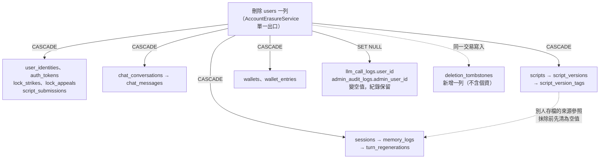

抹除的順序不能反過來：先清別人存檔對這位作者的版本參照、再清帳本的對話編號、最後條件式刪除並寫入刪除紀錄；條件不成立時整個交易回復。細節見 [資料模型-data-model.md](資料模型-data-model.md) 第 4 節。

### 4.3 沒有外鍵的參照

| 欄位 | 指向 | 原因與處理 |
|---|---|---|
| `llm_call_logs.conversation_id` | `chat_conversations.id` | 刻意沒有外鍵：SQL Server 不允許多重串聯路徑（錯誤 1785）。刪除對話時由 Repository 先把帳本的編號清為空值；SQLite 重用整數編號時若不先清，會錯指別人的新對話。 |
| `deletion_tombstones.user_id` | `users.id` | 帳號已被抹除，外鍵無從指向；只存內部編號、時間與原因，不含個資。 |
| `admin_audit_logs.target_user_public_id` | `users.public_id` | 只存對外識別碼（UUID，非個資）；同一張表若有兩個指向 users 且帶動作的外鍵會觸發錯誤 1785；目標被刪除後「誰對誰做了什麼」仍成立。 |
| `admin_audit_logs.target_conversation_public_id` | `chat_conversations.public_id` | 同上。 |
| `wallet_entries.session_public_id` | `sessions.public_id` | 只存對外識別碼（UUID，非個資），不設外鍵：帳本比存檔活得久，內部整數編號可能被重用而錯指別人的存檔；`users` 到帳本也不能有第二條串聯路徑。 |
| `script_versions.live_script_id` | `scripts.id` | 輔助欄位，不是外鍵：狀態為 published 時等於 script_id，其餘為空；篩選式唯一索引保證每個劇本至多一個上架版本。 |
| `script_versions.open_script_id` | `scripts.id` | 輔助欄位，不是外鍵：狀態為 draft 或 pending_review 時等於 script_id；保證每個劇本至多一個進行中的版本。 |

## 5. 資料字典

### 5.0 閱讀方式

| 欄位 | 寫法 |
|---|---|
| 型別 | SQL Server 的實際型別。`INTEGER IDENTITY(1,1)` 是自動遞增的主鍵；`（JSON）` 表示由 SQLAlchemy 序列化存成 `NVARCHAR(max)`，**不得依內容篩選查詢**（兩種資料庫的 JSON 語法不同） |
| 可空 | 是＝允許空值（NULL） |
| 資料庫預設 | 資料表上實際的 DEFAULT 約束。整個資料庫只有 `users.content_tier_preference` 與 `users.story_preference` 有；其他欄位的預設值由 ORM 或 Service 在寫入時指定（寫在說明裡） |
| 鍵 | `PK`＝主鍵；`FK→父表.欄位`＝外鍵；`UK`＝單一欄位的唯一約束（多欄位的唯一約束列在各表的「索引與約束」） |
| 說明 | 欄位的意義、單位與限制；固定值見第 6 節、JSON 結構見第 7 節；標示「個資」的欄位受 AGENTS.md 第 11 節的保存與日誌規範 |

### 5.1 `users`（會員）

玩家與管理員的帳號主表：身分、年齡確認、內容模式、帳號鎖定與暫停發佈、暱稱、故事偏好。

- 領域：帳號與身分　｜　主要寫入者：UserRepository（條件式更新）；後台操作走 AdminRepository　｜　保存與刪除：連續 12 個月未登入刪除（管理員不納入）；申請刪除後 7 天寬限；建立後 24 小時未完成年齡確認即刪除；一律經 AccountErasureService 單一出口

| # | 欄位 | 型別 | 可空 | 資料庫預設 | 鍵 | 說明 |
|---|---|---|---|---|---|---|
| 1 | `id` | INTEGER IDENTITY(1,1) | 否 | — | PK | 內部主鍵（自動遞增）；不對外暴露。 |
| 2 | `email` | NVARCHAR(255) | 否 | — | UK | 登入信箱（原始地址，Google 回傳）；唯一。Service 層轉小寫後才寫入與查詢（排序規則不分大小寫）。 |
| 3 | `email_canonical` | NVARCHAR(255) | 否 | — | UK | 重複判斷用的正規化信箱：小寫；gmail.com 與 googlemail.com 另去除「.」與「+標籤」；唯一。 |
| 4 | `display_name` | NVARCHAR(50) | 否 | — | — | Google 帶來的顯示名稱，或管理員指令指定的名稱；不公開（公開的是 nickname）。 |
| 5 | `password_hash` | NVARCHAR(255) | 是 | — | — | Argon2id 雜湊；只有管理員有值，玩家（只用 Google 登入）為空。 |
| 6 | `email_verified_at` | DATETIME2(6) | 是 | — | — | 信箱驗證時間；玩家建立帳號時即有值（以 Google 的 email_verified 為準）。 |
| 7 | `role` | NVARCHAR(10) | 否 | — | — | 角色：user｜admin。 |
| 8 | `member_tier` | NVARCHAR(10) | 否 | — | — | 會員等級：free｜plus｜vip；只影響額度，不影響權限。 |
| 9 | `status` | NVARCHAR(20) | 否 | — | — | 帳號狀態：active｜suspended｜deletion_pending。沒有資料庫預設，由 Service 明確指定。 |
| 10 | `failed_login_count` | INTEGER | 否 | — | — | 管理員密碼（含後台重新輸入密碼）連續失敗次數；只有登入成功才歸零。 |
| 11 | `locked_until` | DATETIME2(6) | 是 | — | — | 管理員密碼鎖定的截止時間（連續失敗 5 次鎖定 15 分鐘）；與玩家帳號鎖定 locked_at 分開。 |
| 12 | `token_version` | INTEGER | 否 | — | — | 登入狀態的版本號；加 1 即撤銷既有的 session（改密碼、登出所有裝置、停權）。 |
| 13 | `terms_version` | NVARCHAR(40) | 是 | — | — | 同意的服務條款版本；管理員指令建立的帳號沒有同意動作，為空。 |
| 14 | `terms_accepted_at` | DATETIME2(6) | 是 | — | — | 同意服務條款的時間。 |
| 15 | `age_confirmed_at` | DATETIME2(6) | 是 | — | — | 完成年齡確認的時間（使用者自行聲明，不核實）。 |
| 16 | `age_policy_version` | NVARCHAR(40) | 是 | — | — | 確認當時的年齡政策版本。 |
| 17 | `birth_date` | DATE | 是 | — | — | 生日（個資）；是否成年一律由它於當下計算；不進 API 回應、日誌與模型。 |
| 18 | `age_range` | NVARCHAR(20) | 是 | — | — | 自行選擇的年齡區間（個資），與生日對照通過才寫入；值見第 6 節。 |
| 19 | `is_adult_at_confirmation` | BIT | 是 | — | — | 確認當時是否已滿 18 歲；只供紀錄，不參與任何判斷。 |
| 20 | `last_login_at` | DATETIME2(6) | 是 | — | — | 最後一次登入時間；連續 12 個月未登入即刪除帳號的依據。 |
| 21 | `deletion_requested_at` | DATETIME2(6) | 是 | — | — | 申請刪除的時間；只有 deletion_pending 才有值（7 天寬限期的起點）。 |
| 22 | `status_before_deletion` | NVARCHAR(20) | 是 | — | — | 申請刪除前的狀態（只會是 active）；撤銷刪除時還原。 |
| 23 | `age_deadline_at` | DATETIME2(6) | 是 | — | — | 玩家補填年齡的期限（建立後 24 小時）；補填成功後清空；逾時由每小時的排程刪除帳號。 |
| 24 | `locked_at` | DATETIME2(6) | 是 | — | — | 玩家帳號被自動鎖定的時間；只有管理員能解除。 |
| 25 | `lock_reason` | NVARCHAR(20) | 是 | — | — | 鎖定原因：identity_rejected｜rate_limited。 |
| 26 | `content_tier_preference` | NVARCHAR(10) | 否 | `'safe'` | — | 玩家選擇的內容模式：safe｜standard｜adult；年齡確認時依年齡設定，滿 18 歲不自動調高；資料庫預設最保守的 'safe'。 |
| 27 | `adult_confirmed_at` | DATETIME2(6) | 是 | — | — | 切換成人模式時的成年確認時間；只保存目前這一次。 |
| 28 | `adult_rules_version` | NVARCHAR(40) | 是 | — | — | 確認當時的安全規範版本；版本改變後視為失效、須重新確認。 |
| 29 | `adult_confirm_method` | NVARCHAR(20) | 是 | — | — | 確認方式（目前只有 self_declared，自行聲明）。 |
| 30 | `nickname` | NVARCHAR(20) | 是 | — | — | 公開暱稱（2 至 20 字）；與 display_name 分開；既有帳號可為空，第一次創作劇本前必須設定。 |
| 31 | `nickname_code` | NVARCHAR(8) | 是 | — | — | 系統產生的穩定短代號（4 碼）；第一次設定暱稱時產生，之後更改暱稱也不變；不要求唯一。 |
| 32 | `publish_suspended_at` | DATETIME2(6) | 是 | — | — | 連續被自動拒絕而被暫停發佈的時間；獨立於 locked_at，只停止送審；只由條件式更新寫入。 |
| 33 | `story_preference` | NVARCHAR(10) | 否 | `'all'` | — | 故事偏好：all（全讀者，預設）｜male（男頻）｜female（女頻）；**只影響劇本清單的排序**，不影響內容分級、敘事與權限；系統從不自動改變它。資料庫預設 'all'，讓舊版程式的 INSERT 在新結構上仍有效；既有帳號全部為 all。0017 新增。 |
| 34 | `public_id` | NVARCHAR(36) | 否 | — | UK | 對外識別碼（UUID 字串）；網址與 API 只使用它，內部整數編號不外露；唯一。 |
| 35 | `created_at` | DATETIME2(6) | 否 | — | — | 建立時間（UTC）。 |
| 36 | `updated_at` | DATETIME2(6) | 否 | — | — | 最後更新時間（UTC）；每次更新時由程式寫入。 |

索引與約束：

| 名稱 | 種類 | 欄位 | 篩選條件 | 用途 |
|---|---|---|---|---|
| `uq_users_email` | 唯一約束 | `email` | — | 一組信箱只能對應一個帳號。 |
| `uq_users_email_canonical` | 唯一約束 | `email_canonical` | — | 別名正規化後仍不得重複（Gmail 去點與去 +標籤）。 |
| `uq_users_public_id` | 唯一約束 | `public_id` | — | 對外識別碼唯一。 |
| `ix_users_age_deadline_at` | 索引 | `age_deadline_at` | — | 每小時清除逾時未完成年齡確認的帳號；只有少數列有值。 |
| `ix_users_locked_at` | 索引 | `locked_at` | — | 後台列出被鎖定的帳號、告警「帳號鎖定激增」計數。 |
| `ix_users_publish_suspended_at` | 索引 | `publish_suspended_at` | — | 後台列出被暫停發佈的帳號。 |

### 5.2 `user_identities`（第三方登入身分）

Google 登入的穩定識別（sub）。一個帳號最多一個 Google 身分，一個 Google 身分只屬於一個帳號。

- 領域：帳號與身分　｜　主要寫入者：UserIdentityRepository　｜　保存與刪除：隨帳號刪除（CASCADE）

| # | 欄位 | 型別 | 可空 | 資料庫預設 | 鍵 | 說明 |
|---|---|---|---|---|---|---|
| 1 | `id` | INTEGER IDENTITY(1,1) | 否 | — | PK | 內部主鍵（自動遞增）；不對外暴露。 |
| 2 | `user_id` | INTEGER | 否 | — | FK→users.id | 所屬帳號。 |
| 3 | `provider` | NVARCHAR(20) | 否 | — | — | 第三方登入提供者；目前只有 google。 |
| 4 | `provider_subject` | NVARCHAR(255) | 否 | — | — | 提供者給的穩定識別（Google 的 sub）；不因信箱變更而改變。 |
| 5 | `created_at` | DATETIME2(6) | 否 | — | — | 建立時間（UTC）。 |

索引與約束：

| 名稱 | 種類 | 欄位 | 篩選條件 | 用途 |
|---|---|---|---|---|
| `uq_user_identities_provider_subject` | 唯一約束 | `provider`、`provider_subject` | — | 一個 Google 身分只屬於一個帳號。 |
| `uq_user_identities_user_provider` | 唯一約束 | `user_id`、`provider` | — | 一個帳號最多一個 Google 身分。 |

### 5.3 `auth_tokens`（管理員重設密碼權杖）

管理員「忘記密碼」寄出的一次性權杖；只存 SHA-256 雜湊，原值只出現在信件中。

- 領域：帳號與身分　｜　主要寫入者：AuthTokenRepository　｜　保存與刪除：到期後 7 天由 purge-expired-data 刪除；隨帳號刪除（CASCADE）

| # | 欄位 | 型別 | 可空 | 資料庫預設 | 鍵 | 說明 |
|---|---|---|---|---|---|---|
| 1 | `id` | INTEGER IDENTITY(1,1) | 否 | — | PK | 內部主鍵（自動遞增）；不對外暴露。 |
| 2 | `user_id` | INTEGER | 否 | — | FK→users.id | 權杖所屬的管理員帳號。 |
| 3 | `purpose` | NVARCHAR(20) | 否 | — | — | 用途；目前只有 reset_password（遷移前遺留的信箱驗證權杖只等著過期被清除）。 |
| 4 | `token_hash` | NVARCHAR(64) | 否 | — | UK | 權杖的 SHA-256 雜湊（64 個十六進位字元）；原值不保存；唯一。 |
| 5 | `created_at` | DATETIME2(6) | 否 | — | — | 建立時間（UTC）。 |
| 6 | `expires_at` | DATETIME2(6) | 否 | — | — | 到期時間（建立後 1 小時）。 |
| 7 | `used_at` | DATETIME2(6) | 是 | — | — | 使用時間；權杖單次使用。 |

索引與約束：

| 名稱 | 種類 | 欄位 | 篩選條件 | 用途 |
|---|---|---|---|---|
| `uq_auth_tokens_token_hash` | 唯一約束 | `token_hash` | — | 權杖雜湊唯一；以雜湊查詢。 |
| `ix_auth_tokens_user_id_purpose_created_at` | 索引 | `user_id`、`purpose`、`created_at` | — | 查某位使用者某用途最近一次權杖的建立時間（重寄的間隔限制），以及作廢尚未使用的舊權杖。 |

### 5.4 `deletion_tombstones`（帳號刪除紀錄）

記錄「哪個內部編號在何時、因何原因被抹除」，備份還原後據此重新執行刪除；不含任何個資。

- 領域：帳號與身分　｜　主要寫入者：DeletionTombstoneRepository（隨抹除流程同一交易寫入）　｜　保存與刪除：不設期限、不納入期限清除（還原後要靠它重播刪除）

| # | 欄位 | 型別 | 可空 | 資料庫預設 | 鍵 | 說明 |
|---|---|---|---|---|---|---|
| 1 | `id` | INTEGER IDENTITY(1,1) | 否 | — | PK | 內部主鍵（自動遞增）；不對外暴露。 |
| 2 | `user_id` | INTEGER | 否 | — | — | 被抹除帳號的內部編號；沒有外鍵（帳號已不存在），不含個資。 |
| 3 | `deleted_at` | DATETIME2(6) | 否 | — | — | 抹除時間。 |
| 4 | `reason` | NVARCHAR(30) | 否 | — | — | 抹除原因：inactive_12_months｜user_requested｜restore_replay｜underage｜age_unconfirmed。 |

索引與約束：

| 名稱 | 種類 | 欄位 | 篩選條件 | 用途 |
|---|---|---|---|---|

### 5.5 `lock_strikes`（帳號鎖定計次）

玩家帳號自動鎖定的計次：已辨識身分卻被拒的 Google 登入，與被每分鐘訊息數上限擋下的洗版。

- 領域：鎖定與申訴　｜　主要寫入者：LockStrikeRepository　｜　保存與刪除：建立後 7 天由 purge-expired-data 刪除（計次視窗只有 15 分鐘）；隨帳號刪除（CASCADE）

| # | 欄位 | 型別 | 可空 | 資料庫預設 | 鍵 | 說明 |
|---|---|---|---|---|---|---|
| 1 | `id` | INTEGER IDENTITY(1,1) | 否 | — | PK | 內部主鍵（自動遞增）；不對外暴露。 |
| 2 | `user_id` | INTEGER | 否 | — | FK→users.id | 被計次的玩家帳號。 |
| 3 | `kind` | NVARCHAR(20) | 否 | — | — | 計次種類：identity_rejected（已辨識身分卻被拒的登入、年齡確認不一致）｜rate_limited（被每分鐘訊息數上限擋下）。 |
| 4 | `created_at` | DATETIME2(6) | 否 | — | — | 計次時間；15 分鐘視窗內累計。 |

索引與約束：

| 名稱 | 種類 | 欄位 | 篩選條件 | 用途 |
|---|---|---|---|---|
| `ix_lock_strikes_user_id_created_at` | 索引 | `user_id`、`created_at` | — | 視窗（15 分鐘）內的計次彙總。 |

### 5.6 `lock_appeals`（申訴）

被鎖定或被暫停發佈的玩家向管理員提出的申訴；內容由玩家撰寫，視為個資。

- 領域：鎖定與申訴　｜　主要寫入者：LockAppealRepository；管理員檢視走 AdminRepository　｜　保存與刪除：保存期限與所屬帳號相同，隨帳號刪除（CASCADE）；不由期限清除

| # | 欄位 | 型別 | 可空 | 資料庫預設 | 鍵 | 說明 |
|---|---|---|---|---|---|---|
| 1 | `id` | INTEGER IDENTITY(1,1) | 否 | — | PK | 內部主鍵（自動遞增）；不對外暴露。 |
| 2 | `user_id` | INTEGER | 否 | — | FK→users.id | 提出申訴的帳號。 |
| 3 | `content` | NVARCHAR(max) | 否 | — | — | 申訴內容（至多 1000 字，由玩家撰寫，個資）；日誌與稽核只記字數。 |
| 4 | `created_at` | DATETIME2(6) | 否 | — | — | 建立時間（UTC）。 |
| 5 | `handled_at` | DATETIME2(6) | 是 | — | — | 處理時間；管理員解除鎖定或解除暫停發佈時，待處理的申訴一併標為已處理。 |
| 6 | `public_id` | NVARCHAR(36) | 否 | — | UK | 對外識別碼（UUID 字串）；網址與 API 只使用它，內部整數編號不外露；唯一。 |

索引與約束：

| 名稱 | 種類 | 欄位 | 篩選條件 | 用途 |
|---|---|---|---|---|
| `uq_lock_appeals_public_id` | 唯一約束 | `public_id` | — | 對外識別碼唯一。 |
| `ix_lock_appeals_user_id_created_at` | 索引 | `user_id`、`created_at` | — | 每小時 3 則、同時 1 則待處理的上限判斷；列出自己的申訴。 |

### 5.7 `chat_conversations`（客服對話）

客服對話的標頭：標題、累積摘要、當前狀態與處理標記。

- 領域：客服對話　｜　主要寫入者：ChatRepository　｜　保存與刪除：最後活動後 365 天由 purge-expired-data 刪除；使用者可主動刪除；隨帳號刪除（CASCADE）

| # | 欄位 | 型別 | 可空 | 資料庫預設 | 鍵 | 說明 |
|---|---|---|---|---|---|---|
| 1 | `id` | INTEGER IDENTITY(1,1) | 否 | — | PK | 內部主鍵（自動遞增）；不對外暴露。 |
| 2 | `user_id` | INTEGER | 否 | — | FK→users.id | 對話的擁有者。 |
| 3 | `client_id` | NVARCHAR(36) | 否 | — | — | 前端建立對話時產生的 UUID；與 user_id 唯一，讓建立對話可以重送（冪等）。 |
| 4 | `title` | NVARCHAR(100) | 否 | — | — | 對話標題（至多 100 字）；預設由第一則訊息的內容產生，使用者可改名；沒有內容時為「新對話」。 |
| 5 | `summary` | NVARCHAR(max) | 是 | — | — | 累積摘要（長期記憶）；空值表示尚未產生摘要。 |
| 6 | `summary_upto_seq` | INTEGER | 否 | — | — | 摘要已涵蓋到哪一則訊息的 seq（補償式摘要的標記）。 |
| 7 | `state_json` | NVARCHAR(max)（JSON） | 否 | — | — | 客服「當前狀態」，只含列舉值組成的字串；結構見第 7 節。 |
| 8 | `state_version` | INTEGER | 否 | — | — | 狀態與標題共用的版本號；寫入時比對，不一致以後端為準。 |
| 9 | `processing_since` | DATETIME2(6) | 是 | — | — | 同一對話正在處理訊息的標記（60 秒過期）；同一對話同時只處理 1 則訊息。 |
| 10 | `public_id` | NVARCHAR(36) | 否 | — | UK | 對外識別碼（UUID 字串）；網址與 API 只使用它，內部整數編號不外露；唯一。 |
| 11 | `created_at` | DATETIME2(6) | 否 | — | — | 建立時間（UTC）。 |
| 12 | `updated_at` | DATETIME2(6) | 否 | — | — | 最後活動時間（UTC）；期限清除（365 天）與清單排序的依據。 |

索引與約束：

| 名稱 | 種類 | 欄位 | 篩選條件 | 用途 |
|---|---|---|---|---|
| `uq_chat_conversations_public_id` | 唯一約束 | `public_id` | — | 對外識別碼唯一。 |
| `uq_chat_conversations_user_client` | 唯一約束 | `user_id`、`client_id` | — | 建立對話的冪等：同一使用者的同一 client_id 只會有一個對話。 |
| `ix_chat_conversations_updated_at` | 索引 | `updated_at` | — | 期限清除：全表找出最後活動超過 365 天的對話（其他索引都以 user_id 開頭，用不上）。 |
| `ix_chat_conversations_user_id_updated_at` | 索引 | `user_id`、`updated_at` | — | 某位使用者的對話清單（由新到舊）與對話數上限。 |

### 5.8 `chat_messages`（客服訊息）

對話中的每一則訊息（使用者與助理），以單調遞增的 seq 排序。

- 領域：客服對話　｜　主要寫入者：ChatRepository　｜　保存與刪除：隨對話刪除（CASCADE）

| # | 欄位 | 型別 | 可空 | 資料庫預設 | 鍵 | 說明 |
|---|---|---|---|---|---|---|
| 1 | `id` | INTEGER IDENTITY(1,1) | 否 | — | PK | 內部主鍵（自動遞增）；不對外暴露。 |
| 2 | `conversation_id` | INTEGER | 否 | — | FK→chat_conversations.id | 所屬對話。 |
| 3 | `client_msg_id` | NVARCHAR(36) | 否 | — | — | 使用者訊息：前端產生的 UUID；助理訊息：由使用者訊息決定性地推得；與對話唯一，重送不重複呼叫模型。 |
| 4 | `seq` | INTEGER | 否 | — | — | 對話內單調遞增的序號，由後端指派；顯示順序以它為準，不使用前端時鐘。 |
| 5 | `role` | NVARCHAR(10) | 否 | — | — | 訊息角色：user｜assistant。 |
| 6 | `content` | NVARCHAR(max) | 否 | — | — | 訊息全文（個資）；回覆一律以純文字顯示。 |
| 7 | `intent` | NVARCHAR(50) | 是 | — | — | 意圖（只有助理訊息，供統計）；值見第 6 節。 |
| 8 | `entities_json` | NVARCHAR(max)（JSON） | 是 | — | — | 意圖解析出的實體（只有助理訊息）；結構見第 7 節。 |
| 9 | `suggested_actions_json` | NVARCHAR(max)（JSON） | 是 | — | — | 建議動作的快速回覆（最多 4 個，只有助理訊息）；結構見第 7 節。 |
| 10 | `confidence` | FLOAT(53) | 是 | — | — | 意圖信心值（0 至 1）。 |
| 11 | `msg_status` | NVARCHAR(10) | 否 | — | — | 訊息狀態：ok｜fallback（降級文案，不計入每日配額）。 |
| 12 | `created_at` | DATETIME2(6) | 否 | — | — | 建立時間（UTC）。 |

索引與約束：

| 名稱 | 種類 | 欄位 | 篩選條件 | 用途 |
|---|---|---|---|---|
| `uq_chat_messages_conversation_client_msg` | 唯一約束 | `conversation_id`、`client_msg_id` | — | 訊息冪等：同一對話的同一 client_msg_id 只處理一次。 |
| `uq_chat_messages_conversation_seq` | 唯一約束 | `conversation_id`、`seq` | — | 同一對話內的 seq 不重複，顯示順序唯一。 |
| `ix_chat_messages_created_at` | 索引 | `created_at` | — | 每分鐘訊息數上限（rate limit）的計數。 |
| `ix_chat_messages_intent` | 索引 | `intent` | — | 依意圖統計。 |

### 5.9 `llm_call_logs`（模型呼叫用量帳本）

每次模型呼叫一筆（含重試與備援）：用量、額度、斷路與全站每日 token 的唯一來源；不含對話全文。

- 領域：模型用量與營運　｜　主要寫入者：LlmCallLogRepository（與回覆同一交易）　｜　保存與刪除：建立後 365 天刪除；失敗原文（error_detail）14 天清為空值；帳號刪除時 user_id 變空值（匿名化）

| # | 欄位 | 型別 | 可空 | 資料庫預設 | 鍵 | 說明 |
|---|---|---|---|---|---|---|
| 1 | `id` | INTEGER IDENTITY(1,1) | 否 | — | PK | 內部主鍵（自動遞增）；不對外暴露。 |
| 2 | `user_id` | INTEGER | 是 | — | FK→users.id | 呼叫的使用者；帳號刪除時變空值（匿名化），帳本那一筆保留。 |
| 3 | `conversation_id` | INTEGER | 是 | — | — | 對應的客服對話內部編號；沒有外鍵（SQL Server 的多重串聯路徑限制），刪除對話時由 Repository 先清為空值。 |
| 4 | `kind` | NVARCHAR(20) | 否 | — | — | 呼叫用途：chat｜summary｜script_review｜protagonist_gen｜protagonist_review｜rpg_stream｜rpg_state｜rpg_opening｜rpg_notebook。 |
| 5 | `provider` | NVARCHAR(20) | 否 | — | — | 供應商：gemini｜openai-compatible。 |
| 6 | `model` | NVARCHAR(64) | 否 | — | — | 實際使用的模型名稱（備援時為備援模型）。 |
| 7 | `attempt` | INTEGER | 否 | — | — | 這次請求的第幾次呼叫（含重試與備援）。 |
| 8 | `status` | NVARCHAR(20) | 否 | — | — | 結果狀態；值見第 6 節。 |
| 9 | `counted` | BIT | 否 | — | — | 是否計入每日對話輪數：這則訊息得到正常的 AI 回覆時，最後成功的對話呼叫為真。 |
| 10 | `prompt_tokens` | INTEGER | 是 | — | — | 輸入 token 數；供應商沒回報時為空。 |
| 11 | `completion_tokens` | INTEGER | 是 | — | — | 輸出 token 數；供應商沒回報時為空。 |
| 12 | `thinking_tokens` | INTEGER | 是 | — | — | 思考 token 數；供應商沒回報時為空。 |
| 13 | `latency_ms` | INTEGER | 否 | — | — | 這次呼叫的延遲（毫秒）。 |
| 14 | `first_chunk_ms` | INTEGER | 是 | — | — | 串流呼叫（rpg_stream、rpg_opening）從送出到收到第一個正文片段的毫秒數（首字延遲）；非串流呼叫與沒有收到正文的呼叫為空。0016 新增。 |
| 15 | `finish_reason` | NVARCHAR(20) | 是 | — | — | 供應商回報的結束原因。 |
| 16 | `error_detail` | NVARCHAR(max) | 是 | — | — | 驗證失敗的模型原文（截斷至 2000 字）；僅管理員可讀，14 天後清為空值。串流呼叫被中斷或被審查擋下時只記列舉（disconnected、output_blocked 加類別），不含任何文字。 |
| 17 | `created_at` | DATETIME2(6) | 否 | — | — | 呼叫時間（UTC）；每日額度與全站用量以台灣日（Asia/Taipei）彙總。 |

索引與約束：

| 名稱 | 種類 | 欄位 | 篩選條件 | 用途 |
|---|---|---|---|---|
| `ix_llm_call_logs_created_at` | 索引 | `created_at` | — | 全站每日 token 與呼叫次數的彙總（跨使用者）。 |
| `ix_llm_call_logs_model_status_created_at` | 索引 | `model`、`status`、`created_at` | — | 斷路查詢：某模型最近是否連續逾時或伺服器錯誤。 |
| `ix_llm_call_logs_user_id_created_at` | 索引 | `user_id`、`created_at` | — | 每位使用者的每日對話輪數與安全過濾累計。 |

### 5.10 `admin_audit_logs`（管理稽核紀錄）

管理員操作與系統自動動作（鎖定、暫停發佈、修改營運限制）的稽核；只新增、不可修改。

- 領域：模型用量與營運　｜　主要寫入者：AdminAuditRepository（只有新增與讀取）　｜　保存與刪除：建立後 730 天由 purge-expired-data 刪除（唯一的清除途徑在 RetentionRepository）

| # | 欄位 | 型別 | 可空 | 資料庫預設 | 鍵 | 說明 |
|---|---|---|---|---|---|---|
| 1 | `id` | INTEGER IDENTITY(1,1) | 否 | — | PK | 內部主鍵（自動遞增）；不對外暴露。 |
| 2 | `admin_user_id` | INTEGER | 是 | — | FK→users.id | 執行操作的管理員；系統自動動作（鎖定、暫停發佈、修改限制）為空；管理員帳號被刪除時變空值，紀錄保留。 |
| 3 | `action` | NVARCHAR(40) | 否 | — | — | 動作（16 個固定值，見第 6 節）。 |
| 4 | `target_user_public_id` | NVARCHAR(36) | 是 | — | — | 目標使用者的對外識別碼（UUID，非個資）；沒有外鍵。 |
| 5 | `target_conversation_public_id` | NVARCHAR(36) | 是 | — | — | 目標對話的對外識別碼；沒有外鍵。 |
| 6 | `reason` | NVARCHAR(200) | 是 | — | — | 管理員填寫的原因（至多 200 字）。 |
| 7 | `detail_json` | NVARCHAR(max)（JSON） | 否 | — | — | 只放列舉值與整數的細節；結構見第 7 節。 |
| 8 | `created_at` | DATETIME2(6) | 否 | — | — | 建立時間（UTC）。 |

索引與約束：

| 名稱 | 種類 | 欄位 | 篩選條件 | 用途 |
|---|---|---|---|---|
| `ix_admin_audit_logs_admin_user_id_created_at` | 索引 | `admin_user_id`、`created_at` | — | 依管理員檢視稽核。 |
| `ix_admin_audit_logs_created_at` | 索引 | `created_at` | — | 由新到舊檢視與 730 天期限清除。 |

### 5.11 `alert_states`（營運告警狀態）

五項營運告警各一列（至多 5 列）：目前是否告警中、嚴重度與最近一次通知。

- 領域：模型用量與營運　｜　主要寫入者：AlertStateRepository（條件式更新搶佔通知）　｜　保存與刪除：不設期限；不指向使用者，不含個資

| # | 欄位 | 型別 | 可空 | 資料庫預設 | 鍵 | 說明 |
|---|---|---|---|---|---|---|
| 1 | `id` | INTEGER IDENTITY(1,1) | 否 | — | PK | 內部主鍵（自動遞增）；不對外暴露。 |
| 2 | `alert_key` | NVARCHAR(40) | 否 | — | UK | 告警代碼（5 個固定值，見第 6 節）；唯一。 |
| 3 | `state` | NVARCHAR(10) | 否 | — | — | 目前狀態：ok｜firing。 |
| 4 | `severity` | NVARCHAR(10) | 是 | — | — | 嚴重度：warning｜critical；只有告警中才有值。 |
| 5 | `changed_at` | DATETIME2(6) | 否 | — | — | 目前這個狀態是何時開始的。 |
| 6 | `last_notified_at` | DATETIME2(6) | 是 | — | — | 最近一次通知時間；狀態轉換以條件式更新比對它，兩個檢查行程重疊時只有一個寄信。 |
| 7 | `last_value` | FLOAT(53) | 是 | — | — | 最近一次評估的數值（比例、毫秒或筆數）。 |
| 8 | `updated_at` | DATETIME2(6) | 否 | — | — | 最後更新時間（UTC）；每次更新時由程式寫入。 |

索引與約束：

| 名稱 | 種類 | 欄位 | 篩選條件 | 用途 |
|---|---|---|---|---|
| `uq_alert_states_alert_key` | 唯一約束 | `alert_key` | — | 每個告警代碼至多一列。 |

### 5.12 `runtime_limits`（營運限制）

存放在資料庫的營運限制（劇本數量、每日送審次數、每日主角生成次數、連續被拒門檻，以及遊戲幣的五個設定）；程式每次使用時現讀。

- 領域：模型用量與營運　｜　主要寫入者：RuntimeLimitRepository；只能以 flask set-script-limit（劇本與主角組）、set-wallet-setting（遊戲幣組）或 set-rpg-setting（RPG 組）修改　｜　保存與刪除：不設期限；不指向使用者，不含個資；初始十五列由遷移 0013（七列）、0014（三列）與 0015（五列）寫入

| # | 欄位 | 型別 | 可空 | 資料庫預設 | 鍵 | 說明 |
|---|---|---|---|---|---|---|
| 1 | `id` | INTEGER IDENTITY(1,1) | 否 | — | PK | 內部主鍵（自動遞增）；不對外暴露。 |
| 2 | `key` | NVARCHAR(60) | 否 | — | UK | 限制的鍵（16 個固定值，見第 6 節）；唯一。 |
| 3 | `int_value` | INTEGER | 否 | — | — | 限制的整數值；合法範圍與缺值時的保底預設在程式（runtime_limits.py），不在資料庫約束。 |
| 4 | `updated_at` | DATETIME2(6) | 否 | — | — | 最後修改時間（UTC）；只能由 flask set-script-limit 修改。 |

索引與約束：

| 名稱 | 種類 | 欄位 | 篩選條件 | 用途 |
|---|---|---|---|---|
| `uq_runtime_limits_key` | 唯一約束 | `key` | — | 每個限制的鍵只有一列。 |

### 5.13 `scripts`（劇本）

劇本的身分：作者、內建劇本的種子鍵、筆名與短代號的快照；內容與狀態在 script_versions。

- 領域：RPG 劇本　｜　主要寫入者：ScriptRepository　｜　保存與刪除：隨作者的帳號抹除（CASCADE）；內建劇本沒有作者，不隨帳號刪除

| # | 欄位 | 型別 | 可空 | 資料庫預設 | 鍵 | 說明 |
|---|---|---|---|---|---|---|
| 1 | `id` | INTEGER IDENTITY(1,1) | 否 | — | PK | 內部主鍵（自動遞增）；不對外暴露。 |
| 2 | `creator_id` | INTEGER | 是 | — | FK→users.id | 作者；內建劇本沒有作者，為空；作者帳號刪除時劇本一併刪除（CASCADE）。 |
| 3 | `seed_key` | NVARCHAR(60) | 是 | — | — | 內建劇本的穩定鍵（例如 xianxia-qingyun）；玩家劇本為空，非空時唯一（篩選式唯一索引）。 |
| 4 | `author_name` | NVARCHAR(20) | 是 | — | — | 筆名快照（建立時取當時的暱稱）；第一次發佈時鎖定，發佈前可重新取用目前的暱稱。內建劇本為「官方」。 |
| 5 | `author_code` | NVARCHAR(8) | 是 | — | — | 短代號快照，與筆名一起顯示。 |
| 6 | `author_locked_at` | DATETIME2(6) | 是 | — | — | 筆名鎖定時間（第一次發佈，審核通過時）；空值表示尚未鎖定。 |
| 7 | `public_id` | NVARCHAR(36) | 否 | — | UK | 對外識別碼（UUID 字串）；網址與 API 只使用它，內部整數編號不外露；唯一。 |
| 8 | `created_at` | DATETIME2(6) | 否 | — | — | 建立時間（UTC）。 |
| 9 | `updated_at` | DATETIME2(6) | 否 | — | — | 最後更新時間（UTC）；每次更新時由程式寫入。 |

索引與約束：

| 名稱 | 種類 | 欄位 | 篩選條件 | 用途 |
|---|---|---|---|---|
| `uq_scripts_public_id` | 唯一約束 | `public_id` | — | 對外識別碼唯一。 |
| `uq_scripts_seed_key` | 篩選式唯一索引 | `seed_key` | `seed_key IS NOT NULL` | 內建劇本的種子鍵唯一；玩家劇本沒有種子鍵，允許多個空值（SQL Server 的 UNIQUE 只容許一個 NULL，所以用篩選式索引）。 |
| `ix_scripts_creator_id` | 索引 | `creator_id` | — | 列出某位作者的劇本、計算劇本數量上限。 |

### 5.14 `script_versions`（劇本版本）

劇本的每個版本：固定規格的全部欄位、狀態、內容雜湊與審查結果。已發佈的版本不可變，修改一律新增版本。

- 領域：RPG 劇本　｜　主要寫入者：ScriptRepository（狀態只在此寫入，有架構測試擋住別處）　｜　保存與刪除：隨劇本刪除（CASCADE）；刪除草稿時直接刪除

| # | 欄位 | 型別 | 可空 | 資料庫預設 | 鍵 | 說明 |
|---|---|---|---|---|---|---|
| 1 | `id` | INTEGER IDENTITY(1,1) | 否 | — | PK | 內部主鍵（自動遞增）；不對外暴露。 |
| 2 | `script_id` | INTEGER | 否 | — | FK→scripts.id | 所屬劇本。 |
| 3 | `version_no` | INTEGER | 否 | — | — | 版本編號；同一劇本內從 1 連續遞增，與 script_id 唯一。 |
| 4 | `status` | NVARCHAR(16) | 否 | — | — | 版本狀態：draft｜pending_review｜published｜rejected｜superseded。 |
| 5 | `spec_version` | INTEGER | 否 | — | — | 劇本固定規格的版本。 |
| 6 | `content_hash` | NVARCHAR(64) | 否 | — | — | 標準化內容的 SHA-256；用來偵測草稿衝突與審查結果是否仍有效；不對外。 |
| 7 | `total_chars` | INTEGER | 否 | — | — | 全部文字欄位的總字數（用於總量上限）。 |
| 8 | `title` | NVARCHAR(30) | 否 | — | — | 標題（至多 30 字）；目錄欄位，可瀏覽與篩選。 |
| 9 | `summary` | NVARCHAR(150) | 否 | — | — | 簡介（至多 150 字）。 |
| 10 | `world_name` | NVARCHAR(50) | 否 | — | — | 世界觀名稱（至多 50 字）。 |
| 11 | `content_tier` | NVARCHAR(10) | 否 | — | — | 作者宣告的內容模式：safe｜standard｜adult。 |
| 12 | `audience` | NVARCHAR(10) | 是 | — | — | 讀者頻道：all（全讀者）｜male（男頻）｜female（女頻）；屬版本內容，與版本一起不可變，修改須產生新版本。**空值視同全讀者**：0017 之前建立的版本為空，不回填；新版本寫入明確的值。0017 新增。 |
| 13 | `background` | NVARCHAR(max) | 否 | — | — | 背景與體系（至多 1500 字）；世界特有的系統以自由文字寫在這裡。 |
| 14 | `opening` | NVARCHAR(max) | 是 | — | — | 初始對話（至多 500 字，選填）。 |
| 15 | `rules` | NVARCHAR(max) | 是 | — | — | 世界規則（狀態轉移規則，至多 800 字，選填）：寫給 AI 的行事準則。 |
| 16 | `ending_mode` | NVARCHAR(10) | 否 | — | — | 結局模式：none（預設，開放世界）｜custom。 |
| 17 | `ending_text` | NVARCHAR(max) | 是 | — | — | 結局說明（自訂結局時，至多 300 字）；寫給 AI 看的結局描述。 |
| 18 | `ending_age` | INTEGER | 是 | — | — | 壽終年齡（選填）；由 Service 判定。 |
| 19 | `calendar_name` | NVARCHAR(12) | 是 | — | — | 曆法名稱（用年份觸發里程碑時才需要）。 |
| 20 | `calendar_start_year` | INTEGER | 是 | — | — | 曆法的起始年。 |
| 21 | `characters_json` | NVARCHAR(max)（JSON） | 否 | — | — | 角色清單（至多 10 位）；不依內容篩選；結構見第 7 節。 |
| 22 | `locations_json` | NVARCHAR(max)（JSON） | 否 | — | — | 地點清單（至多 15 個）；結構見第 7 節。 |
| 23 | `milestones_json` | NVARCHAR(max)（JSON） | 否 | — | — | 里程碑清單（至多 8 個）；原始劇本唯讀；結構見第 7 節。 |
| 24 | `live_script_id` | INTEGER | 是 | — | — | 輔助欄位：狀態為 published 時等於 script_id，其餘為空；篩選式唯一索引保證每個劇本至多一個上架版本。只由 ScriptRepository 寫入。 |
| 25 | `open_script_id` | INTEGER | 是 | — | — | 輔助欄位：狀態為 draft 或 pending_review 時等於 script_id，其餘為空；保證每個劇本至多一個進行中的版本。只由 ScriptRepository 寫入。 |
| 26 | `published_at` | DATETIME2(6) | 是 | — | — | 上架時間。 |
| 27 | `review_hash` | NVARCHAR(64) | 是 | — | — | 審查當時的 content_hash；與目前的 content_hash 相同才算數，內容有變動即自動失效。 |
| 28 | `review_verdict` | NVARCHAR(8) | 是 | — | — | 審查結果：pass｜flag｜reject（系統的判斷）。 |
| 29 | `review_categories_json` | NVARCHAR(max)（JSON） | 是 | — | — | 審查的類別（固定列舉，不含任何內容）。 |
| 30 | `reviewed_at` | DATETIME2(6) | 是 | — | — | 審查時間。 |
| 31 | `public_id` | NVARCHAR(36) | 否 | — | UK | 對外識別碼（UUID 字串）；網址與 API 只使用它，內部整數編號不外露；唯一。 |
| 32 | `created_at` | DATETIME2(6) | 否 | — | — | 建立時間（UTC）。 |
| 33 | `updated_at` | DATETIME2(6) | 否 | — | — | 最後更新時間（UTC）；每次更新時由程式寫入。 |

索引與約束：

| 名稱 | 種類 | 欄位 | 篩選條件 | 用途 |
|---|---|---|---|---|
| `uq_script_versions_live_script` | 篩選式唯一索引 | `live_script_id` | `live_script_id IS NOT NULL` | 每個劇本至多一個上架版本。 |
| `uq_script_versions_open_script` | 篩選式唯一索引 | `open_script_id` | `open_script_id IS NOT NULL` | 每個劇本至多一個進行中（草稿或待審）的版本。 |
| `uq_script_versions_public_id` | 唯一約束 | `public_id` | — | 對外識別碼唯一。 |
| `uq_script_versions_script_version_no` | 唯一約束 | `script_id`、`version_no` | — | 同一劇本內版本編號不重複。 |
| `ix_script_versions_status_content_tier` | 索引 | `status`、`content_tier` | — | 公開目錄依狀態與內容模式瀏覽（RC-8 使用）。 |

### 5.15 `script_version_tags`（劇本版本標籤）

版本的標籤（以顯示形式儲存，查詢以小寫比對），讓目錄日後可以篩選。

- 領域：RPG 劇本　｜　主要寫入者：ScriptRepository　｜　保存與刪除：隨版本刪除（CASCADE）

| # | 欄位 | 型別 | 可空 | 資料庫預設 | 鍵 | 說明 |
|---|---|---|---|---|---|---|
| 1 | `id` | INTEGER IDENTITY(1,1) | 否 | — | PK | 內部主鍵（自動遞增）；不對外暴露。 |
| 2 | `version_id` | INTEGER | 否 | — | FK→script_versions.id | 所屬版本；與 tag 唯一。 |
| 3 | `tag` | NVARCHAR(12) | 否 | — | — | 標籤（至多 12 字），以顯示形式儲存；查詢以小寫比對。 |

索引與約束：

| 名稱 | 種類 | 欄位 | 篩選條件 | 用途 |
|---|---|---|---|---|
| `uq_script_version_tags_version_tag` | 唯一約束 | `version_id`、`tag` | — | 同一版本內標籤不重複。 |
| `ix_script_version_tags_tag` | 索引 | `tag` | — | 依標籤篩選。 |

### 5.16 `script_submissions`（劇本送審紀錄）

每次成功送審、被自動拒絕與管理員解除暫停各一筆，用來算每日送審次數與連續被拒；不含任何劇本文字。

- 領域：RPG 劇本　｜　主要寫入者：ScriptSubmissionRepository　｜　保存與刪除：建立後 365 天由 purge-expired-data 刪除；隨帳號刪除（CASCADE）

| # | 欄位 | 型別 | 可空 | 資料庫預設 | 鍵 | 說明 |
|---|---|---|---|---|---|---|
| 1 | `id` | INTEGER IDENTITY(1,1) | 否 | — | PK | 內部主鍵（自動遞增）；不對外暴露。 |
| 2 | `user_id` | INTEGER | 否 | — | FK→users.id | 送審的作者；刻意不連到版本，所以沒有 users → script_versions → script_submissions 的第二條串聯路徑。 |
| 3 | `outcome` | NVARCHAR(16) | 否 | — | — | 結果：sent（成功送審）｜auto_rejected（規則層或模型層明確拒絕）｜lifted（管理員解除暫停，使連續被拒中斷）。 |
| 4 | `categories_json` | NVARCHAR(max)（JSON） | 是 | — | — | 拒絕或有疑慮的類別（固定列舉，沒有任何劇本文字）；沒有類別時為空。 |
| 5 | `created_at` | DATETIME2(6) | 否 | — | — | 紀錄時間；每日送審次數以台灣日彙總。 |

索引與約束：

| 名稱 | 種類 | 欄位 | 篩選條件 | 用途 |
|---|---|---|---|---|
| `ix_script_submissions_user_id_created_at` | 索引 | `user_id`、`created_at` | — | 每日送審次數與「連續被自動拒絕」的判斷。 |

### 5.17 `sessions`（RPG 存檔）

玩家的一個遊戲存檔：開局時複製的劇本內容、主角、世界狀態、記事簿與內容模式。

- 領域：RPG 存檔　｜　主要寫入者：SessionRepository　｜　保存與刪除：最後活動後 365 天由 purge-expired-data 刪除（回合、記事簿與主角一併消失）；隨帳號刪除（CASCADE）

| # | 欄位 | 型別 | 可空 | 資料庫預設 | 鍵 | 說明 |
|---|---|---|---|---|---|---|
| 1 | `id` | INTEGER IDENTITY(1,1) | 否 | — | PK | 內部主鍵（自動遞增）；不對外暴露。 |
| 2 | `user_id` | INTEGER | 否 | — | FK→users.id | 存檔的擁有者。 |
| 3 | `source_version_id` | INTEGER | 是 | — | FK→script_versions.id | 開局所用的劇本版本；無動作的外鍵（SQL Server 多重串聯路徑限制）：刪除版本與抹除帳號的流程先清為空值，之後存檔不再讀取劇本。 |
| 4 | `script_snapshot_json` | NVARCHAR(max)（JSON） | 否 | — | — | 開存檔當時的標準化劇本內容（含 spec_version）；之後劇本被修改、下架或刪除都不影響存檔。 |
| 5 | `snapshot_spec_version` | INTEGER | 否 | — | — | 快照的固定規格版本。 |
| 6 | `player_name` | NVARCHAR(50) | 否 | — | — | 主角姓名（劇中角色，至多 50 字）。 |
| 7 | `character_age` | INTEGER | 否 | — | — | 主角在劇中的年齡；與使用者的年齡無關（使用者年齡一律由生日計算）。 |
| 8 | `protagonist_json` | NVARCHAR(max)（JSON） | 是 | — | — | 玩家主角：角色卡與錨定事實（結構見第 7 節）。開存檔時由角色卡寫入，`player_name`、`character_age` 與它同步；遷移之前建立的存檔為空。個資：不進日誌、不在管理員預設可檢視的範圍，隨存檔保存、刪除與匯出。 |
| 9 | `current_location` | NVARCHAR(100) | 否 | — | — | 目前所在地點（世界狀態）。 |
| 10 | `status_summary` | NVARCHAR(max) | 否 | — | — | 狀態摘要（世界狀態）。 |
| 11 | `entities_json` | NVARCHAR(max)（JSON） | 否 | — | — | NPC 角色卡、主角的年齡紀錄與新增的地點（世界狀態，結構見第 7 節）；階段由模型提議、Service 驗證轉移。 |
| 12 | `goals_json` | NVARCHAR(max)（JSON） | 否 | — | — | 目標：{active: [], archived: []}；行為屬回合引擎（RC-2）。 |
| 13 | `milestone_progress_json` | NVARCHAR(max)（JSON） | 否 | — | — | 里程碑的進度；行為屬回合引擎（RC-2）。 |
| 14 | `elapsed_months` | INTEGER | 否 | — | — | 故事開始後經過的遊戲內月數。 |
| 15 | `version` | INTEGER | 否 | — | — | 世界狀態的版本號；以條件式更新（成功加 1），不一致以後端為準。 |
| 16 | `notebook_text` | NVARCHAR(max) | 否 | — | — | 記事簿（長期記憶，個資）；容量依會員等級（2000／5000／10000 字，AI 另有 25% 預備空間）。行為由 rpg-notebook（RC-2b）實作：AI 於每完成 10 輪後只在末尾追加，玩家可檢視與編輯；只存在這一個欄位，沒有副本，全文不進日誌。 |
| 17 | `notebook_version` | INTEGER | 否 | — | — | 記事簿的版本號（新存檔從 1 開始）；AI 追加與玩家儲存都加 1，玩家儲存須帶預期版本，不一致即衝突（以後端為準）。 |
| 18 | `notebook_upto_turn` | INTEGER | 否 | — | — | 記事簿已處理到第幾輪（每 10 輪抓一次重點；已滿、放棄與沒有重點時也推進，暫時性失敗不推進，由下個回合補做）。 |
| 19 | `opening_text` | NVARCHAR(max) | 是 | — | — | 第 0 幕（開場）的文字：`ready` 為生成的開場，`fallback` 為劇本的初始對話（可能是空字串）；`pending`、`generating` 與遷移之前建立的存檔為空。玩家文字衍生的個資：不進日誌、不在管理員預設可檢視的範圍，隨存檔保存、刪除與匯出。0016 新增。 |
| 20 | `opening_state` | NVARCHAR(12) | 是 | — | — | 第 0 幕的狀態：pending｜generating｜ready｜fallback（值見第 6 節）。新存檔為 pending；遷移之前建立的存檔為空，視同 fallback，不生成也不阻擋回合。搶佔、接手、完成與退回都是帶狀態條件的單一 UPDATE；ready 與 fallback 之後不再重新生成。0016 新增。 |
| 21 | `opening_started_at` | DATETIME2(6) | 是 | — | — | 第 0 幕開始生成的時間（UTC），同時是這次生成的憑證：寫回必須帶同一個值，所以被接手而過時的產生器不會覆蓋新的結果；`generating` 超過 90 秒視同生成者已不在，可被接手；退回 pending 時清為空值。不納入匯出。0016 新增。 |
| 22 | `content_tier` | NVARCHAR(10) | 否 | — | — | 開存檔當下的生效內容模式；只能往保守方向調整。 |
| 23 | `status` | NVARCHAR(10) | 否 | — | — | 存檔狀態：active｜ended（已完結，歷史可讀，不得再新增回合，不可恢復）。 |
| 24 | `ended_at` | DATETIME2(6) | 是 | — | — | 完結時間。 |
| 25 | `is_archived` | BIT | 否 | — | — | 玩家自行封存；與劇情完結是兩件事。 |
| 26 | `last_active_at` | DATETIME2(6) | 否 | — | — | 最後活動時間（UTC）；期限清除（365 天）的依據。 |
| 27 | `public_id` | NVARCHAR(36) | 否 | — | UK | 對外識別碼（UUID 字串）；網址與 API 只使用它，內部整數編號不外露；唯一。 |
| 28 | `created_at` | DATETIME2(6) | 否 | — | — | 建立時間（UTC）。 |
| 29 | `updated_at` | DATETIME2(6) | 否 | — | — | 最後更新時間（UTC）；每次更新時由程式寫入。 |

索引與約束：

| 名稱 | 種類 | 欄位 | 篩選條件 | 用途 |
|---|---|---|---|---|
| `uq_sessions_public_id` | 唯一約束 | `public_id` | — | 對外識別碼唯一。 |
| `ix_sessions_last_active_at` | 索引 | `last_active_at` | — | 期限清除：全表找出最後活動超過 365 天的存檔。 |
| `ix_sessions_user_id_last_active_at` | 索引 | `user_id`、`last_active_at` | — | 某位玩家的存檔清單（由新到舊）。 |

### 5.18 `memory_logs`（RPG 回合紀錄）

存檔中的每一個回合：玩家行動、劇情原文與結構化輸出。最後一輪可被重新生成或編輯（rpg-turn-revision）：期間回合仍是 complete（舊內容一直可讀），以 `revising_started_at` 表示有人在修訂；成功時 `revision` 加 1，序號與輪數不變。

- 領域：RPG 存檔　｜　主要寫入者：SessionRepository　｜　保存與刪除：隨存檔刪除（CASCADE）；中斷或被擋回合的劇情內容超過 14 天清為空字串；回合前快照在下一輪完成時清為空值

| # | 欄位 | 型別 | 可空 | 資料庫預設 | 鍵 | 說明 |
|---|---|---|---|---|---|---|
| 1 | `id` | INTEGER IDENTITY(1,1) | 否 | — | PK | 內部主鍵（自動遞增）；不對外暴露。 |
| 2 | `session_id` | INTEGER | 否 | — | FK→sessions.id | 所屬存檔。 |
| 3 | `client_msg_id` | NVARCHAR(64) | 否 | — | — | 前端產生的唯一編號；與存檔唯一，重送不重複生成。 |
| 4 | `seq` | INTEGER | 否 | — | — | 存檔內單調遞增的序號，由後端指派；與存檔唯一。 |
| 5 | `turn_number` | INTEGER | 是 | — | — | 輪數：只有 complete 的回合才有；中斷與被擋的回合沒有，不計輪。 |
| 6 | `turn_status` | NVARCHAR(12) | 否 | — | — | 回合狀態：streaming｜complete｜interrupted｜blocked。 |
| 7 | `attempt` | INTEGER | 否 | `'1'` | — | 嘗試序號（從 1 起），是遊戲幣預扣冪等鍵 `turn:{存檔}:{client_msg_id}:{attempt}` 的一部分：中斷、被擋或逾時的重送接手時加 1，已完成回合的重送不變。寫入時帶 attempt 的完成、中斷與被擋，過時的嘗試（已被接手）無法改寫新的嘗試。0016 新增，既有回合為 1。 |
| 8 | `user_action` | NVARCHAR(max) | 否 | — | — | 玩家的行動（個資）。 |
| 9 | `llm_raw_response` | NVARCHAR(max) | 否 | — | — | 劇情原文；中斷時保留已收到的片段；被擋的回合存最後一次被擋時已收到的文字（含命中的那句）；中斷或被擋的回合超過 14 天清為空字串。 |
| 10 | `structured_result` | NVARCHAR(max)（JSON） | 是 | — | — | 回合的結構化結果（結構見第 7 節）；被擋的回合存被擋的類別。 |
| 11 | `revision` | INTEGER | 否 | `'1'` | — | 修訂版本（從 1 起）：每次成功重新生成或編輯加 1；前端用它偵測並行修訂並覆寫本機暫存。0018 新增，既有回合為 1。 |
| 12 | `regen_count` | INTEGER | 否 | `'0'` | — | 這份輸入已成功重新生成幾次，決定下一次是否免費（前 `rpg.free_regenerations` 次免費）：成功的重新生成加 1，成功的編輯歸零；失敗、被擋與中斷不動它。0018 新增，既有回合為 0。 |
| 13 | `revising_started_at` | DATETIME2(6) | 是 | — | — | 修訂的認領時間（UTC）：空值或已逾時（同 `coin.hold_timeout_seconds`）＝沒有人在修訂；認領時 `attempt` 同時加 1。0018 新增，不回填。 |
| 14 | `state_before_json` | NVARCHAR(max)（JSON） | 是 | — | — | 回合前的世界快照（結構見第 7 節）：開始回合時寫入，下一輪完成時清為空值，所以全存檔最多一個回合有；遷移之前建立的回合沒有（不可修訂）。個資（玩家文字衍生）。0018 新增。 |
| 15 | `created_at` | DATETIME2(6) | 否 | — | — | 建立時間（UTC）。 |
| 16 | `updated_at` | DATETIME2(6) | 否 | — | — | 最後更新時間（UTC）；中斷或被擋回合的 14 天清除以它計算。 |

索引與約束：

| 名稱 | 種類 | 欄位 | 篩選條件 | 用途 |
|---|---|---|---|---|
| `uq_memory_logs_session_client_msg` | 唯一約束 | `session_id`、`client_msg_id` | — | 回合冪等：同一存檔的同一 client_msg_id 只處理一次。 |
| `uq_memory_logs_session_seq` | 唯一約束 | `session_id`、`seq` | — | 同一存檔內的 seq 不重複。 |
| `ix_memory_logs_session_id_turn_number` | 索引 | `session_id`、`turn_number` | — | 依輪數讀取存檔的回合（上下文取最近 10 輪原文）。 |
| `ix_memory_logs_turn_status_updated_at` | 索引 | `turn_status`、`updated_at` | — | 期限清除：找出超過 14 天的中斷或被擋回合。 |

### 5.19 `turn_regenerations`（重新生成與編輯的回饋）

玩家對最後一輪重新生成或編輯時留下的回饋：重新生成要選分類並填理由（5 至 50 字，只供營運檢視）；每次認領都在同一個交易內新增一列（結果為 pending），收尾時標為 applied、failed 或 blocked，被接手的舊認領標為 failed。**不存**被取代的行動與劇情（資料最小化）；管理員的檢視頁不在 rpg-turn-revision 範圍，因此目前沒有任何管理員讀取路徑。

- 領域：RPG 存檔　｜　主要寫入者：儲存庫層（rpg-turn-revision 的後續批次加入寫入方法）　｜　保存與刪除：隨存檔刪除（CASCADE），隨存檔與帳號一併抹除；視為個資，納入個人資料匯出

| # | 欄位 | 型別 | 可空 | 資料庫預設 | 鍵 | 說明 |
|---|---|---|---|---|---|---|
| 1 | `id` | INTEGER IDENTITY(1,1) | 否 | — | PK | 內部主鍵（自動遞增）；不對外暴露。 |
| 2 | `session_id` | INTEGER | 否 | — | FK→sessions.id | 所屬存檔；隨存檔刪除。 |
| 3 | `turn_seq` | INTEGER | 否 | — | — | 被修訂的回合序號（對應 `memory_logs.seq`）；不存內部回合編號，因為回合列不對外。 |
| 4 | `attempt` | INTEGER | 否 | — | — | 認領後的嘗試序號（`memory_logs.attempt` 的新值），也是修訂預扣鍵的一部分；與存檔、回合序號唯一。 |
| 5 | `kind` | NVARCHAR(10) | 否 | — | — | 種類：regenerate（重新生成）｜edit（編輯輸入後重送）。 |
| 6 | `category` | NVARCHAR(30) | 是 | — | — | 玩家選的分類（五類之一，見第 6 節）；編輯沒有分類，為空值。 |
| 7 | `reason` | NVARCHAR(max) | 是 | — | — | 玩家填的理由（個資；NFC 並去除控制字元後 5 至 50 字）；編輯沒有，為空值。只供營運檢視，不進模型呼叫、system_instruction 與日誌。 |
| 8 | `is_free` | BIT | 否 | — | — | 是否為免費的重新生成（沒有預扣遊戲幣）；編輯一律為否。 |
| 9 | `result` | NVARCHAR(10) | 否 | — | — | 結果：pending（已認領、尚未收尾）｜applied（新回應已替換舊回應）｜failed（失敗、中斷或被接手，保留舊內容）｜blocked（新回應被審查擋下，保留舊內容）；理由先寫入，失敗的理由也保留。 |
| 10 | `created_at` | DATETIME2(6) | 否 | — | — | 建立時間（UTC）；與認領同一個交易寫入。 |
| 11 | `updated_at` | DATETIME2(6) | 否 | — | — | 最後更新時間（UTC）；標記結果時更新。 |

索引與約束：

| 名稱 | 種類 | 欄位 | 篩選條件 | 用途 |
|---|---|---|---|---|
| `uq_turn_regenerations_session_turn_attempt` | 唯一約束 | `session_id`、`turn_seq`、`attempt` | — | 同一存檔的同一回合，每個嘗試序號至多一列回饋；認領是互斥的，同一嘗試不會寫兩次。 |

### 5.20 `wallets`（遊戲幣錢包）

每位玩家至多一個錢包：免費與付費兩個餘額，以及每次餘額異動加 1 的版本號。所有異動都以版本做條件式更新並重試，不使用資料庫專屬的鎖。

- 領域：遊戲幣　｜　主要寫入者：WalletRepository（餘額只由它寫入）　｜　保存與刪除：隨帳號抹除（CASCADE），不匿名化保留；視為個資，納入個人資料匯出

| # | 欄位 | 型別 | 可空 | 資料庫預設 | 鍵 | 說明 |
|---|---|---|---|---|---|---|
| 1 | `id` | INTEGER IDENTITY(1,1) | 否 | — | PK | 內部主鍵（自動遞增）；不對外暴露。 |
| 2 | `user_id` | INTEGER | 否 | — | FK→users.id、UK | 擁有者；唯一，一人至多一個錢包。 |
| 3 | `free_balance` | INTEGER | 否 | — | — | 免費幣餘額；`CHECK` 不小於 0（第二道防線，應用程式以條件式更新為主）。 |
| 4 | `paid_balance` | INTEGER | 否 | — | — | 付費幣餘額；`CHECK` 不小於 0。目前沒有取得途徑（儲值屬 W2）。 |
| 5 | `version` | INTEGER | 否 | — | — | 每次餘額異動加 1；所有異動以它做比對並重試（最多 5 次），帳本的 seq 等於寫入當下的 version。 |
| 6 | `created_at` | DATETIME2(6) | 否 | — | — | 建立時間（UTC）。 |
| 7 | `updated_at` | DATETIME2(6) | 否 | — | — | 最後更新時間（UTC）。 |

索引與約束：

| 名稱 | 種類 | 欄位 | 篩選條件 | 用途 |
|---|---|---|---|---|
| `uq_wallets_user_id` | 唯一約束 | `user_id` | — | 一人至多一個錢包。 |

另有一個 `CHECK` 約束 `ck_wallets_balances_non_negative`：`free_balance` 與 `paid_balance` 任何時候都不小於 0。

### 5.21 `wallet_entries`（遊戲幣帳本）

只增不改的帳本：每次餘額異動在同一個交易寫一筆。**唯一的例外**：預扣列的 `resolution` 從空值被條件式更新一次為 settled 或 refunded（結算與退回因此互斥）。只放固定列舉與整數，不放任何玩家輸入的文字。

- 領域：遊戲幣　｜　主要寫入者：WalletRepository　｜　保存與刪除：隨帳號抹除（CASCADE），不匿名化保留；不設期限清除；視為個資，納入個人資料匯出（不含冪等鍵與內部編號）

| # | 欄位 | 型別 | 可空 | 資料庫預設 | 鍵 | 說明 |
|---|---|---|---|---|---|---|
| 1 | `id` | INTEGER IDENTITY(1,1) | 否 | — | PK | 內部主鍵（自動遞增）；不對外暴露。 |
| 2 | `user_id` | INTEGER | 否 | — | FK→users.id | 擁有者。 |
| 3 | `seq` | INTEGER | 否 | — | — | 「這位玩家的第幾筆」（等於寫入當下錢包的 version）；與使用者唯一，記錄頁用它分頁，所以回應不必洩漏全站遞增的內部主鍵。 |
| 4 | `kind` | NVARCHAR(20) | 否 | — | — | 帳本種類（5 個固定值，見第 6 節）。 |
| 5 | `idempotency_key` | NVARCHAR(200) | 否 | — | UK | 冪等鍵，全站唯一；同一個鍵的異動只生效一次（帶有存檔識別碼與前端訊息編號，絕不記入日誌或回應）。 |
| 6 | `free_delta` | INTEGER | 否 | — | — | 免費餘額的增減量（可為負）。 |
| 7 | `paid_delta` | INTEGER | 否 | — | — | 付費餘額的增減量（可為負）。 |
| 8 | `free_after` | INTEGER | 否 | — | — | 異動後的免費餘額。 |
| 9 | `paid_after` | INTEGER | 否 | — | — | 異動後的付費餘額。 |
| 10 | `session_public_id` | NVARCHAR(36) | 是 | — | — | 關聯存檔的對外識別碼（UUID）；沒有外鍵，理由見第 4.3 節。 |
| 11 | `ref_key` | NVARCHAR(200) | 是 | — | — | 退回列指向它所退回的預扣的冪等鍵。 |
| 12 | `resolution` | NVARCHAR(10) | 是 | — | — | 只有預扣列使用：settled｜refunded；只能從空值設定一次（結算與退回互斥）。 |
| 13 | `created_at` | DATETIME2(6) | 否 | — | — | 建立時間（UTC）。 |

索引與約束：

| 名稱 | 種類 | 欄位 | 篩選條件 | 用途 |
|---|---|---|---|---|
| `uq_wallet_entries_idempotency_key` | 唯一約束 | `idempotency_key` | — | 冪等：同一個鍵只生效一次。 |
| `uq_wallet_entries_user_seq` | 唯一約束 | `user_id`、`seq` | — | 同一位玩家的序號不重複。 |
| `ix_wallet_entries_user_id_created_at` | 索引 | `user_id`、`created_at` | — | 依時間由新到舊讀取記錄。 |

## 6. 固定值（列舉）字典

這些欄位只允許下列的值。值取自程式常數（`app/models/`、`app/services/`），資料庫沒有對這些值設檢查約束：寫入前由 Service 層驗證。

| 資料表.欄位 | 允許的值 | 說明 |
|---|---|---|
| `users.role` | `user`｜`admin` | 玩家（user）只用 Google 登入；管理員（admin）只能由部署者以一次性指令建立，登入須先 Google 再密碼。 |
| `users.member_tier` | `free`｜`plus`｜`vip` | 只影響額度、不影響權限：每日對話輪數 30／100／300、每分鐘訊息數 6／10／20、對話數上限 20／100／500、記事簿容量 2000／5000／10000 字、劇本數 3／10／30、每日送審 3／5／10（後兩者存在 runtime_limits，可調整）。 |
| `users.status` | `active`｜`suspended`｜`deletion_pending` | active＝正常；suspended＝被管理員停權；deletion_pending＝申請刪除，7 天寬限期內可撤銷。 |
| `users.lock_reason` | `identity_rejected`｜`rate_limited` | 與 lock_strikes.kind 相同：identity_rejected＝已辨識身分卻被拒的登入、年齡確認不一致；rate_limited＝被每分鐘訊息數上限擋下。 |
| `users.content_tier_preference` | `safe`｜`standard`｜`adult` | safe＝安全模式（未滿 18 歲固定）；standard＝一般模式（浪漫、曖昧與感官，不露骨）；adult＝成人模式（成年角色間合意的露骨內容，須同時滿足部署開關、供應商許可與成年確認）。 |
| `users.story_preference` | `all`｜`male`｜`female` | all＝全讀者（預設）；male＝男頻；female＝女頻。只影響劇本清單的排序（符合偏好者排最前，其次全讀者，其餘仍可瀏覽），不影響內容分級、敘事與權限。 |
| `users.age_range` | `under_13`｜`13_17`｜`18_24`｜`25_34`｜`35_44`｜`45_54`｜`55_plus` | 玩家自行選擇的年齡區間，須與生日對照一致才寫入；未滿 13 歲者不得使用，發現時立即抹除帳號。 |
| `users.adult_confirm_method` | `self_declared` | 目前只有 self_declared（自行聲明）；日後法務要求更強的方式時只更換確認方式。 |
| `user_identities.provider` | `google` | 目前只有 google。 |
| `auth_tokens.purpose` | `reset_password` | 目前只有 reset_password（管理員重設密碼）。 |
| `deletion_tombstones.reason` | `inactive_12_months`｜`user_requested`｜`restore_replay`｜`underage`｜`age_unconfirmed` | 見下方「刪除原因」。 |
| `lock_strikes.kind` | `identity_rejected`｜`rate_limited` | 見 users.lock_reason。 |
| `chat_messages.role` | `user`｜`assistant` | user＝使用者；assistant＝客服 AI。 |
| `chat_messages.msg_status` | `ok`｜`fallback` | ok＝正常回覆；fallback＝降級文案（模型兩次失敗），不計入每日配額。 |
| `chat_messages.intent` | `greeting`｜`general_qa`｜`membership_info`｜`account_help`｜`complaint_feedback`｜`human_handoff`｜`unknown` | 見下方「客服意圖」。 |
| `llm_call_logs.kind` | `chat`｜`summary`｜`script_review`｜`protagonist_gen`｜`protagonist_review`｜`rpg_stream`｜`rpg_state`｜`rpg_opening`｜`rpg_notebook` | chat＝客服對話；summary＝對話摘要壓縮；script_review＝劇本審查的模型層；protagonist_gen＝AI 生成主角預覽；protagonist_review＝開存檔時主角文字的模型層審查；rpg_stream＝RPG 回合的劇情串流；rpg_state＝回合結束後的狀態呼叫（結構化輸出）；rpg_opening＝第 0 幕的串流；rpg_notebook＝每完成 10 輪的記事簿抓取（結構化輸出，背景執行）。 |
| `llm_call_logs.provider` | `gemini`｜`openai-compatible` | gemini＝客服；openai-compatible＝RPG 用途（目前為 OpenRouter 的開放模型）。兩者各有自己的金鑰與模型。 |
| `llm_call_logs.status` | `ok`｜`validation_failed`｜`rate_limited`｜`server_error`｜`timeout`｜`network`｜`blocked`｜`config_error` | 見下方「帳本結果狀態」。 |
| `admin_audit_logs.action` | `user.lookup`｜`user.suspend`｜`user.unsuspend`｜`user.change_tier`｜`conversation.read`｜`conversation.delete`｜`failures.read`｜`reauth.failed`｜`account.lock`｜`appeal.submit`｜`appeal.read`｜`account.unlock`｜`limit.set`｜`publish.suspend`｜`publish.lift`｜`wallet.adjust` | 見下方「稽核動作」。 |
| `alert_states.alert_key` | `usage_budget`｜`llm_error_rate`｜`llm_config_error`｜`llm_latency_p95`｜`login_lockouts` | 見下方「營運告警」。 |
| `alert_states.state` | `ok`｜`firing` | ok＝正常；firing＝告警中。 |
| `alert_states.severity` | `warning`｜`critical` | warning＝警告；critical＝嚴重；只有告警中才有值。 |
| `runtime_limits.key` | `script_limit.free`｜`script_limit.plus`｜`script_limit.vip`｜`script_submit_daily.free`｜`script_submit_daily.plus`｜`script_submit_daily.vip`｜`protagonist_suggest_daily.free`｜`protagonist_suggest_daily.plus`｜`protagonist_suggest_daily.vip`｜`script_reject_streak`｜`coin.turn_cost.standard`｜`coin.signup_grant`｜`coin.checkin_grant`｜`coin.free_cap`｜`coin.hold_timeout_seconds`｜`rpg.max_months_per_turn`｜`rpg.free_regenerations` | 見下方「營運限制」。 |
| `script_versions.status` | `draft`｜`pending_review`｜`published`｜`rejected`｜`superseded` | 見下方「劇本版本狀態」。 |
| `script_versions.content_tier` | `safe`｜`standard`｜`adult` | 作者宣告的內容模式；未滿 18 歲的作者只能宣告 safe。玩家只能遊玩不高於自己生效模式的劇本。 |
| `script_versions.audience` | `all`｜`male`｜`female` | 讀者頻道；空值（0017 之前的版本）視同 all。標準化內容只在 male 或 female 時帶 audience 鍵，all 不進內容雜湊，所以既有內容的雜湊不變。 |
| `script_versions.ending_mode` | `none`｜`custom` | none＝無結局的開放世界（預設）；custom＝自訂結局（附結局說明與選填的壽終年齡）。 |
| `script_versions.review_verdict` | `pass`｜`flag`｜`reject` | pass＝通過；flag＝有疑慮（仍可送審，進人工並標示類別）；reject＝明確違反（直接拒絕）。 |
| `script_versions.review_categories_json` | `minor_sexual`｜`sexual_violence`｜`non_consensual`｜`real_person_sexual`｜`minor_suspected`｜`real_person_suspected`｜`tier_mismatch`｜`other_concern` | 見下方「審查類別」。 |
| `script_submissions.outcome` | `sent`｜`auto_rejected`｜`lifted` | sent＝成功送審（進入待審）；auto_rejected＝規則層或模型層明確拒絕；lifted＝管理員解除暫停發佈（使連續被拒中斷，不計入每日送審次數）。 |
| `script_submissions.categories_json` | `minor_sexual`｜`sexual_violence`｜`non_consensual`｜`real_person_sexual`｜`minor_suspected`｜`real_person_suspected`｜`tier_mismatch`｜`other_concern` | 與 script_versions.review_categories_json 相同的類別列舉。 |
| `sessions.content_tier` | `safe`｜`standard`｜`adult` | 開存檔當下的生效內容模式（玩家設定、劇本宣告與年齡上限中最保守者），之後只能往保守方向調整。 |
| `sessions.status` | `active`｜`ended` | active＝進行中；ended＝已完結（歷史可讀，不得再新增回合，不可恢復）。 |
| `wallet_entries.kind` | `signup_grant`｜`daily_checkin`｜`turn_hold`｜`turn_refund`｜`admin_adjust` | signup_grant＝首次註冊贈幣；daily_checkin＝每日簽到；turn_hold＝冒險回合的預扣（結算後即為消耗）；turn_refund＝預扣的退回；admin_adjust＝管理員調整。 |
| `wallet_entries.resolution` | `settled`｜`refunded` | 只有預扣列使用，只能從空值設定一次：settled＝已結算；refunded＝已退回。 |
| `sessions.opening_state` | `pending`｜`generating`｜`ready`｜`fallback` | pending＝尚未生成（或客戶端斷線後退回）；generating＝有一個請求正在生成（超過 90 秒可被接手）；ready＝已生成並保存；fallback＝生成失敗或被擋，改用劇本的初始對話（沒有則只顯示背景故事）。空值（遷移之前建立的存檔）視同 fallback。 |
| `memory_logs.turn_status` | `streaming`｜`complete`｜`interrupted`｜`blocked` | 見下方「回合狀態」。 |
| `turn_regenerations.kind` | `regenerate`｜`edit` | regenerate＝重新生成最後一輪的 AI 回應（前幾次免費，之後每次消耗一輪的幣價）；edit＝編輯最後一輪的玩家輸入後重送（消耗一輪的幣價，並使免費次數歸零）。 |
| `turn_regenerations.category` | `setting_mismatch`｜`repetitive_or_dull`｜`typo_or_quality`｜`blocked_transition`｜`other` | 重新生成時玩家選的分類：setting_mismatch＝不符設定；repetitive_or_dull＝劇情重複或無趣；typo_or_quality＝錯字或文字品質；blocked_transition＝被轉場擋掉；other＝其他。對應 `docs/RPG.md` 7.8 暫定的五類，繁體中文文案在前端；編輯沒有分類。 |
| `turn_regenerations.result` | `pending`｜`applied`｜`failed`｜`blocked` | pending＝已認領、尚未收尾；applied＝新回應已替換舊回應；failed＝失敗、中斷或被接手，保留舊內容；blocked＝新回應被審查擋下，保留舊內容。 |

### 6.1 客服意圖（`chat_messages.intent`）

| 值 | 說明 |
|---|---|
| `greeting` | 問候、感謝與結束語 |
| `general_qa` | 平台一般問答 |
| `membership_info` | 會員等級與額度 |
| `account_help` | 登入與帳號協助 |
| `complaint_feedback` | 客訴與意見回饋 |
| `human_handoff` | 要求真人客服（引導以意見回饋留下紀錄，客服僅由 AI 提供） |
| `unknown` | 超出範圍或沒有資料來源，引導以意見回饋留下紀錄 |

### 6.2 帳本結果狀態（`llm_call_logs.status`）

| 值 | 說明 |
|---|---|
| `ok` | 成功 |
| `validation_failed` | 輸出沒通過驗證（以同一模型重試一次） |
| `rate_limited` | 429（切換備援模型） |
| `server_error` | 5xx（切換備援模型；與 timeout 一起計入斷路） |
| `timeout` | 單次呼叫逾時 20 秒（切換備援模型） |
| `network` | 連線失敗 |
| `blocked` | 被供應商的安全過濾阻擋（不重試、不切換） |
| `config_error` | 設定錯誤（400、401、403、402、404 等；不重試、不切換，會觸發告警） |

### 6.3 稽核動作（`admin_audit_logs.action`）

| 值 | 說明 |
|---|---|
| `user.lookup` | 以信箱或對外識別碼查詢使用者 |
| `user.suspend` | 停權 |
| `user.unsuspend` | 解除停權 |
| `user.change_tier` | 調整會員等級 |
| `conversation.read` | 讀取對話全文（僅限使用者主動提交的意見回饋與被內容安全過濾標記的對話） |
| `conversation.delete` | 刪除違規對話 |
| `failures.read` | 讀取模型輸出驗證失敗的原文 |
| `reauth.failed` | 重新輸入密碼失敗 |
| `account.lock` | 玩家帳號被自動鎖定（系統觸發，管理員欄位為空） |
| `appeal.submit` | 玩家提交申訴（系統記錄，只記字數） |
| `appeal.read` | 管理員讀取申訴（只記筆數） |
| `account.unlock` | 管理員解除帳號鎖定 |
| `limit.set` | 部署者以 flask set-script-limit 修改營運限制（管理員欄位為空） |
| `publish.suspend` | 作者連續被自動拒絕而被暫停發佈（系統觸發，管理員欄位為空） |
| `publish.lift` | 管理員解除暫停發佈 |
| `wallet.adjust` | 管理員調整玩家的遊戲幣餘額（高風險，重新輸入密碼；細節只有餘額種類、增減量與調整後的餘額） |

### 6.4 營運告警（`alert_states.alert_key`）

| 值 | 說明 |
|---|---|
| `usage_budget` | 全站每日 token 或呼叫次數接近上限 |
| `llm_error_rate` | 模型錯誤率 |
| `llm_config_error` | 模型設定錯誤 |
| `llm_latency_p95` | 對話延遲 p95 |
| `login_lockouts` | 帳號鎖定激增（目前被鎖定的帳號數） |

### 6.5 營運限制（`runtime_limits.key`）

| 值 | 說明 |
|---|---|
| `script_limit.free` | 免費會員可擁有的劇本數；預設 3，範圍 0 至 500 |
| `script_limit.plus` | 進階會員；預設 10 |
| `script_limit.vip` | 尊榮會員；預設 30 |
| `script_submit_daily.free` | 免費會員每個台灣日的送審次數；預設 3，範圍 0 至 100 |
| `script_submit_daily.plus` | 進階會員；預設 5 |
| `script_submit_daily.vip` | 尊榮會員；預設 10 |
| `protagonist_suggest_daily.free` | 免費會員每個台灣日可請 AI 生成主角的次數（含重新生成）；預設 5，範圍 0 至 100 |
| `protagonist_suggest_daily.plus` | 進階會員；預設 15 |
| `protagonist_suggest_daily.vip` | 尊榮會員；預設 40 |
| `script_reject_streak` | 連續被自動拒絕幾次就暫停發佈；預設 3，範圍 1 至 20 |
| `coin.turn_cost.standard` | 遊戲幣：一輪冒險的幣價（模型鍵 standard）；預設 30，範圍 1 至 10000；以 `flask set-wallet-setting` 修改 |
| `coin.signup_grant` | 首次註冊贈幣（免費幣，年齡確認通過時發放）；預設 200，範圍 0 至 100000 |
| `coin.checkin_grant` | 每日簽到的免費幣；預設 200，範圍 0 至 100000 |
| `coin.free_cap` | 免費幣上限（只限制新發放）；預設 1000，範圍 0 至 1000000 |
| `coin.hold_timeout_seconds` | 預扣逾時秒數（超過仍未結算者在該玩家下一次存取錢包時退回）；預設 180，範圍 60 至 1800 |
| `rpg.max_months_per_turn` | RPG 回合引擎：單一回合最多推進幾個遊戲內月份（模型提議的月數超過時以此為上限）；預設 24，範圍 0 至 240；以 `flask set-rpg-setting` 修改 |
| `rpg.free_regenerations` | RPG 回合引擎：每個回合前幾次重新生成免費（第 N+1 次起每次消耗一輪的幣價；編輯使次數歸零）；預設 2，範圍 0 至 20；以 `flask set-rpg-setting` 修改 |

### 6.6 刪除原因（`deletion_tombstones.reason`）

| 值 | 說明 |
|---|---|
| `inactive_12_months` | 連續 12 個月未登入（管理員不納入） |
| `user_requested` | 使用者申請刪除，7 天寬限期滿 |
| `restore_replay` | 備份還原後依日誌補上的刪除 |
| `underage` | 補填年齡時發現未滿 13 歲，立即抹除 |
| `age_unconfirmed` | 建立後 24 小時內沒有完成年齡確認 |

### 6.7 劇本版本狀態（`script_versions.status`）

| 值 | 說明 |
|---|---|
| `draft` | 作者編輯中 |
| `pending_review` | 已送審，內容凍結 |
| `published` | 上架中（每個劇本至多一個） |
| `rejected` | 審核退回，內容保留 |
| `superseded` | 被較新的上架版本取代，內容保留 |

### 6.8 審查類別（`script_versions.review_categories_json`）

| 值 | 說明 |
|---|---|
| `minor_sexual` | 涉及未成年的性內容（可導致拒絕） |
| `sexual_violence` | 性暴力（可導致拒絕） |
| `non_consensual` | 非自願的性情節（可導致拒絕） |
| `real_person_sexual` | 以真人名義的性內容（可導致拒絕） |
| `minor_suspected` | 疑似涉及未成年（只標示） |
| `real_person_suspected` | 疑似真人（只標示） |
| `tier_mismatch` | 宣告的內容模式與內容不符（只標示） |
| `other_concern` | 其他疑慮（只標示） |

### 6.9 回合狀態（`memory_logs.turn_status`）

| 值 | 說明 |
|---|---|
| `streaming` | 生成中 |
| `complete` | 完整的 AI 回應；只有這個狀態計入輪數與上下文 |
| `interrupted` | 串流中斷，保留已收到的片段 |
| `blocked` | 被審查擋下，不進上下文 |

## 7. JSON 欄位結構

JSON 欄位由 Repository 負責序列化與反序列化，一律存成 `NVARCHAR(max)`，**不得依 JSON 欄位的內容做篩選查詢**（SQLite 與 SQL Server 的 JSON 查詢語法不同，會破壞雙軌相容）；需要查詢或統計的值另外獨立成欄位並建索引（例如 `chat_messages.intent`）。

| 欄位 | 結構 | 說明 |
|---|---|---|
| `chat_conversations.state_json` | `{member_tier, last_intent, pending_entities, open_issue}` | 只含列舉值組成的字串：`member_tier` 為會員等級；`last_intent` 為本輪意圖或空值；`pending_entities` 為與前一份合併的非空實體（鍵只有 membership_tier、account_issue、feedback_type；主題詞是模型寫的自由文字，不進狀態）；`open_issue` 為 `<意圖>:<實體或 none>`。不放 email、完整個資或其他對話內容。 |
| `chat_messages.entities_json` | `{topic, membership_tier, account_issue, feedback_type}` | 四個固定欄位；後三者為列舉值、`topic` 為模型寫的短文字；只有助理訊息，不顯示給一般使用者。 |
| `chat_messages.suggested_actions_json` | `[{"text": "…"}, …]` | 最多 4 個；前端以快速回覆呈現，點擊後以 `text` 作為使用者訊息送出；只有助理訊息。 |
| `admin_audit_logs.detail_json` | 依動作而定的小物件 | 只放列舉值與整數，例如 `{"count": 3}`（讀取申訴或失敗原文）、`{"attempted": "publish.lift"}`（重新輸入密碼失敗）、`{"handled_appeals": 1}`（解除鎖定或暫停）、`{"from_tier": "free", "to_tier": "plus"}`、`{"limit_key": "script_limit.free", "old_value": 3, "new_value": 5}`、`{"length": 120}`（申訴字數）。絕不放 email、訊息或模型原文。 |
| `script_versions.characters_json` | `[{name, age, personality, appearance, occupation, speech_style, hidden_trait, image}, …]` | 最多 10 位；`name`、`personality`、`age`（整數）、`appearance` 必填，其餘選填；`image` 一律為空值（圖片 v1 不實作，非空輸入被拒絕）；`hidden_trait` 在故事中逐步揭露。不依內容篩選。 |
| `script_versions.locations_json` | `["地點", …]` | 最多 15 個，每個至多 30 字。 |
| `script_versions.milestones_json` | `[{id, title, note, trigger: {kind, value}}, …]` | 最多 8 個；`trigger.kind` 為 `age`（玩家年齡到達）或 `year`（遊戲內年份到達），`value` 為整數；觸發由 Service 判斷，不由模型宣告；未帶 `id` 時由伺服器產生。原始劇本唯讀，LLM 延伸的目標另存於存檔。 |
| `script_versions.review_categories_json` | `["類別", …]` | 審查類別的固定列舉（見第 6 節），不含任何內容；`pass` 時為空。 |
| `script_submissions.categories_json` | `["類別", …]` | 同上；成功送審時帶有疑慮的類別，自動拒絕時帶拒絕的類別，其餘為空。 |
| `sessions.script_snapshot_json` | 標準化的劇本內容（固定規格的全部欄位）加 `spec_version` | 開存檔當時的完整複本；存檔之後不再讀取劇本。 |
| `sessions.protagonist_json` | `{"character": {name, personality, age, appearance, occupation, speech_style, hidden_trait, image, origin}, "anchor": {kind, ref, text} 或 null}` | 玩家主角；角色卡沿用劇本角色規格（`image` 恆為 null），另有主角專有的來歷 `origin`（`native` 本地人｜`transmigrator` 穿越者；列舉，不經文字審查；缺值視為 `native`，遷移之前建立的存檔沒有這個鍵，讀取時視為本地人）。`anchor.kind` 為 `character`｜`location`｜`milestone`，`ref` 指向開存檔當時劇本複本中的人物姓名、地點名稱或里程碑編號，`text` 至多 60 字；聯繫不得是性的關係或性奴等禁斷關係（戀愛、婚姻與婚約不論年齡開放）；略過錨定事實時 `anchor` 為 null。個資。 |
| `sessions.entities_json` | `{"v": 1, "npcs": {"<NFC 小寫名>": {name, traits: [{label, layer}], stage, age, age_at_month, anchor_fact, last_seen_turn, origin}}, "protagonist": {age, age_at_month}, "locations": […]}` | 世界狀態 v1。`npcs` 的鍵是 NFC 正規化後的小寫姓名；`traits[].layer` 為 `surface`｜`hidden`；`stage` 為 `surface`｜`cracking`｜`revealed`，由模型提議、Service 驗證轉移；`origin` 為 `script`（劇本角色）｜`story`（故事中新增）。目前年齡 ＝ `age` ＋ (經過月數 − `age_at_month`) ÷ 12（取整）。`protagonist` 在第一次更正主角年齡時才建立，原始角色卡與 `character_age` 不動；`locations` 是故事中新增的地點。個資（玩家文字衍生），不依內容篩選查詢。 |
| `sessions.goals_json` | `{"active": […], "archived": […]}` | LLM 動態延伸的目標；完成後歸檔；行為屬回合引擎（RC-2）。 |
| `sessions.milestone_progress_json` | 里程碑的觸發與完成進度 | 由 Service 依玩家年齡或遊戲內年份判斷；行為屬回合引擎（RC-2）。 |
| `memory_logs.structured_result` | 依回合結局而定的小物件 | 完成的回合存狀態呼叫的處理摘要（只有整數與列舉，例如丟棄的項目數）；被擋的回合存 `{"blocked": {"categories": […], "auto_retry": true 或 false}}`（類別為固定列舉）。不放模型原始 JSON。 |
| `memory_logs.state_before_json` | `{"entities_json": …, "goals_json": …, "milestone_progress_json": …, "elapsed_months": 整數, "current_location": 字串, "status_summary": 字串}` | 回合前的世界快照（`WorldState.to_fields()` 的六個值，與 `sessions` 同名欄位同形）；重新生成或編輯時以它為基礎重建上下文，使原本那一輪造成的地點、目標與 NPC 弧線變化自然被覆蓋。開始回合時寫入、下一輪完成時清為空值；個資（玩家文字衍生），不依內容篩選查詢。 |

## 8. 型別、命名與設計慣例

### 8.1 型別對照

| SQLAlchemy 型別 | SQL Server 型別 | 欄位數 | 用法 |
|---|---|---|---|
| `Integer` | `INTEGER` | 61 | 主鍵（自動遞增）、外鍵、計數與版本號 |
| `Unicode(n)` | `NVARCHAR(n)` | 81 個（含 `NVARCHAR(max)`） | 短文字與固定值；長度寫在型別上，SQL Server 會嚴格檢查（SQLite 不會） |
| `UnicodeText` | `NVARCHAR(max)` | 見上 | 長文字（訊息、摘要、劇本背景、記事簿） |
| `JSON` | `NVARCHAR(max)` | 14 | 動態結構（第 7 節） |
| `Boolean` | `BIT` | 3 | 旗標（`counted`、`is_archived`、`is_adult_at_confirmation`） |
| `Float` | `FLOAT(53)` | 2 | 信心值與告警數值 |
| `Date` | `DATE` | 1 | 生日（`users.birth_date`） |
| `UTCDateTime`（自訂） | `DATETIME2(6)` | 44 | 所有時間欄位（`*_at`）：資料庫存 UTC，程式讀出時補上時區 |

### 8.2 命名慣例

命名由 `MetaData(naming_convention=…)` 統一產生（`app/models/base.py`），所以主鍵、外鍵、索引與唯一約束的名稱可預期：

| 種類 | 格式 | 例 |
|---|---|---|
| 主鍵 | `pk_<表>` | `pk_users` |
| 外鍵 | `fk_<表>_<欄>_<父表>` | `fk_chat_messages_conversation_id_chat_conversations` |
| 索引 | `ix_<表>_<欄或欄組合>` | `ix_users_locked_at` |
| 唯一約束或唯一索引 | `uq_<表>_<欄>` | `uq_users_email` |

欄位命名：`*_at`＝時間；`*_json`＝JSON；`*_hash`＝雜湊；`public_id`＝對外識別碼；`*_version`＝樂觀並行的版本號；`client_*_id`＝前端產生、用於冪等的唯一編號。

### 8.3 設計慣例

- **純 ORM，沒有原生 SQL**；唯一例外是 SQLite 連線初始化（基礎設施層）。結構只能透過 Alembic migration（expand/contract：新增欄位先可為空，部署相容新舊結構的程式後再回填與加約束）。
- **可為空且需要唯一的欄位**用「只涵蓋非 NULL 列」的篩選式唯一索引（`unique_when_not_null()`）：SQL Server 的 UNIQUE 只允許一個 NULL，直接設 `unique=True` 會讓兩種資料庫行為分歧。目前有三個：`scripts.seed_key`、`script_versions.live_script_id`、`script_versions.open_script_id`。
- **以條件式 UPDATE 取代鎖與計數器**：帳號鎖定、暫停發佈、告警通知、世界狀態版本、處理中標記都是「比對舊狀態再寫入」，並行請求只會有一個成功；用量也不另設計數器，從 `llm_call_logs` 彙總。
- **對外識別碼與授權分開**：`public_id` 是 UUID，但授權不得依賴它的不可猜測性；所有對話相關的 Repository 方法都接收 `user_id`，非擁有者一律回 404。
- **不設軟刪除**：使用者刪除對話即永久刪除；帳號刪除靠 `CASCADE`；`deletion_tombstones` 只存內部編號與日期，備份還原後據此重新執行刪除。
- **多重串聯路徑**（SQL Server 錯誤 1785）決定了幾個設計：`llm_call_logs.conversation_id` 沒有外鍵、`sessions.source_version_id` 是無動作的外鍵、`script_submissions` 不連到版本、`admin_audit_logs` 只有一個外鍵。
- **資料庫層的預設值極少**：只有 `users.content_tier_preference`（`'safe'`，讓舊版程式的 INSERT 在新結構上仍有效且保守）與 `users.story_preference`（`'all'`，同樣讓舊版程式的 INSERT 有效）；其他預設在 ORM 與 Service。

### 8.4 個資與敏感欄位

下列欄位屬個資或由玩家文字構成，日誌絕不記錄其內容（只記內部編號與整數長度），隨帳號刪除並納入個人資料匯出（除非另有說明）：

| 欄位 | 說明 |
|---|---|
| `users.email`、`email_canonical`、`display_name` | 信箱與 Google 帶來的名稱；管理員後台以對外識別碼為主要入口 |
| `users.birth_date`、`age_range`、`age_confirmed_at` 等年齡欄位 | 不進 API 回應、日誌與模型；管理員只看年齡區間的彙總統計，看不到個別使用者的生日 |
| `users.nickname`、`nickname_code`；`scripts.author_name`、`author_code` | 公開暱稱與筆名；日誌不記錄 |
| `chat_messages.content`、`chat_conversations.summary` | 客服對話全文與摘要；管理員預設只能看使用者主動提交的意見回饋與被內容安全過濾標記的對話 |
| `wallets`、`wallet_entries` | 遊戲幣餘額與帳本（每筆的種類、金額與關聯存檔的對外識別碼）；日誌只記內部編號與整數，匯出不含冪等鍵 |
| `lock_appeals.content` | 申訴內容；只有管理員能在被鎖定或被暫停發佈的帳號下檢視 |
| `sessions.notebook_text`、`protagonist_json`、`opening_text`、`entities_json`、`memory_logs.user_action`、`llm_raw_response`、`script_snapshot_json` | RPG 的記事簿、玩家主角（角色卡與錨定事實）、第 0 幕的文字、NPC 與地點的世界狀態、玩家行動、劇情原文與劇本複本；不在管理員預設可檢視的範圍 |
| `turn_regenerations.reason`、`memory_logs.state_before_json` | 玩家重新生成時填的理由（只供營運檢視，不進模型呼叫與日誌）與回合前的世界快照（玩家文字衍生）；隨存檔與帳號刪除，理由納入個人資料匯出；目前沒有任何管理員讀取路徑 |
| `script_versions` 的文字欄位與 JSON 欄位 | 玩家創作的劇本設定（含草稿、待審與舊版本）；只有送審公開或被檢舉的劇本例外 |
| `llm_call_logs.error_detail` | 驗證失敗的模型原文（截斷 2000 字）；僅管理員可讀，14 天後清為空值 |

## 9. 資料生命週期

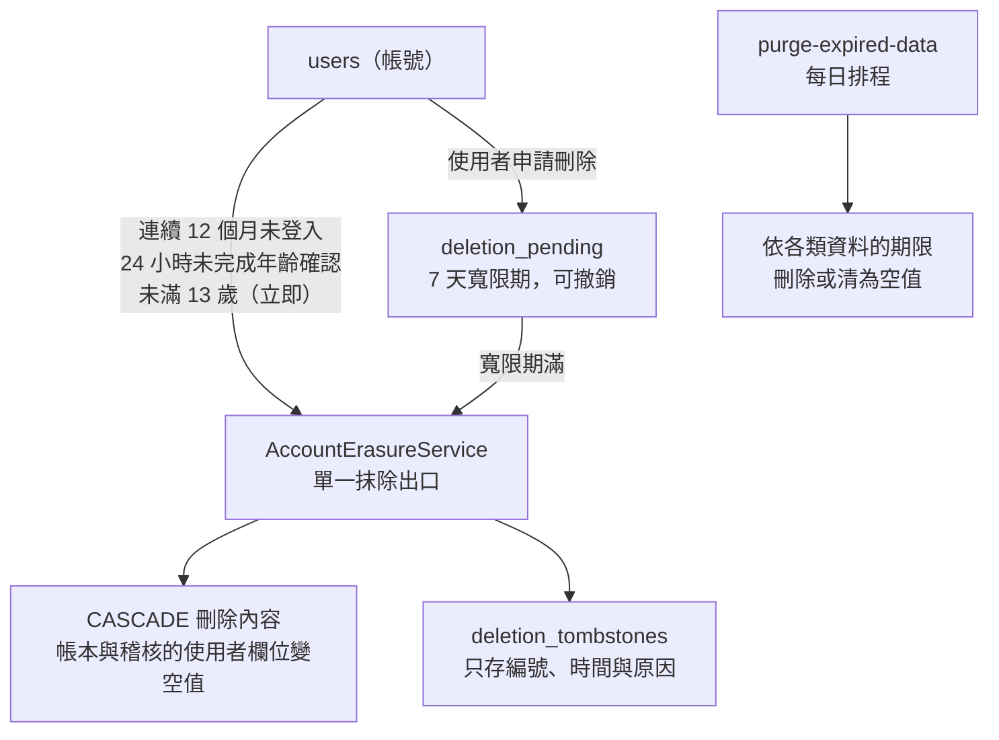

| 資料 | 期限或觸發 | 指令 | 備註 |
|---|---|---|---|
| 帳號（含生日與年齡區間） | 連續 12 個月未登入；使用者申請刪除（7 天寬限）；建立後 24 小時未完成年齡確認；發現未滿 13 歲（立即） | purge-inactive-accounts、execute-account-deletions、purge-unconfirmed-accounts；未滿 13 歲於補填時立即處理 | 全部走 AccountErasureService 單一出口，並寫入 deletion_tombstones；管理員不納入 |
| 對話與訊息 | 最後活動後 365 天；或使用者主動刪除 | purge-expired-data | 帳本的對話編號先清為空值，再刪對話，訊息靠 CASCADE |
| RPG 存檔與回合 | 最後活動後 365 天 | purge-expired-data | 回合、記事簿與重新生成回饋（`turn_regenerations`）一併消失；中斷或被擋回合的劇情內容 14 天清為空字串 |
| 模型呼叫帳本 | 建立後 365 天；失敗原文 14 天 | purge-expired-data | 失敗原文清為空值，帳本那一筆保留；帳號刪除時 user_id 變空值 |
| 管理稽核紀錄 | 建立後 730 天 | purge-expired-data | 唯一的清除途徑在 RetentionRepository |
| 管理員重設權杖 | 到期後 7 天 | purge-expired-data | 不論是否已使用 |
| 帳號鎖定計次 | 建立後 7 天 | purge-expired-data | 計次視窗只有 15 分鐘 |
| 劇本送審紀錄 | 建立後 365 天 | purge-expired-data | 只刪紀錄，帳號的暫停發佈旗標不受影響 |
| 劇本（含草稿、待審、被退回與舊版本） | 隨作者的帳號抹除 | AccountErasureService | 別的玩家用該作者的劇本開過的存檔保留（有自己的複本），來源參照先清為空值 |
| 遊戲幣錢包與帳本 | 與所屬帳號相同 | AccountErasureService | CASCADE，不匿名化保留；幣不過期，帳本不設期限清除；納入個人資料匯出；付款紀錄的法定保存期限待金流規範（W2） |
| 申訴 | 與所屬帳號相同 | AccountErasureService | 不由期限清除；納入個人資料匯出 |
| 帳號刪除紀錄、告警狀態、營運限制 | 不設期限 | — | 不含個資；刪除紀錄在備份還原後用來重新執行刪除 |

備份：託管 SQL Server 啟用自動備份與時間點還原（保存 30 天），備份還原後依 `deletion_tombstones` 重新執行刪除（`flask replay-deletions`）。實作狀態與排程設定見 [營運與部署-operations.md](營運與部署-operations.md) 第 5 節。

## 10. 與應用程式分層的對應

資料表只能由 Repository 層存取（Controller 不碰資料庫，Service 不寫 ORM 查詢）；Repository 不提交也不回復交易，由請求的生命週期決定提交點。分層與依賴方向見 [系統架構-architecture.md](系統架構-architecture.md)。

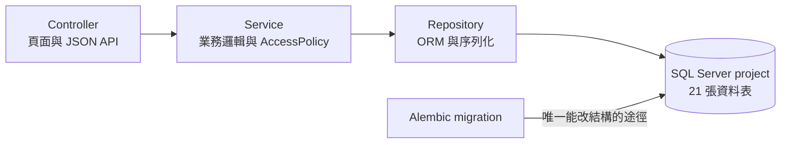

| Repository（`app/repositories/`） | 負責的資料表 | 備註 |
|---|---|---|
| `UserRepository` | users | 條件式更新（鎖定、暫停發佈、年齡確認）；也負責抹除前清除別人存檔對該作者劇本版本的來源參照 |
| `UserIdentityRepository` | user_identities | — |
| `AuthTokenRepository` | auth_tokens | 權杖只以雜湊查詢，單次使用 |
| `DeletionTombstoneRepository` | deletion_tombstones | 隨抹除流程同一交易寫入 |
| `LockStrikeRepository` | lock_strikes | — |
| `LockAppealRepository` | lock_appeals | 玩家本人的讀寫方法第一個參數是 user_id |
| `ChatRepository` | chat_conversations、chat_messages | 所有方法接收 user_id，查詢一律帶擁有者條件；不提供只憑 ID 取資料的方法給 API 路徑 |
| `LlmCallLogRepository` | llm_call_logs | 用量、斷路與全站用量的唯一來源，沒有另外的計數器 |
| `AdminAuditRepository` | admin_audit_logs | 只有新增與讀取（測試以反射守住），不可修改或刪除 |
| `AlertStateRepository` | alert_states | 狀態轉換以條件式更新搶佔通知 |
| `RuntimeLimitRepository` | runtime_limits | 每次使用時現讀，不在行程內快取 |
| `ScriptRepository` | scripts、script_versions、script_version_tags | 版本狀態與兩個輔助欄位只在此寫入（架構測試擋住別處）；審查結果只經 record_review |
| `ScriptSubmissionRepository` | script_submissions | — |
| `WalletRepository` | wallets、wallet_entries | 餘額與帳本的唯一寫入點（架構測試守住）；以 version 做條件式更新；SQLite 的 SAVEPOINT 前先做一次不影響列的條件式 UPDATE |
| `SessionRepository` | sessions、memory_logs | 所有方法接收 user_id；開始回合先對存檔列做條件式更新取鎖 |
| `AdminRepository` | 跨表（users、chat_*、llm_call_logs、lock_appeals…） | 後台專用，只能由 /api/admin/* 使用；管理員存取他人資料的稽核由 AdminService 寫入 |
| `RetentionRepository` | 跨表（期限清除） | 只有 DataRetentionService 使用；每類三個方法：找出、計數、處理一批（500） |
| `HealthRepository` | （無資料表） | /readyz 的連線檢查 |

## 11. 種子資料與初始資料

| 資料表 | 內容 | 來源 | 重複執行 |
|---|---|---|---|
| `alembic_version` | 一列：目前的 migration 版本 | Alembic（`alembic upgrade head`） | 由 Alembic 維護 |
| `runtime_limits` | 十七列初始限制（鍵見第 6 節） | migration `0013`（七列）、`0014`（三列）、`0015`（五列）、`0016`（一列）與 `0018`（一列；後四者只插入缺少的鍵），皆以 ORM 的批次寫入，沒有原生 SQL | 遷移只執行一次；之後只能以 `flask set-script-limit`、`set-wallet-setting`、`set-rpg-setting`（各管自己那一組）修改並寫稽核 |
| `scripts`、`script_versions`、`script_version_tags` | 內建首發劇本 `xianxia-qingyun`（沒有作者、筆名「官方」、已發佈的第 1 版） | `flask seed-scripts`（讀取隨映像封裝的 `app/data/scripts/*.json`） | 以種子鍵與內容雜湊冪等：沒變動就略過，內容改變則新增版本並取代舊版 |
| `users` | 首位管理員 | `flask create-admin`（一次性，密碼只能互動輸入或從標準輸入讀取） | 信箱已存在時拒絕 |

部署順序：備份 → `alembic upgrade head` → 部署新版程式 → `flask seed-scripts`。其餘資料表在新資料庫上沒有任何資料列。

## 12. Migration 歷程

| 版本 | 日期 | 內容 | 性質 |
|---|---|---|---|
| `0001_baseline` | 2026-10-27 | 基線：只建立 Alembic 版本機制（alembic_version） | 結構 |
| `0002_users_and_auth_tokens` | 2026-10-27 | 會員：新增 users、user_identities、auth_tokens | 新增資料表 |
| `0003_users_age_confirmation` | 2026-10-28 | users 新增 age_confirmed_at、age_policy_version | 新增欄位（可為空） |
| `0004_users_birthdate` | 2026-10-28 | users 新增 birth_date、age_range、is_adult_at_confirmation；新增 deletion_tombstones | 新增欄位與資料表 |
| `0005_chat_core` | 2026-10-29 | 客服核心：新增 chat_conversations、chat_messages、llm_call_logs | 新增資料表 |
| `0006_usage_indexes` | 2026-10-29 | 用量限制：新增 ix_llm_call_logs_created_at、ix_chat_messages_created_at | 新增索引 |
| `0007_admin_audit_logs` | 2026-10-29 | 管理員後台：新增 admin_audit_logs 與兩個索引 | 新增資料表 |
| `0008_privacy_lifecycle` | 2026-10-30 | 個資生命週期：users 新增 deletion_requested_at、status_before_deletion；新增 ix_chat_conversations_updated_at | 新增欄位與索引 |
| `0009_alert_states` | 2026-10-30 | 營運告警：新增 alert_states | 新增資料表 |
| `0010_google_first_login` | 2026-11-02 | Google 登入改版：users 新增 age_deadline_at、locked_at、lock_reason（含索引）；新增 lock_strikes、lock_appeals | 新增欄位與資料表 |
| `0011_remove_player_passwords` | 2026-11-03 | 移除玩家端密碼：清除非管理員帳號的密碼雜湊與失敗計數、pending_verification 改為 active | 只動資料（沒有結構變更） |
| `0012_rpg_data_and_script` | 2026-11-03 | RPG 資料基礎：users 新增內容模式四欄（並回填偏好）；新增 scripts、script_versions、script_version_tags、sessions、memory_logs | 新增欄位與資料表，回填資料 |
| `0013_rpg_script_authoring` | 2026-11-04 | 玩家創作劇本：users 新增 nickname、nickname_code、publish_suspended_at；script_versions 新增審查結果四欄；新增 script_submissions、runtime_limits（並寫入七個初始值）；llm_call_logs.kind 由 10 加寬為 20 | 新增欄位與資料表，加寬欄位，寫入初始資料 |
| `0014_rpg_character_creation` | 2026-11-04 | 玩家主角：sessions 新增 protagonist_json（可為空）；runtime_limits 補三個每日生成次數的鍵（只插入缺少的） | 新增欄位，寫入初始資料 |
| `0015_game_wallet` | 2026-11-05 | 遊戲幣：新增 wallets、wallet_entries；runtime_limits 補五個遊戲幣設定鍵（只插入缺少的） | 新增資料表，寫入初始資料 |
| `0016_rpg_turn_engine` | 2026-11-09 | RPG 回合引擎：memory_logs 新增 attempt（NOT NULL、預設 1）；sessions 新增 opening_text、opening_state、opening_started_at（可為空）；llm_call_logs 新增 first_chunk_ms（可為空）；runtime_limits 補 rpg.max_months_per_turn（只插入缺少的） | 新增欄位，寫入初始資料 |
| `0017_story_preference` | 2026-11-10 | 故事偏好與劇本讀者頻道：users 新增 story_preference（NOT NULL、預設 'all'）；script_versions 新增 audience（可為空，既有版本不回填） | 新增欄位 |
| `0018_rpg_turn_revision` | 2026-11-12 | 重新生成與編輯最後一輪：memory_logs 新增 revision（NOT NULL、預設 1）、regen_count（NOT NULL、預設 0）、revising_started_at 與 state_before_json（可為空，不回填）；新增 turn_regenerations；runtime_limits 補 rpg.free_regenerations（只插入缺少的） | 新增欄位與資料表，寫入初始資料 |

一律 expand-only：新增欄位先可為空，先部署相容新舊結構的程式，再回填與加約束；任何版本的程式碼都必須能在「目前結構」與「下一版結構」上運作。migration 是部署流程中獨立的步驟（升級前先備份），不在應用程式啟動時自動執行。完整的 migration 設計見 [資料模型-data-model.md](資料模型-data-model.md) 第 3 節。

## 13. 維護規則：與資料庫保持同步

**每一次對 SQL Server `project` 資料庫的新增、修改或刪除，都要同步更新本文件**——包含資料表、欄位、型別、可空、預設值、鍵、外鍵與刪除動作、索引與唯一約束、固定值（列舉）、JSON 欄位結構與種子資料。

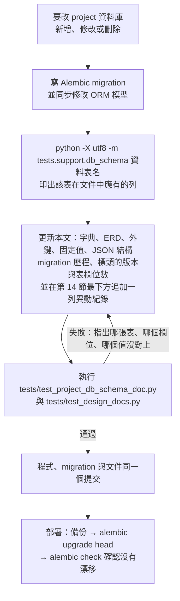

| 這次改了… | 更新本文的… |
|---|---|
| 新增資料表 | 標頭的表數與欄位數、第 2 節總覽、第 3 節 ERD、第 4 節外鍵、第 5 節新增一節、第 10 節 Repository 對應、第 12 節歷程；同時登記在 `tests/support/db_schema.py` 的 `DOMAIN_ORDER` |
| 新增、修改或刪除欄位 | 第 5 節該表的字典列（型別、可空、鍵、說明）、第 3 節的 ERD、標頭的欄位數、第 12 節歷程；若是固定值欄位同步第 6 節，JSON 欄位同步第 7 節 |
| 索引、唯一約束、外鍵、刪除動作 | 第 5 節該表的「索引與約束」、第 4 節外鍵一覽、第 3 節的關聯線 |
| 固定值增減（如新增稽核動作、審查類別、營運限制的鍵） | 第 6 節；同時留意 `tests/support/db_schema.py` 的 `enumerations()` |
| 種子資料 | 第 11 節 |
| 保存期限或刪除流程 | 第 9 節，並同步 [資料模型-data-model.md](資料模型-data-model.md) 第 4 節與 [營運與部署-operations.md](營運與部署-operations.md) |
| 任何 change 的 migration | 標頭的「最後更新」「對應 change」「資料庫版本」 |
| **任何**新增、修改、刪除或套用到 `project` 的動作 | **第 14 節最下方追加一列**（日期、類型、對象、內容、依據），並把標頭的「最後更新」改成這一列的日期 |

**自動檢查**（`tests/test_project_db_schema_doc.py`）：逐表逐欄比對本文與 ORM 以 SQL Server 方言編譯的結果——每張資料表、每個欄位的型別、可空、鍵、每個索引與唯一約束與篩選條件、每個外鍵與刪除動作、每個固定值、最新的 migration 版本，以及標頭的表數與欄位數；失敗訊息會指出哪一項沒對上。測試只比對結構，說明文字寫得對不對仍靠修改時對照程式檢視。

**對照實際資料庫**：測試比對的是 ORM，不連線到 `project`。部署或升級之後，用 Alembic 內建的檢查確認實際資料庫沒有漂移（唯讀）：

```powershell
.\.venv\Scripts\python.exe -m alembic current   # 應顯示目前版本，與本文標頭一致
.\.venv\Scripts\python.exe -m alembic check     # 應顯示 No new upgrade operations detected.
```

本文只描述結構與固定的初始資料，**不記錄任何資料列的內容**（資料列可能含個資）；筆數與用量等營運數字請用後台或 `flask` 指令查看。

---

**何時更新本文**：對 SQL Server `project` 資料庫新增、修改或刪除資料表、欄位、型別、可空、預設值、鍵、外鍵與刪除動作、索引、唯一約束、固定值（列舉）、JSON 欄位結構、種子資料或新增 migration 時；保存期限或刪除流程改變時。更新後在第 14 節最下方追加異動紀錄，執行 `tests/test_project_db_schema_doc.py` 與 `tests/test_design_docs.py`，並同步 [資料模型-data-model.md](資料模型-data-model.md)（設計理由與雙軌取捨）。

## 14. 異動紀錄（Change Log）

每一次對 SQL Server `project` 資料庫的新增、修改或刪除，都在**這一節的最下方追加一列**（由舊到新，不改寫舊的列），並把標頭的「最後更新」改成最後一列的日期。

| 欄 | 寫法 |
|---|---|
| 日期 | 異動發生的日期（YYYY-MM-DD）。migration 的日期取自檔名；手動或維運的異動取實際執行的日期 |
| 類型 | `新增`＝新增資料表、欄位、索引、約束或固定的初始資料；`修改`＝修改型別、長度、可空、預設值、外鍵，或回填、改寫既有資料；`刪除`＝刪除資料表、欄位、索引、約束，或清除既有資料；`套用`＝把 migration 套用到實際的 `project` 資料庫；`文件`＝本文件自己的重大修訂（不是資料庫異動） |
| 對象 | 受影響的資料表、欄位或索引（寫出名稱與欄位數，方便對照第 5 節） |
| 內容 | 做了什麼、為什麼 |
| 依據 | 對應的 migration（`revision`）或 change；沒有 migration 的手動異動寫明由誰執行 |

說明：
- 至今**沒有刪除過任何資料表或欄位**（一律 expand-only：新增欄位先可為空，不刪除、不改名）；「刪除」目前只出現在清除資料的 `0011`。
- 日期是 migration 檔案的建立日期。`project` 資料庫在 `2026-11-04` 之前實際套用各版本的日期沒有留下紀錄；`2026-11-04` 的「套用」列是這份紀錄開始後第一次留下的實際套用。
- 營運限制的數值調整（`flask set-script-limit`）屬於資料而不是結構，每次都已寫入 `admin_audit_logs`（動作 `limit.set`），不重複記在這裡。

| 日期 | 類型 | 對象 | 內容 | 依據 |
|---|---|---|---|---|
| 2026-10-27 | 新增 | 資料表 `alembic_version` | 建立 Alembic 的版本機制；沒有建立任何業務資料表 | `0001_baseline` |
| 2026-10-27 | 新增 | 資料表 `users`（18 欄）、`user_identities`（5 欄）、`auth_tokens`（7 欄）；索引 `ix_auth_tokens_user_id_purpose_created_at` | 會員、第三方登入身分與重設權杖 | `0002_users_and_auth_tokens` |
| 2026-10-28 | 新增 | 欄位 `users.age_confirmed_at`、`users.age_policy_version` | 年齡確認的時間與政策版本（可為空） | `0003_users_age_confirmation` |
| 2026-10-28 | 新增 | 資料表 `deletion_tombstones`（4 欄）；欄位 `users.birth_date`、`users.age_range`、`users.is_adult_at_confirmation` | 生日與年齡區間（可為空）；帳號刪除紀錄 | `0004_users_birthdate` |
| 2026-10-29 | 新增 | 資料表 `chat_conversations`（12 欄）、`chat_messages`（12 欄）、`llm_call_logs`（16 欄）；索引 `ix_chat_conversations_user_id_updated_at`、`ix_chat_messages_intent`、`ix_llm_call_logs_user_id_created_at`、`ix_llm_call_logs_model_status_created_at` | 客服對話、訊息與模型用量帳本 | `0005_chat_core` |
| 2026-10-29 | 新增 | 索引 `ix_llm_call_logs_created_at`、`ix_chat_messages_created_at` | 全站每日用量與每分鐘訊息數的彙總 | `0006_usage_indexes` |
| 2026-10-29 | 新增 | 資料表 `admin_audit_logs`（8 欄）；索引 `ix_admin_audit_logs_created_at`、`ix_admin_audit_logs_admin_user_id_created_at` | 管理員操作的稽核 | `0007_admin_audit_logs` |
| 2026-10-30 | 新增 | 欄位 `users.deletion_requested_at`、`users.status_before_deletion`；索引 `ix_chat_conversations_updated_at` | 自助刪除帳號的寬限期；對話期限清除 | `0008_privacy_lifecycle` |
| 2026-10-30 | 新增 | 資料表 `alert_states`（8 欄） | 營運告警的狀態 | `0009_alert_states` |
| 2026-11-02 | 新增 | 欄位 `users.age_deadline_at`、`users.locked_at`、`users.lock_reason`；索引 `ix_users_age_deadline_at`、`ix_users_locked_at`；資料表 `lock_strikes`（4 欄）、`lock_appeals`（6 欄）與索引 `ix_lock_strikes_user_id_created_at`、`ix_lock_appeals_user_id_created_at` | Google 登入改版：補填年齡期限、帳號鎖定與申訴 | `0010_google_first_login` |
| 2026-11-03 | 刪除 | `users`（非管理員帳號）的資料：`password_hash` 清為空值、`failed_login_count` 歸零、`locked_until` 清為空值 | 玩家改為只用 Google 登入，不再保存密碼；被清除的雜湊無法還原，回復靠遷移前的備份。沒有結構變更 | `0011_remove_player_passwords` |
| 2026-11-03 | 修改 | `users` 的資料：曾有密碼者 `token_version` 加 1（使既有登入失效）；`status` 與 `status_before_deletion` 的 `pending_verification` 改為 `active` | 信箱驗證流程移除，不再有待驗證狀態 | `0011_remove_player_passwords` |
| 2026-11-03 | 新增 | 欄位 `users.content_tier_preference`（資料庫預設 `'safe'`）、`users.adult_confirmed_at`、`users.adult_rules_version`、`users.adult_confirm_method` | 三種內容模式與成人模式的成年確認紀錄 | `0012_rpg_data_and_script` |
| 2026-11-03 | 修改 | `users.content_tier_preference` 的資料 | 依 `is_adult_at_confirmation` 一次回填（成年為 `standard`，其餘為 `safe`），滿 18 歲不自動調高 | `0012_rpg_data_and_script` |
| 2026-11-03 | 新增 | 資料表 `scripts`（9 欄）、`script_versions`（28 欄）、`script_version_tags`（3 欄）、`sessions`（25 欄）、`memory_logs`（11 欄）；10 個索引（其中 3 個是篩選式唯一索引：`uq_scripts_seed_key`、`uq_script_versions_live_script`、`uq_script_versions_open_script`） | RPG 的資料基礎：劇本與版本、存檔與回合 | `0012_rpg_data_and_script` |
| 2026-11-04 | 新增 | 欄位 `users.nickname`、`users.nickname_code`、`users.publish_suspended_at`；索引 `ix_users_publish_suspended_at` | 玩家公開暱稱與短代號；暫停發佈（獨立於帳號鎖定，只停止送審） | `0013_rpg_script_authoring` |
| 2026-11-04 | 新增 | 欄位 `script_versions.review_hash`、`review_verdict`、`review_categories_json`、`reviewed_at`（共 4 個，可為空） | 劇本審查結果（對應內容雜湊，內容變動即失效） | `0013_rpg_script_authoring` |
| 2026-11-04 | 新增 | 資料表 `script_submissions`（5 欄）、`runtime_limits`（4 欄）；索引 `ix_script_submissions_user_id_created_at` | 劇本送審紀錄；存放在資料庫的營運限制 | `0013_rpg_script_authoring` |
| 2026-11-04 | 新增 | `runtime_limits` 的七列初始資料（`script_limit.*`、`script_submit_daily.*`、`script_reject_streak`） | 營運限制的初始值，由遷移以 ORM 批次寫入 | `0013_rpg_script_authoring` |
| 2026-11-04 | 修改 | `llm_call_logs.kind` 由 `NVARCHAR(10)` 加寬為 `NVARCHAR(20)` | `script_review` 有 13 個字，SQL Server 會以「字串會被截斷」拒絕寫入（SQLite 不檢查長度，所以只在 SQL Server 才會發現） | `0013_rpg_script_authoring` |
| 2026-11-04 | 套用 | 實際資料庫 `project` | 由使用者備份（`COPY_ONLY`、`CHECKSUM`，`RESTORE VERIFYONLY` 通過）後，由 `0011_remove_player_passwords` 升級到 `0013_rpg_script_authoring`（`0012` 與 `0013` 兩段）；`alembic current` 為 `0013_rpg_script_authoring (head)`，`alembic check` 沒有差異；`flask seed-scripts` 內建劇本已存在，重複執行沒有變動 | `0012_rpg_data_and_script`、`0013_rpg_script_authoring` |
| 2026-11-04 | 文件 | 本文件 | 建立本文件，並與實際的 `project` 資料庫逐項比對（18 張資料表、206 個欄位，型別、可空、索引與約束的名稱、篩選條件、主鍵名稱都沒有差異） | 本文件 |
| 2026-11-04 | 新增 | 欄位 `sessions.protagonist_json`（JSON，可為空） | 玩家主角的角色卡與錨定事實（沿用劇本角色規格）；`player_name`、`character_age` 保留並與它同步；遷移之前建立的存檔此欄為空 | `0014_rpg_character_creation` |
| 2026-11-04 | 新增 | `runtime_limits` 的三列初始資料（`protagonist_suggest_daily.free／plus／vip` = 5／15／40） | 每個台灣日可請 AI 生成主角的次數上限；只插入資料庫還沒有的鍵 | `0014_rpg_character_creation` |
| 2026-11-05 | 套用 | 實際資料庫 `project` | 由使用者備份（`COPY_ONLY`、`CHECKSUM`，`project_pre_0014_20261105.bak`，`RESTORE VERIFYONLY` 通過）後，由 `0013_rpg_script_authoring` 升級到 `0014_rpg_character_creation`；`alembic current` 為 `0014_rpg_character_creation (head)`，`alembic check` 沒有差異；`flask show-script-limits` 列出十個鍵，三個新的 `protagonist_suggest_daily.*` 為 5／15／40 | `0014_rpg_character_creation` |
| 2026-11-05 | 新增 | 資料表 `wallets`（7 欄）與 `wallet_entries`（13 欄） | 遊戲幣錢包與只增不改的帳本；兩個外鍵皆 `ON DELETE CASCADE`（帳號抹除時不匿名化保留），帳本以存檔的對外識別碼關聯、不設外鍵 | `0015_game_wallet` |
| 2026-11-05 | 新增 | `runtime_limits` 的五列初始資料（`coin.turn_cost.standard` 30、`coin.signup_grant` 200、`coin.checkin_grant` 200、`coin.free_cap` 1000、`coin.hold_timeout_seconds` 180） | 遊戲幣的數值設定，每次使用時現讀；只插入資料庫還沒有的鍵 | `0015_game_wallet` |
| 2026-11-09 | 文件 | 本文件 | 同步 `0015_game_wallet`：新增第 3.6 節、第 5.19／5.20 節與遊戲幣的固定值 | 本文件 |
| 2026-11-09 | 套用 | 實際資料庫 `project` | 先備份（`COPY_ONLY`、`CHECKSUM`，`project_pre_0015_20261109.bak`，`RESTORE VERIFYONLY` 通過）後，由 `0014_rpg_character_creation` 升級到 `0015_game_wallet`；`alembic current` 為 `0015_game_wallet (head)`，`alembic check` 沒有差異，`flask show-wallet-settings` 列出五個鍵；唯讀查詢確認 20 張資料表、227 個欄位、17 個外鍵、`runtime_limits` 15 列。升級後發現 `wallets` 的 CHECK 約束名稱因命名慣例重複展開成 `ck_wallets_ck_wallets_balances_non_negative`，已修正遷移（`name="balances_non_negative"`）並把實際資料庫的約束改名為 `ck_wallets_balances_non_negative`（沒有資料列受影響） | `0015_game_wallet` |
| 2026-11-09 | 新增 | 欄位 `memory_logs.attempt`（INTEGER，NOT NULL，資料庫預設 1）、`sessions.opening_text`、`sessions.opening_state`、`sessions.opening_started_at`、`llm_call_logs.first_chunk_ms`（皆可為空） | RPG 回合引擎：預扣冪等鍵的嘗試序號、第 0 幕（開場）的文字、狀態與搶佔時間、串流呼叫的首字延遲；既有回合的嘗試序號為 1，既有存檔的第 0 幕欄位為空（視同 fallback，不生成） | `0016_rpg_turn_engine` |
| 2026-11-09 | 新增 | `runtime_limits` 的一列初始資料（`rpg.max_months_per_turn` = 24） | 單一回合最多推進的遊戲內月數；只插入資料庫還沒有的鍵，部署者調整過的值不被覆蓋 | `0016_rpg_turn_engine` |
| 2026-11-09 | 套用 | 實際資料庫 `project` | 先備份（`COPY_ONLY`、`CHECKSUM`，`project_pre_0016_20261109_140913.bak`，`RESTORE VERIFYONLY` 通過，`RESTORE HEADERONLY` 確認為 `project` 的完整備份、未損毀）後，由 `0015_game_wallet` 升級到 `0016_rpg_turn_engine`；`alembic current` 為 `0016_rpg_turn_engine (head)`，`alembic check` 沒有差異，`flask show-rpg-settings` 列出一個鍵（24）；唯讀查詢確認 20 張資料表、232 個欄位、17 個外鍵、`runtime_limits` 16 列，五個新欄位的型別與可空和本文一致。由 Claude 依使用者要求執行 | `0016_rpg_turn_engine` |
| 2026-11-10 | 文件 | 本文件 | 同步 rpg-notebook（RC-2b）：`llm_call_logs.kind` 的允許值新增 `rpg_notebook`（第 5 節的欄位說明與第 7 節的固定值字典），並補寫 `sessions.notebook_text`／`notebook_version`／`notebook_upto_turn` 三欄現在的行為。**沒有結構變更、沒有遷移、不需要升級 `project` 資料庫**：`kind` 為 `NVARCHAR(20)`，新值 12 字放得下；三個記事簿欄位早在 `0012_rpg_data_and_script` 建立 | 本文件 |
| 2026-11-10 | 新增 | 欄位 `users.story_preference`（NVARCHAR(10)，NOT NULL，資料庫預設 'all'）、`script_versions.audience`（NVARCHAR(10)，可為空） | 故事偏好（只影響劇本清單排序）與劇本讀者頻道（版本內容）；既有帳號取得 all，既有版本的 audience 為空（視同全讀者，不回填，已發佈的版本不可變）；新增兩個欄位，沒有新資料表與新外鍵 | `0017_story_preference` |
| 2026-11-11 | 套用 | 實際資料庫 `project` | 先備份（`COPY_ONLY`、`CHECKSUM`，`project_pre_0017_20261111_102044.bak`，`RESTORE VERIFYONLY` 通過，`RESTORE HEADERONLY` 確認為 `project` 的完整備份、含 CHECKSUM、未損毀，伺服器確認檔案存在）後，由 `0016_rpg_turn_engine` 升級到 `0017_story_preference`；`alembic current` 為 `0017_story_preference (head)`，`alembic check` 沒有差異，`flask seed-scripts --dry-run` 內建劇本「沒有變動 1（共 1 份）」（升級前由舊程式存入的雜湊在新程式下仍相同）；唯讀查詢確認 20 張資料表、234 個欄位（皆不含 `alembic_version`；含它為 21 與 235）、17 個外鍵不變；`users.story_preference` 為 NVARCHAR(10)、NOT NULL、預設 'all'，既有 1 位使用者為 all；`script_versions.audience` 為 NVARCHAR(10)、可為空，既有 1 個版本為空；`users`、`scripts`、`script_versions`、`sessions` 的列數升級前後相同（1、1、1、0）。**第一次備份嘗試沒有真的寫出檔案**（pyodbc 執行 `BACKUP` 後沒有讀完結果集，`RESTORE VERIFYONLY` 回報找不到檔案），當時沒有升級；改以讀完結果集的方式重做並驗證後才升級。由 Claude 依使用者要求執行 | `0017_story_preference` |
| 2026-11-12 | 新增 | 欄位 `memory_logs.revision`（INTEGER，NOT NULL，資料庫預設 1）、`memory_logs.regen_count`（INTEGER，NOT NULL，資料庫預設 0）、`memory_logs.revising_started_at`（DATETIME2(6)，可為空）、`memory_logs.state_before_json`（NVARCHAR(max)，可為空） | 重新生成與編輯最後一輪：修訂版本、已成功重新生成的次數（決定是否免費）、修訂的認領時間（逾時可被接手）與回合前的世界快照（下一輪完成時清除）；既有回合的 revision 為 1、regen_count 為 0、其餘為空（快照不回填，所以遷移之前建立的回合不可修訂） | `0018_rpg_turn_revision` |
| 2026-11-12 | 新增 | 資料表 `turn_regenerations`（11 欄，1 個唯一約束 `uq_turn_regenerations_session_turn_attempt`，1 個外鍵 `session_id`→`sessions.id` CASCADE） | 玩家重新生成時選的分類與填的理由（供營運檢視）與每次修訂的結果；不存被取代的行動與劇情；隨存檔與帳號抹除、納入個人資料匯出；新表 21 張、欄位共 249 個 | `0018_rpg_turn_revision` |
| 2026-11-12 | 新增 | `runtime_limits` 的一列初始資料（`rpg.free_regenerations` = 2） | 每個回合前幾次重新生成免費；只插入資料庫還沒有的鍵，部署者調整過的值不被覆蓋；`runtime_limits` 由 16 列變 17 列 | `0018_rpg_turn_revision` |
