# 前端架構

> 狀態：已實作（`/game` 入口與存檔頁外殼已上線；開存檔精靈〔樣板、純函式、API 封裝與 Vue 掛載的 `wizard.js`〕已實作但尚未在瀏覽器驗收；遊戲主畫面〔rpg-game-ui〕第 1 至 4 批已實作：串流核心、本機暫存、同步與 API 封裝，加上樣板、樣式、`game-wallet.js`、`game-notebook.js`、`game-session.js`、`game.js`、後端對前端契約的整合測試與 `/game` 的預設分頁，通過 Node 與 pytest 測試，**尚未在瀏覽器驗收**） ｜ 最後更新：2026-11-12 ｜ 對應 change：rpg-game-ui、rpg-entry-ui、story-preference、game-wallet、rpg-script-authoring、remove-player-password-auth、platform-foundation、member-auth、cs-chat-core、usage-limits、admin-console、privacy-lifecycle、google-first-login ｜ 規範依據：AGENTS.md 第 1、2、5、6、7、10 節
> 注意（2026-11-03）：本文件已納入 change ① `google-first-login` 的前端變化（登入頁只有 Google 與條款、新增 `/age`、`/appeal`、`/login/password`、移除註冊頁、管理員後台新增「被鎖定的帳號」與「申訴」）與 change ② `remove-player-password-auth`（刪除 `forgot-password`、`verify-email` 的頁面與腳本；`reset-password` 只服務管理員；帳號頁沒有「尚未驗證」提示與重寄按鈕）。

本文件說明前端的資產載入、共用元件、會員頁面、客服頁面、RPG 入口與管理員後台的模組關係，以及客服的離線暫存與同步。伺服器端的對應流程見 [客服對話-chat-service.md](客服對話-chat-service.md) 與 [帳號與安全-auth-security.md](帳號與安全-auth-security.md)。

## 1. 資產與載入順序

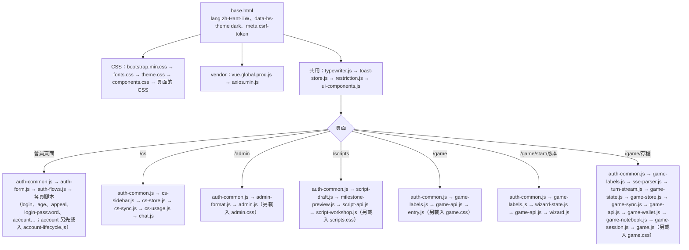

- 第三方資產（Vue、Bootstrap CSS、axios、字型）全部在 `static/vendor`、`static/fonts`，**不使用 CDN**；字型為 Noto Sans TC（108 個 `unicode-range` 切片的 woff2）。
- 範本一律用 `url_for('static', …)` 引用；不使用 `.vue`、打包工具、`v-html`、外部彈窗套件，也不使用 Bootstrap 的 JavaScript 與 `data-bs-*`（唯一例外是 `data-bs-theme="dark"`）。`tests/architecture/test_frontend_rules.py` 掃描範本、自有 CSS/JS 與實際渲染出來的頁面。
- 色彩只在 `theme.css` 定義一次（主背景 `#0F1012`、文字 `#E2E4E9`、次要 `#8A8F99`、焦點 `#FF6B35`、分隔線 `#2A2D34`），嚴禁純白。

## 2. 共用元件

| 檔案 | 內容 | 測試 |
|---|---|---|
| `js/ui/ui-components.js` | 自製 Modal（左上角狀態碼、焦點陷阱、Esc 關閉）與 Toast 容器（右下角、由下往上淡入、左側 2px 琥珀線），以及受限狀態提示 `UiRestrictionNotice`（`ui-restriction-notice`：說明文字加指向 `/appeal` 的「前往申訴」一般連結）；顯示由 Vue 響應式狀態接管 | 瀏覽器驗收、`tests/js/script-workshop-template.test.js`（範本編譯） |
| `js/ui/toast-store.js` | Toast 的狀態庫（與框架無關） | `tests/js/toast-store.test.js` |
| `js/ui/restriction.js` | 申訴捷徑的判定與文字（純函式，`UI.restrictionOf`、`UI.restrictionNoticeOf`、`UI.APPEAL_PATH`）：API 回應 403 且代碼為 `account_locked` 或 `publish_suspended`，或 `/api/auth/me` 的 `restriction === 'locked'`／`publish_suspended === true`，才回傳 `locked` 或 `suspended`；其他一律 `null`。不記住任何狀態，所以解除後重新整理即消失 | `tests/js/restriction.test.js`、`tests/test_appeal_shortcut.py` |
| `js/ui/typewriter.js` | 打字機緩衝區：以字素為單位、積壓越多越快、`finish()` 後加速補完、可 `flush()` 與 `cancel()` | `tests/js/typewriter.test.js` |
| `js/auth/auth-common.js` | CSRF 標頭、初始狀態讀取、錯誤整理（`describeError`）、登入導向 | `tests/js/auth-common.test.js` |
| `js/auth/auth-flows.js` | 登入、年齡確認、申訴與管理員密碼驗證頁的判斷邏輯（純函式，`Auth.*`）：安全的導向位置、Google 發起的請求內容（只有條款旗標與 `next`）、檢查輸入、每種錯誤代碼的處理結果（顯示欄位錯誤、清空欄位、導向、結束流程）、申訴字數以 Unicode 字元計 | `tests/js/auth-flows.test.js`（22 項） |
| `js/auth/account-lifecycle.js` | 帳號頁匯出與刪除的純函式（`Auth.lifecycle`）：確認文字比對、送出條件、檔名、預定刪除時間（台灣時間）、錯誤代碼說明、Blob 錯誤整理 | `tests/js/account-lifecycle.test.js` |

## 3. 客服頁面（`/cs`）的模組關係

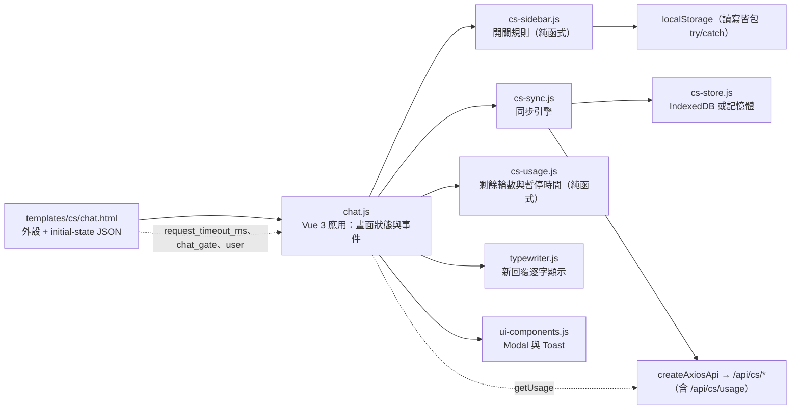

- **逾時不寫死**：送出訊息的 axios 逾時只讀初始狀態的 `request_timeout_ms`（伺服器的總預算 + 5 秒）；後端預算一改，前端自動跟著改。
- **純文字**：所有使用者與助理的文字都以 `{{ }}` 輸出並以 CSS `white-space: pre-wrap` 保留換行，不解析任何標記語言。
- **Sidebar**：寬 280px；992px 以上預設開啟並推擠主區域、狀態記在 `localStorage`；未滿 992px 預設關閉、以覆蓋方式顯示並附遮罩、不記住狀態、選擇對話後自動關閉。
- **chips**：最後一則助理訊息帶建議動作、打字機結束、其後沒有任何新訊息時才顯示（最多 4 個）；點擊後立即移除並以其文字送出。
- **閘門與 503**：`chat_gate` 不是 `null` 時顯示說明（需補填年齡時附前往帳號設定的連結）並停用輸入；服務暫時無法使用時保留已輸入的文字為待送。
- **用量**（`GET /api/cs/usage`，邏輯在 `cs-usage.js`）：Sidebar 底部一行顯示「今日剩餘 N 輪」（用完時「今日額度已用完」），每則回覆或被拒絕之後重新讀取；**取得失敗或離線就整行隱藏**，其他功能不受影響，因為真正的限制永遠在後端。暫停期間橫幅顯示恢復時間（台灣時間，固定 UTC+8，不依賴 `Intl`）並停用輸入與「新對話」，到點由計時器自動恢復，不必重新整理。
- **用量類的拒絕**：每分鐘限制（`rate_limited`）與全站忙碌（`system_busy`）是暫時的，訊息保留為待送、稍後自動重送，並以 toast 說明原因（不是「無法連線」）；今日額度用完、對話暫停、對話數已滿（`daily_quota_exceeded`、`chat_suspended`、`conversation_limit_reached`）短時間內不會成功，訊息標記為無法送出、**不自動重送**並顯示伺服器的說明，使用者可以重試或移除。對話數已滿時，離線建立的對話不可能建立成功，會連同其中的待送一起移除，原因以 toast 說明，輸入的文字留在輸入框。

## 3a. 管理員後台（`/admin`）的模組關係

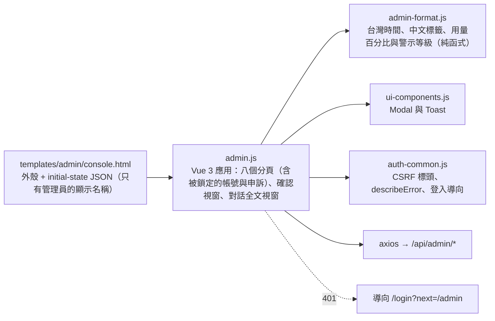

- **六個分頁**（依管理員的使用順序）：總覽、被標記對話、意見回饋、使用者、模型失敗、稽核。總覽最上面是可點擊的「今日警告」，點它切到被標記對話；被標記對話與意見回饋的每一列有「看對話」與「看使用者」；「使用者」分頁只有標明「供客服反應時使用」的信箱查詢，沒有使用者清單。
- **只有純文字**：使用者、模型與管理員填寫的原因一律以 `{{ }}` 輸出，對話內容以 `white-space: pre-wrap` 保留換行；`<script>` 與 `` 字樣逐字顯示，不被解析。
- **確認視窗共用一個**：停權與刪除對話顯示原因欄位（必填、200 字、提醒勿填個人資料），解除停權與調整等級只有密碼（調整等級另有等級選單，不含目前的等級）。密碼欄位 `type=password`、`autocomplete="off"`，**送出的當下與視窗關閉時立即清空**，不存進任何儲存體；密碼錯誤的訊息顯示在密碼欄位下方。同時只開一個視窗：從對話全文按「刪除對話」會先關掉全文視窗，視窗關閉時全文也從記憶體丟掉。
- **調整遊戲幣（game-wallet）**：「使用者」分頁的使用者檢視多一列「遊戲幣」（免費與付費餘額）與「調整遊戲幣」按鈕（目標是管理員或待刪除者時不顯示）。確認視窗多兩個欄位：餘額種類（付費或免費，預設付費）與增減量（不為 0 的整數，扣除用負數；`admin-format.js` 的 `parseCoinDelta` 解析、`bucketLabel` 提供繁體中文標籤），加上必填的原因與管理員密碼，送到 `POST /api/admin/users/<id>/wallet/adjust`；欄位錯誤（`bucket`、`delta`）顯示在對應欄位，餘額不足（409）顯示在視窗內。玩家端的錢包與記錄畫面屬 `player-hub`，目前沒有。
- **載入策略**：進入分頁時才載入一次，「重新整理」才重讀；做了會改變資料的操作後，相關分頁標記為過期、下次進入才重新載入。模型失敗每次讀取都會寫稽核，所以不因切換分頁而重複讀取。清單以 `limit=50` 分頁，「載入更多」依已載入的筆數作為起始位置。
- **錯誤處理**：`Auth.describeError` 整理後端的錯誤；401 導向登入；欄位錯誤（`password`、`reason`、`tier`）顯示在對應欄位，其餘顯示在視窗內；視窗已被關掉時改用 Toast。
- **版面**：頂欄與分頁列與內容區左右對齊（最大寬度 64rem）；手機寬度時分頁列自己橫向捲動、頁面不會；清單的每一列改為直向排列；用量以長條加百分比與文字說明呈現，**不單靠顏色**（達 80% 長條為琥珀橙並寫明「已達 80% 告警線」）。

## 3a. 登入、年齡確認、申訴與管理員密碼驗證頁（google-first-login）

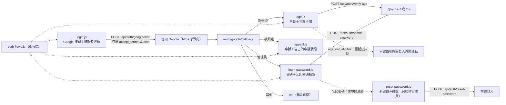

- **登入頁只有 Google 與條款**：沒有電子郵件、密碼、生日與年齡欄位，也沒有註冊與忘記密碼的連結；按鈕在條款沒勾選時仍可按（回訪的使用者不必勾選，新使用者沒勾由伺服器擋下並導回提示），只在送出中禁用。`/register` 與註冊頁的範本、腳本已移除。
- **年齡確認頁**：伺服器提供年齡規則（區間選項與範圍）放在初始狀態，沒有任何個人資料；`age_mismatch` 顯示通用說明並清空兩個欄位；`age_not_eligible`（帳號已抹除）只顯示說明與回登入頁的連結；登入逾時導向登入頁。生日只存在輸入框的響應式欄位，不寫入任何瀏覽器儲存體。
- **申訴頁**：字數提示（以 Unicode 字元計）、自己的申訴與處理狀態、已有待處理的申訴時不顯示表單；申訴內容一律純文字；沒有被鎖定時 API 回 404，頁面導向預設頁面。
- **管理員密碼驗證頁**：密碼在送出的當下立即清空；沒有或已過期的中間狀態導回 `/login?error=google_state`；「忘記密碼」只在伺服器說有寄信設定時顯示。
- **重設密碼確認頁**（`/reset-password`，`reset-password.js`，只服務管理員；玩家沒有密碼，也不會收到這類信）：權杖在信中連結的網址片段（`#token=…`），頁面讀取後立即從網址列移除，**載入時不自動送出任何動作**，使用者輸入新密碼（8 至 128 字）與確認、按下按鈕才 `POST /api/auth/reset-password`。兩次輸入不一致在前端擋下；成功後清空兩個欄位，只顯示結果訊息與「前往登入」；缺少權杖時顯示「連結不完整」的說明與回到登入的連結。沒有寄信設定（寄信器與 `BASE_URL`）時伺服器回 404，這個頁面不存在。
- 所有頁面都遵守前端規範：無 `v-html`、無 Bootstrap 的 JavaScript、處理中禁用按鈕並在 `finally` 恢復（`Auth.useForm`）。

## 3b. 帳號頁（`/account`）的匯出、刪除、撤銷與故事偏好（C-4c、story-preference）

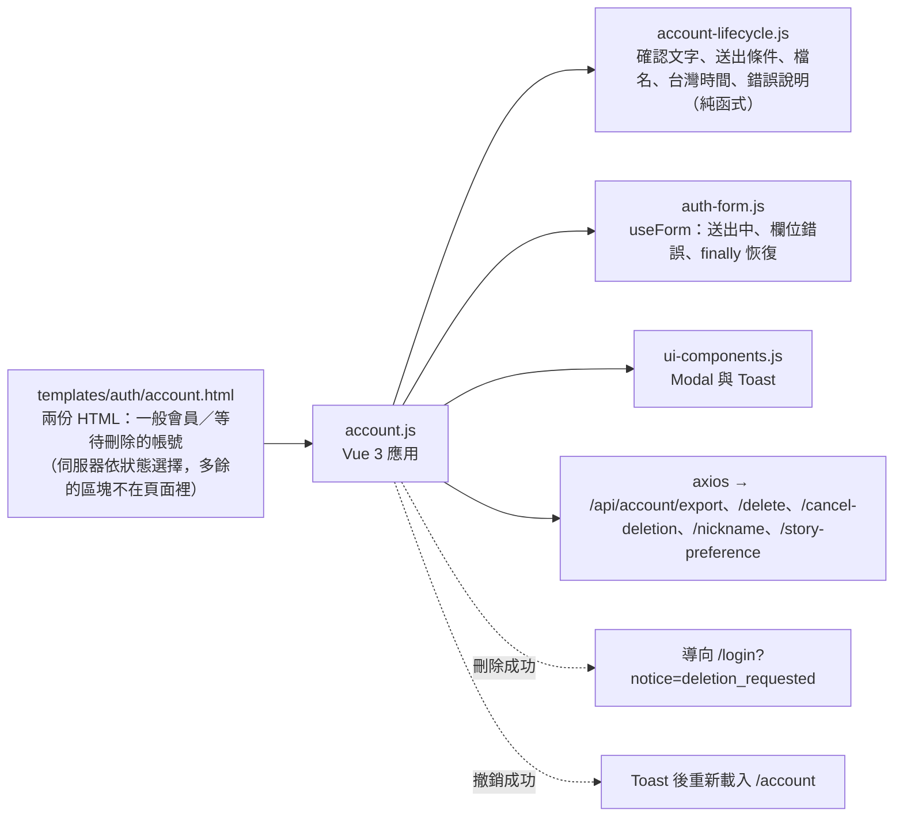

- 年齡補填區塊只留給管理員（玩家沒完成年齡確認之前連這一頁都進不來，會被導向 `/age`）。
- **匯出**：`POST /api/account/export` 以 `responseType: 'blob'`、逾時 60 秒、`AbortController` 送出（離開頁面時中止），回應轉成物件網址以 `<a download>` 下載；無論成功、失敗或中斷，`finally` 恢復按鈕。失敗時錯誤本文也是 Blob，`unwrapBlobError` 先讀成 JSON 再交給共用的錯誤整理。
- **刪除**：自製 Modal（Vue 狀態接管）說明 7 天寬限、抹除範圍並建議先匯出；有密碼者輸入密碼，其餘輸入確認文字（文字由伺服器放進初始狀態，前端不寫死第二份）。**確認前不送出請求**；送出後密碼欄位立即清空；成功後所有裝置登出並導向登入頁，登入頁以固定列舉的代碼顯示寬限期說明。
- **等待刪除**：另一份 HTML 只有預定刪除時間（台灣時間）、撤銷與登出；寬限期已過但排程還沒執行時，不顯示注定失敗的撤銷按鈕；頁面開著時剛好過期則由前端處理 `grace_expired`（顯示說明、按鈕恢復）。登入頁與 Google 回呼在 `deletion_pending` 時一律去 `/account`，不依 `next`。
- **管理員**：頁面沒有刪除區塊（HTML 裡完全沒有，不是用 `v-if` 藏起來）；匯出照常提供。
- **故事偏好**（story-preference）：「暱稱與劇本創作」之後的區塊，與暱稱區塊同樣 `v-if="ageConfirmed"`，等待刪除者的那份 HTML 沒有。三個單選（全讀者、男頻、女頻；標籤是樣板裡的固定文字）綁定 `storyForm.values.story_preference`，初始值取自 `user.story_preference`（來自 `/api/auth/me` 的使用者資料，沒有生日與年齡區間；缺值或不認得的值退回全讀者）。`saveStoryPreference` 以 `Auth.useForm` 的 `run` 送出 `PUT /api/account/story-preference`：送出中按鈕禁用並標示忙碌、`finally` 恢復、重複點擊只送一次；成功 Toast，失敗以 Toast 或欄位錯誤說明且**不改動玩家目前的選取**（網路、逾時與 CSRF 的 Toast 由 `useForm` 顯示，不重複）；401 導向登入頁並保留位置，鎖定時顯示申訴捷徑。偏好不存進瀏覽器儲存空間。

## 3c. 劇本創作頁（`/scripts`，rpg-script-authoring）

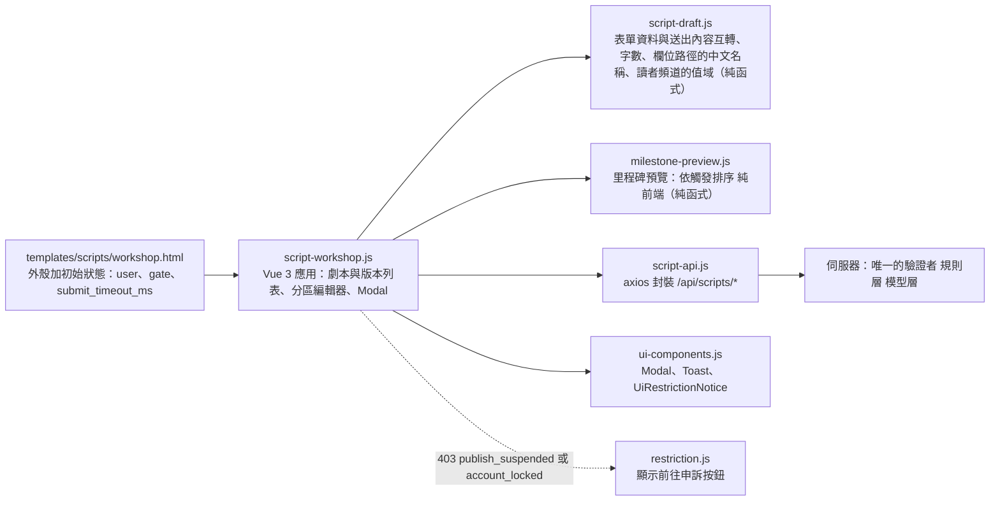

- **伺服器是唯一的驗證者**：前端只顯示字數與伺服器回傳的逐欄位錯誤（路徑轉成中文名稱），不自行擋下、不改寫使用者輸入；空白只在送出時修剪。
- **草稿衝突**：儲存帶開始編輯時的 `base_hash`，別處已更新時伺服器回 `draft_changed`，頁面以自製 Modal 讓作者選擇重新載入或保留自己的修改。
- **送審**：自製確認 Modal；axios 逾時取自初始狀態的 `submit_timeout_ms`（伺服器總預算加 5 秒，前端不寫死數字），以 `AbortController` 於離開頁面時中止，無論成功、失敗或中斷，`finally` 恢復按鈕。
- **被暫停發佈**：頁面載入時由初始狀態判定，送審被拒（403 `publish_suspended`）時即時判定；顯示 `UiRestrictionNotice` 並停用送審按鈕，編輯與儲存照常。
- **欄位說明與範例**：每個區塊最上方有一句用途說明，每個文字欄位都有範例（`placeholder`）；「狀態轉移規則」對玩家顯示為「世界規則（狀態轉移規則，選填）」並附白話說明。人工驗收發現原本玩家看不懂，所以 `tests/test_script_page.py` 要求任何文字欄位都必須有範例。
- **讀者頻道**（story-preference）：編輯器最下方（結局之後、字數統計之前）的可摺疊區塊，`open.audience` 預設展開；男頻、女頻、全讀者三選一，`fieldset` 隨 `canEdit` 禁用，所以待審與已發佈的版本顯示但不可改。`script-draft.js` 的 `toDraft` 與 `toContent` 共用 `audienceOf`：非三個列舉值的輸入（含舊版本沒有這個鍵）一律為全讀者，`toContent` 永遠送出 `audience`，全讀者時由伺服器決定不保存該鍵（雜湊相容）；帶入範例就是整份草稿換成範例的 `toDraft`，所以頻道回到全讀者。頻道不計入字數，伺服器的 `audience` 欄位錯誤顯示在單選旁。
- **個資**：劇本文字與暱稱只在記憶體與伺服器，不寫入 `localStorage`、`sessionStorage`、IndexedDB 或 cookie（`tests/test_script_page.py` 掃描）；所有文字以 `{{ }}` 純文字顯示。
- 欄位範例由 `GET /api/scripts/example` 帶入（內建首發劇本的標準化內容）；沒有種子資料時伺服器回 404，頁面在編輯器上方顯示一般的錯誤說明，原有內容不變。

## 3d. RPG 入口（`/game`，rpg-entry-ui）

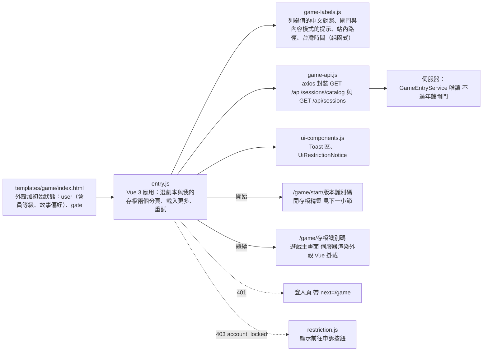

- **三個頁面、同一個前綴**：`/game` 是 Vue 應用；`/game/<存檔識別碼>` 是遊戲主畫面（見 3e）：伺服器只渲染外殼與初始狀態（存檔摘要、閘門、串流逾時等，**沒有任何劇情**），標題與主角姓名由 Vue 以插值顯示成純文字，劇情、第 0 幕、記事簿與世界狀態一律由前端呼叫既有端點取得；`/game/start/<版本識別碼>` 是開存檔精靈（見下一小節；版本識別碼只在網址裡，頁面內容不含它）。登入後的預設頁面是 `/game`（`DEFAULT_AFTER_LOGIN`），`/cs` 仍可直接開啟。
- **初始狀態只有 `user` 與 `gate`**：`user` 是會員等級與故事偏好（沒有 email、生日與年齡），`gate` 是 `AccessPolicy.chat_gate` 的結果（`null` 或 `age_confirmation_required`、`age_restricted`、`forbidden`），前端不自行判斷。**清單內容不在初始狀態裡**，由兩個唯讀端點取得（`tests/test_game_pages.py` 以劇本與存檔的標題證明它們不在 HTML 中）。損壞的初始狀態不會讓頁面壞掉，也不會憑猜測禁用任何東西。
- **載入規則**（`entry.js` 的 `loadNext`，兩個清單共用）：載入中再按不送第二次請求；位移依伺服器**實際回傳的筆數**前進（不是去重後的筆數），並以 `id` 去重（兩次請求之間若有新劇本上架，同一張卡可能再出現）；失敗時已載入的卡片不消失、位移不前進，所以重試取的是同一頁；`finally` 一律恢復載入狀態；空的一頁不算還有下一頁（避免壞回應造成無止境的載入）；取消的請求不顯示錯誤；401 導向登入頁並帶回 `/game`，403 `account_locked` 顯示申訴捷徑。預設分頁依玩家有沒有存檔決定（rpg-game-ui）：掛載時**並行載入「選劇本」與「我的存檔」的第一頁**（兩個請求互不等待），存檔載入完成、非空，而玩家還沒有手動切換過（`userPickedTab`；按任何一個分頁按鈕都算，載入中途切換也不會被覆蓋），就切到「我的存檔」，最近活動的存檔在最前面；沒有存檔就維持「選劇本」；存檔請求失敗也維持「選劇本」，「我的存檔」分頁自己顯示錯誤與重試（不是整頁錯誤），**首次載入失敗後不會因為再切換分頁而自動重試**，由重試按鈕負責，之後重試成功也不會把玩家切走。掛載時兩個請求都 401 只導向登入頁一次。
- **提示**（`game-labels.js`）：後端只回列舉值，中文對照集中在這裡；未知值一律退回固定的預設文字，不顯示原始值（分級退回「未標示」，不把未知的分級當成安全或成人）。`gateNotice` 對未知的非空閘門代碼也當成「不可開始」（失敗時關閉）；閘門非空時「開始」按鈕禁用，但清單仍可瀏覽。`contentModeNotice` 只負責說明「為什麼沒看到某些劇本」：未滿成年門檻者固定為安全模式，只說明原因、沒有連結；成年但選了安全模式者提示可到帳號設定調整。**頁面上沒有任何改變內容模式的動作，也不自動調高**。後端列舉值與對照表是否一致，由 `tests/test_game_pages.py` 以後端常數比對（後端新增列舉值時會失敗）。
- **只讀與個資**：入口頁只呼叫兩個 GET 端點，不碰遊戲幣；作者與玩家的文字一律以 `{{ }}` 純文字顯示；不寫入 `localStorage`、`sessionStorage`、IndexedDB 或 cookie，也沒有 `console.log`（`tests/test_game_pages.py` 掃描）。
- **版面**：`game.css` 預設單欄，768px 以上兩欄；沒有固定寬度，長文字以 `overflow-wrap` 折行，360px 不橫向溢出；沿用深色琥珀配色，沒有純白。
- **導覽**：`/game` 頂列有「客服」「創作」「帳號」；`/scripts` 與 `/cs` 的頁首、`/account`（卡片頂端的小導覽；等待刪除者的版本沒有）各有一個回 `/game` 的「冒險」連結，都是一般站內連結、沒有 `data-bs-*`（各頁的測試與 `tests/test_game_pages.py` 檢查）。

### 開存檔精靈（`/game/start/<版本識別碼>`，rpg-entry-ui）

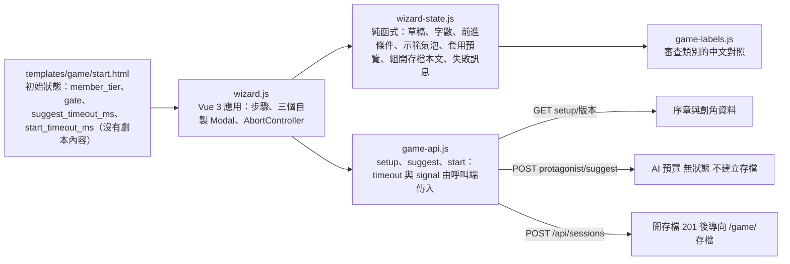

- **單頁三步驟、狀態只在記憶體**：序章（唯讀的背景故事）、聯繫、創角在同一頁以 `step` 切換（`v-if`）；創角內容是個資，**不寫 `localStorage`、`sessionStorage`、IndexedDB 或 cookie，不放網址，重新整理就回到序章（刻意的）**。`game-api.js` 的三個新呼叫只有 `suggest`（無狀態的預覽）與 `start`（開存檔）是 POST，`tests/test_game_pages.py` 以程式碼掃描固定「寫入的呼叫恰好這兩個」。
- **初始狀態只有 `member_tier`、`gate` 與兩個逾時**：`gate` 與 `/game` 相同（`AccessPolicy.chat_gate`，前端不自行判斷）。`suggest_timeout_ms` = 後端單次請求總預算 + 5 秒（與 `/scripts` 的送審相同的算法，預設 35 秒）；`start_timeout_ms` = `2 × 後端單次請求總預算 + 5 秒`（預設 65 秒，與 `session_api_controller` 說明的一致）：開存檔最壞是「劇本審查（必要時）＋主角模型審查」兩次呼叫各用滿一份預算。兩者由 `game_page_controller` 從設定算出，前端與樣板都不寫死（`test_game_pages.py` 以不同的預算設定驗證）。**劇本內容不在初始狀態裡**，由 `GET /api/sessions/setup/<id>` 取得。
- **`wizard-state.js`（UMD 純函式，沒有請求、儲存、日誌與 DOM）**：草稿是一組字串欄位（角色卡七欄、來歷、選填的自我介紹）；聯繫有三態：未設定、已設定（`kind`、`ref`、`text`）、略過，另分出「選了一半」（選了對象沒寫、或寫了沒選對象）。`blockers`／`canAdvance` 只做「必要欄位已填、沒有超過長度」的即時回饋（上限取自 `setup` 的 `limits`，不寫死），**合規與審查全由伺服器判斷**；自我介紹超長只擋「請 AI 生成」，不擋開始（它不會隨開存檔送出）。`applySuggestion` 回傳新的 `{ draft, anchor }`：AI 預覽覆蓋角色卡與聯繫，保留玩家選的來歷與自我介紹，預覽殘缺時不用空白蓋掉玩家的內容。`buildStartPayload` 只搬運與去頭尾空白（看不懂的年齡原樣送出，讓伺服器指出欄位），略過聯繫時帶 `skip_anchor: true` 而不帶 `anchor`；沒有頭像與性別。`targetGroups` 的人物選項只取姓名與職業。
- **失敗訊息只來自固定文字與列舉對照，不含玩家文字**：`describeSetupFailure`、`describeSuggestFailure`、`describeStartFailure` 依狀態碼與代碼回傳 `{ kind, code, message, step, fields, link, retry }`；422 只列出認得的審查類別（不認得的識別字略過，不顯示原始值）；唯一原樣放進 `fields` 的是 400 的逐欄位規則說明（伺服器保證不回顯輸入），`stepOfField` 與 `fieldKeyOf` 把欄位路徑對應回步驟（`protagonist.*`、`intro` 在創角，`anchor.*` 在聯繫；兩步都有錯誤時回到較前面的步驟）。開始冒險逾時或斷線時說明伺服器可能已經完成，請玩家先到「我的存檔」確認再重送。所有失敗都保留玩家已填的內容。
- **樣板與 `wizard.js` 的約定**：樣板標頭列出 `wizard.js` 的 `setup()` 要回傳的名稱（狀態、計算、方法），`tests/js/wizard-template.test.js` 以離線 Vue 編譯樣板，並檢查樣板用到的名稱與這份清單完全一致（多一個或少一個都會失敗）。`wizard-template.test.js` 另以 `vm` 沙盒執行 `wizard.js` 的 `setup()`，檢查它實際回傳了清單的每一個名稱、不多不少；過渡用的「建置中」說明已隨 `wizard.js` 移除。
- **`wizard.js`（Vue 掛載）**：只負責狀態、請求的時機與 `finally` 的恢復，邏輯都在 `wizard-state.js`。掛載時才呼叫 `setup`（版本識別碼從網址最後一段讀，讀不出來就是「找不到」，不送請求）；載入有 404、403（分級高於目前模式、年齡確認、鎖定）與可重試失敗各自的畫面，看不懂的成功回應也當成可重試的失敗。往後的步驟要通過前進條件，往前（`back`、`goTo`）不受限；「請 AI 生成」在已有手動內容時先開覆蓋確認 Modal，成功只填表、更新今日剩餘並出 Toast；「開始冒險」同一時間只送一個請求，送出期間所有按鈕禁用，成功後導向 `/game/<存檔>`，**導向之前仍保持禁用**（開存檔沒有冪等鍵，連點會開出兩個存檔）；400 依欄位路徑跳回較前面的那一步，422 與其他失敗只顯示固定文字；`pagehide` 時三種請求（載入、生成、開存檔）的 `AbortController` 都中止，被中止的請求不顯示錯誤。沒有任何瀏覽器儲存、主控台輸出與網址參數；`tests/js/wizard.test.js` 在 `vm` 沙盒用儲存物件與主控台的陷阱斷言這一點。

## 3e. 遊戲主畫面（`/game/<存檔識別碼>`，rpg-game-ui 第 1 至 4 批）：串流核心、本機暫存、錢包、記事簿、流程與掛載

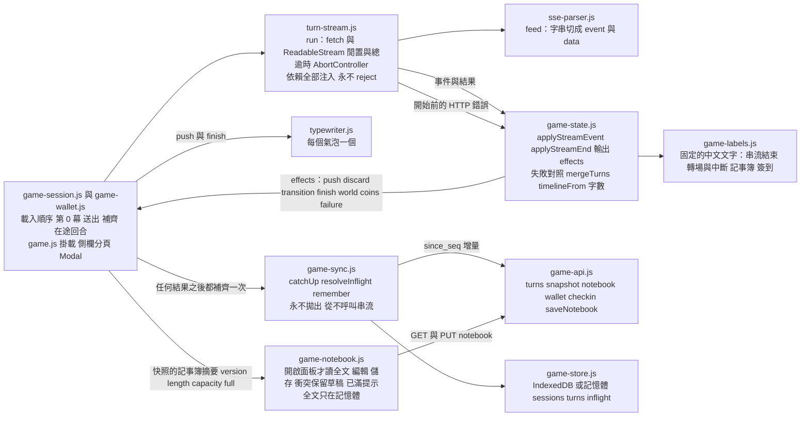

- **現況**：第 1、2 批是純邏輯、本機暫存與 API 封裝；第 3 批加入 `session.html`（整頁取代原本的空殼）、`game.css` 的 `gm-` 樣式、`game-wallet.js`、`game-session.js` 與掛載腳本 `game.js`，`/game/<存檔識別碼>` 現在是可玩的遊戲主畫面；第 4 批加入 `game-notebook.js`（記事簿面板）、側欄的「記事簿」分頁與 `/game` 入口頁的預設分頁（**尚未在瀏覽器驗收**，見 README 的驗收紀錄）。`sse-parser.js`、`turn-stream.js`、`game-state.js`、`game-labels.js` 的擴充、`game-wallet.js`、`game-notebook.js` 與 `game-session.js` 都沒有 `window`、`document`、瀏覽器儲存與主控台（依賴由 `game.js` 注入），`game-store.js` 是 IndexedDB 的唯一出口，Node 可以用真的 Vue 與替身直接測試；`game.js` 是唯一碰 `document`／`window` 的遊戲腳本。載入順序（即相依順序，見 rpg-game-ui 的 design D6，`tests/test_game_pages.py` 固定）：`auth-common.js` → `game-labels.js` → `sse-parser.js` → `turn-stream.js` → `game-state.js` → `game-store.js` → `game-sync.js` → `game-api.js` → `game-wallet.js` → `game-notebook.js` → `game-session.js` → `game.js`。
- **`sse-parser.js`（UMD 純函式）**：`createParser().feed(text)` 吃 `TextDecoder({stream: true})` 解碼後的字串，回傳這一塊完成的事件 `[{ event, data }]`。事件以空行分隔（容許 `\r\n` 與單獨的 `\r`，結尾的 `\r` 先保留到下一塊再決定），多行 `data:` 以換行串接，`:` 開頭是註解；`data` 必須是 JSON 物件，解析失敗、不是物件或缺 `event` 的事件整個丟棄，後續照常；不完整的尾端留在緩衝。串流結束時殘餘的緩衝不會被當成事件。
- **`turn-stream.js`（UMD，`createTurnStream(deps)`）**：`fetch`、`setTimeout`／`clearTimeout`、`AbortController`、`TextDecoder` 與 `describeHttpFailure` 都由呼叫端注入。`run({ url, body, csrf, idleMs, totalMs, signal, onEvent })` **永不 reject**，回傳 `{ outcome, done, failure }`：`done`（收到 `done` 事件，立即結案並取消讀取）、`error_event`、`interrupted`（連線在 `done` 前結束，含讀取例外與連線建立前的網路失敗）、`timeout_idle`、`timeout_total`、`aborted`、`rejected`（伺服器在開始串流之前以 HTTP 錯誤拒絕，尚未預扣）。**完整接收的唯一依據是 `done` 事件**，不是 HTTP 狀態或讀取結束旗標；優先順序為 `done` > `error` 事件 > 逾時或取消 > `interrupted`。任何位元組（含回應標頭與只有 `ping` 的資料塊）重設 45 秒的閒置計時器，180 秒的總逾時不重設；兩者與外部 `signal` 共用一個內部 `AbortController`，計時器觸發時不等 `fetch` 回報 abort，直接結案；每條結果路徑都清除計時器並移除對外部 `signal` 的監聽。逾時數值必須由呼叫端傳入（取自頁面初始狀態），模組沒有預設值，不合法就回 `rejected`（`failure.kind === 'config'`）而不送出請求。事件只轉交已知的七種名稱（meta、token、ping、transition、state、done、error），`onEvent` 拋出的例外被吞掉，不影響串流。
- **`game-state.js`（UMD 純函式，載入順序在 `game-labels.js` 之後）**：①`newStreamTurn`、`applyStreamEvent(turn, event)`、`applyStreamEnd(turn, result)` 回傳 `{ turn, effects }`（不修改傳入的物件）；`effects` 是給掛載層的純資料指令：`push`（推進打字機）、`discard`（丟棄目前的氣泡）、`transition`（插入一行轉場，`willRetry` 為真才開新氣泡）、`world`、`notices`、`coins`、`finish`、`hint`、`failure`、`done`、`meta`。**被擋與中斷的回合不保存任何部分文字**；`state` 事件只取白名單欄位（地點、月數、摘要、目標與年齡更正通知，NPC 的特質與隱藏資訊本來就不在其中）。②`normalizeTurn`、`mergeTurns(local, remote)`（以 `seq` 為準、後端覆寫、不認得的狀態當成 `interrupted`、非 `complete` 的回合一律沒有行動與劇情）、`timelineFrom(opening, turns, inflight)`（完整回合的 key 是 `turn:<client_msg_id>`，與串流中的氣泡同一個 key，補齊時就地取代）。③`describeHttpFailure`（串流開始前的 JSON 錯誤，訊息一律說明沒有扣除遊戲幣）、`describeRequestFailure`、`describeStreamFailure`、`describeNotebookFailure`、`describeCheckinFailure`：回傳同一個形狀 `{ kind, status, code, message, fields, link, retry, reload, catchUp, silent, keepDraft, … }`。**訊息只來自固定文字與列舉對照，不含玩家文字**；唯二的例外是不認得的 409 與 400 的逐欄位說明，伺服器的文字必須通過 `trusted()`（含中文、不含角括號與控制字元、不超過 120 字）才顯示，後端的固定訊息本來就不含玩家文字。④`notebookLength` 與後端 `notebook_policy.length_of` 同一個算法（NFC 之後的碼點數）：黃金案例在 `tests/js/fixtures/notebook-length-cases.json`，Node 測試檢查前端、`tests/test_game_notebook_length_parity.py` 檢查後端，任何一邊的算法改變都有一個測試失敗。⑤`sendBlocker`／`canSend`（失敗時關閉：第 0 幕必須明確完成才能送出）、`actionProblem`、`worldView`／`mergeWorld`、`noticeText`（年齡更正含更正前的值）、`notebookView`（面板讀到的全文與用量）。⑥記事簿的判斷（第 4 批）：`notebookSummary`（快照裡只有用量的摘要，缺漏或型別不對回傳 null，不確定就不顯示）、`notebookIsFull`（**長度大於容量**才算已滿，剛好用完容量不算；容量不明時退回後端的旗標）、`notebookCurrent`（面板的檢視與快照的摘要取版本較新者，同版本取檢視）、`notebookEditState`（編輯中的即時字數與超出幾字；玩家編輯沒有預備空間，容量不明時不在前端判斷）。
- **`game-labels.js` 的擴充**：回合與串流結束狀態的名稱、連線中斷與逾時的說明（每一則都提醒「這一輪可能已在伺服器完成」，因為前端中止不代表後端中止）、歷史裡未完成回合的一行說明、串流 `error` 事件代碼的訊息、記事簿（含預備空間與超出容量的說明）與簽到的固定文字；不認得的值一律退回固定文字。回合狀態、`done` 的結束狀態與串流錯誤代碼是否與後端一致，由 `tests/test_game_pages.py` 以後端常數比對。
- **`game-store.js`（UMD，第 2 批；載入順序在 `game-state.js` 之後，不修改 `cs-store.js`）**：資料庫 `game-cache-<使用者的對外識別碼>`（`databaseName` 組名；識別碼格式不對或沒有名稱就只用記憶體，不共用資料庫），三個資料集：`sessions`（key＝存檔識別碼：標題、內容模式、是否完結、已完成輪數、第 0 幕的狀態與文字、世界狀態的玩家視圖）、`turns`（key＝`<存檔>|<補零序號>`，字典序即序號順序：`Game.normalizeTurn` 的形狀）、`inflight`（key＝存檔識別碼，所以**每個存檔最多一筆**：`client_msg_id`、行動文字、建立時間）。**只寫白名單欄位**：記事簿（全文與摘要）、主角角色卡、email、生日與年齡區間一律不進來，傳入物件多出的欄位直接丟掉；被擋與中斷的回合只存序號與狀態；**進行中（`streaming`）的回合不存**——它之後會變成別的狀態，存下來的話「以本機最大序號做 `since_seq`」會跳過它完成後的內容。開啟失敗（沒有 IndexedDB、被禁止、被阻擋、3 秒逾時）、寫入失敗（配額）與連線已關閉造成的同步例外都退回記憶體並照常運作，不拋出給畫面（退回後已寫入的快取不搬移，重新整理後不保證保存）。
- **`game-sync.js`（UMD，`createSync({ api, store })`，第 2 批）**：`catchUp(sessionId, { signal })` 以本機已定稿的最大序號做 `since_seq`，迴圈到 `has_more` 為假，後端的回合覆寫同序號的快取；**永不拋出**，回傳 `{ status, changed, added, turns, error? }`：`ok`、`offline`（連線失敗或逾時，快取不變仍可閱讀）、`gone`（404，該存檔的快取與在途回合已清除）、`canceled`、`failed`（401、403、5xx…，`error` 交給 `Game.describeRequestFailure`）；`turns` 是顯示用的完整清單（快取合併這次後端的回合，含沒有文字的進行中回合）。伺服器一直說還有更多卻沒有前進時停止，不會無限迴圈。`resolveInflight(sessionId)` 先補齊，本機已有該 `client_msg_id` 的 `complete` 回合就移除在途紀錄並回傳 null，否則回傳在途紀錄（畫面提供「重送」與「放棄」）；補齊失敗時保留、存檔不存在時回傳 null；呼叫端剛做完 `catchUp` 時可把結果以 `result` 傳進來，就不會再多問一次伺服器。`remember(sessionId, snapshot)` 存入快照的白名單欄位。**這個檔案從不呼叫串流端點**（它的 API 只有 `turns`，測試以只提供 `turns` 的替身與原始碼掃描證明）：重送只有玩家按下才發生，每一輪都要消耗遊戲幣，所以沒有自動排隊。
- **`game-api.js` 的擴充（第 2 批）**：新增 `snapshot`、`turns`、`notebook`、`saveNotebook`（`/api/game/sessions/<id>`）、`wallet`、`checkin`（`/api/wallet`）；`timeout` 與 `signal` 由呼叫端傳入，檔內沒有逾時數字；識別碼經 `encodeURIComponent`。寫入的呼叫恰好是四個：`suggest`、`start`、`checkin`、`saveNotebook`（`tests/test_game_pages.py` 固定）。失敗一律是 `Auth.describeError` 整理過的物件，再加上固定形狀的欄位供 `game-state.js` 的失敗對照使用：`categories`、`notebook`（409 `notebook_conflict` 時後端最新的記事簿）、`length` 與 `capacity`（422 `notebook_too_long`）、`checkin`（409 `checkin_overflow` 的預覽）、`balance` 與 `needed`（409 `insufficient_coins`）；型別不對的值與未列出的欄位一律不複製。

- **`game.js`（Vue 掛載與接線，第 3 批）**：建立 `store`（`Game.store.openStore` 在背景開啟，開好之前由代理排隊，所以不必等它）、`sync`、`turn-stream`、`wallet`、`session` 與 `notebook`，並提供只屬於畫面的東西：**側欄**（分頁「世界」「記事簿」，預設在「世界」）在桌面與手機都**預設收合**，頂列的開關按鈕切換——桌面（寬度 992px 以上，與客服的 Sidebar 同一個斷點）開啟時推擠本文區（`push`），手機與平板以覆蓋方式開啟並附遮罩（`overlay`），Esc 與遮罩可關閉（有 Modal 開著時 Esc 先給 Modal），開關與分頁只存在記憶體、**不記住**（不寫任何瀏覽器儲存，重新整理回到收合與「世界」）；記事簿的全文只在側欄於「記事簿」分頁開啟時才讀（開啟側欄時目前就是該分頁、側欄開著時切到該分頁，或按頂列的「記事簿已滿」入口），載入頁面時完全不請求；離開確認與放棄在途回合兩個 Modal 的狀態（記事簿「放棄未儲存的變更」的 Modal 狀態在 `game-notebook.js`，它開著時 Esc 也不關側欄）；`session.scrollTick` 變動時把時間軸捲到底；`pagehide` 中止所有進行中的請求（含記事簿的讀取與儲存，**不會自動儲存**）；`online`／`offline` 事件轉給 `session.setOnline`。`setup()` 回傳的名稱與樣板約定的清單（`tests/js/support/game-contract.js`）完全一致。
- **`game-wallet.js`（`createWallet(deps)`）**：載入 `GET /api/wallet`（失敗顯示「—」，不阻擋閱讀與輸入）；每輪的 `done.coins` 直接覆寫餘額（不另外請求）；送出前已知餘額低於每輪幣價時只提示並提供簽到入口，**不阻止送出**（餘額以伺服器為準）；409 `insufficient_coins` 開自製 Modal（目前餘額與所需幣數、沒有扣款、行動文字保留）；最小的每日簽到入口：`checkin_overflow` 的預覽由玩家選「取消」（不再呼叫、不消耗當日簽到）或「領取」（才帶 `confirm_overflow: true`），`already_checked_in` 顯示下次可簽到的台灣時間，進行中只有一個請求、`finally` 恢復；簽到成功**不自動重送**被擋的行動。沒有儲值、訂閱與記錄頁。
- **`game-notebook.js`（`createNotebook(deps)`，第 4 批）**：依賴（Vue 的 `ref`／`computed`、`api`、`sessionId`、快照的摘要與 `ended` 兩個響應式變數、`onEnded`、`toast`、`goLogin`、`noteFailure`、`AbortController`）都由 `game.js` 注入。**全文只在 `open()` 時才 `GET`**（建立面板與載入頁面都不請求；編輯中的 `open()` 不重讀，草稿與版本不能被覆蓋），只存在記憶體：不進 IndexedDB、不進主控台，除了 `notebook` 與 `saveNotebook` 這兩個呼叫之外不把它送往任何地方（Node 測試掃描原始碼確認）。**已滿**＝長度大於容量；面板、分頁徽章與頂列的「記事簿已滿」入口共用 `notebookFull`，由面板讀到的檢視與快照的摘要取版本較新者判斷，所以入口不必先開面板；快照比面板讀到的新時另外提示「記事簿剛剛有更新」並提供重新載入，不自動覆蓋畫面。**編輯**：`startEdit` 記下版本並複製全文成草稿；字數即時顯示（與後端 `length_of` 同一個算法），超過容量或沒有改動或已完結或儲存中時 `save()` 本身就拒絕（不是只靠按鈕禁用）；`save()` **只有玩家按下才會送出**，進行中再呼叫只有一個請求，`finally` 一律恢復；有未儲存的變更時 `cancelEdit` 先開確認 Modal（`discardOpen`），確認後才丟棄。**失敗**一律經 `Game.describeNotebookFailure` 的固定文字：409 `notebook_conflict` 以後端附上的最新記事簿更新全文、用量與版本，草稿原封不動，另外保留最新內容供對照（`conflict`），下一次儲存以最新版本為基準（玩家看過之後明確再按一次，不自動合併、不自動重送）；422 太長顯示長度與容量並採用伺服器說的容量，422 規則層命中只顯示類別；409 `session_ended` 通知頁面轉為已完結（輸入框唯讀、草稿留著供複製）；404、401（導向登入）、網路與逾時各有固定訊息；所有失敗都保留草稿，訊息不含記事簿內容。`dispose()`（`pagehide`）中止進行中的讀取與儲存。
- **`game-session.js`（`createSession(deps)`）**：載入順序是「快照 → 第 0 幕（`ready`／`fallback` 直接顯示、不重抽；`pending`／`generating` 呼叫開場串流，409 `opening_in_progress` 時每 5 秒重讀快照、最多 24 次再提供重試）與歷史補齊（`since_seq`）、在途回合的確認、錢包並行」；第 0 幕完成之前輸入禁用，離線或帳號閘門非空時只讀本機快取（伺服器的快照與回合端點同樣要過閘門，所以閘門非空的玩家只看得到先前已快取的歷史）。送出一輪：先驗證（空白與超長不送出）→ 新的 `client_msg_id` → **先把在途回合存起來** → 串流 → 事件轉成時間軸（每個氣泡一個打字機；`transition` 丟棄氣泡並插入一行轉場）→ `done` 時**立刻解鎖輸入**（不等打字機與補齊；下一輪等上一輪的補齊做完才開始）→ 以 `since_seq` 補齊並由後端內容取代暫存的氣泡 → 重讀快照更新世界狀態 → `finally` 恢復；失敗保留行動文字。串流結果的在途回合處理：`done`、開始前被拒與 `error` 事件移除；中斷、逾時、取消保留，補齊後仍沒有完整回合才顯示「重送／放棄」，**從不自動重送**。時間軸只渲染最近 60 項（其餘「顯示更早的內容」）；新內容只在讀者位於底部 80px 內時自動捲動，否則顯示「回到最新」。
- **版面與樣式**（`session.html`、`game.css` 的 `gm-` 前綴）：頁面高度固定為視窗高度，頂列（標題、內容模式、記事簿已滿的入口、餘額、回到冒險／客服／帳號）、橫幅（閘門、未成年的安全模式說明、離線、已完結）、時間軸（唯一捲動的區域）與固定在底部的輸入區（在版面流程內，不遮住最後一則劇情；Ctrl＋Enter 送出、Enter 換行）；所有玩家與作者的文字以 `{{ }}` 插值顯示並以 `white-space: pre-wrap` 保留換行，沒有 `v-html`；360px 不橫向溢出，顏色只用主題變數，串流中的游標在 `prefers-reduced-motion` 時不動畫。側欄有「世界」「記事簿」兩個分頁（`role="tablist"`，顯示由 Vue 的響應式變數接管，沒有 `data-bs-*`）；記事簿的全文與編輯框是純文字（`white-space: pre-wrap`、`overflow-wrap: anywhere`），編輯框只有 `v-model` 綁定草稿、沒有任何會自動儲存的事件。樣板標頭列出與 `game.js` 的名稱約定，`tests/js/game-template.test.js` 以離線 Vue 編譯樣板並對照清單（用到的名稱＝清單，不多不少），`tests/js/game.test.js` 以 `vm` 沙盒執行 `setup()` 確認真的回傳每一個名稱。
- **第 3 批的已知限制**：①完全沒有在瀏覽器執行過（Node 測試用真的 Vue、store、sync 與串流客戶端，伺服器、打字機與計時器是替身；後端契約由 `tests/test_game_screen_flow.py` 以 Python 版的 SSE 解析驗證）。②閘門非空（例如未確認年齡的管理員）時，伺服器的快照與回合端點同樣拒絕，所以只能閱讀先前已快取的歷史。③`state` 事件只更新地點、月數、摘要與目標；去過的地點與主角年齡要等 `done` 後重讀快照才更新（每輪多一個小的 GET）。④轉場文字只在該回合的行動與劇情之間顯示，重新載入後被擋的回合只剩固定的一行說明。⑤時間軸沒有虛擬捲動（只渲染最近 60 項）。
- **第 4 批的已知限制**：①記事簿面板與入口頁的預設分頁同樣沒有在瀏覽器執行過。②離線時無法開啟記事簿（全文刻意不進本機暫存）。③編輯中的草稿只在記憶體，重新整理或離開頁面就沒了（不自動儲存，也不在離開頁面時詢問）。④頂列的「記事簿已滿」入口取自快照的摘要，快照只在載入頁面與每輪 `done` 之後讀取，別處造成的變化要等下一次快照。⑤`/game` 掛載時多一個存檔清單的請求；帳號閘門非空時兩個清單的請求都被拒絕，「我的存檔」分頁會顯示同一則錯誤。

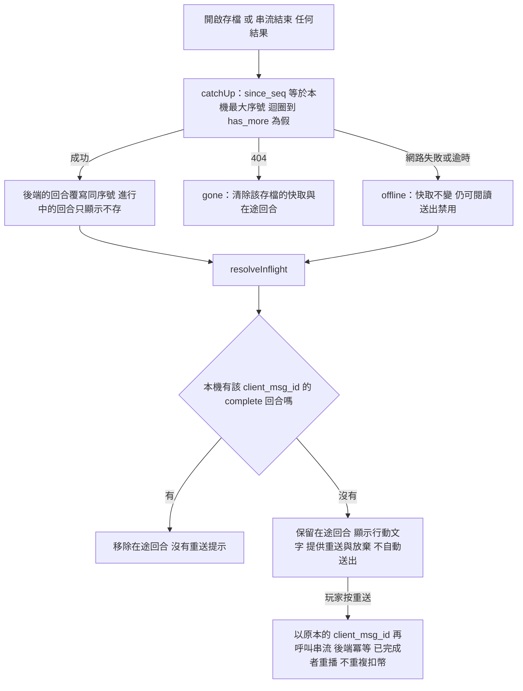

- **本機暫存的已知限制**：①IndexedDB 在裝置上，帳號刪除與登出無法由伺服器清除（與客服的快取同一個限制，README 記載）；快取只含劇情與行動，不含記事簿、角色卡與個資，內容與後端分歧時一律以後端覆寫。②重新整理後的在途回合只在 IndexedDB 可用時保存；退回記憶體後不保證。③`since_seq` 只往後讀：同序號的內容在後端被取代（之後的重新生成與編輯輸入，RC-2c）時，增量補齊不會自己發現，屆時要由那個 change 重讀最後一輪。④沒有離線佇列：離線時不能送出，在途回合要連線後由玩家明確重送。
- **隱私**：這些模組除了 `game-store.js`（IndexedDB 的唯一出口，`tests/test_game_pages.py` 掃描整個 `game/` 目錄，其餘檔案不得出現 `indexedDB`，所有檔案都不得出現 `localStorage`、`sessionStorage` 與 cookie）之外不寫任何瀏覽器儲存、不直接碰全域的 `fetch`（`turn-stream.js` 的請求一律經由呼叫端注入的 `fetch`，同一個測試掃描）、不輸出主控台；`game-state.js` 與 `game-sync.js` 的測試掃描原始碼確認沒有儲存、網路與主控台。

## 4. 暫存、待送與同步

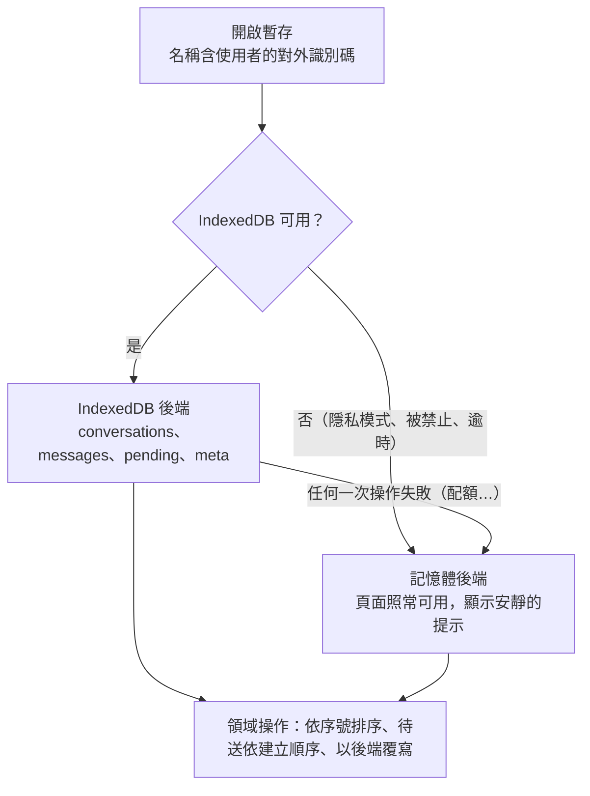

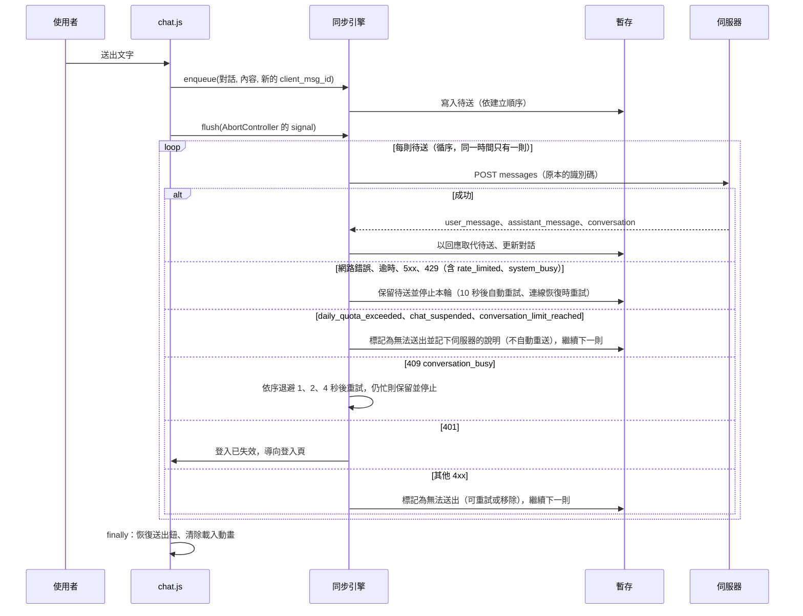

- **後端是權威**：訊息由後端先寫入並指派序號；本機只有可離線閱讀的快取與尚未同步成功的待送。衝突時以後端為準：`since_seq` 增量拉取、同序號覆寫、已有完整回覆的待送隨之移除。
- **中止不代表後端中止**：取消、切換對話、離開頁面只中止請求；後端仍會完成並寫入，之後以序號補齊（重送同一識別碼不會重複）。
- **離線**：只能閱讀暫存的歷史並保存待送訊息；產生新回覆需要連線。離線建立的對話以 `client_id` 冪等重送建立，成功後訊息與待送改掛正式識別碼。
- **RPG 遊戲頁的暫存是另一套**（`game-store.js`、`game-sync.js`，見 3e）：沒有待送佇列、不自動重送（每一輪都要連線生成並消耗遊戲幣），只有閱讀快取與每個存檔最多一筆在途回合；`cs-store.js` 與 `cs-sync.js` 不因此修改。

## 5. 驗證方式

| 層級 | 內容 |
|---|---|
| Node 單元測試 | `tests/js/*.test.js`（劇本創作頁另有 `script-draft`、`milestone-preview`、`restriction` 與 Vue 範本編譯 `script-workshop-template`；帳號頁的故事偏好有 `account-story-preference`：以真的 Vue 與 `Auth.useForm` 在 `vm` 沙盒執行 `account.js` 的 `setup()`，axios、Toast 與 mount 為替身；RPG 入口有 `game-labels`〔對照表、未知值、閘門與內容模式的提示、路徑、台灣時間〕與 `entry`〔同樣以 `vm` 沙盒執行 `entry.js` 的 `setup()`：預設分頁〔沒有存檔是「選劇本」；有存檔是「我的存檔」、手動切換不被覆蓋、存檔請求失敗退回「選劇本」、兩個清單並行載入〕、載入更多、失敗保留與重試、閘門禁用開始、401、樣板用到的名稱都由 `setup()` 回傳；每個測試都有逾時，被破壞的程式讓 Promise 永遠不完成時會失敗而不是掛住〕；開存檔精靈有 `wizard-state`〔純函式：草稿與聯繫三態、字數與前進條件、示範氣泡、套用預覽、開存檔本文的兩種形狀、欄位路徑對應步驟、各種失敗的固定訊息且不含玩家文字〕、`wizard-template`〔樣板以離線 Vue 編譯，用到的名稱與 `wizard.js` 的約定清單一致，`setup()` 實際回傳每一個名稱〕與 `wizard`〔以 `vm` 沙盒執行 `wizard.js`，沙盒在 `tests/js/support/wizard-sandbox.js`：載入的三種失敗與重試、聯繫的選擇與略過、示範氣泡不送請求、欄位上限禁用、生成預覽只填表與覆蓋確認、各種失敗保留內容、離開頁面時中止、重複點擊只送一次、導向前保持禁用、整個流程沒有儲存寫入與主控台輸出〕；遊戲主畫面的串流核心有 `sse-parser`〔事件切塊、CRLF、註解、壞 JSON 丟棄〕、`turn-stream`〔假 fetch 與假計時器：各種結果、ping 重設、兩種逾時、取消、多位元組字元、請求標頭、每條路徑都清除計時器與監聽，每個測試都有逾時〕與 `game-state`〔事件到 effects 的轉換、合併與時間軸、各狀態碼與代碼的失敗對照且不含玩家文字、字數與後端的黃金案例〕，`game-labels` 另有新增的固定文字案例；記事簿面板有 `game-notebook`〔真的 Vue 與替身 API：開啟才讀、已滿的邊界與入口、編輯與即時字數、超過容量禁用儲存、儲存成功、重複點擊只送一次、`finally` 恢復、版本衝突保留草稿、422／409／404／401／網路的對照、未儲存離開的確認、已完結唯讀、從不自動儲存、全文不進主控台與瀏覽器儲存〕，掛到 `game.js` 之後的整合〔側欄分頁、載入頁面時不請求、入口、IndexedDB 內容沒有記事簿、`pagehide`〕在 `game`；本機暫存與 API 有 `game-store`〔記憶體與假 IndexedDB 兩種後端、白名單、帳號隔離、開啟失敗與寫入失敗退回記憶體、整個資料庫沒有記事簿全文與個資〕、`game-sync`〔增量補齊、分頁、後端覆寫、離線與 404、在途回合的各種結果、從不呼叫串流〕與 `game-api`〔`vm` 沙盒與替身 axios：每個呼叫的方法、路徑、本文、逾時與 signal，失敗物件帶出的欄位且餵給 `game-state` 的失敗對照〕，假 IndexedDB 在 `tests/js/support/fake-indexeddb.js`）：Sidebar 規則、暫存（記憶體與假 IndexedDB、開啟失敗退回記憶體）、同步引擎（假伺服器、重送不重複、退避、停止條件、用量代碼的歸類）、用量顯示（`cs-usage.test.js`）、打字機、Toast、共用函式、後台的顯示邏輯（`admin-format.test.js`：每個列舉值都有標籤、日界、比例邊界）；`tests/test_admin_format_labels.py` 比對前端標籤與後端的列舉 |
| 架構掃描 | `tests/architecture/test_frontend_rules.py`、`tests/test_cs_pages.py`、`tests/test_admin_page.py`、`tests/test_script_page.py`、`tests/test_game_pages.py`（含遊戲頁樣板、載入順序與 `gm-` 樣式的守門）、`tests/test_game_screen_flow.py`（後端對前端契約，SQLite 與 SQL Server）、`tests/test_game_notebook_length_parity.py`、`tests/test_appeal_shortcut.py`：離線規則、逾時不寫死、`v-cloak`、純文字、自製 Modal 與 Toast；`/admin` 只有外殼與管理員的顯示名稱 |
| 瀏覽器驗收 | Edge 無頭模式（CDP）的整頁驗收，結果與截圖摘要記在 README 的「瀏覽器驗收」與「管理員後台（C-4b）」 |

---

**何時更新本文**：新增或改名前端模組與頁面、載入順序、共用元件 API、Sidebar 規則、暫存資料集、同步引擎的停止與重試規則、前端規範改變時。`tests/test_design_docs.py` 會檢查 `static/js/cs/`、`static/js/ui/`、`static/js/admin/` 的每個檔案都出現在本文。
