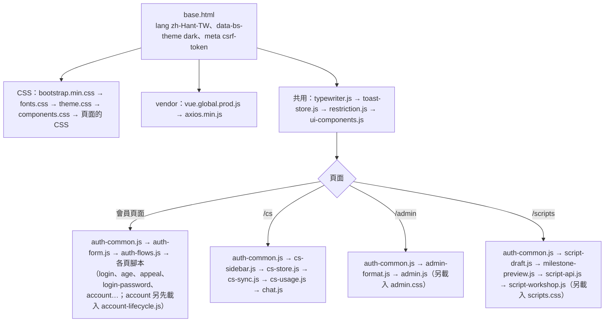
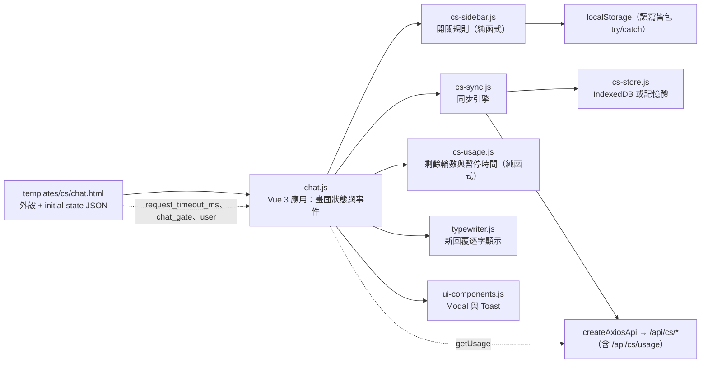
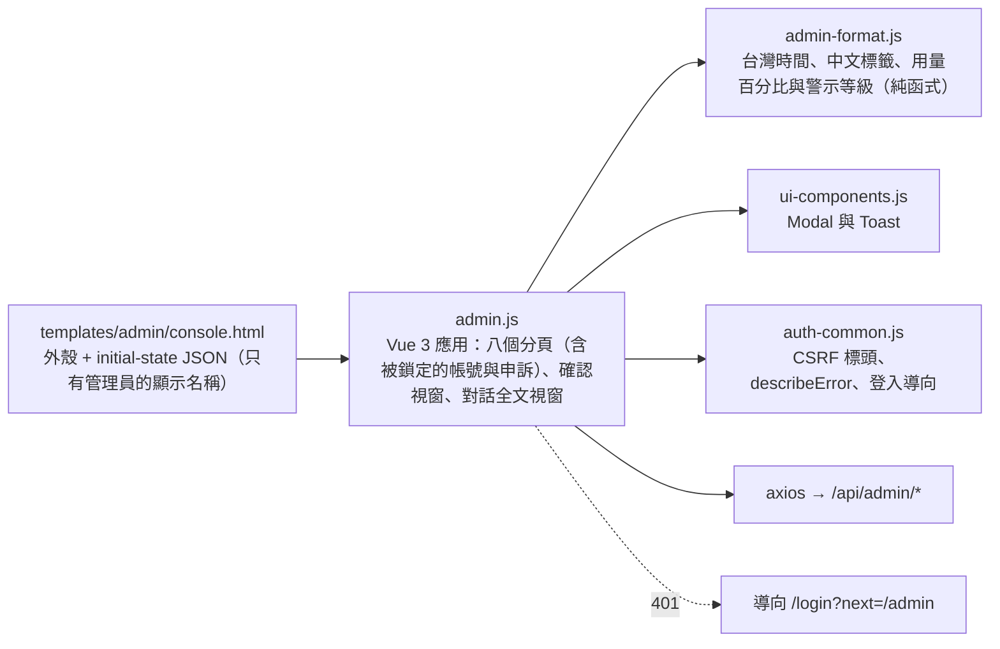
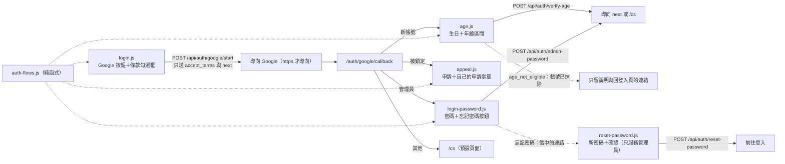
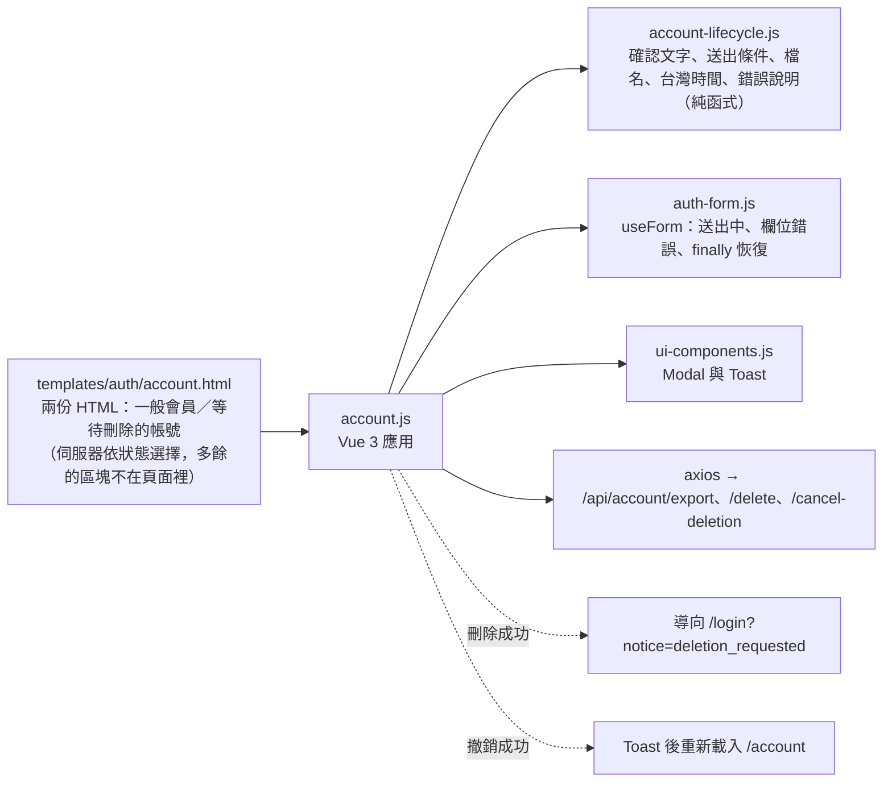
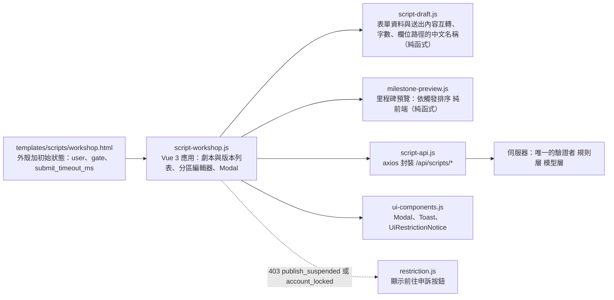
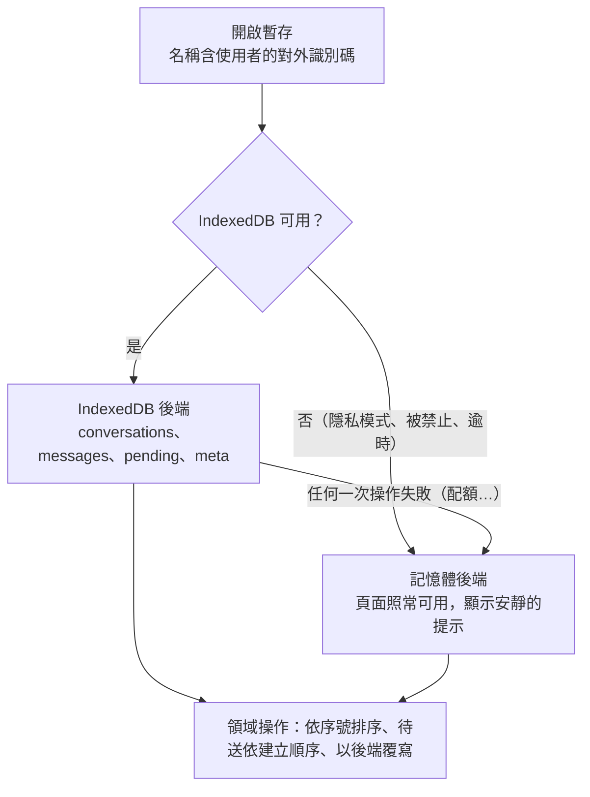
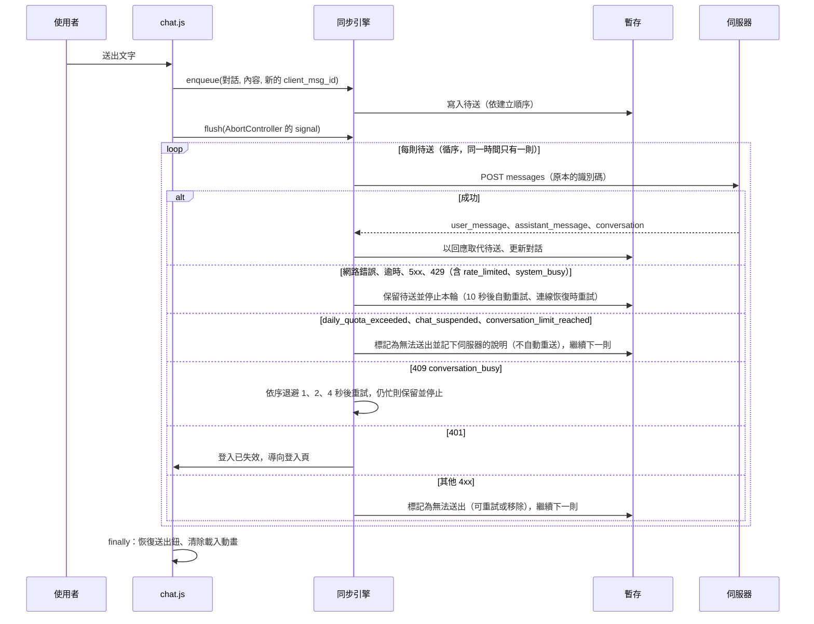

# 前端架構

> 狀態：已實作（RPG 的 `/game` 為規劃中） ｜ 最後更新：2026-11-04 ｜ 對應 change：rpg-script-authoring、remove-player-password-auth、platform-foundation、member-auth、cs-chat-core、usage-limits、admin-console、privacy-lifecycle、google-first-login ｜ 規範依據：AGENTS.md 第 1、2、5、6、7、10 節
> 注意（2026-11-03）：本文件已納入 change ① `google-first-login` 的前端變化（登入頁只有 Google 與條款、新增 `/age`、`/appeal`、`/login/password`、移除註冊頁、管理員後台新增「被鎖定的帳號」與「申訴」）與 change ② `remove-player-password-auth`（刪除 `forgot-password`、`verify-email` 的頁面與腳本；`reset-password` 只服務管理員；帳號頁沒有「尚未驗證」提示與重寄按鈕）。

本文件說明前端的資產載入、共用元件、會員頁面、客服頁面與管理員後台的模組關係，以及客服的離線暫存與同步。伺服器端的對應流程見 [客服對話-chat-service.md](客服對話-chat-service.md) 與 [帳號與安全-auth-security.md](帳號與安全-auth-security.md)。

## 1. 資產與載入順序

- 第三方資產（Vue、Bootstrap CSS、axios、字型）全部在 `static/vendor`、`static/fonts`，**不使用 CDN**；字型為 Noto Sans TC（108 個 `unicode-range` 切片的 woff2）。
- 範本一律用 `url_for('static', …)` 引用；不使用 `.vue`、打包工具、`v-html`、外部彈窗套件，也不使用 Bootstrap 的 JavaScript 與 `data-bs-*`（唯一例外是 `data-bs-theme="dark"`）。`tests/architecture/test_frontend_rules.py` 掃描範本、自有 CSS/JS 與實際渲染出來的頁面。
- 色彩只在 `theme.css` 定義一次（主背景 `#0F1012`、文字 `#E2E4E9`、次要 `#8A8F99`、焦點 `#FF6B35`、分隔線 `#2A2D34`），嚴禁純白。

## 2. 共用元件

| 檔案 | 內容 | 測試 |
|---|---|---|
| `js/ui/ui-components.js` | 自製 Modal（左上角狀態碼、焦點陷阱、Esc 關閉）與 Toast 容器（右下角、由下往上淡入、左側 2px 琥珀線），以及受限狀態提示 `UiRestrictionNotice`（`ui-restriction-notice`：說明文字加指向 `/appeal` 的「前往申訴」一般連結）；顯示由 Vue 響應式狀態接管 | 瀏覽器驗收、`tests/js/script-workshop-template.test.js`（範本編譯） |
| `js/ui/toast-store.js` | Toast 的狀態庫（與框架無關） | `tests/js/toast-store.test.js` |
| `js/ui/restriction.js` | 申訴捷徑的判定與文字（純函式，`UI.restrictionOf`、`UI.restrictionNoticeOf`、`UI.APPEAL_PATH`）：API 回應 403 且代碼為 `account_locked` 或 `publish_suspended`，或 `/api/auth/me` 的 `restriction === 'locked'`／`publish_suspended === true`，才回傳 `locked` 或 `suspended`；其他一律 `null`。不記住任何狀態，所以解除後重新整理即消失 | `tests/js/restriction.test.js`、`tests/test_appeal_shortcut.py` |
| `js/ui/typewriter.js` | 打字機緩衝區：以字素為單位、積壓越多越快、`finish()` 後加速補完、可 `flush()` 與 `cancel()` | `tests/js/typewriter.test.js` |
| `js/auth/auth-common.js` | CSRF 標頭、初始狀態讀取、錯誤整理（`describeError`）、登入導向 | `tests/js/auth-common.test.js` |
| `js/auth/auth-flows.js` | 登入、年齡確認、申訴與管理員密碼驗證頁的判斷邏輯（純函式，`Auth.*`）：安全的導向位置、Google 發起的請求內容（只有條款旗標與 `next`）、檢查輸入、每種錯誤代碼的處理結果（顯示欄位錯誤、清空欄位、導向、結束流程）、申訴字數以 Unicode 字元計 | `tests/js/auth-flows.test.js`（22 項） |
| `js/auth/account-lifecycle.js` | 帳號頁匯出與刪除的純函式（`Auth.lifecycle`）：確認文字比對、送出條件、檔名、預定刪除時間（台灣時間）、錯誤代碼說明、Blob 錯誤整理 | `tests/js/account-lifecycle.test.js` |

## 3. 客服頁面（`/cs`）的模組關係

- **逾時不寫死**：送出訊息的 axios 逾時只讀初始狀態的 `request_timeout_ms`（伺服器的總預算 + 5 秒）；後端預算一改，前端自動跟著改。
- **純文字**：所有使用者與助理的文字都以 `{{ }}` 輸出並以 CSS `white-space: pre-wrap` 保留換行，不解析任何標記語言。
- **Sidebar**：寬 280px；992px 以上預設開啟並推擠主區域、狀態記在 `localStorage`；未滿 992px 預設關閉、以覆蓋方式顯示並附遮罩、不記住狀態、選擇對話後自動關閉。
- **chips**：最後一則助理訊息帶建議動作、打字機結束、其後沒有任何新訊息時才顯示（最多 4 個）；點擊後立即移除並以其文字送出。
- **閘門與 503**：`chat_gate` 不是 `null` 時顯示說明（需補填年齡時附前往帳號設定的連結）並停用輸入；服務暫時無法使用時保留已輸入的文字為待送。
- **用量**（`GET /api/cs/usage`，邏輯在 `cs-usage.js`）：Sidebar 底部一行顯示「今日剩餘 N 輪」（用完時「今日額度已用完」），每則回覆或被拒絕之後重新讀取；**取得失敗或離線就整行隱藏**，其他功能不受影響，因為真正的限制永遠在後端。暫停期間橫幅顯示恢復時間（台灣時間，固定 UTC+8，不依賴 `Intl`）並停用輸入與「新對話」，到點由計時器自動恢復，不必重新整理。
- **用量類的拒絕**：每分鐘限制（`rate_limited`）與全站忙碌（`system_busy`）是暫時的，訊息保留為待送、稍後自動重送，並以 toast 說明原因（不是「無法連線」）；今日額度用完、對話暫停、對話數已滿（`daily_quota_exceeded`、`chat_suspended`、`conversation_limit_reached`）短時間內不會成功，訊息標記為無法送出、**不自動重送**並顯示伺服器的說明，使用者可以重試或移除。對話數已滿時，離線建立的對話不可能建立成功，會連同其中的待送一起移除，原因以 toast 說明，輸入的文字留在輸入框。

## 3a. 管理員後台（`/admin`）的模組關係

- **六個分頁**（依管理員的使用順序）：總覽、被標記對話、意見回饋、使用者、模型失敗、稽核。總覽最上面是可點擊的「今日警告」，點它切到被標記對話；被標記對話與意見回饋的每一列有「看對話」與「看使用者」；「使用者」分頁只有標明「供客服反應時使用」的信箱查詢，沒有使用者清單。
- **只有純文字**：使用者、模型與管理員填寫的原因一律以 `{{ }}` 輸出，對話內容以 `white-space: pre-wrap` 保留換行；`<script>` 與 `` 字樣逐字顯示，不被解析。
- **確認視窗共用一個**：停權與刪除對話顯示原因欄位（必填、200 字、提醒勿填個人資料），解除停權與調整等級只有密碼（調整等級另有等級選單，不含目前的等級）。密碼欄位 `type=password`、`autocomplete="off"`，**送出的當下與視窗關閉時立即清空**，不存進任何儲存體；密碼錯誤的訊息顯示在密碼欄位下方。同時只開一個視窗：從對話全文按「刪除對話」會先關掉全文視窗，視窗關閉時全文也從記憶體丟掉。
- **載入策略**：進入分頁時才載入一次，「重新整理」才重讀；做了會改變資料的操作後，相關分頁標記為過期、下次進入才重新載入。模型失敗每次讀取都會寫稽核，所以不因切換分頁而重複讀取。清單以 `limit=50` 分頁，「載入更多」依已載入的筆數作為起始位置。
- **錯誤處理**：`Auth.describeError` 整理後端的錯誤；401 導向登入；欄位錯誤（`password`、`reason`、`tier`）顯示在對應欄位，其餘顯示在視窗內；視窗已被關掉時改用 Toast。
- **版面**：頂欄與分頁列與內容區左右對齊（最大寬度 64rem）；手機寬度時分頁列自己橫向捲動、頁面不會；清單的每一列改為直向排列；用量以長條加百分比與文字說明呈現，**不單靠顏色**（達 80% 長條為琥珀橙並寫明「已達 80% 告警線」）。

## 3a. 登入、年齡確認、申訴與管理員密碼驗證頁（google-first-login）

- **登入頁只有 Google 與條款**：沒有電子郵件、密碼、生日與年齡欄位，也沒有註冊與忘記密碼的連結；按鈕在條款沒勾選時仍可按（回訪的使用者不必勾選，新使用者沒勾由伺服器擋下並導回提示），只在送出中禁用。`/register` 與註冊頁的範本、腳本已移除。
- **年齡確認頁**：伺服器提供年齡規則（區間選項與範圍）放在初始狀態，沒有任何個人資料；`age_mismatch` 顯示通用說明並清空兩個欄位；`age_not_eligible`（帳號已抹除）只顯示說明與回登入頁的連結；登入逾時導向登入頁。生日只存在輸入框的響應式欄位，不寫入任何瀏覽器儲存體。
- **申訴頁**：字數提示（以 Unicode 字元計）、自己的申訴與處理狀態、已有待處理的申訴時不顯示表單；申訴內容一律純文字；沒有被鎖定時 API 回 404，頁面導向預設頁面。
- **管理員密碼驗證頁**：密碼在送出的當下立即清空；沒有或已過期的中間狀態導回 `/login?error=google_state`；「忘記密碼」只在伺服器說有寄信設定時顯示。
- **重設密碼確認頁**（`/reset-password`，`reset-password.js`，只服務管理員；玩家沒有密碼，也不會收到這類信）：權杖在信中連結的網址片段（`#token=…`），頁面讀取後立即從網址列移除，**載入時不自動送出任何動作**，使用者輸入新密碼（8 至 128 字）與確認、按下按鈕才 `POST /api/auth/reset-password`。兩次輸入不一致在前端擋下；成功後清空兩個欄位，只顯示結果訊息與「前往登入」；缺少權杖時顯示「連結不完整」的說明與回到登入的連結。沒有寄信設定（寄信器與 `BASE_URL`）時伺服器回 404，這個頁面不存在。
- 所有頁面都遵守前端規範：無 `v-html`、無 Bootstrap 的 JavaScript、處理中禁用按鈕並在 `finally` 恢復（`Auth.useForm`）。

## 3b. 帳號頁（`/account`）的匯出、刪除與撤銷（C-4c）

- 年齡補填區塊只留給管理員（玩家沒完成年齡確認之前連這一頁都進不來，會被導向 `/age`）。
- **匯出**：`POST /api/account/export` 以 `responseType: 'blob'`、逾時 60 秒、`AbortController` 送出（離開頁面時中止），回應轉成物件網址以 `<a download>` 下載；無論成功、失敗或中斷，`finally` 恢復按鈕。失敗時錯誤本文也是 Blob，`unwrapBlobError` 先讀成 JSON 再交給共用的錯誤整理。
- **刪除**：自製 Modal（Vue 狀態接管）說明 7 天寬限、抹除範圍並建議先匯出；有密碼者輸入密碼，其餘輸入確認文字（文字由伺服器放進初始狀態，前端不寫死第二份）。**確認前不送出請求**；送出後密碼欄位立即清空；成功後所有裝置登出並導向登入頁，登入頁以固定列舉的代碼顯示寬限期說明。
- **等待刪除**：另一份 HTML 只有預定刪除時間（台灣時間）、撤銷與登出；寬限期已過但排程還沒執行時，不顯示注定失敗的撤銷按鈕；頁面開著時剛好過期則由前端處理 `grace_expired`（顯示說明、按鈕恢復）。登入頁與 Google 回呼在 `deletion_pending` 時一律去 `/account`，不依 `next`。
- **管理員**：頁面沒有刪除區塊（HTML 裡完全沒有，不是用 `v-if` 藏起來）；匯出照常提供。

## 3c. 劇本創作頁（`/scripts`，rpg-script-authoring）

- **伺服器是唯一的驗證者**：前端只顯示字數與伺服器回傳的逐欄位錯誤（路徑轉成中文名稱），不自行擋下、不改寫使用者輸入；空白只在送出時修剪。
- **草稿衝突**：儲存帶開始編輯時的 `base_hash`，別處已更新時伺服器回 `draft_changed`，頁面以自製 Modal 讓作者選擇重新載入或保留自己的修改。
- **送審**：自製確認 Modal；axios 逾時取自初始狀態的 `submit_timeout_ms`（伺服器總預算加 5 秒，前端不寫死數字），以 `AbortController` 於離開頁面時中止，無論成功、失敗或中斷，`finally` 恢復按鈕。
- **被暫停發佈**：頁面載入時由初始狀態判定，送審被拒（403 `publish_suspended`）時即時判定；顯示 `UiRestrictionNotice` 並停用送審按鈕，編輯與儲存照常。
- **欄位說明與範例**：每個區塊最上方有一句用途說明，每個文字欄位都有範例（`placeholder`）；「狀態轉移規則」對玩家顯示為「世界規則（狀態轉移規則，選填）」並附白話說明。人工驗收發現原本玩家看不懂，所以 `tests/test_script_page.py` 要求任何文字欄位都必須有範例。
- **個資**：劇本文字與暱稱只在記憶體與伺服器，不寫入 `localStorage`、`sessionStorage`、IndexedDB 或 cookie（`tests/test_script_page.py` 掃描）；所有文字以 `{{ }}` 純文字顯示。
- 欄位範例由 `GET /api/scripts/example` 帶入（內建首發劇本的標準化內容）；沒有種子資料時伺服器回 404，頁面在編輯器上方顯示一般的錯誤說明，原有內容不變。

## 4. 暫存、待送與同步

- **後端是權威**：訊息由後端先寫入並指派序號；本機只有可離線閱讀的快取與尚未同步成功的待送。衝突時以後端為準：`since_seq` 增量拉取、同序號覆寫、已有完整回覆的待送隨之移除。
- **中止不代表後端中止**：取消、切換對話、離開頁面只中止請求；後端仍會完成並寫入，之後以序號補齊（重送同一識別碼不會重複）。
- **離線**：只能閱讀暫存的歷史並保存待送訊息；產生新回覆需要連線。離線建立的對話以 `client_id` 冪等重送建立，成功後訊息與待送改掛正式識別碼。

## 5. 驗證方式

| 層級 | 內容 |
|---|---|
| Node 單元測試 | `tests/js/*.test.js`（劇本創作頁另有 `script-draft`、`milestone-preview`、`restriction` 與 Vue 範本編譯 `script-workshop-template`）：Sidebar 規則、暫存（記憶體與假 IndexedDB、開啟失敗退回記憶體）、同步引擎（假伺服器、重送不重複、退避、停止條件、用量代碼的歸類）、用量顯示（`cs-usage.test.js`）、打字機、Toast、共用函式、後台的顯示邏輯（`admin-format.test.js`：每個列舉值都有標籤、日界、比例邊界）；`tests/test_admin_format_labels.py` 比對前端標籤與後端的列舉 |
| 架構掃描 | `tests/architecture/test_frontend_rules.py`、`tests/test_cs_pages.py`、`tests/test_admin_page.py`、`tests/test_script_page.py`、`tests/test_appeal_shortcut.py`：離線規則、逾時不寫死、`v-cloak`、純文字、自製 Modal 與 Toast；`/admin` 只有外殼與管理員的顯示名稱 |
| 瀏覽器驗收 | Edge 無頭模式（CDP）的整頁驗收，結果與截圖摘要記在 README 的「瀏覽器驗收」與「管理員後台（C-4b）」 |

---

**何時更新本文**：新增或改名前端模組與頁面、載入順序、共用元件 API、Sidebar 規則、暫存資料集、同步引擎的停止與重試規則、前端規範改變時。`tests/test_design_docs.py` 會檢查 `static/js/cs/`、`static/js/ui/`、`static/js/admin/` 的每個檔案都出現在本文。
