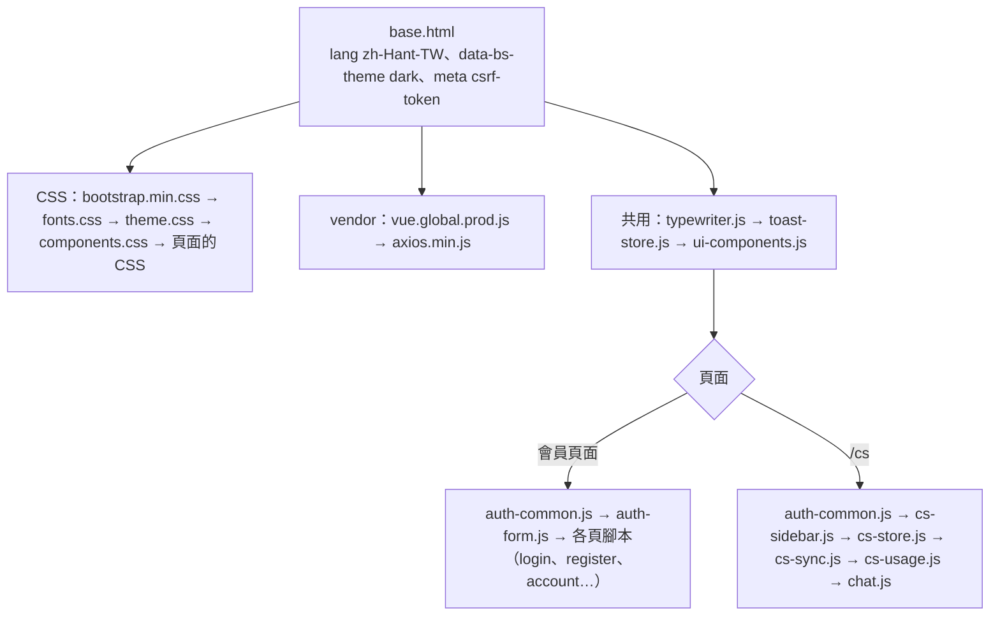
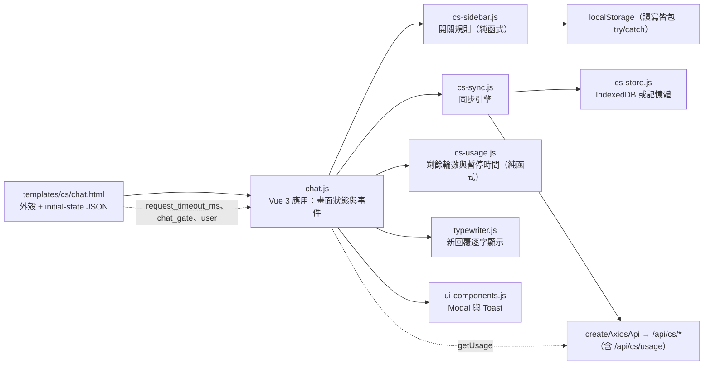
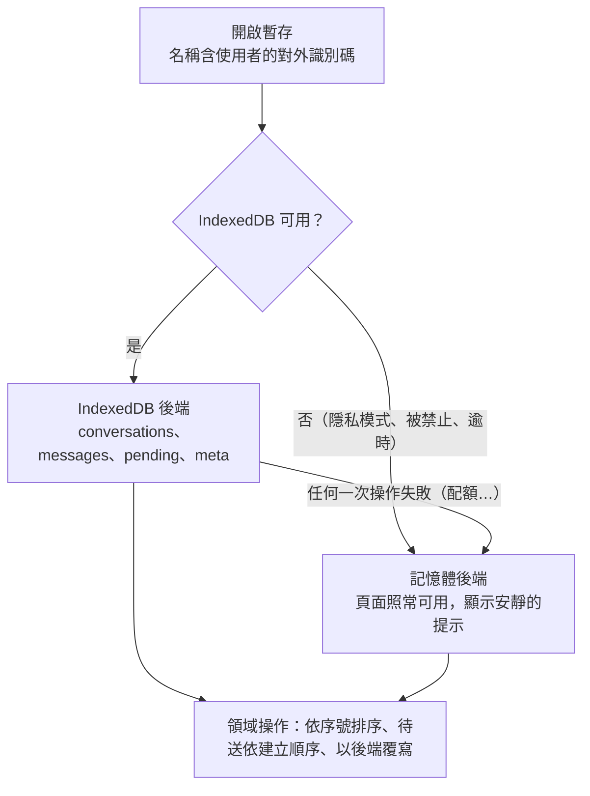
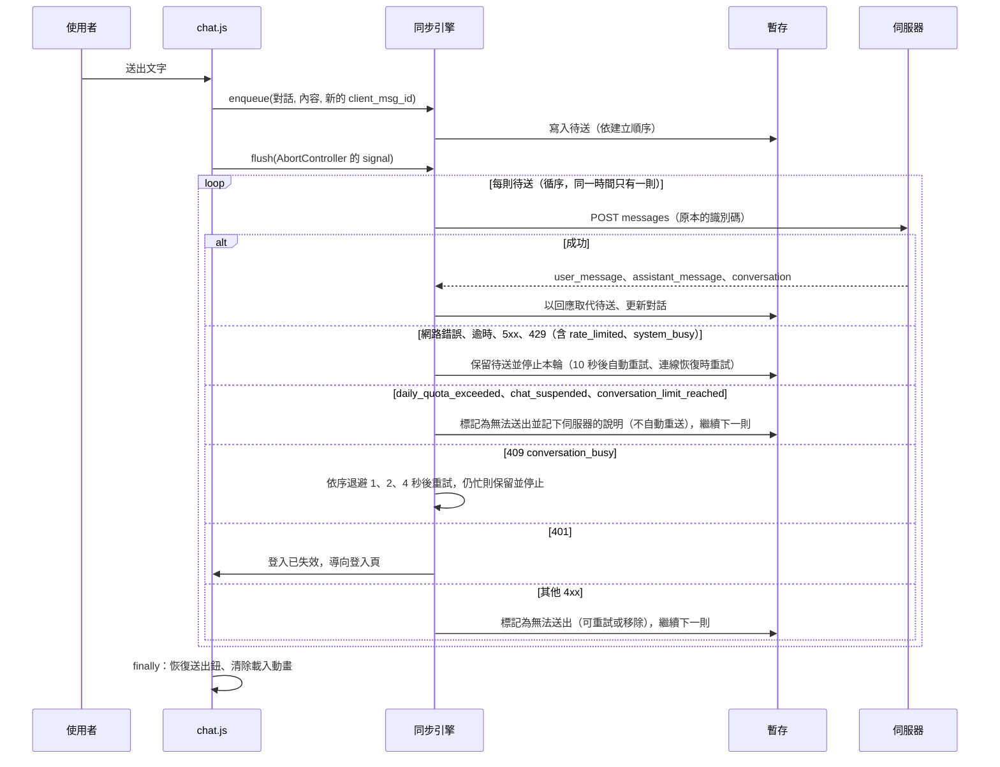

# 前端架構

> 狀態：已實作（RPG 的 `/game` 為規劃中） ｜ 最後更新：2026-10-29 ｜ 對應 change：platform-foundation、member-auth、cs-chat-core、usage-limits ｜ 規範依據：AGENTS.md 第 1、2、5、6、7 節

本文件說明前端的資產載入、共用元件、會員頁面與客服頁面的模組關係，以及客服的離線暫存與同步。伺服器端的對應流程見 [客服對話-chat-service.md](客服對話-chat-service.md)。

## 1. 資產與載入順序

- 第三方資產（Vue、Bootstrap CSS、axios、字型）全部在 `static/vendor`、`static/fonts`，**不使用 CDN**；字型為 Noto Sans TC（108 個 `unicode-range` 切片的 woff2）。
- 範本一律用 `url_for('static', …)` 引用；不使用 `.vue`、打包工具、`v-html`、外部彈窗套件，也不使用 Bootstrap 的 JavaScript 與 `data-bs-*`（唯一例外是 `data-bs-theme="dark"`）。`tests/architecture/test_frontend_rules.py` 掃描範本、自有 CSS/JS 與實際渲染出來的頁面。
- 色彩只在 `theme.css` 定義一次（主背景 `#0F1012`、文字 `#E2E4E9`、次要 `#8A8F99`、焦點 `#FF6B35`、分隔線 `#2A2D34`），嚴禁純白。

## 2. 共用元件

| 檔案 | 內容 | 測試 |
|---|---|---|
| `js/ui/ui-components.js` | 自製 Modal（左上角狀態碼、焦點陷阱、Esc 關閉）與 Toast 容器（右下角、由下往上淡入、左側 2px 琥珀線）；顯示由 Vue 響應式狀態接管 | 瀏覽器驗收 |
| `js/ui/toast-store.js` | Toast 的狀態庫（與框架無關） | `tests/js/toast-store.test.js` |
| `js/ui/typewriter.js` | 打字機緩衝區：以字素為單位、積壓越多越快、`finish()` 後加速補完、可 `flush()` 與 `cancel()` | `tests/js/typewriter.test.js` |
| `js/auth/auth-common.js` | CSRF 標頭、初始狀態讀取、錯誤整理（`describeError`）、登入導向 | `tests/js/auth-common.test.js` |

## 3. 客服頁面（`/cs`）的模組關係

- **逾時不寫死**：送出訊息的 axios 逾時只讀初始狀態的 `request_timeout_ms`（伺服器的總預算 + 5 秒）；後端預算一改，前端自動跟著改。
- **純文字**：所有使用者與助理的文字都以 `{{ }}` 輸出並以 CSS `white-space: pre-wrap` 保留換行，不解析任何標記語言。
- **Sidebar**：寬 280px；992px 以上預設開啟並推擠主區域、狀態記在 `localStorage`；未滿 992px 預設關閉、以覆蓋方式顯示並附遮罩、不記住狀態、選擇對話後自動關閉。
- **chips**：最後一則助理訊息帶建議動作、打字機結束、其後沒有任何新訊息時才顯示（最多 4 個）；點擊後立即移除並以其文字送出。
- **閘門與 503**：`chat_gate` 不是 `null` 時顯示說明（需補填年齡時附前往帳號設定的連結）並停用輸入；服務暫時無法使用時保留已輸入的文字為待送。
- **用量**（`GET /api/cs/usage`，邏輯在 `cs-usage.js`）：Sidebar 底部一行顯示「今日剩餘 N 輪」（用完時「今日額度已用完」），每則回覆或被拒絕之後重新讀取；**取得失敗或離線就整行隱藏**，其他功能不受影響，因為真正的限制永遠在後端。暫停期間橫幅顯示恢復時間（台灣時間，固定 UTC+8，不依賴 `Intl`）並停用輸入與「新對話」，到點由計時器自動恢復，不必重新整理。
- **用量類的拒絕**：每分鐘限制（`rate_limited`）與全站忙碌（`system_busy`）是暫時的，訊息保留為待送、稍後自動重送，並以 toast 說明原因（不是「無法連線」）；今日額度用完、對話暫停、對話數已滿（`daily_quota_exceeded`、`chat_suspended`、`conversation_limit_reached`）短時間內不會成功，訊息標記為無法送出、**不自動重送**並顯示伺服器的說明，使用者可以重試或移除。對話數已滿時，離線建立的對話不可能建立成功，會連同其中的待送一起移除，原因以 toast 說明，輸入的文字留在輸入框。

## 4. 暫存、待送與同步

- **後端是權威**：訊息由後端先寫入並指派序號；本機只有可離線閱讀的快取與尚未同步成功的待送。衝突時以後端為準：`since_seq` 增量拉取、同序號覆寫、已有完整回覆的待送隨之移除。
- **中止不代表後端中止**：取消、切換對話、離開頁面只中止請求；後端仍會完成並寫入，之後以序號補齊（重送同一識別碼不會重複）。
- **離線**：只能閱讀暫存的歷史並保存待送訊息；產生新回覆需要連線。離線建立的對話以 `client_id` 冪等重送建立，成功後訊息與待送改掛正式識別碼。

## 5. 驗證方式

| 層級 | 內容 |
|---|---|
| Node 單元測試 | `tests/js/*.test.js`：Sidebar 規則、暫存（記憶體與假 IndexedDB、開啟失敗退回記憶體）、同步引擎（假伺服器、重送不重複、退避、停止條件、用量代碼的歸類）、用量顯示（`cs-usage.test.js`）、打字機、Toast、共用函式 |
| 架構掃描 | `tests/architecture/test_frontend_rules.py`、`tests/test_cs_pages.py`：離線規則、逾時不寫死、`v-cloak`、純文字、自製 Modal 與 Toast |
| 瀏覽器驗收 | Edge 無頭模式（CDP）的整頁驗收，結果與截圖摘要記在 README 的「瀏覽器驗收」 |

---

**何時更新本文**：新增或改名前端模組與頁面、載入順序、共用元件 API、Sidebar 規則、暫存資料集、同步引擎的停止與重試規則、前端規範改變時。`tests/test_design_docs.py` 會檢查 `static/js/cs/`、`static/js/ui/` 的每個檔案都出現在本文。
