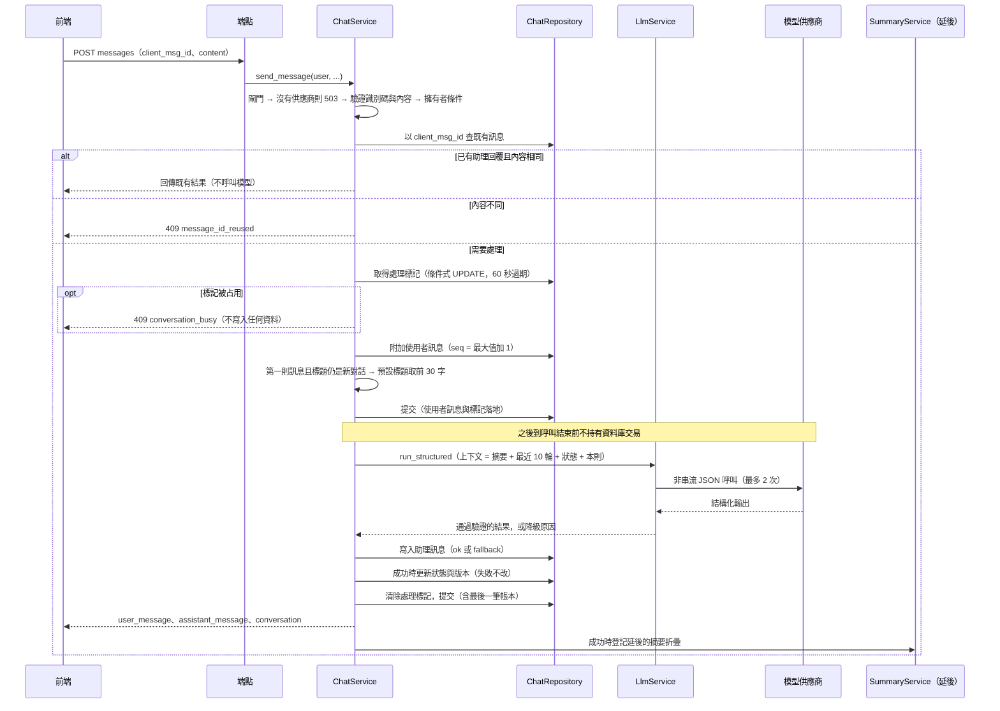
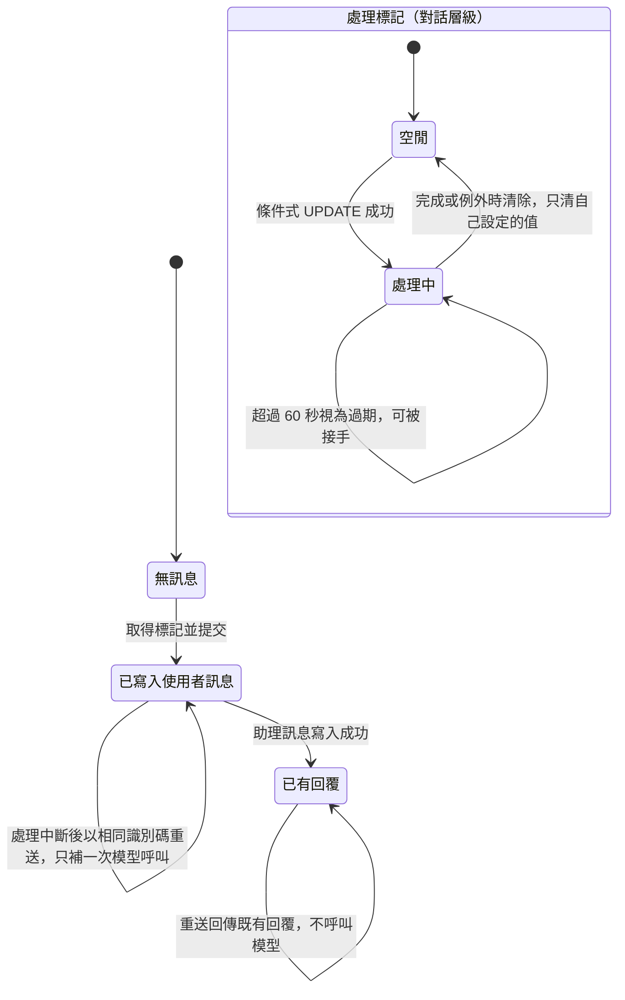
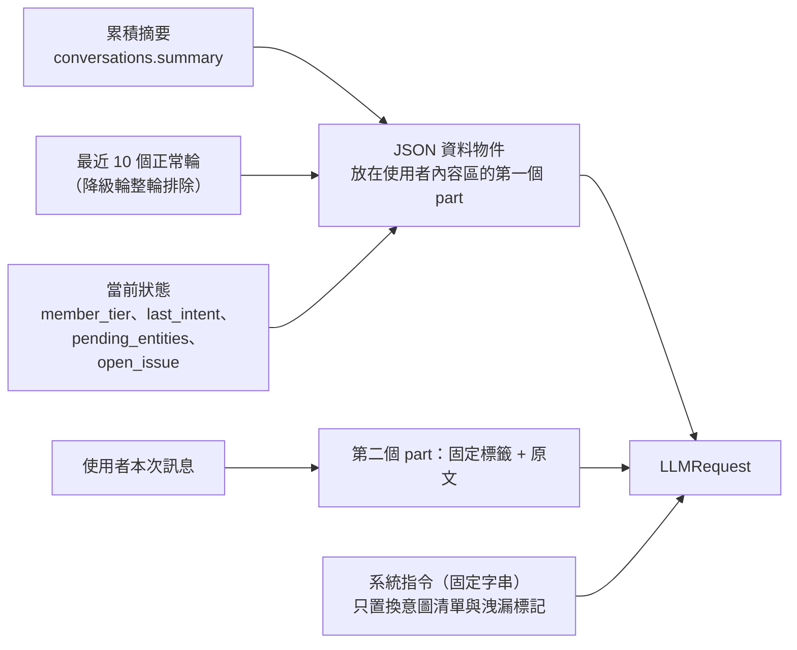
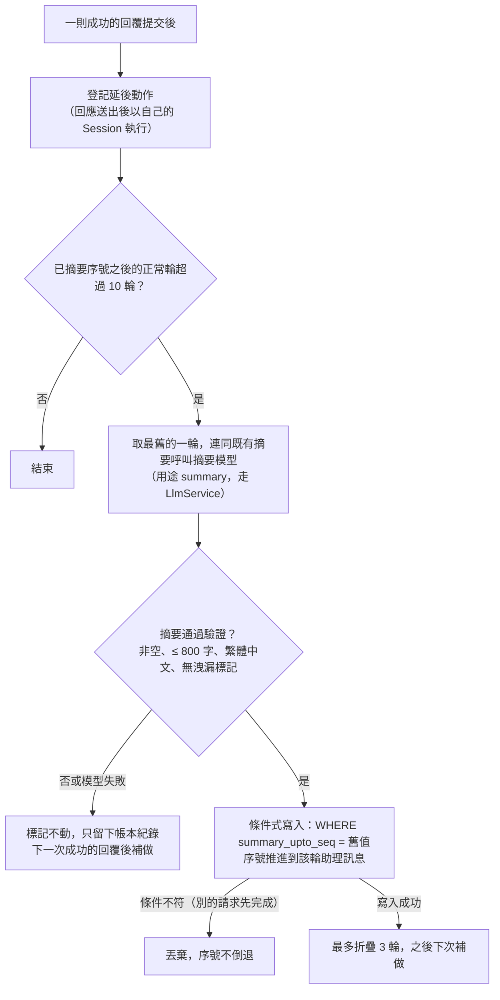

# 客服對話流程

> 狀態：已實作（額度、限流、安全過濾累計暫停由 C-4 實作） ｜ 最後更新：2026-10-29 ｜ 對應 change：cs-chat-core ｜ 規範依據：AGENTS.md 第 5、6、7、10 節

本文件說明會員與客服 AI 的對話如何被建立、送出、重送、摘要與同步。模型呼叫本身（重試、備援、斷路、帳本）見 [模型呼叫層-llm-layer.md](模型呼叫層-llm-layer.md)；瀏覽器端見 [前端結構-frontend.md](前端結構-frontend.md)。

## 1. 端點

全部需要登入與 CSRF（非 GET），`/api/cs/` 底下的回應一律 `Cache-Control: no-store`。「閘門」指須通過 `AccessPolicy.require_chat_access`（見 [帳號與安全-auth-security.md](帳號與安全-auth-security.md)）。

| 端點 | 方法 | 閘門 | 用途 |
|---|---|---|---|
| `/api/cs/conversations` | POST | 是 | 建立對話（冪等：同一 `client_id` 回同一個對話，第一次 201、之後 200） |
| `/api/cs/conversations` | GET | 否 | 列出自己的對話，依最後活動時間由新到舊 |
| `/api/cs/conversations/<public_id>` | PATCH | 是 | 改名；版本過期回 409 `version_conflict` 並附最新的對話 |
| `/api/cs/conversations/<public_id>` | DELETE | 否 | 永久刪除對話與訊息 |
| `/api/cs/conversations/<public_id>/messages` | POST | 是 | 送出訊息並取得 AI 回覆 |
| `/api/cs/conversations/<public_id>/messages` | GET | 否 | 以 `since_seq` 增量拉取訊息（每次最多 200 則） |

頁面 `/cs`：需登入，初始狀態帶 `chat_gate`、`service_available`、`request_timeout_ms`（= 後端總預算 + 5 秒）、`max_message_chars` 與使用者的對外識別碼。回應只含文字與建議動作；**意圖、實體、信心、摘要與狀態都不離開伺服器**。

## 2. 送出一則訊息

任何例外都會回復並以新的交易清除處理標記，再讓例外往外傳；使用者訊息保留，下次以相同識別碼重送會走「已有使用者訊息、沒有回覆」的補做路徑。

## 3. 冪等與同一對話同時只處理一則

- 助理訊息的 `client_msg_id` 由使用者訊息的識別碼**決定性**推得（`uuid5`）；唯一約束因此保證一則使用者訊息至多一則回覆。標記過期被接手的邊界上，後寫入者撞到唯一約束後改為讀取既有回覆，自己的結果（含計入額度的帳本）一併丟棄。
- 相同識別碼但內容不同回 409 `message_id_reused`；他人的對話與不存在的對話回應逐字相同（404）。

## 4. 上下文與當前狀態

- 一輪 = 序號相鄰的「使用者訊息 + 狀態為 `ok` 的助理回覆」；沒有回覆的訊息與已被摘要涵蓋的輪次不重複送出。
- **狀態只由列舉值推得**，沒有任何自由文字（使用者訊息、模型的主題詞、email 都進不來）：`last_intent` = 本輪意圖；`pending_entities` = 與前一份合併的非空列舉實體（`greeting` 清空）；`open_issue` = `account_help` 或 `complaint_feedback` 時為「意圖:對應實體或 none」，`greeting` 清空。降級的輪次狀態與版本都不變。
- 狀態寫入以 `state_version` 為條件；與改名共用同一個版本，衝突時以最新版本重算一次。

## 5. 補償式摘要

標記與摘要都在資料庫，worker 重啟不遺失；摘要失敗不影響使用者已收到的回覆。

## 6. 降級文案與訊息狀態

| 情況 | 使用者看到 | `msg_status` | 帳本 |
|---|---|---|---|
| 輸出驗證失敗（兩次） | 「抱歉，我暫時無法正確處理您的問題，請稍後再試，或換個方式描述。」 | `fallback` | 不計入額度 |
| 逾時、供應商錯誤、設定錯誤、預算用盡 | 「目前服務暫時繁忙，請稍後再試。」 | `fallback` | 不計入額度 |
| 被安全過濾阻擋 | 「這個問題我無法協助。若有會員或帳號相關的問題，歡迎告訴我。」 | `fallback` | 狀態 `blocked`，結束原因註明輸入或輸出被擋 |
| 信心低於 0.6 且意圖不是 `unknown` | 「抱歉，我不太確定您的意思。可以請您換個說法，再描述一次您的問題嗎？」 | `ok`，意圖改為 `unknown` | 計入額度 |
| 沒有模型供應商（本機沒有金鑰） | 503 `service_unavailable`，不寫入任何資料 | — | — |

降級訊息整輪不送給模型，但仍保留在使用者可見的歷史中。

## 7. 客服回覆的原則

客服只需要**精準回答**，不要求長回覆，也沒有任何最低字數；驗證只守 `reply_text` 1000 字的上限。350 至 1000 字只屬於 RPG 的劇情（見 [RPG.md](RPG.md) T-13）。提示詞要求只依「平台資料」回答、不得編造、純文字、稱呼「您」。

---

**何時更新本文**：`/api/cs/*` 端點、送出流程的提交點、冪等或處理標記規則、上下文與狀態的組成、摘要規則、降級文案或客服回覆原則改變時。`tests/test_design_docs.py` 會檢查每個 `/api/cs/` 路由都出現在本文。
