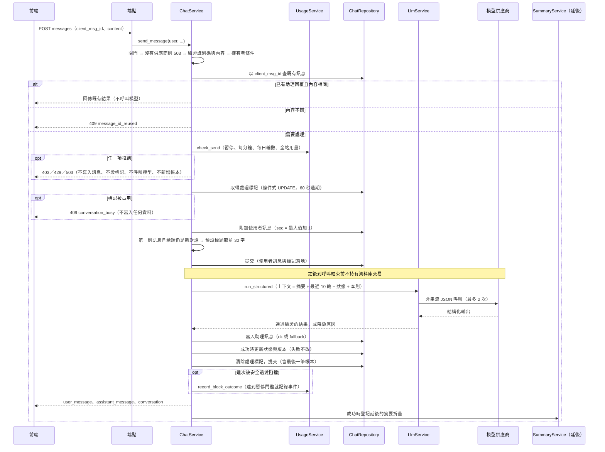
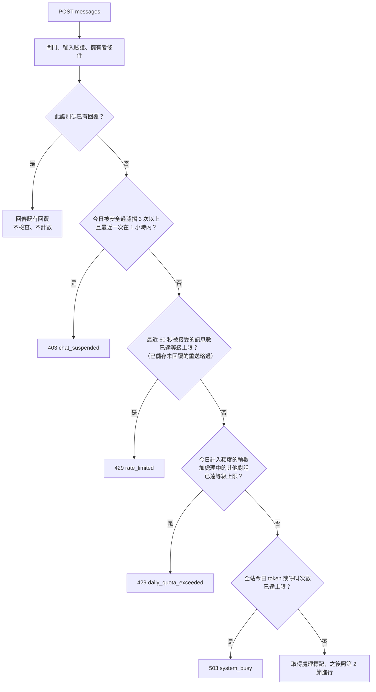
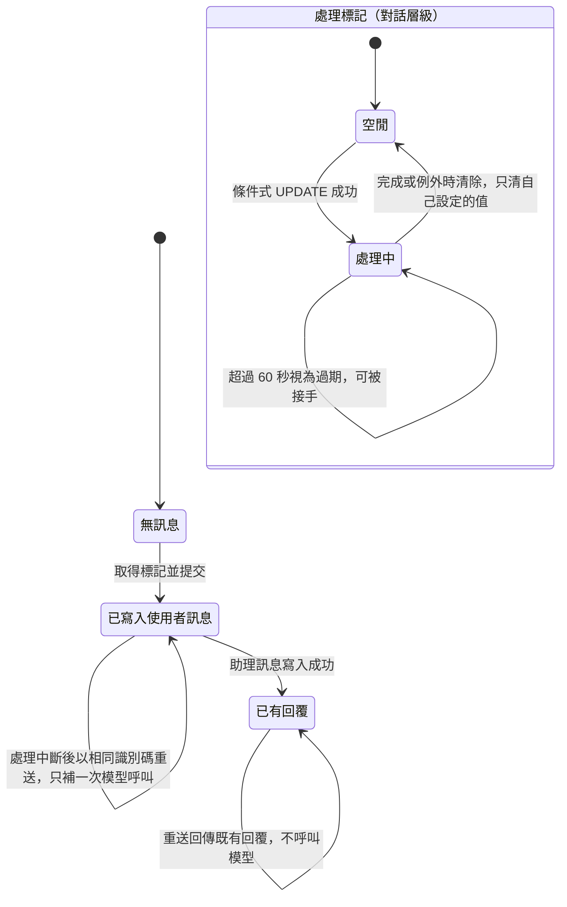
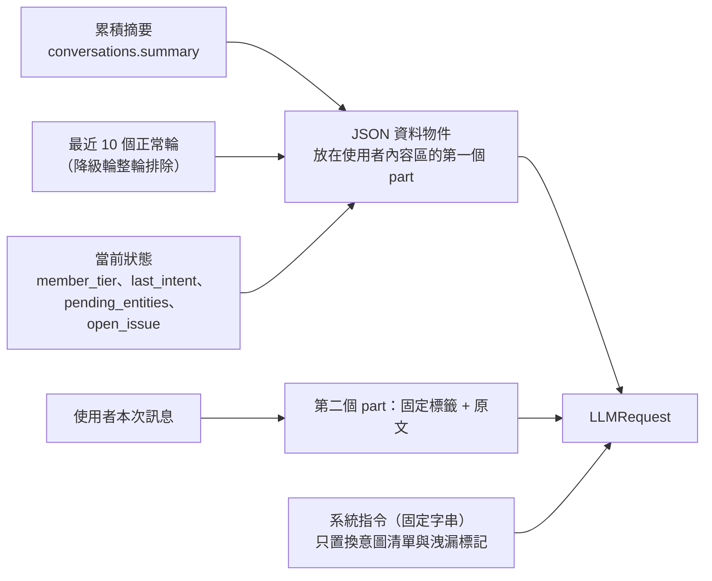
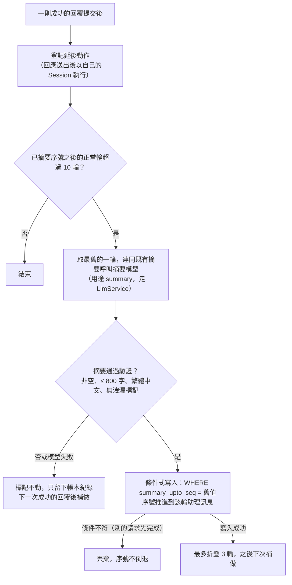
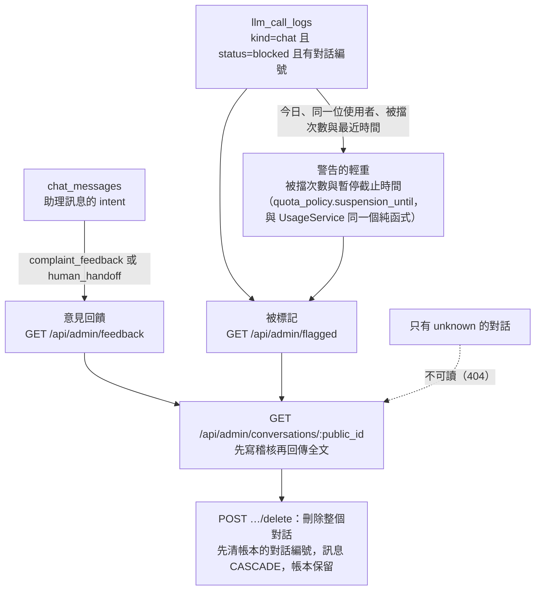

# 客服對話流程

> 狀態：已實作（額度、限流、全站用量上限、安全過濾累計暫停由 C-4a `usage-limits` 實作；管理員後台看得到被標記與意見回饋對話由 C-4b `admin-console` 實作） ｜ 最後更新：2026-10-30 ｜ 對應 change：cs-chat-core、usage-limits、admin-console ｜ 規範依據：AGENTS.md 第 5、6、7、10 節

本文件說明會員與客服 AI 的對話如何被建立、送出、重送、摘要與同步。模型呼叫本身（重試、備援、斷路、帳本）見 [模型呼叫層-llm-layer.md](模型呼叫層-llm-layer.md)；瀏覽器端見 [前端結構-frontend.md](前端結構-frontend.md)。

## 1. 端點

全部需要登入與 CSRF（非 GET），`/api/cs/` 底下的回應一律 `Cache-Control: no-store`。「閘門」指須通過 `AccessPolicy.require_chat_access`（見 [帳號與安全-auth-security.md](帳號與安全-auth-security.md)）。

| 端點 | 方法 | 閘門 | 用途 |
|---|---|---|---|
| `/api/cs/conversations` | POST | 是 | 建立對話（冪等：同一 `client_id` 回同一個對話，第一次 201、之後 200；新對話會超過對話數上限時 409 `conversation_limit_reached`） |
| `/api/cs/conversations` | GET | 否 | 列出自己的對話，依最後活動時間由新到舊 |
| `/api/cs/conversations/<public_id>` | PATCH | 是 | 改名；版本過期回 409 `version_conflict` 並附最新的對話 |
| `/api/cs/conversations/<public_id>` | DELETE | 否 | 永久刪除對話與訊息 |
| `/api/cs/conversations/<public_id>/messages` | POST | 是 | 送出訊息並取得 AI 回覆；用量限制的拒絕見第 3 節 |
| `/api/cs/conversations/<public_id>/messages` | GET | 否 | 以 `since_seq` 增量拉取訊息（每次最多 200 則） |
| `/api/cs/usage` | GET | 否 | 呼叫者自己的用量：等級、今日已用與上限與重置時間、每分鐘上限、對話數與上限、暫停截止時間；**不含**全站用量、token 數與他人資料。與列表一致不過閘門，被停權或尚未完成年齡確認者仍能看到說明 |

頁面 `/cs`：需登入，初始狀態帶 `chat_gate`、`service_available`、`request_timeout_ms`（= 後端總預算 + 5 秒）、`max_message_chars` 與使用者的對外識別碼。回應只含文字與建議動作；**意圖、實體、信心、摘要與狀態都不離開伺服器**。

## 2. 送出一則訊息

任何例外都會回復並以新的交易清除處理標記，再讓例外往外傳；使用者訊息保留，下次以相同識別碼重送會走「已有使用者訊息、沒有回覆」的補做路徑。

## 3. 用量限制

`UsageService`（`app/services/usage_service.py`）回答「這一次可不可以」；所有計數都從資料庫導出（帳本 `llm_call_logs` 與訊息表），沒有計數器欄位，也不依賴行程內記憶體，所以多個 worker 看到同一個數字。各等級的數值只有一份：`app/services/quota_policy.py` 的 `TIER_LIMITS`，客服 system prompt 的額度說明也由它產生。會員等級只影響額度，`AccessPolicy` 不讀它。

| 限制 | 計算方式 | 超過時 | 文案 |
|---|---|---|---|
| 暫停 | 今日（台灣日）對話呼叫被擋的帳本列 ≥ 3，且最近一次 + 1 小時尚未到 | 403 `chat_suspended`，回應另帶 `suspended_until` | 「由於多次觸發內容安全限制，客服對話已暫停，將於 HH:MM（台灣時間）恢復。」 |
| 每分鐘 | `chat_messages` 中這位使用者最近 60 秒、角色為 user 的訊息數 | 429 `rate_limited`，`Retry-After` = 最早那則離開視窗的秒數 | 「您傳送訊息的速度太快了，請稍候幾秒再試。」 |
| 每日輪數 | 帳本中今日 `counted` 的對話呼叫數，加上處理標記仍有效的其他對話數（已預留的名額） | 429 `daily_quota_exceeded`，`Retry-After` = 距明日 00:00（台灣時間）的秒數 | 「您今日的對話額度已用完，將於明日 00:00（台灣時間）重置。」 |
| 全站用量 | 今日帳本全部列的 token 總和與筆數，任一項達 `USAGE_DAILY_TOKEN_LIMIT`／`USAGE_DAILY_CALL_LIMIT` | 503 `system_busy`，`Retry-After: 60` | 「目前使用人數較多，請稍後再試。」（不透露數字） |
| 對話數 | 這位使用者的對話列數；建立前檢查，同一 `client_id` 的重送不受影響 | 409 `conversation_limit_reached` | 「對話數已達上限，請先刪除不需要的對話。」 |

- **拒絕不留痕**：檢查在取得處理標記之前，任何一項拒絕都不寫入訊息、不設標記、不呼叫模型、不新增帳本；被拒絕的訊息之後以同一個識別碼重送仍是全新的一則。
- **為什麼每分鐘從訊息表數、每日從帳本數**：帳本的最後一筆要等回覆寫完才提交，期間其他請求看不到，連發就能繞過；使用者訊息在呼叫模型之前就已提交。每日輪數用 `counted` 標記，天然排除降級與摘要。
- **並行**：檢查與提交之間有時間差，並行請求可能一起通過，超額幅度不超過並行數；處理中的其他對話先算成已預留的名額，所以先到的請求在等模型時，後到的不會一起通過。需要硬上限時須改用資料庫中的原子計數列（另案）。
- **暫停不新增欄位**：最近一次被擋的時間 + 1 小時；暫停期間請求在呼叫模型前就被拒絕，不會再產生新的被擋紀錄，到期自然解除；期滿後再被擋即再次暫停。依 AGENTS.md 第 10 節的字面，輸入或輸出被擋**都計**（RPG 的規範另有明文只計輸入）；摘要呼叫被擋不計。
- **全站用量**：包含摘要、降級與失敗的嘗試（供應商都已計入配額）；越過 80% 只記錄警告事件、不阻擋；背景摘要在達上限時延後（不呼叫模型，之後補做）。預設值依 `gemini-3.5-flash-lite` 免費層（15 RPM、25 萬 TPM、每日 500 次請求）；15 RPM 是全站共用，本 change 不另設全站每分鐘閘門。
- **事件**：`usage.denied`、`usage.global_budget_warning`、`cs.chat_suspended`，只有分類與整數（見 [營運與部署-operations.md](營運與部署-operations.md)）。

## 4. 冪等與同一對話同時只處理一則

- 助理訊息的 `client_msg_id` 由使用者訊息的識別碼**決定性**推得（`uuid5`）；唯一約束因此保證一則使用者訊息至多一則回覆。標記過期被接手的邊界上，後寫入者撞到唯一約束後改為讀取既有回覆，自己的結果（含計入額度的帳本）一併丟棄。
- 相同識別碼但內容不同回 409 `message_id_reused`；他人的對話與不存在的對話回應逐字相同（404）。

## 5. 上下文與當前狀態

- 一輪 = 序號相鄰的「使用者訊息 + 狀態為 `ok` 的助理回覆」；沒有回覆的訊息與已被摘要涵蓋的輪次不重複送出。
- **狀態只由列舉值推得**，沒有任何自由文字（使用者訊息、模型的主題詞、email 都進不來）：`last_intent` = 本輪意圖；`pending_entities` = 與前一份合併的非空列舉實體（`greeting` 清空）；`open_issue` = `account_help` 或 `complaint_feedback` 時為「意圖:對應實體或 none」，`greeting` 清空。降級的輪次狀態與版本都不變。
- 狀態寫入以 `state_version` 為條件；與改名共用同一個版本，衝突時以最新版本重算一次。

## 6. 補償式摘要

標記與摘要都在資料庫，worker 重啟不遺失；摘要失敗不影響使用者已收到的回覆；全站用量達上限時延後（見第 3 節）。

## 7. 降級文案與訊息狀態

| 情況 | 使用者看到 | `msg_status` | 帳本 |
|---|---|---|---|
| 輸出驗證失敗（兩次） | 「抱歉，我暫時無法正確處理您的問題，請稍後再試，或換個方式描述。」 | `fallback` | 不計入額度 |
| 逾時、供應商錯誤、設定錯誤、預算用盡 | 「目前服務暫時繁忙，請稍後再試。」 | `fallback` | 不計入額度 |
| 被安全過濾阻擋 | 「這個問題我無法協助。若有會員或帳號相關的問題，歡迎告訴我。」 | `fallback` | 狀態 `blocked`，結束原因註明輸入或輸出被擋 |
| 信心低於 0.6 且意圖不是 `unknown` | 「抱歉，我不太確定您的意思。可以請您換個說法，再描述一次您的問題嗎？」 | `ok`，意圖改為 `unknown` | 計入額度 |
| 沒有模型供應商（本機沒有金鑰） | 503 `service_unavailable`，不寫入任何資料 | — | — |

降級訊息整輪不送給模型，但仍保留在使用者可見的歷史中。

## 8. 客服回覆的原則

客服只需要**精準回答**，不要求長回覆，也沒有任何最低字數；驗證只守 `reply_text` 1000 字的上限。350 至 1000 字只屬於 RPG 的劇情（見 [RPG.md](RPG.md) T-13）。提示詞要求只依「平台資料」回答、不得編造、純文字、稱呼「您」。

## 9. 管理員如何看到被標記與意見回饋的對話（C-4b）

客服沒有真人通道：使用者要求真人客服或留下意見時，客服告訴他「管理員會看到」。管理員能看到的就是下面兩類對話，**不多也不少**，且都從既有資料推得（沒有新增欄位）：

| 項目 | 規則 |
|---|---|
| 意見回饋 | 至少有一則助理回覆的意圖是 `complaint_feedback` 或 `human_handoff`（客服會告訴使用者「管理員會看到」的兩種情況）。**只有 `unknown` 的對話不算**：它還包含離題閒聊與越權試探，全部開放會違反「不得任意讀取其他對話全文」；代價是使用者沒有要求真人、只直接問一個被歸為 `unknown` 的問題時，管理員讀不到（刻意接受） |
| 被標記 | 帳本中有該對話被內容安全過濾擋下的紀錄（摘要不算）；使用者刪除對話後帳本的對話編號清為空值，該對話離開清單 |
| 清單與全文 | 清單只有對外識別碼、次數與時間，**沒有訊息內容**；全文最多 200 則（`has_more` 告知還有更多）；清單與讀取用同一份條件（兩個 `EXISTS`），所以「清單裡有的才讀得到」，不符資格與不存在得到同一個 404 |
| 警告的輕重 | 被標記清單每筆帶該使用者今日被擋的對話呼叫總次數與客服對話暫停的截止時間；暫停本身（一日內被擋 3 次暫停 1 小時）仍由帳本推得、自然到期，後台**不能解除** |
| 刪除 | 只刪整個對話（單則刪除會破壞序號、輪的配對與摘要的涵蓋範圍），須原因與密碼；帳本保留，所以用量與成本稽核不會因為刪內容而少 |
| 稽核 | 讀取先寫 `conversation.read` 再回傳，寫入失敗就不回傳內容；刪除寫 `conversation.delete`（含原因）；稽核沒有任何訊息文字 |

模型輸出驗證失敗的原文（`llm_call_logs.error_detail`）則在後台「模型失敗」分頁：最近 14 天、最多 100 筆，每次讀取寫 `failures.read`。存取規則與端點見 [帳號與安全-auth-security.md](帳號與安全-auth-security.md) 第 7 節。

---

**何時更新本文**：`/api/cs/*` 端點、送出流程的提交點、用量限制的種類或計算方式、冪等或處理標記規則、上下文與狀態的組成、摘要規則、降級文案、客服回覆原則，或管理員可讀的對話範圍（意見回饋與被標記的條件）改變時。`tests/test_design_docs.py` 會檢查每個 `/api/cs/` 路由都出現在本文。
