# 帳號、年齡與存取控制

> 狀態：已實作（管理員後台由 C-4b 實作；使用者自助刪除帳號與受限登入狀態由 C-4c 實作） ｜ 最後更新：2026-11-24 ｜ 對應 change：admin-default-landing（管理員登入後的預設頁面依角色決定：`landing_for` 對啟用中的管理員回 `/admin`〔`ADMIN_AFTER_LOGIN`〕，明確的返回位置優先、恰為 `/game` 視同沒有指定；沒有資料表變更、沒有遷移，第 7 節預設頁面段落）、admin-delete-account（管理員在後台刪除一個玩家帳號：`POST /api/admin/users/<public_id>/delete`、`user.delete` 稽核、重新輸入密碼、立即抹除且劇本全刪；`/terms` 第 4 節加一條與條款版本 `2026-11-24-draft-11`；沒有資料表變更、沒有遷移）、onboarding-polish（`/age` 改為三步精靈、登入頁加「全部同意」，純前端，後端契約與受限登入狀態都不變）、rpg-story-view（行動建議端點 `POST /api/game/sessions/<id>/suggestions` 的存取規則；建議內容視為個資、不在管理員預設可讀的範圍）、rpg-script-reports（劇本檢舉的權限與稽核：登入且完成年齡確認才能檢舉、不得檢舉自己的與內建劇本、`report.read` 與 `report.dismiss` 稽核、結案為不成立不需密碼；匿名保留偏好端點與抹除時機）、rpg-script-publishing（管理員審核與下架的權限與稽核：第 7 節的可讀範圍、核可與退回不需密碼、下架與恢復須密碼、只有下架者能恢復、備註不外洩、`script.*` 五個稽核動作）、safe-mode-toggle（兩種內容模式、生效模式現算、緊急煞車、內容模式 API，第 5 節「內容模式」）、wallet-hub（錢包頁 `/wallet` 的存取規則，第 7f 節）、admin-unlimited-coins（管理員帳號不消耗遊戲幣、`is_active_admin`）、adult-only-signup（全站只限滿 18 歲、登入頁年滿 18 歲聲明、未滿 18 歲抹除）、rpg-turn-revision（修訂端點的存取規則、政策頁與條款版本）、rpg-entry-ui（入口清單端點的存取規則）、story-preference（故事偏好端點的存取規則）、rpg-notebook（記事簿端點的存取規則）、rpg-turn-engine、game-wallet、rpg-character-creation、rpg-script-authoring、rpg-data-and-script、remove-player-password-auth、google-first-login、member-auth、age-gate、age-verification-birthdate、cs-chat-core（`chat_gate`）、admin-console（管理員檢查、重新輸入密碼）、openai-compatible-provider（等級 3 的環境開關，已由 rpg-data-and-script 的三種內容模式取代）、privacy-lifecycle（自助刪除帳號、受限登入狀態）、staging-deployment（開發用通道的 TRUST_PROXY_HEADERS） ｜ 規範依據：AGENTS.md 第 10、11 節
> 注意（2026-11-03）：Google 登入改版的兩個 change 都已實作：change ① `google-first-login`（玩家首次 Google 登入即建立帳號、登入後才做年齡確認、登入有效期閒置 30 天續期、帳號鎖定與申訴、管理員 Google 加密碼二階段登入）與 change ② `remove-player-password-auth`（移除玩家端的密碼註冊、密碼登入、忘記密碼與信箱驗證，以及 `EMAIL_VERIFICATION_REQUIRED`；玩家不設密碼、不收任何信）。決定見 [report.md](report.md) 的 U-12 至 U-19。
> 注意（2026-11-03）：AGENTS.md 第 10 節新增「暱稱與筆名」（初次設定頁與生日一起填、公開顯示於劇本、第一次發佈時鎖定），並把管理員預設可讀範圍擴大到使用者送審公開的劇本與被檢舉的劇本；其中**內容模式與劇本、存檔的資料基礎已實作**（change `rpg-data-and-script`，見第 5 節），暱稱的欄位、年齡確認頁的暱稱、帳號設定頁的更改，以及連續被拒的暫停發佈與申訴範圍已由 change `rpg-script-authoring`（RC-7）實作（見第 7d 節）；筆名的鎖定（第一次發佈時）、審核流程及管理員讀取待審劇本的專用路徑（RC-8）**尚未實作**，本文件描述目前的實作。
> 注意（2026-11-04）：AGENTS.md 第 5、6、7、10、11 節新增「玩家主角」與開場的「第 0 幕」（玩家依劇本角色規格自創主角，可請 AI 生成角色卡加一個錨定事實；自我介紹不存；第 0 幕不是一輪）。**規範已修訂，並已由 change `rpg-character-creation`（RC-9）實作 API 與資料**（三個畫面屬 RC-3，開場的第 0 幕屬 RC-2）；本文在第 6 節的端點表、第 7e 節與第 8 節記錄與帳號安全有關的規則。

本文件說明玩家如何以 Google 登入、登入後完成年齡確認，管理員如何先 Google 再輸入密碼，年齡如何決定能做什麼，權限如何集中判斷，以及管理員後台的存取規則。端點的完整清單見本文第 6 節（會員）與第 7 節（後台）；請求本身的處理順序見 [系統架構-architecture.md](系統架構-architecture.md)。

## 1. 帳號狀態

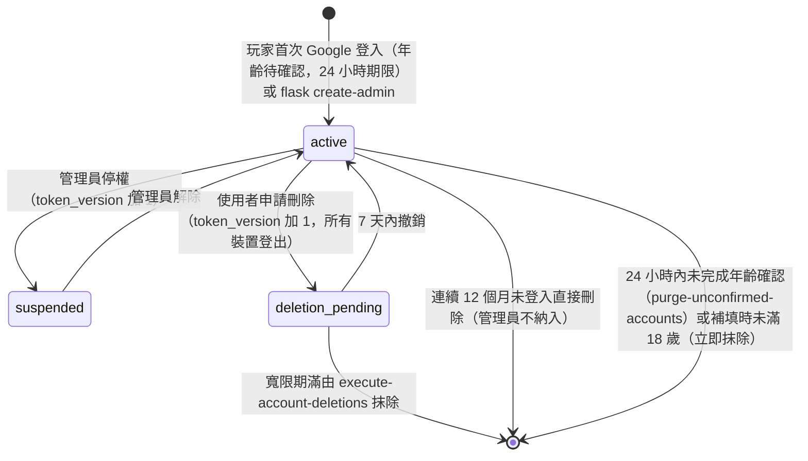

- 只有三種狀態：`active`、`suspended`、`deletion_pending`。**`pending_verification` 已退役**（玩家的信箱在建立帳號時就由 Google 驗證）：遷移 `0011` 把殘留的 `pending_verification`（含申請刪除前的狀態）改為 `active`，程式不再產生它。
- `active` 的帳號可登入；`suspended` 一律拒絕登入。`deletion_pending` **可以登入，但只得到受限登入狀態**（只能撤銷刪除與登出，見第 7a 節）。帳號是否可用客服只看狀態與年齡，不看信箱驗證時間。
- 停權的帳號無法登入，所以無法自助刪除（仍由 12 個月閒置清除處理）；管理員帳號不可自助刪除。
- `EMAIL_VERIFICATION_REQUIRED` 已淘汰：程式不再讀取它（啟動時只警告一次，不回顯值，也不會讓部署失敗）；`scripts/launch_plan.py` 的部署計畫檔含有它會被拒絕。

## 2. 密碼只屬於管理員

玩家只以 Google 登入（第 4 節）：**沒有密碼註冊、密碼登入、忘記密碼、信箱驗證，也不寄任何信給玩家**（含申請刪除的通知）。`POST /api/auth/register`、`/login`、`/verify-email`、`/resend-verification`、`/forgot-password` 與頁面 `/forgot-password`、`/verify-email` 都已移除（回 404）；`/register` 仍導向 `/login`。密碼只屬於管理員：用在 Google 之後的第二步（第 7c 節）、高風險操作的重新輸入，以及管理員自己的變更密碼與忘記密碼。

資料遷移 `0011_remove_player_passwords`（只動資料、不動結構、可重複執行）把既有資料帶到相同的狀態：非管理員帳號的 `password_hash`、`failed_login_count`、`locked_until` 清除，`pending_verification` 改為 `active`。遷移之後，持有舊密碼帳號的玩家以**同信箱**的 Google 登入即綁定回原帳號（已驗證者直接綁定；未驗證者依合併規則清除憑證並視為已驗證）。回復（downgrade）不還原雜湊，需要時靠遷移前的備份。

| 項目 | 規則 |
|---|---|
| 密碼 | Argon2id，長度 8 至 128 字，不強制字元組合；**只有管理員有密碼**，玩家的 `password_hash` 一律為空 |
| 防帳號列舉 | 管理員的密碼驗證失敗回應一律相同（密碼錯誤與鎖定中同一則通用訊息）；`POST /api/auth/login` 不存在（404），不計入任何失敗次數 |
| 登入失敗 | 同一帳號連續 5 次鎖定 15 分鐘，計數存資料庫（只適用管理員的密碼驗證步驟、重新輸入密碼與變更密碼時的目前密碼） |
| 重設權杖 | 32 位元組隨機值，只存 SHA-256；1 小時失效；單次使用；兩次寄信至少間隔 60 秒並有每小時上限；**權杖所屬帳號必須是管理員**，遷移前遺留的玩家權杖一律視為無效；沒有寄信設定時整組停用（404） |
| 連結流程 | GET 只顯示確認頁，POST 才完成動作；權杖放在網址片段（`#token=`），不進存取日誌 |
| 重設密碼成功 | `token_version` 加 1（撤銷既有登入）並寄通知信（有寄信設定時；變更密碼成功同樣寄通知信） |

## 3. Session 與 CSRF

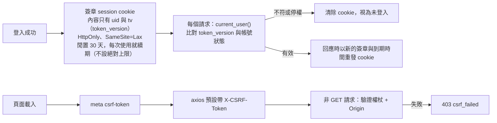

- **滑動續期**（`SlidingSessionInterface`，`app/security/session.py`）：到期時間一律是「寫入 cookie 的當下加 30 天」，不依賴 `permanent` 旗標；只有「這個請求辨識過登入者」才重發 cookie，所以 `/healthz`、靜態檔與匿名頁面不重發。玩家只要沒有登出，下次打開就直接進入帳號。
- **代價與補償**：被竊取的 cookie 只要持續被使用就一直有效（沒有絕對上限），撤銷靠 `token_version` 加 1（改密碼、登出所有裝置、停權）、帳號停權與管理員的鎖定。cookie 內容仍只有 `uid` 與 `tv`，不放簽發時間（Flask 以簽章時間加 `PERMANENT_SESSION_LIFETIME` 判斷過期）。
- staging 與 production 的 cookie 使用 `__Host-` 前綴（Secure、Path=/、無 Domain）；入口層由 `ProxyFix` 信任轉發標頭（development 只有明確設定 `TRUST_PROXY_HEADERS` 經 HTTPS 通道使用時才信任，且仍不送 HSTS、cookie 不加前綴）。
- 改密碼、登出所有裝置、重設密碼、綁定 Google 時 `token_version` 加 1，既有登入立即失效。

## 4. Google 登入

登入與註冊合一：`/login` 只有「使用 Google 登入」按鈕與兩個勾選框——「同意服務條款與隱私權政策」與「我確認已滿 18 歲」（全站只限滿 18 歲；新使用者**兩者都必須勾選**，回訪的使用者不必）。年齡不在這裡填，登入之後才做（第 7b 節）。

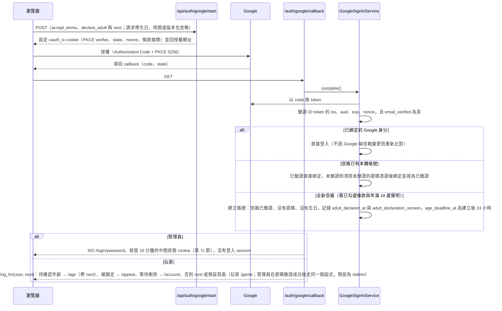

- 已有帳號者登入不需要勾選；沒有帳號時先檢查條款、再檢查聲明：沒勾條款不建立帳號，導回 `/login?error=terms_required`；沒勾年滿 18 歲聲明不建立帳號，導回 `/login?error=adult_required` 並記錄 `auth.google_rejected.adult`（兩項都沒勾時只回報條款）。
- **年滿 18 歲聲明**（adult-only-signup）：新使用者建立帳號時寫入 `users.adult_declared_at`（伺服器時鐘）與 `users.adult_declaration_version`（當時的 `AgePolicy.version`；遷移 `0019`，皆可為空，管理員與升級前的帳號為空）。它只是稽核紀錄，**不是年齡判斷的依據**：年齡一律由 `birth_date` 於當下計算，與生日不一致時以生日為準。`/api/auth/google/start` 只讀 `accept_terms` 與 `declare_adult` 兩個布林，請求帶的任何時間、版本、生日與年齡區間一律忽略；兩個旗標放在簽章的交易 cookie（鍵 `t`、`a`），部署瞬間仍在進行中的舊授權流程（沒有 `a`）視為未聲明，被拒絕並提示重新勾選。
- **政策頁與條款版本**：`/terms`、`/privacy` 是應用程式內的繁體中文頁面（沒有外部資源），版本字串 `CURRENT_TERMS_VERSION`（`app/services/legal.py`，目前 `2026-11-24-draft-11`：admin-delete-account 在 `/terms` 第 4 節補一條，管理員得因違反內容規範或條款刪除帳號與其全部資料、立即執行、無法復原、不適用匿名保留選項；前一版 `2026-11-22-draft-10` 是 rpg-script-reports 提高，補寫筆名公開、AI 檢查、管理員審閱、授權保存、檢舉內容與保存期限、匿名保留選項，並更正「公開分享尚未開放」）由伺服器決定，只影響之後新註冊者記錄的 `terms_version`，不強迫既有使用者重新同意。rpg-turn-revision 補了：服務條款「重新生成與編輯最後一輪」一條（重新生成與編輯**共用**每回合前幾次免費、免費次數內不扣幣也不需要餘額、用完後每次消耗一輪的幣、原本那輪已扣的幣不退、餘額不足無法送出、編輯不使免費次數歸零；條文不寫死幣價與次數）；隱私權政策補玩家於重新生成時填寫的理由（供營運團隊檢視、不送給 AI、隨存檔與帳號刪除、納入匯出）與遊戲幣錢包與帳本的保存。尚待處理：隱私權政策沒有明寫「遊玩時的行動與劇情歷史」也送往 RPG 模型服務，列入法務覆核。adult-only-signup（draft-8）：服務條款改為僅限滿 18 歲、註冊時須聲明已滿 18 歲且據實聲明並自行承擔謊報的責任、未滿 18 歲者不得使用且帳號與資料立即刪除（移除「13 歲以上」與「13 至 17 歲僅限安全模式」）；隱私權政策的生日用途改為「年齡確認」與「去識別的統計」，未滿 13 歲改為未滿 18 歲。safe-mode-toggle 第 3 組（draft-9，`2026-11-19-draft-9`）補上關閉安全模式之後的揭露：`/terms` 第 5 節改為「安全模式（內容模式）」只有開與關兩種狀態（所有帳號一開始都是開；開的界線與關時**本服務含露骨內容**、是否出現取決於模型不保證）、「如何切換」（在帳號設定頁自行開關、第一次關閉須同意安全規範並記錄時間與版本、生效的是設定與劇本綁定中較保守者、緊急煞車、系統不會自動替玩家關閉）、「露骨內容僅限成年使用者」（年數取自年齡政策、謊報年齡者自行承擔責任）、「無論哪一種模式，一律禁止」四類，以及「敏感內容的留存與審閱」；移除「一般模式」「成人模式預設關閉」「我確定已滿 18 歲」的舊說法。`/privacy` 第 1 節新增「安全模式的設定與同意紀錄」（只有模式與同意的時間與版本，不含文字），第 4 節新增「安全模式關閉時」段落：遊玩時玩家輸入的行動與模型產生的劇情會傳送至 RPG 模型服務，**敏感內容可能被模型供應商留存或人工審閱**，關閉安全模式不以付費模型為前提。兩頁仍標示為草稿；`_legal_context` 不再提供 `adult_age`（樣板用 `min_age`）。
- 已存在的帳號（已綁定或以信箱合併）登入時**不會**被順便標記為已確認年齡。
- 已辨識出帳號卻被拒絕（帳號停用、已綁定另一個 Google 身分）會計入帳號鎖定的計次（第 7b 節）；無法辨識身分的失敗與還沒有帳號的 Google 身分不計。
- 開發與正式環境使用不同的 OAuth 用戶端；失敗一律導回 `/login?error=<固定代碼>`，Google 回傳的任何文字都不會進入網址或頁面。
- 登入後的預設頁面**依角色各一個常數**（`app/security/redirects.py`）：玩家為 `DEFAULT_AFTER_LOGIN`（目前 `/game`，也就是 RPG 的入口（選劇本與我的存檔）；change `rpg-entry-ui` 在 `/game` 入口頁上線之後才把它從 `/cs` 改過來，避免登入後導向還不存在的頁面；客服 `/cs` 不受影響，仍可直接開啟），啟用中的管理員為 `ADMIN_AFTER_LOGIN`（`/admin`，change `admin-default-landing`）。`landing_for` 由首頁、登入頁、`/age`、`/appeal`、Google 回呼與管理員的密碼驗證（`POST /api/auth/admin-password` 回傳的 `next`）共用，**選擇預設頁面的規則只在這個函式裡**，各呼叫者不判斷角色。選擇只看伺服器端的使用者紀錄，且與後台權限同一個定義（`is_active_admin`：角色為 `admin` 且帳號啟用中），所以停權的管理員不會被導向一個會回 404 的頁面；導向不授權任何事，`/admin` 與 `/api/admin/*` 仍由既有的管理員檢查把關，管理員也仍可直接開啟 `/game` 與 `/cs`。登入前指定的合法返回位置仍然優先（例如管理員被擋在 `/game/<存檔>` 後登入，回到該存檔）。**「沒有指定」包含恰為 `/game` 的返回位置**：登入頁、`google/start` 與兩個登入 cookie（交易 cookie 的 `x`、管理員中間狀態）都以 `/game` 補上沒有指定的情況，到 `landing_for` 時「沒有指定」與「指定 `/game`」已分不開，所以對管理員而言已驗證的 `next` 恰為 `/game` 視同沒有指定（沿用待確認年齡既有的作法；不改 cookie 內容、不改前端傳值）。已知取捨：管理員被擋在恰好是 `/game` 之後登入，會落在 `/admin`（頂列有「冒險」可回去）。受限登入狀態（待確認年齡、被鎖定、等待刪除）的導向不受影響；管理員不會是待確認年齡或被鎖定，所以未完成年齡確認的管理員也落在 `/admin`（頁面外殼與後台 API 不呼叫模型，要用 AI 功能時仍由年齡閘門擋下並要求補填）。未登入者開首頁 `/` 看到歡迎頁（`home.html`，只有簡介與通往 `/login` 的連結，不處理登入）。**預設頁面改成 `/game` 不改變任何人能做什麼**：入口頁用到的兩個清單端點只要求已登入，受限登入狀態與年齡確認的導向規則（第 7b 節）完全不變；尚未完成年齡確認的玩家一律先導向 `/age`，不會落在入口頁。

## 5. 年齡閘門與內容模式

年齡規則的所有數字（最低註冊年齡 18、最低使用年齡 18、成年門檻 18、區間選項、政策版本）只在 `app/services/age_policy.py` 的 `AgePolicy`；年齡一律由生日於「當下」計算，不用儲存的結果判斷。**全站只限滿 18 歲**（adult-only-signup，政策版本 `2026-11-17-adults-only`）：區間選項不變，選到「未滿 13 歲」或「13–17」一律是 `age_not_eligible`（讓未成年者自行表明並被拒絕）；日後調整最低年齡只需換一個 `AgePolicy` 並提高版本。

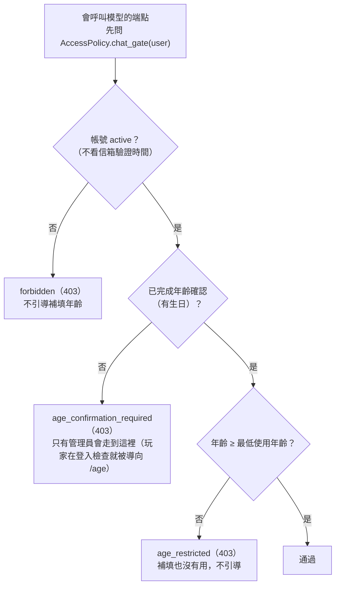

- `chat_gate` 是純查詢（不拋例外、不記錄事件）；`require_chat_access` 以它判斷並對年齡拒絕記錄一筆事件，兩者不會分歧（測試逐一比對）。
- 管理員與各會員等級都不豁免年齡閘門。管理員帳號由指令建立，沒有生日，第一次登入後須到 `/account` 補填；**玩家**則是登入後除了年齡確認與登出什麼都不能做（受限登入狀態 `age_pending`，第 7b 節），所以玩家不會走到 `chat_gate`。
- 全站只限滿 18 歲：最低註冊年齡與最低使用年齡都是 18，沒有可使用的未成年區間。補填時算出未滿 18 歲的玩家立即抹除（第 7b 節）；已有生日但未滿 18 歲的帳號（資料庫裡不會存在，只在單元測試製造）呼叫模型功能得到 `age_restricted`。先前「13 至 17 歲可以使用但固定安全模式」的設定已取消（它以供應商同意為前提，與 Gemini 條款的 18 歲門檻不符）。

### 內容模式（change `safe-mode-toggle`，取代 `rpg-data-and-script` 的三種模式）

> **規範已修訂（2026-11-17，AGENTS.md 第 7 節）並由 `safe-mode-toggle` 實作（2026-11-19：第 1、2 組後端核心與審查尺度、第 3 組個人頁開關、第 4 組目錄通知與創作頁綁定、第 5 組遊戲內提示；2026-11-19 已部署到展示環境並演練緊急煞車，使用者驗收完成〔緊急煞車玩家層略過〕，已於 2026-11-19 封存）**：全站只限滿 18 歲；內容模式為「安全模式開（預設）／關」兩種；關閉安全模式不以供應商書面許可、法務意見或付費模型為前提；部署層的開關改為緊急煞車 `SAFE_MODE_FORCED`。第 1 階段的**過渡相容層**（`content_access`、`effective_tier(save_tier=…)`、`author_content_cap`、`is_adult`）已於第 2 組移除，並以守門測試 `tests/architecture/test_no_legacy_tier_checks.py` 鎖住；新程式請勿使用它們。

內容模式只有兩種，由保守到寬鬆：`safe`（安全模式開）、`adult`（安全模式關）；順序與「取較保守者」在 `app/services/content_tier.py`（純邏輯，無法判定視為 `safe`）。**舊值 `standard`（原一般模式）一律讀作 `adult`**（`parse_tier`），不論出現在玩家偏好、劇本內容或存檔，所以既有資料不改寫；系統不再寫入 `standard`。**生效模式 = 玩家偏好（缺少目前版本同意視為 `safe`）、劇本是否綁定安全模式、緊急煞車三者中最保守者**（`AccessPolicy.effective_mode(user, script_binding=None)`，每次現算；全站只限滿 18 歲，沒有依年齡的上限；存檔不釘住自己的模式；管理員與各會員等級都不豁免）。

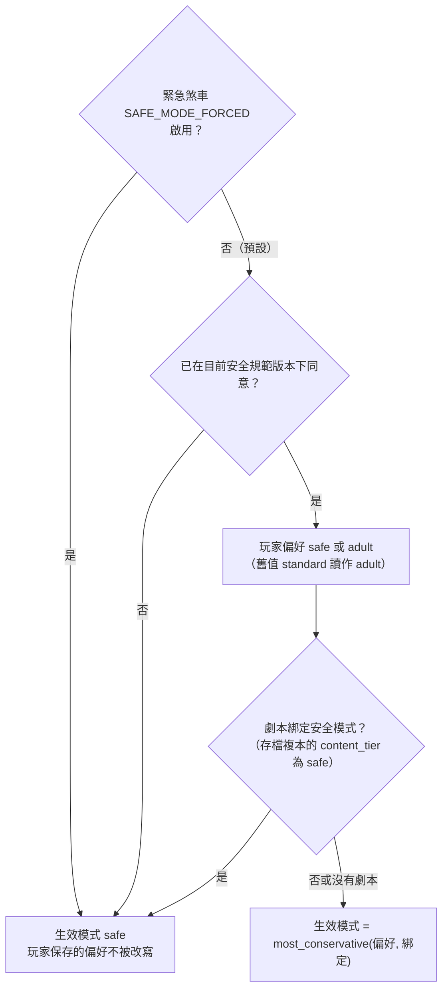

- **偏好與預設**：`users.content_tier_preference` 預設 `safe`；年齡確認成功時**一律**設為 `safe`。**不自動調高**：偏好只有玩家自己切換才會改變，不因玩家輸入、模型輸出、年齡或登入而改變。
- **關閉安全模式（偏好改為 `adult`）的條件**只有：已完成年齡確認、緊急煞車未啟用、並在**目前的安全規範版本**（`SAFE_RULES_VERSION`）下同意（`confirm_rules` 為明確的 `true`；缺少回 400 並指出 `confirm_rules`）。不再要求「我確定已滿 18 歲」的勾選（全站皆成年）；同意成功時記錄確認時間、規範版本與方式（`self_declared`，沿用 `users.adult_confirmed_at`／`adult_rules_version`／`adult_confirm_method`，不蒐集證件、不接第三方驗證）。規範版本改變後先前的同意失效，偏好仍是 `adult` 者的生效模式退為 `safe`（不是錯誤），須重新同意；已在目前版本同意者再次關閉不需要重新勾選；回到 `safe` 不清除紀錄。
- **API**（需登入、CSRF、先過年齡閘門；受限登入狀態依既有規則被拒絕）：`GET /api/account/content-mode` 與 `PUT /api/account/content-mode`。回應只有 `preference`（`safe` 或 `adult`）、`effective`（生效模式，不含劇本）、`confirmed`（是否已在目前版本同意）與 `forced`（緊急煞車是否啟用），**不含**生日、年齡區間、年齡確認時間、同意的時間戳記或內部編號。錯誤：400（`mode` 不是 `safe` 或 `adult`，含舊值 `standard`；或缺少 `confirm_rules`）、403 `safe_mode_forced`（緊急煞車時要求 `adult`；要求 `safe` 仍成功）、403 `age_confirmation_required`、401。成功時記錄 `account.content_mode.safe`／`adult` 事件（只有事件名稱與使用者編號）。
- `/account` 不再有未成年的安全模式提示（adult-only-signup 移除；`/api/auth/me` 的 `age_group` 欄位保留，已完成確認者必為 `adult`）。
- **個人頁的安全模式開關**（第 3 組，`/account` 的「安全模式」區塊；前端細節見 `前端結構-frontend.md` 第 3b 節）：開關顯示**生效模式**（開＝`safe`），由 Page Controller 的 `_content_mode_state` 放進初始狀態 `contentMode`——只有 `effective`、`confirmed`、`forced` 與已驗證的返回位置 `returnPath`，**沒有生日、年齡區間或同意時間戳記**；未通過 `AccessPolicy.chat_gate`（例如尚未完成年齡確認的管理員）與等待刪除者的 `contentMode` 為 `null`，區塊不顯示。開→關而尚未在目前版本同意時先顯示自製 Modal（只有「我同意安全規範」勾選框，沒有年齡勾選），確認後 `PUT` 帶 `confirm_rules: true`；已同意者直接送出；關→開不需要確認；緊急煞車啟用時開關顯示為開並禁用。**返回位置**（`/account?return=/game/…`）由 `app/security/redirects.py` 的 `safe_return_path` 驗證：必須以 `/game/` 開頭，含 `//`、反斜線、控制字元、`..` 段落、`://`、超過 200 字或百分比編碼後出現這些的一律丟棄（開放轉址防護）；前端 `Auth.safeMode.safeReturnPath` 使用同一份規則，兩邊的測試共用 `tests/js/fixtures/safe-return-path-cases.json`。
- **故事偏好**（change `story-preference`）：`users.story_preference`（`all`／`male`／`female`，預設 `all`）**只影響劇本清單的排序**，與內容模式是兩回事——不影響生效的內容模式、可看或可玩的劇本、敘事、提示詞與額度，也不被年齡確認、切換內容模式或滿 18 歲自動改變。端點 `GET`／`PUT /api/account/story-preference` 用 `require_login()`（受限登入狀態一律被拒），**不過年齡閘門 `require_chat_access`**——那一道檢查的是「能不能呼叫模型」，偏好不涉及模型。值必須完全等於三個列舉值之一（否則 400 並指出 `story_preference`，偏好不變，錯誤不回顯輸入）；請求中沒有任何可指定他人的欄位。`CurrentUser.public_dict` 多一個 `story_preference` 鍵（`/api/auth/me`），不含生日與年齡區間。成功只記 `account.story_preference_changed`（事件名稱與使用者編號，不含值）。
- 年齡規則的數字不在 `AccessPolicy` 內嵌（測試以 AST 掃描不得出現 13、17、18）；`AccessPolicy.mode_state(user)` 回傳 `ModeState`（偏好、生效模式、是否已同意、緊急煞車）。舊的 `content_access(user)` 與 `ContentAccess` 已於第 2 組移除。

**緊急煞車的環境開關**（AGENTS.md 第 7 節）：`SAFE_MODE_FORCED`（`true` 或 `false`）預設未啟用（玩家可關閉安全模式），**不能在程式裡寫死為啟用**，由組裝處依設定傳入 `AccessPolicy(safe_mode_forced=…)`。它是營運出事時全站停用「關閉安全模式」的開關，**不是使用門檻**：不需要 RPG 用途、模型清單、書面許可或法務前提；四個環境都可以設定；值不是布林啟動失敗，訊息只指出變數名稱；啟用時所有玩家與所有存檔的生效模式一律是 `safe`（保存的偏好不被改寫，解除後恢復），要求關閉安全模式回 403 `safe_mode_forced`。設定於重新啟動後生效，不需要資料庫遷移或程式改版。

- 舊的 `SEXUAL_CONTENT_LEVEL3_ENABLED`、`SEXUAL_CONTENT_LEVEL3_MODELS`、`ADULT_MODE_ENABLED` 與 `ADULT_MODE_MODELS` 已淘汰：忽略、啟動時各警告一次（只含變數名稱，不回顯值，值不合法也不會啟動失敗），**不論值為何都不改變緊急煞車與玩家可用的模式**；`scripts/launch_plan.py` 的部署計畫檔含有它們會被拒絕（可含 `SAFE_MODE_FORCED`）。緊急煞車的啟用與解除（含事故處理與演練狀態）見 [營運與部署-operations.md](營運與部署-operations.md) 第 7 節「緊急煞車的啟用與解除」。
- 模型供應商與資料使用條款的評估（免費模型的輸入輸出可能被供應商留存或審閱）屬上線前關卡（`launch-gates`），隱私權政策與服務條款已揭露（`/terms` 第 5 節、`/privacy` 第 4 節，safe-mode-toggle 補入時的版本為 `2026-11-19-draft-9`，`2026-11-22-draft-10`，admin-delete-account 補入管理員得刪除帳號後為目前的 `2026-11-24-draft-11`，仍為草稿）；書面許可與法務意見**不再是**關閉安全模式的前提。
- **自家審查層已於 rpg-turn-engine 實作**：擋未成年的性內容、性暴力與非自願、以真人名義的內容，不得僅依賴模型拒絕；這四類絕對禁止項不隨模式放寬。

## 6. 權限規則與端點清單

權限判斷只在 `AccessPolicy`（`app/services/access_policy.py`），端點與其他 Service 不自行判斷：

| 規則 | 行為 |
|---|---|
| 非擁有者存取資源 | 一律 `NotFound`（404），與不存在的回應逐字相同 |
| 會員等級 | 只影響額度，不參與任何權限判斷 |
| 管理員存取他人資料 | 一般端點與一般使用者相同（404）；只有 `/api/admin/*` 能讀他人的內容，走後台專用的 Repository、每次都寫稽核（見第 7 節） |
| 是否為管理員 | `AccessPolicy.require_admin(user)`：不是 `admin` 或帳號不是 `active` 就記錄 `admin.access_denied` 並拋出 `NotFound`（404）；後台的唯一入口。「角色為 admin 且帳號啟用中」只有一個定義：`CurrentUser.is_active_admin`，`AccessPolicy.is_admin` 委派它，遊戲幣豁免（`WalletService`，見 7f）直接用同一個屬性，測試窮舉角色、狀態與會員等級證明兩者一致 |
| 權限測試 | `tests/support/idor.py` 依序以「他人、不存在、未登入、擁有者」檢查每個帶識別碼的端點 |

`/api/auth/*` 端點（全部需 CSRF；「登入」欄指是否需要已登入）。**已移除**：`register`、`login`、`verify-email`、`resend-verification`、`forgot-password`（回 404）。

| 端點 | 方法 | 登入 | 用途 |
|---|---|---|---|
| `/api/auth/admin-password` | POST | 否（需中間狀態） | 管理員通過 Google 之後的密碼驗證，成功才建立登入 session |
| `/api/auth/admin-password/forgot` | POST | 否（需中間狀態） | 管理員按「忘記密碼」寄重設信（沒有中間狀態或沒有寄信設定一律 404） |
| `/api/auth/logout` | POST | 否 | 登出目前裝置 |
| `/api/auth/logout-all` | POST | 是 | 登出所有裝置 |
| `/api/auth/me` | GET | 是 | 本人資料（不含生日與內部編號） |
| `/api/auth/verify-age` | POST | 是（含待確認年齡） | 補填生日、年齡區間與暱稱（玩家必填，管理員可省略）；暱稱先驗證，不合格只回欄位錯誤、不計入鎖定計次；未滿 18 歲的玩家立即抹除、不一致計入鎖定計次 |
| `/api/auth/change-password` | POST | 是 | 變更密碼（只有已設定密碼者，實際上是管理員；玩家得到 400 `no_password`） |
| `/api/auth/reset-password` | POST | 否 | 管理員以重設權杖設定新密碼（沒有寄信設定時 404；非管理員的權杖視為無效） |
| `/api/auth/google/start` | POST | 否 | 發起 Google 登入（未設定時 404）；只收 `accept_terms`、`declare_adult` 與 `next` |
| `/api/appeals` | POST | 是（含被鎖定） | 被鎖定或被暫停發佈的玩家向管理員申訴（其他人 404） |
| `/api/appeals/mine` | GET | 是（含被鎖定） | 自己的申訴與處理狀態 |

`/api/account/*` 端點（C-4c；全部需 CSRF，回應 `no-store`）：

| 端點 | 方法 | 登入 | 用途 |
|---|---|---|---|
| `/api/account/delete` | POST | 是 | 申請刪除自己的帳號（有密碼者帶密碼，只靠 Google 者帶確認文字）；成功後所有裝置登出 |
| `/api/account/cancel-deletion` | POST | 是（含受限狀態） | 寬限期內撤銷刪除，還原為申請前的狀態 |
| `/api/account/export` | POST | 是 | 匯出自己的帳號資料與全部對話（JSON 或 CSV zip）；受限狀態不可用 |
| `/api/account/nickname` | PUT | 是 | 更改公開暱稱（2 至 20 字；短代號不變）；不合格只回欄位錯誤 |
| `/api/account/story-preference` | GET | 是 | 查詢故事偏好（`all`／`male`／`female`）；只要求已登入，受限登入狀態一律 403，不過年齡閘門 |
| `/api/account/story-preference` | PUT | 是 | 設定故事偏好（必須完全等於列舉值，其餘 400 指出 `story_preference`）；冪等；只改自己的；成功記 `account.story_preference_changed` |
| `/api/wallet` | GET | 是 | 遊戲幣餘額與簽到狀態（第 7f 節）；先完成年齡確認，否則 403 `age_confirmation_required` |
| `/api/wallet/checkin` | POST | 是 | 每日簽到；會有幣作廢時須帶 `confirm_overflow` |
| `/api/wallet/entries` | GET | 是 | 遊戲幣記錄（游標分頁） |
| `/api/sessions/catalog` | GET | 是 | RPG 入口的可玩劇本清單（上架版本、不高於玩家生效模式、依故事偏好排序、分頁）；只要求已登入，受限登入狀態一律 403，**不過年齡閘門**（尚未確認年齡的管理員讀到安全模式的清單）；唯讀，不呼叫模型、不動遊戲幣；回應含 `content_mode`（生效模式與是否已滿成年門檻，不含生日與年齡） |
| `/api/sessions` | GET | 是 | 自己的存檔清單（不含已封存者；只含白名單欄位與已完成輪數）；存取規則與 `catalog` 相同；只有擁有者看得到自己的存檔 |
| `/api/sessions/setup/<version_id>` | GET | 是 | 序章與創角所需的資料（背景故事、可聯繫的人物／地點／里程碑、欄位上限、今日剩餘的生成次數）；可見性與內容模式與開存檔相同 |
| `/api/sessions/protagonist/suggest` | POST | 是 | AI 生成主角的預覽（無狀態；自我介紹不保存）；每日次數有上限，失敗回 503 讓前端改走自創 |
| `/api/sessions` | POST | 是 | 開存檔：主角與錨定事實的驗證、規則層與模型層審查通過才寫入；管理員與各會員等級不豁免年齡閘門 |
| `/api/game/sessions/<id>/turns/stream` | POST | 是 | RPG 回合的事件串流；先完成年齡確認並通過閘門，非擁有者與不存在同為 404，開始前的失敗（含餘額不足 409）一律是 JSON；預扣在回合開始時（rpg-turn-stream） |
| `/api/game/sessions/<id>/opening/stream` | POST | 是 | 第 0 幕的事件串流；不扣遊戲幣，已完成者回傳既有文字 |

| `/api/game/sessions/<id>/turns/<client_msg_id>/regenerate/stream` | POST | 是 | 重新生成最後一輪的 AI 回應（rpg-turn-revision）；CSRF 與 Origin、年齡閘門，非擁有者與不存在同為 404；本文 `expected_revision`、分類與理由（理由只進回饋表，不進模型）；開始前的失敗（409 `revision_conflict`、`not_revisable`、`turn_in_progress`、`insufficient_coins`）一律是 JSON；免費次數內不預扣 |

| `/api/game/sessions/<id>/turns/<client_msg_id>/edit/stream` | POST | 是 | 編輯最後一輪的玩家輸入後重送；存取規則同上，行動須過規則層（422）；與重新生成共用每回合的免費次數，免費次數內不預扣也不檢查餘額，需付費時才可能回 409 `insufficient_coins` |
| `/api/game/sessions/<id>` | GET | 是 | 存檔狀態與世界狀態的玩家視圖（不含 NPC 角色卡）；已完結仍可讀 |
| `/api/game/sessions/<id>/turns` | GET | 是 | 回合清單（`since_seq` 增量）；被擋與中斷的回合不含文字 |
| `/api/game/sessions/<id>/notebook` | GET | 是 | 記事簿全文與用量；非擁有者與不存在同為 404；已完結仍可讀；禁止快取；管理員沒有任何讀取記事簿的功能 |
| `/api/game/sessions/<id>/notebook` | PUT | 是 | 玩家儲存編輯後的記事簿：CSRF 與 Origin、版本比對（409）、容量（422）、規則層（422，只回類別）；不呼叫模型；已完結 409 |
| `/api/game/sessions/<id>/suggestions` | POST | 是 | 玩家點建議圖示才產生的行動建議（rpg-story-view）：CSRF 與 Origin、帳號與年齡閘門（`require_chat_access`）；非擁有者與不存在同為 404；沒有本文；已完結 409 `session_ended`、第 0 幕未完成 409 `opening_pending`、有進行中的回合 409 `turn_in_progress`、產生期間劇情前進 409 `suggestions_stale`、全站 token 上限 503 `system_busy`、沒有供應商 503、模型失敗或沒有有效項 503 `suggestions_unavailable`；**不扣遊戲幣**（管理員行為相同）；已有有效建議時重用、不呼叫模型；管理員沒有任何讀取建議的功能 |

頁面：`/login`（登入與註冊合一，只有 Google 按鈕、條款與年滿 18 歲兩個勾選框，另有一個只是同時勾選兩者的「全部同意」總開關）、`/login/password`（管理員密碼驗證，需中間狀態）、`/age`（年齡確認）、`/appeal`（申訴）、`/account`、`/scripts`（劇本創作，第 7d 節）、`/wallet`（錢包頁，第 7f 節）、`/terms`、`/privacy`、`/auth/google/callback`；`/register` 一律導向 `/login`；`/reset-password` 只服務管理員的重設連結（需要寄信設定，否則 404）；`/forgot-password` 與 `/verify-email` 已移除（404）。

## 7. 管理員後台的存取（C-4b）

後台是高權限的攻擊面，所以重點是**可讀範圍小、每個操作可追溯、危險操作要重新輸入密碼**。業務邏輯在 `AdminService`，控制器只呼叫它（分層規則見 [系統架構-architecture.md](系統架構-architecture.md) 的第 2 節）。

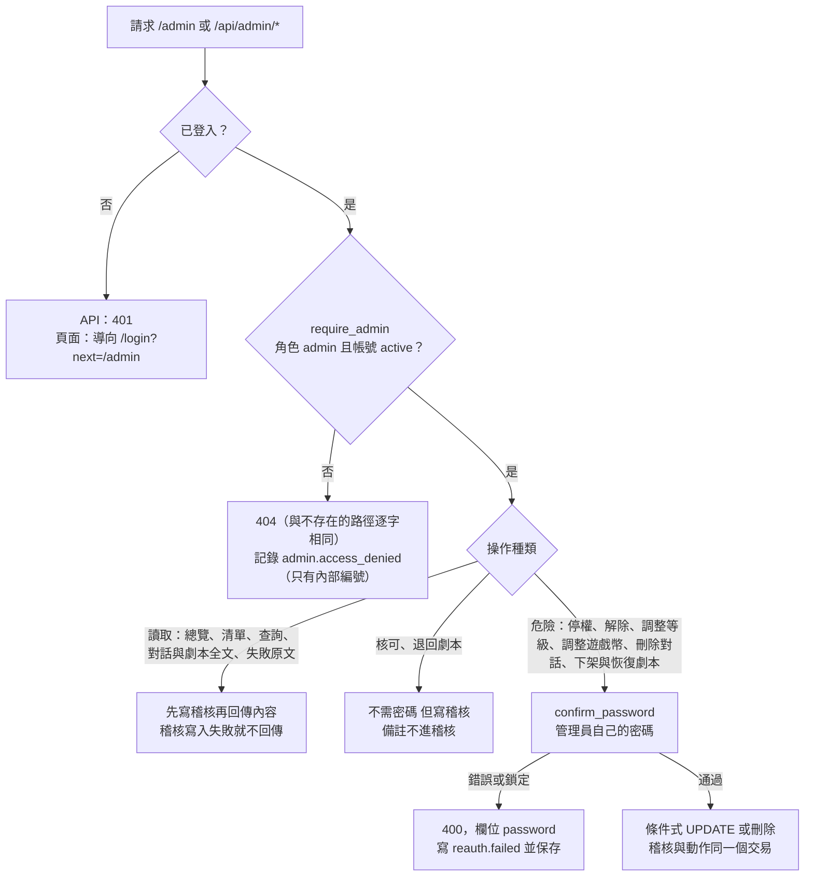

| 規則 | 行為 |
|---|---|
| 非管理員 | 一律 404，不是 403（否則會告訴一般使用者後台存在）；順序是「登入 → 管理員檢查 → 才解析請求本文」，所以格式錯誤的本文也只得到 404 |
| 可讀範圍 | 清單沒有訊息內容；只有「意見回饋」（助理回覆的意圖是 `complaint_feedback` 或 `human_handoff`）與「被內容安全過濾標記」兩類對話可讀全文，不符資格與不存在得到同一個 404；**劇本全文只限使用者送審過的版本**（`pending_review`、`published`、`removed`、`rejected` 與被取代者；草稿與不存在得到同一個 404），**每次讀取都先寫 `script.read` 稽核**；使用者資料沒有任何個別的年齡資料，年齡只有總覽的區間人數 |
| 劇本審核與下架（rpg-script-publishing） | 核可與人工退回**不需要重新輸入密碼**，但寫稽核（`script.approve`、`script.reject`）；管理員下架與恢復是高風險操作：須重新輸入密碼並寫稽核（`script.remove`、`script.restore`）。**只有下架者能恢復**：作者自行下架的，管理員不能恢復（那是作者自己的決定）；管理員下架的，作者不能自行恢復；內建劇本（沒有作者）不可下架。審核備註只有管理員看得到：不進稽核細節、日誌與事件，不出現在作者端的任何回應與個人資料匯出；稽核細節只有版本與劇本的對外識別碼、狀態與固定類別。核可、退回與下架的結果只顯示在作者的 `/scripts` 頁面，**不寄信**；管理員下架的說明導向客服的意見回饋（申訴頁只開放被鎖定或被暫停發佈的帳號） |
| 劇本檢舉（rpg-script-reports） | 檢舉只升高「被檢舉」檢視的優先度（紅線理由者最前，其次未結案人數多者，再其次最早檢舉者），**不自動下架**。管理員讀取一個版本的檢舉內容每次先寫 `report.read` 稽核再回傳，**拿不到檢舉人**（查詢根本不選取）；結案為「不成立」**不需要密碼**（高風險清單不含檢舉結案，與核可、退回同級；寫 `report.dismiss`），結案為「下架」沿用 `script.remove`（須密碼，檢舉在同一個交易自動結為 `removed`），**不提供免密碼的下架捷徑**；版本被新版本取代時未結案的檢舉由系統結為 `superseded`；稽核細節與事件只有識別碼與整數筆數，不含自寫文字、理由、檢舉人與標題 |
| 找使用者 | 主要入口是警告（總覽的今日警告 → 被標記對話 → 看使用者）；信箱精確查詢是次要入口、供客服反應時使用；沒有使用者清單與模糊搜尋 |
| 重新輸入密碼 | `AuthService.confirm_password`：與登入共用失敗計數與鎖定（連續 5 次鎖定 15 分鐘），鎖定中即使正確也拒絕且訊息相同；成功不重設計數；沒有設定密碼的管理員不能執行（`no_password`） |
| 操作對象 | 只能是一般使用者：管理員（含自己）403 `admin_target_forbidden`；`deletion_pending` 409（**刪除帳號例外：`deletion_pending` 也可刪**，見下方「管理員刪除帳號」）；兩位管理員同時操作靠條件式 UPDATE 不互相覆蓋 |
| 稽核 | `admin_audit_logs`：24 個固定動作（含管理員刪除帳號的 `user.delete`，細節只有原狀態、不含 email 或暱稱；含劇本審核的 `script.read`、`script.approve`、`script.reject`、`script.remove`、`script.restore`，與劇本檢舉的 `report.read`、`report.dismiss`），只存對外識別碼、管理員填寫的原因與列舉細節，不含 email 與訊息；Repository 沒有更新與刪除（見 [資料模型-data-model.md](資料模型-data-model.md)） |
| 回應 | `/admin` 與 `/api/admin/` 一律 `Cache-Control: no-store`；非 GET 須通過 CSRF |

**管理員刪除帳號**（admin-delete-account）：`AdminService.delete_user`——`require_admin` → 原因（1 至 200 字）→ 找目標（404）→ 角色不是 `user` 則 403 → `_confirm`（重新輸入密碼）→ **先寫 `user.delete` 稽核（只 flush）→ 再呼叫 `AccountErasureService.erase_by_admin`**（單一抹除出口，內部提交，所以稽核與抹除在同一個交易；條件式刪除 `role != admin` 不成立時整個回復、稽核列一併消失、回 409 `state_changed`）→ 成功後才記 `admin.action` 日誌。不經 7 天寬限期、不套用匿名保留（劇本全刪）、刪除紀錄原因 `admin_deleted`；沒有使用者清單與批次端點。

`/api/admin/*` 端點（全部需要登入且是管理員；`POST` 另需 CSRF）：

| 端點 | 方法 | 用途 |
|---|---|---|
| `/api/admin/overview` | GET | 總覽與今日警告的三個計數（只有彙總） |
| `/api/admin/audit` | GET | 稽核紀錄，由新到舊 |
| `/api/admin/users/lookup` | POST | 以信箱查詢使用者（次要入口，信箱在本文） |
| `/api/admin/users/<public_id>` | GET | 以對外識別碼檢視使用者 |
| `/api/admin/users/<public_id>/suspend` | POST | 停權（原因與密碼） |
| `/api/admin/users/<public_id>/unsuspend` | POST | 解除停權（密碼） |
| `/api/admin/users/<public_id>/tier` | POST | 調整會員等級（密碼） |
| `/api/admin/users/<public_id>/delete` | POST | 刪除帳號（原因與密碼；一次一個、立即抹除、劇本全刪；回 `{"ok": true}`） |
| `/api/admin/feedback` | GET | 意見回饋對話清單 |
| `/api/admin/flagged` | GET | 被標記對話清單（帶今日被擋次數與暫停截止時間） |
| `/api/admin/conversations/<public_id>` | GET | 讀取可讀對話的全文（最多 200 則） |
| `/api/admin/conversations/<public_id>/delete` | POST | 刪除整個對話（原因與密碼） |
| `/api/admin/failures` | GET | 最近 14 天模型輸出驗證失敗的原文 |
| `/api/admin/locked` | GET | 目前被鎖定的玩家帳號（識別碼、顯示名稱、鎖定時間、原因類別） |
| `/api/admin/appeals` | GET | 只有目前被鎖定或被暫停發佈的帳號送出的申訴，每筆標明 `restriction`（`locked` 優先或 `suspended`）（寫 `appeal.read`，只記筆數；兩種狀態都解除後不再出現） |
| `/api/admin/users/<public_id>/unlock` | POST | 解除鎖定（重新輸入密碼）；清計次、申訴標為已處理、寫 `account.unlock` |
| `/api/admin/publish-suspended` | GET | 目前被暫停發佈的玩家帳號（識別碼、顯示名稱、暫停時間；不含 email 與暱稱） |
| `/api/admin/users/<public_id>/lift-publish-suspension` | POST | 解除暫停發佈（重新輸入密碼）；補一筆 `lifted` 送審紀錄使連續被拒中斷、申訴標為已處理、寫 `publish.lift` |
| `/api/admin/users/<public_id>/wallet/adjust` | POST | 調整玩家的遊戲幣餘額（`bucket`、`delta`、`reason`、密碼）；不受免費幣上限限制，不能使餘額低於 0（409 `insufficient_coins`）；稽核 `wallet.adjust` 與調整同一個交易 |
| `/api/admin/scripts` | GET | 劇本審核清單（待審、上架中、已下架，以及 `status=reported` 的被檢舉檢視：上架中且有未結案檢舉，依紅線、人數、最早檢舉時間排序；待審有疑慮的排最前）：只有目錄資訊、狀態與檢舉的兩個計數（`report_count`、`red_line_reported`），沒有內文、審核備註全文與檢舉文字，不寫稽核 |
| `/api/admin/scripts/versions/<public_id>` | GET | 讀取送審過的版本全文與審核備註（先寫 `script.read` 稽核再回傳；草稿與不存在一律 404） |
| `/api/admin/scripts/versions/<public_id>/approve` | POST | 核可（不需要密碼）；取代同劇本原本上架或下架的版本，寫 `script.approve` |
| `/api/admin/scripts/versions/<public_id>/reject` | POST | 人工退回（固定類別加只有管理員看得到的備註，不需要密碼）；寫 `script.reject`，備註不進稽核與日誌 |
| `/api/admin/scripts/versions/<public_id>/remove` | POST | 管理員下架（類別、備註與密碼）；內建劇本不可下架；寫 `script.remove` |
| `/api/admin/scripts/versions/<public_id>/restore` | POST | 管理員恢復自己下架的版本（密碼）；作者自行下架的不恢復；寫 `script.restore` |
| `/api/admin/scripts/versions/<public_id>/reports` | GET | 讀取一個版本的全部檢舉（理由、自寫文字、時間、結案結果；**沒有檢舉人**）；先寫 `report.read`（細節只有識別碼與筆數）再回傳；草稿與不存在一律 404（rpg-script-reports） |
| `/api/admin/scripts/versions/<public_id>/reports/dismiss` | POST | 把未結案的檢舉全部結為「不成立」（不需要密碼與本文）；沒有未結案的 409 `no_open_reports`；寫 `report.dismiss`；結案為「下架」沿用 `remove`（密碼） |

頁面：`/admin`（只有管理員的顯示名稱，所有資料經由 API 取得；前端見 [前端結構-frontend.md](前端結構-frontend.md)）。

已知取捨：被盜用的管理員登入狀態可以不輸入密碼讀取兩類對話（每次都有稽核，要加強只需讓「讀全文」也要求密碼）；管理員輸入錯誤密碼也累積登入的失敗計數，連續 5 次會把自己鎖定 15 分鐘（刻意，讓後台不成為暴力猜測的捷徑）。完整清單見 README 的「管理員後台（C-4b）」。

## 7a. 受限登入狀態與自助刪除（C-4c）

使用者可以自助刪除帳號，並有 7 天寬限期可以撤銷。難處在「寬限期內帳號已停用，卻還要讓本人能撤銷」：做法是讓待刪除的帳號**可以登入**，但只得到**受限登入狀態**，並在入口層**預設拒絕**。

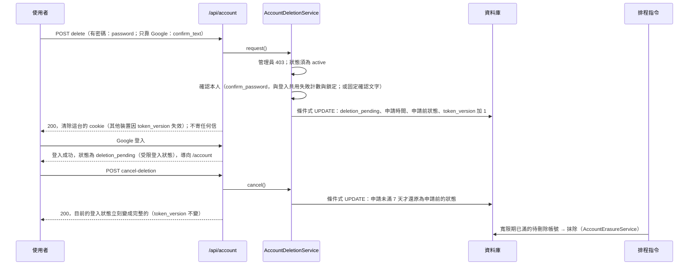

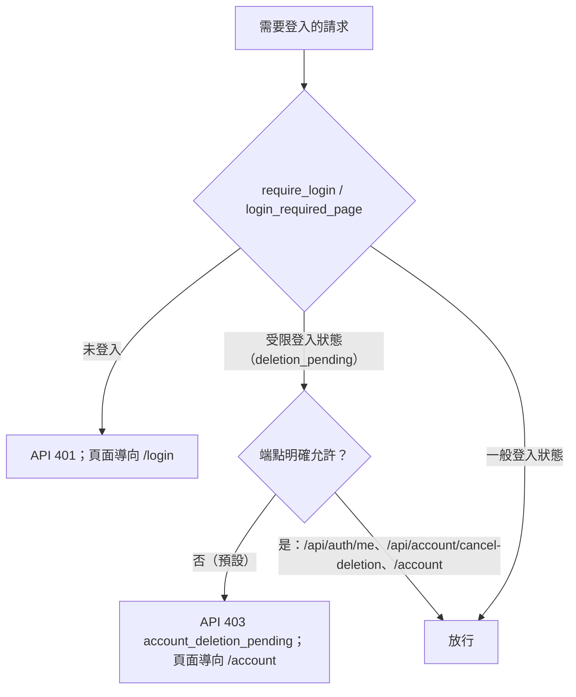

| 規則 | 行為 |
|---|---|
| 受限登入狀態預設拒絕 | `resolve_session` 對 `deletion_pending` 回傳使用者；`require_login(allow_pending_deletion=False)` 與 `login_required_page` 預設拒絕它。**既有端點不必修改**就自動被擋，新增的端點漏掉檢查也是安全的一邊。`tests/test_restricted_session.py` 掃描 `app.url_map` 的每條規則：先以未登入找出需要登入的端點，再以受限登入狀態逐一請求，允許清單以外必須全部被擋，並有自我驗證（暫時加一個只用 `current_user()` 的端點必須被抓到） |
| 第二道防線 | `AccessPolicy.chat_gate` 與 `is_admin` 各自要求帳號為 `active`，所以即使入口層漏了，客服與後台仍然不可用 |
| 確認本人 | 有密碼的帳號重新輸入密碼（沿用 `AuthService.confirm_password`，連續 5 次失敗鎖定 15 分鐘）；沒有密碼（只靠 Google）的帳號輸入固定文字「刪除我的帳號」（NFC 正規化並去除前後空白，含全形空白）。伺服器依帳號是否有密碼決定要哪個欄位，另一個欄位被忽略 |
| 申請 | 單一條件式 `UPDATE`：非管理員、狀態為 `active`；同一個語句記下申請時間與申請前的狀態並使 `token_version` 加 1。兩個並行的申請只有一個成立；**不寄通知信**（寬限期與撤銷方式由申請成功後的畫面與 `/account` 說明） |
| 撤銷 | 單一條件式 `UPDATE`：狀態為 `deletion_pending` 且申請未滿 7 天；一律還原為 `active`。超過 7 天回 409 `grace_expired`，帳號維持待刪除 |
| 期滿的抹除 | `flask execute-account-deletions`：條件在刪除當下再確認一次，剛撤銷的帳號不會被刪；每個帳號一個交易，原因 `user_requested` |
| Google 登入 | 已綁定 Google 的待刪除帳號可登入（受限狀態，導向 `/account`）；以信箱找到、尚未綁定的待刪除帳號仍拒絕，不在即將刪除的帳號上新增綁定 |
| 重設密碼 | 待刪除或停權的帳號不會收到重設信（`EmailFlowService` 的 `_BLOCKED_FROM_RESET`）；玩家本來就沒有密碼 |
| 帳號頁 | 待刪除者拿到**另一份 HTML**（預定刪除時間、撤銷、登出，沒有其他區塊；寬限期已過就不顯示撤銷按鈕）；管理員的頁面沒有刪除區塊 |
| 匯出 | 受限狀態不能匯出：請在申請刪除之前匯出。內容與格式見 [資料模型-data-model.md](資料模型-data-model.md) 與 README |

## 7b. 待確認年齡與被鎖定的受限登入狀態（google-first-login）

受限登入狀態從一種（等待刪除）擴充為三種，共用同一個機制：`CurrentUser.restriction` 回傳 `locked`、`age_pending` 或 `deletion_pending`（同時符合時依此優先順序），`require_login` 與 `login_required_page` **預設拒絕**，只有明確允許該狀態的端點通過。管理員不會是 `locked` 或 `age_pending`（未確認年齡的管理員只是不能使用會呼叫模型的功能，由 `AccessPolicy` 判斷）。

| 狀態 | 進入條件 | 拒絕代碼 | 導向頁面 | 允許的端點 |
|---|---|---|---|---|
| `locked` | 玩家的 `locked_at` 有值（只有管理員能解除） | `account_locked` | `/appeal` | `/api/auth/me`、`GET /appeal`、`POST /api/appeals`、`GET /api/appeals/mine` |
| `age_pending` | 玩家沒有生日（Google 首次登入後） | `age_confirmation_required` | `/age` | `/api/auth/me`、`POST /api/auth/verify-age`、`GET /age` |
| `deletion_pending` | 申請刪除後的寬限期內 | `account_deletion_pending` | `/account` | `/api/auth/me`、`GET /account`、`POST /api/account/cancel-deletion` |

- **允許清單不變**：`/api/account/story-preference` 與其他需要登入的端點一樣被三種受限登入狀態預設拒絕（`locked` 回 `account_locked`、`age_pending` 回 `age_confirmation_required`、`deletion_pending` 回 `account_deletion_pending`），不在任何狀態的允許清單內；`tests/test_restricted_session.py` 的全路由掃描自動涵蓋，`tests/test_story_preference_api.py` 另逐一證明三種狀態的代碼且偏好不變。
- **入口清單端點同樣不在允許清單內**（change `rpg-entry-ui`）：`GET /api/sessions/catalog` 與 `GET /api/sessions` 用 `require_login()`，三種受限登入狀態各回自己的 403 代碼（`tests/test_session_api.py` 逐一證明，`test_restricted_session.py` 的 `REQUIRED_TO_BE_FOUND` 也列入它們，確保掃描真的看得到）。**它們不過年齡閘門 `require_chat_access`**，原因是 `/game` 是登入後的預設頁面，而未確認年齡的**管理員**（不是 `age_pending`）也會落在那裡：清單不花成本，內容模式對未確認年齡者本來就是安全模式，所以回安全模式的清單而不是 403；真正會花成本的開存檔、AI 生成與回合仍由既有的閘門拒絕（`tests/test_session_api.py` 證明未確認年齡的管理員讀得到清單、開存檔得 403 `age_confirmation_required`）。
- **`/age` 的分步精靈沒有放寬任何限制**（onboarding-polish）：畫面改為三步（暱稱與使用守則、生日與年齡區間、故事偏好），但送出仍是**一個** `POST /api/auth/verify-age`（暱稱、生日、區間同一步驟、全有或全無，AGENTS.md 第 10 節），受限登入狀態的允許清單不變。故事偏好的 `PUT /api/account/story-preference` 在待確認年齡時會被 403，所以前端一定在確認成功之後才呼叫（選預設的全讀者不呼叫，失敗不阻擋）。「已確認使用守則」只是畫面上的引導：不送伺服器、不存資料庫、不寫瀏覽器儲存，條款同意仍以登入頁的勾選與 `terms_version` 為準。
- **年齡確認**：玩家首次以 Google 登入只建立帳號（沒有生日，`age_deadline_at` = 建立後 24 小時），登入後被導向 `/age`；`POST /api/auth/verify-age` 驗證生日與區間：未滿 18 歲（或所選區間為未滿 13 歲、13–17）立即抹除（`AccountErasureService.erase_underage`，不保存生日）、不一致回通用訊息並計入鎖定計次、成功則寫入並清空期限。逾時由 `purge-unconfirmed-accounts` 每小時清除。
- **帳號鎖定**：`AccountLockService.register_strike` 把兩類計次寫入 `lock_strikes`——`identity_rejected`（已辨識出帳號卻被拒絕的 Google 登入、補填年齡不一致；15 分鐘內 5 次）與 `rate_limited`（被每分鐘訊息數上限擋下；15 分鐘內 10 次）；達門檻時以條件式 UPDATE 鎖定並寫 `account.lock` 稽核（管理員欄位為空）。計次發生在會以 4xx 結束的請求裡，所以寫入後呼叫 `keep_changes_on_error`。無法辨識出帳號的失敗不計次。
- **申訴**：`/api/appeals` 對被鎖定或被暫停發佈的玩家有效（兩者皆非則 404，管理員也一樣），1000 字、每小時 3 則、同時 1 則待處理，兩種狀態共用同一套上限；內容是個資，日誌與稽核只有字數（`appeal.submit`）。`/appeal` 頁面由 `CurrentUser.appeal_kind`（`locked` 優先、`suspended`）決定說明文字，兩者皆非時導向預設頁面。

## 7c. 管理員二階段登入（google-first-login）

管理員每次登入都先通過 Google，再通過密碼，兩者都通過才建立登入 session；**管理員不能只靠密碼登入**：`POST /api/auth/login` 已不存在（404，不建立 session、不計失敗次數），唯一的路徑是「先 Google、再密碼」。

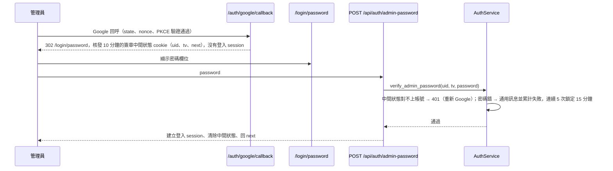

**忘記密碼**：密碼驗證頁在有寄信設定（寄信器與對外網址）時多一個按鈕，`POST /api/auth/admin-password/forgot` 只接受持有有效中間狀態的請求（對象由中間狀態決定，匿名與沒有寄信設定一律 404），沿用重設密碼的權杖規則寄信到該管理員的信箱；`/reset-password` 因此不再只受 `EMAIL_VERIFICATION_REQUIRED` 控制。

中間狀態 cookie（`app/security/admin_step.py`）不被 `current_user()` 辨識，所以只持有它的請求對所有需要登入的端點都是 401；`token_version` 變動（改密碼、登出所有裝置、停權）會使它失效。第一次以同信箱的 Google 登入時沿用既有的合併規則綁定 Google 身分，之後同樣要再輸入密碼。

## 7d. 暱稱與暫停發佈（rpg-script-authoring）

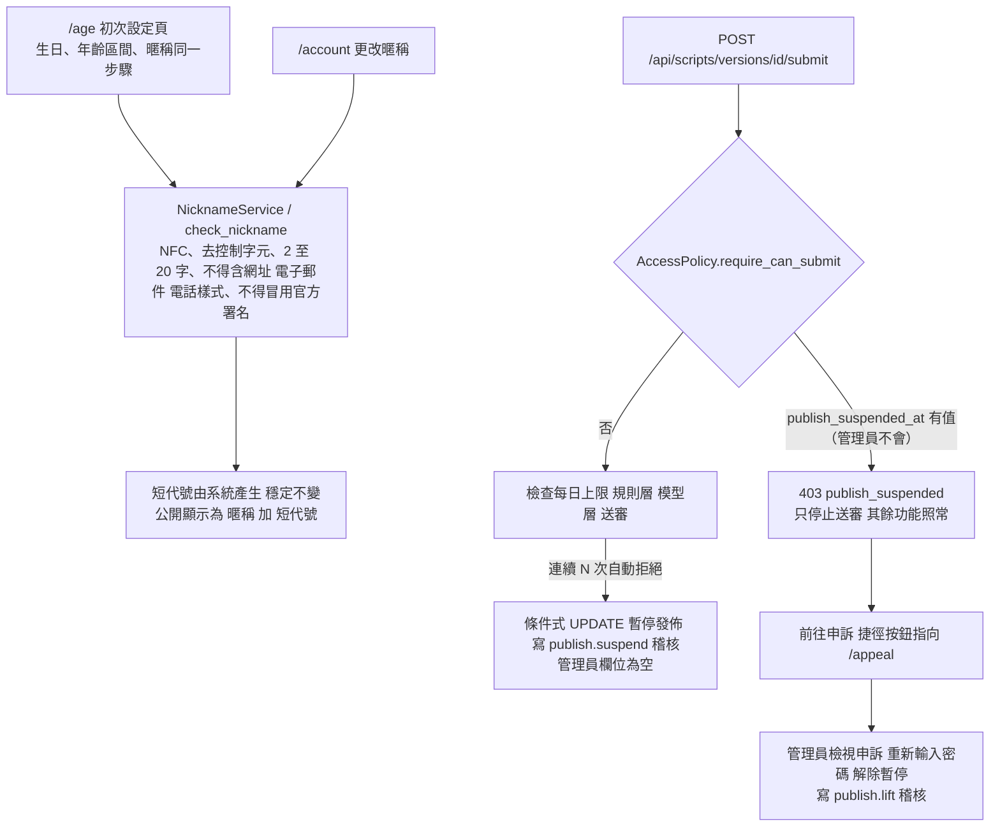

- **暱稱**：公開顯示於玩家創作的劇本，與 Google 帶來的 `display_name` 分開存放，`display_name` 不公開；不要求唯一，公開顯示時附系統產生的穩定短代號。玩家在年齡確認頁一起填（必填，與年齡確認同一步驟、同受 24 小時期限，被抹除或不一致時不保存）；既有帳號可為空，第一次創作劇本前須先設定。暱稱是個資：日誌只記內部編號，絕不記暱稱或短代號；匯出時包含，隨帳號刪除。
- **綁定安全模式**：作者選擇劇本是否綁定安全模式（`content_tier` 為 `safe`＝綁定、`adult`＝未綁定，舊值 `standard` 讀作未綁定）；不再有依年齡的宣告上限（全站皆成年，`author_content_cap` 已於第 2 組移除，不要求作者本人關閉安全模式）。
- **暫停發佈**：獨立於帳號鎖定的旗標（`users.publish_suspended_at`），只停止送審；觸發條件是最近 `script_reject_streak` 筆送審紀錄全部是自動拒絕（門檻存在資料庫，預設 3，每次使用時現讀）；管理員不會被暫停；寫入走條件式 UPDATE，並行的拒絕只暫停一次。被暫停的玩家看到說明與「前往申訴」按鈕（`/appeal` 的一般連結，無 `data-bs-*`、無查詢字串；是否顯示只依伺服器回應，解除後重新整理即消失）。
- **申訴捷徑**：`/cs`（使用中才被鎖定時 API 回 `account_locked`）、`/scripts` 與 `/account` 都在受限時顯示同一個元件 `UiRestrictionNotice`；判定集中在純函式 `UI.restrictionOf`（`static/js/ui/restriction.js`）。
- **劇本檢舉的權限**（rpg-script-reports）：登入且完成年齡確認的帳號才能檢舉（`AccessPolicy.require_can_report`，沿用 `chat_gate`，不論角色與會員等級；受限登入狀態在更早的登入檢查被擋，被暫停發佈的作者仍可檢舉）；不得檢舉自己的劇本（403 `report_own_script`）與內建劇本（404，種子鍵判斷）；同一人對同一版本只能一次（409 `already_reported`），新版本核可上架後可再檢舉；每人每日上限由資料庫的 `script_report_daily` 現讀（429）。檢舉只升高管理員佇列的優先度，不自動下架；管理員只能在「被檢舉」或送審的範圍讀取，讀取先寫 `report.read`，且**拿不到檢舉人**；結案為「不成立」不需要密碼（`report.dismiss`），下架沿用 `script.remove`（須密碼）。
- **匿名保留我已發佈的劇本**（rpg-script-reports）：偏好 `users.keep_published_scripts`（預設關）由帳號頁開關或刪除視窗的核取方塊寫入（`GET`／`PUT /api/account/script-retention`、`POST /api/account/delete` 的選填欄位）；管理員一律 403（`admin_script_retention_forbidden`），受限登入狀態拒絕。**偏好在抹除當下讀取**，抹除原因與結果的對照如下：

| 抹除原因 | 讀偏好 | 結果 |
|---|---|---|
| `user_requested`（寬限期滿） | 是 | 偏好開啟：只留下目前上架的版本，筆名改「已註銷的作者」、解除作者關聯、清除審核備註，其餘全刪；關閉：全刪 |
| `inactive_12_months`（連續 12 個月未登入，管理員不納入） | 是 | 同上 |
| `underage`（補填時未滿 18 歲） | 否 | 一律全刪 |
| `age_unconfirmed`（24 小時內未完成年齡確認） | 否 | 一律全刪 |
| `restore_replay`（備份還原後重新抹除） | 否 | 一律全刪；**已知限制**：先前選擇保留的劇本會被一併刪除（`deletion_tombstones` 只存內部編號、時間與原因，不知道誰選了保留） |

保留之後的劇本仍是玩家創作的劇本：管理員可下架（內建以種子鍵判斷，不以「沒有作者」判斷）、玩家可檢舉、可開新存檔；作者外鍵仍採串聯刪除，漏掉處理時偏向刪除。
- **管理員的可讀範圍**：申訴只看得到被鎖定或被暫停發佈帳號送出的；解除暫停與解除鎖定同樣要重新輸入密碼並寫稽核；仍不得任意讀取其他對話全文。

## 7e. 玩家主角與聯繫（rpg-character-creation）

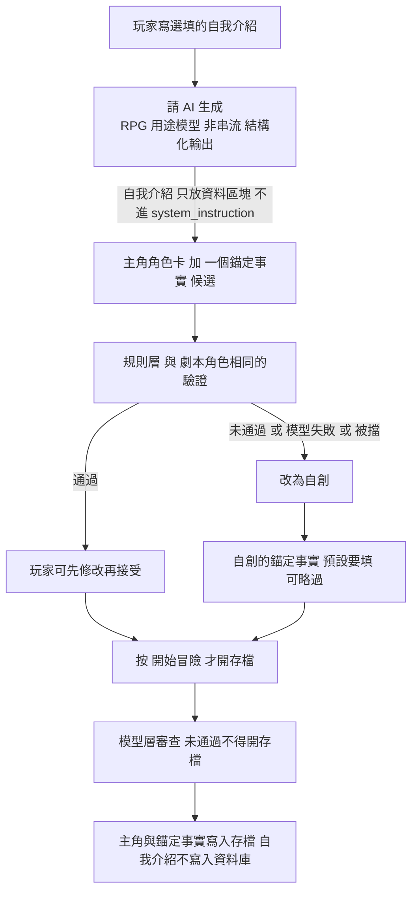

- **玩家文字**：自我介紹、主角角色卡與自創的錨定事實都是使用者文字，只能放在資料區塊，不得進入 `system_instruction`；規則文字不得覆寫平台的不變量。
- **審查**：與劇本設定使用同一套審查層，規則層於每次生成與送出時執行，模型層於開存檔時執行，未通過者不得開存檔，拒絕只告知類別。
- **年齡**：主角年齡是劇中角色的年齡，與使用者年齡無關（使用者年齡一律由生日計算）；開存檔後是錨定事實，模型與玩家都不能直接寫入。未滿 18 歲的內容上限不因主角設定而改變。
- **錨定事實**：每位主角一個，必須指向該存檔劇本內容中存在的人物、地點或里程碑，由 Service 驗證；模型只提議，玩家接受或自行撰寫後才由 Service 寫入。錨定事實不得為性的關係，也不得為性奴等禁斷關係；戀愛、婚姻與婚約類的關係不論年齡一律開放（例如青梅竹馬，須用符合劇本世界觀的說法，仍不得涉及性）。
- **用量**：生成與重新生成有次數上限（存資料庫的設定表，每次使用時現讀，以 flask 指令修改並寫稽核）；其 token 計入全站每日上限，不計入每日對話輪數。
- **管理員的可讀範圍**：不變。主角的角色卡、錨定事實不在管理員預設可檢視的範圍內（`tests/test_protagonist_lifecycle.py` 守住：管理員沒有任何路徑讀到玩家的存檔與主角，後台的 Repository 與 Service 從不提到主角）。
- **實作現況**：`/api/sessions/*` 有五支端點：`setup`、`suggest`、開存檔三支涉及主角與開存檔，每個公開方法先過 `AccessPolicy.require_chat_access`；另兩支是 RPG 入口的唯讀清單（`GET /api/sessions/catalog`、`GET /api/sessions`，由 `GameEntryService` 提供，**不過** `require_chat_access`，見第 7b 節）。別人的草稿與不存在的版本逐字相同的 404；劇本宣告的內容模式高於玩家生效的模式回 403 `content_tier_restricted`。審查不可用一律擋下（503 `review_unavailable`），`flag` 放行；規則層比劇本更嚴的一點是，未成年主角自己的文字出現露骨用語即直接拒絕。

## 7f. 遊戲幣的存取與稽核（game-wallet）

- **誰能用**：`/api/wallet/*` 用 `require_login()`（預設拒絕受限登入狀態）：待確認年齡 403 `age_confirmation_required`、鎖定 403 `account_locked`，所以尚未確認年齡的帳號也不會領到任何幣。這不是 AI 功能，不另做 `require_chat_access`；管理員與各會員等級在「誰能用」上一視同仁（等級只影響額度，幣價不因等級而異）。**唯一的例外是扣款**：管理員帳號（`is_active_admin`）不消耗遊戲幣（`admin-unlimited-coins`）——預扣仍寫入帳本但金額為 0、不因餘額不足被拒；判斷只依伺服器端的角色與狀態，不因會員等級而異，不由前端或請求內容決定（`GET /api/wallet` 的 `coin_exempt` 只是告知畫面）。客服的額度與全站每日 token 上限對管理員照舊，模型呼叫照常記入 `llm_call_logs`。
- **玩家無法經 HTTP 花費或增加餘額**（簽到除外）：預扣、結算與退回只由伺服器端的回合流程（RC-2）呼叫 `WalletService`。
- **錢包頁 `/wallet`**（wallet-hub，MVC 頁面）：以 `login_required_page` 保護，權限判斷全在裝飾器與 `AccessPolicy`、Controller 不寫——未登入導向登入頁、被鎖定導向 `/appeal`、待確認年齡導向 `/age`、等待刪除導向 `/account`（`tests/test_restricted_session.py` 的全路由掃描涵蓋）；回應 `Cache-Control: no-store`。頁面外殼的初始狀態只有 `member_tier`，**沒有餘額、帳本、email、生日與年齡**，渲染它不會建立錢包或補發贈幣（那是頁面載入後呼叫 `GET /api/wallet` 的事，仍受上一條的 API 規則約束）。頁面上的「儲值」只是示意卡片，按鈕停用、不發任何增加餘額的請求，所以「玩家無法經 HTTP 增加餘額（簽到除外）」仍然成立；真實的付費幣取得方式屬後續的 `wallet-topup`，須先探索金流。頂列的餘額標籤（`<ui-wallet-balance>`）只在六個已登入頁面，等待刪除的 `/account` 畫面與 `/login`、`/age`、`/appeal` 都沒有。
- **贈幣時機**：首次註冊的 200 免費幣在年齡確認通過時由 `AuthService` 呼叫錢包回呼發放（帳號 24 小時內未確認會被刪除，不會送出又收不回）；回呼失敗不影響年齡確認，記 `wallet.grant_deferred`，由下一次存取錢包補發，冪等鍵相同；既有玩家同樣在第一次存取時補發。
- **管理員調整**：高風險，與停權、調整等級同一套重新輸入密碼（失敗寫 `reauth.failed`）；稽核 `wallet.adjust` 的細節只有餘額種類、增減量與調整後的餘額，原因放在理由欄；目標只能是一般使用者；後台檢視餘額不觸發逾時預扣的清理。
- **個資**：錢包與帳本視為個資，隨帳號抹除（`CASCADE`）、納入個人資料匯出，不在管理員預設可讀的範圍（只有 `wallet.adjust` 的結果會顯示在使用者檢視）；日誌只記內部編號與整數。

## 8. 個資與保存

- 生日與年齡區間：不進 API 回應、日誌與模型；管理員只看年齡區間的彙總統計（`flask age-stats` 與後台總覽），後台看不到任何個別使用者的生日、年齡區間或年齡群組。
- 連續 12 個月未登入的帳號由 `flask purge-inactive-accounts` 直接刪除（管理員不納入）；使用者自助刪除寬限期滿後由 `flask execute-account-deletions` 刪除。兩者走同一個抹除出口（先清帳本的對話編號，再刪使用者，並寫入只含內部編號、日期與原因的 `deletion_tombstones`，見 [資料模型-data-model.md](資料模型-data-model.md)）。各類資料的保存期限由 `flask purge-expired-data` 清除。
- 使用者可在帳號頁匯出自己的帳號資料（含生日、年齡區間與故事偏好）與全部對話（自己創作的劇本版本含讀者頻道，舊版本的空值匯出為 `all`；另含狀態〔含 `removed`〕、審核或下架的固定類別、決定時間與下架者，**不含管理員的審核備註**）；匯出不含密碼雜湊、權杖與模型內部欄位，CSV 的公式字元會被中和。作者自行下架與恢復自己的劇本版本不需要密碼、不寫管理員稽核（只記日誌事件）；管理員下架的版本作者不能恢復（403 `removal_locked`）。
- 玩家主角（`sessions.protagonist_json`）：角色卡與錨定事實隨所屬存檔保存、刪除與匯出；自我介紹只用於生成當下，不寫入資料庫，但會傳送至 RPG 模型供應商，適用供應商的個資限制；日誌只記內部編號與整數長度。
- 日誌只記錄白名單欄位，絕不記錄 email、密碼、權杖、生日、訊息全文與模型輸出（見 [營運與部署-operations.md](營運與部署-operations.md)）。

---

**何時更新本文**：註冊、登入、驗證、Google 登入、session、CSRF、年齡規則、權限政策、`/api/auth/*` 與 `/api/admin/*` 端點、後台的可讀範圍與重新輸入密碼規則、帳號狀態或保存期限改變時。`tests/test_design_docs.py` 會檢查每個 `/api/auth/` 與 `/api/admin/` 路由都出現在本文。
