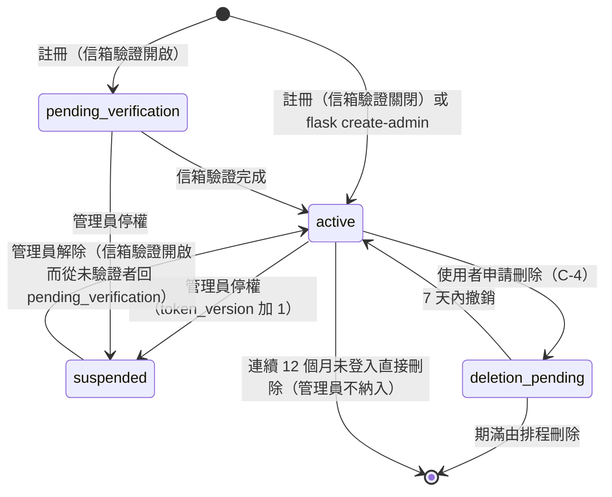
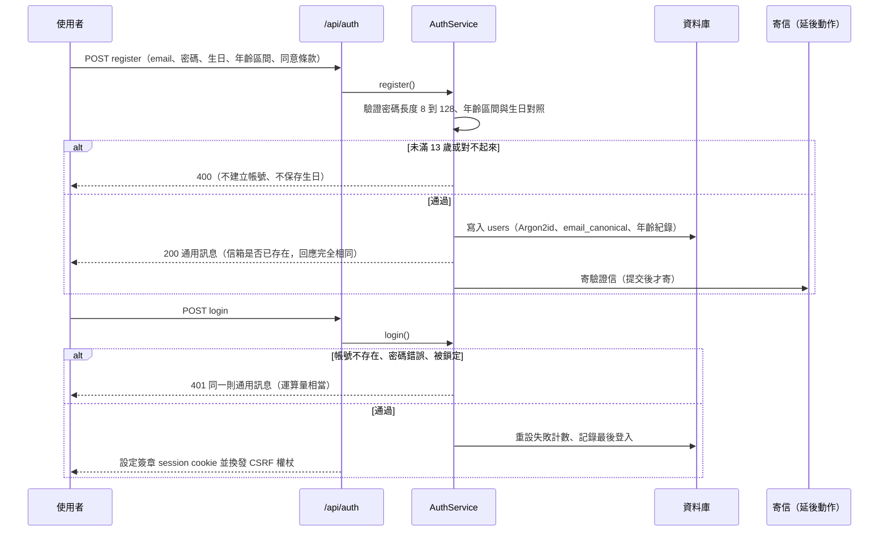
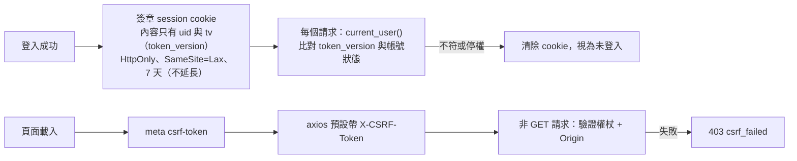
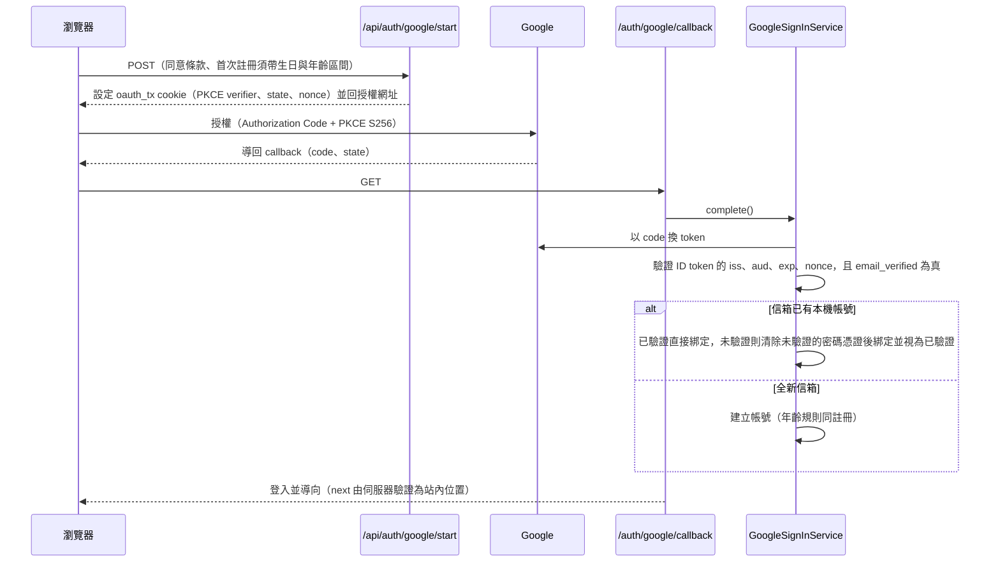
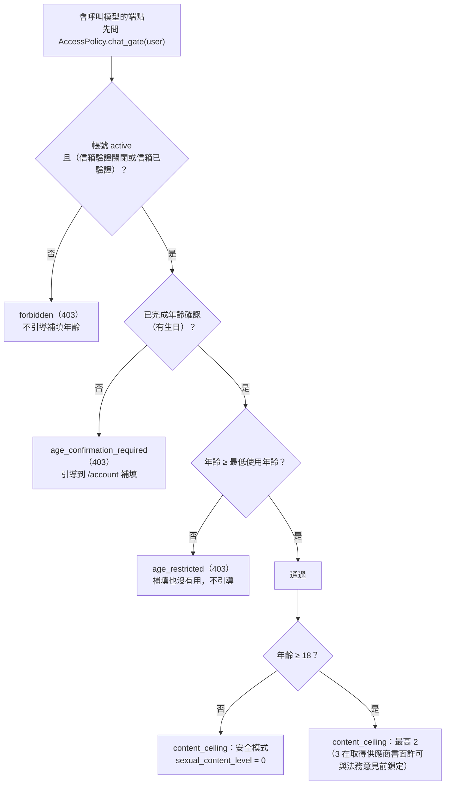
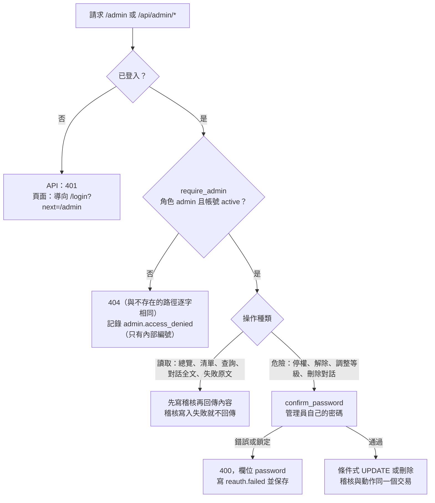

# 帳號、年齡與存取控制

> 狀態：已實作（管理員後台由 C-4b 實作；使用者自助刪除帳號由 C-4c 實作） ｜ 最後更新：2026-10-30 ｜ 對應 change：member-auth、age-gate、age-verification-birthdate、cs-chat-core（`chat_gate`）、admin-console（管理員檢查、重新輸入密碼） ｜ 規範依據：AGENTS.md 第 10、11 節

本文件說明會員如何註冊、驗證、登入，年齡如何決定能做什麼，權限如何集中判斷，以及管理員後台的存取規則。端點的完整清單見本文第 6 節（會員）與第 7 節（後台）；請求本身的處理順序見 [系統架構-architecture.md](系統架構-architecture.md)。

## 1. 帳號狀態

- 只有 `active` 的帳號能登入；信箱驗證開啟時，信箱必須已驗證才能使用客服。
- `EMAIL_VERIFICATION_REQUIRED`：development、testing、staging 可關閉（註冊後直接 `active`、忘記密碼停用）；production 必須開啟並設定寄信服務，否則啟動失敗。

## 2. 註冊與登入

| 項目 | 規則 |
|---|---|
| 密碼 | Argon2id，長度 8 至 128 字，不強制字元組合 |
| 防帳號列舉 | 註冊、忘記密碼、登入失敗的回應一律相同 |
| 登入失敗 | 同一帳號連續 5 次鎖定 15 分鐘，計數存資料庫 |
| 信箱權杖 | 32 位元組隨機值，只存 SHA-256；驗證信 24 小時、重設信 1 小時；單次使用；兩次寄信至少間隔 60 秒並有每小時上限 |
| 連結流程 | GET 只顯示確認頁，POST 才完成動作；權杖放在網址片段（`#token=`），不進存取日誌 |
| 重設密碼成功 | `token_version` 加 1（撤銷既有登入）並寄通知信 |

## 3. Session 與 CSRF

- staging 與 production 的 cookie 使用 `__Host-` 前綴（Secure、Path=/、無 Domain）；入口層由 `ProxyFix` 信任轉發標頭。
- 改密碼、登出所有裝置、重設密碼、綁定 Google 時 `token_version` 加 1，既有登入立即失效。

## 4. Google 登入（選用）

Google 與信箱密碼共用同一個帳號；開發與正式環境使用不同的 OAuth 用戶端；失敗一律導回 `/login?error=<固定代碼>`，Google 回傳的任何文字都不會進入網址或頁面。

## 5. 年齡閘門與內容上限

年齡規則的所有數字（最低註冊年齡 13、最低使用年齡 13、成年門檻 18、區間選項、政策版本）只在 `app/services/age_policy.py` 的 `AgePolicy`；年齡一律由生日於「當下」計算，不用儲存的結果判斷。

- `chat_gate` 是純查詢（不拋例外、不記錄事件）；`require_chat_access` 以它判斷並對年齡拒絕記錄一筆事件，兩者不會分歧（測試逐一比對）。
- 管理員與各會員等級都不豁免年齡閘門。管理員帳號由指令建立，沒有生日，第一次登入後須到 `/account` 補填。
- 13 至 17 歲可以使用（含 AI 功能）但固定安全模式；此設定以供應商同意為前提，換供應商時只需換 `AgePolicy` 並提高版本（見 [路線圖-roadmap.md](路線圖-roadmap.md) 的待決定事項）。

## 6. 權限規則與端點清單

權限判斷只在 `AccessPolicy`（`app/services/access_policy.py`），端點與其他 Service 不自行判斷：

| 規則 | 行為 |
|---|---|
| 非擁有者存取資源 | 一律 `NotFound`（404），與不存在的回應逐字相同 |
| 會員等級 | 只影響額度，不參與任何權限判斷 |
| 管理員存取他人資料 | 一般端點與一般使用者相同（404）；只有 `/api/admin/*` 能讀他人的內容，走後台專用的 Repository、每次都寫稽核（見第 7 節） |
| 是否為管理員 | `AccessPolicy.require_admin(user)`：不是 `admin` 或帳號不是 `active` 就記錄 `admin.access_denied` 並拋出 `NotFound`（404）；後台的唯一入口 |
| 權限測試 | `tests/support/idor.py` 依序以「他人、不存在、未登入、擁有者」檢查每個帶識別碼的端點 |

`/api/auth/*` 端點（全部需 CSRF；「登入」欄指是否需要已登入）：

| 端點 | 方法 | 登入 | 用途 |
|---|---|---|---|
| `/api/auth/register` | POST | 否 | 註冊（生日與年齡區間必填） |
| `/api/auth/login` | POST | 否 | 登入 |
| `/api/auth/logout` | POST | 否 | 登出目前裝置 |
| `/api/auth/logout-all` | POST | 是 | 登出所有裝置 |
| `/api/auth/me` | GET | 是 | 本人資料（不含生日與內部編號） |
| `/api/auth/verify-age` | POST | 是 | 補填生日與年齡區間 |
| `/api/auth/change-password` | POST | 是 | 變更密碼 |
| `/api/auth/verify-email` | POST | 否 | 以權杖驗證信箱（驗證關閉時 404） |
| `/api/auth/resend-verification` | POST | 是 | 重寄驗證信（驗證關閉時 404） |
| `/api/auth/forgot-password` | POST | 否 | 忘記密碼（驗證關閉時 404） |
| `/api/auth/reset-password` | POST | 否 | 以權杖設定新密碼（驗證關閉時 404） |
| `/api/auth/google/start` | POST | 否 | 發起 Google 登入（未設定時 404） |

頁面：`/login`、`/register`、`/forgot-password`、`/reset-password`、`/verify-email`、`/account`、`/terms`、`/privacy`、`/auth/google/callback`。

## 7. 管理員後台的存取（C-4b）

後台是高權限的攻擊面，所以重點是**可讀範圍小、每個操作可追溯、危險操作要重新輸入密碼**。業務邏輯在 `AdminService`，控制器只呼叫它（分層規則見 [系統架構-architecture.md](系統架構-architecture.md) 的第 2 節）。

| 規則 | 行為 |
|---|---|
| 非管理員 | 一律 404，不是 403（否則會告訴一般使用者後台存在）；順序是「登入 → 管理員檢查 → 才解析請求本文」，所以格式錯誤的本文也只得到 404 |
| 可讀範圍 | 清單沒有訊息內容；只有「意見回饋」（助理回覆的意圖是 `complaint_feedback` 或 `human_handoff`）與「被內容安全過濾標記」兩類對話可讀全文，不符資格與不存在得到同一個 404；使用者資料沒有任何個別的年齡資料，年齡只有總覽的區間人數 |
| 找使用者 | 主要入口是警告（總覽的今日警告 → 被標記對話 → 看使用者）；信箱精確查詢是次要入口、供客服反應時使用；沒有使用者清單與模糊搜尋 |
| 重新輸入密碼 | `AuthService.confirm_password`：與登入共用失敗計數與鎖定（連續 5 次鎖定 15 分鐘），鎖定中即使正確也拒絕且訊息相同；成功不重設計數；沒有設定密碼的管理員不能執行（`no_password`） |
| 操作對象 | 只能是一般使用者：管理員（含自己）403 `admin_target_forbidden`；`deletion_pending` 409；兩位管理員同時操作靠條件式 UPDATE 不互相覆蓋 |
| 稽核 | `admin_audit_logs`：8 個固定動作，只存對外識別碼、管理員填寫的原因與列舉細節，不含 email 與訊息；Repository 沒有更新與刪除（見 [資料模型-data-model.md](資料模型-data-model.md)） |
| 回應 | `/admin` 與 `/api/admin/` 一律 `Cache-Control: no-store`；非 GET 須通過 CSRF |

`/api/admin/*` 端點（全部需要登入且是管理員；`POST` 另需 CSRF）：

| 端點 | 方法 | 用途 |
|---|---|---|
| `/api/admin/overview` | GET | 總覽與今日警告的三個計數（只有彙總） |
| `/api/admin/audit` | GET | 稽核紀錄，由新到舊 |
| `/api/admin/users/lookup` | POST | 以信箱查詢使用者（次要入口，信箱在本文） |
| `/api/admin/users/<public_id>` | GET | 以對外識別碼檢視使用者 |
| `/api/admin/users/<public_id>/suspend` | POST | 停權（原因與密碼） |
| `/api/admin/users/<public_id>/unsuspend` | POST | 解除停權（密碼） |
| `/api/admin/users/<public_id>/tier` | POST | 調整會員等級（密碼） |
| `/api/admin/feedback` | GET | 意見回饋對話清單 |
| `/api/admin/flagged` | GET | 被標記對話清單（帶今日被擋次數與暫停截止時間） |
| `/api/admin/conversations/<public_id>` | GET | 讀取可讀對話的全文（最多 200 則） |
| `/api/admin/conversations/<public_id>/delete` | POST | 刪除整個對話（原因與密碼） |
| `/api/admin/failures` | GET | 最近 14 天模型輸出驗證失敗的原文 |

頁面：`/admin`（只有管理員的顯示名稱，所有資料經由 API 取得；前端見 [前端結構-frontend.md](前端結構-frontend.md)）。

已知取捨：被盜用的管理員登入狀態可以不輸入密碼讀取兩類對話（每次都有稽核，要加強只需讓「讀全文」也要求密碼）；管理員輸入錯誤密碼也累積登入的失敗計數，連續 5 次會把自己鎖定 15 分鐘（刻意，讓後台不成為暴力猜測的捷徑）。完整清單見 README 的「管理員後台（C-4b）」。

## 8. 個資與保存

- 生日與年齡區間：不進 API 回應、日誌與模型；管理員只看年齡區間的彙總統計（`flask age-stats` 與後台總覽），後台看不到任何個別使用者的生日、年齡區間或年齡群組。
- 連續 12 個月未登入的帳號由 `flask purge-inactive-accounts` 直接刪除（管理員不納入），並寫入只含內部編號與日期的 `deletion_tombstones`（見 [資料模型-data-model.md](資料模型-data-model.md)）。
- 日誌只記錄白名單欄位，絕不記錄 email、密碼、權杖、生日、訊息全文與模型輸出（見 [營運與部署-operations.md](營運與部署-operations.md)）。

---

**何時更新本文**：註冊、登入、驗證、Google 登入、session、CSRF、年齡規則、權限政策、`/api/auth/*` 與 `/api/admin/*` 端點、後台的可讀範圍與重新輸入密碼規則、帳號狀態或保存期限改變時。`tests/test_design_docs.py` 會檢查每個 `/api/auth/` 與 `/api/admin/` 路由都出現在本文。
