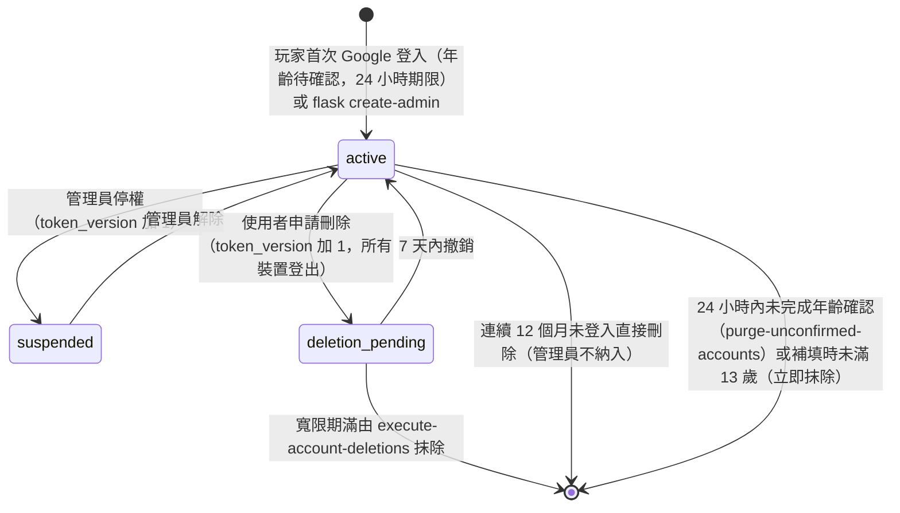
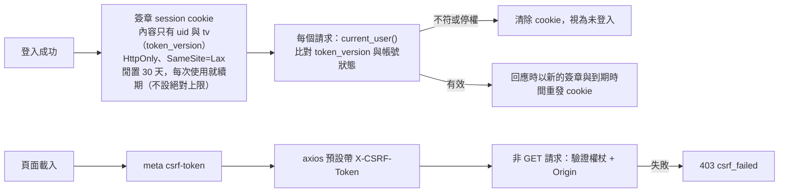
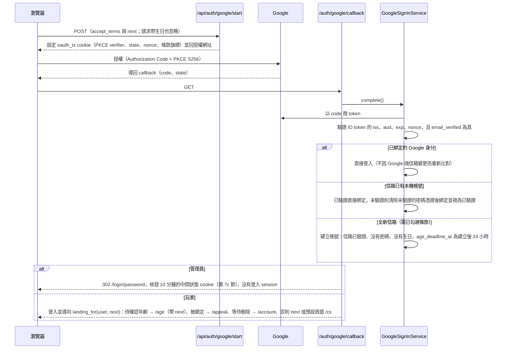
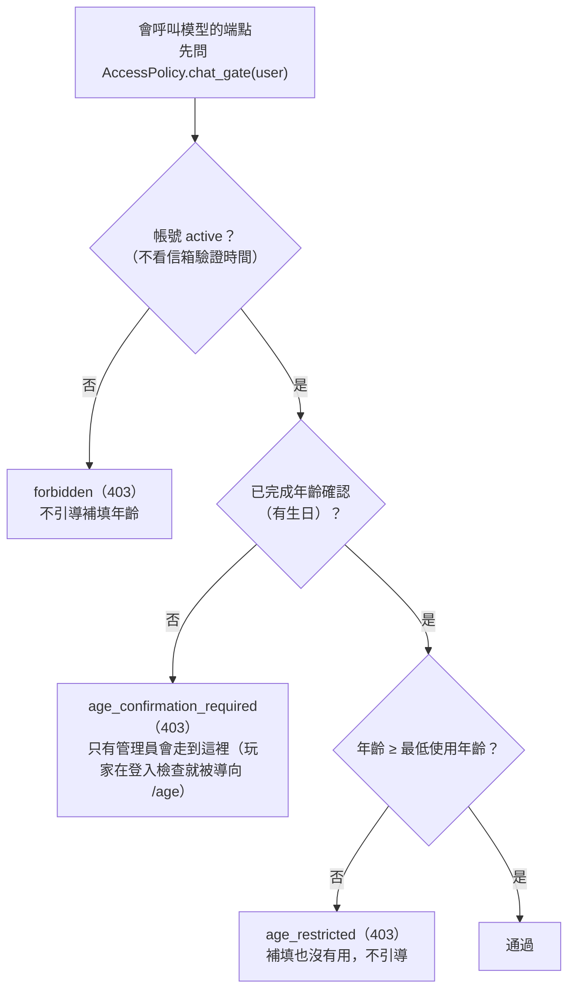
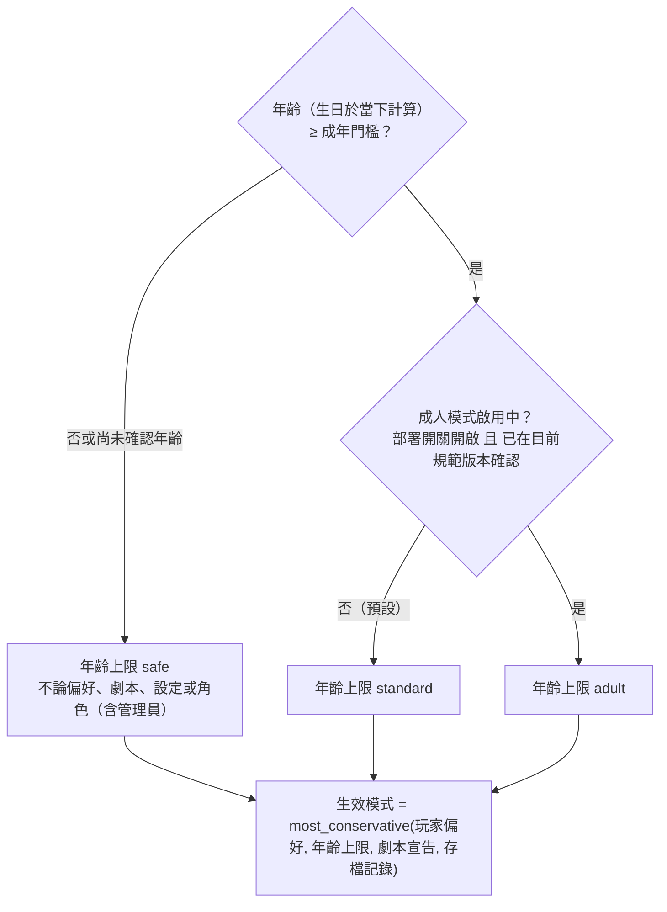
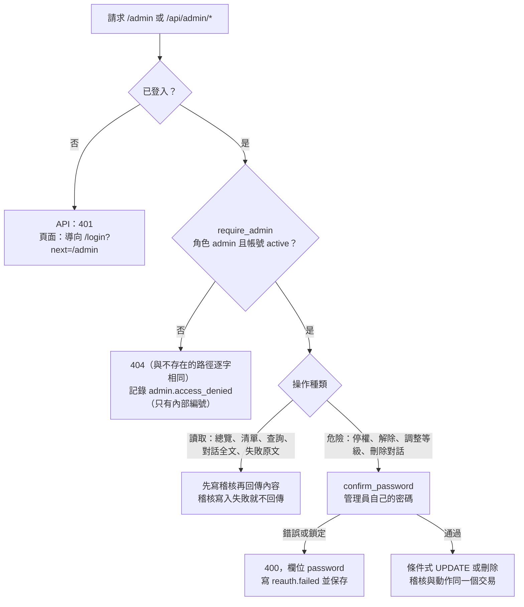
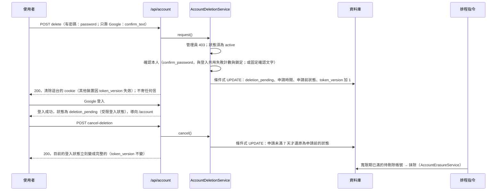
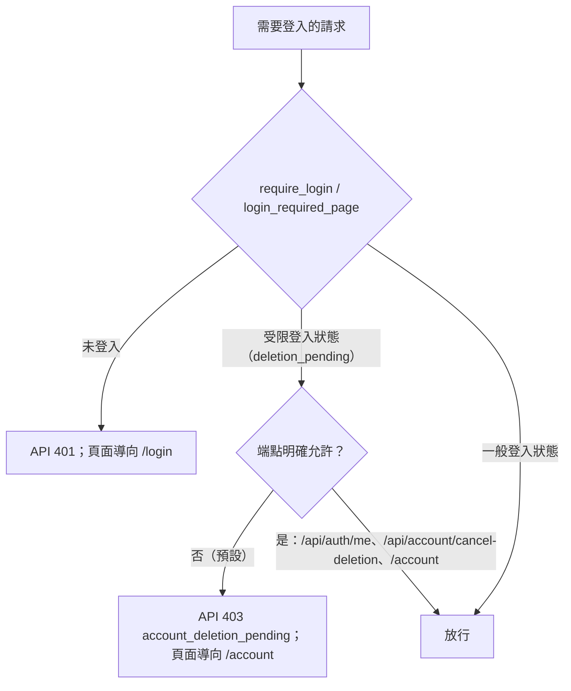
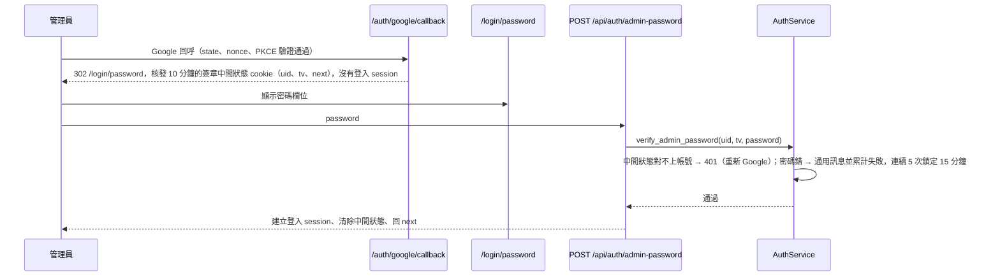
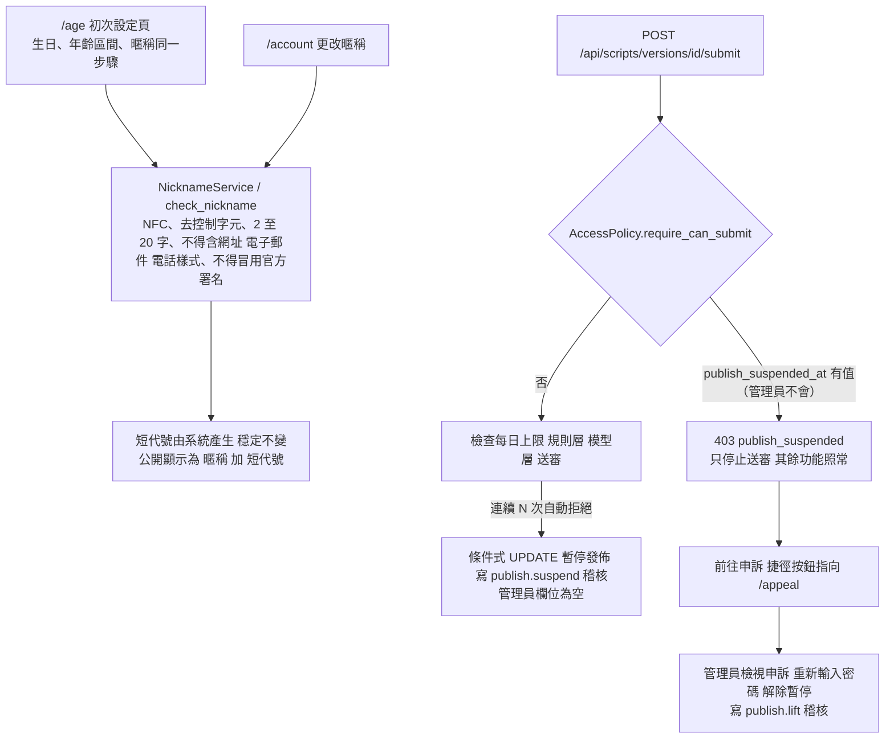

# 帳號、年齡與存取控制

> 狀態：已實作（管理員後台由 C-4b 實作；使用者自助刪除帳號與受限登入狀態由 C-4c 實作） ｜ 最後更新：2026-11-04 ｜ 對應 change：rpg-script-authoring、rpg-data-and-script、remove-player-password-auth、google-first-login、member-auth、age-gate、age-verification-birthdate、cs-chat-core（`chat_gate`）、admin-console（管理員檢查、重新輸入密碼）、openai-compatible-provider（等級 3 的環境開關，已由 rpg-data-and-script 的三種內容模式取代）、privacy-lifecycle（自助刪除帳號、受限登入狀態）、staging-deployment（開發用通道的 TRUST_PROXY_HEADERS） ｜ 規範依據：AGENTS.md 第 10、11 節
> 注意（2026-11-03）：Google 登入改版的兩個 change 都已實作：change ① `google-first-login`（玩家首次 Google 登入即建立帳號、登入後才做年齡確認、登入有效期閒置 30 天續期、帳號鎖定與申訴、管理員 Google 加密碼二階段登入）與 change ② `remove-player-password-auth`（移除玩家端的密碼註冊、密碼登入、忘記密碼與信箱驗證，以及 `EMAIL_VERIFICATION_REQUIRED`；玩家不設密碼、不收任何信）。決定見 [report.md](report.md) 的 U-12 至 U-19。
> 注意（2026-11-03）：AGENTS.md 第 10 節新增「暱稱與筆名」（初次設定頁與生日一起填、公開顯示於劇本、第一次發佈時鎖定），並把管理員預設可讀範圍擴大到使用者送審公開的劇本與被檢舉的劇本；其中**內容模式與劇本、存檔的資料基礎已實作**（change `rpg-data-and-script`，見第 5 節），暱稱的欄位、年齡確認頁的暱稱、帳號設定頁的更改，以及連續被拒的暫停發佈與申訴範圍已由 change `rpg-script-authoring`（RC-7）實作（見第 7d 節）；筆名的鎖定（第一次發佈時）、審核流程及管理員讀取待審劇本的專用路徑（RC-8）**尚未實作**，本文件描述目前的實作。

本文件說明玩家如何以 Google 登入、登入後完成年齡確認，管理員如何先 Google 再輸入密碼，年齡如何決定能做什麼，權限如何集中判斷，以及管理員後台的存取規則。端點的完整清單見本文第 6 節（會員）與第 7 節（後台）；請求本身的處理順序見 [系統架構-architecture.md](系統架構-architecture.md)。

## 1. 帳號狀態

- 只有三種狀態：`active`、`suspended`、`deletion_pending`。**`pending_verification` 已退役**（玩家的信箱在建立帳號時就由 Google 驗證）：遷移 `0011` 把殘留的 `pending_verification`（含申請刪除前的狀態）改為 `active`，程式不再產生它。
- `active` 的帳號可登入；`suspended` 一律拒絕登入。`deletion_pending` **可以登入，但只得到受限登入狀態**（只能撤銷刪除與登出，見第 7a 節）。帳號是否可用客服只看狀態與年齡，不看信箱驗證時間。
- 停權的帳號無法登入，所以無法自助刪除（仍由 12 個月閒置清除處理）；管理員帳號不可自助刪除。
- `EMAIL_VERIFICATION_REQUIRED` 已淘汰：程式不再讀取它（啟動時只警告一次，不回顯值，也不會讓部署失敗）；`scripts/launch_plan.py` 的部署計畫檔含有它會被拒絕。

## 2. 密碼只屬於管理員

玩家只以 Google 登入（第 4 節）：**沒有密碼註冊、密碼登入、忘記密碼、信箱驗證，也不寄任何信給玩家**（含申請刪除的通知）。`POST /api/auth/register`、`/login`、`/verify-email`、`/resend-verification`、`/forgot-password` 與頁面 `/forgot-password`、`/verify-email` 都已移除（回 404）；`/register` 仍導向 `/login`。密碼只屬於管理員：用在 Google 之後的第二步（第 7c 節）、高風險操作的重新輸入，以及管理員自己的變更密碼與忘記密碼。

資料遷移 `0011_remove_player_passwords`（只動資料、不動結構、可重複執行）把既有資料帶到相同的狀態：非管理員帳號的 `password_hash`、`failed_login_count`、`locked_until` 清除，`pending_verification` 改為 `active`。遷移之後，持有舊密碼帳號的玩家以**同信箱**的 Google 登入即綁定回原帳號（已驗證者直接綁定；未驗證者依合併規則清除憑證並視為已驗證）。回復（downgrade）不還原雜湊，需要時靠遷移前的備份。

| 項目 | 規則 |
|---|---|
| 密碼 | Argon2id，長度 8 至 128 字，不強制字元組合；**只有管理員有密碼**，玩家的 `password_hash` 一律為空 |
| 防帳號列舉 | 管理員的密碼驗證失敗回應一律相同（密碼錯誤與鎖定中同一則通用訊息）；`POST /api/auth/login` 不存在（404），不計入任何失敗次數 |
| 登入失敗 | 同一帳號連續 5 次鎖定 15 分鐘，計數存資料庫（只適用管理員的密碼驗證步驟、重新輸入密碼與變更密碼時的目前密碼） |
| 重設權杖 | 32 位元組隨機值，只存 SHA-256；1 小時失效；單次使用；兩次寄信至少間隔 60 秒並有每小時上限；**權杖所屬帳號必須是管理員**，遷移前遺留的玩家權杖一律視為無效；沒有寄信設定時整組停用（404） |
| 連結流程 | GET 只顯示確認頁，POST 才完成動作；權杖放在網址片段（`#token=`），不進存取日誌 |
| 重設密碼成功 | `token_version` 加 1（撤銷既有登入）並寄通知信（有寄信設定時；變更密碼成功同樣寄通知信） |

## 3. Session 與 CSRF

- **滑動續期**（`SlidingSessionInterface`，`app/security/session.py`）：到期時間一律是「寫入 cookie 的當下加 30 天」，不依賴 `permanent` 旗標；只有「這個請求辨識過登入者」才重發 cookie，所以 `/healthz`、靜態檔與匿名頁面不重發。玩家只要沒有登出，下次打開就直接進入帳號。
- **代價與補償**：被竊取的 cookie 只要持續被使用就一直有效（沒有絕對上限），撤銷靠 `token_version` 加 1（改密碼、登出所有裝置、停權）、帳號停權與管理員的鎖定。cookie 內容仍只有 `uid` 與 `tv`，不放簽發時間（Flask 以簽章時間加 `PERMANENT_SESSION_LIFETIME` 判斷過期）。
- staging 與 production 的 cookie 使用 `__Host-` 前綴（Secure、Path=/、無 Domain）；入口層由 `ProxyFix` 信任轉發標頭（development 只有明確設定 `TRUST_PROXY_HEADERS` 經 HTTPS 通道使用時才信任，且仍不送 HSTS、cookie 不加前綴）。
- 改密碼、登出所有裝置、重設密碼、綁定 Google 時 `token_version` 加 1，既有登入立即失效。

## 4. Google 登入

登入與註冊合一：`/login` 只有「使用 Google 登入」按鈕與「同意服務條款與隱私權政策」勾選框（新使用者必須勾選，回訪的使用者不必）。年齡不在這裡填，登入之後才做（第 7b 節）。

- 已有帳號者登入不需要勾選條款；沒有帳號而沒勾條款不建立帳號，導回 `/login?error=terms_required`。
- 已存在的帳號（已綁定或以信箱合併）登入時**不會**被順便標記為已確認年齡。
- 已辨識出帳號卻被拒絕（帳號停用、已綁定另一個 Google 身分）會計入帳號鎖定的計次（第 7b 節）；無法辨識身分的失敗與還沒有帳號的 Google 身分不計。
- 開發與正式環境使用不同的 OAuth 用戶端；失敗一律導回 `/login?error=<固定代碼>`，Google 回傳的任何文字都不會進入網址或頁面。
- 登入後的預設頁面是單一常數 `DEFAULT_AFTER_LOGIN`（`app/security/redirects.py`，目前 `/cs`，RPG 上線後改為選擇劇本的首頁）；`landing_for` 由首頁、登入頁與回呼共用。

## 5. 年齡閘門與內容模式

年齡規則的所有數字（最低註冊年齡 13、最低使用年齡 13、成年門檻 18、區間選項、政策版本）只在 `app/services/age_policy.py` 的 `AgePolicy`；年齡一律由生日於「當下」計算，不用儲存的結果判斷。

- `chat_gate` 是純查詢（不拋例外、不記錄事件）；`require_chat_access` 以它判斷並對年齡拒絕記錄一筆事件，兩者不會分歧（測試逐一比對）。
- 管理員與各會員等級都不豁免年齡閘門。管理員帳號由指令建立，沒有生日，第一次登入後須到 `/account` 補填；**玩家**則是登入後除了年齡確認與登出什麼都不能做（受限登入狀態 `age_pending`，第 7b 節），所以玩家不會走到 `chat_gate`。
- 13 至 17 歲可以使用（含 AI 功能）但固定安全模式；此設定以供應商同意為前提，換供應商時只需換 `AgePolicy` 並提高版本（見 [路線圖-roadmap.md](路線圖-roadmap.md) 的待決定事項）。

### 內容模式（change `rpg-data-and-script`，取代 `sexual_content_level` 0 至 3）

三種模式由保守到寬鬆：`safe`（安全模式）、`standard`（一般模式）、`adult`（成人模式）；順序與「取較保守者」在 `app/services/content_tier.py`（純邏輯，無法判定視為 `safe`）。**生效模式 = 玩家偏好、年齡上限、劇本宣告、存檔記錄中最保守者**（`AccessPolicy.effective_tier`）。

- **偏好與預設**：`users.content_tier_preference` 預設 `safe`；年齡確認成功的當下依年齡設定（已滿 18 歲 `standard`，未滿 `safe`）。**滿 18 歲不自動調高**：年齡上限解除，但偏好與既有存檔的模式不變，`GET /api/account/content-mode` 的 `selectable.standard` 變成真值，介面提示玩家自行切換。成年玩家也可以自行選擇 `safe`。偏好為 `adult` 但條件不齊時退為 `standard`，不是錯誤。
- **成人模式須同時滿足**：部署開關 `ADULT_MODE_ENABLED` 開啟；已滿 18 歲；在目前的安全規範版本（`ADULT_RULES_VERSION`）下完成成年確認；偏好為 `adult`。成年確認在切換為成人模式時完成：同時確認「我確定已滿 18 歲」與同意安全規範兩項（缺一回 400 並指出缺哪一項），記錄確認時間、規範版本與方式（目前 `self_declared`，不蒐集證件、不接第三方驗證）；規範版本改變後先前的確認失效，須重新確認；離開成人模式不清除紀錄。
- **API**（需登入、CSRF、先過年齡閘門；受限登入狀態依既有規則被拒絕）：`GET /api/account/content-mode` 與 `PUT /api/account/content-mode`。回應只有 `preference`、`effective`、`selectable`（三種模式各是否可選）、`adult_reason`（`not_adult`、`disabled`、`needs_confirmation` 或空）與 `adult_confirmed`，**不含**生日、年齡區間、年齡確認時間或內部編號。錯誤：400（`mode` 不是三種之一，或缺少確認的那一項）、403 `content_mode_restricted`（未滿成年門檻者要求 `standard` 或 `adult`）、403 `adult_mode_unavailable`（部署開關關閉）、403 `age_confirmation_required`、401。成功時記錄 `account.content_mode.safe`／`standard`／`adult` 事件（只有事件名稱與使用者編號）。
- `/account` 對 13 至 17 歲的使用者顯示安全模式的提示與原因，依生日於當下計算的年齡群組決定，不看儲存的偏好；目前**沒有切換內容模式的介面**（RC-3）。
- 年齡規則的數字不在 `AccessPolicy` 內嵌（測試以 AST 掃描不得出現 13、17、18）；`AccessPolicy.content_access(user)` 回傳 `ContentAccess`（偏好、年齡上限、生效模式、是否已成年、成人模式是否可選、是否已確認、原因）。

**成人模式的環境開關**（AGENTS.md 第 7 節）：`ADULT_MODE_ENABLED` 預設關閉，**不能在程式裡寫死為開啟**，由組裝處依設定傳入 `AccessPolicy(adult_mode_enabled=…)`；未成年者、尚未完成年齡確認者、管理員與各會員等級都不受開關影響（未成年永遠是安全模式）。

| 環境 | 開關 | 條件 |
|---|---|---|
| development、testing、staging、production | 可開啟；staging 與 production 須明確設定才生效 | 必須已設定 RPG 用途，且 `ADULT_MODE_MODELS`（取得書面許可所涵蓋的模型）非空並涵蓋 RPG 用途的主要與備援模型，否則啟動失敗；值不是布林也啟動失敗，訊息只指出變數名稱 |

- 舊的 `SEXUAL_CONTENT_LEVEL3_ENABLED`、`SEXUAL_CONTENT_LEVEL3_MODELS` 已淘汰：忽略、啟動時各警告一次（只含變數名稱），**忽略 = 成人模式維持關閉**；`scripts/launch_plan.py` 的部署計畫檔含有它們會被拒絕。
- 清單只在開關開啟時才驗證，關閉時完全不影響行為；它是「防止換了模型卻忘了許可範圍」的護欄，不是許可本身的證明。**許可涵蓋的供應商與日期須由人另外記錄**（使用者尚未提供，見 [路線圖-roadmap.md](路線圖-roadmap.md)）。
- **這只是資料與政策基礎**：RPG 尚未實作，目前沒有任何送出露骨內容的入口。任何入口出現之前，仍須先完成**自家審查層**（安全模式與一般模式的界線、擋未成年、性暴力與非自願、以真人名義的內容，不得僅依賴模型拒絕，屬 RC-2）、書面許可與法務意見。

## 6. 權限規則與端點清單

權限判斷只在 `AccessPolicy`（`app/services/access_policy.py`），端點與其他 Service 不自行判斷：

| 規則 | 行為 |
|---|---|
| 非擁有者存取資源 | 一律 `NotFound`（404），與不存在的回應逐字相同 |
| 會員等級 | 只影響額度，不參與任何權限判斷 |
| 管理員存取他人資料 | 一般端點與一般使用者相同（404）；只有 `/api/admin/*` 能讀他人的內容，走後台專用的 Repository、每次都寫稽核（見第 7 節） |
| 是否為管理員 | `AccessPolicy.require_admin(user)`：不是 `admin` 或帳號不是 `active` 就記錄 `admin.access_denied` 並拋出 `NotFound`（404）；後台的唯一入口 |
| 權限測試 | `tests/support/idor.py` 依序以「他人、不存在、未登入、擁有者」檢查每個帶識別碼的端點 |

`/api/auth/*` 端點（全部需 CSRF；「登入」欄指是否需要已登入）。**已移除**：`register`、`login`、`verify-email`、`resend-verification`、`forgot-password`（回 404）。

| 端點 | 方法 | 登入 | 用途 |
|---|---|---|---|
| `/api/auth/admin-password` | POST | 否（需中間狀態） | 管理員通過 Google 之後的密碼驗證，成功才建立登入 session |
| `/api/auth/admin-password/forgot` | POST | 否（需中間狀態） | 管理員按「忘記密碼」寄重設信（沒有中間狀態或沒有寄信設定一律 404） |
| `/api/auth/logout` | POST | 否 | 登出目前裝置 |
| `/api/auth/logout-all` | POST | 是 | 登出所有裝置 |
| `/api/auth/me` | GET | 是 | 本人資料（不含生日與內部編號） |
| `/api/auth/verify-age` | POST | 是（含待確認年齡） | 補填生日、年齡區間與暱稱（玩家必填，管理員可省略）；暱稱先驗證，不合格只回欄位錯誤、不計入鎖定計次；未滿 13 歲的玩家立即抹除、不一致計入鎖定計次 |
| `/api/auth/change-password` | POST | 是 | 變更密碼（只有已設定密碼者，實際上是管理員；玩家得到 400 `no_password`） |
| `/api/auth/reset-password` | POST | 否 | 管理員以重設權杖設定新密碼（沒有寄信設定時 404；非管理員的權杖視為無效） |
| `/api/auth/google/start` | POST | 否 | 發起 Google 登入（未設定時 404）；只收 `accept_terms` 與 `next` |
| `/api/appeals` | POST | 是（含被鎖定） | 被鎖定或被暫停發佈的玩家向管理員申訴（其他人 404） |
| `/api/appeals/mine` | GET | 是（含被鎖定） | 自己的申訴與處理狀態 |

`/api/account/*` 端點（C-4c；全部需 CSRF，回應 `no-store`）：

| 端點 | 方法 | 登入 | 用途 |
|---|---|---|---|
| `/api/account/delete` | POST | 是 | 申請刪除自己的帳號（有密碼者帶密碼，只靠 Google 者帶確認文字）；成功後所有裝置登出 |
| `/api/account/cancel-deletion` | POST | 是（含受限狀態） | 寬限期內撤銷刪除，還原為申請前的狀態 |
| `/api/account/export` | POST | 是 | 匯出自己的帳號資料與全部對話（JSON 或 CSV zip）；受限狀態不可用 |
| `/api/account/nickname` | PUT | 是 | 更改公開暱稱（2 至 20 字；短代號不變）；不合格只回欄位錯誤 |

頁面：`/login`（登入與註冊合一，只有 Google 按鈕與條款勾選框）、`/login/password`（管理員密碼驗證，需中間狀態）、`/age`（年齡確認）、`/appeal`（申訴）、`/account`、`/scripts`（劇本創作，第 7d 節）、`/terms`、`/privacy`、`/auth/google/callback`；`/register` 一律導向 `/login`；`/reset-password` 只服務管理員的重設連結（需要寄信設定，否則 404）；`/forgot-password` 與 `/verify-email` 已移除（404）。

## 7. 管理員後台的存取（C-4b）

後台是高權限的攻擊面，所以重點是**可讀範圍小、每個操作可追溯、危險操作要重新輸入密碼**。業務邏輯在 `AdminService`，控制器只呼叫它（分層規則見 [系統架構-architecture.md](系統架構-architecture.md) 的第 2 節）。

| 規則 | 行為 |
|---|---|
| 非管理員 | 一律 404，不是 403（否則會告訴一般使用者後台存在）；順序是「登入 → 管理員檢查 → 才解析請求本文」，所以格式錯誤的本文也只得到 404 |
| 可讀範圍 | 清單沒有訊息內容；只有「意見回饋」（助理回覆的意圖是 `complaint_feedback` 或 `human_handoff`）與「被內容安全過濾標記」兩類對話可讀全文，不符資格與不存在得到同一個 404；使用者資料沒有任何個別的年齡資料，年齡只有總覽的區間人數 |
| 找使用者 | 主要入口是警告（總覽的今日警告 → 被標記對話 → 看使用者）；信箱精確查詢是次要入口、供客服反應時使用；沒有使用者清單與模糊搜尋 |
| 重新輸入密碼 | `AuthService.confirm_password`：與登入共用失敗計數與鎖定（連續 5 次鎖定 15 分鐘），鎖定中即使正確也拒絕且訊息相同；成功不重設計數；沒有設定密碼的管理員不能執行（`no_password`） |
| 操作對象 | 只能是一般使用者：管理員（含自己）403 `admin_target_forbidden`；`deletion_pending` 409；兩位管理員同時操作靠條件式 UPDATE 不互相覆蓋 |
| 稽核 | `admin_audit_logs`：15 個固定動作，只存對外識別碼、管理員填寫的原因與列舉細節，不含 email 與訊息；Repository 沒有更新與刪除（見 [資料模型-data-model.md](資料模型-data-model.md)） |
| 回應 | `/admin` 與 `/api/admin/` 一律 `Cache-Control: no-store`；非 GET 須通過 CSRF |

`/api/admin/*` 端點（全部需要登入且是管理員；`POST` 另需 CSRF）：

| 端點 | 方法 | 用途 |
|---|---|---|
| `/api/admin/overview` | GET | 總覽與今日警告的三個計數（只有彙總） |
| `/api/admin/audit` | GET | 稽核紀錄，由新到舊 |
| `/api/admin/users/lookup` | POST | 以信箱查詢使用者（次要入口，信箱在本文） |
| `/api/admin/users/<public_id>` | GET | 以對外識別碼檢視使用者 |
| `/api/admin/users/<public_id>/suspend` | POST | 停權（原因與密碼） |
| `/api/admin/users/<public_id>/unsuspend` | POST | 解除停權（密碼） |
| `/api/admin/users/<public_id>/tier` | POST | 調整會員等級（密碼） |
| `/api/admin/feedback` | GET | 意見回饋對話清單 |
| `/api/admin/flagged` | GET | 被標記對話清單（帶今日被擋次數與暫停截止時間） |
| `/api/admin/conversations/<public_id>` | GET | 讀取可讀對話的全文（最多 200 則） |
| `/api/admin/conversations/<public_id>/delete` | POST | 刪除整個對話（原因與密碼） |
| `/api/admin/failures` | GET | 最近 14 天模型輸出驗證失敗的原文 |
| `/api/admin/locked` | GET | 目前被鎖定的玩家帳號（識別碼、顯示名稱、鎖定時間、原因類別） |
| `/api/admin/appeals` | GET | 只有目前被鎖定或被暫停發佈的帳號送出的申訴，每筆標明 `restriction`（`locked` 優先或 `suspended`）（寫 `appeal.read`，只記筆數；兩種狀態都解除後不再出現） |
| `/api/admin/users/<public_id>/unlock` | POST | 解除鎖定（重新輸入密碼）；清計次、申訴標為已處理、寫 `account.unlock` |
| `/api/admin/publish-suspended` | GET | 目前被暫停發佈的玩家帳號（識別碼、顯示名稱、暫停時間；不含 email 與暱稱） |
| `/api/admin/users/<public_id>/lift-publish-suspension` | POST | 解除暫停發佈（重新輸入密碼）；補一筆 `lifted` 送審紀錄使連續被拒中斷、申訴標為已處理、寫 `publish.lift` |

頁面：`/admin`（只有管理員的顯示名稱，所有資料經由 API 取得；前端見 [前端結構-frontend.md](前端結構-frontend.md)）。

已知取捨：被盜用的管理員登入狀態可以不輸入密碼讀取兩類對話（每次都有稽核，要加強只需讓「讀全文」也要求密碼）；管理員輸入錯誤密碼也累積登入的失敗計數，連續 5 次會把自己鎖定 15 分鐘（刻意，讓後台不成為暴力猜測的捷徑）。完整清單見 README 的「管理員後台（C-4b）」。

## 7a. 受限登入狀態與自助刪除（C-4c）

使用者可以自助刪除帳號，並有 7 天寬限期可以撤銷。難處在「寬限期內帳號已停用，卻還要讓本人能撤銷」：做法是讓待刪除的帳號**可以登入**，但只得到**受限登入狀態**，並在入口層**預設拒絕**。

| 規則 | 行為 |
|---|---|
| 受限登入狀態預設拒絕 | `resolve_session` 對 `deletion_pending` 回傳使用者；`require_login(allow_pending_deletion=False)` 與 `login_required_page` 預設拒絕它。**既有端點不必修改**就自動被擋，新增的端點漏掉檢查也是安全的一邊。`tests/test_restricted_session.py` 掃描 `app.url_map` 的每條規則：先以未登入找出需要登入的端點，再以受限登入狀態逐一請求，允許清單以外必須全部被擋，並有自我驗證（暫時加一個只用 `current_user()` 的端點必須被抓到） |
| 第二道防線 | `AccessPolicy.chat_gate` 與 `is_admin` 各自要求帳號為 `active`，所以即使入口層漏了，客服與後台仍然不可用 |
| 確認本人 | 有密碼的帳號重新輸入密碼（沿用 `AuthService.confirm_password`，連續 5 次失敗鎖定 15 分鐘）；沒有密碼（只靠 Google）的帳號輸入固定文字「刪除我的帳號」（NFC 正規化並去除前後空白，含全形空白）。伺服器依帳號是否有密碼決定要哪個欄位，另一個欄位被忽略 |
| 申請 | 單一條件式 `UPDATE`：非管理員、狀態為 `active`；同一個語句記下申請時間與申請前的狀態並使 `token_version` 加 1。兩個並行的申請只有一個成立；**不寄通知信**（寬限期與撤銷方式由申請成功後的畫面與 `/account` 說明） |
| 撤銷 | 單一條件式 `UPDATE`：狀態為 `deletion_pending` 且申請未滿 7 天；一律還原為 `active`。超過 7 天回 409 `grace_expired`，帳號維持待刪除 |
| 期滿的抹除 | `flask execute-account-deletions`：條件在刪除當下再確認一次，剛撤銷的帳號不會被刪；每個帳號一個交易，原因 `user_requested` |
| Google 登入 | 已綁定 Google 的待刪除帳號可登入（受限狀態，導向 `/account`）；以信箱找到、尚未綁定的待刪除帳號仍拒絕，不在即將刪除的帳號上新增綁定 |
| 重設密碼 | 待刪除或停權的帳號不會收到重設信（`EmailFlowService` 的 `_BLOCKED_FROM_RESET`）；玩家本來就沒有密碼 |
| 帳號頁 | 待刪除者拿到**另一份 HTML**（預定刪除時間、撤銷、登出，沒有其他區塊；寬限期已過就不顯示撤銷按鈕）；管理員的頁面沒有刪除區塊 |
| 匯出 | 受限狀態不能匯出：請在申請刪除之前匯出。內容與格式見 [資料模型-data-model.md](資料模型-data-model.md) 與 README |

## 7b. 待確認年齡與被鎖定的受限登入狀態（google-first-login）

受限登入狀態從一種（等待刪除）擴充為三種，共用同一個機制：`CurrentUser.restriction` 回傳 `locked`、`age_pending` 或 `deletion_pending`（同時符合時依此優先順序），`require_login` 與 `login_required_page` **預設拒絕**，只有明確允許該狀態的端點通過。管理員不會是 `locked` 或 `age_pending`（未確認年齡的管理員只是不能使用會呼叫模型的功能，由 `AccessPolicy` 判斷）。

| 狀態 | 進入條件 | 拒絕代碼 | 導向頁面 | 允許的端點 |
|---|---|---|---|---|
| `locked` | 玩家的 `locked_at` 有值（只有管理員能解除） | `account_locked` | `/appeal` | `/api/auth/me`、`GET /appeal`、`POST /api/appeals`、`GET /api/appeals/mine` |
| `age_pending` | 玩家沒有生日（Google 首次登入後） | `age_confirmation_required` | `/age` | `/api/auth/me`、`POST /api/auth/verify-age`、`GET /age` |
| `deletion_pending` | 申請刪除後的寬限期內 | `account_deletion_pending` | `/account` | `/api/auth/me`、`GET /account`、`POST /api/account/cancel-deletion` |

- **年齡確認**：玩家首次以 Google 登入只建立帳號（沒有生日，`age_deadline_at` = 建立後 24 小時），登入後被導向 `/age`；`POST /api/auth/verify-age` 驗證生日與區間：未滿 13 歲立即抹除（`AccountErasureService.erase_underage`，不保存生日）、不一致回通用訊息並計入鎖定計次、成功則寫入並清空期限。逾時由 `purge-unconfirmed-accounts` 每小時清除。
- **帳號鎖定**：`AccountLockService.register_strike` 把兩類計次寫入 `lock_strikes`——`identity_rejected`（已辨識出帳號卻被拒絕的 Google 登入、補填年齡不一致；15 分鐘內 5 次）與 `rate_limited`（被每分鐘訊息數上限擋下；15 分鐘內 10 次）；達門檻時以條件式 UPDATE 鎖定並寫 `account.lock` 稽核（管理員欄位為空）。計次發生在會以 4xx 結束的請求裡，所以寫入後呼叫 `keep_changes_on_error`。無法辨識出帳號的失敗不計次。
- **申訴**：`/api/appeals` 對被鎖定或被暫停發佈的玩家有效（兩者皆非則 404，管理員也一樣），1000 字、每小時 3 則、同時 1 則待處理，兩種狀態共用同一套上限；內容是個資，日誌與稽核只有字數（`appeal.submit`）。`/appeal` 頁面由 `CurrentUser.appeal_kind`（`locked` 優先、`suspended`）決定說明文字，兩者皆非時導向預設頁面。

## 7c. 管理員二階段登入（google-first-login）

管理員每次登入都先通過 Google，再通過密碼，兩者都通過才建立登入 session；**管理員不能只靠密碼登入**：`POST /api/auth/login` 已不存在（404，不建立 session、不計失敗次數），唯一的路徑是「先 Google、再密碼」。

**忘記密碼**：密碼驗證頁在有寄信設定（寄信器與對外網址）時多一個按鈕，`POST /api/auth/admin-password/forgot` 只接受持有有效中間狀態的請求（對象由中間狀態決定，匿名與沒有寄信設定一律 404），沿用重設密碼的權杖規則寄信到該管理員的信箱；`/reset-password` 因此不再只受 `EMAIL_VERIFICATION_REQUIRED` 控制。

中間狀態 cookie（`app/security/admin_step.py`）不被 `current_user()` 辨識，所以只持有它的請求對所有需要登入的端點都是 401；`token_version` 變動（改密碼、登出所有裝置、停權）會使它失效。第一次以同信箱的 Google 登入時沿用既有的合併規則綁定 Google 身分，之後同樣要再輸入密碼。

## 7d. 暱稱與暫停發佈（rpg-script-authoring）

- **暱稱**：公開顯示於玩家創作的劇本，與 Google 帶來的 `display_name` 分開存放，`display_name` 不公開；不要求唯一，公開顯示時附系統產生的穩定短代號。玩家在年齡確認頁一起填（必填，與年齡確認同一步驟、同受 24 小時期限，被抹除或不一致時不保存）；既有帳號可為空，第一次創作劇本前須先設定。暱稱是個資：日誌只記內部編號，絕不記暱稱或短代號；匯出時包含，隨帳號刪除。
- **內容上限**：作者可宣告的內容模式上限由 `AccessPolicy.author_content_cap` 依生日於當下算出（未滿 18 歲只能宣告安全模式，成年可到成人模式；不要求作者本人開啟成人模式）。
- **暫停發佈**：獨立於帳號鎖定的旗標（`users.publish_suspended_at`），只停止送審；觸發條件是最近 `script_reject_streak` 筆送審紀錄全部是自動拒絕（門檻存在資料庫，預設 3，每次使用時現讀）；管理員不會被暫停；寫入走條件式 UPDATE，並行的拒絕只暫停一次。被暫停的玩家看到說明與「前往申訴」按鈕（`/appeal` 的一般連結，無 `data-bs-*`、無查詢字串；是否顯示只依伺服器回應，解除後重新整理即消失）。
- **申訴捷徑**：`/cs`（使用中才被鎖定時 API 回 `account_locked`）、`/scripts` 與 `/account` 都在受限時顯示同一個元件 `UiRestrictionNotice`；判定集中在純函式 `UI.restrictionOf`（`static/js/ui/restriction.js`）。
- **管理員的可讀範圍**：申訴只看得到被鎖定或被暫停發佈帳號送出的；解除暫停與解除鎖定同樣要重新輸入密碼並寫稽核；仍不得任意讀取其他對話全文。

## 8. 個資與保存

- 生日與年齡區間：不進 API 回應、日誌與模型；管理員只看年齡區間的彙總統計（`flask age-stats` 與後台總覽），後台看不到任何個別使用者的生日、年齡區間或年齡群組。
- 連續 12 個月未登入的帳號由 `flask purge-inactive-accounts` 直接刪除（管理員不納入）；使用者自助刪除寬限期滿後由 `flask execute-account-deletions` 刪除。兩者走同一個抹除出口（先清帳本的對話編號，再刪使用者，並寫入只含內部編號、日期與原因的 `deletion_tombstones`，見 [資料模型-data-model.md](資料模型-data-model.md)）。各類資料的保存期限由 `flask purge-expired-data` 清除。
- 使用者可在帳號頁匯出自己的帳號資料（含生日與年齡區間）與全部對話；匯出不含密碼雜湊、權杖與模型內部欄位，CSV 的公式字元會被中和。
- 日誌只記錄白名單欄位，絕不記錄 email、密碼、權杖、生日、訊息全文與模型輸出（見 [營運與部署-operations.md](營運與部署-operations.md)）。

---

**何時更新本文**：註冊、登入、驗證、Google 登入、session、CSRF、年齡規則、權限政策、`/api/auth/*` 與 `/api/admin/*` 端點、後台的可讀範圍與重新輸入密碼規則、帳號狀態或保存期限改變時。`tests/test_design_docs.py` 會檢查每個 `/api/auth/` 與 `/api/admin/` 路由都出現在本文。
