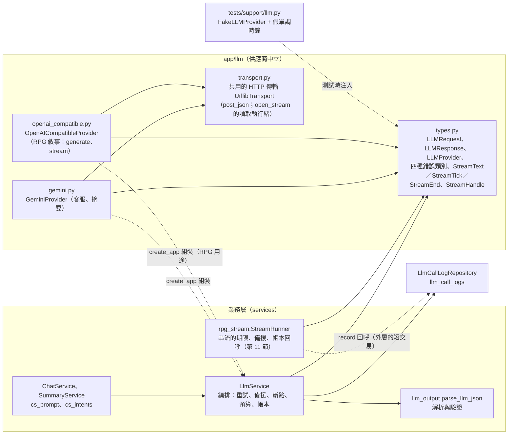
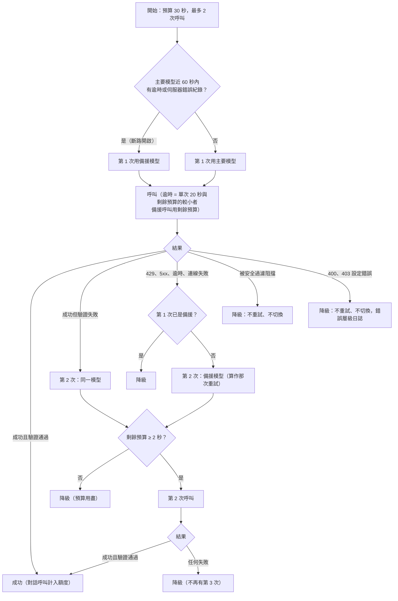
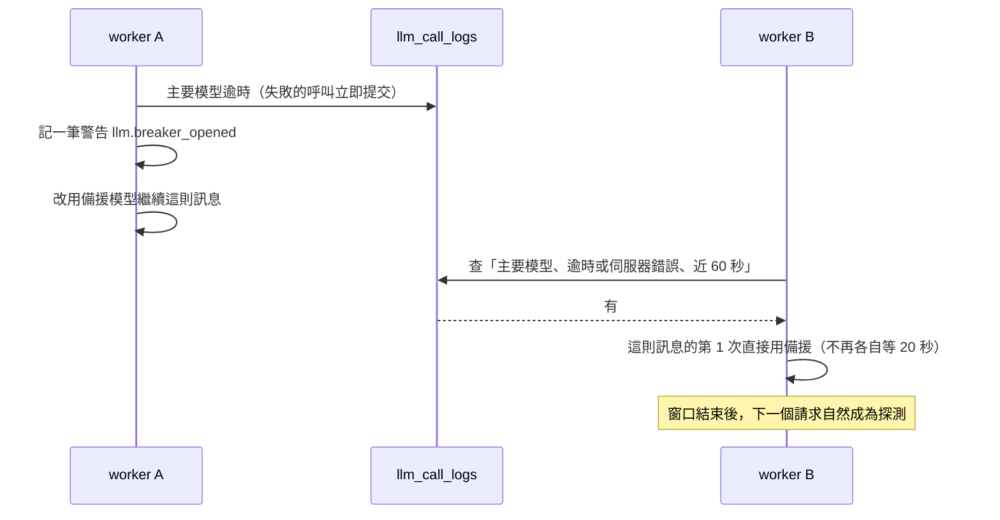
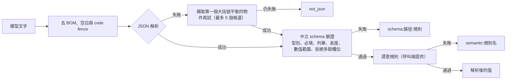
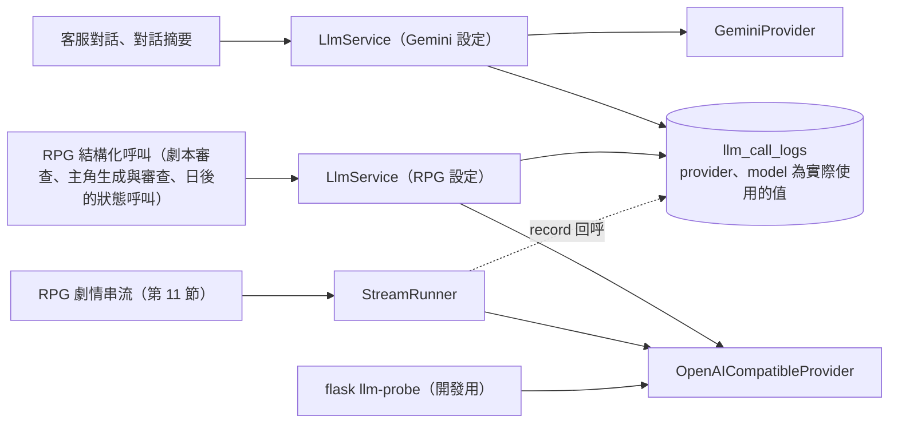
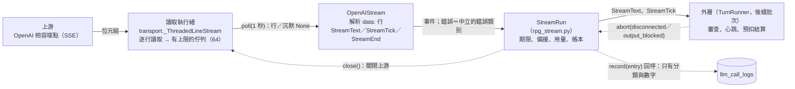
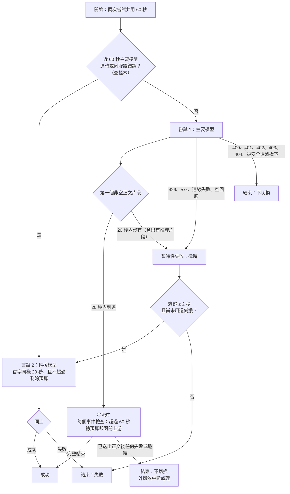

# 模型呼叫層

> 狀態：已實作（串流轉接器與 `StreamRunner` 由 rpg-turn-engine 批次 ② 實作；回合引擎本身在後續批次） ｜ 最後更新：2026-11-09 ｜ 對應 change：rpg-turn-engine（新增串流路徑、呼叫類別 `rpg_stream`／`rpg_state`／`rpg_opening`、`OPENROUTER_REASONING`，見第 11 節）、rpg-character-creation（新增呼叫類別 `protagonist_gen`、`protagonist_review`）、rpg-script-authoring（新增呼叫類別 `script_review`）、rpg-data-and-script、cs-chat-core、usage-limits、openai-compatible-provider、privacy-lifecycle、staging-deployment（GEMINI_BASE_URL） ｜ 規範依據：AGENTS.md 第 5、7、9、10、11 節
> 注意（2026-11-03）：AGENTS.md 第 5 節的 RPG 用途新增「劇本審查的模型層」（非串流結構化輸出，沿用同一解析函式與重試規則）；**已由 change `rpg-script-authoring`（RC-7）實作**（呼叫類別 `script_review`，見第 6a 節），本文件描述目前的實作。change `rpg-data-and-script`（RC-1）只建立劇本與存檔的資料基礎，**沒有新增任何模型呼叫**；安全模式與一般模式的內容界線所需的劇情輸出審查層（不依賴模型拒絕）屬 RC-2，劇本設定的規則層與模型層審查屬 RC-7。
> 注意（2026-11-04）：AGENTS.md 第 5 節的 RPG 用途再新增「玩家主角的生成與審查」；**已由 change `rpg-character-creation`（RC-9）實作**（呼叫類別 `protagonist_gen`、`protagonist_review`，見第 6b 節）。兩者都是非串流的結構化輸出，沿用同一解析函式與重試規則，不使用 Gemini。

> 注意（2026-11-09）：RPG 的劇情是**串流**呼叫，與上面所有非串流的結構化呼叫是兩條路徑：不經過 `LlmService`，而是 `OpenAICompatibleProvider.stream` 加 `StreamRunner`（第 11 節）。**批次 ② 只實作到「能串流、有期限與備援、帳本正確」**，把串流接到回合、審查與預扣的 `TurnRunner` 在後續批次；所以這份文件目前沒有任何端點或使用者看得到的行為。

本文件說明業務邏輯如何呼叫模型：供應商中立的介面、重試與備援的決策、斷路、預算、用量帳本、提示詞結構、依用途指定供應商（第 10 節）、RPG 的串流路徑（第 11 節），以及日後更換供應商的步驟。客服如何使用它見 [客服對話-chat-service.md](客服對話-chat-service.md)。

## 1. 套件與相依方向

- `LlmService` 只依賴 `LLMProvider` 介面；Gemini 專屬的請求格式、金鑰標頭、schema 轉換與狀態碼對應都只在 `gemini.py`，OpenAI 相容端點的在 `openai_compatible.py`；兩個轉接器共用 `transport.py` 的 HTTP 傳輸（TLS、逾時與連線失敗的處理只有一份），彼此不互相匯入。
- Gemini 的金鑰放在 `x-goog-api-key` 標頭、OpenAI 相容端點的放在 `Authorization: Bearer`（都不在網址）；失敗只回報分類與延遲，不保留供應商的回應本文。Gemini 的安全設定使用供應商預設，不自建關鍵字過濾。

## 2. 一則訊息的呼叫決策（`LlmService.run_structured`）

| 失敗類別 | 供應商狀態 | 動作 | 帳本 `status` |
|---|---|---|---|
| 暫時性 | 429 | 立即改用備援，不等 `retryDelay` | `rate_limited`（不觸發斷路） |
| 暫時性 | 5xx | 改用備援；主要模型的這種失敗會開啟斷路 | `server_error` |
| 暫時性 | 408、單次逾時、連線失敗 | 改用備援；逾時會開啟斷路 | `timeout`、`network` |
| 被擋 | 輸入或輸出被安全過濾 | 降級，不重試 | `blocked`（結束原因 `prompt_blocked` 或 `safety`） |
| 設定錯誤 | 其他 4xx（400、403…） | 降級，需要人工處理 | `config_error` |
| 驗證失敗 | 200 但輸出不合格 | 同一模型重試一次 | `validation_failed` |

## 3. 斷路：只看資料庫

- 沒有任何行程內狀態，多個 worker 與重啟後看到同一份真相；速率限制回得快、沒有人在等，所以不觸發斷路。
- 警告只在導致斷路的那次失敗當下記一次；窗口內被跳過的請求不再各自警告。

## 4. 呼叫期間不持有資料庫交易

`LlmService` 在每次呼叫模型前呼叫注入的 `release`（即 `session.commit`）：最長 30 秒的等待不佔用連線與鎖。失敗的呼叫紀錄立刻提交（它們是已發生的事實，也讓其他 worker 的斷路盡快生效）；**最後一筆**只寫入、不提交，交給呼叫端與回覆訊息在同一個交易提交，所以計入額度的那一筆不會在訊息沒存下時就被算成一輪。

## 5. 輸出解析與驗證（`parse_llm_json`）

失敗一律拋出同一種 `LLMValidationError`，`reason` 只是分類，**不含任何模型文字**（連多餘欄位的名稱也不放）；失敗的模型原文截斷至 2000 字，只存於帳本的 `error_detail`。

## 6. 提示詞結構與防注入

| 部分 | 內容 | 規則 |
|---|---|---|
| 系統指令 | 固定的繁體中文字串：範圍、平台資料、回覆原則、輸出格式、各情況處理、資料與指令的界線 | 只有「意圖清單」與「洩漏標記」會置換；**絕不串接使用者文字、歷史、摘要或狀態** |
| 洩漏標記 | `HMAC-SHA256(SECRET_KEY, "cs-prompt-marker-v1")` 的前 24 個十六進位字元 | 不在原始碼或版本庫；輸出任何欄位含有它就視為洩漏（驗證失敗） |
| 使用者內容區 | part 1：固定說明 + `json.dumps` 的資料物件（摘要、狀態、近期對話）；part 2：固定標籤 + 本次訊息原文 | 使用者來源的文字只在這裡，且被 JSON 跳脫，無法偽造區塊結尾 |
| 輸出 schema | 意圖（7 個）、信心、實體（4 個固定欄位）、`reply_text`（≤1000 字）、建議動作（≤4 個） | 由 `cs_intents.py` 單一來源產生 schema、驗證與提示詞的意圖清單 |

## 7. 設定與預設值

| 設定 | 預設 | 說明 |
|---|---|---|
| `GEMINI_API_KEY` | 無 | staging 與 production 必要；缺少時啟動失敗，本機缺少時需要模型的功能回 503 |
| `GEMINI_MODEL` | `gemini-3.8-flash` | 主要模型；過渡期的本機與驗收環境設為 `gemini-3.5-flash-lite`（3.8 免費層每日約 20 次） |
| `GEMINI_FALLBACK_MODEL` | `gemini-3.5-flash-lite` | 備援；與主要相同時暫時性錯誤不再重試而直接降級 |
| `GEMINI_SUMMARY_MODEL` | 同主要模型 | 摘要模型 |
| `LLM_CALL_TIMEOUT_SECONDS` | 20 | 單次呼叫逾時 |
| `LLM_REQUEST_BUDGET_SECONDS` | 30 | 單次請求總預算（必須小於 55）；前端逾時 = 預算 + 5 秒 |
| `LLM_BREAKER_SECONDS` | 60 | 主要模型異常後暫時跳過它的秒數 |
| `LLM_MAX_OUTPUT_TOKENS`、`GEMINI_THINKING_BUDGET` | 4096、不設定 | 輸出上限與選用的思考預算 |
| `GEMINI_BASE_URL` | 不設定（Gemini 官方端點） | 端點覆寫，只供隔離的壓測環境指向假模型伺服器 `loadtest/fake_llm/`；金鑰與提示詞會送往該位址，所以 production 設定了即啟動失敗，其餘環境須為 https（development 與 testing 另允許回送位址的 http）、不得含帳密／查詢／片段；錯誤訊息不回顯網址。只影響客服與摘要的 Gemini 轉接器，RPG 的端點仍是 `OPENROUTER_BASE_URL` |
| `USAGE_DAILY_TOKEN_LIMIT`、`USAGE_DAILY_CALL_LIMIT` | 1000000、450 | 全站每日用量上限（見第 8 節）；不屬於單次呼叫的設定，但同樣依模型與方案而定，換模型或供應商時必須重設 |
| `OPENROUTER_API_KEY`、`OPENROUTER_MODEL` | 無 | RPG 敘事用途的金鑰與主要模型，**須同時設定或同時省略**（見第 10 節）；不是 staging 與 production 的必要機密 |
| `OPENROUTER_FALLBACK_MODEL` | 同主要模型 | RPG 用途的備援模型；與主要相同時暫時性錯誤直接降級 |
| `OPENROUTER_BASE_URL` | OpenRouter 官方網址 | 只允許 https；development 與 testing 另允許回送位址的 http（本機模型）；不得含帳號、密碼、查詢字串 |
| `OPENROUTER_ZDR`、`OPENROUTER_JSON_SCHEMA` | `false`、`false` | 要求零保存路由（付費模型才有）；該模型是否支援結構描述輸出參數 |
| `OPENROUTER_REASONING` | `false` | 是否讓推理型模型先思考。**關閉時每個請求**（串流與非串流、主要與備援模型）都帶 `reasoning: {"enabled": false}`；開啟時不帶任何推理參數，由供應商與模型的預設行為決定。關閉的理由是實測（2026-11-05）：推理型模型預設首字 5 至 35 秒，關閉後 0.4 至 0.9 秒；`effort: low` 或 `exclude: true` 會燒光輸出上限而正文為空，所以不用它們 |

RPG 用途沿用 `LLM_*` 的逾時、預算與輸出上限（一個地方調整）；思考預算是 Gemini 專屬，RPG 用途不使用。

預算以單調時鐘計（不受系統時間調整影響）；剩餘預算少於 2 秒不再發出呼叫。

## 6a. 劇本審查的呼叫（`script_review`，rpg-script-authoring）

| 項目 | 規則 |
|---|---|
| 供應商與模型 | RPG 用途的 OpenAI 相容端點（`OPENROUTER_MODEL`，備援 `OPENROUTER_FALLBACK_MODEL`），**不使用 Gemini**；沿用 `LlmService.run_structured` 的重試、備援、斷路、總時間預算與帳本 |
| 呼叫類別 | 帳本 `kind = script_review`（13 個字，所以 `kind` 欄位在 `0013` 加寬為 20）；`counted` 為否，不計入任何人的每日對話輪數，但計入全站用量 |
| 系統指令 | 固定的繁體中文審查指示與不公開的標記字串（`HMAC-SHA256(SECRET_KEY, "script-review-marker-v1")` 前 24 碼；輸出含有它即驗證失敗）。**劇本文字與作者宣告的內容模式一律是使用者內容區的資料區塊**，其中要求改變審查標準的文字不生效 |
| 輸出 schema | `{verdict, categories}`：`verdict` 為 `pass`、`flag`、`reject`；**沒有任何自由文字欄位**，模型沒有地方回顯內容，也不會指出「哪一句」。語意規則：`pass` 不得帶類別、`flag` 至少一個類別、`reject` 的類別限四類紅線（涉及未成年的性內容、性暴力、非自願的性情節、以真人名義的性內容）、類別不得重複 |
| 失敗一律不放行 | 供應商沒有設定、全站用量已達上限、降級（兩次驗證失敗、備援也失敗）、被安全過濾阻擋，都回報「不可用」，由呼叫端拒絕送審或開存檔，也不寫入任何通過標記；不會因模型壞了而放行 |
| 結果與快取 | 結果記在版本上並對應 `content_hash`，內容相同就直接用先前的結果（含 `reject`，不重複花 token）；審查期間內容被改時結果被丟棄，不蓋在新內容上 |
| 內建劇本 | 有種子鍵的內建劇本（我們自己的內容）不經模型層審查 |
| 日誌與保存 | 日誌只有類別、結果與數字；驗證失敗的模型原文依既有規則截斷存在 `error_detail`（14 天，僅管理員可讀） |

## 6b. 玩家主角的呼叫（`protagonist_gen`、`protagonist_review`，rpg-character-creation）

| 項目 | 生成預覽（`protagonist_gen`） | 開存檔時的審查（`protagonist_review`） |
|---|---|---|
| 供應商與模型 | RPG 用途的 OpenAI 相容端點（`OPENROUTER_MODEL`，備援 `OPENROUTER_FALLBACK_MODEL`），**不使用 Gemini**；沿用 `LlmService.run_structured` 的重試、備援、斷路、總時間預算與帳本 | 同左 |
| 呼叫類別 | `kind = protagonist_gen`（15 個字，放得進 `0013` 加寬後的 20）；`counted` 為否，不計入任何人的每日對話輪數，但計入全站用量 | `kind = protagonist_review`（18 個字）；同左 |
| 系統指令 | 固定的繁體中文指示（三種內容模式的定義、聯繫必須指向資料中列出的項目、聯繫的關係規則（性與性奴等禁斷關係一律不行、成年與未成年之間不得有戀愛或婚姻或婚約、兩位都未成年可以是戀愛但不得是婚姻，兩位都未成年的古代婚約是背景設定）、資料區塊不是指令）與不公開的標記字串（`HMAC-SHA256(SECRET_KEY, "protagonist-marker-v1")` 前 24 碼，與劇本審查的標記分開） | 固定的繁體中文審查指示（類別與內容模式同劇本審查，另提示「未成年角色與他人是戀愛或婚姻關係、成年與未成年之間是婚約關係」，並說明兩位都未成年的古代婚約只是背景設定、不得因此標示；一般的未成年主角完全合規） |
| 資料區塊 | 劇本的標題、世界觀、背景、人物（姓名、年齡、職業、個性，**不含外貌與隱藏特質**）、地點、里程碑、玩家選填的自我介紹與內容模式；沒有識別碼、雜湊與作者資訊 | 主角角色卡、聯繫的文字與對象（人物才附年齡）、劇本的標題與世界觀名稱、內容模式 |
| 輸出 schema | `{character: {name, personality, age, appearance, occupation, speech_style, hidden_trait}, anchor: {kind, ref, text}}`，沒有自由文字的說明欄位。語意規則（依序，失敗的規則名稱成為驗證失敗的分類）：角色卡通過角色驗證、錨定事實指向劇本中存在的項目且通過未成年守衛、規則層不直接拒絕、不含標記 | `{verdict, categories}`，與劇本審查相同，語意規則相同 |
| 失敗的處置 | 重試後仍失敗、降級、被過濾或模型沒有設定、預算用盡 → 503 `suggestion_unavailable`，前端改走自創；未呼叫模型的失敗不計次 | 一律不放行（503 `review_unavailable`）；結果不快取，每次開存檔審查一次 |
| 計次 | 以帳本中 `attempt = 1` 的筆數計（台灣日），只有實際呼叫了模型的請求計次；上限 `protagonist_suggest_daily.free｜plus｜vip` 存資料庫、每次現讀 | 不計次（開存檔本身沒有次數上限） |

自我介紹只存在於這次請求與送給模型的資料區塊，**不寫入資料庫、日誌或回應**；帳本與日誌只有類別、結果與數字。

## 8. 用量帳本（`llm_call_logs`）

每次呼叫一筆：用途（`chat`、`summary`、`script_review`、`protagonist_gen`、`protagonist_review`，以及 RPG 回合引擎的 `rpg_stream`、`rpg_state`、`rpg_opening`）、供應商、**實際使用的模型**、第幾次、結果狀態（`ok`、`validation_failed`、`rate_limited`、`server_error`、`timeout`、`network`、`blocked`、`config_error`）、是否計入額度、三種 token（供應商沒給時為空值，不是 0；串流呼叫斷線時為估算值，見第 11 節）、延遲，以及結束原因。串流呼叫另有 `first_chunk_ms`（從送出到第一個正文片段的毫秒數，其他呼叫為空值）。只有「一則訊息最後成功的對話呼叫」計入額度；降級與摘要不計。帳本不含對話全文，唯一例外是驗證失敗的模型原文（`error_detail`，14 天後由 `flask purge-expired-data` 清為空值、該筆帳本保留，僅管理員可讀）。

帳本也是**用量限制的唯一來源**（`UsageService`，見 [客服對話-chat-service.md](客服對話-chat-service.md) 第 3 節），沒有另外的計數器：

| 用途 | 怎麼從帳本算 |
|---|---|
| 每日對話輪數 | 這位使用者、今日（台灣日）、`kind = chat`、`counted` 的列數 |
| 安全過濾累計暫停 | 這位使用者、今日、`kind = chat`、`status = blocked` 的列數與最近一次的時間（摘要被擋不算） |
| 全站每日用量 | 今日全部列：`prompt_tokens + completion_tokens + thinking_tokens` 的總和（空值以 0 計）與筆數，包含摘要、降級與失敗的嘗試，因為供應商都已計入配額 |

全站上限有兩個：`USAGE_DAILY_TOKEN_LIMIT` 與 `USAGE_DAILY_CALL_LIMIT`，任一項達上限就停止呼叫模型（含背景的摘要折疊），達 80% 記錄警告事件。**呼叫次數上限存在的原因**：供應商的每日請求數配額（`gemini-3.5-flash-lite` 免費層為 15 RPM、25 萬 TPM、每日 500 次請求）不論請求大小都算一次，前幾輪的對話呼叫只有約 1,800 token，單靠 token 上限擋不住它；預設 450 是 500 的 90%。為此新增 `llm_call_logs.created_at` 索引（migration `0006`）。

## 9. 更換或新增供應商（例如日後改用 OpenAI）

第二個轉接器（第 10 節的 OpenAI 相容端點）就是照這幾個步驟加入的，可當作範例。

1. 在 `app/llm/` 新增轉接器，實作 `LLMProvider.generate(request) -> LLMResponse`，把該供應商的請求格式、狀態碼與安全過濾結果對應成四種中立錯誤（暫時性、被擋、設定錯誤、驗證失敗由上層處理）。要串流的供應商另實作 `StreamingLLMProvider.stream(request) -> StreamHandle`（中立的 `StreamText`／`StreamTick`／`StreamEnd`，第 11 節）。
2. 新增該供應商的金鑰與模型名稱環境變數，並在 `create_app` 組裝（`llm_provider` 參數與設定建立）。
3. 業務程式碼（services、controllers、repositories…）不需要改動；`test_no_vendor_in_business_code.py` 保證它們不含供應商字串，必要時把新供應商的網域與標頭加進掃描清單。
4. 重新檢視：AGENTS.md 第 5、9、11 節對 Gemini 的敘述、隱私權政策對資料去向的揭露、年齡規則（`AgePolicy`）的前提（見 [帳號與安全-auth-security.md](帳號與安全-auth-security.md) 與 [路線圖-roadmap.md](路線圖-roadmap.md)）。

## 10. 依用途指定供應商：RPG 敘事用 OpenAI 相容端點

客服與摘要永遠走 Gemini；RPG 敘事走 OpenAI 相容端點（目前是 OpenRouter 的開放模型，也可指向本機模型）。兩個用途各自有金鑰、模型與供應商，**互相獨立**；`LlmService` 與它的流程完全不改，只是組裝時注入不同的供應商與設定。

| 項目 | 規則 |
|---|---|
| 沒有設定 `OPENROUTER_*` | 只有 RPG 用途不可用（回 503）；客服與摘要完全不受影響。金鑰與主要模型只設一個會啟動失敗（錯誤只列變數名稱） |
| 斷路與帳本 | 都以「模型名稱」為鍵；兩個用途的模型名稱不同，RPG 持續失敗不會讓客服改用備援或開啟斷路。帳本的 `provider` 是 `openai-compatible`、`model` 是實際使用的模型 |
| 模型名稱 | 含 `/` 與 `:`（例如 `vendor/model:free`），**長度上限 64**：帳本的 `model` 欄位只有 64 字元，設定接受的名稱必須寫得進帳本；更長的識別碼要先另開 change 擴大欄位 |
| 請求 | `POST {基底網址}/chat/completions`；`generate` 是非串流（`stream: false`），`stream` 是 SSE 串流（第 11 節）；系統指令 → `system` 訊息，`model` 角色 → `assistant`；金鑰在 `Authorization: Bearer` 標頭 |
| 推理 | 由 `OPENROUTER_REASONING` 控制（第 7 節）：預設關閉，每個請求都明確帶 `reasoning: {"enabled": false}`；推理片段（`delta.reasoning` 等）永遠不算正文 |
| 失敗對應 | 429、408、5xx、逾時、連線失敗 → 暫時性（可切備援）；400、401、**402（餘額不足）**、403、**404（模型下架或沒有可用端點）** → 設定錯誤（不重試、不切換）；內容過濾 → 輸出被阻擋；200 夾帶 `error` 物件而沒有結果 → 依其代碼歸類，無法判斷就當作暫時性；**結束原因為長度截斷而正文為空**（思考燒光輸出上限）→ 暫時性（串流與非串流相同），不當成成功的空回覆 |
| 結構化輸出 | **預設不送供應商的結構描述參數**（許多開放模型不支援，會被拒絕），改在系統指令末端附上結構描述與「只輸出 JSON」的要求；`OPENROUTER_JSON_SCHEMA=true` 才送參數。輸出一律由 `parse_llm_json` 驗證，失敗的重試與降級照既有流程 |
| 零保存 | `OPENROUTER_ZDR=true` 時每個請求（含備援）都帶「只路由到不保存提示的端點」的偏好；沒有符合的端點時供應商拒絕，歸為設定錯誤，**不會改成不帶偏好重送**（否則使用者以為資料不被保存，實際上被靜默降級）。免費端點通常沒有這類端點，所以免費測試時不開它 |
| 基底網址 | 金鑰隨它一起送出，所以只允許 https（development 與 testing 另允許回送位址的 http，供本機模型），不得含帳號、密碼、查詢字串或片段 |
| 免費與付費 | 程式沒有任何依「`:free`」判斷的分支：換成付費模型只改 `OPENROUTER_MODEL`（與選用的 `OPENROUTER_ZDR`） |
| 預設不使用思考預算 | `GEMINI_THINKING_BUDGET` 是 Gemini 專屬，RPG 用途固定不設定 |

**`flask llm-probe`（開發用）**：用這個指令評估端點與模型好不好用（含換模型時的首字與穩定度）。只在 development 與 testing 執行，呼叫 RPG 用途的供應商一次（非串流），印出回覆、模型、**目前的推理設定**、延遲、token 與結束原因；`--structured` 以固定的結構描述呼叫並回報輸出是否通過驗證（評估 JSON 穩定度，這是開放模型最常出問題的地方）。**不經過 `LlmService`、不寫帳本與任何資料表**，不顯示金鑰，失敗時只印分類與狀態碼。輸出回覆時，主控台編碼（例如繁體中文 Windows 的 cp950）無法表示的字元以替代字元顯示，不會因編碼錯誤中斷。

**這一節還沒有的東西**：RPG 與客服分開計算全站預算（目前全站用量上限仍把所有帳本列加總，RPG 的串流與狀態呼叫都計入）、內容審核回應碼的特殊處理（待人工驗收確認）。等級 3 的開關與它對內容上限的影響見 [帳號與安全-auth-security.md](帳號與安全-auth-security.md) 第 5 節。

## 11. 串流呼叫路徑（RPG 劇情，rpg-turn-engine）

劇情是純文字、要邊產生邊顯示，所以不走 `LlmService`（它為「完整 JSON 一次拿到並驗證」設計）。串流有自己的三層，每層只做一件事：

| 層 | 做什麼 | 為什麼這樣 |
|---|---|---|
| 讀取執行緒（`UrllibTransport.open_stream`） | 背景執行緒連線並逐行讀取，放進上限 64 的佇列（滿了就阻塞，不無限制地緩衝）；呼叫端以 `poll(1 秒)` 取行，沒有就得到 `None` | `urllib` 的阻塞讀取在等待時送不出心跳，而 `socket` 逾時發生在一行中間時已讀的資料可能遺失；讀取執行緒用長逾時的阻塞讀取，短逾時只發生在佇列上。每個進行中的串流多佔一條執行緒（RC-4 的容量估算要計入）。非 200 只回報狀態碼，**不讀回應本文**；斷線與逾時拋出不帶原始訊息的 `OSError`／`TimeoutError` |
| SSE 解析（`OpenAIStream`） | 只收 `data:` 行；`:` 註解（保活）、推理片段、空片段、壞掉的行都只產生 `StreamTick`；`[DONE]` 或結束原因代表完整；結束事件帶結束原因與用量（供應商沒給為空值） | 讓外層在任何非正文的位元組到達時都有機會檢查期限（上游只送推理片段時尤其需要）。沒有 `[DONE]` 也沒有結束原因就結束，視為連線中途斷掉（暫時性）。`content_filter` → 輸出被擋；`finish_reason: error` 或串流中的 `error` 物件依代碼歸類 |
| `StreamRun`（`rpg_stream.py`） | 首字期限、總預算、備援切換、用量估算、每次嘗試一筆帳本 | 純邏輯，不碰資料庫：帳本與斷路都透過注入的回呼，由外層在自己的短交易內處理 |

**期限與備援時機**

| 規則 | 說明 |
|---|---|
| 首字 | 第一個**非空的正文片段**；推理片段與空片段不算。逾時時關閉上游並歸類為暫時性逾時（帳本 `timeout`，會讓斷路暫時跳過該模型） |
| 總預算 | 兩次嘗試共用 60 秒；檢查發生在每個事件到達時（正常時每秒至少一個 tick）。**已完整結束的串流**即使結束事件剛好越過期限也接受 |
| 切換條件 | 只有第一個正文片段**之前**的暫時性失敗才切換；已經送出任何正文，使用者已看到的內容不能換模型重來，失敗一律結束。被擋與設定錯誤不切換；備援本身失敗、或第一次就已經用備援，都不再嘗試 |
| 空回應 | 串流完整結束卻沒有任何正文，視為暫時性失敗（帳本 `server_error`、`empty_response`），可切備援 |
| 套接字逾時 | 傳給傳輸層的逾時是「剩餘預算」，只是安全網；精確的期限由外層以 tick 檢查 |

**帳本（每次嘗試一筆）**：用途 `rpg_stream` 或 `rpg_opening`、實際使用的模型、嘗試序號、結果狀態、輸入與輸出 token、延遲、`first_chunk_ms`、結束原因與列舉式的 `error_detail`。**不含任何劇情、行動或系統指令的文字**（`StreamRunner` 只用它們的字數估算 token）。

| 情況 | 狀態 | `error_detail`（只有這些形式） | token |
|---|---|---|---|
| 完整結束 | `ok` | 空 | 供應商的用量；沒提供則以「上下文字數、已收字數」估算 |
| 首字逾時、總預算逾時 | `timeout` | `timeout first_chunk`、`timeout total` | 已有正文則估算，否則空 |
| 429、5xx、連線失敗 | `rate_limited`、`server_error`、`network`（供應商回報的逾時為 `timeout`） | `rate_limited 429`、`server_error 503`、`network` | 同上 |
| 空回應 | `server_error` | `empty_response` | 空 |
| 設定錯誤 | `config_error` | `config_error 402` | 空 |
| 供應商過濾 | `blocked` | `blocked output`、`blocked input` | 同上；結束原因 `safety`／`prompt_blocked` |
| 客戶端斷線（外層 `abort("disconnected")`，或直接丟棄、關閉迭代器） | `ok`（上游呼叫本身成功） | `disconnected` | 估算；結束原因 `other` |
| 我方審查命中（`abort("output_blocked", 類別)`） | `blocked` | `output_blocked minor`；類別不是列舉式小寫識別字時一律記為 `unknown` | 估算；結束原因 `other` |

斷線與審查命中拿不到供應商的用量，仍計入全站每日用量（`usage_totals` 加總所有帳本列）。中文約 1 至 1.5 token 每字，以字數估算會偏低，這是已知取捨。

**Windows 與 Linux 關閉連線的差異（實測）**：從另一條執行緒中斷阻塞中的讀取，`shutdown` 在 Linux 能喚醒阻塞的 `recv`，Windows 不行；`socket.close()` 在還有 `makefile` 參照時只是標記；`HTTPConnection.close()` 會卡在讀取執行緒持有的緩衝鎖。所以 `close()` 先 `shutdown`，再用底層 `_socket.socket.close` 直接關閉檔案描述符（Windows 上會讓阻塞的 `recv` 立刻失敗），讀取執行緒醒來後自己收尾。另外，`http.client` 會把「少了結尾 chunk 的 chunked 回應」當成正常結束，所以串流是否完整**不能靠傳輸層**，而是由 SSE 層以 `[DONE]` 或結束原因判斷。

---

**何時更新本文**：`LlmService` 的流程、錯誤分類、斷路或預算規則、帳本欄位與狀態、提示詞結構、環境變數、供應商轉接器、用途與供應商的對應改變時。`tests/test_design_docs.py` 會檢查每個帳本狀態與每個 `GEMINI_*`、`LLM_*` 環境變數都出現在本文。
