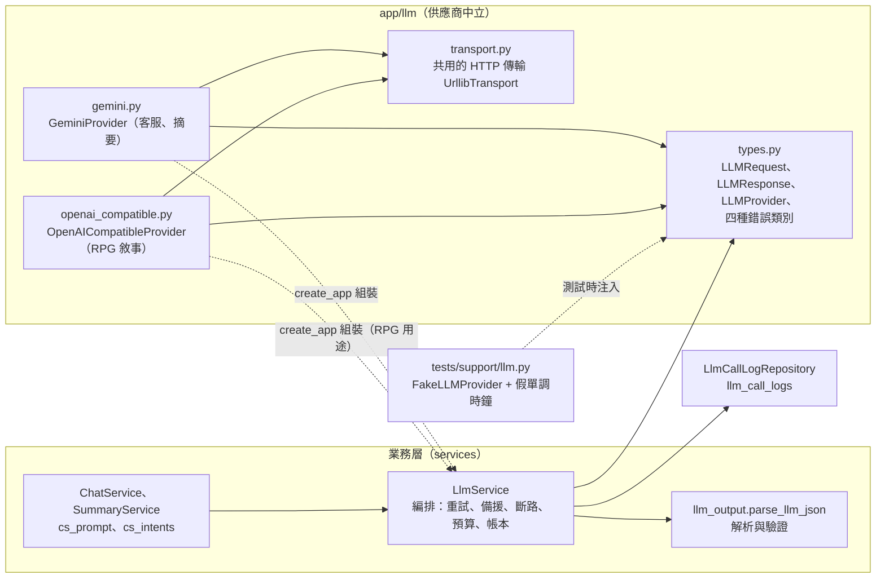
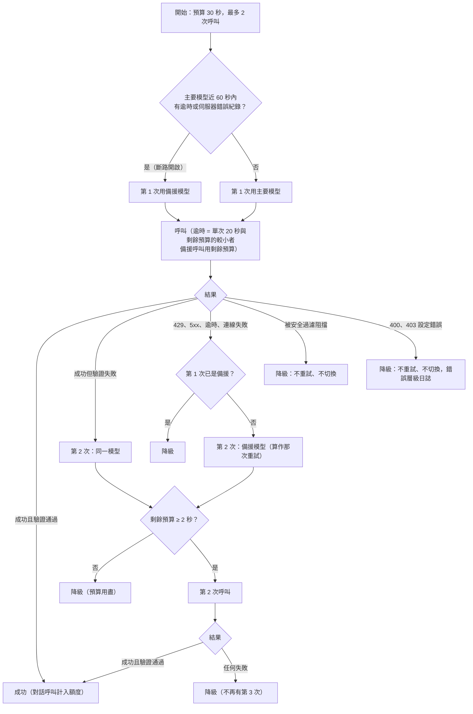
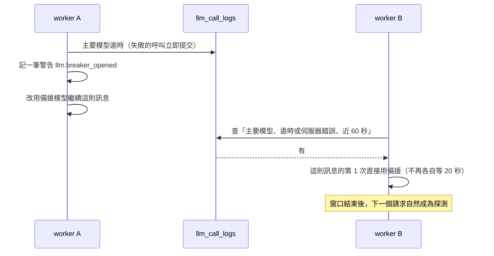
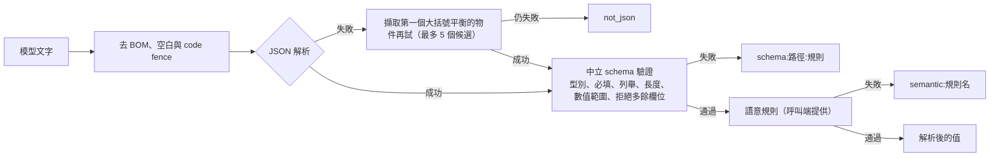
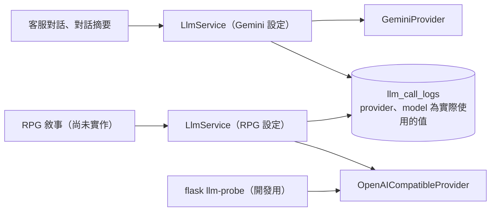

# 模型呼叫層

> 狀態：已實作（串流呼叫由 RPG 實作） ｜ 最後更新：2026-10-30 ｜ 對應 change：cs-chat-core、usage-limits、openai-compatible-provider ｜ 規範依據：AGENTS.md 第 5、7、9、10、11 節

本文件說明業務邏輯如何呼叫模型：供應商中立的介面、重試與備援的決策、斷路、預算、用量帳本、提示詞結構、依用途指定供應商（第 10 節），以及日後更換供應商的步驟。客服如何使用它見 [客服對話-chat-service.md](客服對話-chat-service.md)。

## 1. 套件與相依方向

- `LlmService` 只依賴 `LLMProvider` 介面；Gemini 專屬的請求格式、金鑰標頭、schema 轉換與狀態碼對應都只在 `gemini.py`，OpenAI 相容端點的在 `openai_compatible.py`；兩個轉接器共用 `transport.py` 的 HTTP 傳輸（TLS、逾時與連線失敗的處理只有一份），彼此不互相匯入。
- Gemini 的金鑰放在 `x-goog-api-key` 標頭、OpenAI 相容端點的放在 `Authorization: Bearer`（都不在網址）；失敗只回報分類與延遲，不保留供應商的回應本文。Gemini 的安全設定使用供應商預設，不自建關鍵字過濾。

## 2. 一則訊息的呼叫決策（`LlmService.run_structured`）

| 失敗類別 | 供應商狀態 | 動作 | 帳本 `status` |
|---|---|---|---|
| 暫時性 | 429 | 立即改用備援，不等 `retryDelay` | `rate_limited`（不觸發斷路） |
| 暫時性 | 5xx | 改用備援；主要模型的這種失敗會開啟斷路 | `server_error` |
| 暫時性 | 408、單次逾時、連線失敗 | 改用備援；逾時會開啟斷路 | `timeout`、`network` |
| 被擋 | 輸入或輸出被安全過濾 | 降級，不重試 | `blocked`（結束原因 `prompt_blocked` 或 `safety`） |
| 設定錯誤 | 其他 4xx（400、403…） | 降級，需要人工處理 | `config_error` |
| 驗證失敗 | 200 但輸出不合格 | 同一模型重試一次 | `validation_failed` |

## 3. 斷路：只看資料庫

- 沒有任何行程內狀態，多個 worker 與重啟後看到同一份真相；速率限制回得快、沒有人在等，所以不觸發斷路。
- 警告只在導致斷路的那次失敗當下記一次；窗口內被跳過的請求不再各自警告。

## 4. 呼叫期間不持有資料庫交易

`LlmService` 在每次呼叫模型前呼叫注入的 `release`（即 `session.commit`）：最長 30 秒的等待不佔用連線與鎖。失敗的呼叫紀錄立刻提交（它們是已發生的事實，也讓其他 worker 的斷路盡快生效）；**最後一筆**只寫入、不提交，交給呼叫端與回覆訊息在同一個交易提交，所以計入額度的那一筆不會在訊息沒存下時就被算成一輪。

## 5. 輸出解析與驗證（`parse_llm_json`）

失敗一律拋出同一種 `LLMValidationError`，`reason` 只是分類，**不含任何模型文字**（連多餘欄位的名稱也不放）；失敗的模型原文截斷至 2000 字，只存於帳本的 `error_detail`。

## 6. 提示詞結構與防注入

| 部分 | 內容 | 規則 |
|---|---|---|
| 系統指令 | 固定的繁體中文字串：範圍、平台資料、回覆原則、輸出格式、各情況處理、資料與指令的界線 | 只有「意圖清單」與「洩漏標記」會置換；**絕不串接使用者文字、歷史、摘要或狀態** |
| 洩漏標記 | `HMAC-SHA256(SECRET_KEY, "cs-prompt-marker-v1")` 的前 24 個十六進位字元 | 不在原始碼或版本庫；輸出任何欄位含有它就視為洩漏（驗證失敗） |
| 使用者內容區 | part 1：固定說明 + `json.dumps` 的資料物件（摘要、狀態、近期對話）；part 2：固定標籤 + 本次訊息原文 | 使用者來源的文字只在這裡，且被 JSON 跳脫，無法偽造區塊結尾 |
| 輸出 schema | 意圖（7 個）、信心、實體（4 個固定欄位）、`reply_text`（≤1000 字）、建議動作（≤4 個） | 由 `cs_intents.py` 單一來源產生 schema、驗證與提示詞的意圖清單 |

## 7. 設定與預設值

| 設定 | 預設 | 說明 |
|---|---|---|
| `GEMINI_API_KEY` | 無 | staging 與 production 必要；缺少時啟動失敗，本機缺少時需要模型的功能回 503 |
| `GEMINI_MODEL` | `gemini-3.8-flash` | 主要模型；過渡期的本機與驗收環境設為 `gemini-3.5-flash-lite`（3.8 免費層每日約 20 次） |
| `GEMINI_FALLBACK_MODEL` | `gemini-3.5-flash-lite` | 備援；與主要相同時暫時性錯誤不再重試而直接降級 |
| `GEMINI_SUMMARY_MODEL` | 同主要模型 | 摘要模型 |
| `LLM_CALL_TIMEOUT_SECONDS` | 20 | 單次呼叫逾時 |
| `LLM_REQUEST_BUDGET_SECONDS` | 30 | 單次請求總預算（必須小於 55）；前端逾時 = 預算 + 5 秒 |
| `LLM_BREAKER_SECONDS` | 60 | 主要模型異常後暫時跳過它的秒數 |
| `LLM_MAX_OUTPUT_TOKENS`、`GEMINI_THINKING_BUDGET` | 4096、不設定 | 輸出上限與選用的思考預算 |
| `USAGE_DAILY_TOKEN_LIMIT`、`USAGE_DAILY_CALL_LIMIT` | 1000000、450 | 全站每日用量上限（見第 8 節）；不屬於單次呼叫的設定，但同樣依模型與方案而定，換模型或供應商時必須重設 |
| `OPENROUTER_API_KEY`、`OPENROUTER_MODEL` | 無 | RPG 敘事用途的金鑰與主要模型，**須同時設定或同時省略**（見第 10 節）；不是 staging 與 production 的必要機密 |
| `OPENROUTER_FALLBACK_MODEL` | 同主要模型 | RPG 用途的備援模型；與主要相同時暫時性錯誤直接降級 |
| `OPENROUTER_BASE_URL` | OpenRouter 官方網址 | 只允許 https；development 與 testing 另允許回送位址的 http（本機模型）；不得含帳號、密碼、查詢字串 |
| `OPENROUTER_ZDR`、`OPENROUTER_JSON_SCHEMA` | `false`、`false` | 要求零保存路由（付費模型才有）；該模型是否支援結構描述輸出參數 |

RPG 用途沿用 `LLM_*` 的逾時、預算與輸出上限（一個地方調整）；思考預算是 Gemini 專屬，RPG 用途不使用。

預算以單調時鐘計（不受系統時間調整影響）；剩餘預算少於 2 秒不再發出呼叫。

## 8. 用量帳本（`llm_call_logs`）

每次呼叫一筆：用途（`chat`、`summary`）、供應商、**實際使用的模型**、第幾次、結果狀態（`ok`、`validation_failed`、`rate_limited`、`server_error`、`timeout`、`network`、`blocked`、`config_error`）、是否計入額度、三種 token（供應商沒給時為空值，不是 0）、延遲與結束原因。只有「一則訊息最後成功的對話呼叫」計入額度；降級與摘要不計。帳本不含對話全文，唯一例外是驗證失敗的模型原文（`error_detail`，14 天後清除、僅管理員可讀，清除由 C-4c 實作）。

帳本也是**用量限制的唯一來源**（`UsageService`，見 [客服對話-chat-service.md](客服對話-chat-service.md) 第 3 節），沒有另外的計數器：

| 用途 | 怎麼從帳本算 |
|---|---|
| 每日對話輪數 | 這位使用者、今日（台灣日）、`kind = chat`、`counted` 的列數 |
| 安全過濾累計暫停 | 這位使用者、今日、`kind = chat`、`status = blocked` 的列數與最近一次的時間（摘要被擋不算） |
| 全站每日用量 | 今日全部列：`prompt_tokens + completion_tokens + thinking_tokens` 的總和（空值以 0 計）與筆數，包含摘要、降級與失敗的嘗試，因為供應商都已計入配額 |

全站上限有兩個：`USAGE_DAILY_TOKEN_LIMIT` 與 `USAGE_DAILY_CALL_LIMIT`，任一項達上限就停止呼叫模型（含背景的摘要折疊），達 80% 記錄警告事件。**呼叫次數上限存在的原因**：供應商的每日請求數配額（`gemini-3.5-flash-lite` 免費層為 15 RPM、25 萬 TPM、每日 500 次請求）不論請求大小都算一次，前幾輪的對話呼叫只有約 1,800 token，單靠 token 上限擋不住它；預設 450 是 500 的 90%。為此新增 `llm_call_logs.created_at` 索引（migration `0006`）。

## 9. 更換或新增供應商（例如日後改用 OpenAI）

第二個轉接器（第 10 節的 OpenAI 相容端點）就是照這幾個步驟加入的，可當作範例。

1. 在 `app/llm/` 新增轉接器，實作 `LLMProvider.generate(request) -> LLMResponse`，把該供應商的請求格式、狀態碼與安全過濾結果對應成四種中立錯誤（暫時性、被擋、設定錯誤、驗證失敗由上層處理）。
2. 新增該供應商的金鑰與模型名稱環境變數，並在 `create_app` 組裝（`llm_provider` 參數與設定建立）。
3. 業務程式碼（services、controllers、repositories…）不需要改動；`test_no_vendor_in_business_code.py` 保證它們不含供應商字串，必要時把新供應商的網域與標頭加進掃描清單。
4. 重新檢視：AGENTS.md 第 5、9、11 節對 Gemini 的敘述、隱私權政策對資料去向的揭露、年齡規則（`AgePolicy`）的前提（見 [帳號與安全-auth-security.md](帳號與安全-auth-security.md) 與 [路線圖-roadmap.md](路線圖-roadmap.md)）。

## 10. 依用途指定供應商：RPG 敘事用 OpenAI 相容端點

客服與摘要永遠走 Gemini；RPG 敘事走 OpenAI 相容端點（目前是 OpenRouter 的開放模型，也可指向本機模型）。兩個用途各自有金鑰、模型與供應商，**互相獨立**；`LlmService` 與它的流程完全不改，只是組裝時注入不同的供應商與設定。

| 項目 | 規則 |
|---|---|
| 沒有設定 `OPENROUTER_*` | 只有 RPG 用途不可用（回 503）；客服與摘要完全不受影響。金鑰與主要模型只設一個會啟動失敗（錯誤只列變數名稱） |
| 斷路與帳本 | 都以「模型名稱」為鍵；兩個用途的模型名稱不同，RPG 持續失敗不會讓客服改用備援或開啟斷路。帳本的 `provider` 是 `openai-compatible`、`model` 是實際使用的模型 |
| 模型名稱 | 含 `/` 與 `:`（例如 `vendor/model:free`），**長度上限 64**：帳本的 `model` 欄位只有 64 字元，設定接受的名稱必須寫得進帳本；更長的識別碼要先另開 change 擴大欄位 |
| 請求 | 非串流的 `POST {基底網址}/chat/completions`；系統指令 → `system` 訊息，`model` 角色 → `assistant`；金鑰在 `Authorization: Bearer` 標頭 |
| 失敗對應 | 429、408、5xx、逾時、連線失敗 → 暫時性（可切備援）；400、401、**402（餘額不足）**、403、**404（模型下架或沒有可用端點）** → 設定錯誤（不重試、不切換）；內容過濾 → 輸出被阻擋；200 夾帶 `error` 物件而沒有結果 → 依其代碼歸類，無法判斷就當作暫時性 |
| 結構化輸出 | **預設不送供應商的結構描述參數**（許多開放模型不支援，會被拒絕），改在系統指令末端附上結構描述與「只輸出 JSON」的要求；`OPENROUTER_JSON_SCHEMA=true` 才送參數。輸出一律由 `parse_llm_json` 驗證，失敗的重試與降級照既有流程 |
| 零保存 | `OPENROUTER_ZDR=true` 時每個請求（含備援）都帶「只路由到不保存提示的端點」的偏好；沒有符合的端點時供應商拒絕，歸為設定錯誤，**不會改成不帶偏好重送**（否則使用者以為資料不被保存，實際上被靜默降級）。免費端點通常沒有這類端點，所以免費測試時不開它 |
| 基底網址 | 金鑰隨它一起送出，所以只允許 https（development 與 testing 另允許回送位址的 http，供本機模型），不得含帳號、密碼、查詢字串或片段 |
| 免費與付費 | 程式沒有任何依「`:free`」判斷的分支：換成付費模型只改 `OPENROUTER_MODEL`（與選用的 `OPENROUTER_ZDR`） |
| 預設不使用思考預算 | `GEMINI_THINKING_BUDGET` 是 Gemini 專屬，RPG 用途固定不設定 |

**`flask llm-probe`（開發用）**：RPG 尚未實作，所以用這個指令在它出現之前評估端點好不好用。只在 development 與 testing 執行，呼叫 RPG 用途的供應商一次，印出回覆、模型、延遲、token 與結束原因；`--structured` 以固定的結構描述呼叫並回報輸出是否通過驗證（評估 JSON 穩定度，這是開放模型最常出問題的地方）。**不經過 `LlmService`、不寫帳本與任何資料表**，不顯示金鑰，失敗時只印分類與狀態碼。

**這一節還沒有的東西**：串流（`stream()`，留給 RPG 的回合引擎，屆時共用請求組裝）、RPG 與客服分開計算全站預算（RPG 呼叫出現時才有意義；目前全站用量上限仍把所有帳本列加總）、內容審核回應碼的特殊處理（待人工驗收確認）。等級 3 的開關與它對內容上限的影響見 [帳號與安全-auth-security.md](帳號與安全-auth-security.md) 第 5 節。

---

**何時更新本文**：`LlmService` 的流程、錯誤分類、斷路或預算規則、帳本欄位與狀態、提示詞結構、環境變數、供應商轉接器、用途與供應商的對應改變時。`tests/test_design_docs.py` 會檢查每個帳本狀態與每個 `GEMINI_*`、`LLM_*` 環境變數都出現在本文。
