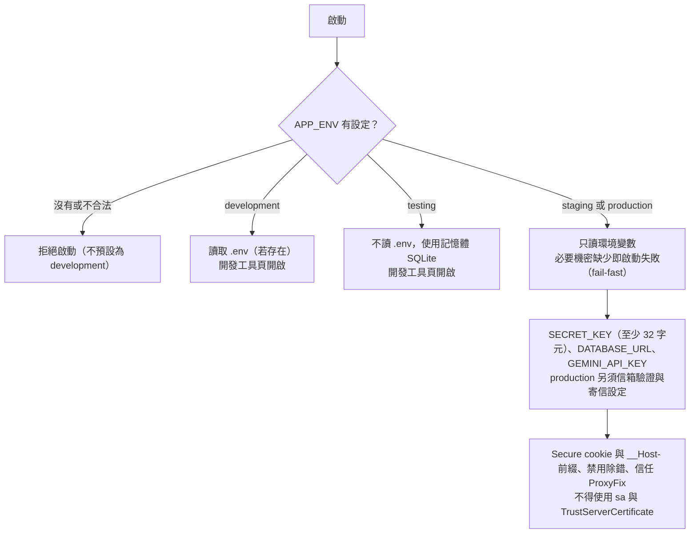
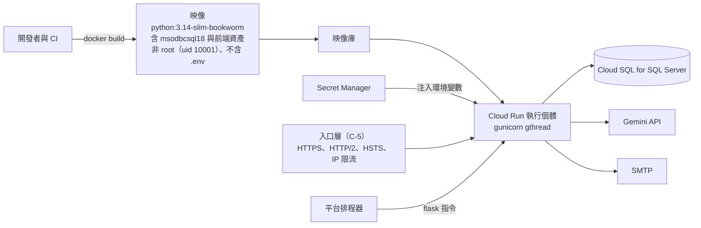
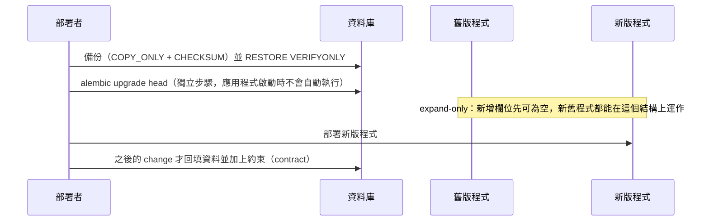
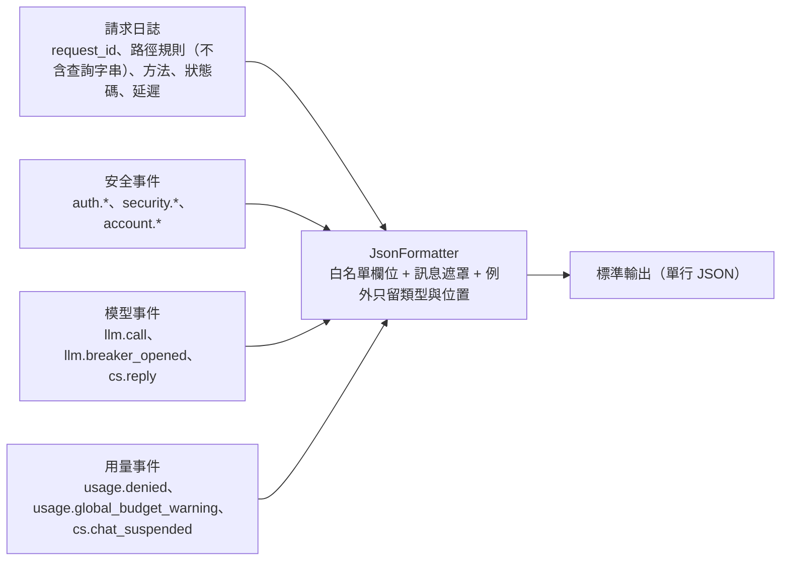
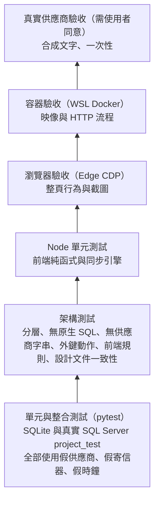

# 設定、部署、日誌與營運

> 狀態：已實作（正式部署、入口層與備份演練由 C-5、告警由 C-4c 實作） ｜ 最後更新：2026-10-30 ｜ 對應 change：platform-foundation、member-auth、age-verification-birthdate、cs-chat-core、usage-limits ｜ 規範依據：AGENTS.md 第 9、11 節

本文件說明設定如何依環境載入、容器如何建置與執行、migration 的部署步驟、日誌與事件的規則、維運指令，以及測試與驗收的分層。逐項的環境變數說明在 README 的「環境變數與機密」與 `.env.example`。

## 1. 環境與設定載入

| 環境 | 用途 | 與 production 的差異 |
|---|---|---|
| development | 本機開發（SQL Server `project`） | 讀 `.env`、可關閉信箱驗證、可信任自簽憑證、開發工具頁 |
| testing | 自動測試 | 不讀 `.env`、預設記憶體 SQLite、開發工具頁 |
| staging | 雲端預備環境 | 除可關閉信箱驗證外，與 production 相同 |
| production | 正式（Google Cloud：Cloud Run、Cloud SQL for SQL Server、Secret Manager） | 信箱驗證必須開啟且已設定寄信服務 |

機密（Gemini 金鑰、`SECRET_KEY`、資料庫連線、OAuth、寄信）只由環境變數或平台機密功能注入，以 `Secret` 包裝（`repr` 與 `str` 一律遮罩），不得出現在日誌、錯誤訊息或前端回應。

## 2. 容器與部署拓樸

| 項目 | 設定 |
|---|---|
| 執行 | `gunicorn --config gunicorn.conf.py wsgi:app`；`gthread`、`WEB_CONCURRENCY`（預設 2）個 worker、`GUNICORN_THREADS`（預設 8）、`timeout` 60 秒、`graceful_timeout` 30 秒 |
| 連接埠 | 取自 `PORT`（預設 8080）；映像有 `HEALTHCHECK`（`/healthz`） |
| 禁止 | 不得用 `app.run()`（開發伺服器）執行正式環境；客服與 RPG 串流日後使用獨立的 worker 池 |
| 驗收 | `scripts/verify_container.py`（經 WSL 的 Docker）：建置、非 root、無 `.env`、各環境啟動與健康檢查、缺少機密時只列變數名稱、會員與客服的 HTTP 流程、保存期限指令 |

## 3. Migration 的部署步驟

## 4. 日誌與事件

- **白名單**：只輸出固定的基本欄位與 `ALLOWED_FIELDS`（`request_id`、`path`、`method`、`status`、`latency_ms`、`user_id`、`conversation_id`、`intent`、`model`、`attempt`、`prompt_tokens`、`completion_tokens`、`finish_reason`、`error_type`、`error_location`、`event`，以及模型呼叫的 `kind`、`provider`、`outcome`、`thinking_tokens`、`reason`、`provider_status`，以及用量事件的整數 `used`、`limit`），其餘一律丟棄。
- **絕不記錄**：密碼與雜湊、cookie、CSRF 與驗證／重設權杖、OAuth code、Authorization 標頭、完整金鑰、email、生日與年齡區間、使用者訊息、`reply_text`、模型原始輸出、含權杖的網址。事件名稱是固定列舉，失敗原因寫在名稱最後一段，所以日誌裡不可能夾帶自由文字。
- 模型呼叫的函式（`app/observability/llm_events.py`）根本沒有接收文字內容的參數；`tests/test_log_scan_full_flow.py` 走完整個流程後掃描整段日誌，找不到任何測試用的敏感字串。
- 用量事件（`app/observability/usage_events.py`）同樣只有分類與整數，原因是固定列舉（拒絕：`rate_limited`、`daily_quota`、`conversation_limit`、`suspended`、`global_budget`；預算警告：`tokens`、`calls`；暫停：`safety_blocks`），傳入列舉以外的值會立刻出錯。`usage.global_budget_warning` 在全站今日的 token 或呼叫次數越過上限的 80% 後，每個請求都記一筆（沒有跨 worker 的共享狀態可「每日只記一次」），由告警層（C-4c）以時間窗去重；`cs.chat_suspended` 供管理員之後在後台查看（C-4b）。
- 層級：設定錯誤（400、403）為錯誤層級；驗證失敗與暫時性錯誤為警告；主要模型因逾時或伺服器錯誤將被暫時跳過時，在導致斷路的那次失敗記一筆 `llm.breaker_opened`。
- 健康檢查：`/healthz`（存活，不碰資料庫）與 `/readyz`（確認資料庫），回應不含內部細節且 `no-store`。

## 5. 維運指令與保存期限

| 指令 | 用途 |
|---|---|
| `flask --app wsgi create-admin` | 一次性建立首位管理員（密碼只能互動輸入或從標準輸入讀取，不接受命令列參數） |
| `flask --app wsgi purge-inactive-accounts [--dry-run]` | 刪除連續 12 個月未登入的帳號（管理員不納入），每個帳號在同一交易寫入 `deletion_tombstones` |
| `flask --app wsgi age-stats` | 各年齡區間的人數，沒有任何個別使用者的資料 |

| 資料 | 保存期限 | 狀態 |
|---|---|---|
| 帳號（含生日與年齡區間） | 連續 12 個月未登入即刪除 | 已實作 |
| 對話與訊息 | 最後一則訊息後 12 個月，或使用者主動刪除 | 主動刪除已實作；期滿清除（C-4c） |
| `llm_call_logs` | 12 個月（不含對話全文） | C-4c（期滿清除；用量彙總依賴它，見 [模型呼叫層-llm-layer.md](模型呼叫層-llm-layer.md)） |
| 失敗的模型原文（`error_detail`） | 14 天，僅管理員可讀 | C-4c |
| `auth_tokens` | 到期後 7 天 | C-4c |
| 應用程式日誌、管理稽核、備份 | 30 天、24 個月、30 天 | 平台設定（C-4b、C-4c、C-5） |

全站每日用量上限由環境變數設定（逐項說明在 README 與 `.env.example`）：`USAGE_DAILY_TOKEN_LIMIT`（預設 1,000,000）與 `USAGE_DAILY_CALL_LIMIT`（預設 450）。預設值依目前使用的 `gemini-3.5-flash-lite` 免費層（15 RPM、25 萬 TPM、每日 500 次請求），**換模型或換供應商（例如正式環境改用 OpenAI）時必須重設**；部署時須確認它們與供應商的實際配額一致。

## 6. 測試與驗收分層

最近一次的數字（2026-10-30，C-4a）：pytest 3782 項、Node 142 項、瀏覽器驗收 C-3 的 64 項加 C-4a 的 30 項；容器驗收 95 項是 C-3 時的結果，C-4a 沒有重跑。細節與已知限制記在 README 的「客服對話（C-3）」與「用量限制（C-4a）」。真實的 Gemini 呼叫只在人工驗收進行，且每次都需要使用者當下同意（免費方案的資料可能被用於改進產品，只用合成文字）。

---

**何時更新本文**：環境與必要機密、容器與 gunicorn 設定、migration 的部署步驟、日誌白名單或事件、維運指令、保存期限的實作狀態、測試分層與驗收數字改變時。`tests/test_design_docs.py` 會檢查四種環境名稱與三個 flask 指令都出現在本文。
