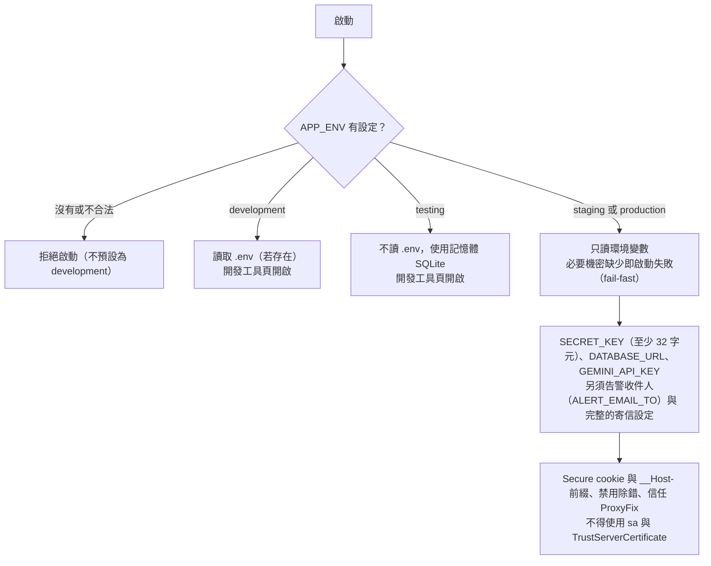
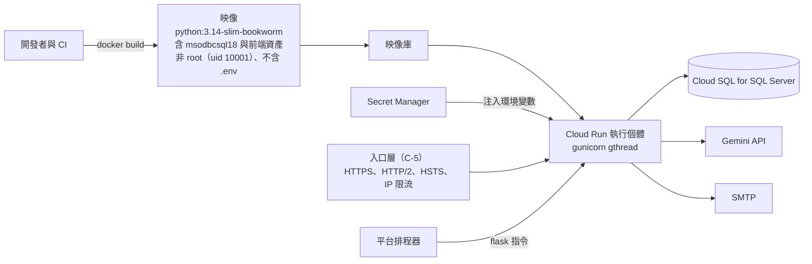
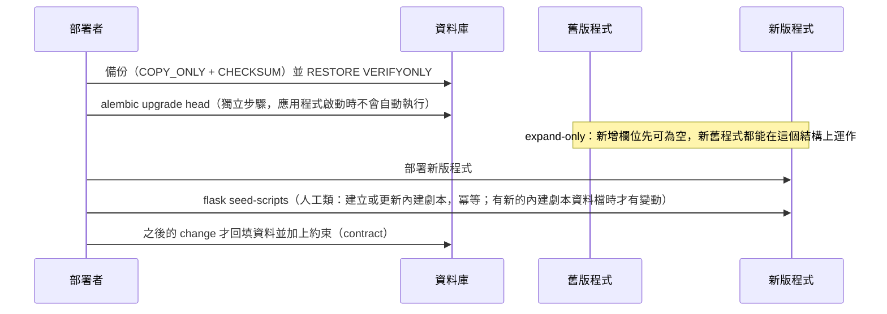
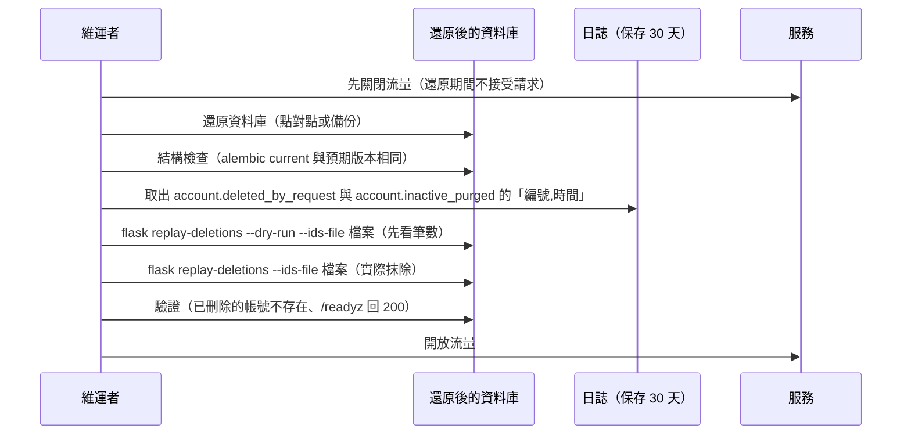
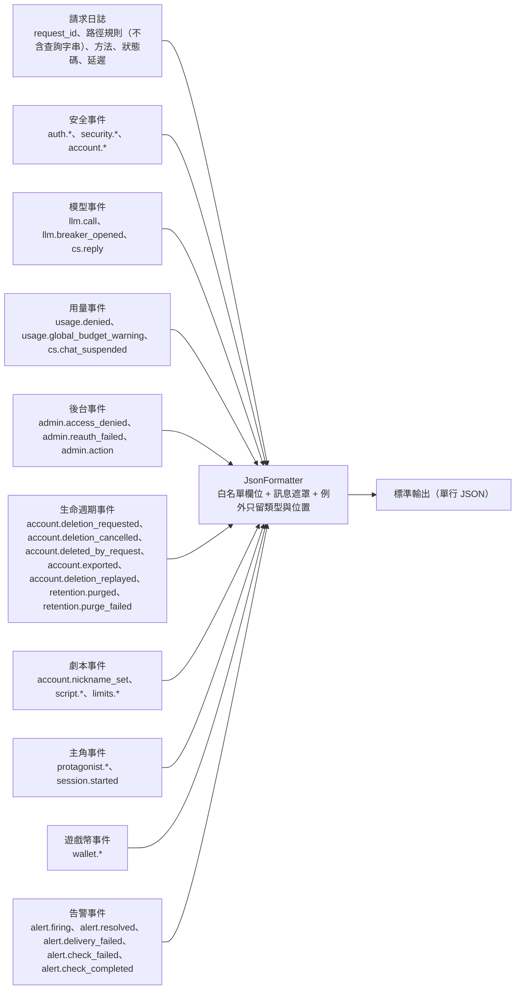
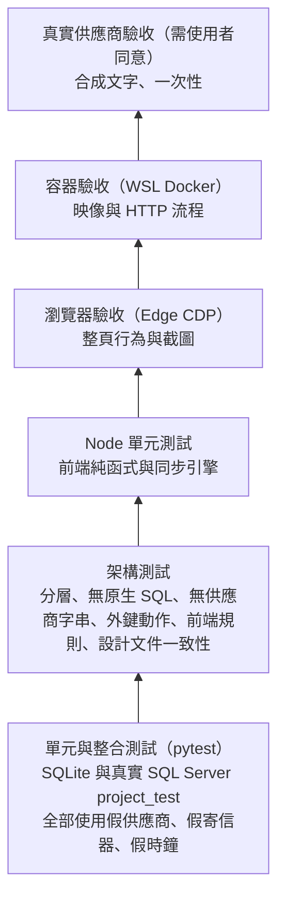

# 設定、部署、日誌與營運

> 狀態：已實作（保存期限清除與自助刪除帳號由 C-4c、資料庫可量得到的營運告警由 C-4d 實作；排程設定、平台負責的三項告警、正式部署、入口層與備份演練由 C-5 實作） ｜ 最後更新：2026-11-09 ｜ 對應 change：game-wallet、rpg-character-creation、rpg-script-authoring、rpg-data-and-script、remove-player-password-auth、platform-foundation、member-auth、age-verification-birthdate、cs-chat-core、usage-limits、admin-console、openai-compatible-provider、privacy-lifecycle、ops-alerting、launch-readiness、staging-deployment、google-first-login ｜ 規範依據：AGENTS.md 第 9、11 節
> 注意（2026-11-03）：本文件已納入 change ① `google-first-login` 的營運變化（新排程指令 `purge-unconfirmed-accounts`、告警改名為「帳號鎖定激增」、期限清除納入鎖定計次）與 change ② `remove-player-password-auth`：`EMAIL_VERIFICATION_REQUIRED` 已淘汰（留著只會警告一次，部署計畫檔含有它會被拒絕）；寄信設定只供營運告警信與管理員的重設密碼信使用，玩家不收任何信；部署多一個資料遷移 `0011`；載入測試、冒煙驗收與容器驗收改用在目標環境內簽出的測試玩家 cookie（`scripts/mint_test_sessions.py`）。
> 注意（2026-11-03）：本文件已納入 change `rpg-data-and-script`：成人模式的環境變數改為 `ADULT_MODE_ENABLED` 與 `ADULT_MODE_MODELS`（舊的 `SEXUAL_CONTENT_LEVEL3_*` 已淘汰：忽略、啟動時各警告一次、部署計畫檔含有會被拒絕；staging 與 production 不再一律禁止，須明確設定才生效）、新的人工類指令 `seed-scripts`（部署之後執行）、`purge-expired-data` 新增 RPG 存檔與回合部分內容兩類，以及遷移 `0012`。

本文件說明設定如何依環境載入、容器如何建置與執行、migration 的部署步驟、日誌與事件的規則、維運指令，以及測試與驗收的分層。逐項的環境變數說明在 README 的「環境變數與機密」與 `.env.example`。

## 1. 環境與設定載入



| 環境 | 用途 | 與 production 的差異 |
|---|---|---|
| development | 本機開發（SQL Server `project`） | 讀 `.env`、可不設寄信與告警收件人、可信任自簽憑證、開發工具頁 |
| testing | 自動測試 | 不讀 `.env`、預設記憶體 SQLite、開發工具頁 |
| staging | 雲端預備環境 | 與 production 相同（唯一的例外是可設定 `GEMINI_BASE_URL` 指向假模型伺服器） |
| production | 正式（Google Cloud：Cloud Run、Cloud SQL for SQL Server、Secret Manager） | 告警收件人與寄信設定必填（營運告警與管理員的重設密碼信用）；玩家不收任何信 |

機密（Gemini 金鑰、`SECRET_KEY`、資料庫連線、OAuth、寄信）只由環境變數或平台機密功能注入，以 `Secret` 包裝（`repr` 與 `str` 一律遮罩），不得出現在日誌、錯誤訊息或前端回應。

### 開發用通道（ngrok）

要在本機測試 Google 登入或信件連結，需要一個對外的 https 網域。使用者目前以 ngrok 當臨時網域（本機的臨時網址，**不是**雲端預備環境的網域；雲端預備環境用 Cloud Run 預設網域）。通道後面的程式只有兩種用法，不要混用：

| 用法 | 環境 | 信任轉送標頭的方式 | HSTS | cookie |
|---|---|---|---|---|
| 日常開發經通道 | `development` | 設定 `TRUST_PROXY_HEADERS=true`（只有 development 可以設定） | **不送**（瀏覽器會把 HSTS 記在通道網域，牽連之後的本機開發） | 無 `__Host-` 前綴、非 Secure |
| 本機預演預備環境（C-5b） | `staging`（SQLite 檔案） | 本來就信任入口層，**不需要也不得設定** `TRUST_PROXY_HEADERS` | 送出 | `__Host-` 前綴與 Secure |

`TRUST_PROXY_HEADERS` 在 testing、staging、production 設定了（不論值）會啟動失敗，訊息只指出變數名稱；development 的值只接受 `true` 或 `false`。它讓 `ProxyFix` 生效（單層代理），使經通道到達的請求被視為 https 與通道的主機名稱，POST 才會通過 CSRF 的來源比對；Origin 與請求的主機仍必須一致，不信任的來源照樣被拒絕。

**日常開發經通道的步驟**

1. 在 ngrok 後台取得固定的免費網域（每個帳號一個），在本機啟動應用程式後開通道：`ngrok http --url=<你的固定網域> 5000`（連接埠依你的啟動方式）。
2. `.env` 設定 `TRUST_PROXY_HEADERS=true` 與 `BASE_URL=https://<你的固定網域>`（不含路徑；Google 登入的回呼網址與信件連結因此指向通道）。
3. 在**開發用**的 Google OAuth 用戶端把「已授權的重新導向 URI」加上 `https://<你的固定網域>/auth/google/callback`。通道網址若變動（沒有固定網域時每次都會變），授權重新導向 URI 與 `BASE_URL` 都要同步改，否則 Google 會回 `redirect_uri_mismatch`。
4. 第一次用瀏覽器開通道網址時，ngrok 免費方案會先顯示一頁警告，點過一次後該網域 7 天內不再出現；測試 Google 登入前先開一次首頁。程式端的請求（例如冒煙腳本）改帶 `ngrok-skip-browser-warning` 標頭略過它。

**暴露風險與存取控制**

- 通道會把本機的開發環境**暴露在網際網路上**：知道網址的任何人都能連到開發工具頁（只在 development 與 testing 註冊的元件示範頁）與你建立的測試帳號。
- 建議在通道端加上存取控制（例如 ngrok 的基本驗證；免費方案是否提供以 ngrok 當時的方案為準）。沒有的話，只在需要測試的時段開著通道，其餘時間關閉；測試帳號一律用保留的 `.invalid` 信箱與可丟棄的資料，不放真實個資。
- 開發用的 OAuth 用戶端**不用於預備或正式環境**（AGENTS.md 第 10 節）；預備環境另建專用的用戶端，授權重新導向 URI 只放預備環境的回呼網址。
- 驗證：`tests/test_development_tunnel.py`（經通道的 POST 通過 CSRF、不設定時維持拒絕、其他環境拒絕、值不合法、development 經通道仍沒有 HSTS、回呼網址取自 `BASE_URL`、本小節載明風險）。

## 2. 容器與部署拓樸



| 項目 | 設定 |
|---|---|
| 執行 | `gunicorn --config gunicorn.conf.py wsgi:app`；`gthread`、`WEB_CONCURRENCY`（預設 2）個 worker、`GUNICORN_THREADS`（預設 8）、`timeout` 60 秒、`graceful_timeout` 30 秒 |
| 連接埠 | 取自 `PORT`（預設 8080）；映像有 `HEALTHCHECK`（`/healthz`） |
| 禁止 | 不得用 `app.run()`（開發伺服器）執行正式環境；客服與 RPG 串流日後使用獨立的 worker 池 |
| 驗收 | `scripts/verify_container.py`（經 WSL 的 Docker）：建置、非 root、無 `.env`、各環境啟動與健康檢查、缺少機密時只列變數名稱、會員與客服的 HTTP 流程、保存期限指令 |

### 傳輸安全與安全標頭（C-5a）

入口層（Cloud Run）負責 HTTPS 與 HTTP/2，但**不會替我們加任何安全標頭**，所以由應用程式自己送（`app/security/security_headers.py`，在每個回應上，含錯誤與靜態資源；端點已自行設定同名標頭時不覆蓋）：

| 標頭 | 值 | 環境 |
|---|---|---|
| `Strict-Transport-Security` | `max-age=31536000`（一年，**不含** `includeSubDomains` 與 `preload`） | 只有 staging 與 production（有 HTTPS 入口層的環境；development 即使經通道、信任了轉送標頭也不送） |
| `X-Content-Type-Options` | `nosniff` | 全部 |
| `Referrer-Policy` | `strict-origin-when-cross-origin` | 全部 |
| `X-Frame-Options` | `DENY` | 全部 |
| `Permissions-Policy` | 停用相機、麥克風、定位、付款、USB | 全部 |

- **development 與 testing 不送 HSTS**：本機是 http，瀏覽器會把 HSTS 記在 `localhost`，之後的本機開發全部失敗。development 經 HTTPS 通道使用（`TRUST_PROXY_HEADERS=true`，見「開發用通道（ngrok）」）時同樣不送：判斷依據是環境（`is_production_like`），不是「是否信任轉送標頭」。
- **HSTS 為何只設一年且不含子網域與預載入**：瀏覽器記住後無法由伺服器撤回，網域與其他子網域尚未確定；日後要升級是放寬（延長時間、加子網域），而不是撤回。
- **刻意不送 `Content-Security-Policy`（已知限制）**：前端使用 Vue 全域建置，模板在瀏覽器以 `new Function` 編譯，政策必須允許 `unsafe-eval`（加上 `style=` 屬性還要 `unsafe-inline`），這樣的 CSP 幾乎沒有保護力。替代做法是預先編譯模板，等於改變前端建置，違反「不使用打包」的規範，不在 C-5a 範圍；前端改版時重新評估。這項與入口層 IP 限流一起列在「未滿足的規範項目」。
- 驗證：`tests/test_security_headers.py`（五種路徑、錯誤回應、四個環境、自訂標頭不被覆蓋、沒有 CSP）。

> 注意（2026-11-04）：本文件已納入 change `rpg-script-authoring`（RC-7）：遷移 `0013`（部署順序不變：備份 → 遷移 → 部署 → `flask seed-scripts`；七個營運限制的初始值由遷移寫入，不必另外執行指令）、兩個人工類指令 `set-script-limit` 與 `show-script-limits`（限制存在資料庫、立即生效、每次修改寫 `limit.set` 稽核）、`purge-expired-data` 新增劇本送審紀錄一類（365 天）、劇本事件的日誌白名單，以及容器驗收新增的七項檢查。
> 注意（2026-11-09）：本文件已納入 change `game-wallet`（W1）：遷移 `0015`（部署順序不變：備份 → 遷移 → 部署；只新增 `wallets`、`wallet_entries` 兩張表並補五個遊戲幣設定鍵，已有的鍵不蓋掉）、兩個人工類指令 `set-wallet-setting`、`show-wallet-settings`（部署後以 `show-wallet-settings` 確認五個值）、遊戲幣事件 `wallet.*` 與三個新的日誌欄位 `coins`、`lost_coins`、`balance`。
> 注意（2026-11-04）：本文件已納入 change `rpg-character-creation`（RC-9）：遷移 `0014`（部署順序不變：備份 → 遷移 → 部署；只新增 `sessions.protagonist_json` 並補三個每日主角生成次數的限制鍵，已有的鍵不蓋掉）、`show-script-limits` 與 `set-script-limit` 現在涵蓋十個鍵、主角事件的日誌白名單，以及開存檔最壞約 60 秒（劇本尚未審查過時再加一次審查；前端 axios 逾時請設 65 秒）。

## 3. Migration 的部署步驟



- `0013_rpg_script_authoring` 的 `runtime_limits` 的初始值由遷移以 ORM 資料表寫入（`0013` 七個，`0014` 再補三個每日主角生成次數，只插入資料庫還沒有的鍵）；之後調整只用 `flask set-script-limit`（不必重新部署，程式每次使用時現讀）。資料缺值或不合法時（例如某一列被誤刪）讀取端用保守的保底預設並記一筆警告（只記鍵名）；表本身仍須先由遷移建立，所以順序不能反過來。

### 部署與回復（C-5a）

部署用 `scripts/gcp_launch.py`（Python 加 `gcloud`，符合第 8 節「維運腳本用 Python」）。**預設只印出將執行的指令**，加 `--execute` 才逐步執行，而且**每一步執行前都要確認**；專案、區域、環境與資料庫執行個體必須明確提供（沒有預設的專案）。步驟的內容與順序在 `scripts/launch_plan.py`（純函式，有測試，不需要 `gcloud`）。

| 子命令 | 做什麼 |
|---|---|
| `plan` | 預覽或執行以下全部，順序固定 |
| `secrets` | 啟用 API、建立執行用的服務帳號、建立 Secret Manager 的機密容器並寫入值（值從標準輸入讀取，不經命令列）、授予讀取權限 |
| `build` | 建立映像庫、以 Cloud Build 建置並推送映像（內容依 `Dockerfile` 與 `.dockerignore`，不含 `.env`） |
| `migrate` | **先備份**（隨需備份 Cloud SQL），再以 Cloud Run Job 執行 `alembic upgrade head`；失敗不自動重試，**失敗即停止，不部署新版程式** |
| `deploy` | 部署服務，再驗證 `/healthz`（存活）與 `/readyz`（含資料庫）都回 200 |
| `schedule` | 為四個排程指令（見「維運指令與保存期限」）各建一個 Cloud Run Job 與 Cloud Scheduler |
| `alerts` | 平台告警定義（見「告警條件一覽」） |

```
python scripts/gcp_launch.py plan --project <專案> --region asia-east1 --env staging     --sql-instance cs-sql-staging --image-tag <標籤> --vars-file staging.vars
```

- **設定的歸類**：`.env.example` 的每個變數必須恰好是「機密」（Secret Manager，`--set-secrets` 只有名稱與版本參照）、「一般設定」（環境變數）或「不部署」（`TEST_SQLSERVER_URL`、`FLASK_DEBUG`）之一，新增變數而忘了歸類會讓測試失敗。一般設定放在 `--vars-file`（KEY=VALUE，不進版本庫，已列入 `.gitignore`）；**含機密名稱的檔案會被拒絕**。`APP_ENV` 由計畫依環境填入。
- **環境隔離**：所有資源名稱帶環境名稱（`cs-web-staging`、`cs-staging-secret-key`…），`--sql-instance` 必須含環境名稱，staging 與 production 沒有共用的資源、資料庫或機密。計畫**不建立 Cloud SQL 執行個體**（費用由你決定，N-9），只對既有的執行個體備份。
- **連線資料庫**：Cloud SQL for SQL Server 沒有 Cloud Run 的 unix socket 連線，要走私有 IP（Direct VPC egress，`--network` 與 `--subnet`），`DATABASE_URL` 指向私有 IP。這一段尚未對真實環境驗證（C-5b）。
- **新版本的部署順序**：`build` → `migrate`（含備份）→ `deploy`（含驗證）→ 需要時 `schedule`。migration 是 expand-only，新舊版程式都能在新結構上運作（見第 3 節）。
- **回復**：用前一個映像標籤重新執行 `deploy`（`--image-tag <前一版>`），**不需要回復資料庫結構**。若 `migrate` 失敗：停止，不部署；資料庫仍是舊結構，舊版程式照常運作；必要時依「資料庫還原」從備份還原。
- **限制（誠實揭露）**：這份腳本只在預覽輸出與測試中驗證過，**沒有對真實的 `gcloud` 與雲端專案執行過**；`gcloud` 的旗標會隨版本變動，第一次實際執行在 C-5b 的預備環境，發現的差異回寫到 `scripts/launch_plan.py`。

### 資料庫還原與重新抹除（C-5a）

使用者刪除帳號之後，資料庫從備份還原會讓他**復活**（個資法的刪除權因此失效）。規範要求還原時依 `deletion_tombstones` 重新執行刪除；備份**之後**才發生的刪除不在還原後的資料庫裡，所以另外從日誌補上。順序固定，**重新抹除必須在還原之後、對外開放流量之前**：



| 步驟 | 指令 | 說明 |
|---|---|---|
| 取出日誌 | `python scripts/restore_drill.py logs-to-ids --input 日誌.json --output 刪除.txt` | 只取內部編號與時間，**丟棄其餘全部欄位**；日誌可由 `gcloud logging read` 匯出（過濾 `jsonPayload.event` 為上述兩個事件）。日誌保存 30 天，與備份相同，所以涵蓋範圍一致 |
| 預覽 | `flask --app wsgi set-wallet-setting KEY VALUE` | **人工類，不得排程**：修改一個遊戲幣設定（`coin.turn_cost.standard` 每輪幣價 30、`coin.signup_grant` 首次註冊贈幣 200、`coin.checkin_grant` 每日簽到 200、`coin.free_cap` 免費幣上限 1000、`coin.hold_timeout_seconds` 預扣逾時秒數 180）；驗證鍵與範圍後寫入，輸出舊值與新值並寫一筆 `limit.set` 稽核（管理員欄位為空）。立即生效，不必重新部署；只接受遊戲幣組的鍵（用錯會指出該用哪個指令） |
| `flask --app wsgi show-wallet-settings` | **人工類，不得排程**：列出五個鍵、目前生效的值與範圍；資料庫缺值或不合法的鍵標示「保底預設」。輸出只有鍵與數值 |
| `flask --app wsgi replay-deletions --dry-run [--ids-file 刪除.txt]` | 只輸出筆數：將抹除、略過（編號已被重新發出）、略過（管理員）、已不存在。**「略過（編號已被重新發出）」的數字要人工看過** |
| 實際抹除 | `flask --app wsgi replay-deletions [--ids-file 刪除.txt]` | 與一般抹除走同一個出口（清帳本的對話編號 → 條件式刪除 → 提交），可重複執行；抹除成功時補寫一筆刪除紀錄（原因 `restore_replay`、時間沿用原本的刪除時間），之後再還原仍涵蓋 |

- **資料來源的實情**：還原後資料庫裡的 `deletion_tombstones` 只涵蓋**備份之前**的刪除，而那些帳號本來就不在備份裡；真正會復活的是**備份之後**才刪除的帳號，它們的紀錄只在現場資料庫（如果還能存取就先匯出）與日誌裡。所以日誌取出的檔案才是主要來源，資料庫內的紀錄是補充（例如還原到另一個資料庫、仍保有現場紀錄的情況）。日誌保存 30 天、備份也保存 30 天，所以任何可還原的備份都被日誌涵蓋。
- **為什麼要比對建立時間**：SQL Server 的 IDENTITY 在還原後從備份時的種子繼續，備份之後註冊再被刪除的帳號，其編號會被還原後的新使用者沿用；只憑編號刪除會刪到別人。指令只抹除「建立時間不晚於刪除時間」且不是管理員的帳號，條件在刪除當下由資料庫判斷（條件式 DELETE）。同一個編號有多筆紀錄時只看最晚的刪除時間。
- **檔案先整體驗證**：任何一行格式錯誤，指令在抹除任何帳號之前失敗，只指出行號，不回顯該行內容與檔案路徑。檔案以 UTF-8（可帶 BOM）讀取。
- **日誌與輸出**：事件 `account.deletion_replayed` 只有內部編號；輸出只有筆數；預覽不記事件。
- **演練**：`scripts/restore_drill.py`（把備份還原到名稱帶 `_restore_drill` 的暫存資料庫，依序預覽與實際抹除並檢查已刪除者不存在）。演練的結果記在 README「驗收紀錄」；**每季演練一次**（AGENTS.md 第 11 節），C-5b 在預備環境實際演練。

## 4. 日誌與事件



- **白名單**：只輸出固定的基本欄位與 `ALLOWED_FIELDS`（`request_id`、`path`、`method`、`status`、`latency_ms`、`user_id`、`conversation_id`、`intent`、`model`、`attempt`、`prompt_tokens`、`completion_tokens`、`finish_reason`、`error_type`、`error_location`、`event`，以及模型呼叫的 `kind`、`provider`、`outcome`、`thinking_tokens`、`reason`、`provider_status`，以及用量事件的整數 `used`、`limit`，與期限清除、營運告警的整數 `count`，以及營運告警的固定列舉 `severity`），其餘一律丟棄。
- **絕不記錄**：密碼與雜湊、cookie、CSRF 與驗證／重設權杖、OAuth code、Authorization 標頭、完整金鑰、email、生日與年齡區間、使用者訊息、`reply_text`、模型原始輸出、含權杖的網址。事件名稱是固定列舉，失敗原因寫在名稱最後一段，所以日誌裡不可能夾帶自由文字。
- 模型呼叫的函式（`app/observability/llm_events.py`）根本沒有接收文字內容的參數；`tests/test_log_scan_full_flow.py` 走完整個流程後掃描整段日誌，找不到任何測試用的敏感字串。
- 用量事件（`app/observability/usage_events.py`）同樣只有分類與整數，原因是固定列舉（拒絕：`rate_limited`、`daily_quota`、`conversation_limit`、`suspended`、`global_budget`；預算警告：`tokens`、`calls`；暫停：`safety_blocks`），傳入列舉以外的值會立刻出錯。`usage.global_budget_warning` 在全站今日的 token 或呼叫次數越過上限的 80% 後，每個請求都記一筆（沒有跨 worker 的共享狀態可「每日只記一次」），由告警層（C-4d 的 `check-alerts`）以狀態去重；`cs.chat_suspended` 是日誌事件；後台總覽的「暫停中的使用者數」與被標記清單的暫停截止時間不靠它，而是由帳本以與 `UsageService` 相同的純函式（`quota_policy.suspension_until`）推得。
- 後台事件（`app/observability/admin_events.py`）：`admin.access_denied`（非管理員碰到後台，只有內部編號）、`admin.reauth_failed`（重新輸入密碼失敗）、`admin.action`（停權、解除、調整等級、刪除對話成功）。欄位只有 `event`、`user_id`（操作者的內部編號；`admin.access_denied` 時是被擋下的非管理員）與 `reason`（固定列舉：動作名稱或 `not_admin`），傳入列舉以外的值立刻出錯；**沒有** email、訊息、管理員填寫的原因與目標使用者，`tests/test_admin_flow.py` 走完整段流程後掃描日誌證明這一點。稽核的完整內容在資料庫的 `admin_audit_logs`，不在日誌。
- 生命週期事件（`app/observability/lifecycle_events.py`）：申請刪除、撤銷、被抹除（寬限期滿，原因 `user_requested`）、匯出（`reason` 為 `json` 或 `csv`）、期限清除某一類完成（`reason` 為類別、`count` 為筆數）或失敗（只有類別，不記錄例外內容）。欄位只有內部編號、固定列舉與整數；列舉以外的值立刻出錯。閒置帳號清除沿用既有的 `account.inactive_purged`。`tests/test_privacy_lifecycle_flow.py` 走完整段流程（註冊、對話、匯出、申請、撤銷、再申請、排程刪除、一年多之後的期限清除）後掃描日誌與指令輸出，找不到 email、名稱、生日、密碼、確認文字、對話與失敗原文。
- 劇本事件（`app/observability/script_events.py`）：暱稱設定（`account.nickname_set`）、劇本建立／更新／新版本／刪除／撤回／重新取用筆名、送審（`script.submitted`）、自動拒絕（`script.auto_rejected`）、模型層審查（`script.review`）、審查不可用（`script.review_unavailable`）、暫停與解除暫停發佈（`script.publish_suspended`、`script.publish_lifted`），以及營運限制缺值或不合法與被修改（`limits.invalid`、`limits.changed`）。欄位只有內部編號、固定列舉（階段 `kind`、層級 `outcome`、類別 `reason`）與整數（字數 `count`、嘗試次數 `attempt`）、模型名稱；函式簽名沒有任何文字參數，類別與原因傳入列舉以外的值立刻出錯。絕不出現暱稱、短代號、筆名、劇本的任何文字、標題、標籤、申訴內容與模型原文；`tests/test_script_events.py` 守住簽名與列舉，`tests/test_log_scan_script_authoring.py` 走完整個創作與送審流程後掃描日誌。
- 主角事件（`app/observability/protagonist_events.py`）：生成預覽（`protagonist.suggested`，帶今日剩餘次數 `count`）、生成不可用（`protagonist.suggest_unavailable`）、生成次數用盡（`protagonist.suggest_limited`，帶 `used`／`limit`）、被自動拒絕（`protagonist.rejected`，階段 `kind` 為 `suggest`／`start`、層級 `outcome` 為 `rules`／`model`、類別 `reason`）、模型層審查（`protagonist.review`）與不可用（`protagonist.review_unavailable`），以及開出存檔（`session.started`，內容模式 `kind`、是否帶錨定事實 `outcome`）。欄位只有內部編號、固定列舉與整數、模型名稱；函式簽名沒有任何文字參數，列舉以外的值立刻出錯。絕不出現自我介紹、角色卡、錨定事實與模型原文；`tests/test_protagonist_events.py` 守住簽名與列舉，`tests/test_log_scan_protagonist.py` 走完整個主角流程後掃描日誌。
- 遊戲幣事件（`app/observability/wallet_events.py`）：`wallet.signup_granted`、`wallet.checkin`、`wallet.checkin_overflow`、`wallet.hold`、`wallet.settle`、`wallet.refund`、`wallet.stale_released`、`wallet.insufficient`、`wallet.adjust`、`wallet.grant_deferred`；欄位只有內部使用者編號、整數的幣量 `coins`、作廢量 `lost_coins`、餘額 `balance`，以及固定列舉的餘額種類（`kind`：`free`、`paid`）與模型鍵（`model`）。函式沒有接收冪等鍵（帶有存檔識別碼與前端產生的訊息編號）、存檔識別碼、管理員理由或任何玩家文字的參數，傳入列舉以外的值或不是整數的幣量立刻出錯（`tests/test_wallet_events.py` 與 `tests/test_wallet_flow.py` 的日誌掃描守住）。
- 告警事件（`app/observability/alert_events.py`）：`alert.firing`（進入、升級或提醒；`reason` 為告警代碼、`severity` 為 `warning` 或 `critical`、`count` 為整數數值）、`alert.resolved`、`alert.delivery_failed`（這一次通知沒有寄出，只有告警代碼）、`alert.check_failed`（這一項評估失敗，只有告警代碼）、`alert.check_completed`（**心跳**：`check-alerts` 完整跑完一次，只有事件名稱；預覽、唯讀與有評估失敗的執行不記。寄信失敗那次仍記，因為檢查本身跑完了；平台用它偵測「告警檢查停擺」，見「平台告警」）。欄位只有固定列舉與整數，**沒有收件人地址、信件內容、使用者資料與例外訊息**；列舉以外的值立刻出錯；預覽不記事件。`tests/test_alerting_flow.py` 以真正的客服對話與登入走完整條生命週期後掃描日誌、指令輸出與信件。
- 層級：設定錯誤（400、403）為錯誤層級；驗證失敗與暫時性錯誤為警告；主要模型因逾時或伺服器錯誤將被暫時跳過時，在導致斷路的那次失敗記一筆 `llm.breaker_opened`。
- 健康檢查：`/healthz`（存活，不碰資料庫）與 `/readyz`（確認資料庫），回應不含內部細節且 `no-store`。

## 5. 維運指令與保存期限

指令分兩類，清單在 `app/cli.py`（`SCHEDULED_COMMANDS`、`MANUAL_COMMANDS`）並由 `tests/test_scheduled_commands.py` 守住：**排程類**由平台排程器觸發（`check-alerts` 每 5 分鐘 `*/5 * * * *`；`purge-unconfirmed-accounts` 每小時整點 `0 * * * *`（24 小時的年齡確認期限）；`purge-inactive-accounts` 03:00、`execute-account-deletions` 03:20、`purge-expired-data` 03:40，每日，Asia/Taipei，錯開以免同時佔用資料庫連線）；**人工類**（`create-admin`、`age-stats`、`llm-probe`，以及 C-5a 的 `replay-deletions`、`rpg-data-and-script` 的 `seed-scripts`）不得排程。新增指令必須歸入其中一類，否則測試失敗；部署計畫的排程清單從同一份清單產生。

| 指令 | 用途 |
|---|---|
| `flask --app wsgi create-admin` | 一次性建立首位管理員（密碼只能互動輸入或從標準輸入讀取，不接受命令列參數） |
| `flask --app wsgi purge-unconfirmed-accounts [--dry-run]` | 刪除玩家首次以 Google 登入後 24 小時內沒有完成年齡確認的帳號（管理員、已完成者與沒有期限記錄的舊帳號不納入；每小時），原因記為 `age_unconfirmed`；與閒置清除共用同一個抹除出口 |
| `flask --app wsgi purge-inactive-accounts [--dry-run]` | 刪除連續 12 個月未登入的帳號（管理員不納入），每個帳號在同一交易寫入 `deletion_tombstones` |
| `flask --app wsgi execute-account-deletions [--dry-run]` | 抹除「使用者申請刪除、寬限期（7 天）已滿」的帳號，原因記為 `user_requested`；與閒置清除共用同一個抹除出口（先清帳本的對話編號、再條件式刪除、寫刪除紀錄，條件不成立整個回復）。可重複執行，輸出只有筆數 |
| `flask --app wsgi purge-expired-data [--dry-run]` | 清除超過保存期限的資料：對話與訊息（365 天）、帳號鎖定計次（7 天）、失敗的模型原文（14 天，清為空值）、用量帳本（365 天）、驗證權杖（到期後 7 天）、管理稽核（730 天）、RPG 存檔（最後活動後 365 天，回合與記事簿一併刪除）、劇本送審紀錄（365 天，只刪紀錄，暫停旗標不受影響）、中斷或被擋回合的部分劇情內容（14 天，清為空字串、回合紀錄保留）。各類獨立、分批（500）、每批各自提交；某一類失敗不阻止其他類別，但指令以非零代碼結束並標明類別。輸出與日誌只有各類筆數 |
| `flask --app wsgi check-alerts [--dry-run]` | 評估五項只靠資料庫量得到的營運告警（見下方「告警條件一覽」），狀態有變化時寄電子郵件給 `ALERT_EMAIL_TO`（進入、升級、每 6 小時提醒、恢復各一封，不隨檢查頻率重複寄）。`--dry-run` 與沒有設定收件人時只評估並顯示結果，不寄信也不改變狀態。輸出只有告警名稱、狀態與數值；寄信失敗或某項評估失敗時以非零代碼結束 |
| `flask --app wsgi age-stats` | 各年齡區間的人數，沒有任何個別使用者的資料 |
| `flask --app wsgi seed-scripts [--dry-run]` | **人工類，不得排程，不在應用程式啟動時執行**：部署（備份、遷移、部署新版程式）之後執行，讀取隨映像封裝的 `app/data/scripts/*.json`，全部驗證通過才在單一交易內寫入（全有或全無），以種子鍵與標準化內容的雜湊冪等地建立、更新（新增版本並取代舊版）或略過；資料不合規時以非零代碼結束並指出檔名與欄位路徑，沒有寫入任何資料；輸出只有種子鍵與筆數。雲端的部署計畫腳本尚未為它產生一次性的 Job（屬 C-5c），目前由部署者以同一個映像執行 |
| `flask --app wsgi set-script-limit KEY VALUE` | **人工類，不得排程**：修改一個營運限制（每位作者可擁有的劇本數 `script_limit.<等級>`、每個台灣日的送審次數 `script_submit_daily.<等級>`、每個台灣日請 AI 生成主角的次數 `protagonist_suggest_daily.<等級>`、連續被自動拒絕幾次就暫停發佈 `script_reject_streak`）。驗證鍵與範圍後寫入，輸出舊值與新值，寫一筆 `limit.set` 稽核（管理員欄位為空）；立即生效，不必重新部署。沒有任何 HTTP 端點可以修改限制 |
| `flask --app wsgi show-script-limits` | **人工類，不得排程**：列出全部十個鍵、目前生效的值與範圍；資料庫缺值或不合法的鍵標示「保底預設」。輸出只有鍵與數值 |
| `flask --app wsgi replay-deletions [--dry-run] [--ids-file 檔案]` | **人工類，不得排程**：備份還原後、對外開放流量之前，依 `deletion_tombstones`（與日誌取出的「編號,時間」檔案）重新抹除復活的帳號；只抹除建立時間不晚於刪除時間且非管理員的帳號；輸出只有筆數。步驟見「資料庫還原與重新抹除」 |
| `flask --app wsgi llm-probe [--text 短文字] [--structured]` | **開發用**（不是維運工作，不由排程器觸發）：呼叫 RPG 敘事用途的端點一次，印出回覆、模型、延遲、token 與結束原因；`--structured` 評估 JSON 穩定度。只在 development 與 testing 執行，staging 與 production 拒絕；不寫帳本與任何資料表，不顯示金鑰 |

| 資料 | 保存期限 | 狀態 |
|---|---|---|
| 帳號（含生日與年齡區間） | 連續 12 個月未登入即刪除；使用者申請刪除後 7 天；玩家首次以 Google 登入後 24 小時內沒有完成年齡確認即刪除 | 已實作（`purge-inactive-accounts`、`execute-account-deletions`、`purge-unconfirmed-accounts`） |
| 對話與訊息 | 最後一則訊息後 12 個月，或使用者主動刪除 | 已實作（`purge-expired-data`，最後活動早於 365 天） |
| RPG 存檔（連同回合與記事簿） | 最後活動後 12 個月（沒有回合的存檔以建立時間算）；帳號刪除時一併刪除 | 已實作（`purge-expired-data`，365 天，不論進行中或已完結）；隱私權政策的保存期限表尚未補上這一列（留給法務覆核） |
| 中斷或被擋回合的部分劇情內容 | 14 天 | 已實作（`purge-expired-data` 清為空字串，回合紀錄保留） |
| 劇本送審紀錄（`script_submissions`，只有結果、類別與時間） | 12 個月；帳號刪除時一併刪除 | 已實作（`purge-expired-data`，365 天；只被「近期」的判斷使用，清除舊紀錄不影響暫停旗標與當日次數）；隱私權政策的保存期限表尚未補上這一列（留給法務覆核） |
| 玩家創作的劇本（含草稿、待審、被退回與舊版本） | 隨帳號刪除；不設期限清除 | 抹除已實作（`CASCADE`，別人的存檔保留並清空來源參照）；「匿名保留已發佈劇本」的偏好屬 RC-8 |
| `llm_call_logs` | 12 個月（不含對話全文） | 已實作（`purge-expired-data`，365 天；用量彙總只讀近期紀錄，不受影響，見 [模型呼叫層-llm-layer.md](模型呼叫層-llm-layer.md)） |
| 失敗的模型原文（`error_detail`） | 14 天，僅管理員可讀 | 僅管理員可讀已實作（C-4b 後台「模型失敗」，讀取端以查詢限制 14 天、不依賴清除排程）；期滿清除已實作（`purge-expired-data` 清為空值，帳本那一筆保留） |
| `auth_tokens` | 到期後 7 天 | 已實作（`purge-expired-data`，不論是否已使用） |
| 管理稽核（`admin_audit_logs`） | 24 個月 | 寫入與檢視已實作（C-4b）；期滿清除已實作（`purge-expired-data`，730 天；唯一的清除途徑在 `RetentionRepository`） |
| 遊戲幣錢包與帳本（`wallets`、`wallet_entries`） | 與帳號相同：帳號刪除時一併刪除，納入個人資料匯出；幣不過期，帳本不設期限清除 | 抹除已實作（`CASCADE`，不匿名化保留）；付款紀錄的法定保存期限待金流規範（W2）時決定 |
| 帳號刪除紀錄（`deletion_tombstones`） | 不設期限（只含內部編號、時間與原因，不含個資） | 已實作；不納入期限清除，備份還原後要靠它重新執行刪除 |
| 應用程式日誌、備份 | 30 天、30 天 | 平台設定（C-5） |

### 告警條件一覽（C-4d）

七項告警（AGENTS.md 第 11 節）依「資料量得到的地方」分成兩邊。**應用程式負責的五項**由 `check-alerts` 評估，門檻是 `app/services/alert_rules.py` 的常數（規範的建議初值，要依實際流量調整；README「營運告警（C-4d）」有逐項的表，並由測試與程式常數比對）：

| 代碼 | 條件 | 嚴重度 | 資料來源 |
|---|---|---|---|
| `usage_budget` | 全站今日 token 或呼叫次數達上限的 80%（警告）、100%（嚴重） | 警告／嚴重 | `llm_call_logs` 彙總與 `USAGE_DAILY_*` |
| `llm_error_rate` | 近 5 分鐘對話呼叫的 429、逾時、伺服器錯誤與網路錯誤占比超過 10%（樣本至少 10 次） | 警告 | `llm_call_logs.status` |
| `llm_config_error` | 近 5 分鐘出現任何一次設定錯誤（金鑰被撤銷等） | 嚴重 | `llm_call_logs.status` |
| `llm_latency_p95` | 近 15 分鐘完成的對話呼叫 p95 超過 10 秒（樣本至少 20 次） | 警告 | `llm_call_logs.latency_ms` |
| `login_lockouts`（顯示名稱「帳號鎖定激增」） | 目前被鎖定的帳號達 5 個：管理員密碼連續失敗（15 分鐘後自動解除）與玩家帳號的自動鎖定（管理員解除前一直計入）合計，同一帳號只算一個 | 警告 | `users.locked_until`、`users.locked_at` |

**平台負責的告警**（資料庫沒有這些資料，或資料庫本身可能就是出問題的地方）。定義由 `scripts/launch_plan.py` 的常數與 `alerts` 子命令產生（日誌型指標、外部探測與 Cloud Monitoring 的告警政策，**預設只預覽**），**門檻與下表由 `tests/test_platform_alerts.py` 比對**；通知管道只有電子郵件，收件人由 `--notify-email` 提供，沒有預設值：

| 告警 | 條件 | 窗口 | 來源 |
|---|---|---|---|
| 5xx 比率 | 伺服器錯誤（5xx）占全部請求**超過 5%**，且窗口內請求數**至少 20**（低流量時不通知） | 300 秒 | Cloud Run 的請求指標 `request_count`，不依賴應用程式的資料庫 |
| 服務存活 | `/healthz` 連續失敗 **3** 次（探測間隔 **1 分鐘**） | 180 秒 | 平台的外部探測（來自服務之外，不需要登入） |
| 服務就緒 | `/readyz` 連續失敗 **3** 次；`/healthz` 正常而它失敗代表資料庫問題，通知標題標明資料庫 | 180 秒 | 平台的外部探測 |
| 寄信失敗 | 日誌事件 `mail.send_failed` 出現 **3** 次以上 | 300 秒 | 日誌型指標（事件不含收件人地址） |
| 排程工作失敗 | 四個排程工作任一個以非零代碼結束 | 300 秒 | Cloud Run Job 的完成次數指標（結果為失敗） |
| 告警檢查停擺 | `check-alerts` 超過 **15 分鐘**沒有成功執行（沒有 `alert.check_completed` 心跳） | 900 秒 | 日誌型指標的缺漏偵測；它自己無法通報自己停擺 |

`check-alerts` 的**非零結束代碼**由上表的「排程工作失敗」接手：資料庫不通時這個指令也跑不動，寄信服務掛掉時它寄不出信，這兩種情況只有平台看得到。管道只有電子郵件（沒有 webhook）；不使用會把例外內容送出本系統的外部錯誤追蹤服務。`usage.global_budget_warning` 日誌事件維持原樣，但**不再是通知來源**。排程：`check-alerts` 每 5 分鐘一次（窗口刻意重疊，短暫的尖峰不會落在兩次檢查之間而漏掉）。

**排程與第一次執行**（排程器設定屬 C-5）：`execute-account-deletions` 與 `purge-expired-data` 各每日一次、可重複執行。第一次在正式環境執行前，先備份資料庫，並各以 `--dry-run` 檢視筆數；`purge-expired-data` 以非零結束代碼回報失敗的類別，排程器應把它接到告警（C-4d）。備份最長 30 天後自然汰除；備份還原後，依 `deletion_tombstones` 與日誌取出的檔案以 `replay-deletions` 重新執行刪除（指令與腳本已實作並在本機 SQL Server 演練，見「資料庫還原與重新抹除」；預備環境的實際演練屬 C-5b）。

**RPG 敘事用途的模型端點**（`OPENROUTER_*`，change `openai-compatible-provider`）：不是 staging 與 production 的必要機密（RPG 尚未實作），沒有設定時只有該用途不可用；金鑰與主要模型只設一個會啟動失敗。基底網址只允許 https（development 與 testing 另允許回送位址的 http，供本機模型）。免費換付費只改 `OPENROUTER_MODEL`（與選用的 `OPENROUTER_ZDR`）。**成人模式的部署開關 `ADULT_MODE_ENABLED`**（取代已淘汰的 `SEXUAL_CONTENT_LEVEL3_ENABLED`）預設關閉，各環境規則相同：staging 與 production 須明確設為 `true` 才生效，開啟時 RPG 用途必須已設定，且 `ADULT_MODE_MODELS`（書面許可涵蓋的模型）須涵蓋主要與備援模型，否則啟動失敗；這只是玩家能使用成人模式的條件之一（玩家仍須已滿 18 歲並完成成年確認）；殘留的舊變數只警告、不開啟任何東西；細節見 [帳號與安全-auth-security.md](帳號與安全-auth-security.md) 第 5 節與 [模型呼叫層-llm-layer.md](模型呼叫層-llm-layer.md) 第 10 節。換成不同模型或供應商時，也要依新方案重設下面的全站用量上限。

全站每日用量上限由環境變數設定（逐項說明在 README 與 `.env.example`）：`USAGE_DAILY_TOKEN_LIMIT`（預設 1,000,000）與 `USAGE_DAILY_CALL_LIMIT`（預設 450）。預設值依目前使用的 `gemini-3.5-flash-lite` 免費層（15 RPM、25 萬 TPM、每日 500 次請求），**換模型或換供應商（例如正式環境改用 OpenAI）時必須重設**；部署時須確認它們與供應商的實際配額一致。

## 6. 測試與驗收分層



最近一次的數字（2026-10-30，C-5a）：pytest 5522 項（含真實 SQL Server，沒有略過；上次 5241 項）、Node 175 項、瀏覽器驗收 C-3 的 64 項、C-4a 的 30 項、C-4b 的 100 項加 C-4c 的 48 項；C-4d 沒有新的前端，改以真實的 SMTP 擷取伺服器加真實的 SQL Server 驗收寄信；C-5a 同樣沒有前端變動，改以本機 SQL Server 實跑還原演練、本機冒煙跑一次負載測試；容器驗收 95 項是 C-3 時的結果，之後沒有重跑。細節與已知限制記在 README 的「客服對話（C-3）」、「用量限制（C-4a）」、「管理員後台（C-4b）」、「個資生命週期（C-4c）」與「營運告警（C-4d）」。後台的瀏覽器驗收需要預先塞好資料的暫時伺服器（被擋的使用者、意見回饋、失敗原文、7 日用量），驗收腳本不進版本庫，結果與修正記在 README。**備份腳本的陷阱**：升級資料庫前的 `BACKUP` 必須讀完所有結果集再向伺服器確認檔案存在，否則驅動程式關閉游標時伺服器會靜默中止備份（見 README「管理員後台（C-4b）」的驗收紀錄）。真實的 Gemini 呼叫只在人工驗收進行，且每次都需要使用者當下同意（免費方案的資料可能被用於改進產品，只用合成文字）。

### 負載測試（C-5a）

目的：在不消耗模型額度、不危及正式環境的前提下量測 worker、執行緒、資料庫與限流的容量（report.md D-24）。工具是 Locust（`requirements-dev.txt`，**只在開發環境，不進映像**），檔案在 `loadtest/`（Dockerfile 不複製、`.dockerignore` 排除）。

| 項目 | 說明 |
|---|---|
| 假模型入口 | `loadtest/fake_app.py`：以 `LoadTestProvider` 取代真實供應商（真的睡眠來模擬延遲，不連線、不耗額度）。`LOADTEST_LATENCY_SECONDS`（預設 1.5）、`LOADTEST_JITTER_SECONDS`（0.5）、`LOADTEST_ERROR_RATES`（例如 `rate_limited=0.02,timeout=0.01,server_error=0.01`，總和不得超過 1）、`LOADTEST_SEED`。**`APP_ENV` 為 `staging`、`production` 或未設定時載入即失敗**；預設關閉信箱驗證，註冊不寄信。啟動：`python -m flask --app loadtest.fake_app run --port 5000`（`APP_ENV=testing`，`DATABASE_URL` 指向 SQLite 檔案） |
| 情境 | `loadtest/locustfile.py`：每位虛擬使用者帶著**預先簽出的登入 cookie** 進入（玩家只用 Google 登入，沒有註冊與密碼登入可用；cookie 由 `scripts/mint_test_sessions.py` 在目標環境內建立測試玩家並簽出，寫成 `test-sessions.json`，路徑由 `LOADTEST_SESSIONS` 指定，**數量不足就在送出任何請求之前失敗**）、開新對話，之後每 30 至 45 秒送一則訊息，並混入列表與 `since_seq` 增量拉取。每人自己的帳號（保留網域 `@loadtest.invalid`），每個非 GET 請求都帶同源 `Origin` 與 CSRF 權杖。簽出步驟拒絕在 `production` 執行；映像不新增任何能簽發登入狀態的指令或端點。**本機（`--local`）簽出的 cookie 只有目標伺服器使用相同的 `SECRET_KEY` 與 `DATABASE_URL` 才會被接受**（腳本讀得到 `.env`，`loadtest.fake_app` 不讀，所以兩邊都明確設定；對容器用 `--docker-exec`） |
| 執行 | `locust -f loadtest/locustfile.py --headless -u 100 -r 5 -t 15m --host http://127.0.0.1:5000 --csv loadtest/result`（預設建議 100 位虛擬使用者、15 分鐘；找拐點用下面的階梯式情境）。**降級回覆（模型暫時性錯誤且備援也失敗，HTTP 仍是 200）在 Locust 裡標為失敗**，所以模型錯誤會進錯誤率 |
| 位址守門 | 預設只對本機位址執行；其他位址需要 `--confirm-remote`；**正式環境一律拒絕**（即使有確認參數）：`loadtest/guard.py` 的 `PRODUCTION_DOMAINS`（取得正式網域後填入；目前尚未取得網域，所以是空的）與任何主機名稱含 `production` 的位址 |
| 判定 | `python loadtest/evaluate.py --csv-prefix loadtest/result --log app.log [--cpu-percent 55]`：**p95 小於 8 秒**（對話訊息的請求）、**錯誤率小於 1%**、日誌**沒有資料庫鎖定錯誤**（SQLite `database is locked`、SQL Server 死結 1205 與鎖逾時 1222；應用程式日誌依規範不記例外訊息，所以真實日誌裡以 `"error_type":"OperationalError"` 計入，這是唯一看得到的資料庫層錯誤）、**CPU 低於 70%**（由平台量測後填入；**未提供就標為「未驗證」，整體不判為通過**）。結束代碼 0 全部通過、1 有項目未通過、2 沒有未通過但有未驗證 |
| 階梯式情境（找拐點） | `loadtest/shapes.py`（純邏輯，不匯入 Locust）加薄包裝 `loadtest/locustfile_stairs.py`：`LOADTEST_STAIRS=start=20,step=20,steps=5,seconds=120`（第一階段 20 位，每階段加 20 位，共 5 階段，每階段 120 秒，共 10 分鐘；`steps` 至少 2、`seconds` 至少 10、最高 5000 位）。執行：`locust -f loadtest/locustfile_stairs.py --headless --host http://127.0.0.1:5000 --csv loadtest/result --csv-full-history`。每階段開頭用最多 10 秒把新增的使用者逐步加進來，階梯結束後 Locust 自行停止（不需要 `-t`）。設定不合法就以非零碼結束並說明欄位規則，不回顯值 |
| 假模型伺服器（隔離的壓測環境） | `loadtest/fake_llm/`：Gemini 相容的 `generateContent`，讓**真實的** Gemini 轉接器經 `GEMINI_BASE_URL` 指向它，整條程式路徑都是真的、只有模型是假的。只接受部署時設定的測試金鑰 `FAKE_LLM_API_KEY`（不符回 403、看起來像真實金鑰的值拒絕啟動），延遲與錯誤率沿用 `LOADTEST_LATENCY_SECONDS`、`LOADTEST_JITTER_SECONDS`、`LOADTEST_ERROR_RATES`、`LOADTEST_SEED`，另有 `LOADTEST_TIMEOUT_SECONDS`（逾時類錯誤睡多久，預設 25 秒），日誌只有請求數與各狀態碼的彙總。有自己的 Dockerfile 與 `requirements.txt`（只有 Flask 與 gunicorn），**不屬於主映像**；`GEMINI_BASE_URL` 在 production 設定了會啟動失敗。本機執行：`python -m flask --app "loadtest.fake_llm.server:create_fake_llm_app" run --port 8081`（先設定 `FAKE_LLM_API_KEY`） |
| 每一輪的記錄 | `evaluate.py` 加 `--environment local｜local-container｜cloud`、`--setting WEB_CONCURRENCY=2`（可重複，名稱限於 `WEB_CONCURRENCY`、`GUNICORN_THREADS`、`CPU`、`MEMORY`、`CONCURRENCY`、`MIN_INSTANCES`、`MAX_INSTANCES`、`USERS`、`DURATION_SECONDS`）、`--stairs`（與 `LOADTEST_STAIRS` 同格式）；輸出環境、容量依據、設定、負載，最後印出可貼進 README 壓測紀錄表的「記錄列」 |

**只在測試或預備環境執行，不在正式環境壓測**；結果回頭調整 D-11、D-12、D-13（worker 與執行緒數）。

**本機結果的解讀**：gunicorn 不支援 Windows，本機只能用 Flask 的 threaded 伺服器，和正式環境的 gunicorn gthread 不同；本機容器（WSL 的 Docker）雖然用 gunicorn，卻是 SQLite、不同的 CPU 與記憶體，也不是 Cloud Run。所以**本機與本機容器的數字只用來確認測試本身可用、判定腳本正確、假模型與錯誤率設定生效、映像在 Linux 與 gunicorn 下確實能跑、`WEB_CONCURRENCY` 與 `GUNICORN_THREADS` 確實生效，以及取得粗略的相對比較（例如加倍執行緒是否改善 p95）——不是容量依據**。真正的容量量測在雲端預備環境（`cloud-staging-run`），gunicorn 的預設值到那時才依實測調整。

**階梯式加壓與每一輪的記錄規則**

1. 從基準設定開始，每一輪**只調整一個變數**（`WEB_CONCURRENCY`、`GUNICORN_THREADS` 或資源大小），跑一次完整的階梯，用 `evaluate.py` 判定，把「記錄列」貼進 README 的壓測紀錄表。
2. 每一輪的記錄都要有：執行環境（本機、本機容器或雲端）、虛擬使用者數與持續時間（階梯的各階段）、gunicorn 的 worker 與執行緒數、資源設定（本機容器的 CPU 與記憶體限制，或雲端的 CPU、記憶體、並行數與執行個體數）、判定結果與各項數字，以及**這個數字是否可作為正式環境的容量依據**。
3. **只有雲端的結果可以作為容量依據**；本機與本機容器一律標為「不是容量依據」，`evaluate.py` 在沒有標明環境時也不當作容量依據。本機的結果不會讓「負載測試」關卡變成已通過。
4. 最終採用的設定要附上對應那一輪的結果；所有嘗試的設定都達不到通過標準時，記錄目前最佳的結果與瓶頸，關卡維持「進行中」。

| 日期 | 環境 | 伺服器與資源設定 | 負載（階梯） | 各項數字與判定 | 整體 | 容量依據 |
|---|---|---|---|---|---|---|
| （由 `evaluate.py` 的「記錄列」貼入） | | | | | | |

### 本機預演（C-5b）

使用者目前沒有可計費的 Google Cloud 專案，所以預備環境的**應用程式行為**先在本機預演（不花錢）：`APP_ENV=staging`、SQLite 檔案、經 ngrok 的 https 網址。啟動仍通過與雲端相同的設定驗證（缺機密即失敗、`staging` 信任入口層標頭、不得使用 `sa` 與 `TrustServerCertificate=yes`），**預演不放寬任何 staging 的檢查**；它也**不需要** `TRUST_PROXY_HEADERS`（那個開關只給 development，見「開發用通道（ngrok）」）。

**步驟**（Git Bash，在專案根目錄；`.env.staging` 與 `staging.vars` 被版本控制忽略，值不要印出或貼到對話）

1. 載入設定：`set -a; . ./.env.staging; . ./staging.vars; set +a`，再 `export APP_ENV=staging DATABASE_URL=sqlite+pysqlite:///staging-rehearsal.sqlite3 BASE_URL=https://<你的固定網域>`（SQLite 檔案在被忽略的 `*.sqlite3`）。**每開一個新的終端機分頁都要重新載入**：沒有載入時 `alembic` 與 `flask run` 不會報錯，而是悄悄退回讀專案的 `.env`，把遷移與伺服器指到開發用的 SQL Server（2026-11-03 實際發生過一次，見 README「驗收紀錄（remove-player-password-auth）」）。
2. 建立資料表：`python -m alembic upgrade head`（staging 不使用 `create_all`）。**先看輸出的第一行是 `Context impl SQLiteImpl`**，不是 `MSSQLImpl`，才算跑在預演資料庫上。
3. 建立首位管理員，**在你自己的終端機互動輸入密碼，不經對話**：`python -m flask --app wsgi create-admin`。
4. 啟動：`python -m flask --app=wsgi run --port 5000`（內建的 `run` 不是專案的自訂指令）（Windows 沒有 gunicorn，本機預演才有這個例外；容量以容器預演與雲端為準），另開終端機 `ngrok http --url=<你的固定網域> 5000`。啟動前先故意拿掉一個必要機密（例如 `unset SECRET_KEY`），確認啟動失敗且訊息只列變數名稱，再補回。
5. 冒煙驗收：`python scripts/staging_smoke.py https://<你的固定網域>`（見「預備環境驗收」）。
6. Google 登入人工驗收（首次、第二次、同信箱既有帳號的合併）與營運告警信的真實寄送：在預演的資料庫製造一項告警條件（例如 5 個被鎖定的 `.invalid` 測試帳號），執行 `python -m flask --app wsgi check-alerts`，由使用者確認收到信（含是否進垃圾郵件匣）。沒收到就標為「未驗證」並寫明檢查過的地方與推測原因，**不以預期結果代替**；驗證後清除測試帳號與告警狀態。
7. （條件式）本機容器預演：WSL 的 Docker 能啟動時，建置主映像、以 gunicorn gthread 啟動、`GEMINI_BASE_URL` 指向假模型伺服器，跑階梯式加壓並以 `evaluate.py --environment local-container` 判定；起不來就標為「未預演」並寫明原因，**不以 Flask 開發伺服器的數字代替**。
8. 收尾：關閉通道、刪除預演的 SQLite 檔案與測試資料、確認 `.env.staging` 與 `staging.vars` 仍未被追蹤（`git status` 沒有任何預演產物）。

**預演驗證了什麼、哪些必須等雲端**（README 的驗收紀錄照這兩欄分開寫）

| 本機預演可以驗證 | 必須在雲端驗證（預演不能代替；在 `cloud-staging-run` 完成前維持「尚未做」） |
|---|---|
| 啟動時的設定驗證與缺機密即失敗 | 託管資料庫的私有連線與伺服器憑證驗證 |
| HSTS、其餘四個安全標頭、沒有 CSP | Cloud Run 服務與 Secret Manager 的注入方式 |
| `__Host-` 前綴與 Secure cookie、CSRF 與來源檢查（經 https 網域） | Cloud Scheduler 與 Cloud Run 工作（排程指令的實際觸發） |
| 冒煙驗收腳本的全部檢查 | 平台告警（日誌型指標、政策）與演練 |
| Google 登入與帳號合併（人工） | 雲端的壓測容量（含 CPU 由 Cloud Monitoring 量測） |
| 營運告警信經 Brevo 的真實寄送（人工） | 雲端的還原演練（Cloud SQL 複製） |
| 映像在 Linux 與 gunicorn 下能跑、gunicorn 兩個旋鈕生效（條件式） | 託管資料庫的成本與備份／時間點還原的實際行為 |

**上線前關卡不因本機預演而通過**：「託管資料庫成本」與「負載測試」兩道關卡的狀態在本機預演之後維持原狀。

### 預備環境驗收（C-5b）

`python scripts/staging_smoke.py https://<預備環境網址>`：對一個預備環境網址依序檢查並逐項輸出「通過」、「失敗」或「略過」，本機預演的通道網址與日後的雲端網址使用同一個腳本。結束代碼：沒有失敗為 0、有失敗為 1、位址被拒絕為 2。

| # | 檢查項目 | 預期 |
|---|---|---|
| 1 | `/healthz` | 200 |
| 2 | `/readyz` | 200 |
| 3 | 首頁的安全標頭 | 五個標頭齊全（含 `Strict-Transport-Security`），沒有 `Content-Security-Policy` |
| 4 | 沒有 CSRF 權杖的 POST | 403 |
| 5 | 已移除的 `POST /api/auth/login` 與 `/api/auth/register` | 404（玩家只用 Google 登入；帶有效的 CSRF 權杖，才不會被 403 蓋過） |
| 6 | 帶測試玩家的登入 cookie 進入（`SMOKE_SESSION_COOKIE`） | 成功；**沒有提供 cookie 時標為「未驗證」，不是通過** |
| 7 | 開新對話 | 成功（需要登入；否則未驗證） |
| 8 | session 與 CSRF cookie | `__Host-` 前綴、`Secure`、不含 `Domain`、`Path=/`；session 為 `HttpOnly`（需要登入；否則未驗證） |
| 9 | 一般會員存取 `/api/admin/overview` | 404（與不存在的端點相同，不透露後台存在；需要登入；否則未驗證） |
| 10 | 未登入存取 `/api/cs/conversations` | 401 |
| 11 | 模型呼叫 | **預設略過**；加 `--allow-model-call` 才送出一則訊息並檢查回覆不是降級文案（會消耗模型額度） |

- **只對 https 的預備環境執行**：主機名稱含 `production` 或位於 `loadtest/guard.py` 的 `PRODUCTION_DOMAINS` 時一律拒絕，**沒有任何確認參數可以繞過**；非 https、帶帳密、路徑、查詢字串或片段的位址也拒絕，而且是在送出任何請求之前。
- **輸出只有項目名稱與結果**：沒有 cookie、權杖、密碼或回應本文；失敗只說明是哪個標頭、狀態碼或屬性。
- **預備環境不放真實個資**：帳號只能是保留的 `.invalid` 網域的測試帳號（RFC 2606，永遠不會有真實信箱），資料庫不得由正式環境複製而來，部署與還原流程沒有把正式資料還原到預備環境的步驟。冒煙腳本每執行一次會留下一個這樣的測試帳號。
- 經 ngrok 的網址，腳本會多帶 `ngrok-skip-browser-warning` 標頭略過免費方案的瀏覽器警告頁。
- Google 登入需要使用者本人的 Google 帳號，只能**人工驗收**；沒有人工驗收就標為「未驗證」，不以自動化測試或預期結果代替。

**驗收紀錄的格式**（寫在 README）：日期、對應的 commit、每一項的結果與數字、未完成或未驗證的項目，並分成「本機預演已驗證」與「必須在雲端驗證（尚未做）」兩欄。上線前關卡的狀態**只在有對應紀錄時**才更新為「進行中」或「已通過」，且要記錄資料來源的位置；沒有實際執行的項目標為未驗證。
- 驗證：`tests/test_staging_smoke.py`（以 `https://` 的 staging 測試應用驅動全部檢查、缺 HSTS 或 `__Host-` 各別失敗、CSRF 沒擋住會失敗、預設不送訊息、輸出掃描、位址守門）。

## 7. 營運手冊與上線前關卡（C-5a）

> 本節的指令與腳本都真實存在，由 `tests/test_launch_docs.py` 逐一檢查；關卡的狀態只在有依據時才標為「已通過」。部署與回復見第 2、3 節的「部署與回復」，還原見「資料庫還原與重新抹除」，平台告警見「告警條件一覽」。

### 機密輪替

至少每 **90 天**輪替一次，疑似外洩時**立即**輪替（AGENTS.md 第 9 節）。步驟固定：**建立新金鑰 → 更新機密 → 重新部署 → 驗證 → 停用舊金鑰**。

| 機密 | 用途 | 建立新金鑰 | 備註 |
|---|---|---|---|
| `GEMINI_API_KEY` | 客服（只有客服使用 Gemini） | Google AI Studio 建立新金鑰 | 驗證：`/readyz` 與一則真實客服對話；之後才停用舊金鑰 |
| `OPENROUTER_API_KEY` | RPG 用途（與 `OPENROUTER_MODEL` 成對，不使用 Gemini） | OpenRouter 建立新金鑰 | RPG 尚未對外，仍照排程輪替 |
| `SECRET_KEY` | session 與 CSRF 簽章 | 產生新的 32 字元以上隨機值 | **先**把舊值放進 `SECRET_KEY_FALLBACKS`（Flask 3.1 以上）再換新值，部署並驗證後才移除舊值，否則所有人會被登出 |
| `DATABASE_URL` | 資料庫連線（帳號與密碼） | 在 Cloud SQL 建立新密碼 | 不得使用 `sa`；變更後 `/readyz` 必須回 200 |
| `MAIL_SMTP_PASSWORD` | 寄信服務 | 寄信服務建立新密碼 | 驗證：忘記密碼流程寄出一封測試信 |
| `GOOGLE_OAUTH_CLIENT_SECRET` | Google 登入 | Google Cloud 主控台建立新的用戶端密鑰 | 開發與正式使用不同的 OAuth 用戶端 |

- **更新機密**：`python scripts/gcp_launch.py secrets --project … --region … --env production --sql-instance … --rotate GEMINI_API_KEY --execute`（`--rotate` 只為指定的機密寫入新版本，可重複；值從標準輸入讀取，不經命令列；服務以 `latest` 參照）。不加 `--rotate` 的 `secrets` 是第一次準備（建立服務帳號、機密容器與權限），會對所有必要機密寫入版本，輪替時不要用。
- **重新部署**：`python scripts/gcp_launch.py deploy … --execute`（新版本的修訂才會讀到新的機密），並驗證 `/healthz` 與 `/readyz`。
- **停用舊金鑰**：在供應商端停用；Secret Manager 中舊版本改為停用，不刪除，直到確認沒有問題。
- 輪替日期與下次到期日記在營運的行事曆上（不寫進程式庫）。

### 事故處理

| 事故 | 怎麼發現 | 立即動作 | 後續 |
|---|---|---|---|
| **金鑰外洩**（任何機密） | 供應商通知、用量異常（`usage_budget`）、`llm_config_error` | **立即輪替**（上表）；在供應商端先停用外洩的金鑰；檢視 `check-alerts` 輸出與用量是否異常 | 找出外洩途徑；確認日誌沒有機密（日誌白名單與掃描測試保證不記錄）；記錄事件 |
| **模型供應商故障** | `llm_error_rate`、`llm_latency_p95`、對話出現降級文案 | 不需要重新部署：客服已有備援模型與降級文案；確認 `GEMINI_FALLBACK_MODEL` 有效；RPG 看 `OPENROUTER_FALLBACK_MODEL` | 供應商恢復後告警自動恢復；若長時間故障，通知使用者（站內公告屬後續功能） |
| **資料庫不通** | `/readyz` 失敗（`/healthz` 正常）、5xx 比率、`check-alerts` 非零結束 | 查看 Cloud SQL 狀態與連線；排程工作會失敗並由平台告警通知 | 必要時依「資料庫還原與重新抹除」還原；**還原後一定要執行 `replay-deletions` 才能開放流量** |
| **被攻擊**（登入暴力嘗試、註冊洪水、請求洪水） | `login_lockouts`、5xx 比率、用量異常 | 帳號層級的鎖定與每分鐘訊息數已在運作；必要時用 `flask --app wsgi check-alerts --dry-run` 檢視；在平台層暫時限制流量 | **入口層沒有 IP 限流（見下方「未滿足的規範項目」）**：這是目前最大的缺口，上線前必須重新決定 |
| **資料毀損或誤刪** | 使用者回報、資料異常 | 停止流量；依還原步驟處理 | 還原後執行 `replay-deletions`，演練見 `scripts/restore_drill.py` |

### 上線前關卡

對外開放真實會員前必須全部通過。狀態只有「未開始」「進行中」「已通過」；**標為「已通過」必須在「依據」欄寫明日期與驗收紀錄的位置**，沒有依據不得標為已通過。

| 關卡 | 負責人 | 狀態 | 依據／備註 |
|---|---|---|---|
| 營運告警與管理員重設密碼的寄信設定（`ALERT_EMAIL_TO` 與 `MAIL_*` 已設定，寄信服務已選定並實際寄出過一封） | 使用者（寄信服務）、系統（staging 與 production 缺少設定時啟動失敗） | 未開始 | 寄信服務尚未選定（營運告警信目前經 Brevo SMTP 寄給使用者本人）；玩家端不寄任何信，所以不再有「信箱驗證」關卡 |
| 模型供應商方案與資料使用條款的重新評估（客服的 Gemini 與 RPG 的 OpenRouter 各自評估，金鑰分別為 `GEMINI_API_KEY` 與 `OPENROUTER_API_KEY`） | 使用者 | 未開始 | 目前是個人測試用的免費方案，不得輸入真實個資 |
| 網域取得，Google 登入與信件的 SPF／DKIM／DMARC 設定 | 使用者 | 未開始 | 尚未取得網域；取得後填入 `loadtest/guard.py` 的 `PRODUCTION_DOMAINS` |
| 隱私權政策、服務條款與保存期限的法務覆核 | 使用者 | 未開始 | 政策頁已描述實際行為，尚未經法務 |
| 託管資料庫的成本評估與同意（N-9） | 使用者 | 未開始 | 本機開發使用本機 SQL Server；Cloud SQL 費用未評估；使用者目前沒有可計費的 Google Cloud 專案（2026-11-02），雲端部分屬 C-5c |
| 負載測試達到通過標準 | 系統（腳本）、使用者（預備環境） | 進行中 | 測試與判定腳本已完成；2026-11-02 本機容器預演留下兩輪記錄（README「驗收紀錄（C-5b）」），**兩輪都不是容量依據**也都沒有通過；雲端的實測屬 C-5c（`cloud-staging-run`） |
| 入口層 IP 限流的決定 | 使用者 | 未開始 | 2026-10-30 使用者決定先不做；上線前必須重新決定（見下方） |
| 成年驗證方式（只有要開放成人模式時才需要） | 使用者 | 未開始 | 方式已決定為切換時勾選確認（report.md 的 U-28），尚待法務確認足夠；程式已改為三種內容模式（`rpg-data-and-script`），成人模式的部署開關 `ADULT_MODE_ENABLED` 預設關閉，另須書面許可、法務意見與劇情輸出的審查層（RC-2）到位才能對外開啟 |

### 未滿足的規範項目

目前**尚未滿足**、刻意延後的項目；每一項都載明原因、風險與何時重新評估，不得悄悄消失。

| 項目 | 規範來源 | 原因 | 風險 | 重新評估 |
|---|---|---|---|---|
| **入口層 IP 限流** | AGENTS.md 第 9 節「限流第一道使用入口層」 | 使用者決定先不做（Cloud Run 沒有內建；Nginx 旁車或 Cloud Armor 加外部負載平衡器各有複雜度與費用） | 入口沒有第一道防線：只有帳號層級的登入鎖定與每分鐘訊息數，擋不住來自單一 IP 的註冊洪水、請求洪水與對不存在帳號的暴力嘗試 | 上線前關卡「入口層 IP 限流的決定」；C-5b 之前 |
| **內容安全政策（CSP）** | 未明文要求，屬安全加固；列在此以免遺忘 | 前端使用 Vue 全域建置，模板在瀏覽器編譯，政策必須允許 `unsafe-eval`，幾乎沒有保護力（見「傳輸安全與安全標頭」） | 若出現 XSS，沒有第二道防線；目前靠純文字渲染（嚴禁 `v-html`）與輸入驗證 | 前端改為預先編譯模板時 |
| **RPG 專用的獨立 worker 池** | AGENTS.md 第 9 節「客服與 RPG 串流使用獨立的 worker 池」 | RPG 尚未實作，沒有串流端點 | RPG 上線後，長連線的串流會佔用客服的執行緒 | RC-2（串流端點）與 RC-4（壓測） |
| **平台告警尚未在雲端建立** | AGENTS.md 第 11 節（五項告警之外的三項由平台負責） | 定義已寫成腳本（預設只預覽），沒有雲端專案可建立 | 上線後沒有人會被通知 5xx、存活與寄信失敗 | C-5b 建立預備環境時 |

---

**何時更新本文**：環境與必要機密、容器與 gunicorn 設定、migration 的部署步驟、日誌白名單或事件、維運指令、保存期限的實作狀態、測試分層與驗收數字改變時。`tests/test_design_docs.py` 會檢查四種環境名稱與每個 flask 指令都出現在本文。
