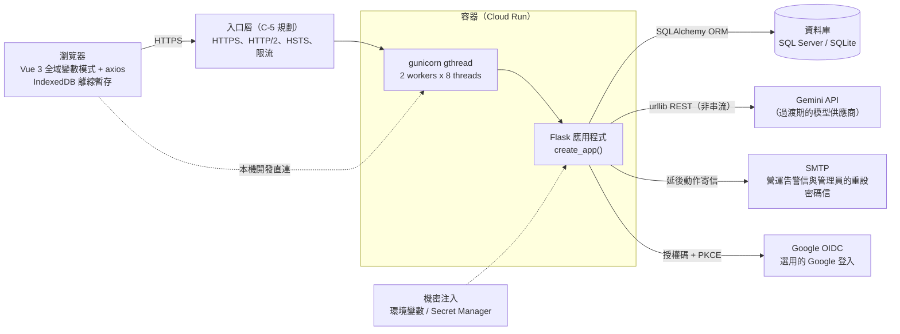
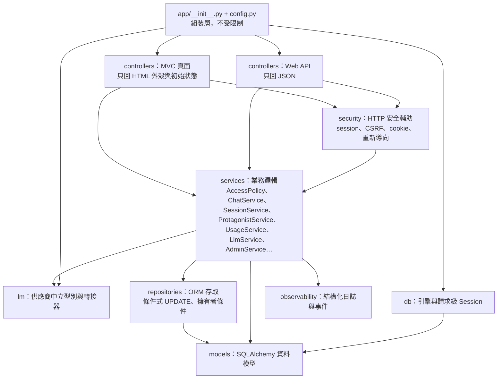
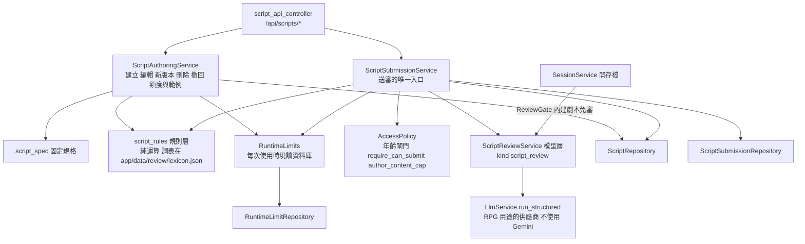
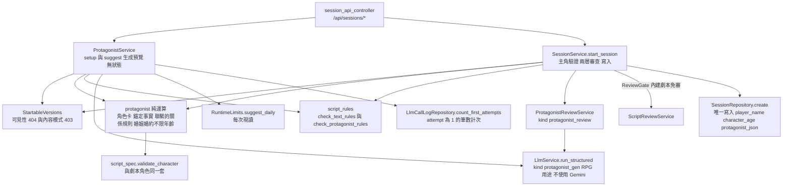
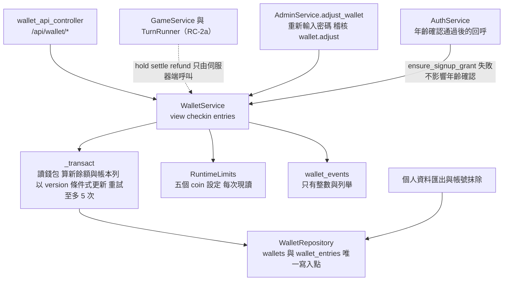
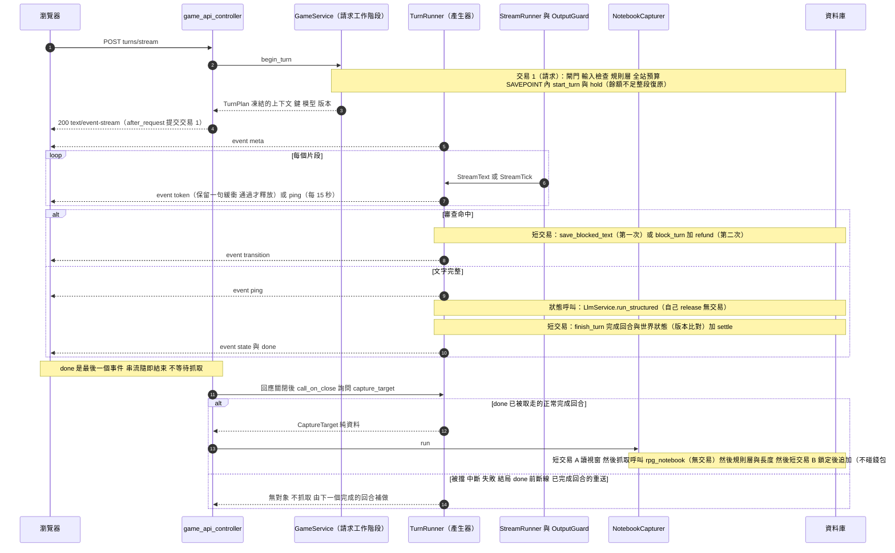
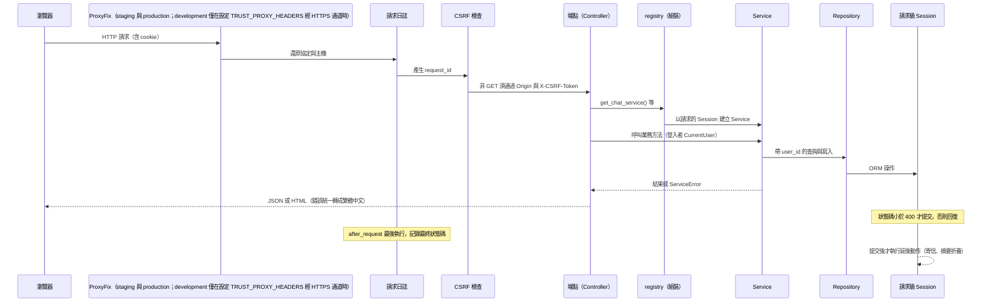
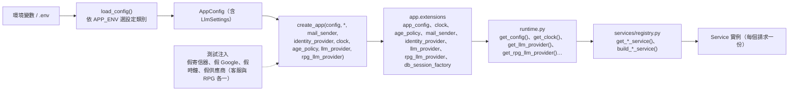

# 系統架構與分層

> 狀態：已實作（RPG 為規劃中） ｜ 最後更新：2026-11-10 ｜ 對應 change：rpg-turn-engine、game-wallet、rpg-character-creation、rpg-script-authoring、rpg-data-and-script、remove-player-password-auth、platform-foundation、member-auth、cs-chat-core、usage-limits、admin-console、openai-compatible-provider、privacy-lifecycle、ops-alerting、launch-readiness、staging-deployment、google-first-login ｜ 規範依據：AGENTS.md 第 3、4、9、10 節
> 注意（2026-11-03）：Google 登入改版的兩個 change 都已實作：change ① `google-first-login`（`AccountLockService`、`AppealService`、`SlidingSessionInterface`、受限登入狀態一般化、管理員二階段登入的中間狀態 cookie）與 change ② `remove-player-password-auth`（移除玩家端密碼註冊、密碼登入、忘記密碼與信箱驗證；`AuthService` 只剩管理員的密碼驗證、補填年齡、變更密碼與建立管理員，`EmailFlowService` 只剩管理員的重設密碼；玩家不收任何信）。
> 注意（2026-11-03）：change `rpg-data-and-script`（RC-1）加入 RPG 的資料基礎：`ScriptRepository`、`SessionRepository`、`ContentModeService`、`SessionService`、`ScriptSeedService` 與純運算的 `script_spec`、`content_tier`；`AccessPolicy` 的內容上限改為三種內容模式。還沒有任何玩家看得到的 RPG 介面。
> 注意（2026-11-04）：change `rpg-script-authoring`（RC-7）加入玩家創作劇本：`ScriptAuthoringService`、`ScriptSubmissionService`、`ScriptReviewService`、`RuntimeLimits`、`NicknameService`，以及純運算的 `script_rules`、`script_review_prompt`、`nickname`（見下方「劇本創作與審查」）；`SessionService` 開存檔前多一道審查閘門（`ReviewGate`）。玩家看得到的第一個 RPG 頁面是 `/scripts`。
> 注意（2026-11-04）：change `rpg-character-creation`（RC-9）加入玩家主角與開存檔 API：`ProtagonistService`（創角資料與 AI 生成預覽）、`ProtagonistReviewService`（開存檔時主角的模型層審查）、`StartableVersions`（開存檔、創角資料與生成預覽共用的版本可見性與內容模式判定），以及純運算的 `protagonist`、`protagonist_prompt`；`SessionService.start_session` 改為接收主角角色卡與錨定事實（見下方「玩家主角與開存檔」）。

本文件說明系統由哪些部分組成、後端如何分層、一個請求怎麼走完、外部依賴如何注入。其他設計文件（資料模型、帳號與安全、客服流程、模型呼叫層、前端、營運）都以這裡的分層為準。

## 1. 系統全景

- 瀏覽器只載入本機資產（`static/vendor`、`static/fonts`），不使用任何 CDN。
- 所有狀態都在資料庫：多個 worker 之間沒有行程內共用狀態（限流、處理標記、斷路都存資料庫）。
- 模型供應商是可替換的：業務程式只認得 `app/llm/types.py` 的中立型別（見 [模型呼叫層-llm-layer.md](模型呼叫層-llm-layer.md)）。

## 2. 後端分層與依賴方向

`tests/architecture/test_layering.py` 以 AST 檢查「各層禁止匯入」，違反就失敗：

| 層            | 禁止匯入                                           | 原因                                         |
| ------------- | -------------------------------------------------- | -------------------------------------------- |
| controllers   | repositories、db、models、sqlalchemy               | 端點只呼叫 Service，不碰資料庫               |
| security      | repositories、db、models、sqlalchemy               | HTTP 輔助不直接存取資料                      |
| services      | controllers、flask                                 | Service 不知道 HTTP                          |
| repositories  | services、controllers、flask                       | 資料存取不依賴業務邏輯                       |
| models        | services、repositories、controllers、flask         | 模型是最底層                                 |
| db            | services、repositories、controllers                | 資料庫基礎不依賴上層                         |
| observability | services、repositories、controllers                | 日誌可被任何層使用                           |
| llm           | services、repositories、controllers、models、flask | 供應商轉接器不依賴業務層，換供應商只動這一層 |

另有三項架構測試：業務程式碼（services、controllers、repositories、models、security、observability、db）不得含供應商的 SDK、網域與金鑰標頭名稱（`test_no_vendor_in_business_code.py`）；每個指向 `users.id` 的外鍵必須是 `CASCADE` 或可為空的 `SET NULL`（`test_user_foreign_keys.py`）；後台的兩條規則（`test_admin_boundaries.py`，下述）。

### 後台專用的 Repository（C-4b）

一般路徑的 Repository 方法第一個參數必須是 `user_id`（擁有者條件寫進簽名）；管理員要讀他人的對話，**不放寬這條規則**，而是另一組明確標示為後台專用的方法，並用對稱的規則守住：

| 規則 | 守法 |
|---|---|
| `AdminService` 的每個公開方法，第一個陳述式是 `self._policy.require_admin(admin)` | `tests/architecture/test_admin_boundaries.py`（AST；測試本身有自我驗證，餵它故意違規的原始碼必須失敗並指出方法） |
| 後台專用的 Repository（`admin_repository.py`、`admin_audit_repository.py`）只被 `admin_service.py` 與 `registry.py` 匯入 | 同上（指出違規的檔案） |
| `AdminAuditRepository` 只有 `add` 與 `list`，沒有更新與刪除 | `tests/test_admin_audit_repository.py` 以反射檢查公開方法 |

`AdminService` 依賴 `AccessPolicy`、兩個後台 Repository、`UsageService`（用量快照）、`AgeStatsService`（年齡區間人數）與兩個注入的可呼叫物件：`AuthService.confirm_password`（重新輸入密碼）與 `keep_changes_on_error`（失敗的重新驗證也要保存稽核），由 `registry.get_admin_service()` 組裝。回傳的資料一律是明確組出來的字典，不是 ORM 物件，所以內部編號、密碼雜湊與 `token_version` 不可能意外外露。

### 帳號鎖定、申訴與受限登入狀態（google-first-login）

| 元件 | 角色與規則 | 守法 |
|---|---|---|
| `AccountLockService`（`app/services/account_lock_service.py`） | 兩類計次（`identity_rejected` 15 分鐘 5 次、`rate_limited` 15 分鐘 10 次）寫入 `lock_strikes`，達門檻以條件式 UPDATE 鎖定並寫 `account.lock` 稽核（管理員欄位為空）。呼叫點只有三處：Google 回呼的拒絕（`GoogleSignInService._refuse`，已辨識出帳號者）、補填年齡不一致（`AuthService.verify_age`）、被每分鐘訊息數上限擋下（`UsageService._check_rate`）。計次寫入後呼叫 `keep_changes_on_error`，所以 4xx 的請求也保留 | `tests/test_account_lock_service.py`（SQLite 與 SQL Server、並行只鎖一次）；`tests/test_chat_usage_limits.py`、`test_google_endpoints.py` 證明三個呼叫點 |
| 稽核以注入的函式寫入 | `AccountLockService` 與 `AppealService` 拿到的是 `registry._system_audit` 產生的函式，不直接匯入後台專用的 `AdminAuditRepository`，所以後台專用 Repository 仍只被 `admin_service.py` 與 `registry.py` 匯入 | `tests/architecture/test_admin_boundaries.py` |
| `AppealService`（`app/services/appeal_service.py`） | 只有被鎖定的玩家能申訴（其他人 404）；1000 字、每小時 3 則、同時 1 則待處理；內容是個資，稽核與日誌只有字數 | `tests/test_appeal_api.py` |
| 受限登入狀態 | `CurrentUser.restriction` 回傳 `locked`／`age_pending`／`deletion_pending`（依此優先順序），`require_login`／`login_required_page` 預設拒絕，只有明確傳入 `allow_*` 的端點通過；管理員不會是 `locked` 或 `age_pending` | `tests/test_restricted_session.py` 對三種狀態各掃描一次全部路由，並有自我驗證 |
| `SlidingSessionInterface` | session 到期時間一律是「寫入的當下加 30 天」，辨識過登入者的回應才重發 cookie；取代絕對期限的實作 | `tests/test_session_security.py`（第 20 天使用會續期、連續使用 100 天仍有效、閒置 31 天失效） |
| 管理員的中間狀態 cookie | `app/security/admin_step.py`：10 分鐘的簽章 cookie，不被 `current_user()` 辨識；`POST /api/auth/admin-password` 與 `/forgot` 是登入之前的端點，不在受限狀態掃描的範圍（明列於測試） | `tests/test_admin_two_step_login.py` |
| `landing_for(user, next)`（`app/security/redirects.py`） | 首頁、登入頁與 Google 回呼共用：受限狀態各去自己的頁面，待確認年齡帶著已驗證的 `next` 去 `/age`，否則 `next` 或預設頁面 | `tests/test_landing.py` |

### 抹除的單一出口與期限清除的專用 Repository（C-4c）

「刪除一個人」只有一個出口，期限清除的刪除能力只放在一個專用的 Repository，兩者都由架構測試守住：

| 規則 | 守法 |
|---|---|
| 閒置清除、自助刪除、逾時未補填年齡的清除（`purge-unconfirmed-accounts`）與補填時未滿 13 歲的立即抹除，都共用 `AccountErasureService`：先把別人的存檔對這位作者的劇本版本的來源參照清為空值（無動作的外鍵，不清會擋住刪除）、再清帳本的對話編號、再條件式刪除、寫刪除紀錄、提交；條件不成立整個回復 | `tests/test_account_erasure_service.py`；`tests/test_cli_account_retention.py` 證明閒置清除也走它 |
| 每張指向使用者、對話、存檔、劇本或版本的資料表都要登記（任意父表的串聯與無動作的外鍵都分類），沒有外鍵的整數參照與無動作的外鍵必須由抹除流程在刪除使用者之前明確清除 | `tests/architecture/test_account_erasure_coverage.py`（新增資料表漏掉就失敗，並有自我驗證）；`test_account_erasure_rpg_data.py` 以行為證明作者被抹除時別人的存檔保留 |
| 劇本版本的狀態與兩個輔助欄位（`live_script_id`、`open_script_id`）只由 `ScriptRepository` 寫入；不得在別處建立 `ScriptVersion`、對它 `update`／`delete` 或對它的 `status` 賦值 | `tests/architecture/test_script_state_writes.py`（AST 掃描 `app/`，並附反向驗證） |
| `RetentionRepository`（依期限刪除對話、帳本、權杖、稽核、鎖定計次、RPG 存檔與回合的部分內容）只被 `data_retention_service.py` 與 `registry.py` 匯入；`AdminAuditRepository` 仍沒有更新與刪除 | `tests/architecture/test_retention_boundaries.py` |
| 需要登入的端點預設拒絕三種受限登入狀態（等待刪除、待確認年齡、被鎖定），只有明確允許的端點可用 | `tests/test_restricted_session.py` 掃描 `app.url_map` 的每條規則（見 [帳號與安全-auth-security.md](帳號與安全-auth-security.md) 第 7a、7b 節） |

匯出（`PersonalExportService`）只透過 `ChatRepository`、`ScriptRepository`、`SessionRepository` 與 `UserRepository` 讀取，沿用「擁有者條件寫進簽名」的規則（訊息以 `messages_after` 分頁；劇本、存檔與回合以產生器逐筆、逐頁讀取，簽名第一個參數是 `user_id`），不需要新的繞過路徑。

### RPG 資料基礎（rpg-data-and-script）

| 元件 | 責任 |
|---|---|
| `script_spec.py`（純運算） | 固定規格 v1 的驗證與標準化，輸出標準化內容與 `content_hash`；沒有資料庫、網路與時間的依賴 |
| `content_tier.py`（純邏輯） | 三種內容模式的順序與「取較保守者」，無法判定視為 `safe`；不內嵌任何年齡數字 |
| `AccessPolicy.content_access`／`effective_tier` | 依生日於當下計算的年齡、部署開關與成年確認，算出年齡上限與生效模式；管理員與各等級不豁免 |
| `ContentModeService` | 玩家查詢與切換自己的內容模式、成年確認；`GET`／`PUT /api/account/content-mode` |
| `ScriptRepository` | 劇本與版本：擁有者範圍的方法都接收 `user_id`，公開讀取只回傳上架版本；狀態轉移集中在少數方法，核可時取代舊版與鎖定筆名在同一個 SAVEPOINT |
| `SessionRepository`／`SessionService` | 存檔與回合：所有方法接收 `user_id`；開始回合先對存檔列做條件式 UPDATE 取鎖（串行化並行請求）；開存檔先過年齡閘門、檢查來源版本與劇本宣告的內容模式，再複製完整內容 |
| `ScriptSeedService` | 內建劇本的種子（`flask seed-scripts`）：全部驗證通過才在單一交易內寫入，冪等 |

- 開存檔時複製劇本內容，之後存檔不再讀取劇本；`sessions.source_version_id` 是無動作的外鍵，刪除版本與抹除帳號的流程先清為空值。
- 組裝在 `registry.py`（`get_content_mode_service()`、`get_session_service()`、`build_script_seed_service()`）；`AccessPolicy` 的成人模式開關來自 `config.content.adult_mode_enabled`。

### 劇本創作與審查（rpg-script-authoring）

| 元件 | 責任 |
|---|---|
| `script_rules.py`（純運算） | 規則層：同一句內的詞共現判斷，詞表是隨映像封裝的 JSON（`not_after`／`not_before` 排除誤判，如「異國中生存」）；直接拒絕的主軸是露骨性用語與未成年用語同句，強姦或性暴力用語單獨出現只標示；只回報固定類別，不回報內容或位置；每次儲存都執行 |
| `script_review_prompt.py`／`ScriptReviewService` | 模型層：審查指示只放 `system_instruction`，劇本文字是資料區塊；輸出固定為 `{verdict, categories}`，沒有自由文字；結果掛在版本上（對應 `content_hash`），內容不變就不再呼叫；**RPG 供應商沒有設定、預算用盡、降級或被擋一律不放行** |
| `ScriptAuthoringService` | 作者自己的劇本：建立、儲存草稿（`base_hash` 樂觀並行）、新版本、刪除、撤回、重新取用筆名、額度與範例；每次儲存只跑規則層，被拒絕時不寫入也不計次 |
| `ScriptSubmissionService` | 送審的順序：年齡閘門 → 擁有者（404）→ 必須是草稿 → 沒有被暫停 → 每日上限（台灣日）→ 固定規格與規則層 → 模型層 → 合併疑慮 → 記錄審查結果 → 條件式轉移為待審；自動拒絕寫一筆紀錄、評估連續被拒，達門檻即條件式暫停發佈 |
| `RuntimeLimits` | 七個營運限制（劇本數、每日送審數、連續被拒門檻）：每次現讀、不快取；缺值或不合法用保守的保底預設並記警告；修改只經 `flask set-script-limit` 並寫稽核 |
| `nickname.py`／`NicknameService` | 暱稱的驗證（NFC、去控制字元、長度、不得含網址 電子郵件 電話樣式、不得冒用官方署名）與短代號；年齡確認時與生日一起驗證，帳號頁可更改 |

- **依賴方向**：Service 只透過 Repository 與 `LlmService`；`SessionService` 只依賴 `ReviewGate`（Protocol），不認識模型層的實作，測試以替身注入。審查結果欄位只由 `ScriptRepository.record_review` 寫入，`tests/architecture/test_script_state_writes.py` 擋住別處的賦值。
- 組裝在 `registry.py`（`get_runtime_limits()`、`get_script_review_service()`、`get_script_authoring_service()`、`get_script_submission_service()`、`get_nickname_service()`）；自動拒絕與暫停的稽核走 `_system_audit`（管理員欄位為空）。

### 玩家主角與開存檔（rpg-character-creation）

| 元件 | 責任 |
|---|---|
| `session_api_controller.py` | `GET /api/sessions/setup/<id>`、`POST /api/sessions/protagonist/suggest`、`POST /api/sessions`；只讀請求、呼叫 Service、回應；沒有權限判斷，也不匯入資料層；回應禁止快取 |
| `ProtagonistService` | `setup`：序章與創角資料（人物只給姓名與職業）；`suggest`：年齡閘門 → 版本 → 自我介紹標準化 → 自我介紹的規則層（拒絕不呼叫模型、不計次）→ 每日次數 → 模型未設定或預算用盡（不計次）→ 呼叫模型 → 再標準化。**無狀態**：唯一的資料庫寫入是用量帳本；自我介紹不落地 |
| `SessionService.start_session` | 年齡閘門 → 版本（404）→ 內容模式（403）→ 主角與錨定事實驗證（400，一次回報）→ 主角規則層（422）→ 劇本審查把關 → 主角模型層審查 → `SessionRepository.create`；任何一步失敗都不留存檔。便宜的檢查在前 |
| `protagonist.py`／`protagonist_prompt.py`（純運算） | 角色卡（沿用劇本角色規格）、錨定事實（指向劇本中存在的人物、地點、里程碑，文字 60 字）、聯繫的關係規則（性與性奴等禁斷關係一律不行；戀愛、婚姻與婚約不論年齡一律開放）（詞表群組 `sexual_violence` 與性用語，欄位錯誤；NPC 的錨定事實同規則，見 `rpg_world`）；生成與審查的提示詞、結構描述與語意規則（標記字串與劇本審查分開；給模型的人物資料不含隱藏特質） |
| `ProtagonistReviewService` | 開存檔時對最終的主角做模型層審查，不快取；`reject` 擋下、`flag` 放行、不可用一律擋下 |
| `script_rules.py` 的主角入口 | 與劇本共用同一個引擎；唯一更嚴的地方：未成年主角自己的文字出現露骨用語即直接拒絕 |

- **依賴方向**：`SessionService` 依賴 `ProtagonistReviewGate`（Protocol）與 `ReviewGate`，測試以替身注入；`ProtagonistService`、`SessionService` 的公開方法第一個陳述式都是 `self._policy.require_chat_access(<呼叫者>)`（`tests/architecture/test_protagonist_boundaries.py` 以 AST 守住，附反向驗證）。主角姓名、角色年齡與主角資料只由 `SessionRepository.create` 寫入（`test_protagonist_writes.py`）。
- 組裝在 `registry.py`（`get_protagonist_service()`、`get_protagonist_review_service()`、`get_session_service()`）；兩個主角服務與開存檔共用同一個標記字串（`protagonist_marker`，由 `SECRET_KEY` 導出）。

### 遊戲幣錢包（game-wallet）

| 元件 | 責任 |
|---|---|
| `wallet_api_controller.py` | `GET /api/wallet`、`POST /api/wallet/checkin`、`GET /api/wallet/entries`；只讀請求、呼叫 Service、回應；`require_login()` 預設拒絕受限登入狀態；回應禁止快取；**沒有任何 HTTP 端點能花費或增加餘額**（簽到除外） |
| `WalletService` | 簽到（預覽與實際入帳共用 `checkin_amounts`，所以不分歧）、記錄頁、首次註冊贈幣、預扣／結算／退回（冪等鍵由呼叫端決定）、管理員調整。所有改變餘額的操作走同一個 `_transact`；`_prepare`（查詢、預扣、簽到與記錄之前）建立錢包、補發贈幣、退回逾時的預扣，三者都冪等且有界 |
| `WalletRepository` | 餘額與帳本只由它寫入（`tests/architecture/test_wallet_writes.py` 守住）；以 `version` 做條件式更新，結算與退回互斥由預扣列的 `resolution` 裁判；SQLite 的 SAVEPOINT 前先做一次不影響列的條件式 UPDATE（否則 `RELEASE` 等於 `COMMIT`） |
| `wallet_messages.py`、`wallet_events.py` | 記錄頁的繁體中文說明（每個帳本種類都有，斷言守住）；日誌事件（見 [營運與部署-operations.md](營運與部署-operations.md)） |

- **依賴方向**：`AdminService` 與 `AuthService` 依賴錢包（以回呼或元件注入），錢包不依賴它們；`WalletService` 不匯入 `AdminService` 或回合引擎。回呼在 `registry.py` 的 `_grant_signup_coins_on_age_verified` 組裝，包在 SAVEPOINT 內。
- **逾時預扣沒有排程**：`coin.hold_timeout_seconds`（預設 180，須大於 RC-2 的單回合上限）之後，在該玩家下一次存取錢包時退回；後台檢視餘額不觸發清理。
- 組裝在 `registry.py`（`build_wallet_service()`、`get_wallet_service()`）。

### RPG 回合引擎（rpg-turn-engine）

回合分成兩個階段：**請求階段**（`GameService`，在請求的資料庫工作階段內）與**產生器階段**（`TurnRunner`／`OpeningRunner`，在 `after_request` 之後才執行，自己管理短交易）。串流與狀態呼叫期間沒有任何資料庫交易。

| 元件 | 責任 |
|---|---|
| `game_api_controller.py` | `POST /api/game/sessions/<id>/turns/stream`、`POST …/opening/stream`、`GET …/<id>`、`GET …/turns`，以及記事簿的 `GET`／`PUT …/<id>/notebook`（呼叫 `NotebookService`，不需要 RPG 供應商）；只讀請求、呼叫 `GameService`、回應。串流端點先確認有 RPG 供應商（沒有就在預扣之前回 503），再呼叫開始階段；開始前的失敗全是 JSON；已完成的重送由 `rpg_replay.py` 轉成 `meta`（`replayed: true`）、一個含全文的 `token`、`done`；要生成時在建立 Response 之前呼叫 `build_turn_runner`／`build_opening_runner`，Response 的本文把「關閉」傳給事件產生器（斷線收尾）；回合串流另以 `response.call_on_close` 在回應關閉之後呼叫記事簿抓取（`_notebook_follow_up`：依賴在請求內由 `build_notebook_capturer` 取好，回呼先問 `TurnRunner.capture_target()`，有值才抓取，並包 `try/except`，絕不拋出）。標頭 `text/event-stream; charset=utf-8`、`no-cache, no-transform`、`X-Accel-Buffering: no`；沒有權限判斷，也不匯入資料層 |
| `GameService`（`game_service.py`） | `begin_turn`：閘門 → `client_msg_id` 與行動驗證 → 擁有者 → 已完成的重送（`TurnReplay`，不碰錢包）→ 完結與第 0 幕閘門 → 行動的規則層（只擋確定違規，422 `input_blocked`）→ 全站預算 → SAVEPOINT 內 `start_turn` 與 `hold`（鍵含 `attempt`）→ 凍結 `TurnPlan`（最近 10 輪、世界狀態、在場角色與年齡、結局判定、首選模型、版本、上下文）。`begin_opening`：已完成的直接回傳既有文字，否則條件式搶佔生成權（`OpeningPlan`），同時只有一個請求能生成 |
| `RunnerBase`（`rpg_runner_base.py`） | 兩種 Runner 共用：`SseEvent`、`RunnerDeps`（工作階段工廠、錢包與模型服務工廠、供應商、設定、時鐘，**在建立 Response 之前取出**）、心跳、串流帳本的緩衝與短交易（`_tx`）、一次串流嘗試（`StreamRun` 加 `OutputGuard`，回傳成功、被擋或失敗） |
| `TurnRunner`（`rpg_turn_runner.py`） | 事件產生器：被擋後同一筆預扣自動重生一次、第二次仍被擋則 `blocked` 並退回；失敗與中斷 `interrupted` 並退回；文字完整後的收尾（狀態呼叫、`apply_proposal`、`finish_turn`、`settle`）不 `yield`，正常路徑與 `GeneratorExit` 路徑共用；版本衝突、狀態呼叫失敗都不影響文字與結算；`capture_target()`：`done` 被伺服器取走（`yield` 返回）之後、回合為 `complete`（不是 `ended`、被擋、中斷、失敗或被取代）才回傳抓取對象（`CaptureTarget`，純資料），`done` 寫入時客戶端斷線（`GeneratorExit`）不設定 |
| `NotebookCapturer`（`rpg_notebook_capture.py`） | 每完成 10 輪抓取重點並追加到記事簿，**在回應關閉之後執行，自己管理短交易**：短交易 A（讀存檔、算邊界與視窗、全站預算）→ 抓取呼叫（`rpg_notebook`，無交易，預算 `min(30, 剩餘)`、總預算 60 秒）→ 驗證（清理與去重、標記字串與洩漏、規則層逐條累積）→ 長度（超過「容量 + 預備空間」且剩餘 ≥ 20 秒才精簡重試一次）→ 短交易 B（條件式 UPDATE 鎖定存檔列，對鎖內讀到的最新文字重新計算後追加）。不碰錢包、不計輪數、不拋出；暫時性失敗與驗證失敗不推進 `notebook_upto_turn`，由下個回合補做。細節見 [模型呼叫層-llm-layer.md](模型呼叫層-llm-layer.md) 6c |
| `NotebookService`（`notebook_service.py`） | 玩家檢視與儲存自己存檔的記事簿（`registry.get_notebook_service`，在請求內建立，**不呼叫模型**）。`view`：閘門 → 擁有者（404）→ 全文、版本、字數、容量、預備空間、是否已滿（形狀由 `notebook_policy.view_of` 決定，快照的摘要由 `summary_of` 決定，兩者共用同一個來源）。`save` 的順序：閘門 → 擁有者 → 清理 → 已完結（409 `session_ended`）→ 長度大於容量（422 `notebook_too_long`，玩家沒有預備空間）→ 規則層（`script_rules.check_text_rules`，只擋必須拒絕的類別，422 `notebook_blocked`）→ `SessionRepository.save_notebook` 條件式寫入（進行中且版本相符，版本加 1，不碰 `notebook_upto_turn`）→ 衝突時重新讀取並回 409 `notebook_conflict` 附最新內容。每個被拒的出口只記 `rpg_events` 的整數與列舉事件 |
| `OpeningRunner`（`rpg_opening_runner.py`） | 第 0 幕：不碰錢包、不寫回合表；寫回都是帶憑證（`opening_started_at`）的條件式 UPDATE；失敗或兩次被擋 → `fallback`（劇本的初始對話），斷線 → 退回 `pending` |
| 純運算模組 | `rpg_prompt`、`rpg_context`、`rpg_world`、`rpg_output_guard`、`rpg_output_rules`、`notebook_policy`（容量、清理、視窗、追加）、`rpg_notebook_prompt`（抓取的提示詞與 schema）（不匯入資料模型、Repository 或 Flask，`tests/architecture/test_rpg_pure_modules.py` 守住） |
| `rpg_events.py` | 十八個日誌事件（回合與第 0 幕 12 個、記事簿 6 個），只有內部編號、整數與固定列舉；函式沒有接收文字的參數，所以玩家文字放不進日誌 |

- **交易邊界**：交易 1 由請求提交；之後每個寫入階段各開新工作階段並提交（被擋記錄、中斷或被擋結束、完成回合）。**完成回合、寫入世界狀態與結算預扣在同一個短交易**，不會出現「回合完成但沒結算」。串流的帳本緩衝在下一個短交易寫入，狀態呼叫之前一定先寫入，使帳本順序與實際一致。
- **斷線**：Controller 逐個送出事件，客戶端斷線時 WSGI 伺服器 `close()` 產生器（`GeneratorExit`）。文字尚未完成 → 上游關閉、回合 `interrupted`、退回預扣；文字已完整且通過審查 → 收尾照常完成並結算，玩家以相同 `client_msg_id` 重送即取得既有結果。
- **卡住的回合**：產生器所在的 worker 重啟時，回合停在 `streaming`；超過 `coin.hold_timeout_seconds` 後，重送相同編號會接手（`attempt` 加 1、新的預扣鍵），舊預扣已被錢包的逾時規則退回，玩家只被扣一輪。過時的產生器寫回時因 `attempt` 不符而失敗，只送出 `turn_superseded` 錯誤，不影響新的嘗試。
- 組裝在 `registry.py`（`get_game_service()`、`build_runner_deps()`、`build_turn_runner()`、`build_opening_runner()`、`build_notebook_capturer()`）；標記字串由 `SECRET_KEY` 導出（`rpg_marker`），模型名稱取 RPG 用途的首選模型。

## 3. 一個請求的生命週期

重點：

- **Session 只在狀態碼小於 400 時提交**；需要在失敗回應後仍保留的寫入（登入失敗計數）明確呼叫 `keep_changes_on_error()`；需要在呼叫模型前後落地的寫入（客服）由 Service 注入的 `commit` 明確提交。
- **延後動作**（`defer_until_commit`）在提交之後、回應送出之後執行，用自己綁好的資料（寄信、摘要折疊使用自己的 Session）。
- Service 錯誤（`ServiceError` 的子類）統一由 `controllers/errors.py` 轉成狀態碼與 JSON，不含堆疊、SQL 或機密。

## 4. 應用程式工廠與依賴注入

- 外部依賴（寄信、Google、模型、時鐘、年齡規則）都由 `create_app` 的關鍵字參數注入；沒有注入時依設定建立真實的實作，沒有設定時為空（對應功能回 404 或 503）。
- **模型供應商依用途分開存放**：`llm_provider`（客服與摘要，Gemini）與 `rpg_llm_provider`（RPG 敘事，OpenAI 相容端點）互相獨立；沒有設定 RPG 用途時只有它自己是空的，客服不受影響。`registry.get_llm_service()` 與 `get_rpg_llm_service()` 組出同一個 `LlmService`，只是供應商與設定不同（見 [模型呼叫層-llm-layer.md](模型呼叫層-llm-layer.md) 第 10 節）。
- Service 本身不匯入 flask，也不讀環境變數；命令列指令沒有請求，改用 `build_*` 函式明確傳入 Session。

## 5. 模組與規格、文件對照

| 能力（`openspec/specs/`）                                                                                                                          | 主要程式                                                                                                           | 設計文件                                                                                                   |
| ---------------------------------------------------------------------------------------------------------------------------------------------------- | ------------------------------------------------------------------------------------------------------------------ | ---------------------------------------------------------------------------------------------------------- |
| application-layering、database-access、app-configuration                                                                                             | `app/__init__.py`、`app/config.py`、`app/db/`、`app/controllers/errors.py`                                 | 本文、[資料模型-data-model.md](資料模型-data-model.md)、[營運與部署-operations.md](營運與部署-operations.md) |
| member-registration、session-authentication、email-token-flows、google-sign-in、csrf-protection、access-control、age-confirmation、account-retention | `app/services/auth_service.py`、`access_policy.py`、`email_flow_service.py`、`google_*`、`app/security/` | [帳號與安全-auth-security.md](帳號與安全-auth-security.md)                                                  |
| cs-conversations、cs-conversation-memory、cs-nlp-contract                                                                                            | `app/services/chat_service.py`、`cs_*.py`、`summary_service.py`、`app/repositories/chat_repository.py`     | [客服對話-chat-service.md](客服對話-chat-service.md)                                                        |
| admin-console、admin-user-management、admin-content-review、admin-audit-log                                                                          | `app/services/admin_service.py`、`app/repositories/admin_*.py`、`app/controllers/admin_*.py`                   | [帳號與安全-auth-security.md](帳號與安全-auth-security.md)、[資料模型-data-model.md](資料模型-data-model.md) |
| security-headers                                                                                                                                     | `app/security/security_headers.py`（HSTS 只在 staging 與 production；不送 CSP） | [營運與部署-operations.md](營運與部署-operations.md) |
| operational-alerts（及 app-configuration、service-observability 的告警條款）                                                                         | `app/services/alert_rules.py`（純函式）、`alert_service.py`、`alert_messages.py`、`app/repositories/alert_state_repository.py`、`app/observability/alert_events.py`、`app/cli.py` 的 `check-alerts` | [營運與部署-operations.md](營運與部署-operations.md)、[資料模型-data-model.md](資料模型-data-model.md) |
| content-tier-modes、script-fixed-spec、script-store、rpg-sessions、builtin-script-seed | `app/services/content_tier.py`、`script_spec.py`、`content_mode_service.py`、`session_service.py`、`script_seed_service.py`、`app/repositories/script_repository.py`、`session_repository.py`、`app/data/scripts/` | [資料模型-data-model.md](資料模型-data-model.md)、[帳號與安全-auth-security.md](帳號與安全-auth-security.md) 第 5 節、[RPG.md](RPG.md) |
| script-authoring、script-review、script-submission、runtime-limits、player-nickname、appeal-shortcut | `app/services/script_authoring_service.py`、`script_submission_service.py`、`script_review_service.py`、`script_review_prompt.py`、`script_rules.py`、`runtime_limits.py`、`nickname.py`、`nickname_service.py`、`app/repositories/script_submission_repository.py`、`runtime_limit_repository.py`、`app/controllers/script_api_controller.py`、`script_page_controller.py`、`app/data/review/lexicon.json` | [資料模型-data-model.md](資料模型-data-model.md)、[帳號與安全-auth-security.md](帳號與安全-auth-security.md)、[模型呼叫層-llm-layer.md](模型呼叫層-llm-layer.md)、[前端結構-frontend.md](前端結構-frontend.md)、[營運與部署-operations.md](營運與部署-operations.md) |
| rpg-protagonist、protagonist-suggestion | `app/services/protagonist.py`、`protagonist_prompt.py`、`protagonist_service.py`、`protagonist_review_service.py`、`startable.py`、`session_service.py`、`app/controllers/session_api_controller.py` | [系統架構-architecture.md](系統架構-architecture.md)（本文）、[資料模型-data-model.md](資料模型-data-model.md)、[帳號與安全-auth-security.md](帳號與安全-auth-security.md) |
| rpg-notebook、rpg-notebook-capture | `app/services/notebook_policy.py`、`notebook_service.py`、`rpg_notebook_prompt.py`、`rpg_notebook_capture.py`、`rpg_turn_runner.py`（`capture_target`）、`app/controllers/game_api_controller.py`（`call_on_close`、記事簿端點）、`app/repositories/session_repository.py`（記事簿方法）、`app/observability/rpg_events.py` | 本文、[模型呼叫層-llm-layer.md](模型呼叫層-llm-layer.md) 6c、[RPG.md](RPG.md) 7.16 |
| game-wallet、wallet-api | `app/models/wallet.py`、`app/repositories/wallet_repository.py`、`app/services/wallet_service.py`、`wallet_messages.py`、`app/controllers/wallet_api_controller.py`、`app/observability/wallet_events.py` | [資料模型-data-model.md](資料模型-data-model.md)、[帳號與安全-auth-security.md](帳號與安全-auth-security.md)、[營運與部署-operations.md](營運與部署-operations.md) |
| account-deletion、personal-data-export、data-retention                                                                                               | `app/services/account_deletion_service.py`、`account_erasure_service.py`、`account_deletion_executor.py`、`personal_export_service.py`、`data_retention_service.py`、`app/repositories/retention_repository.py`、`app/controllers/account_api_controller.py` | [帳號與安全-auth-security.md](帳號與安全-auth-security.md)、[資料模型-data-model.md](資料模型-data-model.md)、[營運與部署-operations.md](營運與部署-operations.md) |
| llm-provider、llm-structured-calls                                                                                                                   | `app/llm/`、`app/services/llm_service.py`、`llm_output.py`                                                   | [模型呼叫層-llm-layer.md](模型呼叫層-llm-layer.md)                                                          |
| offline-frontend-assets、shared-ui-components、auth-pages、cs-chat-ui                                                                                | `app/static/`、`app/templates/`                                                                                | [前端結構-frontend.md](前端結構-frontend.md)                                                                |
| service-observability、container-runtime                                                                                                             | `app/observability/`、`Dockerfile`、`gunicorn.conf.py`、`gunicorn.rpg.conf.py`                                                       | [營運與部署-operations.md](營運與部署-operations.md)                                                        |

## 6. 關鍵技術決策

| 決策               | 內容                                                 | 原因                                                        |
| ------------------ | ---------------------------------------------------- | ----------------------------------------------------------- |
| 純 ORM、雙軌資料庫 | 不寫原生 SQL；SQLite 與 SQL Server 行為一致          | 本機開發用 SQLite、正式用 SQL Server；JSON 欄位不做內容查詢 |
| 狀態都在資料庫     | 不依賴行程內記憶體（限流、處理標記、斷路、摘要標記） | 多 worker 與重啟後行為一致                                  |
| 不引入 LLM SDK     | 以標準函式庫 `urllib` 呼叫 REST                    | 減少相依、供應商型別不滲入呼叫端、逾時可控                  |
| 前端不打包         | Vue 3 全域變數模式、不使用 `.vue` 與 Vite          | AGENTS.md 第 2 節；資產全部本地化                           |
| 擁有者條件寫進簽名 | 對話相關的 Repository 方法第一個參數都是 `user_id` | 避免只憑識別碼取資料；AST 測試守住                          |
| 後台走專用路徑     | 管理員讀他人資料只能經 `AdminService` 與後台專用 Repository，每個方法先 `require_admin`、每次讀取先寫稽核 | 不放寬一般路徑的隔離保證；「只有管理員」與「後台資料只走後台路徑」由測試守住，不靠審查 |
| 非擁有者一律 404   | 他人的資源與不存在的回應逐字相同                     | 不洩漏資源是否存在                                          |
| 抹除只有一個出口   | 閒置清除、自助刪除、逾時未補填年齡與未滿 13 歲都走 `AccountErasureService`；新增資料表要登記 | 避免每個功能各做一套刪除而漏掉某張表；帳本的對話編號沒有外鍵，順序錯了就會留下錯指的參照 |
| 受限登入狀態預設拒絕 | 待刪除、待確認年齡與被鎖定的帳號可登入但只能做各自的一小組事情；`require_login` 預設拒絕，允許清單明確列出 | 新增端點漏了檢查也是安全的一邊；以掃描全部路由的測試證明 |

## 7. 規劃中的 RPG 模組

RPG 與客服共用上述分層與模型呼叫層；差異在串流（SSE）、世界狀態與劇本。**資料基礎已實作**（上面的「RPG 資料基礎」）：劇本與版本、存檔與回合、固定規格驗證器、三種內容模式、內建劇本種子。**創作介面已實作**（RC-7，上面的「劇本創作與審查」）。**尚未實作**：審核與公開目錄（RC-8）、回合引擎與串流（RC-2）、遊戲介面（RC-3）。細節見 [RPG.md](RPG.md)，進度見 [路線圖-roadmap.md](路線圖-roadmap.md)。

---

**何時更新本文**：新增或改名分層、改變禁止匯入規則、`create_app` 的注入參數增減、新增主要外部依賴、請求生命週期（中介層順序、提交規則）改變時。更新後同步 [README.md](README.md) 的對照表並執行 `tests/test_design_docs.py`。
