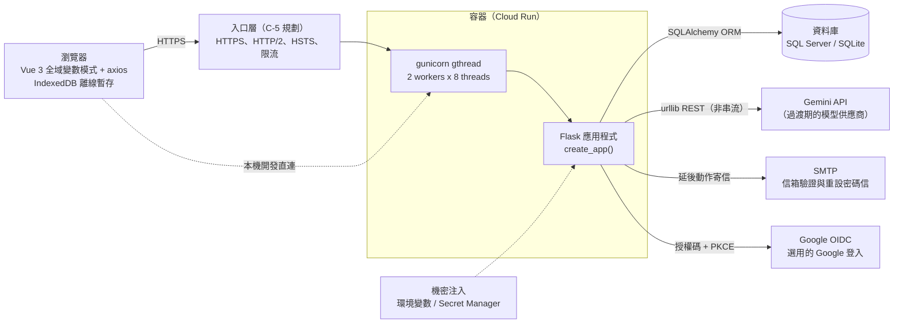
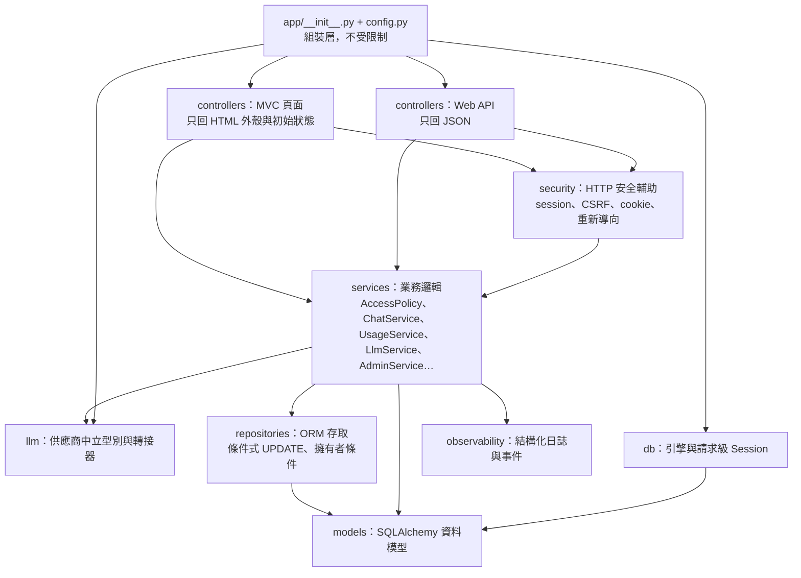
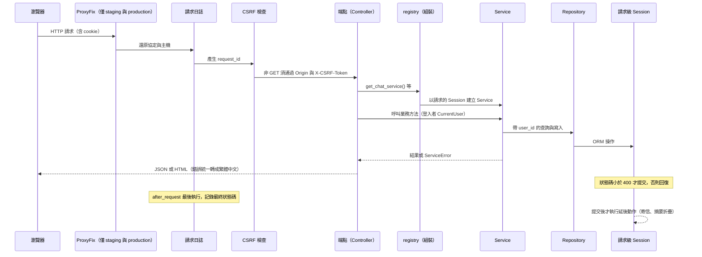
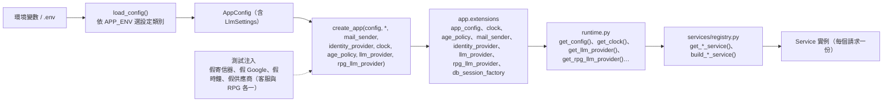

# 系統架構與分層

> 狀態：已實作（RPG 為規劃中） ｜ 最後更新：2026-10-30 ｜ 對應 change：platform-foundation、member-auth、cs-chat-core、usage-limits、admin-console、openai-compatible-provider、privacy-lifecycle、ops-alerting、launch-readiness ｜ 規範依據：AGENTS.md 第 3、4、9、10 節

本文件說明系統由哪些部分組成、後端如何分層、一個請求怎麼走完、外部依賴如何注入。其他設計文件（資料模型、帳號與安全、客服流程、模型呼叫層、前端、營運）都以這裡的分層為準。

## 1. 系統全景

- 瀏覽器只載入本機資產（`static/vendor`、`static/fonts`），不使用任何 CDN。
- 所有狀態都在資料庫：多個 worker 之間沒有行程內共用狀態（限流、處理標記、斷路都存資料庫）。
- 模型供應商是可替換的：業務程式只認得 `app/llm/types.py` 的中立型別（見 [模型呼叫層-llm-layer.md](模型呼叫層-llm-layer.md)）。

## 2. 後端分層與依賴方向

`tests/architecture/test_layering.py` 以 AST 檢查「各層禁止匯入」，違反就失敗：

| 層            | 禁止匯入                                           | 原因                                         |
| ------------- | -------------------------------------------------- | -------------------------------------------- |
| controllers   | repositories、db、models、sqlalchemy               | 端點只呼叫 Service，不碰資料庫               |
| security      | repositories、db、models、sqlalchemy               | HTTP 輔助不直接存取資料                      |
| services      | controllers、flask                                 | Service 不知道 HTTP                          |
| repositories  | services、controllers、flask                       | 資料存取不依賴業務邏輯                       |
| models        | services、repositories、controllers、flask         | 模型是最底層                                 |
| db            | services、repositories、controllers                | 資料庫基礎不依賴上層                         |
| observability | services、repositories、controllers                | 日誌可被任何層使用                           |
| llm           | services、repositories、controllers、models、flask | 供應商轉接器不依賴業務層，換供應商只動這一層 |

另有三項架構測試：業務程式碼（services、controllers、repositories、models、security、observability、db）不得含供應商的 SDK、網域與金鑰標頭名稱（`test_no_vendor_in_business_code.py`）；每個指向 `users.id` 的外鍵必須是 `CASCADE` 或可為空的 `SET NULL`（`test_user_foreign_keys.py`）；後台的兩條規則（`test_admin_boundaries.py`，下述）。

### 後台專用的 Repository（C-4b）

一般路徑的 Repository 方法第一個參數必須是 `user_id`（擁有者條件寫進簽名）；管理員要讀他人的對話，**不放寬這條規則**，而是另一組明確標示為後台專用的方法，並用對稱的規則守住：

| 規則 | 守法 |
|---|---|
| `AdminService` 的每個公開方法，第一個陳述式是 `self._policy.require_admin(admin)` | `tests/architecture/test_admin_boundaries.py`（AST；測試本身有自我驗證，餵它故意違規的原始碼必須失敗並指出方法） |
| 後台專用的 Repository（`admin_repository.py`、`admin_audit_repository.py`）只被 `admin_service.py` 與 `registry.py` 匯入 | 同上（指出違規的檔案） |
| `AdminAuditRepository` 只有 `add` 與 `list`，沒有更新與刪除 | `tests/test_admin_audit_repository.py` 以反射檢查公開方法 |

`AdminService` 依賴 `AccessPolicy`、兩個後台 Repository、`UsageService`（用量快照）、`AgeStatsService`（年齡區間人數）與兩個注入的可呼叫物件：`AuthService.confirm_password`（重新輸入密碼）與 `keep_changes_on_error`（失敗的重新驗證也要保存稽核），由 `registry.get_admin_service()` 組裝。回傳的資料一律是明確組出來的字典，不是 ORM 物件，所以內部編號、密碼雜湊與 `token_version` 不可能意外外露。

### 抹除的單一出口與期限清除的專用 Repository（C-4c）

「刪除一個人」只有一個出口，期限清除的刪除能力只放在一個專用的 Repository，兩者都由架構測試守住：

| 規則 | 守法 |
|---|---|
| 閒置清除與自助刪除共用 `AccountErasureService`：先清帳本的對話編號、再條件式刪除、寫刪除紀錄、提交；條件不成立整個回復 | `tests/test_account_erasure_service.py`；`tests/test_cli_account_retention.py` 證明閒置清除也走它 |
| 每張指向使用者或對話的資料表都要登記，沒有外鍵的整數參照必須由抹除流程明確清除 | `tests/architecture/test_account_erasure_coverage.py`（新增資料表漏掉就失敗，並有自我驗證） |
| `RetentionRepository`（依期限刪除對話、帳本、權杖與稽核）只被 `data_retention_service.py` 與 `registry.py` 匯入；`AdminAuditRepository` 仍沒有更新與刪除 | `tests/architecture/test_retention_boundaries.py` |
| 需要登入的端點預設拒絕受限登入狀態（帳號等待刪除），只有明確允許的端點可用 | `tests/test_restricted_session.py` 掃描 `app.url_map` 的每條規則（見 [帳號與安全-auth-security.md](帳號與安全-auth-security.md) 第 7a 節） |

匯出（`PersonalExportService`）只透過 `ChatRepository` 與 `UserRepository` 讀取，沿用「擁有者條件寫進簽名」的規則（訊息以 `messages_after` 分頁，簽名第一個參數是 `user_id`），不需要新的繞過路徑。

## 3. 一個請求的生命週期

重點：

- **Session 只在狀態碼小於 400 時提交**；需要在失敗回應後仍保留的寫入（登入失敗計數）明確呼叫 `keep_changes_on_error()`；需要在呼叫模型前後落地的寫入（客服）由 Service 注入的 `commit` 明確提交。
- **延後動作**（`defer_until_commit`）在提交之後、回應送出之後執行，用自己綁好的資料（寄信、摘要折疊使用自己的 Session）。
- Service 錯誤（`ServiceError` 的子類）統一由 `controllers/errors.py` 轉成狀態碼與 JSON，不含堆疊、SQL 或機密。

## 4. 應用程式工廠與依賴注入

- 外部依賴（寄信、Google、模型、時鐘、年齡規則）都由 `create_app` 的關鍵字參數注入；沒有注入時依設定建立真實的實作，沒有設定時為空（對應功能回 404 或 503）。
- **模型供應商依用途分開存放**：`llm_provider`（客服與摘要，Gemini）與 `rpg_llm_provider`（RPG 敘事，OpenAI 相容端點）互相獨立；沒有設定 RPG 用途時只有它自己是空的，客服不受影響。`registry.get_llm_service()` 與 `get_rpg_llm_service()` 組出同一個 `LlmService`，只是供應商與設定不同（見 [模型呼叫層-llm-layer.md](模型呼叫層-llm-layer.md) 第 10 節）。
- Service 本身不匯入 flask，也不讀環境變數；命令列指令沒有請求，改用 `build_*` 函式明確傳入 Session。

## 5. 模組與規格、文件對照

| 能力（`openspec/specs/`）                                                                                                                          | 主要程式                                                                                                           | 設計文件                                                                                                   |
| ---------------------------------------------------------------------------------------------------------------------------------------------------- | ------------------------------------------------------------------------------------------------------------------ | ---------------------------------------------------------------------------------------------------------- |
| application-layering、database-access、app-configuration                                                                                             | `app/__init__.py`、`app/config.py`、`app/db/`、`app/controllers/errors.py`                                 | 本文、[資料模型-data-model.md](資料模型-data-model.md)、[營運與部署-operations.md](營運與部署-operations.md) |
| member-registration、session-authentication、email-token-flows、google-sign-in、csrf-protection、access-control、age-confirmation、account-retention | `app/services/auth_service.py`、`access_policy.py`、`email_flow_service.py`、`google_*`、`app/security/` | [帳號與安全-auth-security.md](帳號與安全-auth-security.md)                                                  |
| cs-conversations、cs-conversation-memory、cs-nlp-contract                                                                                            | `app/services/chat_service.py`、`cs_*.py`、`summary_service.py`、`app/repositories/chat_repository.py`     | [客服對話-chat-service.md](客服對話-chat-service.md)                                                        |
| admin-console、admin-user-management、admin-content-review、admin-audit-log                                                                          | `app/services/admin_service.py`、`app/repositories/admin_*.py`、`app/controllers/admin_*.py`                   | [帳號與安全-auth-security.md](帳號與安全-auth-security.md)、[資料模型-data-model.md](資料模型-data-model.md) |
| security-headers                                                                                                                                     | `app/security/security_headers.py`（HSTS 只在 staging 與 production；不送 CSP） | [營運與部署-operations.md](營運與部署-operations.md) |
| operational-alerts（及 app-configuration、service-observability 的告警條款）                                                                         | `app/services/alert_rules.py`（純函式）、`alert_service.py`、`alert_messages.py`、`app/repositories/alert_state_repository.py`、`app/observability/alert_events.py`、`app/cli.py` 的 `check-alerts` | [營運與部署-operations.md](營運與部署-operations.md)、[資料模型-data-model.md](資料模型-data-model.md) |
| account-deletion、personal-data-export、data-retention                                                                                               | `app/services/account_deletion_service.py`、`account_erasure_service.py`、`account_deletion_executor.py`、`personal_export_service.py`、`data_retention_service.py`、`app/repositories/retention_repository.py`、`app/controllers/account_api_controller.py` | [帳號與安全-auth-security.md](帳號與安全-auth-security.md)、[資料模型-data-model.md](資料模型-data-model.md)、[營運與部署-operations.md](營運與部署-operations.md) |
| llm-provider、llm-structured-calls                                                                                                                   | `app/llm/`、`app/services/llm_service.py`、`llm_output.py`                                                   | [模型呼叫層-llm-layer.md](模型呼叫層-llm-layer.md)                                                          |
| offline-frontend-assets、shared-ui-components、auth-pages、cs-chat-ui                                                                                | `app/static/`、`app/templates/`                                                                                | [前端結構-frontend.md](前端結構-frontend.md)                                                                |
| service-observability、container-runtime                                                                                                             | `app/observability/`、`Dockerfile`、`gunicorn.conf.py`                                                       | [營運與部署-operations.md](營運與部署-operations.md)                                                        |

## 6. 關鍵技術決策

| 決策               | 內容                                                 | 原因                                                        |
| ------------------ | ---------------------------------------------------- | ----------------------------------------------------------- |
| 純 ORM、雙軌資料庫 | 不寫原生 SQL；SQLite 與 SQL Server 行為一致          | 本機開發用 SQLite、正式用 SQL Server；JSON 欄位不做內容查詢 |
| 狀態都在資料庫     | 不依賴行程內記憶體（限流、處理標記、斷路、摘要標記） | 多 worker 與重啟後行為一致                                  |
| 不引入 LLM SDK     | 以標準函式庫 `urllib` 呼叫 REST                    | 減少相依、供應商型別不滲入呼叫端、逾時可控                  |
| 前端不打包         | Vue 3 全域變數模式、不使用 `.vue` 與 Vite          | AGENTS.md 第 2 節；資產全部本地化                           |
| 擁有者條件寫進簽名 | 對話相關的 Repository 方法第一個參數都是 `user_id` | 避免只憑識別碼取資料；AST 測試守住                          |
| 後台走專用路徑     | 管理員讀他人資料只能經 `AdminService` 與後台專用 Repository，每個方法先 `require_admin`、每次讀取先寫稽核 | 不放寬一般路徑的隔離保證；「只有管理員」與「後台資料只走後台路徑」由測試守住，不靠審查 |
| 非擁有者一律 404   | 他人的資源與不存在的回應逐字相同                     | 不洩漏資源是否存在                                          |
| 抹除只有一個出口   | 閒置清除與自助刪除都走 `AccountErasureService`；新增資料表要登記 | 避免每個功能各做一套刪除而漏掉某張表；帳本的對話編號沒有外鍵，順序錯了就會留下錯指的參照 |
| 受限登入狀態預設拒絕 | 待刪除的帳號可登入但只能撤銷；`require_login` 預設拒絕，允許清單明確列出 | 新增端點漏了檢查也是安全的一邊；以掃描全部路由的測試證明 |

## 7. 規劃中的 RPG 模組

RPG 與客服共用上述分層與模型呼叫層；差異在串流（SSE）、世界狀態與劇本。細節見 [RPG.md](RPG.md)，進度見 [路線圖-roadmap.md](路線圖-roadmap.md)。

---

**何時更新本文**：新增或改名分層、改變禁止匯入規則、`create_app` 的注入參數增減、新增主要外部依賴、請求生命週期（中介層順序、提交規則）改變時。更新後同步 [README.md](README.md) 的對照表並執行 `tests/test_design_docs.py`。
