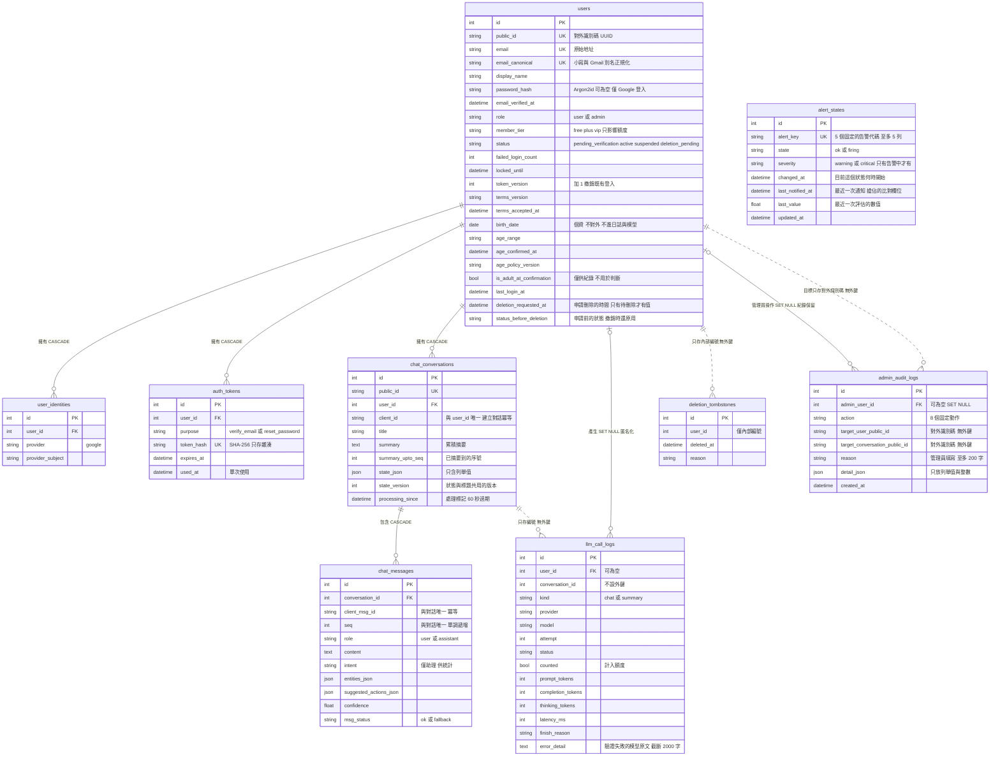
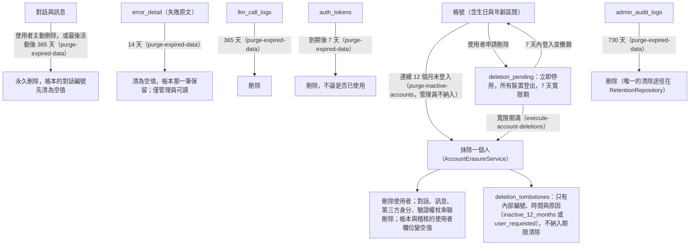

# 資料模型

> 狀態：已實作 ｜ 最後更新：2026-10-30 ｜ 對應 change：member-auth、age-verification-birthdate、cs-chat-core、usage-limits、admin-console、privacy-lifecycle、ops-alerting ｜ 資料庫版本：`0009_alert_states` ｜ 規範依據：AGENTS.md 第 4、10、11 節

本文件說明資料表之間的關係、約束與保存規則。欄位與約束以 `app/models/` 與 `migrations/versions/` 為準；這裡只列對設計有意義的欄位。

## 1. 實體關聯圖

## 2. 約束與設計理由

| 項目 | 規則 | 原因 |
|---|---|---|
| 對外識別碼 | 網址與 API 只用 `public_id`（UUID） | 內部整數主鍵不外露；授權另由擁有者條件保證，不靠不可猜測性 |
| 信箱唯一 | `email` 與 `email_canonical` 都唯一；Gmail 去點與去 `+標籤` 後比對 | 一組信箱只能對應一個帳號；Service 層先正規化，雙軌資料庫行為一致 |
| 外鍵動作 | 指向 `users.id` 一律 `CASCADE`，或可為空的 `SET NULL`（`llm_call_logs`） | 刪除帳號時內容真的消失；帳本匿名化後保留 |
| 帳本不設對話外鍵 | `llm_call_logs.conversation_id` 只存編號 | SQL Server 不允許經由多條路徑的串聯動作（錯誤 1785）；刪除對話時由 Repository 清為空值 |
| 冪等 | `(user_id, client_id)`、`(conversation_id, client_msg_id)`、`(conversation_id, seq)` 唯一 | 重送不重複；助理訊息的識別碼由使用者訊息決定性推得，一則使用者訊息至多一則回覆 |
| JSON 欄位 | `state_json`、`entities_json`、`suggested_actions_json` 由 Repository 序列化 | 不依內容查詢（兩種資料庫的 JSON 語法不同）；需要統計的 `intent` 獨立成欄位並建索引 |
| 用量計數不另設計數器 | 每日輪數、全站用量與暫停都從 `llm_call_logs` 彙總，每分鐘訊息數從 `chat_messages` 計數；為此新增 `ix_llm_call_logs_created_at` 與 `ix_chat_messages_created_at` | 沒有「計數器與真相不一致」的問題；索引只加不改，舊版程式不受影響（`0006`） |
| 待刪除的兩個欄位 | `users.deletion_requested_at`、`status_before_deletion` 皆可為空、不進索引（`0008`） | 待刪除的帳號極少，掃描即可；申請前的狀態只會是 `active` 或 `pending_verification`，撤銷時用來還原，避免待驗證的帳號藉由刪除再撤銷變成已驗證 |
| 期限清除的索引 | `ix_chat_conversations_updated_at`（`0008`） | 依最後活動時間全表找出 12 個月前的對話；既有索引以 `user_id` 開頭，用不上 |
| 抹除的涵蓋由測試守住 | 每張指向使用者或對話的資料表都要登記在 `tests/architecture/test_account_erasure_coverage.py`；沒有外鍵的整數參照（`llm_call_logs.conversation_id`）由抹除流程明確清除 | 新增資料表時，漏掉「刪除一個人」會讓測試失敗，而不是默默留下個資 |
| 告警狀態獨立成表 | `alert_states`（`0009`）至多 5 列，沒有外鍵、不含個資，`alert_key` 唯一；狀態轉換以條件式 UPDATE 搶佔（比對 `state`、`severity`、`last_notified_at`），所以兩個檢查行程重疊時只有一個寄信 | 通知不隨檢查頻率重複；不指向使用者或對話，所以不需要保存期限清除，也不在抹除流程的登記清單內 |
| 稽核只有一個外鍵 | `admin_audit_logs.admin_user_id → users.id`（`SET NULL`）；目標使用者與對話只存對外識別碼（UUID，不是個資），不設外鍵 | SQL Server 不允許同一張表有兩個指向同一個父表且帶動作的外鍵（錯誤 1785）；管理員或目標被刪除後，「誰對誰做了什麼」仍然成立，這正是稽核該有的性質 |
| 稽核不可變 | 動作是固定列舉；`detail_json` 只放列舉值與整數；`AdminAuditRepository` 只有 `add` 與 `list`（測試以反射守住） | 紀錄不能被改寫；不記錄 email、訊息、模型原文與密碼 |
| 字串型別 | 一律 `Unicode` 與 `UnicodeText` | SQL Server 對應 NVARCHAR，中文不亂碼 |
| 時間 | 資料庫存 UTC（`UTCDateTime`）；日界與年齡以 Asia/Taipei 計 | 兩種資料庫的時區行為一致 |
| 不設軟刪除 | 使用者刪除對話即永久刪除；帳號刪除靠 `CASCADE` | 不留下內容殘影；`deletion_tombstones` 只存內部編號與日期，備份還原後可重新執行刪除 |
| 生日是個資 | `birth_date`、`age_range` 不進 API 回應、日誌與模型 | AGENTS.md 第 10、11 節；是否成年一律由生日於當下計算 |

## 3. Migration 歷程

```mermaid
flowchart LR
    M1["0001 baseline<br/>只建立版本機制"] --> M2["0002 會員<br/>users、user_identities、auth_tokens"]
    M2 --> M3["0003 年齡確認欄位<br/>age_confirmed_at、age_policy_version"]
    M3 --> M4["0004 生日與年齡區間<br/>birth_date、age_range、deletion_tombstones"]
    M4 --> M5["0005 chat_core<br/>對話、訊息與模型用量帳本"]
    M5 --> M6["0006 usage_indexes<br/>llm_call_logs.created_at、chat_messages.created_at 索引"]
    M6 --> M7["0007 admin_audit_logs<br/>管理員稽核紀錄與兩個索引"]
    M7 --> M8["0008 privacy_lifecycle<br/>users 的兩個待刪除欄位、對話最後活動的索引"]
    M8 --> M9["0009 alert_states<br/>營運告警的狀態資料表"]
```

- 一律 expand-only：新增欄位先可為空，先部署相容新舊結構的程式，再回填與加約束。
- SQLite 對 `users` 的降級必須用 `recreate="never"`（`0003`、`0004`、`0008`）：預設的「重建資料表」會先刪除 `users`，外鍵啟用時以串聯刪除參照它的資料表（身分、權杖、對話）會被一併清空。
- migration 是部署流程中獨立的步驟（升級前先備份），應用程式啟動時不會自動執行；正式環境不使用 `create_all()`。
- migration 腳本使用 Alembic op API 與 ORM 型別，不含方言專屬的原生 SQL；`alembic.ini` 與範本必須純 ASCII。

## 4. 保存期限與刪除

三個排程指令都已實作（`flask purge-inactive-accounts`、`execute-account-deletions`、`purge-expired-data`），設定排程屬 C-5。**抹除一個人只有一個出口**：每個帳號在一個交易內依序「把帳本的對話編號清為空值 → 條件式刪除（當下再確認一次條件）→ 寫刪除紀錄 → 提交」，條件不成立時整個回復。順序不能反過來：使用者一刪，帳本的 `user_id` 就變成空值，找不到要清的列；帳本的 `conversation_id` 沒有外鍵，不先清掉的話，SQLite 重用整數編號時會錯指別人的新對話。管理員在後台刪除違規對話、使用者自己刪除對話與期限清除對話，都是同一個原則：先清帳本的對話編號再刪對話，訊息靠 `CASCADE` 一起刪，帳本保留。稽核的管理員欄位會因 `SET NULL` 變空，紀錄保留。

期限的數值集中在 `app/services/data_retention_service.py`（月以天計：365 與 730），與隱私權政策頁的保存期限表由測試比對；`deletion_tombstones` 不含個資，且備份還原後要靠它重新執行刪除，所以不清除。

---

**何時更新本文**：新增或修改資料表、欄位、約束、索引、外鍵動作；新增 migration（更新「資料庫版本」與歷程圖）；保存期限或刪除流程改變時。`tests/test_design_docs.py` 會檢查每張資料表都出現在本文，且資料庫版本與最新的 migration 一致。
