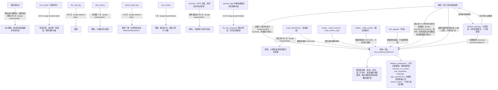

# 資料模型

> 狀態：已實作 ｜ 最後更新：2026-11-12 ｜ 對應 change：rpg-turn-revision（`memory_logs` 新增四個修訂欄位、新增 `turn_regenerations`，設定鍵 `rpg.free_regenerations`）、story-preference（新增 `users.story_preference`、`script_versions.audience`）、rpg-notebook（沒有結構變更，只更正欄位註解）、rpg-turn-engine、game-wallet、rpg-character-creation、rpg-script-authoring、rpg-data-and-script、remove-player-password-auth、member-auth、age-verification-birthdate、cs-chat-core、usage-limits、admin-console、privacy-lifecycle、ops-alerting、launch-readiness、google-first-login ｜ 資料庫版本：`0018_rpg_turn_revision` ｜ 規範依據：AGENTS.md 第 4、10、11 節
> 注意（2026-11-03）：本文件已納入 change ① `google-first-login` 的資料模型（`users` 的 `age_deadline_at`、`locked_at`、`lock_reason`；`lock_strikes`、`lock_appeals`；migration `0010`）與 change ② `remove-player-password-auth`（migration `0011` 只動資料：清除非管理員帳號的密碼雜湊，並把 `pending_verification` 改為 `active`；`users.password_hash` 只屬於管理員，`auth_tokens` 只放管理員的重設密碼權杖）。
> 注意（2026-11-03）：change `rpg-data-and-script`（RC-1）已納入：五張新表（`scripts`、`script_versions`、`script_version_tags`、`sessions`、`memory_logs`）、`users` 的內容模式偏好與成年確認四欄、migration `0012`（只新增，並一次回填偏好）。**仍未實作**：刪帳號的「匿名保留已發佈劇本」偏好（RC-8）、性格原型三張表（RC-5）、記事簿與回合的行為（RC-2，欄位已建立並有預設值）。見 [RPG.md](RPG.md) 第 2 章與 [路線圖](路線圖-roadmap.md)。
> 注意（2026-11-04）：change `rpg-script-authoring`（RC-7）已納入：`users` 的暱稱與短代號、暫停發佈時間三欄，`script_versions` 的審查結果四欄，兩張新表（`script_submissions` 送審紀錄、`runtime_limits` 存放營運限制），`llm_call_logs.kind` 加寬，migration `0013`（只新增與加寬，並以 ORM 的批次寫入植入七個限制的初始值）。

本文件說明資料表之間的關係、約束與保存規則。欄位與約束以 `app/models/` 與 `migrations/versions/` 為準；這裡只列對設計有意義的欄位。**逐表逐欄的資料字典（型別、可空、鍵、說明）、各領域的 ERD、固定值與 JSON 欄位結構**在 [project資料結構文件.md](project資料結構文件.md)，兩份文件同步維護。

## 1. 實體關聯圖

```mermaid
erDiagram
    users ||--o{ user_identities : "擁有 CASCADE"
    users ||--o{ auth_tokens : "擁有 CASCADE"
    users ||--o{ chat_conversations : "擁有 CASCADE"
    users ||--o{ lock_strikes : "鎖定計次 CASCADE"
    users ||--o{ lock_appeals : "申訴 CASCADE"
    users ||--o{ script_submissions : "送審紀錄 CASCADE"
    users ||--o| wallets : "錢包 一對一 CASCADE"
    users ||--o{ wallet_entries : "帳本 CASCADE"
    sessions ||..o{ wallet_entries : "只存存檔的對外識別碼 無外鍵"
    chat_conversations ||--o{ chat_messages : "包含 CASCADE"
    users |o--o{ llm_call_logs : "產生 SET NULL 匿名化"
    chat_conversations ||..o{ llm_call_logs : "只存編號 無外鍵"
    users ||..o{ deletion_tombstones : "只存內部編號 無外鍵"
    users |o--o{ scripts : "創作 CASCADE 內建劇本沒有作者"
    scripts ||--o{ script_versions : "版本 CASCADE"
    script_versions ||--o{ script_version_tags : "標籤 CASCADE"
    users ||--o{ sessions : "存檔 CASCADE"
    sessions ||--o{ memory_logs : "回合 CASCADE"
    sessions ||--o{ turn_regenerations : "重新生成與編輯的回饋 CASCADE"
    script_versions |o..o{ sessions : "來源參照 無動作 抹除前清為空值"
    users |o--o{ admin_audit_logs : "管理員操作 SET NULL 紀錄保留"
    users ||..o{ admin_audit_logs : "目標只存對外識別碼 無外鍵"

    users {
        int id PK
        string public_id UK "對外識別碼 UUID"
        string email UK "原始地址"
        string email_canonical UK "小寫與 Gmail 別名正規化"
        string display_name
        string password_hash "Argon2id 可為空 僅 Google 登入"
        datetime email_verified_at
        string role "user 或 admin"
        string member_tier "free plus vip 只影響額度"
        string status "active suspended deletion_pending"
        int failed_login_count
        datetime locked_until
        int token_version "加 1 撤銷既有登入"
        string terms_version
        datetime terms_accepted_at
        date birth_date "個資 不對外 不進日誌與模型"
        string age_range
        datetime age_confirmed_at
        string age_policy_version
        bool is_adult_at_confirmation "僅供紀錄 不用於判斷"
        datetime last_login_at
        datetime deletion_requested_at "申請刪除的時間 只有待刪除才有值"
        string status_before_deletion "申請前的狀態 撤銷時還原用"
        datetime age_deadline_at "玩家補填年齡的期限 建立後 24 小時 補填後清空 可為空"
        datetime locked_at "玩家帳號被鎖定的時間 只有管理員能解除 可為空"
        string lock_reason "鎖定原因的固定列舉 可為空"
        string content_tier_preference "safe standard adult 預設 safe 確認年齡時依年齡設定 滿 18 歲不自動調高"
        datetime adult_confirmed_at "成人模式的成年確認時間 可為空 只保存目前這一次"
        string adult_rules_version "確認時的安全規範版本 版本改變即失效 可為空"
        string adult_confirm_method "確認方式 目前只有 self_declared 可為空"
        string nickname "公開暱稱 2 至 20 字 個資 與 display_name 分開 可為空 創作劇本前必填"
        string nickname_code "系統產生的穩定短代號 與暱稱一起顯示 可為空"
        string story_preference "故事偏好 all male female 預設 all 只影響劇本清單排序"
        datetime publish_suspended_at "連續被自動拒絕而暫停發佈的時間 獨立於 locked_at 只停止送審 可為空 有索引"
    }
    scripts {
        int id PK
        string public_id UK "對外識別碼 UUID"
        int creator_id FK "CASCADE 可為空 內建劇本沒有作者"
        string seed_key "內建劇本的穩定鍵 非空時唯一 部分唯一索引"
        string author_name "筆名快照 第一次發佈時鎖定"
        string author_code "短代號"
        datetime author_locked_at "鎖定時間 可為空"
    }
    script_versions {
        int id PK
        string public_id UK
        int script_id FK "CASCADE 與版本編號唯一"
        int version_no "同一劇本內從 1 連續遞增"
        string status "draft pending_review published rejected superseded"
        string title "目錄欄位 可瀏覽與篩選"
        string summary
        string world_name
        string content_tier "作者宣告的內容模式"
        string audience "讀者頻道 all male female 可為空 空值視同全讀者"
        text background
        text opening
        text rules
        string ending_mode "none 或 custom"
        int ending_age
        string calendar_name
        int calendar_start_year
        json characters_json "不依內容篩選"
        json locations_json
        json milestones_json "原始劇本 唯讀"
        string content_hash "標準化內容的 SHA-256 不對外"
        int live_script_id "狀態為 published 時等於 script_id 部分唯一"
        int open_script_id "狀態為 draft 或 pending_review 時等於 script_id 部分唯一"
        datetime published_at
        string review_hash "審查當時的 content_hash 與目前相同才算數 內容變動即失效 可為空"
        string review_verdict "pass flag reject 系統判斷 可為空"
        json review_categories_json "固定列舉 不含任何內容 可為空"
        datetime reviewed_at "可為空"
    }
    script_version_tags {
        int id PK
        int version_id FK "CASCADE 與標籤唯一"
        string tag "顯示形式 查詢以小寫比對"
    }
    sessions {
        int id PK
        string public_id UK
        int user_id FK "CASCADE"
        int source_version_id FK "無動作 可為空 抹除前清為空值"
        json script_snapshot_json "開存檔當時的標準化劇本內容 之後不再讀取劇本"
        string player_name
        int character_age "劇中角色的年齡 與使用者年齡無關"
        json protagonist_json "主角角色卡與錨定事實 可為空 與姓名年齡同步"
        string current_location
        text status_summary
        json entities_json "NPC 狀態"
        json goals_json
        json milestone_progress_json
        int version "世界狀態的版本號 條件式更新"
        text notebook_text "記事簿 個資 AI 追加與玩家編輯由 rpg-notebook 實作"
        text opening_text "第 0 幕的文字 個資 可為空"
        string opening_state "pending generating ready fallback 可為空 空值視同 fallback"
        datetime opening_started_at "搶佔時間 也是這次生成的憑證 可為空"
        string content_tier "開存檔當下的生效模式 只能往保守調整"
        string status "active 或 ended 已完結不可恢復"
        datetime last_active_at "期限清除的依據"
    }
    memory_logs {
        int id PK
        int session_id FK "CASCADE"
        string client_msg_id "與存檔唯一 冪等"
        int seq "與存檔唯一 單調遞增"
        int turn_number "只有 complete 的回合才有 中斷與被擋不計輪 可為空"
        string turn_status "streaming complete interrupted blocked"
        int attempt "嘗試序號 預扣冪等鍵的一部分 預設 1"
        text user_action "個資"
        text llm_raw_response "劇情原文 中斷或被擋超過 14 天清為空字串"
        int revision "修訂版本 每次成功重新生成或編輯加 1 預設 1"
        int regen_count "這份輸入已成功重新生成幾次 編輯歸零 預設 0"
        datetime revising_started_at "修訂的認領時間 空值或逾時表示沒有人在修訂 可為空"
        json state_before_json "回合前的世界快照 下一輪完成時清為空值 個資 可為空"
    }
    turn_regenerations {
        int id PK
        int session_id FK "CASCADE"
        int turn_seq "被修訂的回合序號 與存檔和嘗試序號唯一"
        int attempt "認領後的嘗試序號 預扣冪等鍵的一部分"
        string kind "regenerate 或 edit"
        string category "五類之一 編輯為空 可為空"
        text reason "玩家填的理由 個資 只供營運檢視 編輯為空 可為空"
        bool is_free "是否免費重新生成"
        string result "pending applied failed blocked"
    }
    lock_strikes {
        int id PK
        int user_id FK "CASCADE"
        string kind "identity_rejected 或 rate_limited"
        datetime created_at "視窗內計次 15 分鐘 保存 7 天"
    }
    lock_appeals {
        int id PK
        string public_id UK "對外識別碼 UUID"
        int user_id FK "CASCADE"
        text content "玩家撰寫 上限 1000 字 視為個資"
        datetime created_at
        datetime handled_at "解除鎖定時標記 可為空"
    }
    script_submissions {
        int id PK
        int user_id FK "CASCADE 沒有版本識別碼 不連到版本"
        string outcome "sent auto_rejected lifted"
        json categories_json "固定列舉 沒有任何劇本文字 可為空"
        datetime created_at "與 user_id 的複合索引 保存 12 個月"
    }
    runtime_limits {
        int id PK
        string key UK "七個固定的鍵 劇本數 每日送審數 連續被拒門檻 沒有外鍵 不含個資"
        int int_value "範圍與缺值時的保底預設在程式 不在資料庫約束"
        datetime updated_at
    }
    user_identities {
        int id PK
        int user_id FK
        string provider "google"
        string provider_subject
    }
    auth_tokens {
        int id PK
        int user_id FK
        string purpose "只有 reset_password（管理員）；遷移前遺留的 verify_email 只等著過期清除"
        string token_hash UK "SHA-256 只存雜湊"
        datetime expires_at
        datetime used_at "單次使用"
    }
    deletion_tombstones {
        int id PK
        int user_id "僅內部編號"
        datetime deleted_at
        string reason
    }
    chat_conversations {
        int id PK
        string public_id UK
        int user_id FK
        string client_id "與 user_id 唯一 建立對話冪等"
        string title
        text summary "累積摘要"
        int summary_upto_seq "已摘要到的序號"
        json state_json "只含列舉值"
        int state_version "狀態與標題共用的版本"
        datetime processing_since "處理標記 60 秒過期"
    }
    chat_messages {
        int id PK
        int conversation_id FK
        string client_msg_id "與對話唯一 冪等"
        int seq "與對話唯一 單調遞增"
        string role "user 或 assistant"
        text content
        string intent "僅助理 供統計"
        json entities_json
        json suggested_actions_json
        float confidence
        string msg_status "ok 或 fallback"
    }
    llm_call_logs {
        int id PK
        int user_id FK "可為空"
        int conversation_id "不設外鍵"
        string kind "chat summary script_review rpg_stream 等 長度 20"
        string provider
        string model
        int attempt
        string status
        bool counted "計入額度"
        int prompt_tokens
        int completion_tokens
        int thinking_tokens
        int latency_ms
        int first_chunk_ms "串流呼叫的首字延遲 可為空"
        string finish_reason
        text error_detail "驗證失敗的模型原文 截斷 2000 字"
    }
    alert_states {
        int id PK
        string alert_key UK "5 個固定的告警代碼 至多 5 列"
        string state "ok 或 firing"
        string severity "warning 或 critical 只有告警中才有"
        datetime changed_at "目前這個狀態何時開始"
        datetime last_notified_at "最近一次通知 搶佔的比對欄位"
        float last_value "最近一次評估的數值"
        datetime updated_at
    }
    admin_audit_logs {
        int id PK
        int admin_user_id FK "可為空 SET NULL"
        string action "16 個固定動作"
        string target_user_public_id "對外識別碼 無外鍵"
        string target_conversation_public_id "對外識別碼 無外鍵"
        string reason "管理員填寫 至多 200 字"
        json detail_json "只放列舉值與整數"
        datetime created_at
    }
    wallets {
        int id PK
        int user_id FK "唯一 一人一個 CASCADE"
        int free_balance "CHECK 不小於 0"
        int paid_balance "CHECK 不小於 0"
        int version "每次餘額異動加 1 樂觀鎖"
        datetime created_at
        datetime updated_at
    }
    wallet_entries {
        int id PK
        int user_id FK "CASCADE"
        int seq "與使用者唯一 等於當時錢包的 version"
        string kind "5 個固定種類"
        string idempotency_key UK "全站唯一 同一鍵只生效一次"
        int free_delta
        int paid_delta
        int free_after
        int paid_after
        string session_public_id "存檔對外識別碼 無外鍵 可為空"
        string ref_key "退回列指向被退回的預扣 可為空"
        string resolution "僅預扣列 settled 或 refunded 只能設定一次"
        datetime created_at
    }
```



## 2. 約束與設計理由

| 項目 | 規則 | 原因 |
|---|---|---|
| 對外識別碼 | 網址與 API 只用 `public_id`（UUID） | 內部整數主鍵不外露；授權另由擁有者條件保證，不靠不可猜測性 |
| 信箱唯一 | `email` 與 `email_canonical` 都唯一；Gmail 去點與去 `+標籤` 後比對 | 一組信箱只能對應一個帳號；Service 層先正規化，雙軌資料庫行為一致 |
| 外鍵動作 | 指向 `users.id` 一律 `CASCADE`，或可為空的 `SET NULL`（`llm_call_logs`） | 刪除帳號時內容真的消失；帳本匿名化後保留 |
| 帳本不設對話外鍵 | `llm_call_logs.conversation_id` 只存編號 | SQL Server 不允許經由多條路徑的串聯動作（錯誤 1785）；刪除對話時由 Repository 清為空值 |
| 冪等 | `(user_id, client_id)`、`(conversation_id, client_msg_id)`、`(conversation_id, seq)` 唯一 | 重送不重複；助理訊息的識別碼由使用者訊息決定性推得，一則使用者訊息至多一則回覆 |
| JSON 欄位 | `state_json`、`entities_json`、`suggested_actions_json` 由 Repository 序列化 | 不依內容查詢（兩種資料庫的 JSON 語法不同）；需要統計的 `intent` 獨立成欄位並建索引 |
| 用量計數不另設計數器 | 每日輪數、全站用量與暫停都從 `llm_call_logs` 彙總，每分鐘訊息數從 `chat_messages` 計數；為此新增 `ix_llm_call_logs_created_at` 與 `ix_chat_messages_created_at` | 沒有「計數器與真相不一致」的問題；索引只加不改，舊版程式不受影響（`0006`） |
| 待刪除的兩個欄位 | `users.deletion_requested_at`、`status_before_deletion` 皆可為空、不進索引（`0008`） | 待刪除的帳號極少，掃描即可；申請前的狀態只會是 `active`（`pending_verification` 已退役），撤銷時用來還原，避免待驗證的帳號藉由刪除再撤銷變成已驗證 |
| 期限清除的索引 | `ix_chat_conversations_updated_at`（`0008`） | 依最後活動時間全表找出 12 個月前的對話；既有索引以 `user_id` 開頭，用不上 |
| 抹除的涵蓋由測試守住 | 每張指向使用者或對話的資料表都要登記在 `tests/architecture/test_account_erasure_coverage.py`；沒有外鍵的整數參照（`llm_call_logs.conversation_id`）由抹除流程明確清除 | 新增資料表時，漏掉「刪除一個人」會讓測試失敗，而不是默默留下個資 |
| 告警狀態獨立成表 | `alert_states`（`0009`）至多 5 列，沒有外鍵、不含個資，`alert_key` 唯一；狀態轉換以條件式 UPDATE 搶佔（比對 `state`、`severity`、`last_notified_at`），所以兩個檢查行程重疊時只有一個寄信 | 通知不隨檢查頻率重複；不指向使用者或對話，所以不需要保存期限清除，也不在抹除流程的登記清單內 |
| 玩家鎖定與補填期限（`0010`） | `users.age_deadline_at`、`locked_at`、`lock_reason` 皆可為空且各自有索引或不進索引：期限與鎖定都只對少數列有值；鎖定以條件式 UPDATE（`locked_at IS NULL`）搶佔，並行請求只鎖一次；沒有 `age_deadline_at` 的舊帳號與管理員不會被逾時清除 | 補填期限與鎖定狀態是帳號的屬性，不是歷史；expand 階段只新增可為空的欄位，舊版程式不受影響 |
| 鎖定計次與申訴各自成表（`0010`） | `lock_strikes` 只存（使用者、類別、時間），視窗內計數靠 `(user_id, created_at)` 索引；`lock_appeals` 有 `public_id`，內容視為個資；兩者都對 `users.id` `CASCADE`，並登記在抹除涵蓋測試的清單 | 計次不依內容查詢，不放 JSON；刪除帳號時申訴與計次一起消失 |
| 稽核只有一個外鍵 | `admin_audit_logs.admin_user_id → users.id`（`SET NULL`）；目標使用者與對話只存對外識別碼（UUID，不是個資），不設外鍵 | SQL Server 不允許同一張表有兩個指向同一個父表且帶動作的外鍵（錯誤 1785）；管理員或目標被刪除後，「誰對誰做了什麼」仍然成立，這正是稽核該有的性質 |
| 稽核不可變 | 動作是固定列舉；`detail_json` 只放列舉值與整數；`AdminAuditRepository` 只有 `add` 與 `list`（測試以反射守住） | 紀錄不能被改寫；不記錄 email、訊息、模型原文與密碼 |
| 字串型別 | 一律 `Unicode` 與 `UnicodeText` | SQL Server 對應 NVARCHAR，中文不亂碼 |
| 時間 | 資料庫存 UTC（`UTCDateTime`）；日界與年齡以 Asia/Taipei 計 | 兩種資料庫的時區行為一致 |
| 不設軟刪除 | 使用者刪除對話即永久刪除；帳號刪除靠 `CASCADE` | 不留下內容殘影；`deletion_tombstones` 只存內部編號與日期，備份還原後可重新執行刪除 |
| 生日是個資 | `birth_date`、`age_range` 不進 API 回應、日誌與模型 | AGENTS.md 第 10、11 節；是否成年一律由生日於當下計算 |
| 劇本與版本分開（`0012`） | `scripts` 是身分（作者、種子鍵、筆名快照），內容與狀態在 `script_versions`；已發佈的版本不可變，修改一律新增版本 | 「核可前舊版持續有效」需要同一劇本同時存在多列內容；只在單一列上覆寫做不到不可變 |
| 狀態由資料庫保證唯一 | `script_versions.live_script_id`、`open_script_id` 只在狀態為 `published`、`draft` 或 `pending_review` 時等於 `script_id`，各自一個「只涵蓋非 NULL 列」的部分唯一索引；兩者與狀態只由 `ScriptRepository` 寫入（架構測試擋住別處） | 每個劇本至多一個上架版本與一個進行中的版本；SQL Server 的 UNIQUE 只容許一個 NULL，不能直接對 `(script_id, status)` 設唯一，且並行請求只靠程式檢查會同時通過 |
| 種子鍵可為空且唯一 | `scripts.seed_key` 用 `unique_when_not_null()`（`sqlite_where` 與 `mssql_where`） | 玩家劇本沒有種子鍵，多個 NULL 並存；兩種資料庫行為一致 |
| 存檔複製劇本 | `sessions.script_snapshot_json` 存開存檔當時的完整標準化內容，`source_version_id` 只是可為空的參照 | 作者改版、下架或刪帳號都不影響存檔；也讓「作者被抹除時別人的存檔保留」成立 |
| 來源參照是無動作的外鍵 | `sessions.source_version_id → script_versions.id` 沒有 `ON DELETE`；刪除版本與抹除帳號的流程先把參照清為空值 | 刪除使用者有兩條路徑到達 `sessions`（`users → sessions`，與 `users → scripts → script_versions → sessions`），SQL Server 不允許多重串聯路徑（錯誤 1785）；有外鍵才不會出現指向已刪除編號的懸空參照，忘了清空時刪除會直接失敗 |
| 回合的唯一性與輪數 | `(session_id, client_msg_id)`、`(session_id, seq)` 唯一；`turn_number` 可為空，只在回合完成時指派，不設資料庫唯一約束 | 冪等與順序由資料庫保證；可為空的複合唯一在 SQL Server 有問題，輪數的唯一靠「同一存檔同時只處理一則」與開始回合時對存檔列的條件式 UPDATE 取鎖 |
| 內容模式欄位 | `users.content_tier_preference` 為 `NOT NULL`、伺服器預設 `safe`（舊版程式的 INSERT 仍有效且保守）；成年確認三欄皆可為空，只保存目前這一次 | 預設最保守；規範版本改變後覆寫即可，歷史不需要保存；`0012` 依 `is_adult_at_confirmation` 一次回填（成年為 `standard`），所以滿 18 歲不會自動調高 |
| 暱稱與暫停發佈是帳號的屬性（`0013`） | `users.nickname`、`nickname_code`、`publish_suspended_at` 皆可為空，舊版程式的 INSERT 仍有效；暫停時間有索引（後台清單只掃有值的列），只由條件式 UPDATE 寫入（`publish_suspended_at IS NULL` 才寫，並行的拒絕只暫停一次；管理員不會被暫停） | 暫停發佈獨立於 `locked_at`：它只停止送審，其餘功能照常，所以不能共用鎖定欄位；暱稱是公開顯示的個資，與 Google 帶來的 `display_name` 分開存放 |
| 審查結果掛在版本上（`0013`） | `script_versions.review_hash`、`review_verdict`、`review_categories_json`、`reviewed_at` 皆可為空；只由 `ScriptRepository.record_review` 寫入，條件是 `content_hash` 仍等於審查當時的雜湊（架構測試擋住別處的寫入）；`review_hash` 與目前的 `content_hash` 不同即視為尚未審查 | 審查期間內容被改時舊結果不會蓋在新內容上；結果是系統的判斷，不匯出給使用者，類別只有固定列舉 |
| 送審紀錄不連到版本（`0013`） | `script_submissions` 只存（使用者、結果、類別、時間），外鍵只有 `users.id`（`CASCADE`），`(user_id, created_at)` 複合索引；`lifted` 是管理員解除暫停時補的一筆，使連續被拒中斷 | 被拒絕的送審只保留類別與時間（AGENTS.md 第 11 節）；不指向版本也就沒有 `users → script_versions → script_submissions` 的第二條串聯路徑（SQL Server 錯誤 1785）；每日次數與連續被拒都從這張表計算，不另設計數器 |
| 營運限制存在資料庫（`0013`、`0014`、`0015`、`0016`） | `runtime_limits.key` 唯一，十六個鍵由遷移植入（`0013` 七個、`0014` 三個每日主角生成次數、`0015` 五個遊戲幣設定、`0016` 一個 RPG 每回合月數上限，後三者只插入缺少的）；程式**每次使用時現讀**，不在行程內快取；範圍與缺值時的保底預設在 `app/services/runtime_limits.py`，資料庫不設值域約束；只能由 `flask set-script-limit`、`set-wallet-setting`、`set-rpg-setting`（各管自己那一組）修改並寫 `limit.set` 稽核 | 多 worker 不得依賴行程記憶體（AGENTS.md 第 9 節），所以調整不必重新部署也立即生效；資料被誤改時讀取端仍有保守的後備值並記錄警告（只記鍵名） |
| 主角資料放在存檔的一個 JSON 欄位（`0014`） | `sessions.protagonist_json` 可為空，內容 `{character, anchor}`；`player_name`、`character_age` 保留並由同一個 INSERT 依角色卡寫入，唯一寫入點是 `SessionRepository.create`（架構測試守住，開存檔後沒有任何方法能改年齡） | 角色年齡是錨定事實；expand 階段舊程式、匯出與保存期限照常讀兩個舊欄位，移除它們屬日後的 contract。錨定事實不放進 `entities_json`，因為那個欄位的結構由回合引擎（RC-2）決定 |
| 帳本的類別欄位加寬（`0013`） | `llm_call_logs.kind` 由 10 加寬為 20，`script_review` 共 13 個字 | SQL Server 會以錯誤拒絕過長的字串，SQLite 不會，只在 SQLite 測試看不出來，所以在真實 SQL Server 的測試中守住；降級前先刪除非客服類別的列，才能安全縮回 |
| 錢包兩個餘額加只增不改的帳本（`0015`） | `wallets` 一人一列（免費與付費兩個整數，資料庫 `CHECK` 不小於 0 是第二道防線）；`wallet_entries` 每次異動同一個交易寫一筆，`seq` 是這位使用者的第幾筆（等於寫入當下的 `version`），記錄頁以它分頁；帳本只放固定列舉與整數，沒有任何玩家文字 | 不做批次制：幣不過期，批次只剩 W2「付費幣按購買退款」一個用途，屆時以 expand 加欄位。以 `version` 做 CAS 並重試，不用 `SELECT … FOR UPDATE`（SQLite 沒有、AGENTS.md 第 4 節禁止原生 SQL），雙軌行為才一致 |
| 帳本以存檔的對外識別碼關聯、不設外鍵（`0015`） | `wallet_entries.session_public_id` 存 UUID；兩張表的 `user_id` 都是 `ON DELETE CASCADE`（錢包是個資，隨帳號刪除，不匿名化保留） | 帳本比存檔活得久，SQLite 會重用整數編號而錯指別人的存檔；SQL Server 也不允許 `users` 到帳本有兩條串聯路徑。AGENTS.md 第 11 節已依此改為「存檔識別碼」 |
| 結算與退回互斥靠 `resolution`（`0015`） | 預扣列的 `resolution` 只能從空值以條件式更新設定一次為 `settled` 或 `refunded`；結算不另寫帳本列 | 避免零增減的雜訊列；代價是帳本有這一個可改欄位的例外，規格明寫。逾時預扣在該玩家下一次存取錢包時退回，不設排程 |
| 回合的嘗試序號（`0016`） | `memory_logs.attempt` 為 `NOT NULL`、資料庫預設 1；建立時為 1，中斷、被擋或逾時的重送接手時加 1，已完成的重送不變。完成、中斷與被擋可帶 `attempt`，條件式 UPDATE 比對它 | 遊戲幣的預扣冪等鍵必須隨嘗試而變（`hold()` 遇到同一個鍵一律回傳既有預扣，含已退回的）；帶 `attempt` 讓被接手而過時的產生器無法改寫新的嘗試 |
| 同一存檔同時只有一個進行中的回合（`0016`） | 開始回合時已先對存檔列做條件式 UPDATE 取鎖，再查「其他編號且 `updated_at` 未逾時的 `streaming`」，有則衝突；逾時者標為 `interrupted`。逾時秒數沿用 `coin.hold_timeout_seconds`（呼叫端現讀後傳入） | 預扣與回合同時到期，玩家不會被雙重扣款；不新增設定鍵，也不需要資料庫層的部分唯一索引（`streaming` 不是穩定的唯一狀態，且逾時接手需要時間條件） |
| 第 0 幕放在存檔上而不是回合表（`0016`） | `sessions.opening_text`／`opening_state`／`opening_started_at` 皆可為空；搶佔、接手、完成與退回都是帶狀態條件的單一 UPDATE，`opening_started_at` 是這次生成的憑證，寫回時必須相同；空值（舊存檔）視同 `fallback` | 第 0 幕不是一輪：不計輪數、不扣幣、不出現在回合同步序列，放進回合表會讓這三件事都要特例處理；憑證讓被接手而過時的產生器無法覆蓋新的結果 |
| 故事偏好與讀者頻道（`0017`） | `users.story_preference` 為 `NOT NULL`、資料庫預設 `all`（舊版程式的 INSERT 在新結構上仍有效）；`script_versions.audience` 可為空且**不回填**（已發佈的版本不可變，空值與 `all` 行為相同）。標準化內容只在 `male`／`female` 時帶 `audience` 鍵，全讀者不進內容 | 讓既有內容的 `content_hash` 逐位元不變：待審版本的審查結果不失效、內建劇本種子重跑仍是「未變更」；偏好只影響清單排序，所以不加索引，也不加 CHECK 約束（值域由 Service 驗證） |
| 串流的首字延遲進帳本（`0016`） | `llm_call_logs.first_chunk_ms` 可為空，只有串流呼叫有值 | 串流的體感品質看首字不看整段；沒有新增資料表，也不含任何文字 |
| 標籤獨立成表 | `script_version_tags` 以顯示形式儲存（保留大小寫，版本內容可由欄位完整還原、雜湊不變），查詢以小寫比對 | 不得依 JSON 內容篩選；同一版本內由驗證器以 NFC 與不分大小寫去除重複，所以兩種資料庫的唯一約束不會誤判 |

### `sessions.entities_json` 的結構（v1，rpg-turn-engine）

世界狀態的 NPC 角色卡、新增地點與主角年齡更正，由 `rpg_world.WorldState` 讀寫、`SessionRepository.update_world_state` 序列化；**只有 Service 能寫**（模型只提議，`apply_proposal` 逐項驗證後才產生新值），且不依內容篩選查詢。

```json
{ "v": 1,
  "npcs": { "<NFC 小寫名>": { "name": "林曉",
                              "traits": [{"label": "開朗", "layer": "surface"}],
                              "stage": "surface",
                              "age": 16, "age_at_month": 0,
                              "anchor_fact": "與主角是舊識",
                              "last_seen_turn": 7, "origin": "script" } },
  "protagonist": { "age": 30, "age_at_month": 120 },
  "locations": ["遊戲中新增的地點"] }
```

| 欄位 | 說明 |
|---|---|
| `v` | 結構版本，目前為 1 |
| `npcs` | 以名稱的 NFC 小寫形式為鍵；最多 30 位。`origin` 是 `script`（劇本角色，第一次在行動或敘事文字中出現時以劇本的年齡與特質建卡）或 `story`（對話中產生） |
| `traits` | 每項 `label`（至多 8 字）與 `layer`（`surface` 表層、`hidden` 隱藏）；至多 6 項 |
| `stage` | 弧線階段 `surface`、`cracking`、`revealed`，由模型提議、Service 驗證轉移（只能前進一階；`cracking` 可退回 `surface`；`revealed` 是終點，不得跳級） |
| `age`、`age_at_month` | 年齡紀錄與紀錄當下的遊戲內月數；**目前年齡** = `age + (elapsed_months − age_at_month) // 12`。更正可往任何方向，每次更正產生通知（附更正前的年齡） |
| `anchor_fact` | NPC 的錨定事實（至多 100 字）；一旦有值就不被模型覆寫 |
| `last_seen_turn` | 最後一次出現的輪數，由 Service 依「名稱出現在行動或敘事文字」更新（不依模型回報）；用來挑選下一回合在場的 NPC 切片 |
| `protagonist` | 主角年齡的更正紀錄，**第一次更正才建立**；缺值時年齡取角色卡的 `character_age`、`age_at_month` 為 0。原始角色卡與 `character_age` 欄位不變 |
| `locations` | 遊戲中新增的地點（至多 30 個），劇本原有的地點在劇本複本中 |

相關欄位：`goals_json` 為 `{"active": [{text, milestone_id, turn}], "archived": [{text, milestone_id, turn, done_turn}]}`（進行中至多 5 個，已歸檔只留最近 50 筆）；`milestone_progress_json` 為 `{"<里程碑編號>": {"triggered_turn": n, "extended": bool}}`（劇本複本唯讀，進度另存）。主角的錨定事實不放在這裡，仍在 `protagonist_json`。

## 3. Migration 歷程

```mermaid
flowchart LR
    M1["0001 baseline<br/>只建立版本機制"] --> M2["0002 會員<br/>users、user_identities、auth_tokens"]
    M2 --> M3["0003 年齡確認欄位<br/>age_confirmed_at、age_policy_version"]
    M3 --> M4["0004 生日與年齡區間<br/>birth_date、age_range、deletion_tombstones"]
    M4 --> M5["0005 chat_core<br/>對話、訊息與模型用量帳本"]
    M5 --> M6["0006 usage_indexes<br/>llm_call_logs.created_at、chat_messages.created_at 索引"]
    M6 --> M7["0007 admin_audit_logs<br/>管理員稽核紀錄與兩個索引"]
    M7 --> M8["0008 privacy_lifecycle<br/>users 的兩個待刪除欄位、對話最後活動的索引"]
    M8 --> M9["0009 alert_states<br/>營運告警的狀態資料表"]
    M9 --> M10["0010 google_first_login<br/>users 的補填期限與鎖定欄位、lock_strikes、lock_appeals"]
    M10 --> M11["0011 remove_player_passwords<br/>只動資料：清除玩家的密碼雜湊、pending_verification 改為 active"]
    M11 --> M12["0012 rpg_data_and_script<br/>users 的內容模式四欄與回填、scripts、script_versions、script_version_tags、sessions、memory_logs"]
    M12 --> M13["0013 rpg_script_authoring<br/>users 的暱稱與暫停發佈三欄、script_versions 的審查四欄、script_submissions、runtime_limits 與七個初始值、llm_call_logs.kind 加寬"]
    M13 --> M14["0014 rpg_character_creation<br/>sessions.protagonist_json、runtime_limits 補三個每日主角生成次數的初始值"]
    M14 --> M15["0015 game_wallet<br/>wallets、wallet_entries、runtime_limits 補五個遊戲幣設定的初始值"]
    M15 --> M16["0016 rpg_turn_engine<br/>memory_logs.attempt、sessions 的第 0 幕三欄、llm_call_logs.first_chunk_ms、runtime_limits 補每回合月數上限"]
    M16 --> M17["0017 story_preference<br/>users.story_preference、script_versions.audience"]
    M17 --> M18["0018 rpg_turn_revision<br/>memory_logs 的四個修訂欄位、turn_regenerations、runtime_limits 補免費重新生成次數"]
```



- 一律 expand-only：新增欄位先可為空，先部署相容新舊結構的程式，再回填與加約束。
- `0011_remove_player_passwords` 是**只動資料**的遷移（清除非管理員帳號的密碼雜湊、失敗計數與密碼鎖定，並把 `pending_verification` 改為 `active`）：沒有結構變更、可重複執行、舊版程式在遷移後仍可運作；被清除的雜湊無法還原，回復靠遷移前的備份。
- `0012_rpg_data_and_script` 只新增（四個 `users` 欄位與五張新表，部分唯一索引同時有 `sqlite_where` 與 `mssql_where`），並用 ORM 表達式一次回填 `content_tier_preference`；舊版程式在新結構上可運作，所以部署順序仍是「備份 → 遷移 → 部署 → `flask seed-scripts`」；降級會移除新表與新欄位，只在還沒有任何真實資料時使用。
- `0013_rpg_script_authoring` 只新增與加寬（七個可為空的新欄位、兩張新表、`kind` 由 10 加寬為 20）；七個限制的初始值以 `op.bulk_insert` 與 ORM 資料表物件寫入，沒有原生 SQL；舊版程式在新結構上可運作。降級先刪除非客服類別的帳本列才縮回 `kind`，所以只在還沒有真實資料時使用。
- `0014_rpg_character_creation` 只新增一個可為空的欄位並補三個限制鍵（先查再插，已有的鍵不蓋掉、不重複）；舊版程式在新結構上可運作，降級對 `sessions` 同樣用 `recreate="never"`。
- `0015_game_wallet` 只新增兩張表並補五個設定鍵（先查再插，已有的鍵不蓋掉、不重複）；沒有資料回填，既有玩家的贈幣在第一次存取錢包時補發；降級會刪除兩張表（錢包資料一併消失），只在還沒有真實資料時使用。
- `0016_rpg_turn_engine` 只新增五個欄位（一個有預設值的 `attempt`、四個可為空）並補一個設定鍵（先查再插）；既有回合的嘗試序號為 1，既有存檔的第 0 幕欄位為空（程式視同 fallback，不生成也不阻擋回合），沒有資料回填；舊版程式在新結構上可運作。降級對三張表都用 `recreate="never"`，`attempt` 另需 `mssql_drop_default`（SQL Server 的預設值約束要先移除才能刪欄位）。
- `0017_story_preference` 只新增兩個欄位（`users.story_preference` 有預設值 `all`、`script_versions.audience` 可為空且不回填）；沒有新資料表與資料回填，降級用 `recreate="never"` 並移除 SQL Server 的預設值約束；本機開發的 `project` 已於 2026-11-11 升級到這一版。
- `0018_rpg_turn_revision` 只新增四個 `memory_logs` 欄位（`revision`、`regen_count` 有預設值，`revising_started_at`、`state_before_json` 可為空且不回填，所以遷移之前建立的回合沒有快照、不可修訂）、一張新表 `turn_regenerations`（隨存檔串聯刪除；`(session_id, turn_seq, attempt)` 唯一）並補一個設定鍵 `rpg.free_regenerations`（先查再插）；舊版程式在新結構上可運作。降級先刪新表再用 `recreate="never"` 移除欄位，`revision`、`regen_count` 另需 `mssql_drop_default`，只在還沒有真實資料時使用；本機開發的 `project` 尚在 `0017`，新程式上線前要先備份再升級。
- SQLite 對 `users` 的降級必須用 `recreate="never"`（`0003`、`0004`、`0008`、`0010`、`0012`、`0013`）：預設的「重建資料表」會先刪除 `users`，外鍵啟用時以串聯刪除參照它的資料表（身分、權杖、對話）會被一併清空。
- migration 是部署流程中獨立的步驟（升級前先備份），應用程式啟動時不會自動執行；正式環境不使用 `create_all()`。
- migration 腳本使用 Alembic op API 與 ORM 型別，不含方言專屬的原生 SQL；`alembic.ini` 與範本必須純 ASCII。

## 4. 保存期限與刪除



三個排程指令都已實作（`flask purge-inactive-accounts`、`execute-account-deletions`、`purge-expired-data`），設定排程屬 C-5。**抹除一個人只有一個出口**：每個帳號在一個交易內依序「把別人的存檔對這位作者的劇本版本的來源參照清為空值 → 把帳本的對話編號清為空值 → 條件式刪除（當下再確認一次條件）→ 寫刪除紀錄 → 提交」，條件不成立時整個回復。順序不能反過來：使用者一刪，帳本的 `user_id` 就變成空值，找不到要清的列；帳本的 `conversation_id` 沒有外鍵，不先清掉的話，SQLite 重用整數編號時會錯指別人的新對話。管理員在後台刪除違規對話、使用者自己刪除對話與期限清除對話，都是同一個原則：先清帳本的對話編號再刪對話，訊息靠 `CASCADE` 一起刪，帳本保留。稽核的管理員欄位會因 `SET NULL` 變空，紀錄保留。

劇本、版本、標籤與作者自己的存檔、回合都靠 `CASCADE` 一起消失；別的玩家用該作者的劇本開過的存檔**保留**（有自己的劇本複本），只是來源參照變成空值。「匿名保留已發佈劇本」的偏好與抹除分支屬 RC-8，目前沒有它，漏掉處理時偏向刪除。

期限的數值集中在 `app/services/data_retention_service.py`（月以天計：365 與 730；存檔 365、送審紀錄 365、回合的部分內容 14），與隱私權政策頁的保存期限表由測試比對；`deletion_tombstones` 不含個資，且備份還原後要靠它重新執行刪除，所以不清除。重新抹除（`flask replay-deletions`）只抹除「建立時間不晚於刪除時間」且非管理員的帳號：SQL Server 的 IDENTITY 在還原後從備份時的種子繼續，備份之後註冊再被刪除的編號會被還原後的新使用者沿用，只憑編號刪除會刪到別人；同一個編號有多筆紀錄時只看最晚的刪除時間。紀錄本身沒有外鍵、也不唯一，重新抹除時若該編號已有不早於這次的紀錄就不再寫入。

---

**何時更新本文**：新增或修改資料表、欄位、約束、索引、外鍵動作；新增 migration（更新「資料庫版本」與歷程圖）；保存期限或刪除流程改變時。`tests/test_design_docs.py` 會檢查每張資料表都出現在本文，且資料庫版本與最新的 migration 一致。
