# 路線圖與待決定事項

> 狀態：持續更新 ｜ 最後更新：2026-11-03 ｜ 對應 change：全部（每次封存後更新） ｜ 規劃依據：[report.md](report.md) 第 5.2 節、[RPG.md](RPG.md)

本文件說明各個 change 的順序、相依與目前狀態，以及尚未決定的事項。細節與理由在 report.md 與 RPG.md；這裡只維護「現在在哪裡、下一步是什麼」。

## 1. Change 狀態與相依

```mermaid
flowchart LR
    C1["C-1 platform-foundation<br/>骨架、設定、資料庫、日誌、容器"]:::done
    C2["C-2 member-auth<br/>註冊、登入、Google、權限"]:::done
    AG["age-gate<br/>年齡閘門（共用層）"]:::done
    AB["age-verification-birthdate<br/>生日與年齡區間、閒置帳號清除"]:::done
    C3["C-3 cs-chat-core<br/>客服對話核心與模型呼叫層"]:::done
    C4A["C-4a usage-limits<br/>額度、限流、全站用量上限、安全過濾暫停"]:::done
    C4B["C-4b admin-console<br/>/admin、停權、調整等級、稽核"]:::done
    C4C["C-4c privacy-lifecycle<br/>刪除帳號、匯出、保留期限清理"]:::done
    C4D["C-4d ops-alerting<br/>監控與告警管道"]:::done
    OC["openai-compatible-provider<br/>RPG 用途的 OpenAI 相容端點、等級 3 環境開關"]:::done
    C5A["C-5a launch-readiness<br/>安全標頭、部署計畫腳本、平台告警、還原後重新抹除、負載測試、營運手冊"]:::done
    C5B["C-5b staging-deployment<br/>本機單人預演、冒煙驗收、假模型伺服器、階梯式加壓"]:::done
    GL["google-first-login ①<br/>Google 登入改版：條款加 Google、登入後補填年齡、30 天續期、帳號鎖定與申訴、管理員二階段登入"]:::done
    PW["remove-player-password-auth ②<br/>移除玩家端密碼註冊、登入、忘記密碼與信箱驗證，玩家不收任何信"]:::done
    C5C["C-5c cloud-staging-run<br/>雲端預備環境、平台告警與還原演練、雲端壓測"]:::plan
    C5D["C-5d production-launch<br/>production 資源與對外開放"]:::plan
    C6["C-6 order-integration<br/>訂單查詢與退款申請"]:::plan
    RC1["RC-1 rpg-data-and-script<br/>劇本與存檔資料"]:::plan
    RC2["RC-2 rpg-turn-engine<br/>回合引擎、SSE、世界狀態"]:::plan
    RC3["RC-3 rpg-game-ui<br/>/game 頁面"]:::plan
    RC4["RC-4 rpg-ops-loadtest<br/>串流壓測與監控"]:::plan
    RC5["RC-5 rpg-persona-library<br/>性格原型庫"]:::plan
    RC6["RC-6 external-data-gateway<br/>外部資料閘道（共用能力）"]:::plan
    RC7["RC-7 rpg-script-authoring<br/>玩家創作劇本、固定規格、硬性檢查"]:::plan
    RC8["RC-8 rpg-script-publishing<br/>先審後發、目錄、上下架、檢舉"]:::plan
    CT["content-tier-modes<br/>程式改為安全、一般、成人三種模式"]:::plan
    WL["W1 token-wallet<br/>代幣帳本與簽到（金流、訂閱另行探索）"]:::plan

    C1 --> C2 --> AG --> AB --> C3
    C3 --> C4A --> C4B --> C4C --> C4D --> C5A --> C5B --> C5C --> C5D
    C5B --> GL --> PW
    C3 --> C6
    C3 --> OC --> RC2
    C4C --> RC1 --> RC2 --> RC3 --> RC4
    RC2 --> RC5
    RC1 --> RC7 --> RC8
    CT --> RC1
    WL --> RC2
    C4C --> RC6

    classDef done fill:#1f3d2b,stroke:#4c9a6a,color:#e2e4e9
    classDef active fill:#3d2f1f,stroke:#ff6b35,color:#e2e4e9
    classDef plan fill:#1c1e23,stroke:#2a2d34,color:#8a8f99
```

圖例：深綠＝已封存；琥珀＝下一個或實作中；灰＝規劃中。

| change | 狀態 | 日期／提交 | 說明 |
|---|---|---|---|
| platform-foundation（C-1） | 已封存 | 2026-10-27 | 專案骨架、設定與機密、資料庫雙軌、離線資產與共用元件、日誌與健康檢查、容器 |
| member-auth（C-2） | 已封存 | 2026-10-28 | 註冊、信箱驗證、登入、Google 登入、CSRF、`AccessPolicy` |
| age-gate | 已封存 | 2026-10-28 | 年齡閘門：未確認年齡不得使用任何會呼叫模型的功能 |
| age-verification-birthdate | 已封存 | 2026-10-29 | 以生日加年齡區間取代單一勾選；13 至 17 歲固定安全模式；閒置 12 個月帳號清除 |
| cs-chat-core（C-3） | 已封存 | 2026-10-29（實作 `3cd6284`；封存時同步 6 個新能力、修改 4 個既有能力） | 客服對話、模型呼叫層、補償式摘要、`/cs` 頁面；新增主規格 `cs-conversations`、`cs-conversation-memory`、`cs-nlp-contract`、`cs-chat-ui`、`llm-provider`、`llm-structured-calls`，並修改 `access-control`、`service-observability`、`app-configuration`、`application-layering` |
| usage-limits（C-4a） | 已封存 | 2026-10-29（實作 `86bcbc8`；封存時新增 3 個主規格 `cs-usage-limits`、`global-usage-budget`、`cs-safety-suspension`，補充 `cs-chat-ui`、`app-configuration`、`service-observability`） | 原 C-4（usage-safety-ops）依使用者決定拆成三個。本 change：每位使用者依等級的每分鐘／每日／對話數限制、全站每日 token 與呼叫次數上限（依 `gemini-3.5-flash-lite` 免費層 15 RPM、25 萬 TPM、500 RPD）、安全過濾累計暫停、額度顯示。pytest 3782、Node 142、瀏覽器驗收 30 項，本機資料庫已升級到 `0006`。**客服對外開放前至少要完成 C-4a（已完成）**，C-4b 也已完成，C-4c 已完成並封存 |
| admin-console（C-4b） | 已封存 | 2026-10-30（實作 `221585b`；封存時新增 4 個主規格 `admin-console`、`admin-user-management`、`admin-content-review`、`admin-audit-log`，補充 `access-control`、`application-layering`、`service-observability`） | `/admin` 與 `/api/admin/*`（12 個端點）：總覽與今日警告、被標記對話與意見回饋（可讀範圍只有這兩類，意見回饋含 `human_handoff`、不含只有 `unknown` 的對話）、停權與解除、調整會員等級、刪除違規對話、模型失敗原文、`admin_audit_logs`（migration `0007`）、高風險操作重新輸入密碼（與登入共用失敗鎖定）。分層由 AST 測試守住：`AdminService` 每個公開方法先 `require_admin`、後台專用 Repository 只被 `AdminService` 使用。pytest 4508、Node 160、瀏覽器驗收 100 項（桌面 1280 與手機 360），本機資料庫已升級到 `0007`。當時仍缺的稽核與失敗原文的期限清除、刪除帳號、匯出已由 C-4c 實作並封存，告警改為 C-4d |
| openai-compatible-provider | 已封存（與 C-4c 無相依） | 2026-10-30（實作 `65cacb3`；封存時新增主規格 `llm-openai-compatible`，補充 `llm-provider`、`age-confirmation`；16 項任務全部完成；pytest 4715、Node 160；對真實 OpenRouter 的端到端驗收通過；繁體中文以 `nvidia/nemotron-3.5-lightning:free` 最好（結構化 3/3 通過，但推理型、延遲 7 至 19 秒）；**尚未評估成熟內容的許可度**，也未評估 Dolphin：免費版已下架、付費版未呼叫） | 為 RPG 用途新增 OpenAI 相容端點（目前是 OpenRouter 的免費模型，換付費只改環境變數）；客服與摘要維持 Gemini。`sexual_content_level 3` 改為環境開關（預設關閉；staging 與 production 在成年驗證完成前開啟會啟動失敗；開啟時須列出許可涵蓋的模型）。新增開發用的 `flask llm-probe`。**不產生任何露骨內容的入口（RPG 尚未實作）**；任何入口出現之前，仍須先完成**自家審查層**（擋未成年、性暴力與非自願、真人名義）與**強化成年驗證**（方式未定，比較見本文待決定事項） |
| privacy-lifecycle（C-4c） | 已封存 | 2026-10-30（實作 `33a684b`；封存時新增主規格 `account-deletion`、`personal-data-export`、`data-retention`，補充 `account-retention`、`session-authentication`、`google-sign-in`、`access-control`、`auth-pages`、`service-observability`；23 項任務全部完成；pytest 5015、Node 175；瀏覽器驗收 48 / 48；本機資料庫已升級到 `0008`） | 使用者自助刪除帳號（`deletion_pending`、7 天寬限；寬限期內登入只得到「只能撤銷」的**受限登入狀態**，在入口層預設拒絕並由掃描全部路由的測試守住；有密碼者重新輸入密碼、只用 Google 者輸入確認文字）、匯出個人資料（JSON；CSV 為 zip，公式字元被中和）、期限清除（`purge-expired-data`：對話與帳本 12 個月、失敗原文 14 天、權杖到期後 7 天、稽核 24 個月）、排程執行刪除（`execute-account-deletions`）。閒置清除與自助刪除共用單一「抹除一個人」的出口，順便補上閒置清除沒有匿名化帳本對話編號的缺口。隱私權政策頁改為描述實際行為。依使用者決定，**告警拆出為 C-4d**。仍待：兩個指令的排程與備份還原後重新執行刪除的演練（C-5） |
| ops-alerting（C-4d） | 已封存 | 2026-10-30（實作 `4d24d61`；封存時新增主規格 `operational-alerts`，補充 `app-configuration`、`service-observability`；11 項任務全部完成；pytest 5241、Node 175；本機資料庫已升級到 `0009`；以真實 SMTP 與真實 SQL Server 驗收寄信） | 排程指令 `flask check-alerts`：只算資料庫量得到的五項告警——全站用量 80%／100%、模型錯誤率（> 10%）、模型設定錯誤、對話延遲 p95（> 10 秒）、登入失敗激增（5 個帳號被鎖定）；有狀態（新資料表 `alert_states`，進入、升級、每 6 小時提醒、恢復各寄一封，先搶佔再寄信、不隨檢查頻率重複寄），管道只做電子郵件（`ALERT_EMAIL_TO`，staging 與 production 必填）。依使用者決定：5xx 比率、服務存活、寄信失敗由平台負責（C-5 設定，條件寫進營運文件）；不做 webhook。`usage.global_budget_warning` 不再是通知來源。仍待：排程設定與平台告警（C-5） |
| launch-readiness（C-5a） | 已封存 | 2026-11-02（實作 `5052aa6`；封存時新增 6 個主規格 `security-headers`、`deployment-plan`、`platform-alerts`、`deletion-replay`、`load-testing`、`launch-gates`，補充 `service-observability`；24 項任務全部完成；pytest 5522、Node 175；`openspec validate --strict` 通過；本機 SQL Server 實跑還原演練通過；本機負載測試冒煙驗收；**腳本沒有對真實 gcloud 與雲端專案驗證**） | 依使用者決定把 C-5 拆成兩個：本 change 只做程式庫內的部分，不碰雲端帳號、不產生費用。安全標頭（HSTS 一年、不含子網域與預載入；不做 CSP）、Python 加 `gcloud` 的部署計畫腳本（預設只預覽）、平台告警定義（5xx 比率、`/healthz` 與 `/readyz` 探測、`mail.send_failed`、排程失敗與 `check-alerts` 停擺）、**`flask replay-deletions`（備份還原後重新抹除，補上目前沒有的指令）**與還原演練腳本、Locust 負載測試與假模型入口、營運手冊與上線前關卡。**IP 限流依使用者決定先不做**，AGENTS.md 第 9 節因此尚未滿足，列為上線前關卡 |
| staging-deployment（C-5b） | **已完成並封存**（2026-11-02，commit `311cf8b`：18／18 項；pytest 5664、Node 175、容器驗收 95／95；主規格新增 4 個：local-rehearsal、staging-verification、fake-model-server、development-tunnel，補充 app-configuration、load-testing） | 2026-11-02（`openspec validate --strict` 通過；本機容器預演兩輪、冒煙驗收對真實通道 9 項通過、告警信經 Brevo 確認送達，見 README「驗收紀錄（C-5b）」） | 依使用者決定（**沒有可計費的 Google Cloud 專案**）只做程式、文件與**本機單人預演，不花錢**：以 `APP_ENV=staging`、SQLite 檔案、經 ngrok 的 https 網址在本機預演，驗證 HSTS、`__Host-` cookie、CSRF、冒煙驗收腳本、Google 登入（沿用現有實作，**不使用 Firebase**；首次登入仍須年齡確認）與營運告警信的真實寄送（Brevo SMTP，寄給使用者自己）；新增 `GEMINI_BASE_URL`（production 拒絕）與假模型伺服器 `loadtest/fake_llm/`、階梯式加壓、開發用 `TRUST_PROXY_HEADERS`；WSL 的 Docker 能啟動時做條件式的本機容器預演（結果**不是容量依據**）。驗收紀錄分「本機預演已驗證」與「必須在雲端驗證（尚未做）」兩欄，關卡不因預演通過。使用者已提供 Brevo 的 SMTP 登入名稱與寄件者、ngrok 固定網域、預備環境專用的 OAuth 用戶端，並人工驗收了 Google 登入與告警信。`.env.staging` 與 `staging.vars` 已整理（被忽略）。**預演發現的後續項目**：Google 登入流程的調整（畫面只有 Google 與條款、生日登入後補填、回訪一鍵、保持登入，會牽動 AGENTS.md 第 10 節）尚未立案 |
| google-first-login（①） | **已封存**（2026-11-03，實作 commit `35020b7`：25／26 項；封存時新增 4 個主規格 `account-lockout`、`admin-two-step-login`、`lockout-appeals`、`post-login-age-confirmation`，修改 10 個既有規格；pytest 6050、Node 197、容器驗收 109／109、`openspec validate --strict` 通過；第 8.3 項瀏覽器人工驗收封存時未做（使用者同意照樣封存），**同日封存後補做並逐項通過，26／26**，結果見 README） | 2026-11-03 | 玩家只用 Google 登入：登入頁只有 Google 按鈕與條款勾選框，生日與年齡區間改在登入後的 `/age` 補填（24 小時內未完成即刪除、未滿 13 歲立即抹除）；登入有效期改為閒置 30 天、每次使用就續期；帳號鎖定（5 次 Google 登入被拒或 10 次被訊息數上限擋下）與申訴頁、管理員後台解除；管理員每次先 Google 登入再輸入密碼，並可在密碼那一步寄重設信；登入後的預設頁面改為 `/cs`。**不移除**玩家端的密碼註冊與信箱驗證（② 才移除）。資料庫升到 `0010` |
| remove-player-password-auth（②） | **已封存**（2026-11-03，24／24 項；封存時修改 17 個既有規格，合計新增 16、修改 27、移除 20 項需求；pytest 5585、Node 197、容器驗收 112／112、`openspec validate --specs` 48 項通過；第 8.5 項人工驗收使用者在場完成並逐項記入 README，沒做的項目也已列在「未驗證」） | 2026-11-03（實作 `174afb6`） | 移除玩家端的密碼註冊、密碼登入、忘記密碼與信箱驗證，以及 `EMAIL_VERIFICATION_REQUIRED`（淘汰：忽略並只警告一次）；玩家不收任何信；資料遷移 `0011` 清除玩家密碼、使曾有密碼者的登入狀態失效、把待驗證改為啟用，舊玩家以同信箱的 Google 登入即回到原帳號；客服提示詞改為 Google 登入；載入測試、冒煙驗收與容器驗收改用在目標環境內簽出的測試玩家 cookie。**管理員的 Google 加密碼兩段式登入與重設密碼不變**。人工驗收中發現預演指令在未載入預演環境時會悄悄讀 `.env`、誤把開發用 SQL Server 升到 `0011`（無玩家資料，無損失），營運文件的預演步驟已加註 |
| cloud-staging-run（C-5c） | 規劃完成，待實作（等前提） | 2026-11-02（規劃自原 C-5b 拆出） | **前提：使用者有可計費的 Google Cloud 專案**（已安裝並登入 `gcloud`、同意 Cloud SQL 的固定月費，N-9）。會產生雲端費用，每一步使用者在場確認（單步執行 `--only --yes`）：實際執行 C-5a 的腳本並把差異回寫、Cloud SQL（私有 IP、驗證伺服器憑證——失敗就停止，不退讓到 `TrustServerCertificate=yes`、備份與時間點還原、日誌保存 30 天）、平台告警六類各演練一次、隔離的壓測環境與 gunicorn 調整、Cloud SQL 複製的還原演練、`create-admin --password-env` |
| production-launch（C-5d） | 規劃中 | — | production 資源與對外開放真實會員；需要使用者決定：自有網域與信件的 SPF／DKIM／DMARC、法務覆核、模型供應商方案決定（客服 Gemini、RPG OpenRouter）、入口層 IP 限流是否補做、成年驗證方式（成人模式；已決定為切換時勾選確認，待法務確認，見 report.md 的 U-28）；上線前要重新確認供應商條款與年齡規則。**「只留 Google 登入」尚未立案**（見專案記憶：管理員的密碼重新驗證有衝突） |
| order-integration（C-6） | 規劃中 | — | 新增 `order_query`、`refund_request` 兩個意圖與對應實體 |
| RPG 規範修訂（劇本創作與分級） | **已完成**（2026-11-03；不是 OpenSpec change，尚未提交） | 2026-11-03 | AGENTS.md 第 5、7、10、11 節、技能鏡像、同步測試與 report.md 的決定紀錄（U-20 至 U-26）：玩家創作並公開分享劇本（先審後發）、自動檢查四類紅線、內容分級改為安全／一般／成人三種模式、暱稱與筆名、自訂結局與已完結存檔、劇本的個資與刪帳號保留偏好。**不含程式碼** |
| content-tier-modes | 規劃中 | — | `AccessPolicy` 的內容上限與年齡閘門 API 的 `ceiling` 由 `sexual_content_level` 0 至 3 改為 `content_tier` 三種模式；`SEXUAL_CONTENT_LEVEL3_*` 設定與 age-confirmation、launch-gates 規格同步；也可併入 RC-1 |
| rpg-script-authoring（RC-7） | 規劃中 | — | 玩家創作劇本的 API 與表單、固定規格驗證、額度與送審次數、硬性檢查、暱稱的初次設定頁；依賴 RC-1 |
| rpg-script-publishing（RC-8） | 規劃中 | — | 先審後發的管理員審核佇列、上下架、公開目錄、檢舉、署名、刪帳號的保留偏好；依賴 RC-7 |
| 錢包與訂閱（W1 至 W3） | 探索中（方向已定，**尚未寫入規範**） | — | W1 token-wallet（只有免費幣，RC-2 的扣款依賴它）、W2 payments-and-subscriptions（金流、法務、未成年付款）、W3 model-catalog-and-pricing；見 report.md U-27 |
| RPG 系列（RC-1 至 RC-6） | 規劃中 | — | 見 [RPG.md](RPG.md)；沿用客服的模型呼叫層、`parse_llm_json`、`LlmService` 與帳本，另加串流。**2026-10-30 使用者決定 RPG 以「記事簿」取代對話摘要**（每個存檔一本，free 2000、plus 5000、vip 10000 字，每 10 輪抓重點，滿了停止更新；RPG.md R-17，已寫入 AGENTS.md 第 6 節），影響 RC-1（欄位）、RC-2（`NotebookService`）、RC-3（記事簿面板）。RC-4 另要把 C-4d 的錯誤率與延遲告警擴充到 RPG 的呼叫；RU-5、RU-6、RU-9 至 RU-12 已依建議寫成預設（RPG.md），RU-4 仍待預算 |

## 2. 待決定與待辦

| 事項 | 狀態 | 影響的文件 |
|---|---|---|
| 客服提示詞的小偏差 ③：建議動作偶爾不貼題（意見回饋後出現「了解會員額度」；已列出全部等級又給三個「查看 X 額度」） | 偏差 ①（說了「改善」）與 ②（重複範圍說明）已微調並以 5 則真實呼叫快速驗證，兩者改善；③ 未處理，是否調整待使用者決定，調整後須再同意一次真實呼叫 | [模型呼叫層-llm-layer.md](模型呼叫層-llm-layer.md)、README |
| 客服回覆的繁體中文用語與語氣 | 待使用者目視確認 | — |
| **RPG 的開場流程**：第一輪前先顯示背景故事，再顯示符合故事的隨機開場文字；劇情的 350 至 1000 字只是期望值（RPG.md T-13） | 已記錄需求，未立案；立案前以 `/openspec-explore` 設計 | [RPG.md](RPG.md)、[前端結構-frontend.md](前端結構-frontend.md) |
| 正式環境改用 OpenAI API（使用者計畫） | 未開始；屆時新增轉接器與環境變數 | [模型呼叫層-llm-layer.md](模型呼叫層-llm-layer.md) 第 9 節、[帳號與安全-auth-security.md](帳號與安全-auth-security.md)（年齡規則的前提）、AGENTS.md 第 5、9、11 節、隱私權政策 |
| 過渡期的模型：本機與驗收環境用 `gemini-3.5-flash-lite` | 已決定（`gemini-3.8-flash` 免費層每日約 20 次） | [模型呼叫層-llm-layer.md](模型呼叫層-llm-layer.md) |
| 逾時（20 / 30 / 35 秒）要不要調整 | 等正式模型確定後以量測資料決定 | [模型呼叫層-llm-layer.md](模型呼叫層-llm-layer.md) |
| 規範已修訂（AGENTS.md 第 10、11 節、技能檔與同步測試；決定紀錄見 report.md 的 U-12 至 U-16），① 已實作並封存（google-first-login，2026-11-03），② 已實作並封存（remove-player-password-auth，2026-11-03）。**已決定**：玩家只用 Google 登入，畫面只有 Google 與條款勾選框（新使用者必勾、回訪不必勾）；生日與年齡區間在登入之後才填，沒填什麼都不能做，帳號最多保留 24 小時，逾時刪除；補填時未滿 13 歲立即抹除帳號與個資；登入有效期閒置 30 天、每次使用就續期、不設絕對上限；管理員每次先 Google 登入再驗證一次密碼；預設頁面現為 /cs，RPG 上線後改為選擇劇本的首頁；拆成兩個 change（① 新的 Google 登入體驗，② 移除玩家端密碼功能）。管理員忘記密碼：在密碼驗證那一步按「忘記密碼」寄重設信；登入與註冊合一為 /login，登入後另有年齡確認頁，沒有 /register。帳號鎖定與申訴：同一帳號 15 分鐘內 Google 登入被拒達 5 次或被訊息數上限擋下達 10 次即鎖定，只有管理員能解除，被鎖定者只進申訴頁，管理員只看得到申訴（取代「登入失敗激增」告警，改為「帳號鎖定激增」）；門檻為預設值。起因：C-5b 的 Google 登入人工驗收發現登入頁每次都要求重填條款與生日（README「驗收紀錄（C-5b）」第 5 點） | [帳號與安全-auth-security.md](帳號與安全-auth-security.md)、AGENTS.md 第 10、11 節 |
| 登入後的預設頁面（單一常數 `app/security/redirects.py` 的 `DEFAULT_AFTER_LOGIN`） | 已實作（2026-11-02，change ①）：目前是 `/cs`，RPG 上線後改為選擇劇本的首頁（只改這一個常數）；首頁、登入頁與 Google 回呼共用 `landing_for` | [帳號與安全-auth-security.md](帳號與安全-auth-security.md) |
| RPG 玩家創作劇本與三種內容模式（2026-11-03 已決定，見 report.md 的 U-20 至 U-26） | 規範已修訂（AGENTS.md 第 5、7、10、11 節）。**待處理**：成人模式勾選確認是否足夠的法務確認、供應商書面許可須涵蓋新模型、公開分享的法務關卡、劇情輸出的審查層與串流（RC-2）、RPG 開場流程（另行探索）、各欄位上限以實際 token 預算校正（RC-4） | [RPG.md](RPG.md)、[帳號與安全-auth-security.md](帳號與安全-auth-security.md)、AGENTS.md 第 7、10、11 節 |
| 全站每日用量上限的預設值綁定 `gemini-3.5-flash-lite` 免費層（15 RPM、25 萬 TPM、500 RPD） | 換模型或正式環境改用 OpenAI 時須重設 `USAGE_DAILY_TOKEN_LIMIT`、`USAGE_DAILY_CALL_LIMIT`；15 RPM 是全站共用，多人同時使用才需要另加全站每分鐘閘門 | [模型呼叫層-llm-layer.md](模型呼叫層-llm-layer.md)、[營運與部署-operations.md](營運與部署-operations.md) |
| 成人模式的成年確認方式（AGENTS.md 第 7 節） | **已決定（2026-11-03）**：切換為成人模式時勾選「我確定已滿 18 歲」與同意安全規範，並記錄確認時間、規範版本與方式（自行聲明）；書面許可（須涵蓋新模型）、法務意見與部署層開關仍須具備，**法務若認為不足，只更換確認方式**。原評估的備選（若法務要求更強的方式）：台灣數位身分（自然人憑證等）依內政部的申請要點對一般民間企業多半不開放；信用卡在台灣有附卡（約 15 歲起）與金融卡（約 7 歲起）的漏洞，強度偏低且專案沒有金流；第三方證件加活體或自拍估齡是唯一現實的選項，但各家對台灣證件的支援須逐家確認（Yoti 列有台灣國民身分證） | [帳號與安全-auth-security.md](帳號與安全-auth-security.md) |
| 等級 3 的許可涵蓋的供應商、模型與日期 | 使用者表示已取得許可，內容尚未提供；取得後寫入 [帳號與安全-auth-security.md](帳號與安全-auth-security.md) 並填入 `SEXUAL_CONTENT_LEVEL3_MODELS` | [帳號與安全-auth-security.md](帳號與安全-auth-security.md) |
| 13 至 17 歲可使用 AI 功能與 Gemini 條款不符 | 僅限個人測試；對外開放前須以實際供應商條款重新確認（RPG.md R-15.4） | [帳號與安全-auth-security.md](帳號與安全-auth-security.md) |

## 3. 每次封存後要做的事

1. 在上方狀態表把該 change 標為已封存並填入日期。
2. 依 [README.md](README.md) 的對照表更新受影響的設計文件（圖、表、「最後更新」與「對應 change」）。
3. 執行 `tests/test_design_docs.py`：它會檢查資料表、路由、migration 版本、環境變數、分層與前端檔案是否都出現在對應的文件。

---

**何時更新本文**：每次 propose、apply 完成與 archive 之後；待決定事項有結論時。`tests/test_design_docs.py` 會檢查已封存與進行中的 change 名稱都出現在本文。
