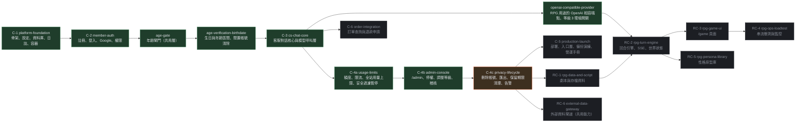

# 路線圖與待決定事項

> 狀態：持續更新 ｜ 最後更新：2026-10-30 ｜ 對應 change：全部（每次封存後更新） ｜ 規劃依據：[report.md](report.md) 第 5.2 節、[RPG.md](RPG.md)

本文件說明各個 change 的順序、相依與目前狀態，以及尚未決定的事項。細節與理由在 report.md 與 RPG.md；這裡只維護「現在在哪裡、下一步是什麼」。

## 1. Change 狀態與相依

圖例：深綠＝已封存；琥珀＝下一個或實作中；灰＝規劃中。

| change | 狀態 | 日期／提交 | 說明 |
|---|---|---|---|
| platform-foundation（C-1） | 已封存 | 2026-10-27 | 專案骨架、設定與機密、資料庫雙軌、離線資產與共用元件、日誌與健康檢查、容器 |
| member-auth（C-2） | 已封存 | 2026-10-28 | 註冊、信箱驗證、登入、Google 登入、CSRF、`AccessPolicy` |
| age-gate | 已封存 | 2026-10-28 | 年齡閘門：未確認年齡不得使用任何會呼叫模型的功能 |
| age-verification-birthdate | 已封存 | 2026-10-29 | 以生日加年齡區間取代單一勾選；13 至 17 歲固定安全模式；閒置 12 個月帳號清除 |
| cs-chat-core（C-3） | 已封存 | 2026-10-29（實作 `3cd6284`；封存時同步 6 個新能力、修改 4 個既有能力） | 客服對話、模型呼叫層、補償式摘要、`/cs` 頁面；新增主規格 `cs-conversations`、`cs-conversation-memory`、`cs-nlp-contract`、`cs-chat-ui`、`llm-provider`、`llm-structured-calls`，並修改 `access-control`、`service-observability`、`app-configuration`、`application-layering` |
| usage-limits（C-4a） | 已封存 | 2026-10-29（實作 `86bcbc8`；封存時新增 3 個主規格 `cs-usage-limits`、`global-usage-budget`、`cs-safety-suspension`，補充 `cs-chat-ui`、`app-configuration`、`service-observability`） | 原 C-4（usage-safety-ops）依使用者決定拆成三個。本 change：每位使用者依等級的每分鐘／每日／對話數限制、全站每日 token 與呼叫次數上限（依 `gemini-3.5-flash-lite` 免費層 15 RPM、25 萬 TPM、500 RPD）、安全過濾累計暫停、額度顯示。pytest 3782、Node 142、瀏覽器驗收 30 項，本機資料庫已升級到 `0006`。**客服對外開放前至少要完成 C-4a（已完成）**，C-4b 也已完成，仍缺 C-4c |
| admin-console（C-4b） | 已封存 | 2026-10-30（實作 `221585b`；封存時新增 4 個主規格 `admin-console`、`admin-user-management`、`admin-content-review`、`admin-audit-log`，補充 `access-control`、`application-layering`、`service-observability`） | `/admin` 與 `/api/admin/*`（12 個端點）：總覽與今日警告、被標記對話與意見回饋（可讀範圍只有這兩類，意見回饋含 `human_handoff`、不含只有 `unknown` 的對話）、停權與解除、調整會員等級、刪除違規對話、模型失敗原文、`admin_audit_logs`（migration `0007`）、高風險操作重新輸入密碼（與登入共用失敗鎖定）。分層由 AST 測試守住：`AdminService` 每個公開方法先 `require_admin`、後台專用 Repository 只被 `AdminService` 使用。pytest 4508、Node 160、瀏覽器驗收 100 項（桌面 1280 與手機 360），本機資料庫已升級到 `0007`。仍缺 C-4c（稽核與失敗原文的期限清除、刪除帳號、匯出、告警） |
| openai-compatible-provider | 已封存（與 C-4c 無相依） | 2026-10-30（實作 `65cacb3`；封存時新增主規格 `llm-openai-compatible`，補充 `llm-provider`、`age-confirmation`；16 項任務全部完成；pytest 4715、Node 160；對真實 OpenRouter 的端到端驗收通過；繁體中文以 `nvidia/nemotron-3.5-lightning:free` 最好（結構化 3/3 通過，但推理型、延遲 7 至 19 秒）；**尚未評估成熟內容的許可度**，也未評估 Dolphin：免費版已下架、付費版未呼叫） | 為 RPG 用途新增 OpenAI 相容端點（目前是 OpenRouter 的免費模型，換付費只改環境變數）；客服與摘要維持 Gemini。`sexual_content_level 3` 改為環境開關（預設關閉；staging 與 production 在成年驗證完成前開啟會啟動失敗；開啟時須列出許可涵蓋的模型）。新增開發用的 `flask llm-probe`。**不產生任何露骨內容的入口（RPG 尚未實作）**；任何入口出現之前，仍須先完成**自家審查層**（擋未成年、性暴力與非自願、真人名義）與**強化成年驗證**（方式未定，比較見本文待決定事項） |
| privacy-lifecycle（C-4c） | 規劃中（下一個） | — | 使用者自助刪除帳號（`deletion_pending`、7 天寬限）、匯出個人資料、保留期限清理、監控與告警管道 |
| production-launch（C-5） | 規劃中 | — | 入口層、HTTPS、備份與還原演練、營運手冊；上線前要重新確認供應商條款與年齡規則 |
| order-integration（C-6） | 規劃中 | — | 新增 `order_query`、`refund_request` 兩個意圖與對應實體 |
| RPG 系列（RC-1 至 RC-6） | 規劃中 | — | 見 [RPG.md](RPG.md)；沿用客服的模型呼叫層、`parse_llm_json`、`LlmService` 與帳本，另加串流 |

## 2. 待決定與待辦

| 事項 | 狀態 | 影響的文件 |
|---|---|---|
| 客服提示詞的小偏差 ③：建議動作偶爾不貼題（意見回饋後出現「了解會員額度」；已列出全部等級又給三個「查看 X 額度」） | 偏差 ①（說了「改善」）與 ②（重複範圍說明）已微調並以 5 則真實呼叫快速驗證，兩者改善；③ 未處理，是否調整待使用者決定，調整後須再同意一次真實呼叫 | [模型呼叫層-llm-layer.md](模型呼叫層-llm-layer.md)、README |
| 客服回覆的繁體中文用語與語氣 | 待使用者目視確認 | — |
| **RPG 的開場流程**：第一輪前先顯示背景故事，再顯示符合故事的隨機開場文字；劇情的 350 至 1000 字只是期望值（RPG.md T-13） | 已記錄需求，未立案；立案前以 `/openspec-explore` 設計 | [RPG.md](RPG.md)、[前端結構-frontend.md](前端結構-frontend.md) |
| 正式環境改用 OpenAI API（使用者計畫） | 未開始；屆時新增轉接器與環境變數 | [模型呼叫層-llm-layer.md](模型呼叫層-llm-layer.md) 第 9 節、[帳號與安全-auth-security.md](帳號與安全-auth-security.md)（年齡規則的前提）、AGENTS.md 第 5、9、11 節、隱私權政策 |
| 過渡期的模型：本機與驗收環境用 `gemini-3.5-flash-lite` | 已決定（`gemini-3.8-flash` 免費層每日約 20 次） | [模型呼叫層-llm-layer.md](模型呼叫層-llm-layer.md) |
| 逾時（20 / 30 / 35 秒）要不要調整 | 等正式模型確定後以量測資料決定 | [模型呼叫層-llm-layer.md](模型呼叫層-llm-layer.md) |
| 登入後的預設頁面（現為 `/account`，可改為 `/cs`，單一常數 `app/security/redirects.py`） | 待決定 | [帳號與安全-auth-security.md](帳號與安全-auth-security.md) |
| 全站每日用量上限的預設值綁定 `gemini-3.5-flash-lite` 免費層（15 RPM、25 萬 TPM、500 RPD） | 換模型或正式環境改用 OpenAI 時須重設 `USAGE_DAILY_TOKEN_LIMIT`、`USAGE_DAILY_CALL_LIMIT`；15 RPM 是全站共用，多人同時使用才需要另加全站每分鐘閘門 | [模型呼叫層-llm-layer.md](模型呼叫層-llm-layer.md)、[營運與部署-operations.md](營運與部署-operations.md) |
| 強化成年驗證的方式（對外開放等級 3 之前，AGENTS.md 第 7 節要求先於第 10 節訂定） | 範圍已決定：只有開啟等級 3 時才驗證，註冊維持自行聲明。比較結果：台灣數位身分（自然人憑證等）依內政部的申請要點對一般民間企業多半不開放；信用卡在台灣有附卡（約 15 歲起）與金融卡（約 7 歲起）的漏洞，強度偏低且專案沒有金流；第三方證件加活體或自拍估齡是唯一現實的選項，但各家對台灣證件的支援須逐家確認（Yoti 列有台灣國民身分證）。**尚未選定**，應排在法務意見與供應商許可之後 | [帳號與安全-auth-security.md](帳號與安全-auth-security.md) |
| 等級 3 的許可涵蓋的供應商、模型與日期 | 使用者表示已取得許可，內容尚未提供；取得後寫入 [帳號與安全-auth-security.md](帳號與安全-auth-security.md) 並填入 `SEXUAL_CONTENT_LEVEL3_MODELS` | [帳號與安全-auth-security.md](帳號與安全-auth-security.md) |
| 13 至 17 歲可使用 AI 功能與 Gemini 條款不符 | 僅限個人測試；對外開放前須以實際供應商條款重新確認（RPG.md R-15.4） | [帳號與安全-auth-security.md](帳號與安全-auth-security.md) |

## 3. 每次封存後要做的事

1. 在上方狀態表把該 change 標為已封存並填入日期。
2. 依 [README.md](README.md) 的對照表更新受影響的設計文件（圖、表、「最後更新」與「對應 change」）。
3. 執行 `tests/test_design_docs.py`：它會檢查資料表、路由、migration 版本、環境變數、分層與前端檔案是否都出現在對應的文件。

---

**何時更新本文**：每次 propose、apply 完成與 archive 之後；待決定事項有結論時。`tests/test_design_docs.py` 會檢查已封存與進行中的 change 名稱都出現在本文。
