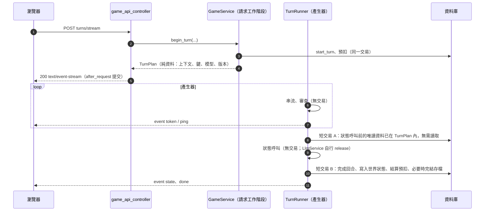
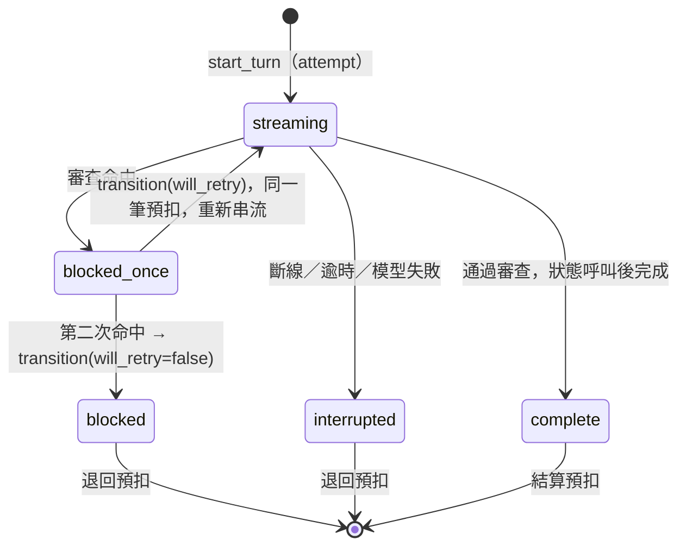

# Design

## Context

動機與範圍見 proposal.md。這份文件只說明「怎麼做」；探索階段的決定與備選方案在 `docs/RPG.md` 7.3 至 7.6、7.15，這裡不重述，只記錄實作時要面對的結構性問題與取捨。

**現況（已讀過程式）**

- `SessionRepository.start_turn` 已能冪等地建立回合列（`(session_id, client_msg_id)` 與 `(session_id, seq)` 唯一），`complete_turn` 在完成時才指派輪數；`SessionService.begin_turn` 只包了它。沒有模型呼叫、沒有世界狀態更新。
- 請求級資料庫工作階段（`app/db/session.py`）在 `after_request` 提交，`teardown_request` 關閉。**串流回應的產生器在 `after_request` 之後才執行**，所以產生器不能使用請求的工作階段，也不能碰 `g` 或 `current_app`（`defer_until_commit` 的註解已寫明這一點）。
- `LlmService.run_structured` 是結構化呼叫的唯一入口（預算 30 秒、最多 2 次呼叫、斷路、帳本）；`get_rpg_llm_service()` 已能取得 RPG 用途的實例。轉接器 `OpenAICompatibleProvider` 只有非串流的 `generate`，傳輸 `UrllibTransport.post_json` 一次讀完整個回應。
- `WalletService.hold/settle/refund` 已就緒，內部以同一個工作階段 flush、不自行提交；`hold()` 遇到同一個鍵一律回傳既有預扣（含已退回的），所以冪等鍵必須隨嘗試而變。
- 規則層 `script_rules._evaluate` 以單句為單位、REJECT／FLAG 的語意是「送人工」；詞表群組已有 `minor`、`sexual_explicit`、`sexual_suggestive`、`rape`、`non_consent`、`real_person` 等，年齡數字的解析（`_AGE`、`_number`）也已存在，但都是模組私有函式。
- 劇本複本（`script_snapshot_json`）已含曆法、里程碑（`trigger.kind` 為 `age` 或 `year`）、`ending_mode`／`ending_text`／`ending_age`、地點、角色；`sessions` 已有 `entities_json`、`goals_json`、`milestone_progress_json`、`elapsed_months`、`version`、`notebook_*`。

**約束**：AGENTS.md 第 4（純 ORM、雙軌、expand）、5（SSE、備援、單一解析函式）、6（視窗）、7（NPC、第 0 幕、遊戲幣、內容分級）、10（LLM 安全、資料隔離）、11（日誌白名單）節；不引入新的第三方套件。

## Goals / Non-Goals

**Goals**

- 一條可獨立驗收的後端管線：行動 → 預扣 → 串流 → 審查 → 狀態 → 結算，且每個失敗出口（餘額不足、首字逾時、備援、被擋、斷線、worker 重啟）的錢與資料都是對的。
- 所有「模型提議」都經 Service 驗證；玩家與作者的文字永遠只是資料。
- 串流期間不持有資料庫交易、不依賴請求結束的清理、不使用行程內狀態（多 worker 安全）。
- 可被 HTTP 腳本與真實模型驗收，不需要任何前端。

**Non-Goals**

- 前端、打字機、IndexedDB 同步（RC-3）；全站同時串流上限與壓測（RC-4）；重生／編輯／回合前快照（RC-2c）；記事簿的抓取與編輯（RC-2b）；`persona_patch` 與原型庫（RC-5）；實際的入口分流。
- 不做好感度與狀態效果。不做 RPG 的暫停對話計數（見 Open Questions）。

## Decisions

### D1　端點與服務分工

新 Blueprint `game_api_bp`，前綴 `/api/game`（與 `docs/RPG.md` R-01、R-08 的入口分流約定一致，日後 RPG 池只需轉送這個前綴）。既有的 `/api/sessions`（創角與開存檔）不動。

```
POST /api/game/sessions/<id>/turns/stream     回合
POST /api/game/sessions/<id>/opening/stream   第 0 幕
GET  /api/game/sessions/<id>                  存檔狀態視圖
GET  /api/game/sessions/<id>/turns?since_seq= 回合清單
```

分工：Controller 只讀取請求並回傳 `Response`；`GameService`（新）負責「開始階段」（在請求工作階段內）並回傳純資料的 `TurnPlan`；`TurnRunner`（新，服務層）持有 `TurnPlan` 並產生事件，**自己管理短交易**。純邏輯拆成不碰資料庫與網路的模組，以便單元測試：

| 模組 | 內容 |
|---|---|
| `rpg_prompt.py` | 系統指令樣板、標記字串衍生（比照 `protagonist_marker`）、穿越者規則、分級界線 |
| `rpg_context.py` | `build_turn_context`、`build_opening_context`、`build_state_context`；窗口、NPC 切片挑選、資料區塊格式 |
| `rpg_world.py` | 世界狀態結構、`apply_proposal`（階段、年齡、地點、月數、目標、里程碑、結局）、目前年齡計算、通知 |
| `rpg_output_guard.py` | 句子切分、保留一句緩衝、跨句與年齡判定 |
| `rpg_stream.py` | `StreamRunner`：期限、備援、tick、用量、帳本 |
| `rpg_turn_runner.py` | `TurnRunner`：事件產生、被擋與重生、收尾（共用於正常與 `GeneratorExit` 路徑） |
| `game_service.py` | 開始階段、唯讀視圖、第 0 幕的搶佔 |

替代方案：把整條管線放進一個巨大的 `GameService`。否決——純邏輯（上下文、世界狀態、審查）才是最需要密集測試的部分，必須能在沒有資料庫的情況下跑。

### D2　請求階段與產生器階段的交易邊界



- `TurnPlan` 在請求階段由資料庫讀出並凍結：存檔版本、劇本複本、主角、世界狀態、最近 10 輪、第 0 幕、記事簿、內容模式、模型名稱、幣價與預扣鍵。產生器不再讀取這些資料，所以串流與狀態呼叫期間完全沒有交易。
- 產生器需要的物件（工作階段工廠、設定、時鐘、供應商、`CurrentUser`）在 Controller 建立 Response 之前就從 `current_app` 取出並傳入 `TurnRunner`；產生器內不使用 `g`、`current_app`。
- 每個寫入階段各開一個新的工作階段、提交、關閉。錢包以 `build_wallet_service(session, clock=...)` 在該工作階段上建構。**結算與完成回合在同一個交易**，不會出現「回合完成但沒結算」。
- 開始階段中預扣失敗（餘額不足）時整個請求交易回復（4xx 的既有行為），因此不留下新的回合列；`start_turn` 先於 `hold` 是因為鍵需要 `attempt`。

替代方案：在請求階段就把串流結果寫回，使用 `stream_with_context`。否決——`after_request` 已提交並關閉，會與工作階段生命週期糾纏，且客戶端斷線時的 `teardown` 時機不可靠。

### D3　串流轉接器：讀取執行緒加佇列

`urllib` 的阻塞讀取沒辦法在等待時送心跳，且 `socket` 逾時發生在一行的中間時，緩衝區內已讀取的資料可能遺失。做法：`UrllibTransport` 新增 `open_stream(url, headers, body)`，開一條連線後由一條**背景讀取執行緒**逐行讀取並放入 `queue.Queue`（上限小，反壓時讀取執行緒阻塞）；呼叫端以 `queue.get(timeout=1)` 輪詢，逾時就產生 `StreamTick`。關閉（`close()`）時關閉回應物件使讀取執行緒的阻塞讀取立刻失敗並結束。

事件型別（`app/llm/types.py`）：`StreamText(text)`、`StreamTick`、`StreamEnd(finish_reason, usage, model)`；錯誤沿用既有的 `LLMTransientError`／`LLMBlockedError`／`LLMConfigError`。`OpenAICompatibleProvider.stream(request)` 回傳可迭代、可關閉的物件（`StreamHandle`）。HTTP 非 200（串流開始前的錯誤）在迭代的第一步以既有對應拋出。只收 `data:` 行；`:` 開頭的註解行忽略；`[DONE]` 結束；`choices[0].delta.content` 為文字，`delta.reasoning` 之類的欄位**不算正文**（首字計時與審查都不看它）；最後的 `usage` 區塊取 token。

與非串流共用：`build_body`（加上 `stream`、`stream_options`）、推理設定、零保存偏好、金鑰處理、`_error_for_status`。`finish_reason == "length"` 且累計正文為空 → `LLMTransientError(server_error)`（非串流的 `_parse` 同樣處理）。

`OPENROUTER_REASONING`（預設關閉）進 `OpenAICompatibleSettings.reasoning` 與轉接器；關閉時所有請求帶 `"reasoning": {"enabled": false}`。選這個形式是因為 7.2 的實測顯示它讓首字從 28 秒降到 0.4 至 0.9 秒，而 `effort: low`／`exclude: true` 會燒光 token。

替代方案：以 `selectors` 對原始 socket 輪詢（不用執行緒）。可行，但要自己處理 TLS 的內部緩衝（`SSLSocket.pending()`）、chunked 編碼與 HTTP 解析，風險高於一條讀取執行緒。每個進行中的串流多佔一條執行緒（RC-4 的容量估算要計入）。

### D4　`StreamRunner`：期限、備援與帳本

輸入 `StreamRequest`（模型、系統指令、內容、`max_output_tokens`），產生 `StreamText`／`StreamTick` 給外層，**不做任何資料庫工作**；帳本寫入透過注入的 `record(entry)` 回呼，由 `TurnRunner` 在自己的短交易內提交。

- 期限以單調時鐘檢查（每個 tick 與每個片段）：每次嘗試的首字 ≤ 20 秒，兩次嘗試共用 60 秒總預算（剩餘 < 2 秒不再嘗試）。逾時 → 關閉上游，歸類為暫時性逾時。
- 嘗試 1 用主要模型；近 60 秒主要模型曾逾時或伺服器錯誤時直接用備援（斷路沿用 `LlmCallLogRepository.model_unhealthy_since`，由帳本判斷，不放行程內狀態）。第一個正文片段之前的暫時性失敗 → 備援；之後的任何失敗 → 結束並由 `TurnRunner` 處理為中斷／失敗。被擋與設定錯誤不切換。
- 每次嘗試一筆帳本：`kind`（`rpg_stream`／`rpg_opening`）、模型、`attempt`、狀態、token、延遲、`finish_reason`、`first_chunk_ms`。斷線或我方主動關閉（審查命中）時沒有 `usage`：prompt 以上下文字數、completion 以已收字數估算，`finish_reason` 記為 `other`、`error_detail` 記 `disconnected` 或 `output_blocked <類別>`（只有列舉，不含文字）。`llm_call_logs.first_chunk_ms` 是新的可為空欄位。
- 最大輸出 token：敘事 1800（目標 350 至 1000 字，中文約 1 至 1.5 token 每字）；是常數，放在 `rpg_prompt.py` 旁。

### D5　輸出審查：保留一句緩衝的演算法

`OutputGuard` 是純狀態機，輸入文字片段，輸出「可釋放的文字」或「命中（類別）」：

1. 以 `。！？!?；;\n` 切句（沿用規則層的切句符號）；未完成的尾端留在 `tail`。
2. 一句完成 → 以「該句」「前一句」「同段累計」三個視角檢查（見下）。通過後，**前一句**才釋放；該句成為新的「保留句」。串流結束時對保留句與 `tail` 做最後檢查並釋放。
3. 段落以換行重置「同段累計」（模型常用單一換行分段）。

**檢查內容**（`rpg_output_rules.py`，建立在 `script_rules` 的詞表與年齡解析上；把需要的私有輔助函式改為模組公開 API 並維持原行為，不複製）：

| 檢查 | 命中條件 | 結果 |
|---|---|---|
| 逐句規則層 | `check_text_rules([句], tier=存檔模式)` 的結果依 7.4 的表對應：REJECT、`tier_mismatch`、`minor_suspected`、`real_person_suspected` → 擋；僅 `other_concern` → 放行並記錄類別 | 擋／放行 |
| 條件①：年齡紀錄 | 同段累計中出現某位在場角色的名稱（含主角），該角色**目前年齡**＜18，且該句或同段累計有性內容（`sexual_explicit` 或 `sexual_suggestive`） | 擋（`minor_sexual`） |
| 條件②：文字線索 | 該句、前一句或同段累計含明確的未成年用語（詞表 `minor`，或 `_has_minor_age`），且該句與前一句任一有性內容；或保留句有性內容而新句含未成年用語 | 擋（`minor_sexual`） |
| 標記字串 | 累計文字含系統指令的標記 | 擋（`marker_leak`） |

「相鄰句」定義為**前一句與下一句**（正好是緩衝能看到的範圍）；「同段」定義為自上一個換行以來。年齡未知的角色不構成任何條件。性內容在條件①②中取 `sexual_explicit` 或 `sexual_suggestive`（RA-21 寫「不得有性內容」，不論模式；擁抱、牽手、簡短親吻不在詞表中）。「嬌小」「娃娃臉」不在 `minor` 詞表，不會命中——測試以樣本鎖住。

在場角色名單由 `TurnPlan` 提供（上下文挑出的 NPC 加主角加劇本角色，含各自目前年齡）。**限制**：只以名稱判定，純代名詞（「她」）的句子看不出是誰；這是 RA-21 已知的取捨，由段落累計與條件②補一部分，並列入驗收量測。誤擋與漏擋由 `tests/fixtures/rpg_output_samples.json` 的樣本集量測（非性場景、一般親子與校園、確定違規各一組），詞表異動時重跑。

替代方案：整回合生成完再審查。否決——7.4 已決定逐句緩衝，且整段審查會讓首字延遲變成整段延遲。

### D6　被擋回合與自動重生



- 自動重生期間回合列維持 `streaming`；兩次嘗試共用 `attempt`（同一個預扣鍵）。第二次嘗試重新走 D4 的期限（總預算重新計算，因為使用者看到的是新的氣泡）；整個請求的最壞時間約 120 秒加狀態呼叫，因此 gunicorn 逾時設為 180 秒（D14），前端總逾時 90 秒的限制由 RC-3 依此放寬（寫入 HANDOFF 與 RPG.md）。
- 結束為 `blocked` 時：`llm_raw_response` 存最後一次被擋時已收到的文字（含命中的那句），`structured_result` 存 `{"blocked": {"categories": [...], "auto_retry": true}}`，不指派輪數，14 天後由既有的保存期限清除（`retention_repository` 已涵蓋 `blocked` 與 `interrupted`）。
- `transition` 文字：`rpg_prompt.py` 內固定 5 句繁體中文，以 `(turn seq + attempt) % N` 輪替（確定性，便於測試；不用隨機也不用模型）。事件只有 `text` 與 `will_retry`，不含原因。
- 玩家輸入不經這條路：行動文字的規則層在開始階段執行（D8），不呼叫模型。

### D7　預扣鍵、嘗試序號與接手

- `memory_logs.attempt`（整數，預設 1，遷移 `server_default`）。`start_turn` 在建立時 `attempt=1`；`_resend` 對 `interrupted`／`blocked` 與逾時的 `streaming` 重設為 `streaming` 並 `attempt + 1`。鍵為 `turn:{public_id}:{client_msg_id}:{attempt}`，最長約 110 字，小於 `HOLD_KEY_MAX`（180）；測試以最長輸入驗證。
- **逾時的 `streaming`**：以 `updated_at` 與錢包的 `coin.hold_timeout_seconds`（同一個設定，現讀）比較，避免新增設定鍵，且兩者同時到期：接手前錢包的 `_prepare` 已把舊預扣退回，玩家不會被雙重扣款。
- **單一進行中回合**：`start_turn` 取得存檔列鎖之後，先查是否有「其他編號且未逾時的 `streaming` 回合」，有則 `TurnInProgressError`（沿用既有 409 `turn_in_progress`）。
- `TurnInProgressError` 目前只用於同編號；現在兩種情況共用，訊息相同。
- 已 `complete` 的重送：回傳既有回合，`GameService` 以 `replayed=True` 通知 Controller 走重送路徑，不碰錢包。

### D8　開始階段的順序與輸入規則層

`GameService.begin_turn`：`require_chat_access` → 清理與驗證行動（沿用 `input_cleaning.clean_message`；上限 1000 字，與客服一致；**假設**，RPG 沒有明文上限）→ 擁有者與存檔狀態（404／`session_ended`）→ 第 0 幕閘門 → 行動的規則層（`check_text_rules([行動], tier)`；只有 REJECT 類別 → 422 `input_blocked`，FLAG 一律放行，原因見 proposal 與 spec）→ 全站預算（`UsageService.global_budget_exhausted`）→ `start_turn` → `hold`。把便宜、無副作用的檢查放前面，讓失敗不會留下回合列或預扣。

### D9　狀態呼叫

經 `get_rpg_llm_service()` 的 `LlmService.run_structured(kind="rpg_state", …)`，所以預算、備援、斷路、帳本、單一解析函式全部沿用。`kind` 加入 `CALL_KINDS`。結構描述（JSON Schema 子集，`additionalProperties: false`）：

```
npc_updates[]: { name, traits[]: {label, layer: surface|hidden}, stage?, age?, anchor_fact? }
current_location?: string        elapsed_months: integer     status_summary?: string(≤100)
goals_add[]: { text, milestone_id? }     goals_done[]: string      ending_proposed: boolean
```

提示詞（系統指令）固定；資料區塊含：本回合行動與完整敘事文字、在場 NPC 切片、現有目標、已觸發而待延伸的里程碑、已知地點、是否為結局回合。語意規則只做格式檢查（欄位型別、長度），**真正的驗證在 `rpg_world.apply_proposal`**，使「丟棄不合格項目、其餘照常處理」成為可能（`parse_llm_json` 的語意規則是整體通過或失敗，會讓一個壞特質使整個狀態呼叫重試）。輸出含標記字串 → 驗證失敗。

最大輸出 token 沿用 `LLM_MAX_OUTPUT_TOKENS`。狀態呼叫的預算是 `LlmService` 的 30 秒，所以一個回合最壞約 60 + 30 秒。

### D10　世界狀態的結構與 `apply_proposal`

`sessions.entities_json` 為 JSON（不依內容篩選），結構 v1：

```json
{ "v": 1,
  "npcs": { "<NFC 小寫名>": { "name": "…", "traits": [{"label": "…", "layer": "surface|hidden"}],
                              "stage": "surface|cracking|revealed",
                              "age": 16, "age_at_month": 120,
                              "anchor_fact": "…", "last_seen_turn": 7, "origin": "script|story" } },
  "protagonist": { "age": 30, "age_at_month": 0 },
  "locations": ["新增的地點…"] }
```

- **目前年齡** = `age + (elapsed_months − age_at_month) // 12`。更正時寫入新的 `age` 與當下的 `elapsed_months`；通知附更正前的「目前年齡」。主角的 `protagonist` 項在開存檔時不寫（缺值＝角色卡年齡、`age_at_month=0`），第一次更正才建立；原始角色卡與 `character_age` 欄位不變，匯出與同步不受影響。
- **劇本角色**：第一次在敘事中出現（名稱出現在行動或敘事文字）時，以劇本角色的年齡與特質（個性當表層、隱藏特質當隱藏）建卡，階段 `surface`。模型對劇本角色提議的年齡與劇本不同＝更正，需通知。
- `apply_proposal(world, proposal, ctx) → (new_world_fields, notices)` 為純函式，`ctx` 含劇本複本、回合數、目前月數、`max_months`（呼叫端現讀）。處理順序：月數 → 里程碑判定（以新月數）→ 地點 → NPC（名稱比對、階段、年齡、特質、錨定事實）→ 目標（先 `goals_done` 再 `goals_add`）→ 淘汰 → 結局。每個子項目獨立驗證，不合格者丟棄並累計「丟棄數」（只記數量，進日誌）。所有玩家可見的文字（特質、錨定事實、目標、地點、`status_summary`）去除控制字元，並過 `check_text_rules`；**任何非 PASS 的結果就丟棄該項**（這些文字會再回到下一回合的上下文，不能成為繞過輸出審查的通道）。
- **里程碑**：`milestone_progress_json = {"<id>": {"triggered_turn": n, "extended": bool}}`。觸發判定：`trigger.kind == "age"` 比對主角目前年齡，`"year"` 比對 `calendar.start_year + elapsed_months // 12`。已觸發而 `extended == false` 的項目在下一次上下文與狀態呼叫中出現；`goals_add[].milestone_id` 必須對應其中之一，且之後標記 `extended=true`。目標最多 5 個，每個 1 至 60 字。
- **結局**：`ending_due`（回合開始時由 Service 判定）＝劇本 `ending_mode == "custom"` 且（`ending_age` 有值且主角目前年齡 ≥ 它）。`ending_proposed` 只在 `custom` 時採信。任一成立 → 回合完成後 `end_session`。沒有 `ending_age` 的自訂結局只能由模型提議結束。
- 版本號：`update_world_state(expected_version=plan.version)`；`StaleSessionVersionError` → 世界狀態不寫入、回合仍完成、`state` 事件標示 `updated: false`。

### D11　上下文組裝

純函式 `build_turn_context(snapshot, world, protagonist, history, opening, notebook, action, tier, language) → (system_instruction, contents)`。

- **資料區塊**以固定的標記分隔（`【記事簿】`…`【/記事簿】` 之類，分隔符號由伺服器固定）；玩家與作者文字內若含分隔符號本身，組裝時以全形替代，避免偽造區塊。區塊順序見 spec。
- **視窗**：最近 10 個 `complete` 的回合以 `user`／`model` 交替的內容區塊呈現；第 0 幕在完成輪數 < 10 時放在歷史最前面（`model` 角色）。最後一個 `user` 區塊是「本次行動」。資料區塊本身放在第一個 `user` 內容。
- **NPC 挑選**：`last_seen_turn ≥ 目前輪數 − 3` 的卡，加上名稱出現在本次行動的卡；依 `last_seen_turn` 由新到舊取 6；主角的錨定事實所指的 NPC 一律優先入選。「出現」的判定在狀態呼叫後由 Service 以「名稱出現在行動或敘事文字」更新 `last_seen_turn`（不依賴模型回報）。
- **系統指令**由 `rpg_prompt.build_system(tier, language, origin, ending_due, marker)` 組成，只用常數樣板與列舉參數。`language` 預設 `zh-Hant-TW`，查表取得「請全程使用…」一句，不在函式內寫死。
- **大小驗證**：測試以全部上限組裝（劇本總量 8000 字、記事簿 12500 字、6 位 NPC、10 輪各 1000 字行動與 1500 字回覆）並斷言總字數 < 宣告的上界（初始 60000 字，實測後調整）；不截斷任何區塊。實際的 token 成本校正屬 RC-4（RPG.md 7.13）。

### D12　第 0 幕

- 欄位：`sessions.opening_text`（UnicodeText，可為空）、`opening_state`（Unicode(12)，可為空；空值＝舊存檔＝`fallback` 且不阻擋回合）、`opening_started_at`。`SessionRepository.create` 對新存檔寫入 `pending`。
- **搶佔**：條件式 UPDATE `opening_state: pending → generating, opening_started_at = now`，`rowcount == 1` 者取得生成權；或 `generating` 且 `opening_started_at` 早於 90 秒前者同樣以條件式 UPDATE 接手。
- 完成：`ready`＋文字；失敗或兩次被擋 → `fallback`＋劇本 `opening`（沒有則空字串）；客戶端斷線 → 退回 `pending`、清文字。寫回都用條件式 UPDATE（`opening_state == generating`），避免被接手後舊產生器覆蓋。
- 共用 `StreamRunner` 與 `OutputGuard`（在場角色＝主角加劇本角色）；`kind="rpg_opening"`；不呼叫錢包；不寫 `memory_logs`。
- 提示詞：資料區塊含主角角色卡、錨定事實、來歷、劇本背景與角色；指令要求「寫開場，不替玩家做決定」。

### D13　來歷

- `protagonist.validate_protagonist` 在共用的角色卡驗證之外，驗證 `origin ∈ {native, transmigrator}`（缺值補 `native`）；劇本角色的驗證不接受這個欄位（`_CHARACTER_FIELDS` 不變）。`build_protagonist` 把 `origin` 放進 `character`。
- `protagonist_prompt` 的建議輸出結構描述與 `suggest_rules` 不含 `origin`；輸出多出該欄位時在 `suggest` 的標準化步驟丟棄（不使驗證失敗，以免浪費一次呼叫）。創角 setup API 回傳 `origin_options`。
- 讀取時以 `character.get("origin") or "native"` 處理舊存檔，不寫資料遷移。

### D14　遷移、設定與部署

遷移 `20261109_0016_rpg_turn_engine.py`（全部 expand）：`memory_logs.attempt`（Integer，NOT NULL，`server_default="1"`）、`sessions.opening_text`／`opening_state`／`opening_started_at`、`llm_call_logs.first_chunk_ms`，並以 ORM 補一列 `rpg.max_months_per_turn=24`（既有值不覆蓋）。`llm_call_logs.kind` 已是 20 字，`rpg_stream` 等都在其內。降級移除新欄位。`runtime_limits` 新增 `GROUP_RPG`、`flask set-rpg-setting`／`show-rpg-settings`（登記為人工類指令，比照 `set-wallet-setting`）。

`gunicorn.rpg.conf.py`：`gthread`、`workers=2`、`threads=16`（初始值，RC-4 校正；可用環境變數覆寫）、`timeout=180`、`graceful_timeout=60`、其餘比照客服池。Dockerfile 預設仍啟動客服池，RPG 池由部署指定設定檔。`OPENROUTER_REASONING` 進 `config.py`、`.env.example` 與 README。

### D15　事件與日誌

`app/observability/rpg_events.py`：`rpg.turn_started`、`rpg.turn_completed`、`rpg.turn_blocked`、`rpg.turn_interrupted`、`rpg.turn_failed`、`rpg.state_failed`、`rpg.session_ended`、`rpg.opening_started/ready/fallback/reset/taken_over`。欄位白名單見 `service-observability` 的 delta；測試對一個完整流程掃描全部日誌輸出，找不到任何夾帶的標記文字。

### D16　測試與驗收

- 單元：轉接器串流（假傳輸，含保活註解、推理片段、斷線、長度空正文）、`StreamRunner`（假時鐘與假上游：首字逾時、備援時機、60 秒上限）、`OutputGuard`（逐句、跨句、樣本集）、`rpg_world`（階段、年齡、月數、地點、里程碑、目標、結局、淘汰）、`rpg_context`（最壞情況、視窗、注入防線）。
- 整合（真實 SQLite 與 `project_test` SQL Server）：回合管線的每個出口對錢包與資料的結果（成功、失敗、被擋一次、被擋兩次、斷線於文字中、斷線於狀態呼叫中、餘額不足、重送、接手、並行不同編號）、第 0 幕狀態機、端點（事件序列、標頭、404、CSRF）、遷移雙軌與降級、架構測試（`entities_json` 等世界狀態欄位只有 Service 能寫、`rpg_*` 純模組不匯入 ORM）。
- 故意破壞程式驗證新測試會失敗（比照 W1）。
- 驗收：HTTP 腳本（Python，UTF-8）打驗收環境，檢查事件序列、扣幣、被擋回合、結局、中斷退幣；真實 OpenRouter 模型各跑一次第 0 幕與三個回合，只當驗證；量測誤擋與漏擋並記入驗收紀錄。

## Risks / Trade-offs

- **產生器內的 `GeneratorExit` 路徑**：客戶端斷線時產生器被關閉，收尾邏輯必須在不能再 `yield` 的情況下完成寫回。→ `TurnRunner` 把收尾寫成不 `yield` 的函式，正常路徑與 `GeneratorExit` 路徑共用；以測試直接對產生器呼叫 `close()` 驗證（文字中、狀態呼叫中、剛送完 `done`）。
- **一個串流多佔一條讀取執行緒**：RPG 池的容量估算要計入。→ RC-4 壓測校正；RPG 池的執行緒數是環境變數。
- **最壞時間**：被擋兩次加狀態呼叫可達約 120 + 30 秒，超過原先前端總逾時 90 秒。→ 已決定（使用者 2026-11-09 核可）：RC-3 的前端總逾時放寬為 180 秒，閒置逾時 45 秒不變；後端上限由 gunicorn 逾時 180 秒承接。
- **審查只看名稱**：純代名詞的句子看不出是哪個角色。→ 同段累計與條件②補強、驗收量測；已列為 RA-21 的法務覆核項目。
- **年齡可自由更正的濫用**：玩家反覆翻轉年齡。→ 7.15.4 的時序（年齡更新在串流之後）使翻轉當回合仍被擋；每次更正都通知並記錄。
- **狀態呼叫的壞項目**：免費模型的 JSON 不穩（7.2：4/6 有效）。→ 逐項丟棄而非整體失敗；失敗時文字保留、世界狀態不變，下一回合可補。累積的丟棄率進日誌，驗收時觀察。
- **預扣逾時與接手的時間差**：接手條件等於預扣逾時，若玩家在逾時前重送會得到 `turn_in_progress`。→ 可接受（產生器正常最長約 150 秒，小於 180 秒）；文案提示稍候。
- **`entities_json` 只存在存檔**：沒有備份以外的重建手段。→ 結構有版本欄位 `v`；匯出已包含它。
- **模型把內部設定寫進劇情**：2026-11-09 對真實模型的實測中，提示詞若直接寫出「階段為 surface」，模型會在劇情裡複誦（「她雖然階段處於 surface…」）。→ 階段以行為描述表達（「只表現表層特質，不要流露隱藏特質的跡象」），系統指令明文禁止在劇情中提到階段名稱、欄位名稱與資料區塊標記；`OutputGuard` 另把這些詞（`surface`／`cracking`／`revealed`、區塊標記）列為「洩漏設定」類別，命中時依被擋回合處理。
- **免費模型與敏感內容**：程式不設防呆（7.15.3）。→ 維持為對外開放前的關卡（`launch-gates`）。

## Migration Plan

1. 使用者備份後，對本機 `project` 與 `project_test` 執行遷移 `0016`（expand；舊程式在新結構上仍可運作——新欄位皆可為空或有預設）。
2. 部署新程式；`rpg.max_months_per_turn` 由遷移寫入。
3. 回復：降級遷移移除新欄位與設定列；舊程式不讀這些欄位。已建立的 `entities_json` v1 結構在降級後只是多出的鍵，舊程式不讀。
4. 同步 `docs/project資料結構文件.md`，並在第 14 節追加異動紀錄。

## Open Questions

- RPG 的「一日被擋 3 次暫停對話」：規則層擋下玩家輸入不呼叫模型，沒有成本；模型輸出被擋不計入。若日後要對 RPG 輸入洗版設限，屬 RC-4 的限流或獨立 change，不影響本 change 的規格與任務。
- 規則層詞表是否需要補未成年用語：先以樣本集量測，必要時單獨調整詞表版本，不改規格。
- 行動文字上限 1000 字是沿用客服的假設；RC-3 實作輸入框時若要調整，只是常數。
